<!-- source: DeepWiki mcp.deepwiki.com · repo openJiuwen-ai/agent-studio · page 6.7 Testing & Debugging · fetched 2026-11-02 -->

# Testing & Debugging

<details>
<summary>Relevant source files</summary>

The following files were used as context for generating this wiki page:

- [backend/openjiuwen_studio/core/manager/model_manager/managers/model_test_manager.py](backend/openjiuwen_studio/core/manager/model_manager/managers/model_test_manager.py)
- [backend/openjiuwen_studio/ops/modules/llm/llm_config_service.py](backend/openjiuwen_studio/ops/modules/llm/llm_config_service.py)
- [backend/openjiuwen_studio/ops/modules/llm/schema.py](backend/openjiuwen_studio/ops/modules/llm/schema.py)
- [backend/openjiuwen_studio/ops/modules/prompt/domain/debug_entity.py](backend/openjiuwen_studio/ops/modules/prompt/domain/debug_entity.py)
- [backend/openjiuwen_studio/ops/modules/prompt/domain/entities.py](backend/openjiuwen_studio/ops/modules/prompt/domain/entities.py)
- [backend/openjiuwen_studio/ops/modules/prompt/domain/services.py](backend/openjiuwen_studio/ops/modules/prompt/domain/services.py)
- [backend/openjiuwen_studio/ops/modules/prompt/infra/repositories/debug_repo.py](backend/openjiuwen_studio/ops/modules/prompt/infra/repositories/debug_repo.py)
- [backend/openjiuwen_studio/routers/prompt_debug_router.py](backend/openjiuwen_studio/routers/prompt_debug_router.py)
- [backend/openjiuwen_studio/routers/prompt_llm_router.py](backend/openjiuwen_studio/routers/prompt_llm_router.py)
- [backend/openjiuwen_studio/routers/prompt_router.py](backend/openjiuwen_studio/routers/prompt_router.py)
- [backend/openjiuwen_studio/routers/prompt_tuning_router.py](backend/openjiuwen_studio/routers/prompt_tuning_router.py)
- [backend/openjiuwen_studio/schemas/model_config.py](backend/openjiuwen_studio/schemas/model_config.py)
- [frontend/packages/workflow-canvas/src/components/testrun/shared/use-input-interruption.ts](frontend/packages/workflow-canvas/src/components/testrun/shared/use-input-interruption.ts)
- [frontend/packages/workflow-canvas/src/components/testrun/testrun-panel/test-run-panel.tsx](frontend/packages/workflow-canvas/src/components/testrun/testrun-panel/test-run-panel.tsx)
- [frontend/packages/workflow-canvas/src/editor.tsx](frontend/packages/workflow-canvas/src/editor.tsx)
- [frontend/packages/workflow-canvas/src/nodes/loop/effects.ts](frontend/packages/workflow-canvas/src/nodes/loop/effects.ts)
- [frontend/packages/workflow-canvas/src/nodes/loop/form-meta.tsx](frontend/packages/workflow-canvas/src/nodes/loop/form-meta.tsx)
- [frontend/packages/workflow-canvas/src/nodes/loop/validation.ts](frontend/packages/workflow-canvas/src/nodes/loop/validation.ts)
- [frontend/packages/workflow-canvas/src/utils/validation/validation-helpers.ts](frontend/packages/workflow-canvas/src/utils/validation/validation-helpers.ts)
- [frontend/packages/workflow-canvas/src/utils/workflow-node-utils.ts](frontend/packages/workflow-canvas/src/utils/workflow-node-utils.ts)
- [frontend/src/components/Agent/ModelDetailForm.tsx](frontend/src/components/Agent/ModelDetailForm.tsx)
- [frontend/src/locales/workflow/en-US/common.json](frontend/src/locales/workflow/en-US/common.json)
- [frontend/src/locales/workflow/en-US/nodes.json](frontend/src/locales/workflow/en-US/nodes.json)
- [frontend/src/locales/workflow/zh-CN/common.json](frontend/src/locales/workflow/zh-CN/common.json)
- [frontend/src/locales/workflow/zh-CN/nodes.json](frontend/src/locales/workflow/zh-CN/nodes.json)

</details>


This page covers the testing and debugging capabilities available in OpenJiuwen Agent Studio. It explains how to test workflows, individual nodes, model configurations, and prompts, as well as how to use validation and debugging tools to troubleshoot issues during development.

**Related Pages:**
- For agent execution details, see [Agent Execution Pipeline](#5.5)
- For workflow design and validation, see [Workflow Canvas Architecture](#5.7)
- For model configuration, see [Models](#3.4)
- For prompt management, see [Prompts & Templates](#3.3)

---

## Overview

The system provides multiple levels of testing and debugging:

| Testing Level | Purpose | Key Features |
|--------------|---------|-------------|
| **Workflow Test Runs** | End-to-end workflow execution | Stream output, input interruption, execution logs |
| **Node-Level Testing** | Individual node validation | Isolated testing, parameter validation |
| **Model Testing** | LLM configuration validation | Connection testing, response validation |
| **Prompt Debugging** | Prompt template testing | Variable mocking, streaming responses, context preservation |
| **Prompt Optimization** | Automated prompt tuning | Iterative improvement, test cases, evaluation metrics |
| **Validation System** | Pre-execution validation | Node configuration, connection validation |

---

## Workflow Test Runs

### Test Run Architecture

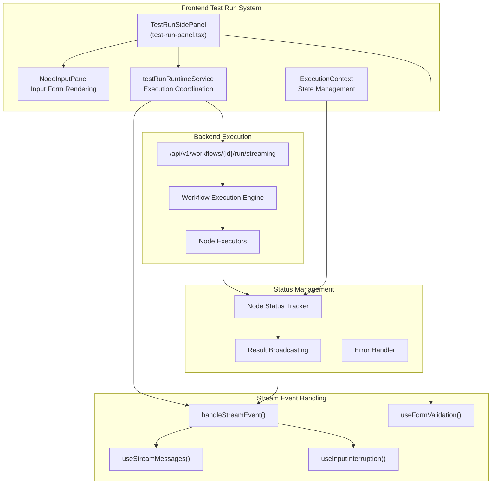

**Test Run Workflow Execution**
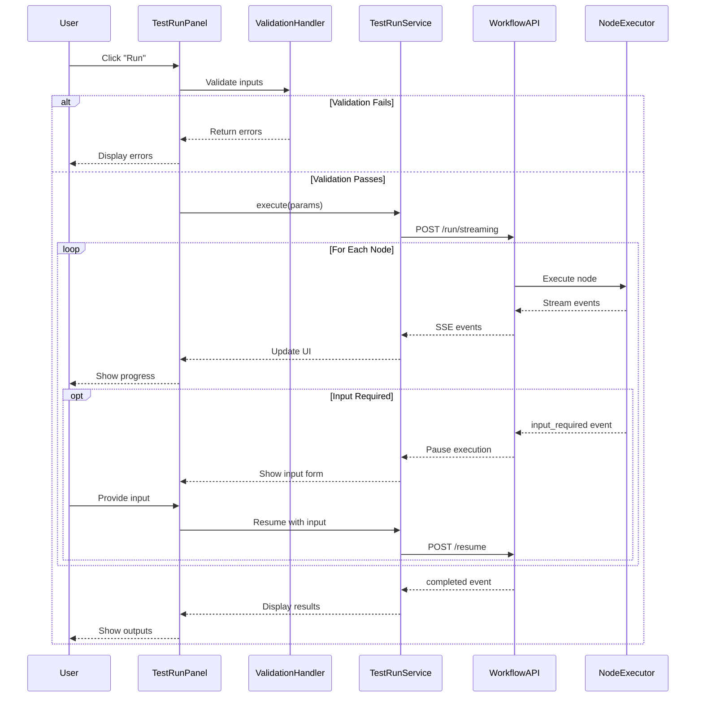

Sources: [frontend/packages/workflow-canvas/src/components/testrun/testrun-panel/test-run-panel.tsx:1-419](), [frontend/packages/workflow-canvas/src/components/testrun/runtime/testrun-runtime-service.ts]()

### Test Run Panel Implementation

The test run panel provides an interface for executing workflows with real-time feedback:

**Key Components:**

| Component | File | Responsibility |
|-----------|------|----------------|
| `TestRunSidePanel` | [test-run-panel.tsx:39-412]() | Main panel UI, orchestrates execution |
| `NodeInputPanel` | [node-input-panel.tsx]() | Renders input forms for workflow parameters |
| `testRunRuntimeService` | [testrun-runtime-service.ts]() | Manages execution state and API calls |
| `useStreamMessages` | [use-stream-messages.ts]() | Handles streaming message display |
| `useInputInterruption` | [use-input-interruption.ts:11-78]() | Manages input interruptions |
| `useFormValidation` | [use-form-validation.ts]() | Validates input values |

**Test Run Execution Flow:**

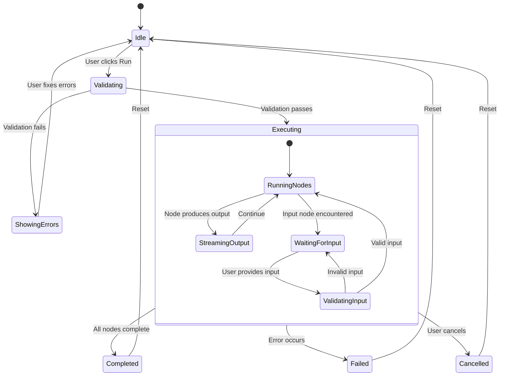

**Input Interruption Handling:**

The system supports pausing workflow execution to collect user input from `Input` nodes:

```typescript
// From frontend/packages/workflow-canvas/src/components/testrun/shared/use-input-interruption.ts:11-78
interface InputInterruption {
  nodeId: string
  message: any
}

// Queue management for multiple input nodes
const [interruptionQueue, setInterruptionQueue] = useState<InputInterruption[]>([])
const currentInterruption = interruptionQueue[0] || null
const pendingCount = Math.max(0, interruptionQueue.length - 1)

// Resume execution with user input
const resume = async (values: Record<string, unknown>) => {
  await testRunRuntimeService.resumeStreamExecution({
    node_id: current.nodeId,
    input_value: values,
  })
}
```

Sources: [frontend/packages/workflow-canvas/src/components/testrun/shared/use-input-interruption.ts:1-79](), [frontend/packages/workflow-canvas/src/components/testrun/testrun-panel/test-run-panel.tsx:190-234]()

### Stream Event Processing

**Event Types and Handlers:**

| Event Type | Purpose | Handler Location |
|-----------|---------|------------------|
| `node_start` | Node begins execution | [testrun-runtime-service.ts]() |
| `node_progress` | Node streams output | [use-stream-messages.ts]() |
| `node_complete` | Node finishes | Status tracker |
| `input_required` | Workflow needs user input | [use-input-interruption.ts:26-33]() |
| `completed` | Workflow finishes | [test-run-panel.tsx:200-206]() |
| `error` | Execution error | [test-run-panel.tsx:207-230]() |

**Stream Message Display:**

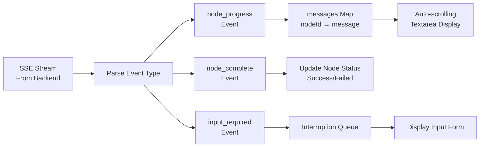

Sources: [frontend/packages/workflow-canvas/src/components/testrun/shared/use-stream-messages.ts](), [frontend/packages/workflow-canvas/src/components/testrun/testrun-panel/test-run-panel.tsx:189-234]()

---

## Node-Level Testing

### Test Debug Panel

Individual nodes can be tested in isolation using the test debug panel:

**Node Testing Architecture:**

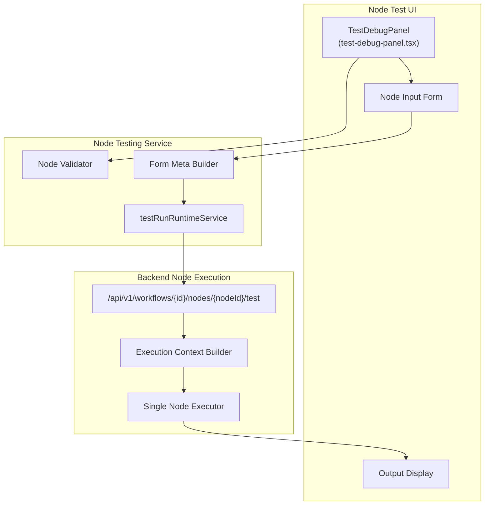

**Node Testing Process:**

1. User selects a node and clicks "Test Node"
2. Panel displays input form based on node's input schema
3. User provides test values
4. System validates inputs
5. Node executes in isolation
6. Results displayed in panel

**Form Metadata Construction:**

The system dynamically builds input forms based on node configuration:

```typescript
// From useFormMeta hook
const formMeta = useMemo(() => {
  const node = document.getNode(nodeId)
  const outputs = node?.form?.getValueIn('outputs.properties') || {}
  
  return Object.entries(outputs).map(([key, fieldDef]: [string, any]) => ({
    name: key,
    type: fieldDef.type || 'string',
    description: fieldDef.description || '',
    required: fieldDef.required || false,
    defaultValue: fieldDef.default
  }))
}, [nodeId])
```

Sources: [frontend/packages/workflow-canvas/src/components/testrun/testdebug/test-debug-panel.tsx](), [frontend/packages/workflow-canvas/src/components/testrun/hooks/use-form-meta.tsx]()

---

## Model Configuration Testing

### Model Test Manager

The system provides comprehensive model configuration testing to validate LLM connections and parameters:

**Model Testing Architecture:**

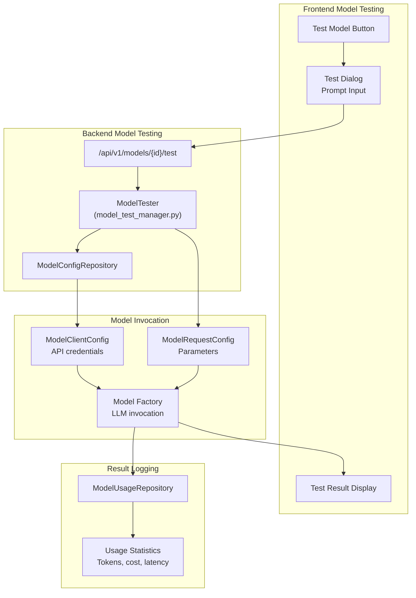

**Model Test Implementation:**

```python
# From backend/openjiuwen_studio/core/manager/model_manager/managers/model_test_manager.py:40-220

async def test_model_config(
    self,
    model_id: int,
    test_request: ModelTestRequest,
    user_id: int
) -> ModelTestResponse:
    """Test model configuration
    
    - Validates API key and connection
    - Invokes model with test prompt
    - Measures response time and tokens
    - Logs results to usage statistics
    """
    
    # Get and validate model configuration
    model = self.model_repo.get_by_id(model_id)
    if not model.is_active:
        raise ModelTestError("Model is inactive")
    
    # Decrypt API key
    api_key = SecurityUtils().decrypt_api_key(model.api_key)
    
    # Create model client configuration
    model_client_config = ModelClientConfig(
        client_provider=compatible_provider(model.provider),
        api_key=api_key,
        api_base=model.base_url,
        timeout=model.timeout or 60,
        verify_ssl=os.getenv("LLM_SSL_VERIFY", "true") == "false"
    )
    
    # Create request configuration with parameters
    model_config = ModelRequestConfig(
        model=model.model_type,
        top_p=test_request.parameters.top_p if test_request.parameters else 0.9,
        temperature=test_request.parameters.temperature if test_request.parameters else 0.7,
        max_tokens=test_request.parameters.max_tokens if test_request.parameters else 4096
    )
    
    # Invoke model
    model_inference = Model(
        model_client_config=model_client_config,
        model_config=model_config
    )
    
    messages = [{"role": "user", "content": test_request.prompt}]
    ai_message = await model_inference.invoke(messages)
    
    # Calculate metrics
    response_time = time.time() - start_time
    
    # Log test result
    self._log_test_result(
        model_id=model_id,
        user_id=user_id,
        tokens_used=inference_result.get('tokens_used', 0),
        cost=inference_result.get('cost', 0.0),
        response_time=response_time,
        success=True
    )
    
    return ModelTestResponse(
        success=True,
        response=ai_message.content,
        latency=response_time
    )
```

**Test Request Schema:**

| Field | Type | Description |
|-------|------|-------------|
| `prompt` | string | Test prompt to send to model |
| `parameters.temperature` | float | Override temperature (0.0-2.0) |
| `parameters.max_tokens` | int | Override max tokens |
| `parameters.top_p` | float | Override top_p (0.0-1.0) |

**Test Response Schema:**

| Field | Type | Description |
|-------|------|-------------|
| `success` | boolean | Whether test succeeded |
| `response` | string | Model's response |
| `error` | string | Error message if failed |
| `latency` | float | Response time in seconds |
| `tokens_used` | int | Tokens consumed |
| `cost` | float | Estimated cost |

**Error Mapping:**

```python
# From model_test_manager.py:221-232
def _map_inference_error_to_user_msg(self, error_message: str) -> str:
    """Map technical errors to user-friendly messages"""
    msg = error_message.lower()
    
    if "401" in msg or "unauthorized" in msg:
        return "API Key or model ID is invalid"
    
    if "resolving ip address failed" in msg or "dns" in msg:
        return "Model service address is unreachable"
    
    return "Model invocation failed, please check configuration"
```

Sources: [backend/openjiuwen_studio/core/manager/model_manager/managers/model_test_manager.py:1-275](), [backend/openjiuwen_studio/schemas/model_config.py:134-145]()

---

## Prompt Debugging & Optimization

### Prompt Debug Streaming

The system provides real-time prompt debugging with variable mocking and context management:

**Prompt Debugging Architecture:**

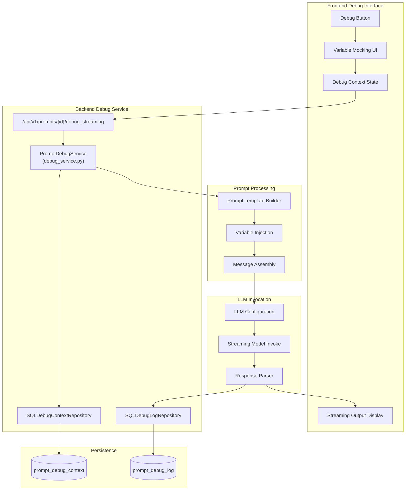

**Debug Context Management:**

```python
# From backend/openjiuwen_studio/ops/modules/prompt/infra/repositories/debug_repo.py:18-41

class PromptDebugContext(Base):
    """Debug context table - stores current debug state per prompt"""
    __tablename__ = "prompt_debug_context"
    
    prompt_id = Column(BigInteger, nullable=False, index=True)
    user_id = Column(String(128), nullable=False)
    mock_contexts = Column(JSON)      # Mocked conversation contexts
    mock_variables = Column(JSON)     # Mocked variable values
    mock_tools = Column(JSON)         # Mocked tool definitions
    debug_config = Column(JSON)       # Debug configuration
    compare_config = Column(JSON)     # A/B comparison config
    created_at = Column(DateTime, server_default=func.now())
    updated_at = Column(DateTime, server_default=func.now(), onupdate=func.now())
```

**Debug Streaming Request:**

| Field | Type | Description |
|-------|------|-------------|
| `prompt` | Prompt | Full prompt with template and configuration |
| `mock_variables` | List[VariableVal] | Variable values for testing |
| `mock_contexts` | List[DebugMessage] | Mock conversation history |
| `mock_tools` | List[MockTool] | Mock tool definitions |

**Streaming Response Events:**

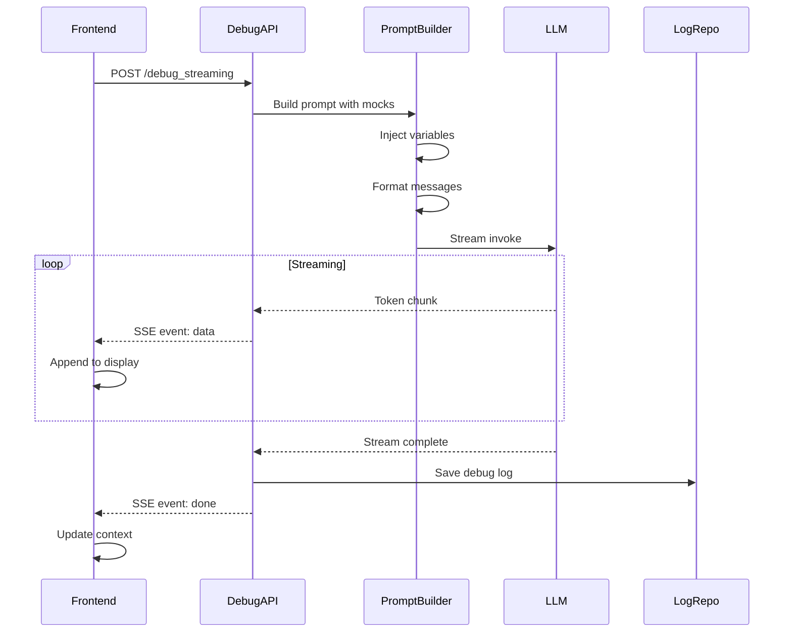

Sources: [backend/openjiuwen_studio/routers/prompt_debug_router.py:1-102](), [backend/openjiuwen_studio/ops/modules/prompt/domain/debug_entity.py:1-186](), [backend/openjiuwen_studio/ops/modules/prompt/infra/repositories/debug_repo.py:1-380]()

### Prompt Optimization Jobs

The system provides automated prompt optimization using LLM-based feedback:

**Prompt Optimization Architecture:**

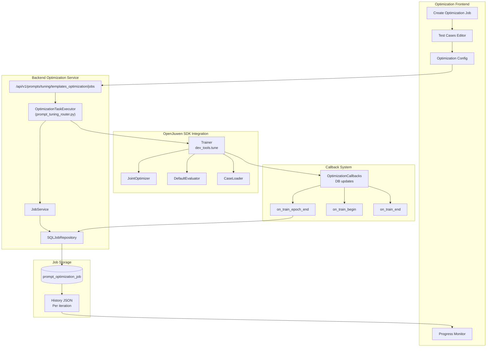

**Optimization Job Configuration:**

```python
# From backend/openjiuwen_studio/routers/prompt_tuning_router.py:677-764

class OptimizeTaskCreationRequest(BaseModel):
    name: str
    desc: str
    raw_templates: str                    # Initial prompt
    optimize_info: OptimizeInfo           # Optimization settings
    model_info: ModelInfo                 # LLM for evaluation
    assistant_info: ModelInfo             # LLM being optimized
    agent_tools: List[Dict[str, Any]]     # Tools available to agent

class OptimizeInfo(BaseModel):
    cases: List[Case]                     # Test cases
    num_iter: int                         # Number of iterations
    example_num: int                      # Examples per iteration
    user_compare_options: str             # Evaluation criteria
    user_compare_rules: str               # Comparison rules
    external_knowledge: str               # Background knowledge
    llm_parallel: int                     # Parallel LLM calls

class Case(BaseModel):
    inputs: Dict[str, Any]                # Input variables
    label: Dict[str, Any]                 # Expected output
```

**Optimization Execution Flow:**

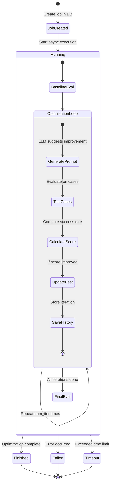

**Optimization Callbacks:**

```python
# From prompt_tuning_router.py:141-206

class OptimizationCallbacks(Callbacks):
    """Database update callbacks during optimization"""
    
    def on_train_begin(self, agent, progress: Progress, eval_info: List[EvaluatedCase]):
        """First evaluation - establish baseline"""
        self.history_records.append({
            "iteration_round": 0,
            "success_rate": float(progress.current_epoch_score),
            "optimized_prompt": "",
            "evaluate_cases": [case.model_dump() for case in eval_info]
        })
        self._update_job_info({
            "status": "running",
            "progress_rate": 0,
            "success_rate": float(progress.current_epoch_score),
            "history": json.dumps(self.history_records)
        })
    
    def on_train_epoch_end(self, agent, progress: Progress, eval_info: List[EvaluatedCase]):
        """After each optimization iteration"""
        current_prompt = get_prompt_content(agent.get_llm_calls().get("llm_call").get_system_prompt().content)
        
        history_record = {
            "iteration_round": progress.current_epoch,
            "success_rate": float(progress.current_epoch_score),
            "optimized_prompt": current_prompt,
            "evaluate_cases": [case.model_dump() for case in eval_info]
        }
        
        self.history_records.append(history_record)
        
        update_data = {
            "progress_rate": min(progress.current_epoch / progress.max_epoch, 0.99),
            "timeCost": int(time.time() - self.start_time),
            "success_rate": float(progress.best_score),
            "history": json.dumps(self.history_records)
        }
        
        if progress.best_score <= progress.current_epoch_score:
            update_data["bestIteration"] = progress.current_epoch
            update_data["bestTemplates"] = current_prompt
        
        self._update_job_info(update_data)
    
    def on_train_end(self, agent, progress: Progress, eval_info: List[EvaluatedCase]):
        """Final results"""
        self._update_job_info({
            "status": "finished",
            "progress_rate": 1.0,
            "timeCost": int(time.time() - self.start_time)
        })
```

**Progress Tracking:**

| Field | Type | Description |
|-------|------|-------------|
| `status` | string | `running`, `finished`, `failed` |
| `progress_rate` | float | 0.0 to 1.0 completion percentage |
| `timeCost` | int | Seconds elapsed |
| `success_rate` | float | Best success rate achieved |
| `bestIteration` | int | Iteration with best score |
| `bestTemplates` | string | Best prompt found |
| `history` | JSON | Per-iteration results |

Sources: [backend/openjiuwen_studio/routers/prompt_tuning_router.py:1-875](), [backend/openjiuwen_studio/ops/modules/prompt/domain/entities.py:370-581]()

---

## Validation System

### Node Validation Framework

The workflow canvas includes comprehensive validation to catch configuration errors before execution:

**Validation Architecture:**

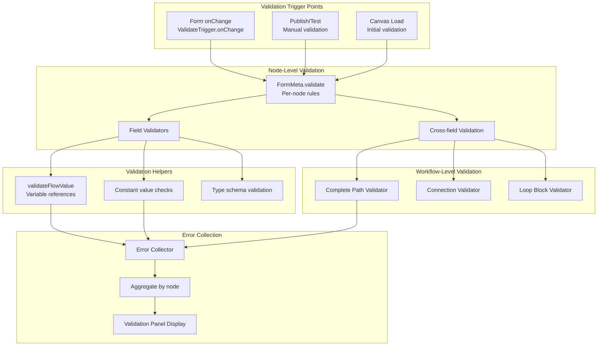

**Loop Node Validation Example:**

```typescript
// From frontend/packages/workflow-canvas/src/nodes/loop/validation.ts:19-55

export const validateLoopNum = ({ value, context, formValues }: LoopValidationContext) => {
  const loopType = formValues?.inputs?.loopParam?.type
  
  // Only validate if loop type is numLoop
  if (loopType !== 'numLoop') {
    return undefined
  }
  
  // Validate the flow value itself (reference or constant)
  const validationResult = validateFlowValue(value, {
    node: context.node,
    required: true,
    includePrivateScope: true,
    errorMessages: {
      required: t('workflowCanvas.nodes.loop.loopCountCannotBeEmpty'),
      unknownVariable: t('workflowCanvas.nodes.loop.loopCountVariableNotFound'),
    },
  })
  
  if (validationResult) {
    return validationResult.message
  }
  
  // For constant values, validate range
  if (value?.type === 'constant') {
    const loopNum = value.content
    if (typeof loopNum === 'number') {
      if (loopNum < 1) {
        return t('workflowCanvas.nodes.loop.loopCountMustBePositive')
      }
      if (loopNum > 1000) {
        return t('workflowCanvas.nodes.loop.loopCountExceedsLimit')
      }
    } else {
      return t('workflowCanvas.nodes.loop.loopCountMustBeNumber')
    }
  }
  
  return undefined
}
```

**Loop Block Path Validation:**

```typescript
// From loop/validation.ts:161-251

export const validateLoopBlocks = ({ value, context }: LoopValidationContext) => {
  const blocks = context.node?.blocks || []
  
  // Must have block start and end
  const blockStart = blocks.find(block => block.flowNodeType === '15')
  const blockEnd = blocks.find(block => block.flowNodeType === '16')
  
  if (!blockStart || !blockEnd) {
    return t('workflowCanvas.nodes.loop.loopBodyMustContainStartAndEnd')
  }
  
  // Continue and break nodes also valid as end points
  const continueNode = blocks.find(block => block.flowNodeType === '12')
  const breakNode = blocks.find(block => block.flowNodeType === '13')
  const validEndNodes = [blockEnd, continueNode, breakNode].filter(Boolean)
  
  // Build graph from edges
  const graph = buildGraph(blocks, edges)
  
  // Check if path exists from start to any valid end
  const hasCompletePath = validEndNodes.some(endNode => 
    hasPath(graph, blockStart.id, endNode.id)
  )
  
  if (!hasCompletePath) {
    return t('workflowCanvas.nodes.loop.loopBodyMustHaveCompletePath')
  }
  
  return undefined
}
```

**Validation Configuration:**

```typescript
// From loop/form-meta.tsx:406-414

export const formMeta: FormMeta = {
  render: LoopFormRender,
  validateTrigger: ValidateTrigger.onChange,  // Validate as user types
  validate: {
    'inputs.loopParam.loopNum': validateLoopNum,
    'inputs.loopParam.loopArray': validateLoopArray,
    'inputs.loopParam.loopArray.*': validateLoopArrayField,
    'inputs.loopParam.intermediateVar': validateIntermediateVarDuplicate,
    'inputs.loopParam.intermediateVar.*': validateIntermediateVarField,
    'blocks': validateLoopBlocks,
  },
  effect: {
    'inputs.loopParam': [...provideLoopEffect, ...exportIntermediateVarsEffect],
  },
  plugins: [createBatchOutputsFormPlugin({ outputKey: 'outputs.properties' })],
}
```

**Validation Error Structure:**

| Field | Type | Description |
|-------|------|-------------|
| `nodeId` | string | Node containing error |
| `nodeTitle` | string | Display name of node |
| `error` | string | Error message |
| `field` | string | Specific field with error |
| `severity` | `'error'` \| `'warning'` | Error severity |

Sources: [frontend/packages/workflow-canvas/src/nodes/loop/validation.ts:1-260](), [frontend/packages/workflow-canvas/src/nodes/loop/form-meta.tsx:406-414](), [frontend/packages/workflow-canvas/src/form-materials/validators/validate-flow-value.ts]()

### Workflow-Level Validation

**Complete Path Validation:**

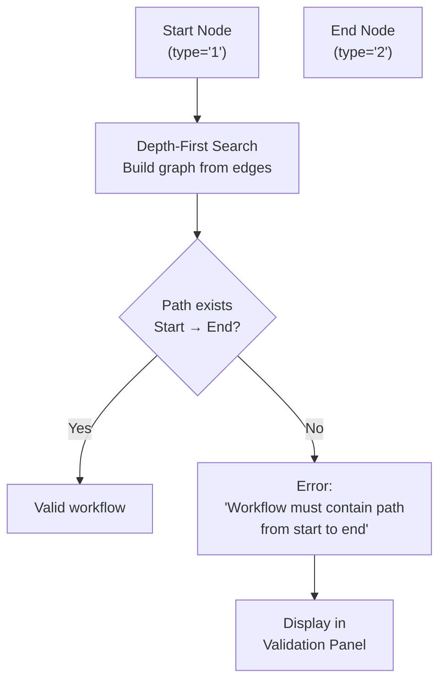

**Validation Helpers:**

```typescript
// From frontend/packages/workflow-canvas/src/utils/validation/validation-helpers.ts:40-57

export const getNodeDisplayName = (node: FlowNodeEntity): string => {
  // Get title from form data
  if (node?.form?.values?.title) {
    return node.form.values.title
  }
  
  // Fallback to translated node type
  const nodeType = node?.type
  const i18nKey = NODE_TYPE_I18N_KEYS[nodeType]
  
  if (i18nKey) {
    return t(i18nKey)
  }
  
  return t('workflowCanvas.node.Node')
}

export const createValidationError = (
  nodeId: string,
  nodeTitle: string,
  error: string,
  field?: string,
  severity: 'error' | 'warning' = 'error',
): ValidationErrorInfo => {
  return {
    nodeId,
    nodeTitle,
    error,
    severity,
    field,
  }
}
```

Sources: [frontend/packages/workflow-canvas/src/utils/validation/validation-helpers.ts:1-150](), [frontend/locales/workflow/en-US/nodes.json:1-440]()

---

## Debugging Tools

### Debug Panel System

The workflow canvas provides rich debugging information during and after execution:

**Debug Panel Architecture:**

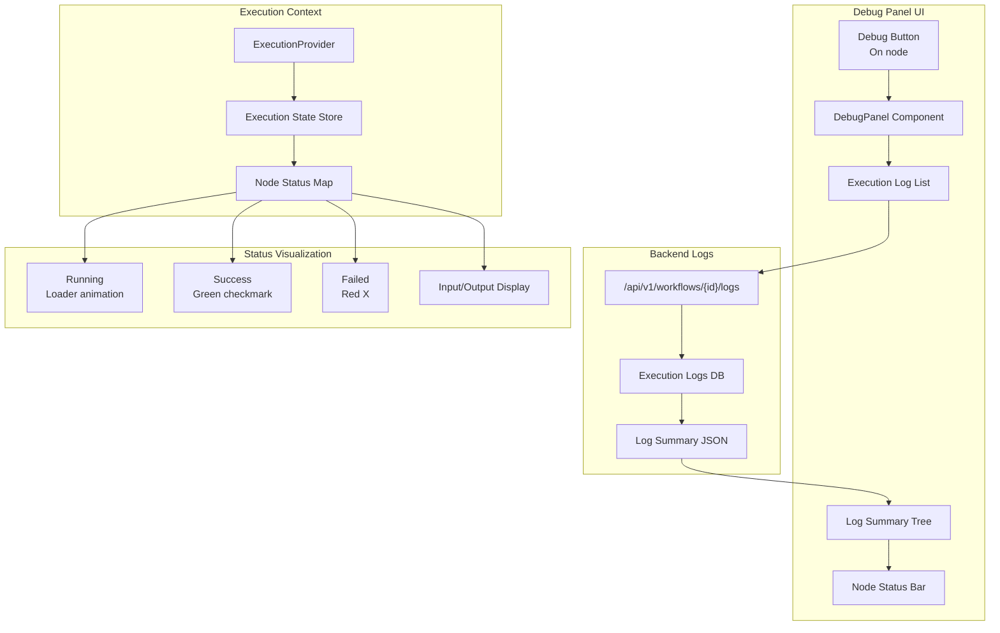

**Execution Log Structure:**

```typescript
// Log summary shows hierarchical execution
interface LogSummary {
  node_id: string
  node_name: string
  status: 'running' | 'success' | 'failed' | 'cancelled'
  start_time: string
  end_time?: string
  duration_ms?: number
  inputs?: Record<string, any>
  outputs?: Record<string, any>
  error_message?: string
  children?: LogSummary[]  // For nested nodes (e.g., loop iterations)
  
  // LLM-specific metadata
  input_tokens?: number
  output_tokens?: number
  total_tokens?: number
}
```

**Debug Panel Features:**

| Feature | Description | Location |
|---------|-------------|----------|
| **Execution Log Selection** | Browse past executions by timestamp | [debug-panel.tsx]() |
| **Log Summary Tree** | Hierarchical view of node execution | [log-summary-tree.tsx]() |
| **Node Status** | Visual status indicators on canvas | [node-status-bar.tsx]() |
| **Input/Output Inspection** | View actual values passed between nodes | [debug-panel.tsx]() |
| **Token Usage** | Track LLM token consumption | [log-summary-tree.tsx]() |
| **Error Details** | Full error messages and stack traces | [debug-panel.tsx]() |
| **Execution Timeline** | See duration of each node | [log-summary-tree.tsx]() |

**Node Status Visualization:**

```typescript
// From node-status-bar component
const statusColors = {
  running: 'var(--semi-color-primary)',
  success: 'var(--semi-color-success)',
  failed: 'var(--semi-color-danger)',
  cancelled: 'var(--semi-color-tertiary)'
}

const statusIcons = {
  running: <Loader2 className="animate-spin" />,
  success: <CheckCircle />,
  failed: <XCircle />,
  cancelled: <Circle />
}
```

**Localized Debug Messages:**

The system provides internationalized debug information:

```json
// From frontend/locales/workflow/en-US/nodes.json:348-379
{
  "debugPanel": {
    "debug": "Debug",
    "noInputOutputData": "This component has no input/output data",
    "componentInfo": "Component Info",
    "status": "Status",
    "executionTime": "Execution Time",
    "model": "Model",
    "loadingDebugData": "Loading debug data for {{nodeName}}...",
    "missingWorkflowOrSpaceId": "Missing workflow or space ID",
    "loadedExecutionLogDetails": "Loaded execution log details for {{nodeName}}",
    "executionLogDetailsEmpty": "Execution log details are empty",
    "loadDebugDataFailed": "Failed to load debug data",
    "noExecutionLogs": "No execution logs",
    "executionLogs": "Execution Logs",
    "refreshExecutionLogs": "Refresh Execution Logs",
    "currentExecutionTime": "Current execution time",
    "inputTokens": "Input Tokens",
    "outputTokens": "Output Tokens",
    "totalNodes": "Total Nodes"
  }
}
```

Sources: [frontend/packages/workflow-canvas/src/components/debug-panel/](), [frontend/locales/workflow/en-US/nodes.json:348-379](), [frontend/packages/workflow-canvas/src/context/execution-context.tsx]()

### Real-Time Status Updates

**Status Update Flow:**

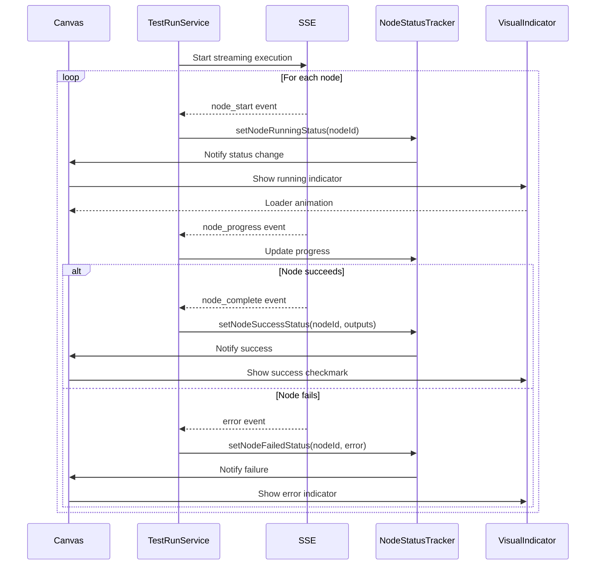

**Status Tracking Service:**

```typescript
// From testrun-runtime-service
class TestRunRuntimeService {
  private runningNodes: string[] = []
  private nodeStatuses: Map<string, NodeStatus> = new Map()
  
  setNodeRunningStatus(nodeId: string) {
    this.runningNodes.push(nodeId)
    this.nodeStatuses.set(nodeId, {
      status: 'running',
      startTime: Date.now()
    })
    this.notifyStatusChange(nodeId)
  }
  
  setNodeSuccessStatus(nodeId: string, outputs: any) {
    const index = this.runningNodes.indexOf(nodeId)
    if (index > -1) {
      this.runningNodes.splice(index, 1)
    }
    this.nodeStatuses.set(nodeId, {
      status: 'success',
      outputs,
      endTime: Date.now()
    })
    this.notifyStatusChange(nodeId)
  }
  
  setNodeFailedStatus(nodeId: string, error: string) {
    const index = this.runningNodes.indexOf(nodeId)
    if (index > -1) {
      this.runningNodes.splice(index, 1)
    }
    this.nodeStatuses.set(nodeId, {
      status: 'failed',
      error,
      endTime: Date.now()
    })
    this.notifyStatusChange(nodeId)
  }
  
  clearAllNodeStatuses() {
    this.runningNodes = []
    this.nodeStatuses.clear()
    this.notifyGlobalReset()
  }
}
```

Sources: [frontend/packages/workflow-canvas/src/components/testrun/runtime/testrun-runtime-service.ts](), [frontend/locales/workflow/en-US/common.json:228-239]()

---

## Testing Best Practices

### Test Case Design

**Effective Test Cases for Prompt Optimization:**

```python
# Good test case structure
case = Case(
    inputs={
        "query": "What is the capital of France?",
        "context": "Geography quiz"
    },
    label={
        "content": "Paris",  # Expected answer
        "tool_calls": None   # No tools expected
    }
)

# For tool-using agents
case_with_tools = Case(
    inputs={
        "query": "What's the weather in Paris?"
    },
    label={
        "tool_calls": [
            ToolCall(
                name="get_weather",
                type="function",
                arguments=json.dumps({"location": "Paris"})
            )
        ]
    },
    tools=[weather_tool_info]  # Provide tool definitions
)
```

**Test Coverage Guidelines:**

1. **Happy Path**: Test expected inputs and outputs
2. **Edge Cases**: Empty inputs, maximum values, special characters
3. **Error Handling**: Invalid inputs, missing required fields
4. **Tool Usage**: Verify correct tool selection and parameters
5. **Variable References**: Test variable resolution and scoping

### Debugging Workflow

**Systematic Debugging Process:**

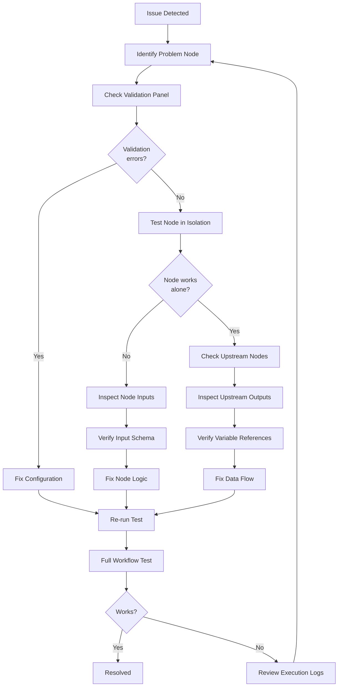

**Debug Information Checklist:**

- [ ] Check validation panel for configuration errors
- [ ] Review node input/output schemas
- [ ] Verify variable references resolve correctly
- [ ] Inspect execution logs for error messages
- [ ] Check LLM token usage and responses
- [ ] Validate model configuration and API keys
- [ ] Test nodes in isolation before integration
- [ ] Review loop block paths and connections
- [ ] Verify prompt templates have correct variables
- [ ] Check for timeout or rate limit issues

Sources: General testing best practices derived from validation system, test panels, and debugging tools throughout the codebase.

---

