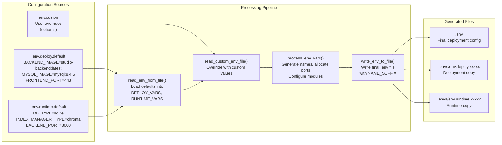
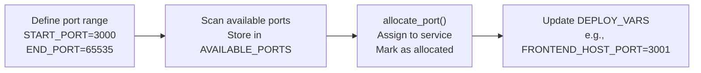
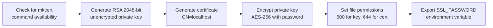
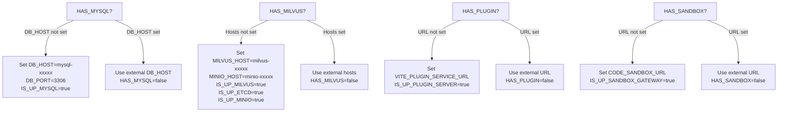

<!-- source: DeepWiki mcp.deepwiki.com · repo openJiuwen-ai/agent-studio · page 7 Deployment & Operations · fetched 2026-11-02 -->

# Deployment & Operations

<details>
<summary>Relevant source files</summary>

The following files were used as context for generating this wiki page:

- [backend/pyproject.toml](backend/pyproject.toml)
- [docs/en/2.Installation Guide/Install via Docker/Linux_Installation.md](docs/en/2.Installation Guide/Install via Docker/Linux_Installation.md)
- [docs/en/2.Installation Guide/Install via Docker/MacOS_Installation.md](docs/en/2.Installation Guide/Install via Docker/MacOS_Installation.md)
- [docs/en/2.Installation Guide/Install via Docker/Windows_Installation.md](docs/en/2.Installation Guide/Install via Docker/Windows_Installation.md)
- [scripts/.env.deploy.default](scripts/.env.deploy.default)
- [scripts/args_handler.sh](scripts/args_handler.sh)
- [scripts/common.sh](scripts/common.sh)
- [scripts/conf/docker-deepsearch.template.yml](scripts/conf/docker-deepsearch.template.yml)
- [scripts/conf/docker-jiuwen.template.yml](scripts/conf/docker-jiuwen.template.yml)
- [scripts/conf/docker-plugin.template.yml](scripts/conf/docker-plugin.template.yml)
- [scripts/envfile_handler.sh](scripts/envfile_handler.sh)
- [scripts/gen_ssl.sh](scripts/gen_ssl.sh)
- [scripts/global_vars.sh](scripts/global_vars.sh)
- [scripts/prompt_handler.sh](scripts/prompt_handler.sh)
- [scripts/service.sh](scripts/service.sh)
- [scripts/template_handler.sh](scripts/template_handler.sh)
- [scripts/vars_handler.sh](scripts/vars_handler.sh)

</details>


This section provides comprehensive documentation for deploying and operating OpenJiuwen Agent Studio in production environments. It covers Docker-based deployment orchestration, configuration management, service lifecycle management, and operational best practices.

For detailed step-by-step instructions on Docker deployment, see [Docker Deployment](#7.1). For production-specific configuration and security settings, see [Production Configuration](#7.2). For scaling and high availability strategies, see [Scaling & High Availability](#7.3). For monitoring, logging, and troubleshooting, see [Monitoring & Logging](#7.4). For backup and disaster recovery procedures, see [Backup & Recovery](#7.5).

## Deployment Architecture Overview

OpenJiuwen Agent Studio uses a modular, script-driven Docker deployment system that supports flexible configuration and incremental service deployment. The deployment system is built around a collection of Bash scripts that orchestrate Docker Compose files, manage environment variables, and handle service lifecycle operations.

### Deployment System Components

```mermaid
graph TB
    subgraph "Entry Point"
        ServiceSh["service.sh<br/>(Main Orchestration)"]
    end
    
    subgraph "Core Script Modules"
        GlobalVars["global_vars.sh<br/>CONFIG, NAMES, PORTS<br/>DEPLOY_VARS, RUNTIME_VARS"]
        ArgsHandler["args_handler.sh<br/>parse_args()<br/>valid_args()"]
        EnvHandler["envfile_handler.sh<br/>generate_env_file()<br/>read_env_from_file()"]
        VarsHandler["vars_handler.sh<br/>process_env_vars()<br/>configure_module_env()"]
        TemplateHandler["template_handler.sh<br/>generate_config_files()<br/>replace_placeholder()"]
        ServiceHandler["service_handler.sh<br/>process_all_services()"]
        ContainerHandler["container_handler.sh<br/>Docker Compose operations"]
        PortsHandler["ports_handler.sh<br/>process_ports()<br/>allocate_port()"]
        GenSSL["gen_ssl.sh<br/>generate_ssl_certs()"]
    end
    
    subgraph "Configuration Files"
        EnvDeployDefault[".env.deploy.default<br/>Default deployment vars"]
        EnvRuntimeDefault[".env.runtime.default<br/>Default runtime vars"]
        EnvCustom[".env.custom<br/>User overrides"]
        EnvGenerated[".env<br/>Generated final config"]
    end
    
    subgraph "Docker Compose Templates"
        JiuwenTemplate["docker-jiuwen.template.yml<br/>Backend + Frontend"]
        MySQLTemplate["docker-mysql.template.yml<br/>MySQL 8.4.5"]
        MilvusTemplate["docker-milvus.template.yml<br/>Milvus + etcd + MinIO"]
        PluginTemplate["docker-plugin.template.yml<br/>Plugin Server"]
        SandboxTemplate["docker-sandbox.template.yml<br/>Python/JS Servers + Gateway"]
        DeepsearchTemplate["docker-deepsearch.template.yml<br/>DeepSearch Service"]
    end
    
    subgraph "Generated Docker Compose Files"
        JiuwenYml["docker-jiuwen.yml"]
        MySQLYml["docker-mysql.yml"]
        MilvusYml["docker-milvus.yml"]
        PluginYml["docker-plugin.yml"]
        SandboxYml["docker-sandbox.yml"]
        DeepsearchYml["docker-deepsearch.yml"]
    end
    
    ServiceSh --> GlobalVars
    ServiceSh --> ArgsHandler
    ServiceSh --> EnvHandler
    ServiceSh --> VarsHandler
    ServiceSh --> TemplateHandler
    ServiceSh --> ServiceHandler
    
    ArgsHandler --> GlobalVars
    EnvHandler --> EnvDeployDefault
    EnvHandler --> EnvRuntimeDefault
    EnvHandler --> EnvCustom
    EnvHandler --> EnvGenerated
    
    VarsHandler --> PortsHandler
    VarsHandler --> GlobalVars
    
    TemplateHandler --> JiuwenTemplate
    TemplateHandler --> MySQLTemplate
    TemplateHandler --> MilvusTemplate
    TemplateHandler --> PluginTemplate
    TemplateHandler --> SandboxTemplate
    TemplateHandler --> DeepsearchTemplate
    TemplateHandler --> GenSSL
    
    TemplateHandler --> JiuwenYml
    TemplateHandler --> MySQLYml
    TemplateHandler --> MilvusYml
    TemplateHandler --> PluginYml
    TemplateHandler --> SandboxYml
    TemplateHandler --> DeepsearchYml
    
    ServiceHandler --> ContainerHandler
    ContainerHandler --> JiuwenYml
    ContainerHandler --> MySQLYml
    ContainerHandler --> MilvusYml
    ContainerHandler --> PluginYml
    ContainerHandler --> SandboxYml
    ContainerHandler --> DeepsearchYml
```



**Sources:** [scripts/service.sh:1-40](), [scripts/global_vars.sh:1-224](), [scripts/args_handler.sh:1-174](), [scripts/envfile_handler.sh:1-195](), [scripts/template_handler.sh:1-125]()

### Module-Based Deployment Model

The deployment system organizes services into logical modules that can be deployed independently or together. Each module consists of one or more Docker containers and is controlled by feature flags in the deployment configuration.

```mermaid
graph TB
    subgraph "Deployment Modules"
        MYSQL["MYSQL Module<br/>HAS_MYSQL flag"]
        MILVUS["MILVUS Module<br/>HAS_MILVUS flag"]
        PLUGIN["PLUGIN Module<br/>HAS_PLUGIN flag"]
        SANDBOX["SANDBOX Module<br/>HAS_SANDBOX flag"]
        DEEPSEARCH["DEEPSEARCH Module<br/>HAS_DEEPSEARCH flag"]
        JIUWEN["JIUWEN Module<br/>HAS_JIUWEN flag"]
        UPGRADE["UPGRADE Module<br/>HAS_UPGRADE flag"]
    end
    
    subgraph "MYSQL Components"
        MySQLContainer["jiuwen-mysql<br/>Container: MYSQL_DOCKER<br/>Service: MYSQL_SERVICE<br/>Volume: mysql-data"]
    end
    
    subgraph "MILVUS Components"
        EtcdContainer["jiuwen-etcd<br/>Container: ETCD_DOCKER<br/>Volume: etcd-data"]
        MinioContainer["jiuwen-minio<br/>Container: MINIO_DOCKER<br/>Volume: minio-data"]
        MilvusContainer["jiuwen-milvus-standalone<br/>Container: MILVUS_DOCKER<br/>Volume: milvus-data"]
    end
    
    subgraph "PLUGIN Components"
        PluginServerContainer["jiuwen-plugin-server<br/>Container: PLUGIN_SERVER_DOCKER<br/>Port: 8185"]
    end
    
    subgraph "SANDBOX Components"
        PythonServerContainer["jiuwen-python-server<br/>Container: PYTHON_SERVER_DOCKER<br/>Port: 5001"]
        JSServerContainer["jiuwen-js-server<br/>Container: JS_SERVER_DOCKER<br/>Port: 5002"]
        SandboxGatewayContainer["jiuwen-sandbox-gateway<br/>Container: SANDBOX_GATEWAY_DOCKER<br/>Port: 8188"]
    end
    
    subgraph "DEEPSEARCH Components"
        DeepsearchContainer["jiuwen-deepsearch<br/>Container: DEEPSEARCH_DOCKER<br/>Port: 8000"]
    end
    
    subgraph "JIUWEN Components"
        BackendContainer["jiuwen-backend<br/>Container: BACKEND_DOCKER<br/>Volumes: sqlite-data<br/>memory-data, knowledge-data"]
        FrontendContainer["jiuwen-frontend<br/>Container: FRONTEND_DOCKER<br/>Nginx + React"]
    end
    
    MYSQL --> MySQLContainer
    MILVUS --> EtcdContainer
    MILVUS --> MinioContainer
    MILVUS --> MilvusContainer
    PLUGIN --> PluginServerContainer
    SANDBOX --> PythonServerContainer
    SANDBOX --> JSServerContainer
    SANDBOX --> SandboxGatewayContainer
    DEEPSEARCH --> DeepsearchContainer
    JIUWEN --> BackendContainer
    JIUWEN --> FrontendContainer
```



**Sources:** [scripts/global_vars.sh:27-61](), [scripts/global_vars.sh:106-130](), [scripts/global_vars.sh:159-193](), [scripts/vars_handler.sh:84-178]()

| Module | Components | Purpose | Optional |
|--------|-----------|---------|----------|
| `JIUWEN` | Backend, Frontend | Core OpenJiuwen platform services | No |
| `MYSQL` | MySQL 8.4.5 | Relational database (alternative to SQLite) | Yes |
| `MILVUS` | Milvus, etcd, MinIO | Vector database and object storage | Yes |
| `PLUGIN` | Plugin Server | External plugin execution | Yes |
| `SANDBOX` | Python Server, JS Server, Sandbox Gateway | Code execution sandboxing | Yes |
| `DEEPSEARCH` | DeepSearch Service | Advanced search capabilities | Yes |
| `UPGRADE` | Upgrade Tool | Database migration during upgrades | Yes |

**Sources:** [scripts/global_vars.sh:159-170](), [scripts/args_handler.sh:40-52]()

## Service Orchestration System

The deployment system provides a unified command-line interface through `service.sh` for managing service lifecycle operations.

### Command-Line Interface

```bash
# Start all services (auto-detect new vs existing deployment)
./service.sh up

# Start specific modules only
./service.sh mysql milvus jiuwen up

# Start new deployment (ignore existing .env file)
./service.sh up -n

# Start with specific environment file
./service.sh up -f .envs/env.deploy.abc123

# Stop services temporarily (preserves state)
./service.sh stop

# Shutdown and remove all containers
./service.sh down

# Upgrade from previous version
./service.sh up -n --upgrade
```

**Sources:** [scripts/args_handler.sh:116-174](), [scripts/service.sh:28-39]()

### Deployment Workflow

The deployment orchestration follows a sequential workflow:

```mermaid
graph LR
    ParseArgs["parse_args()<br/>Parse CLI arguments<br/>Set ARGS map"]
    DetectOS["detect_os()<br/>Detect OS type<br/>Set OS_TYPE"]
    CheckDeps["check_software_dependency()<br/>Verify docker, docker-compose"]
    ProcessEnv["process_env_file()<br/>Load/generate .env files"]
    GenerateConfig["generate_config_files()<br/>Process templates<br/>Replace placeholders"]
    ProcessServices["process_all_services()<br/>Execute docker-compose<br/>up/down/stop"]
    ShowPrompt["show_deploy_prompt()<br/>Display access URLs"]
    
    ParseArgs --> DetectOS
    DetectOS --> CheckDeps
    CheckDeps --> ProcessEnv
    ProcessEnv --> GenerateConfig
    GenerateConfig --> ProcessServices
    ProcessServices --> ShowPrompt
```



**Sources:** [scripts/service.sh:28-36]()

### Environment File Processing

The system uses a layered environment configuration approach:

1. **Default Deployment Variables** (`.env.deploy.default`): Image names, ports, paths
2. **Default Runtime Variables** (`.env.runtime.default`): Database config, API endpoints
3. **Custom Variables** (`.env.custom`): User-specific overrides
4. **Generated Configuration** (`.env`): Final merged configuration with unique suffix



**Sources:** [scripts/envfile_handler.sh:6-28](), [scripts/envfile_handler.sh:46-106](), [scripts/vars_handler.sh:66-81]()

### Template Processing

Docker Compose templates use `<<VARIABLE>>` placeholders that are replaced with actual values during deployment:

**Template Example:**
```yaml
services:
  <<BACKEND_SERVICE>>:
    image: <<BACKEND_IMAGE>>
    container_name: <<BACKEND_DOCKER>>
    ports:
      - "<<BACKEND_HOST_PORT>>:<<BACKEND_PORT>>"
    volumes:
      - <<SQLITE_VOLUME>>:/app/data
```

**Generated Output:**
```yaml
services:
  backend-abc123:
    image: studio-backend:latest
    container_name: jiuwen-backend-abc123
    ports:
      - "8000:8000"
    volumes:
      - sqlite-data-abc123:/app/data
```

**Sources:** [scripts/template_handler.sh:5-61](), [scripts/conf/docker-jiuwen.template.yml:1-72]()

## Configuration Management

### Global Variables Structure

The deployment system uses Bash associative arrays to manage configuration:

| Array | Purpose | Example Keys |
|-------|---------|-------------|
| `CONFIG` | File paths and system settings | `ENV_DIR`, `CONFIG_DIR`, `START_PORT`, `END_PORT` |
| `NAMES` | Docker resource naming | `MYSQL_SERVICE`, `BACKEND_DOCKER`, `MILVUS_VOLUME` |
| `DEPLOY_VARS` | Deployment-time variables | `HAS_MYSQL`, `BACKEND_IMAGE`, `FRONTEND_HOST_PORT` |
| `RUNTIME_VARS` | Runtime environment variables | `DB_TYPE`, `DB_HOST`, `MILVUS_HOST` |
| `ALL_VARS` | Merged deployment + runtime | Combined for template processing |

**Sources:** [scripts/global_vars.sh:11-25](), [scripts/global_vars.sh:27-61](), [scripts/global_vars.sh:107-130](), [scripts/global_vars.sh:133-151]()

### Port Allocation

The system dynamically allocates available ports to avoid conflicts:



Services requiring port allocation:
- `FRONTEND_HOST_PORT`
- `BACKEND_HOST_PORT`
- `MYSQL_HOST_PORT`
- `ETCD_HOST_PORT`
- `MINIO_SERVICE_HOST_PORT`
- `MINIO_CONSOLE_HOST_PORT`
- `MILVUS_HOST_PORT`
- `PLUGIN_SERVER_HOST_PORT`
- `SANDBOX_GATEWAY_HOST_PORT`
- `PYTHON_SERVER_HOST_PORT`
- `JS_SERVER_HOST_PORT`
- `DEEPSEARCH_HOST_PORT`

**Sources:** [scripts/global_vars.sh:64-78](), [scripts/global_vars.sh:22-23](), [scripts/ports_handler.sh]() (referenced but not provided)

### Unique Instance Naming

Each deployment generates a unique 5-character suffix to enable multiple isolated instances:

```bash
# Generate random suffix: abc123
generate_random_chars()

# Apply to all resources:
BACKEND_DOCKER=jiuwen-backend-abc123
BACKEND_SERVICE=backend-abc123
SQLITE_VOLUME=sqlite-data-abc123
JIUWEN_NETWORK_NAME=jiuwen-network-abc123
```

**Sources:** [scripts/common.sh:31-63](), [scripts/vars_handler.sh:5-15]()

## Network and Volume Management

### Docker Network

All services communicate via a dedicated Docker bridge network:

```yaml
networks:
  jiuwen-network-xxxxx:
    driver: bridge
```

Services reference each other by service name (e.g., `backend-xxxxx`, `mysql-xxxxx`) instead of IP addresses.

**Sources:** [scripts/conf/docker-jiuwen.template.yml:69-71]()

### Volume Management

The system creates persistent Docker volumes for data storage:

| Volume | Purpose | Mounted In |
|--------|---------|-----------|
| `sqlite-data` | SQLite database files | Backend (`/app/data`) |
| `memory-data` | Agent memory storage | Backend (`MEMORY_DATA_PATH`) |
| `knowledge-data` | Knowledge base documents | Backend (`/app/site-packages/data`) |
| `mysql-data` | MySQL database | MySQL (`/var/lib/mysql`) |
| `milvus-data` | Milvus vector data | Milvus (`/var/lib/milvus`) |
| `etcd-data` | etcd configuration | etcd (`/etcd`) |
| `minio-data` | Object storage | MinIO (`/data`) |

**Sources:** [scripts/conf/docker-jiuwen.template.yml:64-67](), [scripts/global_vars.sh:34-50]()

## SSL Certificate Generation

The deployment system automatically generates self-signed SSL certificates for HTTPS access:



The SSL password is generated using OpenSSL random data and exported as `SSL_PASSWORD` for Nginx to use during container startup.

**Sources:** [scripts/gen_ssl.sh:5-62](), [scripts/envfile_handler.sh:184]()

## Health Checks and Service Dependencies

Each service defines health check commands and startup dependencies:

### Backend Service Health Check
```yaml
healthcheck:
  test: ["CMD", "curl", "-f", "http://localhost:8000/api/health"]
  interval: 30s
  timeout: 10s
  retries: 5
  start_period: 60s
```

### Frontend Dependency
```yaml
depends_on:
  backend-xxxxx:
    condition: service_healthy
```

This ensures the frontend only starts after the backend is fully operational.

**Sources:** [scripts/conf/docker-jiuwen.template.yml:29-34](), [scripts/conf/docker-jiuwen.template.yml:51-53]()

## Module Auto-Configuration

The system automatically configures module connectivity based on deployment choices:



This allows mixing containerized and external services flexibly.

**Sources:** [scripts/vars_handler.sh:84-178]()

## Deployment Prompt System

After successful deployment, the system displays access information:

```bash
show_deploy_prompt() {
  if HAS_JIUWEN:
    echo "openJiuwen Agent Platform:"
    echo "  Local access: https://localhost:${FRONTEND_HOST_PORT}"
    echo "  Network access: https://${IP}:${FRONTEND_HOST_PORT}"
  else:
    for each deployed module:
      echo "${MODULE} Server started!"
      echo "Configuration values to use in .env:"
      echo "  DB_HOST=localhost"
      echo "  DB_PORT=${MYSQL_HOST_PORT}"
}
```

**Sources:** [scripts/prompt_handler.sh:5-56]()

## Proxy and Network Configuration

The system configures HTTP proxy settings and no-proxy exclusions:

```bash
# Proxy environment variables passed to containers
HTTP_PROXY, HTTPS_PROXY, http_proxy, https_proxy

# Auto-generated no_proxy list includes:
- localhost, 127.0.0.1
- Host machine IP
- All container service names
- All container hostnames
```

**Sources:** [scripts/vars_handler.sh:18-47](), [scripts/conf/docker-jiuwen.template.yml:9-14]()

## Database Migration Support

The deployment system includes revision tracking for Alembic migrations:

| Database | Schema | Version | Revision ID |
|----------|--------|---------|-------------|
| MySQL | Agent | 0.1.4 | `072ac1293a02` |
| MySQL | Ops | 0.1.4 | `13377a900fe2` |
| SQLite | Agent | 0.1.4 | `8f4846812221` |
| SQLite | Ops | 0.1.4 | `f6e49cd8c97d` |

**Sources:** [scripts/global_vars.sh:207-223]()

## Container Resource Limits

The deployment system supports resource limits through environment variables and can be customized in `.env.custom`:

```bash
# Memory limits
BACKEND_MEMORY_LIMIT=2g
MYSQL_MEMORY_LIMIT=1g
MILVUS_MEMORY_LIMIT=4g

# CPU limits
BACKEND_CPUS=1.0
MYSQL_CPUS=1.0
```

Note: The provided templates do not show resource limits by default, but they can be added to the Docker Compose files.

**Sources:** [scripts/conf/docker-jiuwen.template.yml:1-72]()

---

For detailed implementation guides and operational procedures, refer to the child pages of this section:
- [Docker Deployment](#7.1) - Step-by-step Docker installation and startup
- [Production Configuration](#7.2) - Security, performance, and production settings
- [Scaling & High Availability](#7.3) - Load balancing and redundancy strategies
- [Monitoring & Logging](#7.4) - Observability and troubleshooting
- [Backup & Recovery](#7.5) - Data protection and disaster recovery

---

