<!-- source: DeepWiki mcp.deepwiki.com · repo openJiuwen-ai/agent-studio · page 7.1 Docker Deployment · fetched 2026-11-02 -->

# Docker Deployment

<details>
<summary>Relevant source files</summary>

The following files were used as context for generating this wiki page:

- [backend/pyproject.toml](backend/pyproject.toml)
- [docs/en/2.Installation Guide/Install via Docker/Linux_Installation.md](docs/en/2.Installation Guide/Install via Docker/Linux_Installation.md)
- [docs/en/2.Installation Guide/Install via Docker/MacOS_Installation.md](docs/en/2.Installation Guide/Install via Docker/MacOS_Installation.md)
- [docs/en/2.Installation Guide/Install via Docker/Windows_Installation.md](docs/en/2.Installation Guide/Install via Docker/Windows_Installation.md)
- [scripts/.env.deploy.default](scripts/.env.deploy.default)
- [scripts/args_handler.sh](scripts/args_handler.sh)
- [scripts/common.sh](scripts/common.sh)
- [scripts/conf/docker-deepsearch.template.yml](scripts/conf/docker-deepsearch.template.yml)
- [scripts/conf/docker-jiuwen.template.yml](scripts/conf/docker-jiuwen.template.yml)
- [scripts/conf/docker-plugin.template.yml](scripts/conf/docker-plugin.template.yml)
- [scripts/envfile_handler.sh](scripts/envfile_handler.sh)
- [scripts/gen_ssl.sh](scripts/gen_ssl.sh)
- [scripts/global_vars.sh](scripts/global_vars.sh)
- [scripts/prompt_handler.sh](scripts/prompt_handler.sh)
- [scripts/service.sh](scripts/service.sh)
- [scripts/template_handler.sh](scripts/template_handler.sh)
- [scripts/vars_handler.sh](scripts/vars_handler.sh)

</details>


This document provides detailed technical information about Docker-based deployment of OpenJiuwen Agent Studio using Docker Compose. It covers the service orchestration script, container architecture, configuration management, and deployment workflows.

For local development setup without Docker, see [Local Development Setup](#2.2). For production configuration best practices, see [Production Configuration](#7.2).

## Overview

The Docker deployment system uses a Bash-based orchestration script (`service.sh`) that generates Docker Compose configurations from templates, manages environment variables, allocates ports, and orchestrates multi-container deployments. The system supports modular deployment, allowing selective activation of components like MySQL, Milvus, Plugin Server, and Sandbox environments.

**Sources:** [scripts/service.sh:1-40](), [scripts/global_vars.sh:1-224]()

## Container Architecture

### Service Modules and Components

The deployment architecture organizes services into logical modules. Each module contains one or more Docker containers:

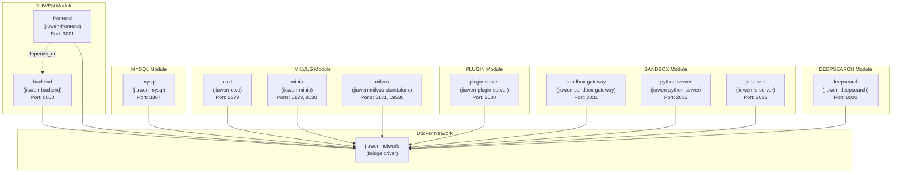

The `COMPONENTS` mapping defines which containers belong to each module:

| Module | Components | Purpose |
|--------|-----------|---------|
| `JIUWEN` | `BACKEND`, `FRONTEND` | Core application services |
| `MYSQL` | `MYSQL` | Relational database (optional) |
| `MILVUS` | `ETCD`, `MINIO`, `MILVUS` | Vector database stack |
| `PLUGIN` | `PLUGIN_SERVER` | Plugin execution service |
| `SANDBOX` | `PYTHON_SERVER`, `JS_SERVER`, `SANDBOX_GATEWAY` | Code execution sandboxes |
| `DEEPSEARCH` | `DEEPSEARCH` | Deep search agent service |
| `UPGRADE` | `UPGRADE_TOOL` | Database migration tool |

**Sources:** [scripts/global_vars.sh:159-170](), [scripts/conf/docker-jiuwen.template.yml:1-72]()

### Volume Persistence

The deployment creates named Docker volumes for persistent data storage:

| Volume Name | Mounted In | Purpose |
|------------|------------|---------|
| `sqlite-data` | backend | SQLite database files when `DB_TYPE=sqlite` |
| `memory-data` | backend | Memory base storage |
| `knowledge-data` | backend | Knowledge base documents |
| `mysql-data` | mysql | MySQL database files |
| `milvus-data` | milvus | Milvus vector database |
| `etcd-data` | etcd | etcd cluster data |
| `minio-data` | minio | MinIO object storage |

Volume names are suffixed with a unique instance identifier (e.g., `sqlite-data-x7a9b`) to support multiple deployment instances on the same host.

**Sources:** [scripts/global_vars.sh:28-61](), [scripts/conf/docker-jiuwen.template.yml:64-67]()

## Configuration System

### Environment Variable Management

The configuration system uses a multi-layer environment variable strategy:

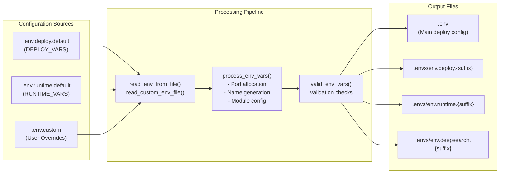

**Variable Categories:**

1. **Deploy Variables (`DEPLOY_VARS`)**: Container names, ports, image tags, module flags
2. **Runtime Variables (`RUNTIME_VARS`)**: Application configuration (database settings, API URLs, paths)
3. **Deep Search Variables (`DEEPSERACH_ENV_VARS`)**: Deepsearch-specific configuration
4. **All Variables (`ALL_VARS`)**: Merged deploy + runtime for template substitution

**Sources:** [scripts/envfile_handler.sh:1-195](), [scripts/global_vars.sh:106-151]()

### Configuration File Processing

The `process_env_file()` function orchestrates configuration based on the command:

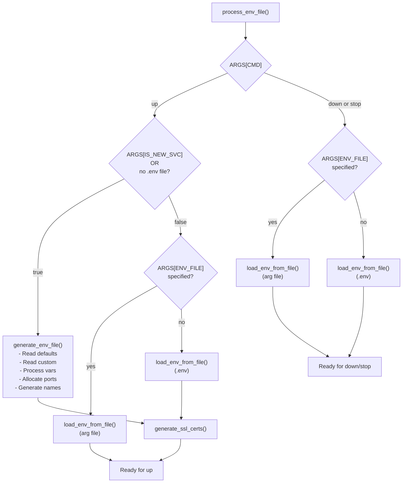

**Sources:** [scripts/envfile_handler.sh:168-195]()

### Template Substitution

Docker Compose templates use `<<VARIABLE>>` placeholders that are replaced during deployment:

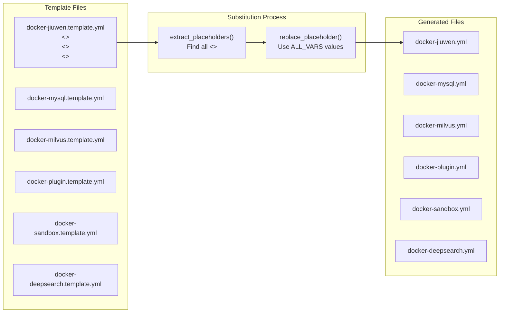

Example template substitution in `docker-jiuwen.template.yml`:

```yaml
services:
  <<BACKEND_SERVICE>>:              # → "backend-x7a9b"
    image: <<BACKEND_IMAGE>>        # → "studio-backend:latest"
    container_name: <<BACKEND_DOCKER>>  # → "jiuwen-backend-x7a9b"
    ports:
      - "<<BACKEND_HOST_PORT>>:<<BACKEND_PORT>>"  # → "8000:8000"
```

**Sources:** [scripts/template_handler.sh:1-125](), [scripts/conf/docker-jiuwen.template.yml:1-72]()

## Port Allocation System

### Dynamic Port Assignment

The system automatically allocates available ports from a configurable range to avoid conflicts:

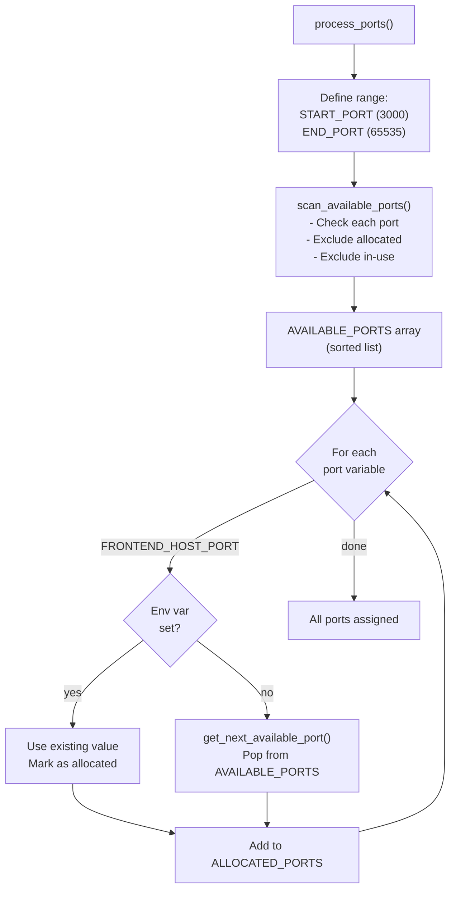

**Port Variables Requiring Allocation:**

- `FRONTEND_HOST_PORT` (default: 3001)
- `BACKEND_HOST_PORT` (default: 8000)
- `MYSQL_HOST_PORT` (default: 3307)
- `MILVUS_HOST_PORT` (default: 8131)
- `MILVUS_HTTP_HOST_PORT` (default: 19530)
- `PLUGIN_SERVER_HOST_PORT` (default: 2030)
- `SANDBOX_GATEWAY_HOST_PORT` (default: 2031)
- `PYTHON_SERVER_HOST_PORT` (default: 2032)
- `JS_SERVER_HOST_PORT` (default: 2033)
- `MINIO_SERVICE_HOST_PORT` (default: 8129)
- `MINIO_CONSOLE_HOST_PORT` (default: 8130)
- `ETCD_HOST_PORT` (default: 2379)
- `DEEPSEARCH_HOST_PORT` (default: 8000)

**Sources:** [scripts/global_vars.sh:63-78](), [scripts/ports_handler.sh]()

### Instance Naming Convention

Each deployment instance receives a unique 5-character suffix to enable multiple instances on the same host:

```
Service Name Pattern: {base-name}-{suffix}
Example: jiuwen-backend-x7a9b
         jiuwen-mysql-k2p4n
```

The suffix is generated by `generate_random_chars()` and applied to all container names, service names, volume names, and network names.

**Sources:** [scripts/common.sh:30-63](), [scripts/vars_handler.sh:5-15]()

## Deployment Workflow

### Main Orchestration Flow

The `service.sh` script executes a series of handler functions:

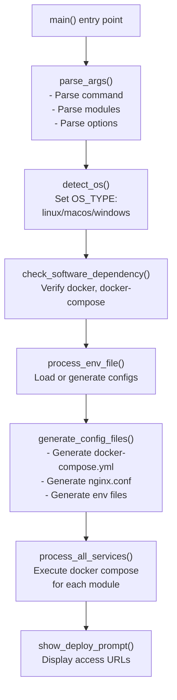

**Sources:** [scripts/service.sh:27-39]()

### Module Activation Logic

The `configure_module_env()` function determines which services to start based on environment variables:

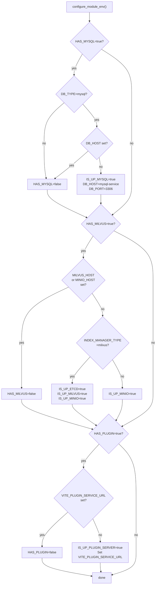

This conditional logic ensures:
- External services are used if configured (e.g., external MySQL host)
- Internal containers are only started when needed
- Service URLs are automatically configured for inter-container communication

**Sources:** [scripts/vars_handler.sh:84-178]()

## Service Orchestration Commands

### Command Syntax

```bash
./service.sh [MODULES] [COMMAND] [OPTIONS]
```

**Commands:**
- `up`: Start services
- `down`: Shutdown and remove containers, networks (preserves volumes)
- `stop`: Pause services temporarily

**Options:**
- `-f, --file <path>`: Use specific environment file
- `-n, --new`: Force new deployment (ignore existing `.env`)
- `--upgrade`: Upgrade from previous version
- `-h, --help`: Show help

**Modules (optional):**
- `mysql`, `milvus`, `plugin`, `sandbox`, `deepsearch`, `jiuwen`
- Omitting modules deploys all components

**Sources:** [scripts/args_handler.sh:115-174]()

### Command Examples

| Command | Description |
|---------|-------------|
| `./service.sh up` | Start all services (auto-detect new vs. existing) |
| `./service.sh up -n` | Force new deployment with fresh configuration |
| `./service.sh up -f .envs/env.x7a9b` | Restart specific instance |
| `./service.sh mysql milvus up` | Start only MySQL and Milvus modules |
| `./service.sh jiuwen up -n` | Start new instance with only core services |
| `./service.sh stop` | Pause all services |
| `./service.sh down` | Shutdown completely |
| `./service.sh up -n --upgrade` | Upgrade from previous version |

**Sources:** [scripts/args_handler.sh:116-174]()

### Service Execution Flow

The `process_all_services()` function orchestrates Docker Compose operations:

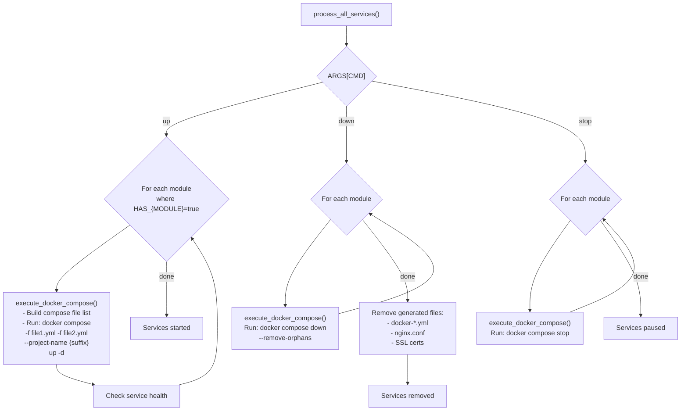

**Sources:** [scripts/service_handler.sh](), [scripts/container_handler.sh]()

## SSL Certificate Generation

### Automatic HTTPS Configuration

The frontend service requires SSL certificates for HTTPS. These are automatically generated on each `up` command:

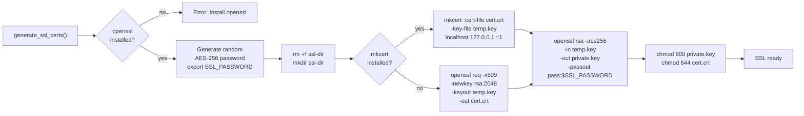

**Certificate Lifecycle:**
1. Certificates are generated to `conf/.ssl-dirs/ssl-{suffix}/`
2. The `SSL_PASSWORD` environment variable is exported for the current shell session
3. Frontend container receives `SSL_PASSWORD` via environment
4. On container stop/restart, certificates must be regenerated (SSL_PASSWORD is not persisted)

**Sources:** [scripts/gen_ssl.sh:1-62]()

## Network Configuration

### Proxy Settings

The deployment script automatically configures `no_proxy` to bypass proxy for internal container communication:

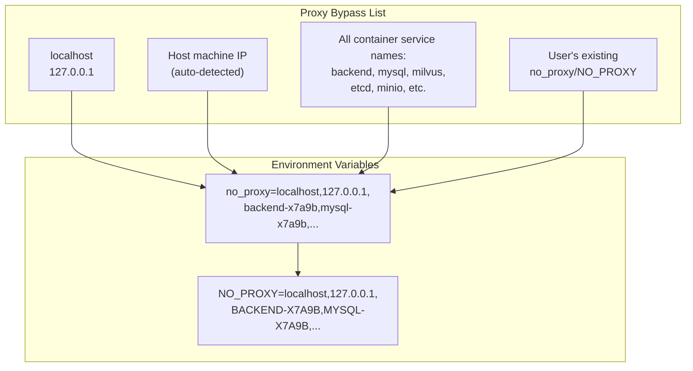

This ensures containers can communicate directly without going through HTTP/HTTPS proxies.

**Sources:** [scripts/vars_handler.sh:17-47]()

### Inter-Container Communication

All containers join the `jiuwen-network-{suffix}` bridge network, enabling DNS-based service discovery:

- Service name `backend-x7a9b` resolves to backend container IP
- Service name `mysql-x7a9b` resolves to MySQL container IP
- Cross-service communication uses service names, not localhost

Example: Backend connects to MySQL using `DB_HOST=mysql-x7a9b` and `DB_PORT=3306` (internal port, not host port).

**Sources:** [scripts/conf/docker-jiuwen.template.yml:69-71]()

## Health Checks and Dependencies

### Service Health Monitoring

Docker Compose configurations include health checks for critical services:

**Backend Health Check:**
```yaml
healthcheck:
  test: ["CMD", "curl", "-f", "http://localhost:8000/api/health"]
  interval: 30s
  timeout: 10s
  retries: 5
  start_period: 60s
```

**Frontend Dependency:**
```yaml
depends_on:
  backend:
    condition: service_healthy
```

This ensures frontend only starts after backend is healthy.

**Sources:** [scripts/conf/docker-jiuwen.template.yml:29-34](), [scripts/conf/docker-jiuwen.template.yml:51-53]()

## Upgrade Process

### Version Migration

The `--upgrade` flag triggers database migration for version upgrades:

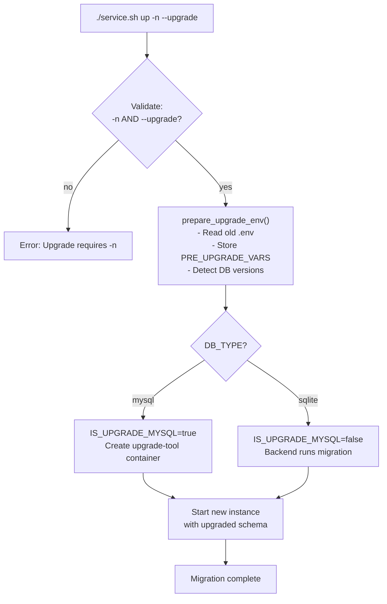

**Revision ID Mapping:**

The system tracks database schema versions using Alembic revision IDs:

| Version | MySQL Agent | MySQL Ops | SQLite Agent | SQLite Ops |
|---------|-------------|-----------|--------------|------------|
| 0.1.1 | 54351e123cf0 | 80f110f929fc | - | - |
| 0.1.2 | 54351e123cf0 | 80f110f929fc | f458c7fb17a5 | b4f4c6589bc5 |
| 0.1.3 | 06a1f79bce8b | 13377a900fe2 | 031b34b4dd30 | f6e49cd8c97d |
| 0.1.4 | 072ac1293a02 | 13377a900fe2 | 8f4846812221 | f6e49cd8c97d |

**Sources:** [scripts/global_vars.sh:207-223](), [scripts/upgrade_handler.sh](), [scripts/args_handler.sh:88-93]()

## Troubleshooting

### Common Issues

**Issue: Port Already in Use**
- Solution: The system auto-allocates ports. If conflicts occur, stop conflicting services or modify port ranges in `.env.custom`

**Issue: Container Fails to Start**
- Check logs: `docker logs <container-name>`
- Verify health: `docker inspect <container-name> | grep Health`
- Check dependencies: Ensure required services are healthy

**Issue: Network Connection Refused**
- Verify containers are on same network: `docker network inspect jiuwen-network-{suffix}`
- Check service names resolve: `docker exec <container> ping <service-name>`

**Issue: SSL Certificate Errors**
- Regenerate certificates: `./service.sh down && ./service.sh up`
- Browser may require accepting self-signed certificate

**Issue: Milvus Container Exits**
- Requires AVX CPU instruction set: `lscpu | grep Flags | grep avx`
- Switch to Chroma: Set `INDEX_MANAGER_TYPE=chroma` in `.env.custom`

**Sources:** [docs/en/2.Installation Guide/Install via Docker/Linux_Installation.md:103-112]()

### Log Locations

Container logs are persisted to host directory:

```
log-dirs/logs-{suffix}/
├── server/          # Backend logs
└── deepsearch/      # DeepSearch logs
```

View logs:
```bash
# Real-time logs
docker logs -f jiuwen-backend-{suffix}

# Historical logs
cat log-dirs/logs-{suffix}/server/app.log
```

**Sources:** [scripts/conf/docker-jiuwen.template.yml:22](), [scripts/conf/docker-deepsearch.template.yml:20]()

---

