<!-- source: DeepWiki mcp.deepwiki.com · repo openJiuwen-ai/agent-studio · page 7.2 Production Configuration · fetched 2026-11-02 -->

# Production Configuration

<details>
<summary>Relevant source files</summary>

The following files were used as context for generating this wiki page:

- [.env.example](.env.example)
- [backend/openjiuwen_studio/core/common/logging/__init__.py](backend/openjiuwen_studio/core/common/logging/__init__.py)
- [backend/openjiuwen_studio/core/common/logging/events.py](backend/openjiuwen_studio/core/common/logging/events.py)
- [backend/openjiuwen_studio/core/config.py](backend/openjiuwen_studio/core/config.py)
- [backend/openjiuwen_studio/core/manager/convertor/components/sub_workflow.py](backend/openjiuwen_studio/core/manager/convertor/components/sub_workflow.py)
- [backend/openjiuwen_studio/core/manager/email_manager/__init__.py](backend/openjiuwen_studio/core/manager/email_manager/__init__.py)
- [backend/openjiuwen_studio/core/manager/email_manager/email_template.py](backend/openjiuwen_studio/core/manager/email_manager/email_template.py)
- [backend/openjiuwen_studio/core/manager/email_manager/email_utils.py](backend/openjiuwen_studio/core/manager/email_manager/email_utils.py)
- [backend/openjiuwen_studio/core/manager/redis_manager/__init__.py](backend/openjiuwen_studio/core/manager/redis_manager/__init__.py)
- [backend/openjiuwen_studio/core/manager/utils/utils.py](backend/openjiuwen_studio/core/manager/utils/utils.py)
- [backend/openjiuwen_studio/main.py](backend/openjiuwen_studio/main.py)
- [scripts/.env.deploy.default](scripts/.env.deploy.default)
- [scripts/args_handler.sh](scripts/args_handler.sh)
- [scripts/common.sh](scripts/common.sh)
- [scripts/conf/docker-deepsearch.template.yml](scripts/conf/docker-deepsearch.template.yml)
- [scripts/conf/docker-jiuwen.template.yml](scripts/conf/docker-jiuwen.template.yml)
- [scripts/conf/docker-plugin.template.yml](scripts/conf/docker-plugin.template.yml)
- [scripts/envfile_handler.sh](scripts/envfile_handler.sh)
- [scripts/gen_ssl.sh](scripts/gen_ssl.sh)
- [scripts/global_vars.sh](scripts/global_vars.sh)
- [scripts/prompt_handler.sh](scripts/prompt_handler.sh)
- [scripts/service.sh](scripts/service.sh)
- [scripts/template_handler.sh](scripts/template_handler.sh)
- [scripts/vars_handler.sh](scripts/vars_handler.sh)

</details>


This page covers best practices and essential configuration settings for deploying OpenJiuwen Agent Studio in production environments. It focuses on security hardening, performance optimization, and service configuration for production workloads.

For Docker deployment procedures, see [Docker Deployment](#7.1). For scaling and high availability strategies, see [Scaling & High Availability](#7.3). For local development configuration, see [Configuration Guide](#2.3).

---

## Configuration Architecture

OpenJiuwen Agent Studio uses a multi-layered configuration system that separates deployment-time variables from runtime environment variables, enabling flexible production deployments.

### Configuration File Hierarchy

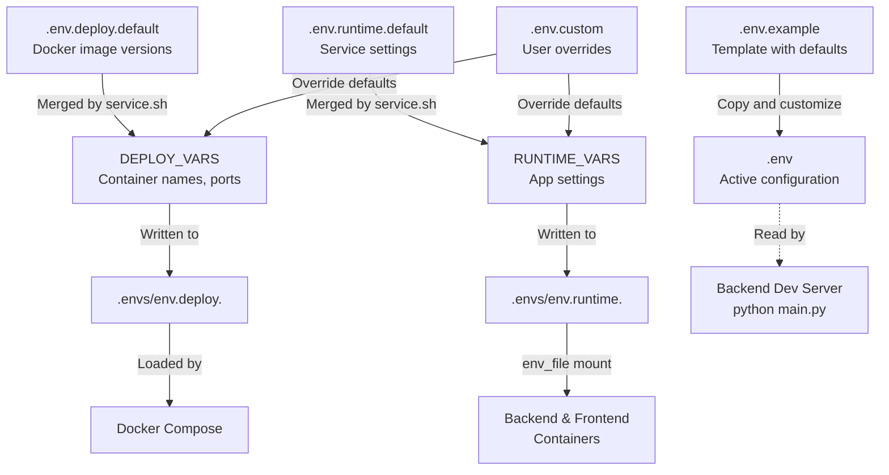

**Sources:** [.env.example:1-196](), [scripts/envfile_handler.sh:5-28](), [scripts/global_vars.sh:106-150]()

---

## Critical Security Settings

### Secret Key and JWT Configuration

The `SECRET_KEY` is used for JWT token signing and must be changed from the default value in production.

| Variable | Default | Production Requirement | Purpose |
|----------|---------|------------------------|---------|
| `SECRET_KEY` | `your-secret-key-change-in-production` | **Must change** | JWT signing, encryption operations |
| `ALGORITHM` | `HS256` | Keep default | JWT algorithm |
| `ACCESS_TOKEN_EXPIRE_MINUTES` | `2880` (2 days) | Adjust per security policy | Access token TTL |
| `REFRESH_TOKEN_EXPIRE_DAYS` | `2` | Adjust per security policy | Refresh token TTL |

**Generate a secure SECRET_KEY:**
```bash
python -c "import secrets; print(secrets.token_urlsafe(32))"
```

**Sources:** [.env.example:51-62](), [backend/openjiuwen_studio/core/config.py:53-61]()

### Service Mode and Encryption

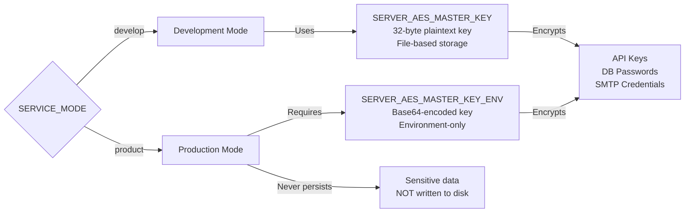

| Variable | Development | Production |
|----------|-------------|------------|
| `SERVICE_MODE` | `develop` | `product` |
| `SERVER_AES_MASTER_KEY` | 32-byte AES key (optional) | **Ignored** |
| `SERVER_AES_MASTER_KEY_ENV` | Not required | **Required** (base64-encoded) |

In production mode, `SERVER_AES_MASTER_KEY_ENV` ensures encryption keys are never persisted to disk and only exist in environment variables.

**Sources:** [.env.example:70-83](), [backend/openjiuwen_studio/core/manager/email_manager/email_utils.py:22]()

### SSL/TLS Configuration

Production deployments generate SSL certificates automatically on startup for HTTPS communication.

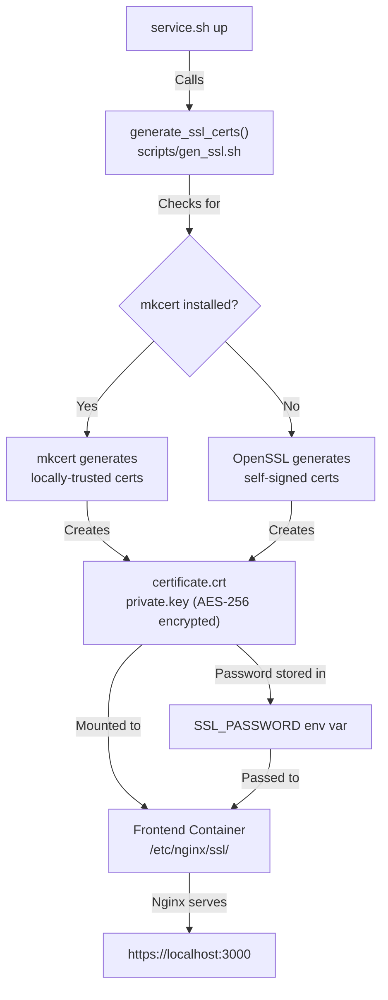

**Certificate location:** `scripts/conf/.ssl-dirs/ssl-<suffix>/`

**Important:** SSL certificates are regenerated on each `up` command. The `SSL_PASSWORD` environment variable is ephemeral and only exists during the Docker Compose session.

**Sources:** [scripts/gen_ssl.sh:4-62](), [scripts/envfile_handler.sh:184](), [scripts/conf/docker-jiuwen.template.yml:43-47]()

---

## Database Configuration for Production

### MySQL vs SQLite

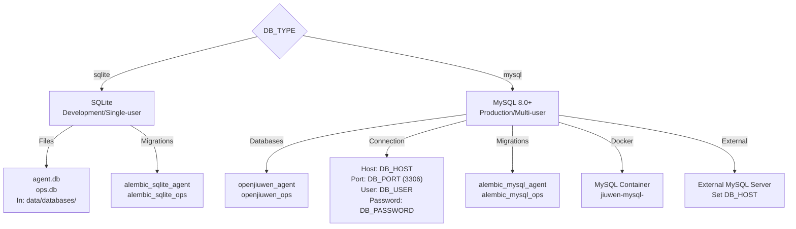

**Production Recommendation:** Use MySQL with an external managed database service for high availability and backup capabilities.

| Configuration | Development | Production |
|---------------|-------------|------------|
| `DB_TYPE` | `sqlite` | `mysql` |
| `DB_HOST` | Not required | Required (container name or external host) |
| `DB_PORT` | Not required | `3306` |
| `DB_USER` | Not required | `root` (or dedicated user) |
| `DB_PASSWORD` | Not required | Strong password required |
| `AGENT_DB_NAME` | Not required | `openjiuwen_agent` |
| `OPS_DB_NAME` | Not required | `openjiuwen_ops` |

**External MySQL Configuration:**
```bash
# .env.custom
DB_TYPE=mysql
DB_HOST=mysql.example.com  # External MySQL server
DB_PORT=3306
DB_USER=jiuwen_user
DB_PASSWORD=<strong-password>
AGENT_DB_NAME=openjiuwen_agent
OPS_DB_NAME=openjiuwen_ops
```

When `DB_HOST` is set in `.env.custom`, the deployment script skips starting the MySQL container and uses the external server.

**Sources:** [.env.example:90-106](), [backend/openjiuwen_studio/core/config.py:26-38](), [scripts/vars_handler.sh:96-108](), [backend/openjiuwen_studio/main.py:94-114]()

### Database Migrations

Production deployments automatically verify Alembic migration versions on startup:

```python
# backend/openjiuwen_studio/main.py:121
check_alembic_versions()
```

Migration directories are located in `backend/alembic_*/versions/` for each database type and schema.

**Sources:** [backend/openjiuwen_studio/main.py:120-121](), [scripts/global_vars.sh:207-223]()

---

## Vector Store Configuration

### Chroma vs Milvus

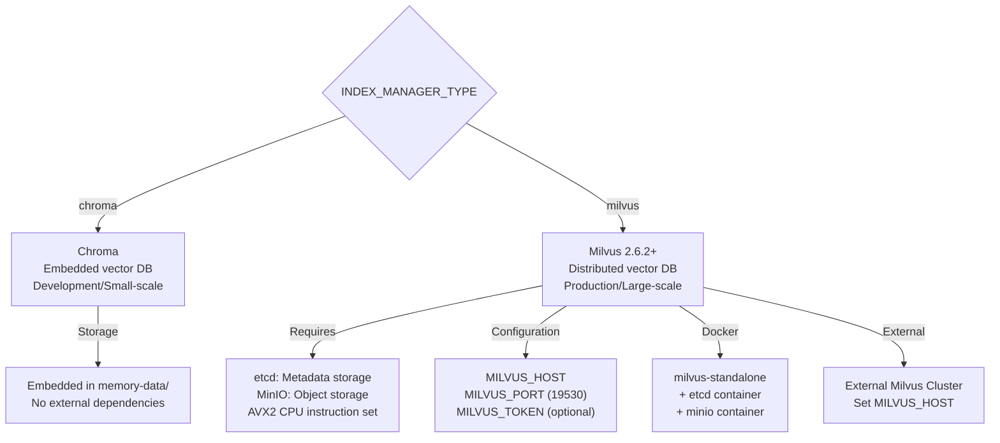

**Production Recommendation:** Use Milvus for production workloads requiring high-performance vector search at scale.

| Variable | Chroma (Default) | Milvus (Production) |
|----------|------------------|---------------------|
| `INDEX_MANAGER_TYPE` | `chroma` | `milvus` |
| `MILVUS_HOST` | Not required | Container name or external host |
| `MILVUS_PORT` | Not required | `19530` |
| `MILVUS_COLLECTION_NAME` | Not required | `memory_vector` |
| `EMBEDDING_MODEL_DIMENTION` | Not required | `1024` (match your embedding model) |

**Milvus CPU Requirements:**
- Requires AVX2 instruction set support
- Check with: `grep avx2 /proc/cpuinfo` (Linux) or `sysctl machdep.cpu.features` (macOS)

**Sources:** [.env.example:135-143](), [scripts/vars_handler.sh:109-125](), [scripts/conf/docker-milvus.template.yml]()

---

## Performance and Scalability Settings

### Worker Configuration

The backend supports multiple worker processes when using MySQL and Milvus:

```python
# backend/openjiuwen_studio/main.py:255-258
config = {
    "workers": int(os.getenv("WORKER_NUM", 1))
        if (os.getenv("INDEX_MANAGER_TYPE") == "milvus" and os.getenv("DB_TYPE") == "mysql")
        else 1,
}
```

| Variable | Development | Production | Notes |
|----------|-------------|------------|-------|
| `WORKER_NUM` | `1` | `4-8` | Only effective with `DB_TYPE=mysql` and `INDEX_MANAGER_TYPE=milvus` |
| `DEBUG` | `true` | `false` | Disable debug mode in production |
| `HOST` | `0.0.0.0` | `0.0.0.0` | Bind to all interfaces |
| `BACKEND_PORT` | `8000` | `8000` | Internal container port |

**Worker Process Limitations:**
- SQLite databases are not safe for multi-process access
- Chroma embedded mode is not thread-safe across processes
- Multi-worker configuration requires both MySQL and Milvus

**Sources:** [.env.example:45-49](), [backend/openjiuwen_studio/main.py:247-273]()

### Timeout Configuration

| Variable | Default | Production Recommendation | Purpose |
|----------|---------|---------------------------|---------|
| `VITE_API_PROXY_TIMEOUT` | `300000` (5 min) | `600000` (10 min) | Nginx reverse proxy timeout (ms) |
| `WORKFLOW_EXECUTE_TIMEOUT` | `300` (5 min) | `600` (10 min) | Workflow execution timeout (seconds) |
| `ACCESS_TOKEN_EXPIRE_MINUTES` | `2880` (2 days) | `15-60` | Access token expiration |

The Nginx timeout is automatically calculated from `VITE_API_PROXY_TIMEOUT`:

```bash
# scripts/vars_handler.sh:73-79
local nginx_read_timeout=$(( tms / 1000 ))
DEPLOY_VARS["NGINX_READ_TIMEOUT"]=${nginx_read_timeout}
```

**Sources:** [.env.example:28-29](), [.env.example:145-146](), [scripts/vars_handler.sh:73-79]()

---

## External Services Configuration

### Redis for Checkpointing

Redis enables workflow state checkpointing for long-running agent executions:

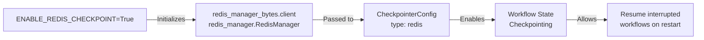

| Variable | Default | Production | Purpose |
|----------|---------|------------|---------|
| `ENABLE_REDIS_CHECKPOINT` | `False` | `True` | Enable workflow checkpointing |
| `REDIS_HOST` | `localhost` | Container name or external host | Redis server |
| `REDIS_PORT` | `6379` | `6379` | Redis port |
| `REDIS_DB` | `0` | `0` | Redis database number |
| `REDIS_PASSWORD` | Empty | Set strong password | Redis authentication |

**Connection URL Format:**
```
redis://[:password@]host:port/db
```

**Sources:** [.env.example:117-121](), [backend/openjiuwen_studio/core/config.py:69-81](), [backend/openjiuwen_studio/main.py:128-138]()

### MinIO/OBS Object Storage

OpenJiuwen uses MinIO for document storage (knowledge bases, uploaded files):

| Variable | Development | Production |
|----------|-------------|------------|
| `MINIO_HOST` | `localhost` | Container name or external endpoint |
| `MINIO_PORT` | `9000` | `9000` |
| `MINIO_ACCESS_KEY` | `minioadmin` | Strong access key |
| `MINIO_SECRET_KEY` | `minioadmin` | Strong secret key |
| `MINIO_SECURE` | `False` | `True` (for external HTTPS) |
| `MINIO_BUCKET` | `jiuwen-bucket` | Custom bucket name |

**External OBS Configuration (Huawei Cloud):**
```bash
# .env.custom
OBS_ACCESS_KEY_ID=<access-key>
OBS_SECRET_ACCESS_KEY=<secret-key>
OBS_SERVER=https://obs.ap-southeast-1.myhuaweicloud.com
OBS_BUCKET=jiuwen-production
```

**Sources:** [.env.example:108-114](), [.env.example:192-196](), [backend/openjiuwen_studio/core/config.py:40-46]()

### SMTP Email Service

Required for user authentication features (registration, password reset):

| Variable | Default | Production Requirement |
|----------|---------|------------------------|
| `SMTP_HOST` | Empty | SMTP server hostname |
| `SMTP_PORT` | `465` | `465` (SSL) or `587` (TLS) |
| `SMTP_USER` | Empty | SMTP username/email |
| `SMTP_PASSWORD` | Empty | SMTP password (encrypted) |
| `SMTP_ALIAS` | `openJiuwen` | Sender display name |
| `VITE_ENABLE_NEW_AUTH` | `False` | `True` to enable auth system |

**Email Configuration Flow:**

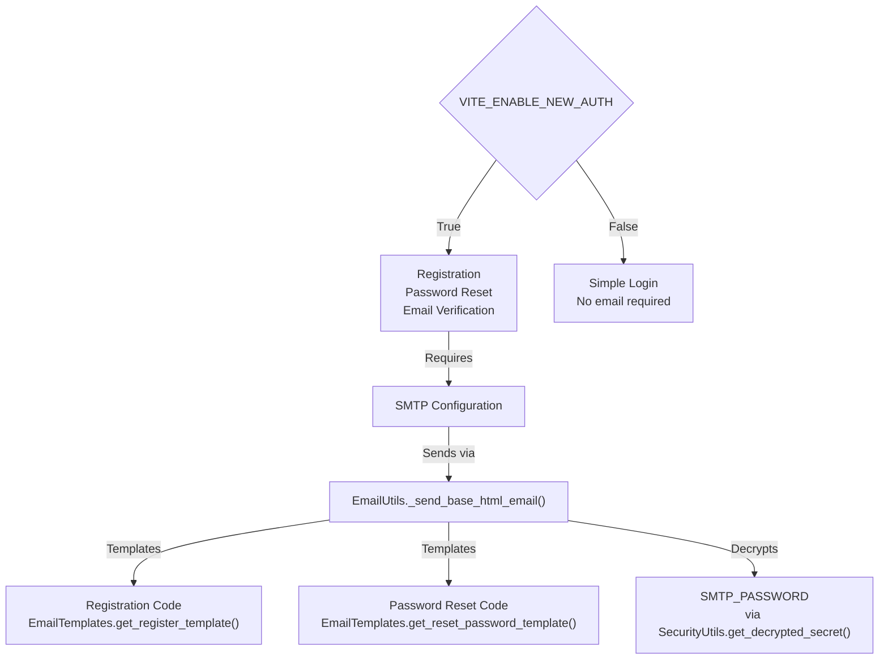

**Sources:** [.env.example:154-164](), [backend/openjiuwen_studio/core/config.py:83-91](), [backend/openjiuwen_studio/core/manager/email_manager/email_utils.py:16-66]()

---

## Production Environment Variables Template

### Complete Production .env.custom Example

```bash
# ========== Security Settings ==========
SECRET_KEY=<generated-with-python-secrets>
SERVICE_MODE=product
SERVER_AES_MASTER_KEY_ENV=<base64-encoded-32-byte-key>

# ========== Database Configuration ==========
DB_TYPE=mysql
DB_HOST=production-mysql.example.com
DB_PORT=3306
DB_USER=jiuwen_prod
DB_PASSWORD=<strong-db-password>
AGENT_DB_NAME=openjiuwen_agent
OPS_DB_NAME=openjiuwen_ops

# ========== Vector Store Configuration ==========
INDEX_MANAGER_TYPE=milvus
MILVUS_HOST=production-milvus.example.com
MILVUS_PORT=19530
MILVUS_TOKEN=<milvus-auth-token>
EMBEDDING_MODEL_DIMENTION=1024

# ========== Object Storage ==========
OBS_ACCESS_KEY_ID=<obs-access-key>
OBS_SECRET_ACCESS_KEY=<obs-secret-key>
OBS_SERVER=https://obs.region.cloud.com
OBS_BUCKET=jiuwen-production

# ========== Redis Configuration ==========
ENABLE_REDIS_CHECKPOINT=True
REDIS_HOST=production-redis.example.com
REDIS_PORT=6379
REDIS_PASSWORD=<redis-password>
REDIS_DB=0

# ========== Email/SMTP Configuration ==========
VITE_ENABLE_NEW_AUTH=True
SMTP_HOST=smtp.example.com
SMTP_PORT=465
SMTP_USER=noreply@example.com
SMTP_PASSWORD=<smtp-password>
SMTP_ALIAS=OpenJiuwen Platform

# ========== Performance Tuning ==========
WORKER_NUM=4
DEBUG=false
VITE_API_PROXY_TIMEOUT=600000
WORKFLOW_EXECUTE_TIMEOUT=600

# ========== JWT Configuration ==========
ACCESS_TOKEN_EXPIRE_MINUTES=60
REFRESH_TOKEN_EXPIRE_DAYS=7

# ========== Optional: Plugin & Sandbox Services ==========
VITE_PLUGIN_SERVICE_URL=http://plugin-server:8185
CODE_SANDBOX_URL=http://sandbox-gateway:8188/run
```

**Sources:** [.env.example:1-196]()

---

## Docker Production Deployment Variables

### Deployment-Time Variables (DEPLOY_VARS)

These variables control Docker container names, network configuration, and image versions:

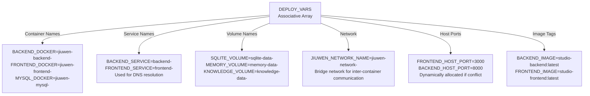

**Random Suffix Generation:**
The deployment script generates a 5-character random suffix to enable multiple isolated deployments on the same host:

```bash
# scripts/vars_handler.sh:5-7
generate_final_names() {
    local name_suffix=$(generate_random_chars)
    DEPLOY_VARS["NAME_SUFFIX"]=${name_suffix}
```

**Sources:** [scripts/global_vars.sh:27-61](), [scripts/vars_handler.sh:5-15](), [scripts/common.sh:30-63]()

### Runtime Variables (RUNTIME_VARS)

These are application-level settings passed to containers via environment files:

| Variable Category | Key Variables |
|-------------------|---------------|
| **Database** | `DB_TYPE`, `DB_HOST`, `DB_PORT`, `DB_USER`, `DB_PASSWORD` |
| **Security** | `SECRET_KEY`, `SERVICE_MODE`, `SERVER_AES_MASTER_KEY_ENV` |
| **Vector Store** | `INDEX_MANAGER_TYPE`, `MILVUS_HOST`, `MILVUS_PORT` |
| **Object Storage** | `MINIO_HOST`, `MINIO_ACCESS_KEY`, `MINIO_SECRET_KEY` |
| **Redis** | `ENABLE_REDIS_CHECKPOINT`, `REDIS_HOST`, `REDIS_PASSWORD` |
| **Performance** | `WORKER_NUM`, `DEBUG`, `WORKFLOW_EXECUTE_TIMEOUT` |
| **Frontend** | `VITE_API_BASE_URL`, `VITE_API_PROXY_TARGET` |

**Volume Mounting in Production:**

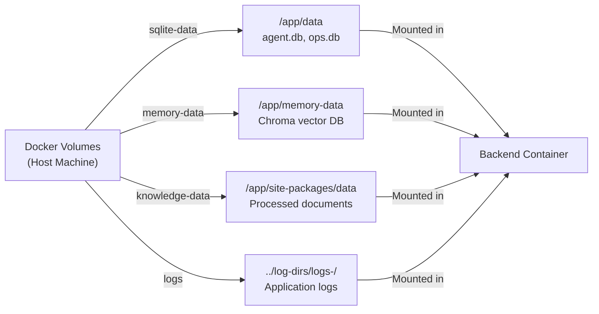

**Important:** Volume paths must be relative for Docker deployments. Absolute paths will cause deployment failure.

**Sources:** [scripts/global_vars.sh:132-150](), [scripts/vars_handler.sh:49-63](), [scripts/conf/docker-jiuwen.template.yml:17-26]()

---

## Network and Proxy Configuration

### CORS Configuration

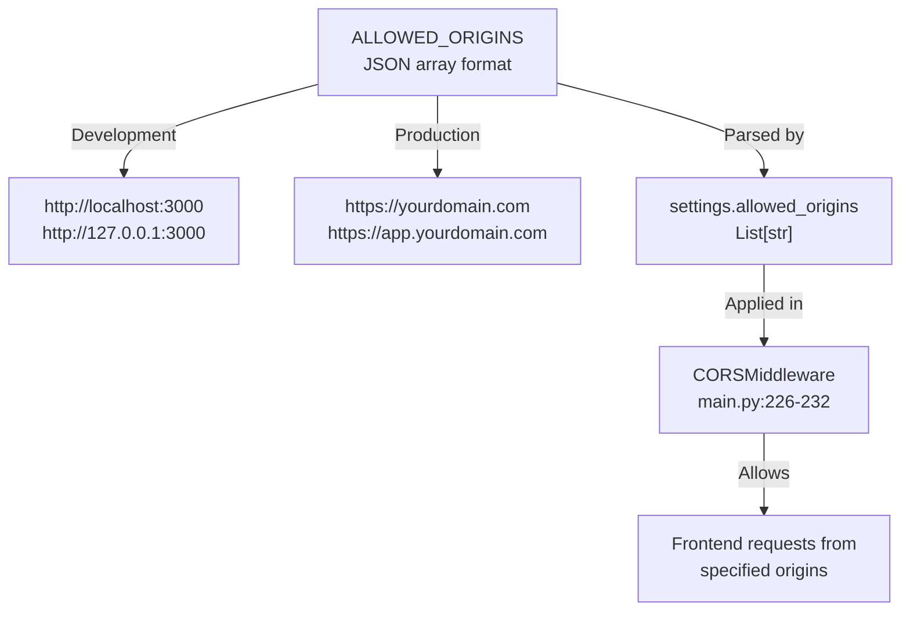

**Production CORS Configuration:**
```bash
# .env.custom
ALLOWED_ORIGINS=["https://app.example.com","https://example.com"]
```

**Sources:** [.env.example:67-68](), [backend/openjiuwen_studio/core/config.py:63-67](), [backend/openjiuwen_studio/main.py:226-232]()

### Proxy and No-Proxy Settings

For deployments behind corporate proxies:

```bash
# scripts/vars_handler.sh:17-47
setup_no_proxy_vars() {
    local no_proxy_addrs="localhost,127.0.0.1"
    # Add all container service names to no_proxy
    for addr in "${CONTAINERS_ADDRS[@]}"; do
        no_proxy_addrs="${no_proxy_addrs},${DEPLOY_VARS[${addr}]}"
    done
}
```

The deployment script automatically configures `no_proxy` and `NO_PROXY` environment variables to exclude internal container communication from proxy routing.

**Sources:** [scripts/vars_handler.sh:17-47](), [scripts/conf/docker-jiuwen.template.yml:9-14]()

---

## Health Checks and Monitoring

### Container Health Check Configuration

Each service defines health check endpoints for monitoring:

| Service | Health Check Endpoint | Interval | Timeout | Retries |
|---------|----------------------|----------|---------|---------|
| Backend | `http://localhost:8000/api/health` | 30s | 10s | 5 |
| Frontend | `https://localhost:3000/` | 30s | 5s | 3 |
| Plugin Server | `http://localhost:8185/system/health` | 30s | 10s | 5 |

**Backend Health Check Implementation:**

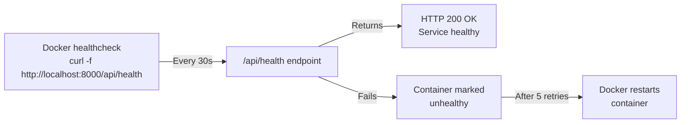

**Start Period:** Containers have a `start_period` (40-60s) during which failed health checks don't count toward the retry limit, allowing time for initialization.

**Sources:** [scripts/conf/docker-jiuwen.template.yml:29-34](), [scripts/conf/docker-jiuwen.template.yml:57-62](), [scripts/conf/docker-plugin.template.yml:18-29]()

---

## Logging Configuration

### Log Directory Structure

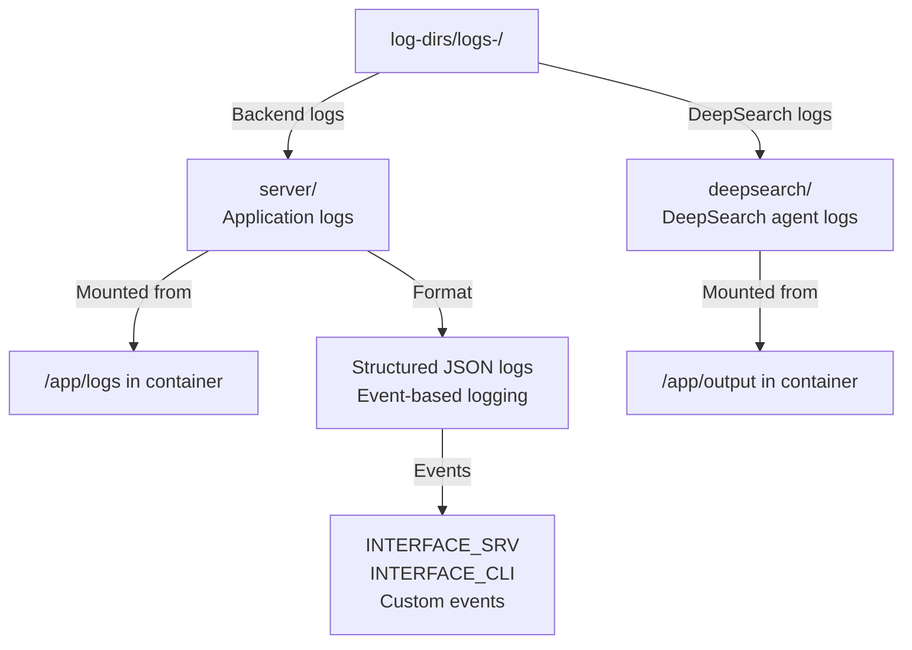

**Structured Logging Example:**

The backend uses event-based structured logging for production monitoring:

```python
# backend/openjiuwen_studio/main.py:189-198
interface_logger.info(
    "",
    event_type=CustomLogEventType.INTERFACE_SRV.value,
    interface_name=endpoint_name,
    execution_time_ms=round((time.perf_counter() - start_time) * 1000),
    error_code=str(response.status_code),
    metadata={"route_path": route_path}
)
```

**Log Event Types:**
- `INTERFACE_SRV`: Backend API request/response logging
- `INTERFACE_CLI`: Client-side API calls
- Custom events via `CustomLogEventType` enum

**Sources:** [scripts/conf/docker-jiuwen.template.yml:22](), [scripts/conf/docker-deepsearch.template.yml:20](), [backend/openjiuwen_studio/core/common/logging/events.py:1-50](), [backend/openjiuwen_studio/main.py:166-221]()

---

## Production Checklist

### Pre-Deployment Verification

| Category | Configuration | Status |
|----------|---------------|--------|
| **Security** | `SECRET_KEY` changed from default | ☐ |
| | `SERVICE_MODE=product` | ☐ |
| | `SERVER_AES_MASTER_KEY_ENV` set (base64) | ☐ |
| | `DEBUG=false` | ☐ |
| **Database** | `DB_TYPE=mysql` | ☐ |
| | External MySQL configured or container started | ☐ |
| | Database migrations applied | ☐ |
| **Vector Store** | `INDEX_MANAGER_TYPE=milvus` | ☐ |
| | Milvus cluster or container configured | ☐ |
| | AVX2 CPU support verified | ☐ |
| **Object Storage** | MinIO or OBS credentials configured | ☐ |
| | Bucket created and accessible | ☐ |
| **Redis** | `ENABLE_REDIS_CHECKPOINT=True` | ☐ |
| | Redis server configured with password | ☐ |
| **Email** | SMTP credentials configured (if using auth) | ☐ |
| | Email templates tested | ☐ |
| **Performance** | `WORKER_NUM` set appropriately | ☐ |
| | Timeout values adjusted for workload | ☐ |
| **CORS** | `ALLOWED_ORIGINS` set to production domains | ☐ |
| **SSL** | SSL certificates generated successfully | ☐ |
| **Monitoring** | Health checks passing for all services | ☐ |
| | Log aggregation configured | ☐ |

**Sources:** [.env.example:1-196]()

---

## Configuration Validation

The deployment script performs automatic validation before starting services:

```bash
# scripts/vars_handler.sh:49-63
valid_env_vars() {
    if [[ "${RUNTIME_VARS["MEMORY_DATA_PATH"]}" =~ ^/ ]]; then
        error "MEMORY_DATA_PATH only supports relative paths for container deployment!"
    fi
    
    if [[ "${RUNTIME_VARS["DB_TYPE"]}" == "mysql" &&
          -z "${RUNTIME_VARS["DB_HOST"]:-}" ]]; then
        error "Validation failed: DB_HOST is a mandatory configuration item!"
    fi
}
```

**Validation Rules:**
1. `MEMORY_DATA_PATH` must be a relative path (not absolute)
2. When `DB_TYPE=mysql`, `DB_HOST` must be defined
3. `VITE_API_PROXY_TIMEOUT` must be a valid integer
4. SSL password generation must succeed

**Sources:** [scripts/vars_handler.sh:49-81](), [scripts/template_handler.sh:54-61]()

---

