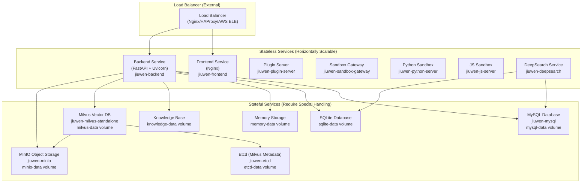
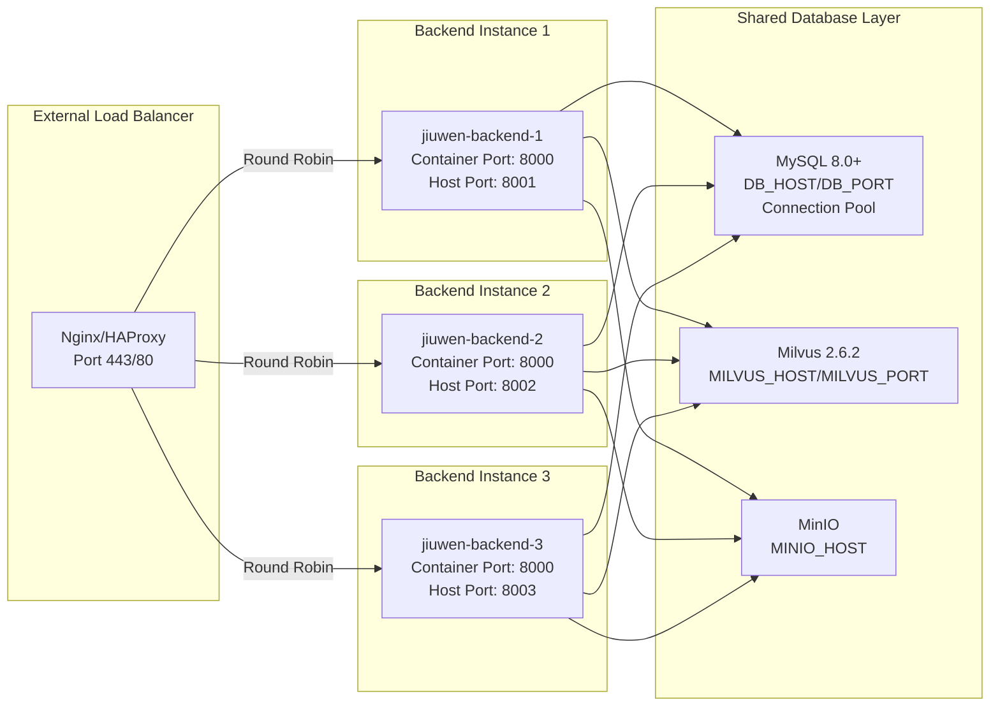
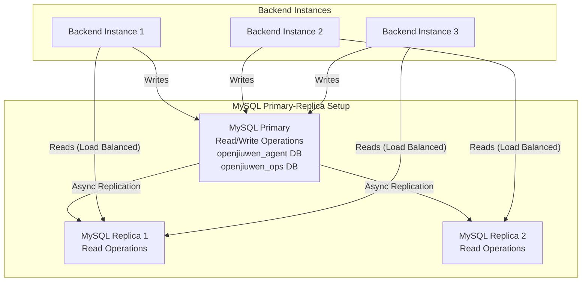
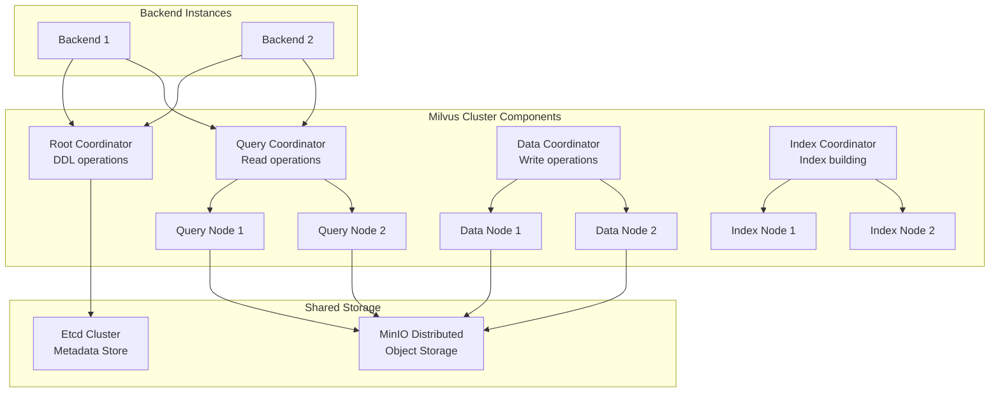
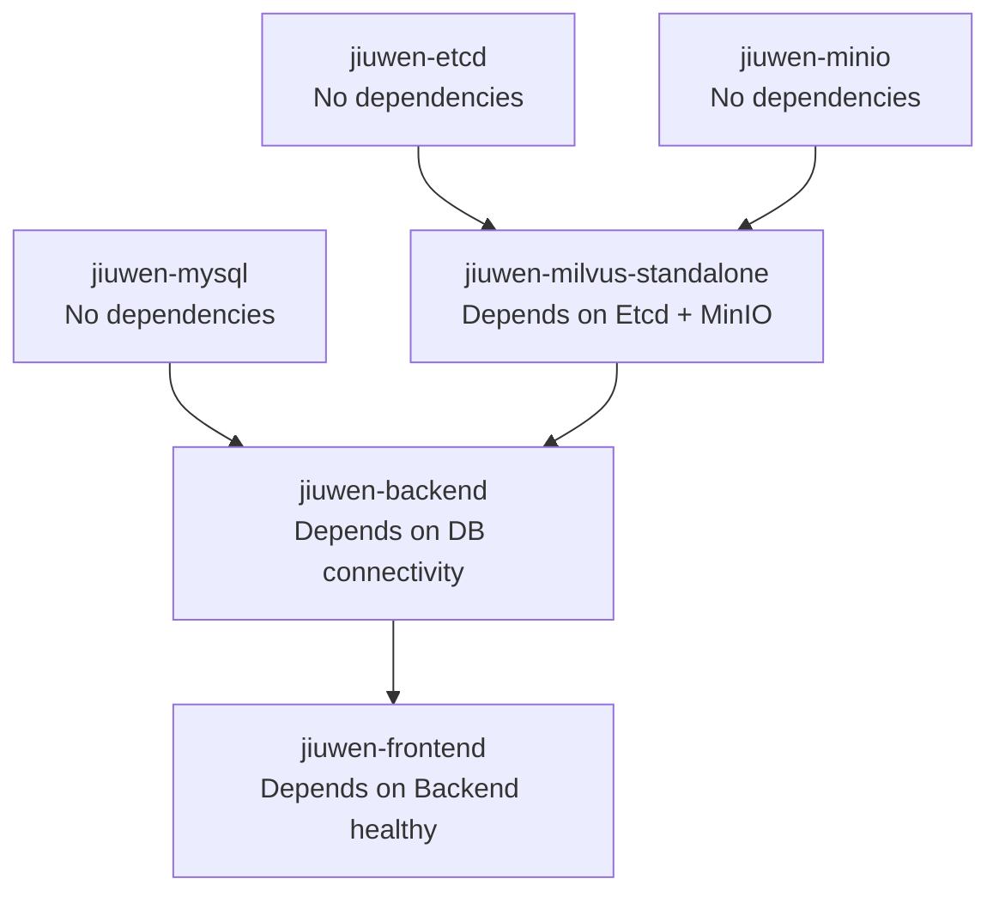
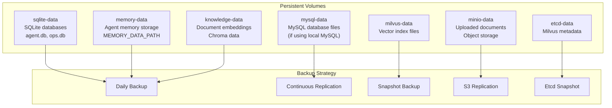
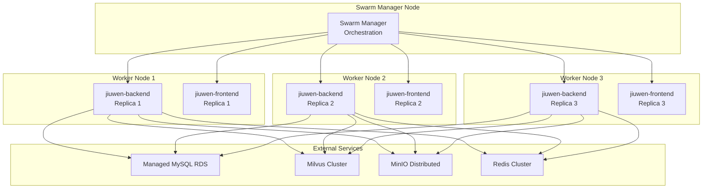

<!-- source: DeepWiki mcp.deepwiki.com · repo openJiuwen-ai/agent-studio · page 7.3 Scaling & High Availability · fetched 2026-11-02 -->

# Scaling & High Availability

<details>
<summary>Relevant source files</summary>

The following files were used as context for generating this wiki page:

- [backend/pyproject.toml](backend/pyproject.toml)
- [docs/en/2.Installation Guide/Install via Docker/Linux_Installation.md](docs/en/2.Installation Guide/Install via Docker/Linux_Installation.md)
- [docs/en/2.Installation Guide/Install via Docker/MacOS_Installation.md](docs/en/2.Installation Guide/Install via Docker/MacOS_Installation.md)
- [docs/en/2.Installation Guide/Install via Docker/Windows_Installation.md](docs/en/2.Installation Guide/Install via Docker/Windows_Installation.md)
- [scripts/.env.deploy.default](scripts/.env.deploy.default)
- [scripts/args_handler.sh](scripts/args_handler.sh)
- [scripts/common.sh](scripts/common.sh)
- [scripts/conf/docker-deepsearch.template.yml](scripts/conf/docker-deepsearch.template.yml)
- [scripts/conf/docker-jiuwen.template.yml](scripts/conf/docker-jiuwen.template.yml)
- [scripts/conf/docker-plugin.template.yml](scripts/conf/docker-plugin.template.yml)
- [scripts/envfile_handler.sh](scripts/envfile_handler.sh)
- [scripts/gen_ssl.sh](scripts/gen_ssl.sh)
- [scripts/global_vars.sh](scripts/global_vars.sh)
- [scripts/prompt_handler.sh](scripts/prompt_handler.sh)
- [scripts/service.sh](scripts/service.sh)
- [scripts/template_handler.sh](scripts/template_handler.sh)
- [scripts/vars_handler.sh](scripts/vars_handler.sh)

</details>


This document provides technical guidance for scaling OpenJiuwen Agent Studio horizontally and configuring it for high availability in production environments. It covers service architecture, deployment patterns, load balancing strategies, and configuration options for achieving fault tolerance and performance at scale.

For Docker deployment basics, see [Docker Deployment](#7.1). For production configuration settings, see [Production Configuration](#7.2). For backup and disaster recovery, see [Backup & Recovery](#7.5).

## Architecture for Scaling

OpenJiuwen Agent Studio consists of multiple independent services that can be scaled separately based on workload requirements. Understanding the stateful vs. stateless nature of each component is critical for designing a scalable architecture.

### Component Classification

The system separates into **stateless services** (which can be horizontally scaled) and **stateful services** (which require careful scaling strategies):



**Sources:** [scripts/global_vars.sh:27-61](), [scripts/conf/docker-jiuwen.template.yml:1-72]()

### Service Dependency Matrix

Understanding dependencies is crucial for scaling decisions:

| Service | Dependencies | Scaling Strategy | Notes |
|---------|-------------|------------------|-------|
| `jiuwen-backend` | MySQL/SQLite, Milvus/Chroma, MinIO | Horizontal | Stateless, shares DB connections |
| `jiuwen-frontend` | `jiuwen-backend` | Horizontal | Static assets, reverse proxy |
| `jiuwen-mysql` | None | Vertical + Replication | Use external managed DB for HA |
| `jiuwen-milvus-standalone` | `jiuwen-etcd`, `jiuwen-minio` | Cluster Mode | Switch to Milvus cluster for HA |
| `jiuwen-minio` | None | Distributed Mode | Use MinIO distributed for HA |
| `jiuwen-etcd` | None | Multi-node Cluster | Required for Milvus HA |
| `jiuwen-plugin-server` | None | Horizontal | Stateless service |
| `jiuwen-sandbox-gateway` | Python/JS servers | Horizontal | Stateless gateway |
| `jiuwen-deepsearch` | MySQL/SQLite | Horizontal | Stateless, shares DB |

**Sources:** [scripts/global_vars.sh:162-170](), [scripts/vars_handler.sh:84-178]()

## Horizontal Scaling Strategies

### Backend Service Scaling

The `jiuwen-backend` service is designed as a stateless FastAPI application running on Uvicorn. Multiple instances can be deployed behind a load balancer.

#### Multi-Instance Deployment Pattern



**Configuration Steps:**

1. **Deploy Multiple Backend Instances** - Use the `-n` flag to create separate service stacks:

```bash
# Instance 1
./service.sh up -n jiuwen
# Edit .env to set BACKEND_HOST_PORT=8001

# Instance 2  
./service.sh up -n jiuwen
# Edit .env to set BACKEND_HOST_PORT=8002

# Instance 3
./service.sh up -n jiuwen  
# Edit .env to set BACKEND_HOST_PORT=8003
```

2. **Configure Shared External Database** - All instances must point to the same database. Set in `.env.custom`:

```bash
# Disable local MySQL container
DB_TYPE=mysql
DB_HOST=external-mysql.example.com
DB_PORT=3306
DB_USER=root
DB_PASSWORD=<secure-password>
```

3. **Configure Shared Vector Store** - Set in `.env.custom`:

```bash
INDEX_MANAGER_TYPE=milvus
MILVUS_HOST=external-milvus.example.com
MILVUS_PORT=19530
```

4. **Configure Shared Object Storage** - Set in `.env.custom`:

```bash
MINIO_HOST=external-minio.example.com
MINIO_PORT=9000
```

**Sources:** [scripts/envfile_handler.sh:46-106](), [scripts/vars_handler.sh:84-178]()

#### Session Management Considerations

The backend uses JWT tokens for authentication stored in Redis for session management. For multi-instance deployments:

```bash
# Configure shared Redis instance in .env.custom
REDIS_HOST=external-redis.example.com
REDIS_PORT=6379
REDIS_PASSWORD=<secure-password>
```

**Sources:** [backend/pyproject.toml:32]()

### Database Scaling

#### MySQL High Availability

For production deployments, use external managed MySQL with replication:



**Configuration:**

Disable local MySQL container and configure external database:

```bash
# In .env.custom
DB_TYPE=mysql
DB_HOST=mysql-primary.example.com
DB_PORT=3306
DB_USER=root
DB_PASSWORD=<secure-password>

# Database names (auto-created by backend)
# openjiuwen_agent - Agent configurations
# openjiuwen_ops - Operational data
```

**Connection Pooling:** The backend uses SQLAlchemy with aiomysql for async database operations. Connection pool settings are managed internally by the framework.

**Sources:** [backend/pyproject.toml:16,21](), [scripts/vars_handler.sh:96-108]()

### Vector Store Scaling

#### Milvus Cluster Mode

For production workloads requiring high availability, deploy Milvus in cluster mode instead of standalone:



**Configuration:**

Instead of using the bundled `jiuwen-milvus-standalone`, configure external Milvus cluster:

```bash
# In .env.custom
INDEX_MANAGER_TYPE=milvus
MILVUS_HOST=milvus-cluster.example.com
MILVUS_PORT=19530

# Ensure MinIO is also external
MINIO_HOST=minio-cluster.example.com
MINIO_PORT=9000
```

The system will detect external Milvus/MinIO and skip local container deployment.

**Sources:** [scripts/vars_handler.sh:109-125](), [scripts/global_vars.sh:36-43]()

#### Chroma Limitations

Chroma is an embedded vector database suitable for development but **not recommended for production scaling**. It stores data locally in the `memory-data` volume and does not support clustering. For production, use Milvus cluster mode.

**Sources:** [backend/pyproject.toml:19]()

### Load Balancer Configuration

#### Nginx Load Balancer Example

External load balancer configuration for distributing traffic across backend instances:

```nginx
upstream backend_cluster {
    least_conn;  # Use least connections algorithm
    
    server 192.168.1.10:8001 max_fails=3 fail_timeout=30s;
    server 192.168.1.11:8002 max_fails=3 fail_timeout=30s;
    server 192.168.1.12:8003 max_fails=3 fail_timeout=30s;
}

server {
    listen 443 ssl http2;
    server_name studio.example.com;
    
    ssl_certificate /etc/nginx/ssl/certificate.crt;
    ssl_private_key /etc/nginx/ssl/private.key;
    
    # Frontend static files
    location / {
        proxy_pass https://192.168.1.10:3001;
        proxy_set_header Host $host;
        proxy_set_header X-Real-IP $remote_addr;
        proxy_set_header X-Forwarded-For $proxy_add_x_forwarded_for;
        proxy_set_header X-Forwarded-Proto $scheme;
    }
    
    # Backend API - Load balanced
    location /api/ {
        proxy_pass http://backend_cluster;
        proxy_set_header Host $host;
        proxy_set_header X-Real-IP $remote_addr;
        proxy_set_header X-Forwarded-For $proxy_add_x_forwarded_for;
        proxy_set_header X-Forwarded-Proto $scheme;
        
        # Important for SSE streaming endpoints
        proxy_buffering off;
        proxy_cache off;
        proxy_read_timeout 300s;
        proxy_connect_timeout 75s;
        
        # WebSocket support (if needed)
        proxy_http_version 1.1;
        proxy_set_header Upgrade $http_upgrade;
        proxy_set_header Connection "upgrade";
    }
    
    # Health check endpoint (not load balanced)
    location /health {
        proxy_pass http://192.168.1.10:8001/api/health;
        access_log off;
    }
}
```

**Session Affinity:** Not required. The backend uses stateless JWT authentication, so requests can be routed to any instance.

**Sources:** [scripts/conf/docker-jiuwen.template.yml:30](), [scripts/vars_handler.sh:73-79]()

## High Availability Configuration

### Container Restart Policies

All services in the Docker Compose templates use `restart: unless-stopped` to ensure automatic recovery from failures:

```yaml
# From docker-jiuwen.template.yml
services:
  backend:
    restart: unless-stopped
    healthcheck:
      test: ["CMD", "curl", "-f", "http://localhost:8000/api/health"]
      interval: 30s
      timeout: 10s
      retries: 5
      start_period: 60s
```

**Sources:** [scripts/conf/docker-jiuwen.template.yml:28-34]()

### Service Health Checks

Each service implements health check endpoints and Docker health check configurations:

| Service | Health Check Endpoint | Interval | Timeout | Retries | Start Period |
|---------|----------------------|----------|---------|---------|--------------|
| `jiuwen-backend` | `http://localhost:8000/api/health` | 30s | 10s | 5 | 60s |
| `jiuwen-frontend` | `https://localhost:<port>/` | 30s | 5s | 3 | 10s |
| `jiuwen-plugin-server` | `http://localhost:8185/system/health` | 30s | 10s | 5 | 60s |
| `jiuwen-deepsearch` | `http://localhost:8000/api/health` | 30s | 10s | 3 | 40s |

**Sources:** [scripts/conf/docker-jiuwen.template.yml:29-34,57-62](), [scripts/conf/docker-plugin.template.yml:18-29](), [scripts/conf/docker-deepsearch.template.yml:24-35]()

### Service Dependency Management

Docker Compose `depends_on` with health checks ensures proper startup order:



```yaml
# From docker-jiuwen.template.yml
frontend:
  depends_on:
    backend:
      condition: service_healthy
```

This ensures the frontend only starts after the backend passes health checks, preventing startup race conditions.

**Sources:** [scripts/conf/docker-jiuwen.template.yml:51-53]()

### Volume Management for High Availability

Critical data volumes that must be backed up and potentially replicated:



**Volume Location:** Docker volumes are stored in `/var/lib/docker/volumes/` by default. For production:

1. **Use Named Volumes with External Storage:** Mount volumes to high-availability shared storage (NFS, EBS, etc.)
2. **Regular Snapshots:** Implement automated volume snapshots
3. **Replication:** Use storage-level replication for critical volumes

**Sources:** [scripts/global_vars.sh:34-50](), [scripts/conf/docker-jiuwen.template.yml:64-67]()

## Production Deployment Patterns

### Pattern 1: Multi-Host Docker Swarm

Deploy across multiple Docker hosts using Docker Swarm for orchestration:



**Key Configuration:**

```bash
# Convert Docker Compose to Swarm stack
docker stack deploy -c docker-jiuwen.yml jiuwen

# Scale backend service
docker service scale jiuwen_backend=3
```

**Sources:** [scripts/conf/docker-jiuwen.template.yml:1-72]()

### Pattern 2: Kubernetes Deployment

For enterprise-scale deployments, convert Docker Compose to Kubernetes manifests:

```yaml
# Backend Deployment
apiVersion: apps/v1
kind: Deployment
metadata:
  name: jiuwen-backend
spec:
  replicas: 3
  selector:
    matchLabels:
      app: jiuwen-backend
  template:
    metadata:
      labels:
        app: jiuwen-backend
    spec:
      containers:
      - name: backend
        image: studio-backend:latest
        ports:
        - containerPort: 8000
        env:
        - name: DB_TYPE
          value: "mysql"
        - name: DB_HOST
          value: "mysql-service"
        - name: DB_PORT
          value: "3306"
        envFrom:
        - configMapRef:
            name: runtime-config
        livenessProbe:
          httpGet:
            path: /api/health
            port: 8000
          initialDelaySeconds: 60
          periodSeconds: 30
        readinessProbe:
          httpGet:
            path: /api/health
            port: 8000
          initialDelaySeconds: 10
          periodSeconds: 5
---
# Backend Service
apiVersion: v1
kind: Service
metadata:
  name: backend-service
spec:
  selector:
    app: jiuwen-backend
  ports:
  - protocol: TCP
    port: 8000
    targetPort: 8000
  type: ClusterIP
```

**Sources:** [scripts/conf/docker-jiuwen.template.yml:2-34]()

### Pattern 3: External Database Configuration

For maximum reliability, use managed database services and disable local containers:

```bash
# .env.custom configuration
DB_TYPE=mysql
DB_HOST=rds.mysql.example.com
DB_PORT=3306
DB_USER=jiuwen_admin
DB_PASSWORD=<secure-password>

INDEX_MANAGER_TYPE=milvus
MILVUS_HOST=milvus.internal.example.com
MILVUS_PORT=19530

MINIO_HOST=s3.example.com
MINIO_PORT=443
MINIO_USE_SSL=true

REDIS_HOST=redis.cluster.example.com
REDIS_PORT=6379
```

When external hosts are provided, the deployment script automatically disables local container deployment:

```bash
# vars_handler.sh logic
if [ -n "${RUNTIME_VARS["DB_HOST"]:-}" ]; then
    DEPLOY_VARS["HAS_MYSQL"]="false"  # Skip local MySQL
fi

if [ -n "${RUNTIME_VARS["MILVUS_HOST"]:-}" ]; then
    DEPLOY_VARS["HAS_MILVUS"]="false"  # Skip Milvus stack
fi
```

**Sources:** [scripts/vars_handler.sh:96-125]()

## Monitoring & Auto-Recovery

### Health Check Monitoring

Implement external monitoring for service health endpoints:

```bash
# Example health check script
#!/bin/bash
BACKEND_URLS=(
    "http://192.168.1.10:8001/api/health"
    "http://192.168.1.11:8002/api/health"
    "http://192.168.1.12:8003/api/health"
)

for url in "${BACKEND_URLS[@]}"; do
    status=$(curl -s -o /dev/null -w "%{http_code}" "$url")
    if [ "$status" != "200" ]; then
        echo "ALERT: Backend at $url returned status $status"
        # Trigger restart or alert
    fi
done
```

### Container Auto-Restart

Docker automatically restarts failed containers with `restart: unless-stopped`:

```yaml
# Restart policy guarantees
- Container exits with error: Auto-restart
- Host reboot: Auto-start (unless manually stopped)
- Manual stop: No auto-restart
- Docker daemon restart: Auto-start
```

**Sources:** [scripts/conf/docker-jiuwen.template.yml:28]()

### Log Aggregation

All container logs are stored in the `log-dirs/logs-<NAME_SUFFIX>/` directory:

```
log-dirs/
└── logs-<random-suffix>/
    ├── server/          # Backend logs
    └── deepsearch/      # DeepSearch logs
```

**Volume Mounts:**
- Backend logs: `../log-dirs/logs-<<NAME_SUFFIX>>/server:/app/logs`
- DeepSearch logs: `../log-dirs/logs-<<NAME_SUFFIX>>/deepsearch:/app/output`

**Sources:** [scripts/conf/docker-jiuwen.template.yml:22](), [scripts/conf/docker-deepsearch.template.yml:20]()

## Limitations & Considerations

### Current Limitations

1. **SQLite Not Recommended for Multi-Instance:** SQLite databases (`sqlite-data` volume) do not support concurrent writes from multiple backend instances. Use MySQL for horizontal scaling.

2. **Chroma Not Clusterable:** The embedded Chroma vector database cannot be shared across instances. Use Milvus cluster for production.

3. **Volume Locking:** Multiple containers cannot mount the same local volume for read-write simultaneously without distributed file systems.

4. **Single-Node Milvus:** The bundled `jiuwen-milvus-standalone` is not HA-ready. Deploy external Milvus cluster.

**Sources:** [scripts/vars_handler.sh:96-108]()

### Scaling Decision Matrix

| Component | 1-10 Users | 10-100 Users | 100-1000 Users | 1000+ Users |
|-----------|-----------|--------------|----------------|-------------|
| Backend Instances | 1 | 2-3 | 3-5 | 5+ |
| Database | SQLite OK | MySQL Single | MySQL Replica | MySQL Cluster |
| Vector Store | Chroma OK | Milvus Standalone | Milvus Cluster | Milvus Cluster + Sharding |
| Object Storage | Local MinIO | Local MinIO | MinIO Distributed | S3-Compatible Cloud |
| Load Balancer | None | Nginx | Nginx/HAProxy | Cloud LB (ELB/ALB) |

### Network Considerations

The deployment script configures proxy bypass for internal container communication via `no_proxy` variables:

```bash
# Generated by setup_no_proxy_vars()
no_proxy=localhost,127.0.0.1,<HOST_IP>,jiuwen-backend,jiuwen-mysql,jiuwen-milvus,...
```

This ensures:
- Containers can communicate without proxy interference
- HTTP_PROXY/HTTPS_PROXY only affect external API calls

**Sources:** [scripts/vars_handler.sh:17-47]()

### Port Allocation

The system dynamically allocates ports from the range `3000-65535` to avoid conflicts:

```bash
# Port variables in global_vars.sh
PORTS=(
    FRONTEND_HOST_PORT      # Default: 3001
    MYSQL_HOST_PORT         # Default: 3307
    BACKEND_HOST_PORT       # Default: 8000
    MILVUS_HOST_PORT        # Default: 19530
    # ... more services
)
```

For multi-instance deployments, manually assign unique ports in `.env.custom` to prevent conflicts.

**Sources:** [scripts/global_vars.sh:64-78](), [scripts/ports_handler.sh]()

---

This document provides the foundation for scaling OpenJiuwen Agent Studio to production workloads. For specific deployment scenarios, combine these strategies based on your performance, availability, and budget requirements. Always test scaling configurations in a staging environment before production deployment.

---

