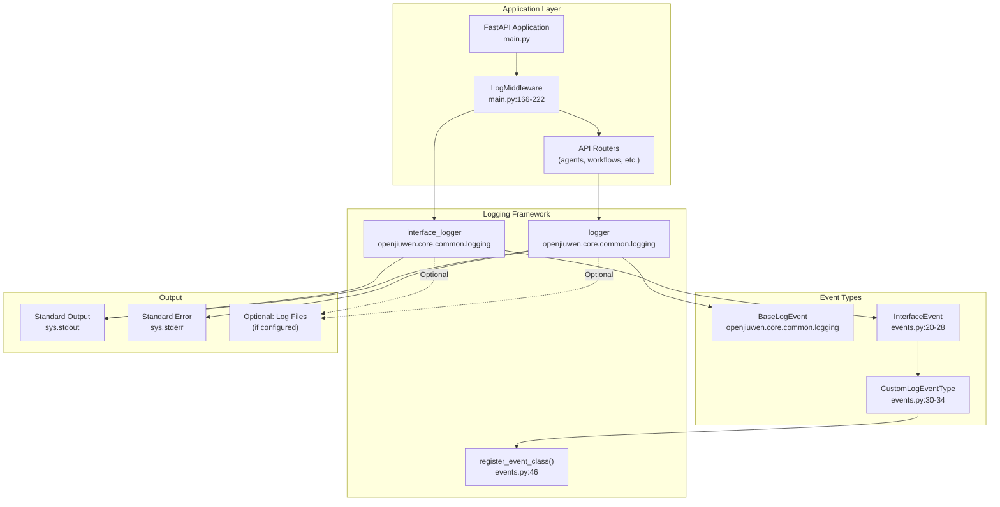
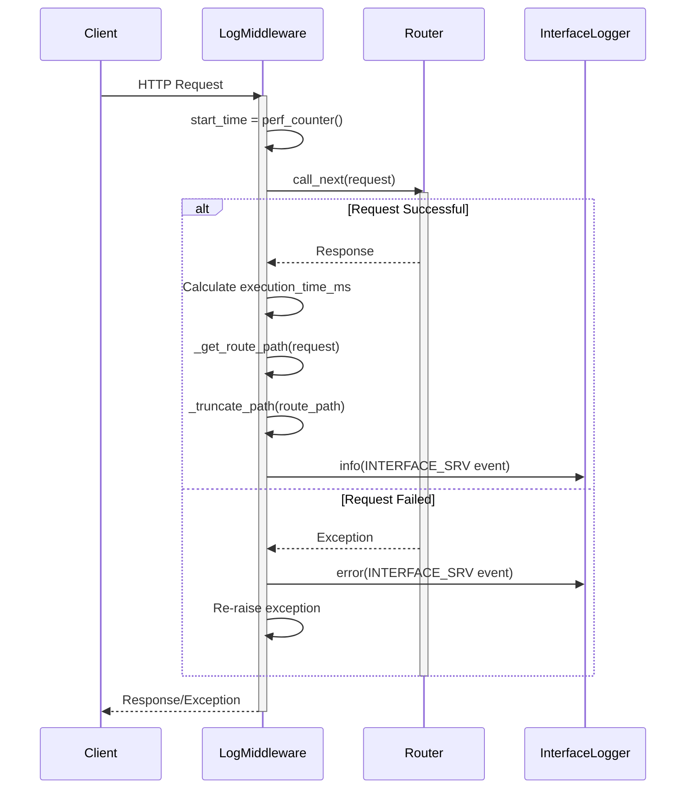
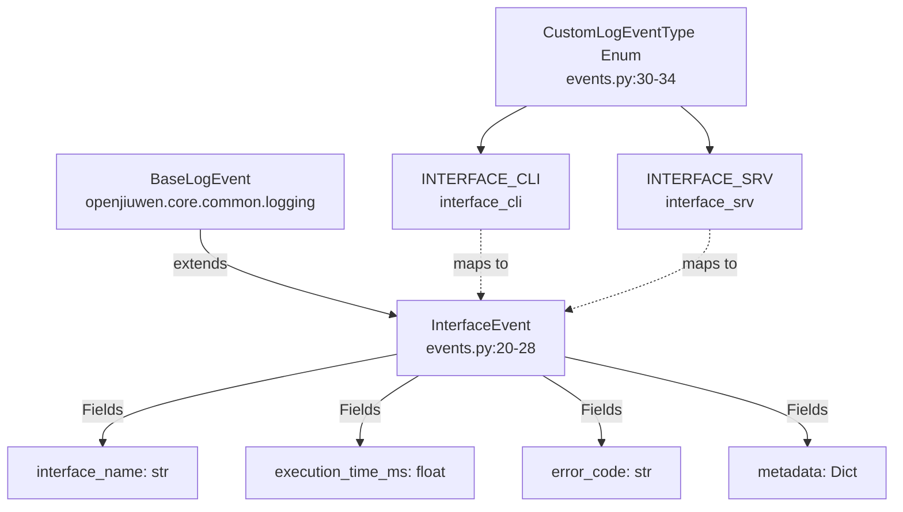
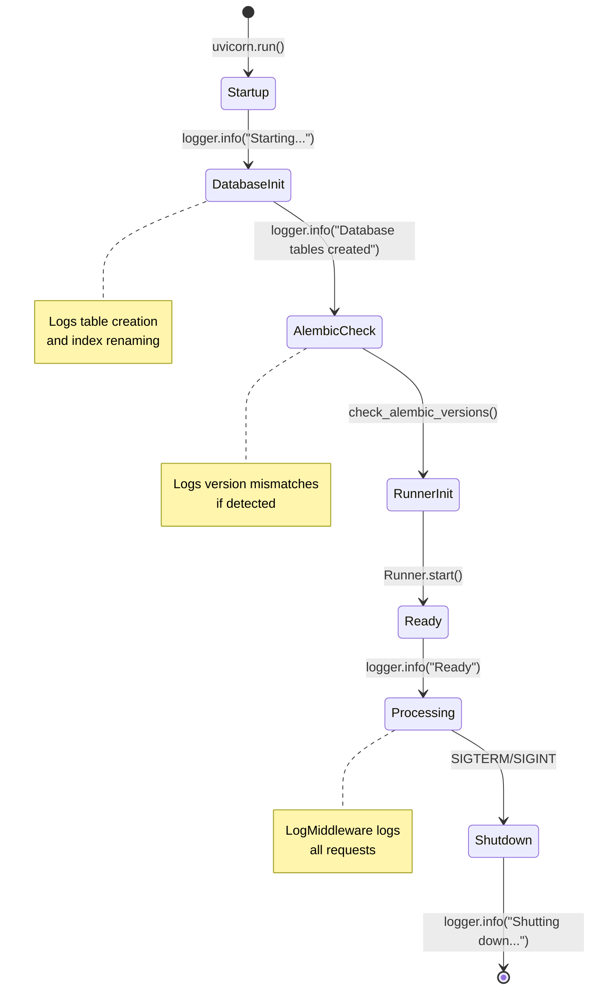

<!-- source: DeepWiki mcp.deepwiki.com · repo openJiuwen-ai/agent-studio · page 7.4 Monitoring & Logging · fetched 2026-11-02 -->

# Monitoring & Logging

<details>
<summary>Relevant source files</summary>

The following files were used as context for generating this wiki page:

- [.env.example](.env.example)
- [backend/openjiuwen_studio/core/common/logging/__init__.py](backend/openjiuwen_studio/core/common/logging/__init__.py)
- [backend/openjiuwen_studio/core/common/logging/events.py](backend/openjiuwen_studio/core/common/logging/events.py)
- [backend/openjiuwen_studio/core/config.py](backend/openjiuwen_studio/core/config.py)
- [backend/openjiuwen_studio/core/manager/convertor/components/sub_workflow.py](backend/openjiuwen_studio/core/manager/convertor/components/sub_workflow.py)
- [backend/openjiuwen_studio/core/manager/email_manager/__init__.py](backend/openjiuwen_studio/core/manager/email_manager/__init__.py)
- [backend/openjiuwen_studio/core/manager/email_manager/email_template.py](backend/openjiuwen_studio/core/manager/email_manager/email_template.py)
- [backend/openjiuwen_studio/core/manager/email_manager/email_utils.py](backend/openjiuwen_studio/core/manager/email_manager/email_utils.py)
- [backend/openjiuwen_studio/core/manager/redis_manager/__init__.py](backend/openjiuwen_studio/core/manager/redis_manager/__init__.py)
- [backend/openjiuwen_studio/core/manager/utils/utils.py](backend/openjiuwen_studio/core/manager/utils/utils.py)
- [backend/openjiuwen_studio/main.py](backend/openjiuwen_studio/main.py)

</details>


This page describes the monitoring and logging infrastructure in OpenJiuwen Agent Studio, including the logging architecture, custom event types, middleware implementation, configuration options, and how to access and interpret logs. This documentation covers both application-level logging and infrastructure-level monitoring.

For deployment configuration details, see [Production Configuration](#7.2). For troubleshooting using logs, see [Runtime Errors](#9.2).

---

## Overview

OpenJiuwen Agent Studio implements a structured logging system that captures:

- **HTTP Request/Response Metrics**: Execution time, status codes, route paths
- **Application Events**: Database operations, model invocations, document processing
- **Error Tracking**: Exceptions, validation failures, external service errors
- **Operational Events**: Email delivery, version checks, system startup/shutdown

The logging system is built on a custom event-based architecture that extends the base logging framework with domain-specific event types and structured metadata.

**Sources**: [backend/openjiuwen_studio/main.py:1-277](), [backend/openjiuwen_studio/core/common/logging/events.py:1-50]()

---

## Logging Architecture

### Core Components



**Diagram: Logging System Architecture**

The logging system consists of three layers:
1. **Application Layer**: Captures events through middleware and service calls
2. **Logging Framework**: Provides structured logging with custom event types
3. **Output Layer**: Writes logs to stdout/stderr (and optionally to files)

**Sources**: [backend/openjiuwen_studio/main.py:166-224](), [backend/openjiuwen_studio/core/common/logging/events.py:1-50]()

---

## Log Middleware Implementation

### LogMiddleware Class

The `LogMiddleware` class intercepts all HTTP requests and logs execution metrics:



**Diagram: Request Logging Flow**

**Sources**: [backend/openjiuwen_studio/main.py:166-222]()

### Key Methods

| Method | Purpose | Implementation |
|--------|---------|----------------|
| `dispatch()` | Main middleware entry point | [main.py:167-199]() |
| `_get_route_path()` | Extract matched route pattern | [main.py:210-221]() |
| `_truncate_path()` | Shorten path for readability | [main.py:202-207]() |

The middleware captures:
- **Execution Time**: Measured with `time.perf_counter()` for high precision
- **Status Code**: HTTP response status
- **Route Path**: Matched route pattern (e.g., `/api/v1/agents/{agent_id}`)
- **Interface Name**: Truncated path for grouping (limited to 3 path segments)

**Sources**: [backend/openjiuwen_studio/main.py:166-222]()

---

## Custom Log Events

### Event Type Hierarchy



**Diagram: Log Event Type System**

**Sources**: [backend/openjiuwen_studio/core/common/logging/events.py:1-50]()

### InterfaceEvent Structure

The `InterfaceEvent` class extends `BaseLogEvent` with interface-specific fields:

| Field | Type | Description |
|-------|------|-------------|
| `interface_name` | `str` | Truncated endpoint path (e.g., `/api/v1/agents`) |
| `execution_time_ms` | `float` | Request execution time in milliseconds |
| `error_code` | `str` | HTTP status code (e.g., `200`, `500`) |
| `metadata` | `Dict` | Additional context (e.g., full `route_path`) |
| `module_type` | `ModuleType` | Always set to `ModuleType.SYSTEM` |

**Sources**: [backend/openjiuwen_studio/core/common/logging/events.py:20-28]()

### Event Registration

Custom events are registered at module import time:

```python
# From events.py:43-49
def regist_log_event():
    for event_type_enum, event_class in _CUSTOM_EVENT_CLASS_MAP.items():
        register_event_class(event_type_enum.value, event_class)

regist_log_event()
```

**Sources**: [backend/openjiuwen_studio/core/common/logging/events.py:43-49]()

---

## Configuration

### Environment Variables

Logging behavior is controlled through environment variables in `.env`:

| Variable | Default | Description |
|----------|---------|-------------|
| `DEBUG` | `false` | Enable debug-level logging |
| `HOST` | `0.0.0.0` | Server host (affects logging context) |
| `BACKEND_PORT` | `8000` | Server port (affects logging context) |
| `WORKER_NUM` | `1` | Number of Uvicorn workers |

**Sources**: [.env.example:48-49](), [backend/openjiuwen_studio/main.py:249-258]()

### Uvicorn Logging Configuration

Uvicorn is configured with logging parameters in the `main()` function:

```python
# From main.py:249-258
config = {
    "host": os.getenv("HOST", "0.0.0.0"),
    "port": int(os.getenv("BACKEND_PORT", "8000")),
    "reload": False,
    "log_level": "info",
    "access_log": True,
    "workers": int(os.getenv("WORKER_NUM", 1))
}
```

| Parameter | Value | Purpose |
|-----------|-------|---------|
| `log_level` | `"info"` | Minimum log level (info, warning, error, critical) |
| `access_log` | `True` | Enable Uvicorn's access logging |
| `reload` | `False` | Hot reload disabled for production |

**Sources**: [backend/openjiuwen_studio/main.py:247-273]()

### Output Encoding

The application ensures UTF-8 encoding for log output:

```python
# From main.py:50-51
sys.stdout = io.TextIOWrapper(sys.stdout.buffer, encoding='utf-8')
sys.stderr = io.TextIOWrapper(sys.stderr.buffer, encoding='utf-8')
```

**Sources**: [backend/openjiuwen_studio/main.py:50-51]()

---

## Logging Points Throughout the System

### Application Lifecycle Events



**Diagram: Application Lifecycle Logging**

**Sources**: [backend/openjiuwen_studio/main.py:54-146]()

### Startup Sequence Logs

The application logs the following during startup:

1. **Service Start**: `"🚀 Starting Jiuwen Agent Studio Backend..."` [main.py:57]()
2. **Index Renaming** (SQLite only): Per-index rename logs [main.py:105]()
3. **Database Tables**: `"✅ Database tables created"` [main.py:125]()
4. **Alembic Check**: Version verification results [main.py:121]()
5. **Runner Initialization**: Redis checkpoint configuration [main.py:128-140]()
6. **Server Info**: Host, port, docs URL [main.py:260-266]()

**Sources**: [backend/openjiuwen_studio/main.py:54-146](), [backend/openjiuwen_studio/main.py:247-273]()

### Request/Response Logging

Every HTTP request generates two log entries:

**Successful Request**:
```
interface_logger.info(
    event_type=INTERFACE_SRV,
    interface_name="/api/v1/agents",
    execution_time_ms=42.5,
    error_code="200",
    metadata={"route_path": "/api/v1/agents/{agent_id}"}
)
```

**Failed Request**:
```
interface_logger.error(
    event_type=INTERFACE_SRV,
    interface_name="/api/v1/workflows",
    execution_time_ms=128.3,
    exception="Validation error: invalid workflow_id",
    error_code="500",
    metadata={"route_path": "/api/v1/workflows/{workflow_id}"}
)
```

**Sources**: [backend/openjiuwen_studio/main.py:172-198]()

### Error Logging Examples

Various error scenarios are logged throughout the system:

| Location | Event | Log Level | Example |
|----------|-------|-----------|---------|
| Version Check | Invalid version format | `ERROR` | `"Invalid latest version format: {version}"` |
| Email Sending | SMTP auth failure | `ERROR` | `"SMTP authentication failed: check auth code"` |
| Email Sending | Connection timeout | `ERROR` | `"SMTP connection failed or timed out"` |
| Sub-workflow | Missing config | `WARNING` | `"Sub-workflow config is None for node {id}"` |
| Conversion | Parameter error | `ERROR` | `"[AGENT_CONVERT] failed to convert parameters..."` |
| Version Reading | File not found | `WARNING` | `"Failed to get current project version..."` |

**Sources**: [backend/openjiuwen_studio/core/manager/utils/utils.py:77-145](), [backend/openjiuwen_studio/core/manager/email_manager/email_utils.py:39-52](), [backend/openjiuwen_studio/core/manager/convertor/components/sub_workflow.py:23]()

---

## Log Format and Structure

### Standard Logger Usage

The base `logger` is used for general application logging:

```python
from openjiuwen.core.common.logging import logger

# Info level
logger.info("Database tables created")
logger.info(f"Renamed index: {old_name} ---> {new_name}")

# Warning level
logger.warning(f"Table {name} has no indexes attribute")

# Error level
logger.error(f"Invalid version format: {version}")
logger.exception(f"Failed to send email to {email}")
```

**Sources**: [backend/openjiuwen_studio/main.py:57-145](), [backend/openjiuwen_studio/core/manager/utils/utils.py:77-144]()

### Interface Logger Usage

The `interface_logger` is specifically for HTTP interface metrics:

```python
from openjiuwen.core.common.logging import interface_logger
from openjiuwen_studio.core.common.logging.events import CustomLogEventType

# Success logging
interface_logger.info(
    "",  # Message can be empty
    event_type=CustomLogEventType.INTERFACE_SRV.value,
    interface_name="/api/v1/agents",
    execution_time_ms=round((time.perf_counter() - start_time) * 1000),
    error_code=str(response.status_code),
    metadata={"route_path": route.path}
)

# Error logging
interface_logger.error(
    "Request failed",
    event_type=CustomLogEventType.INTERFACE_SRV.value,
    interface_name=request.url.path,
    execution_time_ms=round((time.perf_counter() - start_time) * 1000),
    exception=str(e),
    error_code=str(status.HTTP_500_INTERNAL_SERVER_ERROR),
    metadata={"route_path": request.url.path}
)
```

**Sources**: [backend/openjiuwen_studio/main.py:172-198]()

---

## Monitoring Integration Points

### Performance Metrics

The logging system captures performance data that can be used for monitoring:

| Metric | Source | Format | Usage |
|--------|--------|--------|-------|
| Request Duration | `LogMiddleware` | Milliseconds (float) | Identify slow endpoints |
| Error Rate | `interface_logger.error()` | Count per endpoint | Track failure patterns |
| Status Codes | HTTP response | String (e.g., "200") | Monitor service health |
| Route Patterns | `_get_route_path()` | String (e.g., "/api/v1/agents/{id}") | Group by endpoint type |

**Sources**: [backend/openjiuwen_studio/main.py:166-222]()

### Health Check Endpoint

While not explicitly shown in the provided files, the application exposes health check endpoints:

```python
# From main.py:235-241
@app.get("/")
async def root():
    return {
        "message": "Welcome to Jiuwen Agent Studio Backend",
        "docs": "/api/docs",
        "health": "/api/health"
    }
```

**Sources**: [backend/openjiuwen_studio/main.py:235-241]()

### Database Operation Logging

Database operations are logged during startup and migration:

- **Table Creation**: SQLite index renaming to avoid conflicts [main.py:94-107]()
- **Alembic Versions**: Schema version verification [main.py:121]()
- **Table Registration**: Confirmation of table creation [main.py:125]()

**Sources**: [backend/openjiuwen_studio/main.py:94-125]()

### External Service Logging

External service calls are logged for troubleshooting:

**Email Operations**:
```python
# Success
logger.info(f"Email successfully sent to {recipient_email}")

# Failures
logger.error("SMTP authentication failed: check auth code")
logger.error("SMTP connection failed or timed out")
logger.exception(f"Failed to send email to {recipient_email}")
```

**Sources**: [backend/openjiuwen_studio/core/manager/email_manager/email_utils.py:39-52]()

---

## Log Output Locations

### Standard Output (Default)

By default, all logs are written to stdout/stderr:

- **Info/Debug**: `sys.stdout` (UTF-8 encoded)
- **Warning/Error**: `sys.stderr` (UTF-8 encoded)

Uvicorn also writes its access logs to stdout when `access_log=True`.

**Sources**: [backend/openjiuwen_studio/main.py:50-51](), [backend/openjiuwen_studio/main.py:254]()

### Docker Container Logs

In Docker deployments, logs are captured by the Docker daemon:

```bash
# View backend logs
docker logs jiuwen-backend

# Follow logs in real-time
docker logs -f jiuwen-backend

# View logs with timestamps
docker logs -t jiuwen-backend

# View last 100 lines
docker logs --tail 100 jiuwen-backend
```

**Sources**: Referenced in deployment context, not shown in provided files

### Log Aggregation

For production deployments, consider:

1. **Docker Logging Drivers**: Configure in `docker-compose.yml`
2. **Log Forwarding**: Send to external services (e.g., ELK stack, CloudWatch)
3. **Log Rotation**: Prevent disk space issues with container logs

---

## Debugging with Logs

### Debug Mode

Enable debug mode for verbose logging:

```bash
# In .env
DEBUG=true
```

This affects the application's debug flag but does not automatically change the Uvicorn log level (which is hardcoded to `"info"` in [main.py:253]()).

**Sources**: [.env.example:49](), [backend/openjiuwen_studio/main.py:253]()

### Reading Interface Logs

Interface logs follow this pattern:

```
INFO: event_type=interface_srv interface_name=/api/v1/agents execution_time_ms=42.5 error_code=200 metadata={'route_path': '/api/v1/agents/{agent_id}'}
```

**Key Fields**:
- `interface_name`: Endpoint identifier (truncated to 3 path segments)
- `execution_time_ms`: Performance metric
- `error_code`: HTTP status (200-599)
- `metadata.route_path`: Full route pattern with path parameters

**Sources**: [backend/openjiuwen_studio/main.py:189-198]()

### Common Log Patterns

| Pattern | Meaning | Action |
|---------|---------|--------|
| `execution_time_ms > 1000` | Slow request (>1s) | Investigate database queries or external API calls |
| `error_code: 500` | Internal server error | Check exception field for details |
| `error_code: 404` | Route not found | Verify endpoint exists and path is correct |
| `error_code: 401/403` | Authentication/authorization failure | Check token validity and permissions |
| `Renamed index: ...` | SQLite index conflict resolution | Normal during startup, no action needed |
| `SMTP authentication failed` | Email service misconfigured | Verify SMTP credentials in `.env` |

**Sources**: [backend/openjiuwen_studio/main.py:172-198](), [backend/openjiuwen_studio/core/manager/email_manager/email_utils.py:42-48]()

---

## Best Practices

### When Adding New Logging

1. **Use Appropriate Logger**:
   - `logger` for application events
   - `interface_logger` for API interface metrics

2. **Include Context**:
   ```python
   logger.error(f"Failed to process document {doc_id}: {error}")
   ```

3. **Use Structured Metadata**:
   ```python
   interface_logger.info(
       "",
       event_type=CustomLogEventType.INTERFACE_SRV.value,
       interface_name="/api/v1/custom",
       execution_time_ms=duration,
       metadata={"user_id": user.id, "space_id": space_id}
   )
   ```

4. **Avoid Logging Sensitive Data**:
   - Never log passwords, API keys, or tokens
   - Redact PII (personally identifiable information)

**Sources**: Best practices derived from implementation patterns in provided files

### Performance Considerations

- **Use Lazy Formatting**: `logger.info(f"Message {var}")` only formats if log level matches
- **Avoid Excessive Logging**: Don't log inside tight loops
- **Use Appropriate Levels**: Info for normal operations, Warning for recoverable issues, Error for failures

**Sources**: Implementation patterns in [backend/openjiuwen_studio/main.py]()

### Production Monitoring

For production deployments:

1. **Set Up Log Aggregation**: Collect logs from all services
2. **Configure Alerts**: Monitor error rates and slow requests
3. **Implement Log Retention**: Rotate and archive old logs
4. **Use Structured Logging**: Makes parsing and analysis easier
5. **Monitor Key Metrics**:
   - Request latency (p50, p95, p99)
   - Error rates by endpoint
   - Database operation times
   - External service call durations

**Sources**: Deployment best practices context

---

## Related Documentation

- [Production Configuration](#7.2) - Configure logging for production
- [Docker Deployment](#7.1) - View logs in containerized environments
- [Runtime Errors](#9.2) - Troubleshoot issues using logs
- [Backend Development](#6.4) - Add logging to new endpoints

**Sources**: Cross-references to related wiki pages

---

