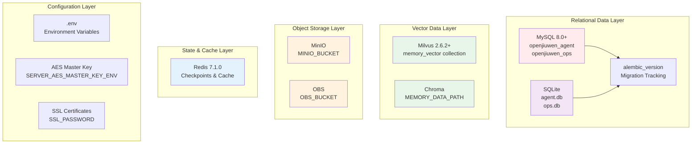
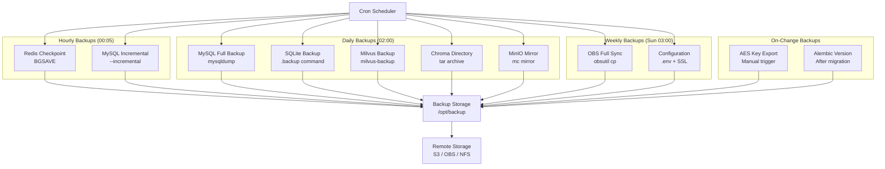
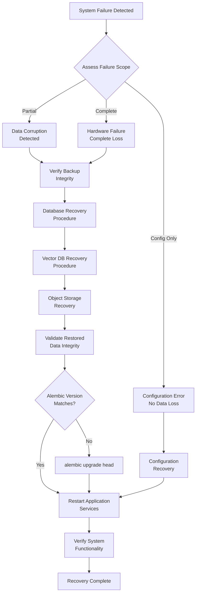

<!-- source: DeepWiki mcp.deepwiki.com · repo openJiuwen-ai/agent-studio · page 7.5 Backup & Recovery · fetched 2026-11-02 -->

# Backup & Recovery

<details>
<summary>Relevant source files</summary>

The following files were used as context for generating this wiki page:

- [.env.example](.env.example)
- [backend/DATABASE_MIGRATION_DEVELOPMENT_GUIDE_EN.md](backend/DATABASE_MIGRATION_DEVELOPMENT_GUIDE_EN.md)
- [backend/GENERATE_MIGRATION_USAGE_EN.md](backend/GENERATE_MIGRATION_USAGE_EN.md)
- [backend/openjiuwen_studio/core/common/logging/__init__.py](backend/openjiuwen_studio/core/common/logging/__init__.py)
- [backend/openjiuwen_studio/core/common/logging/events.py](backend/openjiuwen_studio/core/common/logging/events.py)
- [backend/openjiuwen_studio/core/config.py](backend/openjiuwen_studio/core/config.py)
- [backend/openjiuwen_studio/core/manager/convertor/components/sub_workflow.py](backend/openjiuwen_studio/core/manager/convertor/components/sub_workflow.py)
- [backend/openjiuwen_studio/core/manager/email_manager/__init__.py](backend/openjiuwen_studio/core/manager/email_manager/__init__.py)
- [backend/openjiuwen_studio/core/manager/email_manager/email_template.py](backend/openjiuwen_studio/core/manager/email_manager/email_template.py)
- [backend/openjiuwen_studio/core/manager/email_manager/email_utils.py](backend/openjiuwen_studio/core/manager/email_manager/email_utils.py)
- [backend/openjiuwen_studio/core/manager/redis_manager/__init__.py](backend/openjiuwen_studio/core/manager/redis_manager/__init__.py)
- [backend/openjiuwen_studio/core/manager/utils/utils.py](backend/openjiuwen_studio/core/manager/utils/utils.py)
- [backend/openjiuwen_studio/main.py](backend/openjiuwen_studio/main.py)
- [docs/en/2.Installation Guide/Local Installation/Linux_Installation.md](docs/en/2.Installation Guide/Local Installation/Linux_Installation.md)
- [docs/en/2.Installation Guide/Local Installation/MacOS_Installation.md](docs/en/2.Installation Guide/Local Installation/MacOS_Installation.md)
- [docs/en/2.Installation Guide/Local Installation/Windows_Installation.md](docs/en/2.Installation Guide/Local Installation/Windows_Installation.md)

</details>


This page describes backup strategies, recovery procedures, and disaster recovery planning for OpenJiuwen Agent Studio production deployments. It covers all persistent data stores including relational databases, vector databases, object storage, and configuration files.

For information about database schema migrations, see [Database Migrations](#6.2). For production deployment configuration, see [Production Configuration](#7.2). For monitoring backup health, see [Monitoring & Logging](#7.4).

---

## Overview

OpenJiuwen Agent Studio persists data across multiple storage systems, each requiring distinct backup strategies:

**Relational Databases**: MySQL or SQLite stores agent definitions, workflows, plugins, execution logs, and user data. These databases are managed with Alembic migrations for version control.

**Vector Databases**: Milvus or Chroma stores embedding vectors for knowledge bases and memory systems. Vector data is typically large and requires specialized backup tools.

**Object Storage**: MinIO or OBS stores uploaded documents, processed files, and knowledge base source materials.

**Configuration & Secrets**: Environment variables, AES encryption keys, SSL certificates, and application configuration files.

**Application State**: Redis checkpoint data for workflow execution state and session management (when enabled).

---

## Data Architecture

### Storage Components



**Sources**: [.env.example:1-196](), [backend/openjiuwen_studio/main.py:54-145](), [backend/openjiuwen_studio/core/config.py:1-105]()

---

## Backup Strategies

### Critical Data Priority Matrix

| Data Type | Recovery Priority | Backup Frequency | Retention Period |
|-----------|------------------|------------------|------------------|
| **Relational Databases** | Critical | Hourly (incremental), Daily (full) | 30 days (full), 7 days (incremental) |
| **AES Master Key** | Critical | On generation, never rotate | Permanent (secure vault) |
| **.env Configuration** | Critical | On change | Version controlled |
| **Vector Databases** | High | Daily | 14 days |
| **Object Storage** | High | Daily | 30 days |
| **Redis State** | Medium | Hourly | 24 hours |
| **SSL Certificates** | Medium | On generation | Until expiration + 1 year |

---

### Relational Database Backup

#### MySQL Backup Procedures

The system uses two MySQL databases: `openjiuwen_agent` (AGENT_DB_NAME) and `openjiuwen_ops` (OPS_DB_NAME).

**Full Backup Script** (recommended for daily execution):

```bash
#!/bin/bash
# MySQL backup script for OpenJiuwen Agent Studio
# Location: /opt/backup/mysql_backup.sh

BACKUP_DIR="/opt/backup/mysql"
DATE=$(date +%Y%m%d_%H%M%S)
DB_HOST="${DB_HOST:-localhost}"
DB_PORT="${DB_PORT:-3306}"
DB_USER="${DB_USER:-root}"
DB_PASSWORD="${DB_PASSWORD}"
RETENTION_DAYS=30

# Create backup directory
mkdir -p "$BACKUP_DIR/$DATE"

# Backup agent database
mysqldump \
  --host="$DB_HOST" \
  --port="$DB_PORT" \
  --user="$DB_USER" \
  --password="$DB_PASSWORD" \
  --single-transaction \
  --routines \
  --triggers \
  --events \
  --hex-blob \
  openjiuwen_agent > "$BACKUP_DIR/$DATE/openjiuwen_agent.sql"

# Backup ops database
mysqldump \
  --host="$DB_HOST" \
  --port="$DB_PORT" \
  --user="$DB_USER" \
  --password="$DB_PASSWORD" \
  --single-transaction \
  --routines \
  --triggers \
  --events \
  --hex-blob \
  openjiuwen_ops > "$BACKUP_DIR/$DATE/openjiuwen_ops.sql"

# Compress backups
tar -czf "$BACKUP_DIR/mysql_backup_$DATE.tar.gz" -C "$BACKUP_DIR" "$DATE"
rm -rf "$BACKUP_DIR/$DATE"

# Remove old backups
find "$BACKUP_DIR" -name "mysql_backup_*.tar.gz" -mtime +$RETENTION_DAYS -delete

echo "MySQL backup completed: mysql_backup_$DATE.tar.gz"
```

**Key Options**:
- `--single-transaction`: Ensures consistent snapshot without locking tables
- `--routines --triggers --events`: Includes stored procedures and scheduled events
- `--hex-blob`: Safely exports binary data (important for encrypted fields)

**Sources**: [.env.example:95-101](), [backend/openjiuwen_studio/core/config.py:26-34]()

#### SQLite Backup Procedures

SQLite databases are file-based: `agent.db` and `ops.db` stored in `SQLITE_DB_PATH`.

**Backup Script**:

```bash
#!/bin/bash
# SQLite backup script for OpenJiuwen Agent Studio
# Location: /opt/backup/sqlite_backup.sh

BACKUP_DIR="/opt/backup/sqlite"
DATE=$(date +%Y%m%d_%H%M%S)
SQLITE_DB_PATH="${SQLITE_DB_PATH:-data/databases}"
RETENTION_DAYS=30

mkdir -p "$BACKUP_DIR/$DATE"

# Copy database files with integrity check
sqlite3 "$SQLITE_DB_PATH/agent.db" ".backup '$BACKUP_DIR/$DATE/agent.db'"
sqlite3 "$SQLITE_DB_PATH/ops.db" ".backup '$BACKUP_DIR/$DATE/ops.db'"

# Compress backup
tar -czf "$BACKUP_DIR/sqlite_backup_$DATE.tar.gz" -C "$BACKUP_DIR" "$DATE"
rm -rf "$BACKUP_DIR/$DATE"

# Remove old backups
find "$BACKUP_DIR" -name "sqlite_backup_*.tar.gz" -mtime +$RETENTION_DAYS -delete

echo "SQLite backup completed: sqlite_backup_$DATE.tar.gz"
```

**Important**: Use `sqlite3 .backup` command instead of file copy while the application is running to ensure consistency.

**Sources**: [.env.example:103-106](), [backend/openjiuwen_studio/core/config.py:36-38]()

#### Alembic Version Tracking

The `alembic_version` table in each database tracks the current schema version. This is critical for recovery.

**Export Alembic Version State**:

```bash
# MySQL
mysql -u $DB_USER -p$DB_PASSWORD openjiuwen_agent \
  -e "SELECT * FROM alembic_version" > alembic_version_agent.txt
mysql -u $DB_USER -p$DB_PASSWORD openjiuwen_ops \
  -e "SELECT * FROM alembic_version" > alembic_version_ops.txt

# SQLite
sqlite3 data/databases/agent.db \
  "SELECT * FROM alembic_version" > alembic_version_agent.txt
sqlite3 data/databases/ops.db \
  "SELECT * FROM alembic_version" > alembic_version_ops.txt
```

**Sources**: [backend/DATABASE_MIGRATION_DEVELOPMENT_GUIDE_EN.md:54-58]()

---

### Vector Database Backup

#### Milvus Backup

Milvus stores vector embeddings in the `memory_vector` collection (MILVUS_COLLECTION_NAME).

**Backup Strategy**:

```bash
#!/bin/bash
# Milvus backup script
# Requires milvus-backup utility: https://github.com/zilliztech/milvus-backup

BACKUP_DIR="/opt/backup/milvus"
DATE=$(date +%Y%m%d_%H%M%S)
MILVUS_HOST="${MILVUS_HOST:-127.0.0.1}"
MILVUS_PORT="${MILVUS_PORT:-19530}"
COLLECTION_NAME="${MILVUS_COLLECTION_NAME:-memory_vector}"

mkdir -p "$BACKUP_DIR"

# Create Milvus backup
milvus-backup create \
  --host="$MILVUS_HOST" \
  --port="$MILVUS_PORT" \
  --collection="$COLLECTION_NAME" \
  --backup-name="backup_$DATE" \
  --output-dir="$BACKUP_DIR"

echo "Milvus backup completed: backup_$DATE"
```

**Alternative**: Use Docker volume backup for Milvus standalone deployments:

```bash
# Stop Milvus
docker stop milvus-standalone

# Backup Docker volumes
docker run --rm \
  -v milvus-standalone:/source \
  -v /opt/backup/milvus:/backup \
  alpine tar czf /backup/milvus_volumes_$DATE.tar.gz -C /source .

# Restart Milvus
docker start milvus-standalone
```

**Sources**: [.env.example:138-143](), [backend/openjiuwen_studio/core/config.py:26-34]()

#### Chroma Backup

Chroma stores data in the `MEMORY_DATA_PATH` directory (default: `memory-data`).

**Backup Script**:

```bash
#!/bin/bash
# Chroma backup script

BACKUP_DIR="/opt/backup/chroma"
DATE=$(date +%Y%m%d_%H%M%S)
MEMORY_DATA_PATH="${MEMORY_DATA_PATH:-memory-data}"

mkdir -p "$BACKUP_DIR"

# Copy Chroma data directory
tar -czf "$BACKUP_DIR/chroma_backup_$DATE.tar.gz" "$MEMORY_DATA_PATH"

echo "Chroma backup completed: chroma_backup_$DATE.tar.gz"
```

**Sources**: [.env.example:148](), [backend/openjiuwen_studio/core/config.py:26-34]()

---

### Object Storage Backup

#### MinIO Backup

**Using MinIO Client (mc)**:

```bash
#!/bin/bash
# MinIO backup script

BACKUP_DIR="/opt/backup/minio"
DATE=$(date +%Y%m%d_%H%M%S)
MINIO_ALIAS="openjiuwen-minio"
MINIO_BUCKET="${MINIO_BUCKET:-jiuwen-bucket}"

# Configure mc client (one-time setup)
mc alias set $MINIO_ALIAS \
  http://$MINIO_HOST:$MINIO_PORT \
  $MINIO_ACCESS_KEY \
  $MINIO_SECRET_KEY

# Mirror bucket to local storage
mc mirror $MINIO_ALIAS/$MINIO_BUCKET "$BACKUP_DIR/$DATE"

# Compress backup
tar -czf "$BACKUP_DIR/minio_backup_$DATE.tar.gz" -C "$BACKUP_DIR" "$DATE"
rm -rf "$BACKUP_DIR/$DATE"

echo "MinIO backup completed: minio_backup_$DATE.tar.gz"
```

**Sources**: [.env.example:108-114](), [backend/openjiuwen_studio/core/config.py:40-46]()

#### OBS Backup

For Huawei Cloud OBS deployments:

```bash
#!/bin/bash
# OBS backup script (requires obsutil)

BACKUP_DIR="/opt/backup/obs"
DATE=$(date +%Y%m%d_%H%M%S)
OBS_BUCKET="${OBS_BUCKET}"

# Download entire bucket
obsutil cp obs://$OBS_BUCKET "$BACKUP_DIR/$DATE" -r -f

# Compress backup
tar -czf "$BACKUP_DIR/obs_backup_$DATE.tar.gz" -C "$BACKUP_DIR" "$DATE"
rm -rf "$BACKUP_DIR/$DATE"

echo "OBS backup completed: obs_backup_$DATE.tar.gz"
```

**Sources**: [.env.example:192-196]()

---

### Configuration & Secrets Backup

#### AES Master Key

The AES master key (`SERVER_AES_MASTER_KEY_ENV`) encrypts sensitive data like API keys and passwords. **Loss of this key makes encrypted data unrecoverable**.

**Backup Strategy**:

```bash
# Export to secure vault (one-time operation)
echo "SERVER_AES_MASTER_KEY_ENV=$SERVER_AES_MASTER_KEY_ENV" > /secure/vault/aes_master_key.txt
chmod 400 /secure/vault/aes_master_key.txt

# Alternative: Use KMS (Huawei Cloud example)
# Key is stored in KMS, reference only needed
echo "HUAWEICLOUD_KMS_KEY_ID=$HUAWEICLOUD_KMS_KEY_ID" > /secure/vault/kms_reference.txt
```

**Critical Warning**: The AES key must never change after initial setup. Document the key location in your disaster recovery runbook.

**Sources**: [.env.example:78-83](), [docs/en/2.Installation Guide/Local Installation/Linux_Installation.md:245-258]()

#### Environment Configuration

**Version Control Strategy**:

```bash
#!/bin/bash
# Configuration backup script

BACKUP_DIR="/opt/backup/config"
DATE=$(date +%Y%m%d_%H%M%S)

mkdir -p "$BACKUP_DIR"

# Copy .env file (redact sensitive values for audit trail)
cp .env "$BACKUP_DIR/.env.$DATE"

# Copy SSL certificates if present
if [ -n "$SSL_PASSWORD" ]; then
  cp -r ssl/ "$BACKUP_DIR/ssl_$DATE/"
fi

# Create checksum
cd "$BACKUP_DIR"
sha256sum .env.$DATE > checksums_$DATE.txt

echo "Configuration backup completed"
```

**Best Practice**: Store `.env.example` in version control, but exclude actual `.env` files. Use a secrets management system (Vault, AWS Secrets Manager, etc.) for production.

**Sources**: [.env.example:1-196](), [backend/openjiuwen_studio/core/config.py:1-105]()

---

### Redis Checkpoint Backup

When `ENABLE_REDIS_CHECKPOINT=True`, Redis stores workflow execution state.

**Backup Strategy**:

```bash
#!/bin/bash
# Redis backup script

BACKUP_DIR="/opt/backup/redis"
DATE=$(date +%Y%m%d_%H%M%S)
REDIS_HOST="${REDIS_HOST:-localhost}"
REDIS_PORT="${REDIS_PORT:-6379}"

mkdir -p "$BACKUP_DIR"

# Trigger RDB snapshot
redis-cli -h $REDIS_HOST -p $REDIS_PORT BGSAVE

# Wait for snapshot completion
while [ $(redis-cli -h $REDIS_HOST -p $REDIS_PORT LASTSAVE) -eq $LAST_SAVE ]; do
  sleep 1
done

# Copy RDB file
REDIS_DIR=$(redis-cli -h $REDIS_HOST -p $REDIS_PORT CONFIG GET dir | tail -1)
REDIS_FILE=$(redis-cli -h $REDIS_HOST -p $REDIS_PORT CONFIG GET dbfilename | tail -1)
cp "$REDIS_DIR/$REDIS_FILE" "$BACKUP_DIR/redis_$DATE.rdb"

echo "Redis backup completed: redis_$DATE.rdb"
```

**Sources**: [.env.example:117-121](), [backend/openjiuwen_studio/core/config.py:69-81]()

---

## Complete Backup Workflow

### Automated Backup Schedule



**Crontab Configuration** (`/etc/crontab`):

```cron
# OpenJiuwen Agent Studio Backup Schedule

# Hourly backups (5 minutes past the hour)
5 * * * * root /opt/backup/redis_backup.sh >> /var/log/backup/redis.log 2>&1
5 * * * * root /opt/backup/mysql_incremental.sh >> /var/log/backup/mysql_incr.log 2>&1

# Daily backups (2:00 AM)
0 2 * * * root /opt/backup/mysql_backup.sh >> /var/log/backup/mysql.log 2>&1
0 2 * * * root /opt/backup/sqlite_backup.sh >> /var/log/backup/sqlite.log 2>&1
0 2 * * * root /opt/backup/milvus_backup.sh >> /var/log/backup/milvus.log 2>&1
0 2 * * * root /opt/backup/chroma_backup.sh >> /var/log/backup/chroma.log 2>&1
0 2 * * * root /opt/backup/minio_backup.sh >> /var/log/backup/minio.log 2>&1

# Weekly backups (Sunday 3:00 AM)
0 3 * * 0 root /opt/backup/obs_backup.sh >> /var/log/backup/obs.log 2>&1
0 3 * * 0 root /opt/backup/config_backup.sh >> /var/log/backup/config.log 2>&1

# Remote sync (daily at 4:00 AM)
0 4 * * * root /opt/backup/remote_sync.sh >> /var/log/backup/sync.log 2>&1
```

**Sources**: [backend/openjiuwen_studio/main.py:54-145]()

---

## Recovery Procedures

### Recovery Decision Tree



**Sources**: [backend/DATABASE_MIGRATION_DEVELOPMENT_GUIDE_EN.md:1-603]()

---

### Database Recovery

#### MySQL Recovery

**Full Database Restore**:

```bash
#!/bin/bash
# MySQL recovery script

BACKUP_FILE="/opt/backup/mysql/mysql_backup_20250124_020000.tar.gz"
TEMP_DIR="/tmp/mysql_restore"

# Extract backup
mkdir -p "$TEMP_DIR"
tar -xzf "$BACKUP_FILE" -C "$TEMP_DIR"

# Stop application services
systemctl stop openjiuwen-backend

# Drop existing databases (WARNING: destructive operation)
mysql -u root -p -e "DROP DATABASE IF EXISTS openjiuwen_agent;"
mysql -u root -p -e "DROP DATABASE IF EXISTS openjiuwen_ops;"

# Recreate databases
mysql -u root -p -e "CREATE DATABASE openjiuwen_agent CHARACTER SET utf8mb4 COLLATE utf8mb4_unicode_ci;"
mysql -u root -p -e "CREATE DATABASE openjiuwen_ops CHARACTER SET utf8mb4 COLLATE utf8mb4_unicode_ci;"

# Restore from backup
mysql -u root -p openjiuwen_agent < "$TEMP_DIR"/*/openjiuwen_agent.sql
mysql -u root -p openjiuwen_ops < "$TEMP_DIR"/*/openjiuwen_ops.sql

# Verify alembic versions
mysql -u root -p openjiuwen_agent -e "SELECT * FROM alembic_version;"
mysql -u root -p openjiuwen_ops -e "SELECT * FROM alembic_version;"

# Cleanup
rm -rf "$TEMP_DIR"

echo "MySQL restore completed. Check alembic versions before starting services."
```

**Sources**: [.env.example:95-101]()

#### SQLite Recovery

**Database Restore**:

```bash
#!/bin/bash
# SQLite recovery script

BACKUP_FILE="/opt/backup/sqlite/sqlite_backup_20250124_020000.tar.gz"
TEMP_DIR="/tmp/sqlite_restore"
SQLITE_DB_PATH="data/databases"

# Stop application services
systemctl stop openjiuwen-backend

# Extract backup
mkdir -p "$TEMP_DIR"
tar -xzf "$BACKUP_FILE" -C "$TEMP_DIR"

# Backup existing databases (just in case)
mkdir -p "$SQLITE_DB_PATH/failed_backup"
mv "$SQLITE_DB_PATH/agent.db" "$SQLITE_DB_PATH/failed_backup/" 2>/dev/null
mv "$SQLITE_DB_PATH/ops.db" "$SQLITE_DB_PATH/failed_backup/" 2>/dev/null

# Restore databases
cp "$TEMP_DIR"/*/agent.db "$SQLITE_DB_PATH/"
cp "$TEMP_DIR"/*/ops.db "$SQLITE_DB_PATH/"

# Verify alembic versions
sqlite3 "$SQLITE_DB_PATH/agent.db" "SELECT * FROM alembic_version;"
sqlite3 "$SQLITE_DB_PATH/ops.db" "SELECT * FROM alembic_version;"

# Cleanup
rm -rf "$TEMP_DIR"

echo "SQLite restore completed. Check alembic versions before starting services."
```

**Sources**: [.env.example:103-106]()

#### Alembic Version Reconciliation

After restoring databases, verify the schema version matches the application code:

```bash
#!/bin/bash
# Alembic version check and migration script

cd backend

# Check current database versions
echo "=== Current Database Versions ==="
alembic -n alembic_mysql_agent current
alembic -n alembic_mysql_ops current

# Check expected versions
echo "=== Expected Versions (Code) ==="
alembic -n alembic_mysql_agent heads
alembic -n alembic_mysql_ops heads

# If versions don't match, run migrations
read -p "Run migrations to latest version? (y/n) " -n 1 -r
echo
if [[ $REPLY =~ ^[Yy]$ ]]; then
    alembic -n alembic_mysql_agent upgrade head
    alembic -n alembic_mysql_ops upgrade head
    echo "Migrations completed"
fi
```

**Important**: If the backup is from an older version (e.g., v0.1.2) but the code is newer (e.g., v0.1.4), you must:

1. Verify the backup's alembic version
2. Run `alembic upgrade head` to apply incremental migrations
3. Do NOT use `alembic stamp head` unless the schema already matches

**Sources**: [backend/DATABASE_MIGRATION_DEVELOPMENT_GUIDE_EN.md:396-429]()

---

### Vector Database Recovery

#### Milvus Recovery

**Restore from Milvus Backup**:

```bash
#!/bin/bash
# Milvus recovery script

BACKUP_NAME="backup_20250124_020000"
BACKUP_DIR="/opt/backup/milvus"
MILVUS_HOST="${MILVUS_HOST:-127.0.0.1}"
MILVUS_PORT="${MILVUS_PORT:-19530}"

# Restore collection
milvus-backup restore \
  --host="$MILVUS_HOST" \
  --port="$MILVUS_PORT" \
  --backup-name="$BACKUP_NAME" \
  --backup-dir="$BACKUP_DIR"

echo "Milvus restore completed"
```

**Alternative: Docker Volume Restore**:

```bash
#!/bin/bash
# Milvus Docker volume recovery

BACKUP_FILE="/opt/backup/milvus/milvus_volumes_20250124_020000.tar.gz"

# Stop Milvus
docker stop milvus-standalone

# Restore volume
docker run --rm \
  -v milvus-standalone:/target \
  -v /opt/backup/milvus:/backup \
  alpine sh -c "rm -rf /target/* && tar xzf /backup/$(basename $BACKUP_FILE) -C /target"

# Start Milvus
docker start milvus-standalone

echo "Milvus volume restored"
```

**Sources**: [.env.example:138-143]()

#### Chroma Recovery

**Restore from Directory Backup**:

```bash
#!/bin/bash
# Chroma recovery script

BACKUP_FILE="/opt/backup/chroma/chroma_backup_20250124_020000.tar.gz"
MEMORY_DATA_PATH="${MEMORY_DATA_PATH:-memory-data}"

# Stop application services
systemctl stop openjiuwen-backend

# Backup existing data
mv "$MEMORY_DATA_PATH" "${MEMORY_DATA_PATH}.failed_backup" 2>/dev/null

# Extract backup
tar -xzf "$BACKUP_FILE"

echo "Chroma restore completed"
```

**Sources**: [.env.example:148]()

---

### Object Storage Recovery

#### MinIO Recovery

**Restore from Local Backup**:

```bash
#!/bin/bash
# MinIO recovery script

BACKUP_FILE="/opt/backup/minio/minio_backup_20250124_020000.tar.gz"
TEMP_DIR="/tmp/minio_restore"
MINIO_ALIAS="openjiuwen-minio"
MINIO_BUCKET="${MINIO_BUCKET:-jiuwen-bucket}"

# Extract backup
mkdir -p "$TEMP_DIR"
tar -xzf "$BACKUP_FILE" -C "$TEMP_DIR"

# Delete existing bucket contents (WARNING: destructive)
mc rm --recursive --force $MINIO_ALIAS/$MINIO_BUCKET/

# Restore files
mc mirror "$TEMP_DIR"/*/ $MINIO_ALIAS/$MINIO_BUCKET/

# Cleanup
rm -rf "$TEMP_DIR"

echo "MinIO restore completed"
```

**Sources**: [.env.example:108-114]()

---

### Configuration Recovery

#### Environment Configuration

**Restore .env File**:

```bash
#!/bin/bash
# Configuration recovery script

BACKUP_DIR="/opt/backup/config"
BACKUP_DATE="20250124_020000"

# Stop services
systemctl stop openjiuwen-backend
systemctl stop openjiuwen-frontend

# Restore .env
cp "$BACKUP_DIR/.env.$BACKUP_DATE" .env

# Verify AES key is set
if ! grep -q "SERVER_AES_MASTER_KEY_ENV" .env; then
    echo "ERROR: AES key not found in .env"
    echo "Restore from secure vault: /secure/vault/aes_master_key.txt"
    exit 1
fi

# Restore SSL certificates
if [ -d "$BACKUP_DIR/ssl_$BACKUP_DATE" ]; then
    cp -r "$BACKUP_DIR/ssl_$BACKUP_DATE/" ssl/
fi

echo "Configuration restored. Review .env before starting services."
```

**Critical**: Ensure `SERVER_AES_MASTER_KEY_ENV` matches the key used to encrypt the database. Mismatched keys will make encrypted data unreadable.

**Sources**: [.env.example:78-83](), [docs/en/2.Installation Guide/Local Installation/Linux_Installation.md:245-258]()

---

## Disaster Recovery

### Complete System Recovery Workflow

**Recovery Time Objective (RTO)**: Target < 4 hours for full system recovery  
**Recovery Point Objective (RPO)**: Target < 1 hour data loss (last full backup + incremental)

```mermaid
graph LR
    Start["Disaster Event"]
    
    subgraph "Phase 1: Assessment (15 min)"
        P1A["Identify Scope"]
        P1B["Locate Backups"]
        P1C["Verify Backup<br/>Integrity"]
    end
    
    subgraph "Phase 2: Infrastructure (60 min)"
        P2A["Provision Hardware<br/>or Cloud Resources"]
        P2B["Install Dependencies<br/>Docker, MySQL, etc."]
        P2C["Configure Network<br/>DNS, Firewall"]
    end
    
    subgraph "Phase 3: Data Restoration (90 min)"
        P3A["Restore Databases<br/>MySQL/SQLite"]
        P3B["Restore Vector DB<br/>Milvus/Chroma"]
        P3C["Restore Object Storage<br/>MinIO/OBS"]
        P3D["Restore Config<br/>.env, AES Key"]
    end
    
    subgraph "Phase 4: Validation (60 min)"
        P4A["Run Migrations<br/>alembic upgrade"]
        P4B["Start Services<br/>Backend, Frontend"]
        P4C["Verify Functionality<br/>Test Agents, Workflows"]
        P4D["Monitor Health<br/>Check Logs"]
    end
    
    Complete["System Operational"]
    
    Start --> P1A --> P1B --> P1C
    P1C --> P2A --> P2B --> P2C
    P2C --> P3A --> P3B --> P3C --> P3D
    P3D --> P4A --> P4B --> P4C --> P4D
    P4D --> Complete
```



**Sources**: [backend/openjiuwen_studio/main.py:54-145]()

---

### Disaster Recovery Checklist

**Pre-Disaster Preparation**:

- [ ] Automated backup scripts are running on schedule
- [ ] Remote backup storage is configured and tested
- [ ] AES master key is securely stored in vault (never in code/version control)
- [ ] Recovery procedures are documented and accessible offline
- [ ] Recovery time and point objectives are defined and communicated
- [ ] Backup integrity is verified monthly (restore test)

**Recovery Execution**:

1. **Infrastructure Setup** (60 minutes)
   - [ ] Provision new hardware or cloud instances
   - [ ] Install base OS and dependencies (Docker, MySQL, Python, Node.js)
   - [ ] Configure networking (DNS, firewall rules)
   - [ ] Install OpenJiuwen Agent Studio from deployment package

2. **Configuration Restoration** (15 minutes)
   - [ ] Restore `.env` file from backup
   - [ ] Restore AES master key from secure vault
   - [ ] Restore SSL certificates
   - [ ] Verify all environment variables are set

3. **Database Restoration** (90 minutes)
   - [ ] Create empty databases (MySQL) or prepare directories (SQLite)
   - [ ] Restore MySQL: `openjiuwen_agent` and `openjiuwen_ops`
   - [ ] Restore SQLite: `agent.db` and `ops.db`
   - [ ] Verify `alembic_version` tables exist
   - [ ] Check schema version matches code: `alembic current` vs `alembic heads`
   - [ ] Run migrations if needed: `alembic upgrade head`

4. **Vector Database Restoration** (30 minutes)
   - [ ] Restore Milvus collection or Chroma directory
   - [ ] Verify vector count matches expected
   - [ ] Test embedding retrieval

5. **Object Storage Restoration** (45 minutes)
   - [ ] Restore MinIO bucket or OBS data
   - [ ] Verify file count and sizes
   - [ ] Test document download

6. **Service Startup & Validation** (30 minutes)
   - [ ] Start backend: `cd backend && python main.py`
   - [ ] Check logs for "Application startup complete"
   - [ ] Verify database connections in logs
   - [ ] Start frontend: `cd frontend && npm run dev`
   - [ ] Access web UI and verify login
   - [ ] Test creating a simple agent
   - [ ] Test workflow execution
   - [ ] Test knowledge base query
   - [ ] Review application logs for errors

7. **Post-Recovery Monitoring** (24 hours)
   - [ ] Monitor error rates and performance metrics
   - [ ] Verify backup jobs resume automatically
   - [ ] Document recovery time and lessons learned
   - [ ] Update disaster recovery plan with findings

**Sources**: [backend/DATABASE_MIGRATION_DEVELOPMENT_GUIDE_EN.md:1-603](), [backend/openjiuwen_studio/main.py:54-145]()

---

## Backup Validation & Testing

### Monthly Backup Integrity Test

**Purpose**: Ensure backups are restorable and complete before a disaster occurs.

**Test Procedure** (execute monthly):

```bash
#!/bin/bash
# Monthly backup validation script
# Location: /opt/backup/validate_backup.sh

TEST_DIR="/tmp/backup_validation"
LATEST_BACKUP_DATE=$(ls -t /opt/backup/mysql/mysql_backup_*.tar.gz | head -1 | grep -oP '\d{8}_\d{6}')

echo "=== Backup Validation Test: $LATEST_BACKUP_DATE ==="

# 1. Create isolated test environment
mkdir -p "$TEST_DIR/mysql"
mkdir -p "$TEST_DIR/sqlite"

# 2. Extract backups
tar -xzf "/opt/backup/mysql/mysql_backup_$LATEST_BACKUP_DATE.tar.gz" -C "$TEST_DIR/mysql"
tar -xzf "/opt/backup/sqlite/sqlite_backup_$LATEST_BACKUP_DATE.tar.gz" -C "$TEST_DIR/sqlite"

# 3. Create test MySQL databases
mysql -u root -p -e "CREATE DATABASE IF NOT EXISTS test_openjiuwen_agent;"
mysql -u root -p test_openjiuwen_agent < "$TEST_DIR"/mysql/*/openjiuwen_agent.sql

# 4. Verify data integrity
echo "--- Agent Count ---"
mysql -u root -p test_openjiuwen_agent -e "SELECT COUNT(*) FROM agent_base;"

echo "--- Workflow Count ---"
mysql -u root -p test_openjiuwen_agent -e "SELECT COUNT(*) FROM workflow_base;"

echo "--- Alembic Version ---"
mysql -u root -p test_openjiuwen_agent -e "SELECT * FROM alembic_version;"

# 5. Test SQLite integrity
sqlite3 "$TEST_DIR"/sqlite/*/agent.db "PRAGMA integrity_check;"

# 6. Cleanup
mysql -u root -p -e "DROP DATABASE test_openjiuwen_agent;"
rm -rf "$TEST_DIR"

echo "=== Validation Complete ==="
```

**Expected Outcomes**:
- All SQL files import without errors
- Table counts match production database
- `alembic_version` matches expected version
- SQLite integrity check returns "ok"

**Sources**: [backend/DATABASE_MIGRATION_DEVELOPMENT_GUIDE_EN.md:1-603]()

---

## Monitoring Backup Health

### Backup Monitoring Metrics

| Metric | Alert Threshold | Action |
|--------|----------------|---------|
| **Backup Job Failure** | Any failure | Immediate investigation |
| **Backup Size Change** | >20% deviation from average | Verify data completeness |
| **Backup Duration** | >2x normal duration | Check storage performance |
| **Backup Age** | >48 hours since last successful | Execute manual backup |
| **Disk Space (Backup Storage)** | <10% free space | Purge old backups or expand storage |
| **Remote Sync Failure** | Any sync failure | Check network connectivity |

### Nagios Check Example

```bash
#!/bin/bash
# Nagios backup check script
# /usr/lib/nagios/plugins/check_openjiuwen_backup.sh

BACKUP_DIR="/opt/backup/mysql"
MAX_AGE_HOURS=26  # Allow 2-hour grace period beyond 24 hours

LATEST_BACKUP=$(ls -t $BACKUP_DIR/mysql_backup_*.tar.gz 2>/dev/null | head -1)

if [ -z "$LATEST_BACKUP" ]; then
    echo "CRITICAL: No MySQL backups found in $BACKUP_DIR"
    exit 2
fi

BACKUP_TIME=$(stat -c %Y "$LATEST_BACKUP")
CURRENT_TIME=$(date +%s)
AGE_HOURS=$(( ($CURRENT_TIME - $BACKUP_TIME) / 3600 ))

if [ $AGE_HOURS -gt $MAX_AGE_HOURS ]; then
    echo "CRITICAL: Latest MySQL backup is $AGE_HOURS hours old (threshold: $MAX_AGE_HOURS)"
    exit 2
elif [ $AGE_HOURS -gt 24 ]; then
    echo "WARNING: Latest MySQL backup is $AGE_HOURS hours old"
    exit 1
else
    echo "OK: MySQL backup is $AGE_HOURS hours old"
    exit 0
fi
```

**Sources**: See [Monitoring & Logging](#7.4) for comprehensive monitoring setup.

---

## Best Practices

### Backup Security

1. **Encryption**: Encrypt backup archives before transferring to remote storage
   ```bash
   # Encrypt with GPG
   gpg --symmetric --cipher-algo AES256 mysql_backup_$DATE.tar.gz
   ```

2. **Access Control**: Restrict backup file permissions
   ```bash
   chmod 600 /opt/backup/config/.env.*
   chown backup:backup /opt/backup -R
   ```

3. **Separate AES Key Storage**: Never store AES master key in the same location as backups
   - Use hardware security module (HSM)
   - Use cloud KMS (AWS KMS, Huawei Cloud KMS, Azure Key Vault)
   - Store in password manager with MFA enabled

4. **Audit Logging**: Log all backup and restore operations
   ```bash
   logger -t openjiuwen-backup "MySQL backup started: $DATE"
   ```

**Sources**: [.env.example:174-190](), [backend/openjiuwen_studio/core/manager/email_manager/email_utils.py:1-67]()

### Backup Storage

1. **3-2-1 Rule**: 
   - 3 copies of data (production + 2 backups)
   - 2 different media types (disk + cloud)
   - 1 off-site copy

2. **Retention Policy**:
   - Daily backups: 7 days
   - Weekly backups: 4 weeks
   - Monthly backups: 12 months
   - Yearly backups: 7 years (compliance requirement)

3. **Storage Monitoring**:
   ```bash
   # Check backup storage usage
   df -h /opt/backup
   du -sh /opt/backup/*
   ```

4. **Remote Replication**:
   ```bash
   # Sync to remote storage daily
   rsync -avz --delete /opt/backup/ backup-server:/backups/openjiuwen/
   ```

### Recovery Testing

1. **Quarterly Disaster Recovery Drills**: Full system restoration in isolated environment
2. **Monthly Backup Validation**: Verify backup integrity and restorability
3. **Document Recovery Time**: Record actual recovery duration vs RTO target
4. **Update Runbooks**: Incorporate lessons learned from tests into procedures

---

## Troubleshooting

### Common Backup Issues

**Issue**: `mysqldump: Got error: 2013: Lost connection to MySQL server during query`  
**Solution**: Increase `max_allowed_packet` in MySQL configuration
```sql
SET GLOBAL max_allowed_packet=1073741824; -- 1GB
```

**Issue**: SQLite `database is locked` during backup  
**Solution**: Use `.backup` command instead of file copy, or enable WAL mode
```bash
sqlite3 agent.db "PRAGMA journal_mode=WAL;"
```

**Issue**: Milvus backup fails with "collection not found"  
**Solution**: Verify collection name matches `MILVUS_COLLECTION_NAME` in `.env`

**Issue**: Restored database has wrong alembic version  
**Solution**: Check actual schema, then use `alembic stamp <version>` or `alembic upgrade head` as appropriate

**Sources**: [backend/DATABASE_MIGRATION_DEVELOPMENT_GUIDE_EN.md:360-394]()

### Recovery Failures

**Issue**: `alembic upgrade` fails after database restore  
**Cause**: Schema mismatch between backup version and code version  
**Solution**: 
1. Identify backup's alembic version: `SELECT * FROM alembic_version;`
2. Review migration scripts between backup version and target version
3. Run migrations incrementally if errors occur
4. See [Database Migrations](#6.2) for detailed guidance

**Issue**: Application fails to start with "Fail connecting to server on milvus-standalone:19530"  
**Cause**: `MILVUS_HOST` configuration points to Docker container name instead of IP  
**Solution**: Update `.env` with correct IP address: `MILVUS_HOST=127.0.0.1`

**Issue**: Encrypted data returns gibberish after restore  
**Cause**: `SERVER_AES_MASTER_KEY_ENV` does not match the key used during encryption  
**Solution**: Restore correct AES key from secure vault; this is unrecoverable if key is lost

**Sources**: [.env.example:138-143](), [docs/en/2.Installation Guide/Local Installation/Linux_Installation.md:430-434](), [backend/openjiuwen_studio/core/manager/model_manager/utils/security_utils.py:1-200]()

---

## Summary

This document covered comprehensive backup and recovery procedures for OpenJiuwen Agent Studio, including:

- **Data Architecture**: Understanding the five storage layers (relational, vector, object, cache, configuration)
- **Backup Strategies**: Automated backup schedules for each data type with appropriate frequencies
- **Recovery Procedures**: Step-by-step restoration workflows for databases, vector stores, and object storage
- **Disaster Recovery**: Complete system recovery checklist with RTO/RPO targets
- **Validation & Testing**: Monthly backup integrity tests and quarterly disaster recovery drills
- **Best Practices**: Security, storage, and monitoring recommendations

**Critical Takeaways**:
1. AES master key loss is unrecoverable; store in secure vault separate from backups
2. Always verify `alembic_version` after database restoration before running migrations
3. Test backup restoration monthly; don't wait for a disaster to discover issues
4. Implement 3-2-1 backup rule: 3 copies, 2 media types, 1 off-site

For ongoing maintenance, see [Monitoring & Logging](#7.4). For scaling backup infrastructure, see [Scaling & High Availability](#7.3).

**Sources**: [backend/openjiuwen_studio/main.py:1-278](), [backend/DATABASE_MIGRATION_DEVELOPMENT_GUIDE_EN.md:1-603](), [.env.example:1-196]()

---

