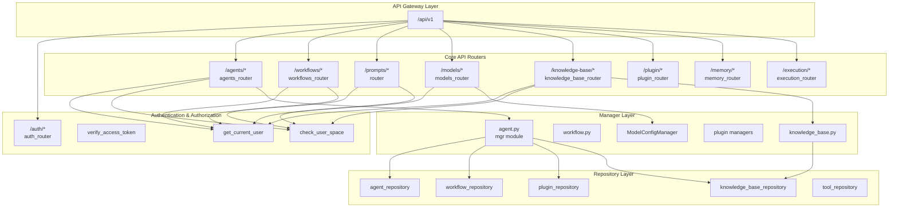
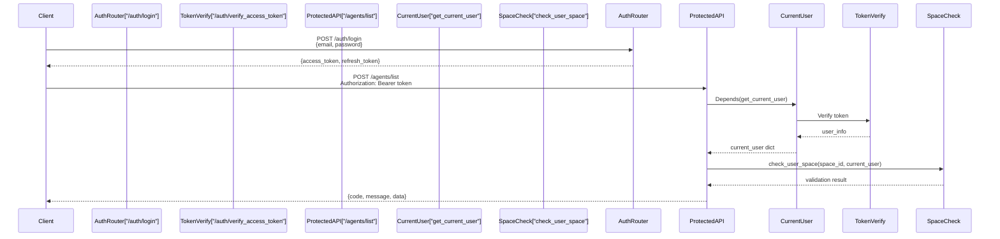
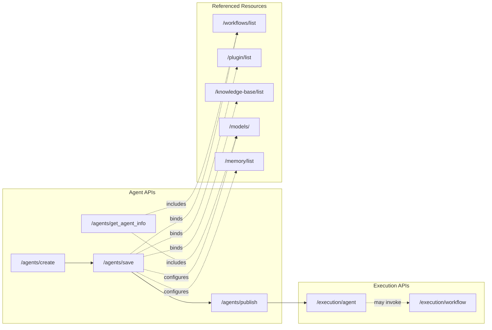

<!-- source: DeepWiki mcp.deepwiki.com · repo openJiuwen-ai/agent-studio · page 8 API Reference · fetched 2026-11-02 -->

# API Reference

<details>
<summary>Relevant source files</summary>

The following files were used as context for generating this wiki page:

- [backend/openjiuwen_studio/core/manager/agent.py](backend/openjiuwen_studio/core/manager/agent.py)
- [backend/openjiuwen_studio/core/manager/convertor/agent.py](backend/openjiuwen_studio/core/manager/convertor/agent.py)
- [backend/openjiuwen_studio/core/manager/knowledge_base.py](backend/openjiuwen_studio/core/manager/knowledge_base.py)
- [backend/openjiuwen_studio/core/manager/model_manager/managers/model_test_manager.py](backend/openjiuwen_studio/core/manager/model_manager/managers/model_test_manager.py)
- [backend/openjiuwen_studio/core/manager/repositories/agent_repository.py](backend/openjiuwen_studio/core/manager/repositories/agent_repository.py)
- [backend/openjiuwen_studio/core/manager/repositories/plugin_repository.py](backend/openjiuwen_studio/core/manager/repositories/plugin_repository.py)
- [backend/openjiuwen_studio/core/manager/repositories/tool_repository.py](backend/openjiuwen_studio/core/manager/repositories/tool_repository.py)
- [backend/openjiuwen_studio/ops/modules/llm/llm_config_service.py](backend/openjiuwen_studio/ops/modules/llm/llm_config_service.py)
- [backend/openjiuwen_studio/ops/modules/llm/schema.py](backend/openjiuwen_studio/ops/modules/llm/schema.py)
- [backend/openjiuwen_studio/ops/modules/prompt/domain/debug_entity.py](backend/openjiuwen_studio/ops/modules/prompt/domain/debug_entity.py)
- [backend/openjiuwen_studio/ops/modules/prompt/domain/entities.py](backend/openjiuwen_studio/ops/modules/prompt/domain/entities.py)
- [backend/openjiuwen_studio/ops/modules/prompt/domain/services.py](backend/openjiuwen_studio/ops/modules/prompt/domain/services.py)
- [backend/openjiuwen_studio/ops/modules/prompt/infra/repositories/debug_repo.py](backend/openjiuwen_studio/ops/modules/prompt/infra/repositories/debug_repo.py)
- [backend/openjiuwen_studio/routers/agents.py](backend/openjiuwen_studio/routers/agents.py)
- [backend/openjiuwen_studio/routers/prompt_debug_router.py](backend/openjiuwen_studio/routers/prompt_debug_router.py)
- [backend/openjiuwen_studio/routers/prompt_llm_router.py](backend/openjiuwen_studio/routers/prompt_llm_router.py)
- [backend/openjiuwen_studio/routers/prompt_router.py](backend/openjiuwen_studio/routers/prompt_router.py)
- [backend/openjiuwen_studio/routers/prompt_tuning_router.py](backend/openjiuwen_studio/routers/prompt_tuning_router.py)
- [backend/openjiuwen_studio/schemas/agent.py](backend/openjiuwen_studio/schemas/agent.py)
- [backend/openjiuwen_studio/schemas/model_config.py](backend/openjiuwen_studio/schemas/model_config.py)
- [frontend/packages/api-client/src/config.ts](frontend/packages/api-client/src/config.ts)
- [frontend/packages/api-client/src/services/agentService.ts](frontend/packages/api-client/src/services/agentService.ts)
- [frontend/src/components/Agent/ModelDetailForm.tsx](frontend/src/components/Agent/ModelDetailForm.tsx)

</details>


This document provides comprehensive reference documentation for the OpenJiuwen Agent Studio REST API. It covers API architecture, common patterns, authentication mechanisms, and endpoint specifications across all functional domains.

For detailed information about specific API domains, see the subsection pages:
- Agent APIs - [#8.1]()
- Workflow APIs - [#8.2]()
- Prompt APIs - [#8.3]()
- Model APIs - [#8.4]()
- Knowledge Base APIs - [#8.5]()
- Plugin APIs - [#8.6]()
- Memory APIs - [#8.7]()
- Authentication APIs - [#8.8]()

For architectural details about backend services and data flows, see [Backend Architecture](#5.3).

---

## API Architecture Overview

The OpenJiuwen Agent Studio API is a RESTful HTTP API built with FastAPI. All endpoints are versioned under `/api/v1` and return JSON responses following a standardized format.

### API Structure Diagram



**Sources:** [frontend/packages/api-client/src/config.ts:70-329](), [backend/openjiuwen_studio/routers/agents.py:1-27](), [backend/openjiuwen_studio/core/manager/agent.py:1-60]()

---

## Common API Patterns

### Base URL and Versioning

All API endpoints are prefixed with `/api/v1`. The base URL can be configured via environment variables:

- **Development:** Relative path `/api/v1` (proxied by Vite)
- **Production:** Configured via `VITE_API_BASE_URL` or `window.__API_BASE_URL__`

**Sources:** [frontend/packages/api-client/src/config.ts:1-12]()

### Standard Request/Response Format

#### Request Structure

All POST requests use JSON payloads with `Content-Type: application/json`. Common fields include:

| Field | Type | Required | Description |
|-------|------|----------|-------------|
| `space_id` or `spaceId` | string | Yes | Workspace identifier |
| `page` | integer | Optional | Page number (default: 1) |
| `page_size` or `pageSize` | integer | Optional | Items per page (default: 10-20) |

**Sources:** [backend/openjiuwen_studio/schemas/agent.py:131-141]()

#### Response Structure

All responses follow the `ResponseModel` pattern:

```json
{
  "code": 200,
  "message": "success",
  "data": { /* response payload */ }
}
```

**Response Fields:**

| Field | Type | Description |
|-------|------|-------------|
| `code` | integer | HTTP status code or custom error code |
| `message` | string | Success or error message |
| `data` | object/array | Response payload (null on error) |

**Sources:** [backend/openjiuwen_studio/schemas/common.py]()

### Authentication

#### JWT Token Authentication

The API uses JWT (JSON Web Token) based authentication. Tokens must be included in the `Authorization` header:

```
Authorization: Bearer <access_token>
```

**Token Storage Keys:**

- `auth_token` - Access token
- `refresh_token` - Refresh token
- `token_expiry` - Token expiration timestamp

**Sources:** [frontend/packages/api-client/src/config.ts:29-34]()

#### Authentication Flow Diagram



**Sources:** [frontend/packages/api-client/src/config.ts:72-83](), [backend/openjiuwen_studio/routers/agents.py:157-183]()

### Error Handling

#### HTTP Status Codes

| Code | Description | Usage |
|------|-------------|-------|
| 200 | Success | Successful operations |
| 400 | Bad Request | Validation errors, malformed requests |
| 401 | Unauthorized | Missing or invalid authentication token |
| 403 | Forbidden | Insufficient permissions for space/resource |
| 404 | Not Found | Resource does not exist |
| 500 | Internal Server Error | Unexpected server errors |

#### Error Response Format

```json
{
  "code": 400,
  "message": "Validation failed: name: Field required, model: Field required",
  "data": null
}
```

**Sources:** [backend/openjiuwen_studio/routers/agents.py:130-151](), [backend/openjiuwen_studio/core/common/status_code.py]()

#### Validation Error Handling

The API provides localized validation error messages based on the `Accept-Language` header:

```python
# Validation error example from agents router
def handle_validation_error(
    e: ValidationError,
    operation: str,
    current_user: Optional[dict] = None,
    user_id: str = "unknown"
) -> HTTPException:
    """Handles ValidationError with friendly localized messages"""
    language = _resolve_language(current_user)
    # Translates field names and error messages
    # Returns: "参数校验失败: 模型配置: 必填字段" (zh)
    #      or "Validation failed: Model Configuration: Field required" (en)
```

**Sources:** [backend/openjiuwen_studio/routers/agents.py:125-151]()

### Pagination

#### Pagination Request Parameters

| Parameter | Type | Default | Description |
|-----------|------|---------|-------------|
| `page` | integer | 1 | Current page number (1-indexed) |
| `page_size` or `pageSize` | integer | 10-20 | Number of items per page |
| `sort_by` or `sortBy` | string | "update_time" | Field to sort by |
| `sort_order` or `sortOrder` | string | "desc" | Sort direction (asc/desc) |

#### Pagination Response Format

```json
{
  "code": 200,
  "message": "success",
  "data": {
    "items": [ /* array of items */ ],
    "pagination": {
      "page": 1,
      "page_size": 10,
      "total": 45,
      "total_pages": 5
    }
  }
}
```

**Sources:** [backend/openjiuwen_studio/schemas/agent.py:131-141](), [backend/openjiuwen_studio/core/manager/agent.py:898-906]()

---

## API Request/Response Flow

```mermaid
sequenceDiagram
    participant Client["API Client<br/>AgentService"]
    participant Router["FastAPI Router<br/>agents_router"]
    participant Validation["Pydantic<br/>Schema Validation"]
    participant Manager["Business Logic<br/>agent.py mgr"]
    participant Repository["Data Access<br/>agent_repository"]
    participant Database["Database<br/>MySQL/SQLite"]
    
    Client->>Router: POST /api/v1/agents/create<br/>{name, desc, type, ...}
    Router->>Validation: validate_request(request, AgentCreate)
    
    alt Validation Success
        Validation-->>Router: AgentCreate object
        Router->>Manager: agent_react_create(req, current_user)
        Manager->>Repository: create_agent_db(agent_info)
        Repository->>Database: INSERT INTO agent_base
        Database-->>Repository: Success
        Repository-->>Manager: ResponseModel{code:200, data:{id}}
        Manager-->>Router: ResponseModel
        Router->>Router: handle_response(res)
        Router-->>Client: {code:200, message:"success", data:{id}}
    else Validation Failure
        Validation-->>Router: ValidationError
        Router->>Router: handle_validation_error()
        Router-->>Client: HTTPException{status:400, detail:"..."}
    end
```

**Sources:** [backend/openjiuwen_studio/routers/agents.py:157-183](), [backend/openjiuwen_studio/core/manager/agent.py:329-376]()

---

## API Configuration

### Timeout Settings

| Configuration | Value | Description |
|---------------|-------|-------------|
| `TIMEOUT` | 300000ms (5 min) | Standard request timeout |
| `STREAM_TIMEOUT` | 300000ms (5 min) | SSE streaming timeout |

### Retry Configuration

| Configuration | Value | Description |
|---------------|-------|-------------|
| `MAX_RETRIES` | 3 | Maximum retry attempts |
| `RETRY_DELAY` | 1000ms | Delay between retries |

**Sources:** [frontend/packages/api-client/src/config.ts:11-21]()

### Headers

Default request headers:

```json
{
  "Content-Type": "application/json",
  "Accept": "application/json",
  "Accept-Language": "zh-CN" | "en-US"
}
```

**Sources:** [frontend/packages/api-client/src/config.ts:23-27]()

---

## API Domain Overview

The following table summarizes the major API domains and their primary endpoints:

| Domain | Base Path | Primary Operations | See Section |
|--------|-----------|-------------------|-------------|
| **Agents** | `/agents/*` | Create, list, update, publish, execute agents | [#8.1]() |
| **Workflows** | `/workflows/*` | Create, edit canvas, execute workflows | [#8.2]() |
| **Prompts** | `/prompts/*` | Manage templates, optimize, debug prompts | [#8.3]() |
| **Models** | `/models/*` | Configure, test LLM and embedding models | [#8.4]() |
| **Knowledge Bases** | `/knowledge-base/*` | Upload documents, process, retrieve | [#8.5]() |
| **Plugins** | `/plugin/*` | Create, publish, manage plugin tools | [#8.6]() |
| **Memory** | `/memory/*` | Manage variables and long-term memory | [#8.7]() |
| **Authentication** | `/auth/*` | Login, register, token management | [#8.8]() |

**Sources:** [frontend/packages/api-client/src/config.ts:70-329]()

---

## Request/Response Examples

### Example: Create Agent

**Request:**
```http
POST /api/v1/agents/create
Authorization: Bearer eyJhbGc...
Content-Type: application/json

{
  "spaceId": "workspace_123",
  "name": "Customer Support Agent",
  "desc": "Handles customer inquiries",
  "icon": "🤖",
  "type": "react"
}
```

**Response:**
```json
{
  "code": 200,
  "message": "create agent success",
  "data": {
    "id": "550e8400-e29b-41d4-a716-446655440000"
  }
}
```

**Sources:** [backend/openjiuwen_studio/schemas/agent.py:20-32](), [backend/openjiuwen_studio/core/manager/agent.py:329-376]()

### Example: List Agents with Pagination

**Request:**
```http
POST /api/v1/agents/list
Authorization: Bearer eyJhbGc...
Content-Type: application/json

{
  "space_id": "workspace_123",
  "page": 1,
  "page_size": 20,
  "sort_by": "update_time",
  "sort_order": "desc"
}
```

**Response:**
```json
{
  "code": 200,
  "message": "get agent list success",
  "data": {
    "agent_items": [
      {
        "id": "agent_001",
        "name": "Support Agent",
        "version": "draft",
        "type": "react",
        "desc": "Customer support",
        "icon": "🤖",
        "status": "test",
        "model_name": "GPT-4",
        "create_time": 1704067200000,
        "update_time": 1704153600000
      }
    ],
    "pagination": {
      "page": 1,
      "page_size": 20,
      "total": 45,
      "total_pages": 3
    }
  }
}
```

**Sources:** [backend/openjiuwen_studio/schemas/agent.py:131-141](), [backend/openjiuwen_studio/core/manager/agent.py:818-918]()

### Example: Agent Publish with Version

**Request:**
```http
POST /api/v1/agents/publish
Authorization: Bearer eyJhbGc...
Content-Type: application/json

{
  "spaceId": "workspace_123",
  "id": "agent_001",
  "version": "1.0.0",
  "description": "Initial production release"
}
```

**Response:**
```json
{
  "code": 200,
  "message": "agent publish success",
  "data": {
    "agent_id": "agent_001",
    "success": true
  }
}
```

**Sources:** [backend/openjiuwen_studio/schemas/agent.py:144-150](), [backend/openjiuwen_studio/core/manager/agent.py:921-1107]()

---

## Streaming Responses (SSE)

Some endpoints support Server-Sent Events (SSE) for streaming responses:

### Streaming Endpoints

| Endpoint | Purpose |
|----------|---------|
| `/prompts/:id/debug_streaming` | Stream prompt debug execution |
| `/execution/workflow` | Stream workflow execution logs |
| `/execution/agent` | Stream agent execution responses |

### Streaming Response Format

```
data: {"type": "start", "content": "Starting execution..."}

data: {"type": "progress", "content": "Processing step 1..."}

data: {"type": "result", "content": "Final output"}

data: {"type": "end"}
```

**Sources:** [frontend/packages/api-client/src/config.ts:14-15](), [backend/openjiuwen_studio/routers/prompt_debug_router.py:1-78]()

---

## API Client Usage (Frontend)

The frontend uses a typed API client for all backend communication:

### Agent Service Example

```typescript
// From frontend/packages/api-client/src/services/agentService.ts
import { AgentService } from '@test-agentstudio/api-client'

// List agents
const response = await AgentService.getAgents({
  space_id: 'workspace_123',
  page: 1,
  page_size: 20
})

// Create agent
const createResponse = await AgentService.createAgent({
  spaceId: 'workspace_123',
  name: 'My Agent',
  desc: 'Agent description',
  icon: '🤖',
  type: 'react'
})

// Get agent detail
const detail = await AgentService.getAgentDetail({
  spaceId: 'workspace_123',
  agentId: 'agent_001',
  version: 'draft'
})
```

**Sources:** [frontend/packages/api-client/src/services/agentService.ts:29-62]()

---

## Field Naming Conventions

The API supports both snake_case and camelCase field names for compatibility:

### Common Field Aliases

| Backend (snake_case) | Frontend (camelCase) | Notes |
|---------------------|---------------------|-------|
| `space_id` | `spaceId` | Workspace identifier |
| `agent_id` | `agentId` | Agent identifier |
| `agent_version` | `version` or `agentVersion` | Version string |
| `page_size` | `pageSize` | Pagination size |
| `sort_by` | `sortBy` | Sort field name |
| `sort_order` | `sortOrder` | Sort direction |

**Pydantic Configuration:**
```python
# From backend/openjiuwen_studio/schemas/agent.py
class AgentId(BaseModel):
    model_config = ConfigDict(populate_by_name=True)
    space_id: str = Field(alias="spaceId", ...)
    agent_id: str = Field(alias="agentId", ...)
    agent_version: Optional[str] = Field(
        "", validation_alias=AliasChoices("agentVersion", "version"), ...
    )
```

**Sources:** [backend/openjiuwen_studio/schemas/agent.py:12-18]()

---

## Cross-Domain API Relationships



**Sources:** [backend/openjiuwen_studio/core/manager/agent.py:500-610](), [backend/openjiuwen_studio/schemas/agent.py:110-129]()

---

For detailed endpoint specifications, request/response schemas, and usage examples for each domain, refer to the respective subsection pages [#8.1]() through [#8.8]().

---

