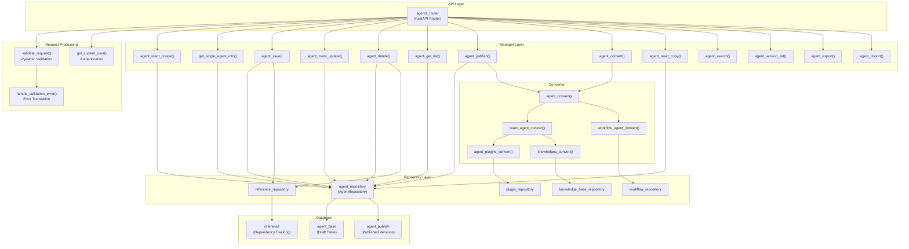
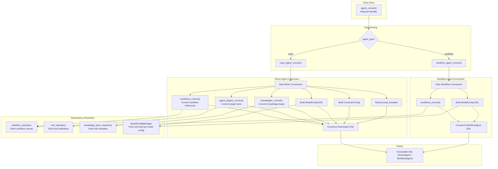
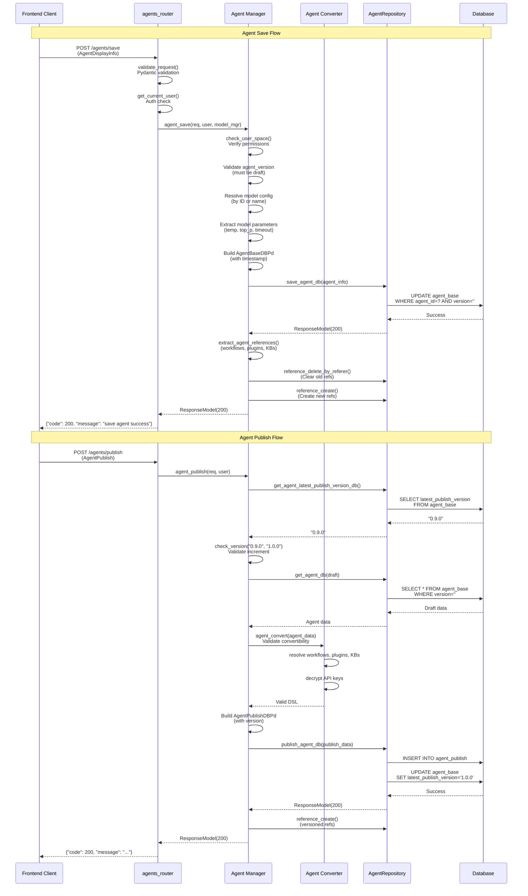

<!-- source: DeepWiki mcp.deepwiki.com · repo openJiuwen-ai/agent-studio · page 8.1 Agent APIs · fetched 2026-11-02 -->

# Agent APIs

<details>
<summary>Relevant source files</summary>

The following files were used as context for generating this wiki page:

- [backend/openjiuwen_studio/core/manager/agent.py](backend/openjiuwen_studio/core/manager/agent.py)
- [backend/openjiuwen_studio/core/manager/convertor/agent.py](backend/openjiuwen_studio/core/manager/convertor/agent.py)
- [backend/openjiuwen_studio/core/manager/knowledge_base.py](backend/openjiuwen_studio/core/manager/knowledge_base.py)
- [backend/openjiuwen_studio/core/manager/repositories/agent_repository.py](backend/openjiuwen_studio/core/manager/repositories/agent_repository.py)
- [backend/openjiuwen_studio/core/manager/repositories/plugin_repository.py](backend/openjiuwen_studio/core/manager/repositories/plugin_repository.py)
- [backend/openjiuwen_studio/core/manager/repositories/tool_repository.py](backend/openjiuwen_studio/core/manager/repositories/tool_repository.py)
- [backend/openjiuwen_studio/routers/agents.py](backend/openjiuwen_studio/routers/agents.py)
- [backend/openjiuwen_studio/schemas/agent.py](backend/openjiuwen_studio/schemas/agent.py)
- [frontend/packages/api-client/src/config.ts](frontend/packages/api-client/src/config.ts)
- [frontend/packages/api-client/src/services/agentService.ts](frontend/packages/api-client/src/services/agentService.ts)

</details>


This document describes the RESTful API endpoints for managing agents in OpenJiuwen Agent Studio. These APIs provide CRUD operations, version management, export/import functionality, and agent conversion to executable DSL format. For information about executing agents at runtime, see [Execution APIs](#8.x). For agent architecture concepts, see [Agents](#3.1).

---

## Overview

The Agent APIs are exposed through the `/api/v1/agents/*` endpoint prefix and provide comprehensive agent lifecycle management. The APIs support two agent types: **ReAct agents** (autonomous tool-calling) and **Workflow agents** (orchestrated workflow execution).

**Key Capabilities:**
- CRUD operations for draft agents
- Version publishing and management
- Agent search and filtering
- Agent duplication (copy)
- Export/import for migration
- Conversion from UI format to executable DSL
- Execution log retrieval

**Sources:** [backend/openjiuwen_studio/routers/agents.py:1-700]()

---

## API Endpoint Summary

The following table lists all agent API endpoints:

| Endpoint | Method | Purpose | Key Request Schema | Key Response Schema |
|----------|--------|---------|-------------------|---------------------|
| `/agents/create` | POST | Create new agent draft | `AgentCreate` | `AgentResponseCreate` |
| `/agents/get_agent_info` | POST | Get agent details | `AgentGetVersion` | `AgentDetailResponse` |
| `/agents/save` | POST | Save agent draft | `AgentDisplayInfo` | `ResponseModel` |
| `/agents/update` | POST | Update agent metadata | `AgentUpdate` | `ResponseModel` |
| `/agents/delete` | POST | Delete agent (all versions) | `AgentGet` | `ResponseModel` |
| `/agents/delete_publish` | POST | Delete specific published version | `AgentId` | `ResponseModel` |
| `/agents/list` | POST | List agents with pagination | `AgentList` | `AgentListResponse` |
| `/agents/search` | POST | Search agents | `AgentSearchRequest` | `AgentSearchResponse` |
| `/agents/copy` | POST | Copy agent | `AgentCopy` | `AgentResponseCreate` |
| `/agents/publish` | POST | Publish agent version | `AgentPublish` | `ResponseModel` |
| `/agents/version_list` | POST | List published versions | `AgentVersionListRequest` | `AgentVersionListResponse` |
| `/agents/{agent_id}` | GET | Get agent DSL for execution | Query params | Executable DSL |
| `/agents/export` | POST | Export agent as ZIP | `AgentExportRequest` | Binary (ZIP file) |
| `/agents/import` | POST | Import agent from file | `AgentImportRequest` | `ResponseModel` |

**Sources:** [backend/openjiuwen_studio/routers/agents.py:154-622](), [frontend/packages/api-client/src/config.ts:132-150]()

---

## Architecture Diagram



**Sources:** [backend/openjiuwen_studio/routers/agents.py:154-622](), [backend/openjiuwen_studio/core/manager/agent.py:1-1500](), [backend/openjiuwen_studio/core/manager/convertor/agent.py:1-650]()

---

## Core Data Models

### Request Schemas

#### AgentCreate
Used for creating new agents.

```python
AgentCreate {
    space_id: str         # Workspace identifier
    name: str            # Agent name (max 255 chars)
    desc: str            # Description (max 500 chars)
    icon: str            # Icon URL/emoji
    type: str            # "react" or "workflow"
}
```

**Sources:** [backend/openjiuwen_studio/schemas/agent.py:20-27]()

#### AgentDisplayInfo
Complete agent configuration used for saving.

```python
AgentDisplayInfo {
    id: str                          # Agent ID
    version: str | None              # Version (None for draft)
    space_id: str
    name: str
    desc: str
    icon: str
    type: str                        # "react" or "workflow"
    mode: str                        # Edit mode
    configs: dict                    # System prompt, retrieval config
    plugins: list[AgentPlugin]       # Tool references
    workflows: list[AgentWorkflow]   # Workflow references
    model: AgentModel                # LLM configuration
    prompt_template_name: str
    prompt_template: list[AgentPromptTemplate]
    constraint: AgentConstraint      # Max iterations, chat rounds
    knowledge: list[str]             # Knowledge base IDs
    memory: AgentMemoryConfig        # Memory configuration
    opening_remarks: str
    default_response: str            # For workflow agents
}
```

**Sources:** [backend/openjiuwen_studio/schemas/agent.py:110-128]()

#### AgentPublish
Used for publishing a version.

```python
AgentPublish {
    space_id: str
    id: str              # Agent ID (aliased as agentId)
    version: str         # Semantic version (e.g., "1.0.0")
    description: str     # Version description
}
```

**Sources:** [backend/openjiuwen_studio/schemas/agent.py:144-149]()

### Response Schemas

#### AgentListResponse
```python
AgentListResponse {
    agent_items: list[AgentItem]
    pagination: {
        page: int
        page_size: int
        total: int
        total_pages: int
    }
}
```

**Sources:** [backend/openjiuwen_studio/core/manager/internal/agent.py:1-100]()

#### AgentVersionListResponse
```python
AgentVersionListResponse {
    agent_id: str
    versions: list[{
        agent_version: str
        version_description: str
        create_time: int
    }]
}
```

**Sources:** [backend/openjiuwen_studio/schemas/agent.py:209-213]()

---

## Detailed Endpoint Specifications

### POST /agents/create

Creates a new agent draft with default configuration.

**Request Body:**
```json
{
  "spaceId": "space-123",
  "name": "Customer Service Agent",
  "desc": "Handles customer inquiries",
  "icon": "🤖",
  "type": "react"
}
```

**Response:**
```json
{
  "code": 200,
  "message": "create agent success",
  "data": {
    "id": "550e8400-e29b-41d4-a716-446655440000"
  }
}
```

**Implementation Flow:**
1. Validate user space permissions via `check_user_space()`
2. Generate UUID for agent
3. Create `AgentBaseDBPd` with defaults (opening remarks, constraints)
4. Save to `agent_base` table via `agent_repository.create_agent_db()`
5. Return agent ID

**Sources:** [backend/openjiuwen_studio/routers/agents.py:157-183](), [backend/openjiuwen_studio/core/manager/agent.py:329-376]()

---

### POST /agents/save

Saves agent configuration changes to draft version.

**Request Body:**
Full `AgentDisplayInfo` object with all agent configurations.

**Key Validations:**
- `agent_version` must be empty or None (draft only)
- Model configuration must exist and be active
- Knowledge base embedding models must match if multiple KBs used

**Implementation Flow:**
1. Validate `agent_version` is draft (empty/None)
2. Resolve model configuration by ID or name
3. Extract model config parameters (temperature, top_p, timeout)
4. Create `AgentBaseDBPd` with updated timestamp
5. Save via `agent_repository.save_agent_db()`
6. **Reference Management:**
   - Delete old draft references via `reference_repository.reference_delete_by_referer_with_version()`
   - Extract new references via `extract_agent_references()`
   - Create new reference records for workflows, plugins, knowledge bases

**Sources:** [backend/openjiuwen_studio/routers/agents.py:267-351](), [backend/openjiuwen_studio/core/manager/agent.py:613-755]()

---

### POST /agents/publish

Publishes a draft agent as a versioned release.

**Request Body:**
```json
{
  "spaceId": "space-123",
  "id": "agent-uuid",
  "version": "1.0.0",
  "description": "Initial release with basic tools"
}
```

**Version Validation:**
- Version must follow semantic versioning (X.Y.Z)
- Must be greater than latest published version
- Performed by `check_version()` utility

**Implementation Flow:**
1. Validate version format and increment
2. Fetch draft agent data
3. **Agent Validation:** Convert to DSL via `agent_convert()` to ensure validity
4. Create `AgentPublishDBPd` with version metadata
5. Save to `agent_publish` table
6. Update draft's `latest_publish_version` and `latest_publish_time`
7. **Reference Management:** Create versioned reference records
8. Update `prompt_relation` table if needed

**Sources:** [backend/openjiuwen_studio/routers/agents.py:406-432](), [backend/openjiuwen_studio/core/manager/agent.py:922-1102]()

---

### POST /agents/delete

Deletes an agent including all versions (draft and published).

**Request Body:**
```json
{
  "spaceId": "space-123",
  "agentId": "agent-uuid"
}
```

**Implementation Flow:**
1. Construct `AgentId` with `agent_version=None` to target draft
2. Delete via `agent_repository.delete_agent_db()`
3. Cascade deletes all published versions (database foreign key)
4. Clean up all references via `reference_repository.reference_delete_by_referer()`

**Sources:** [backend/openjiuwen_studio/routers/agents.py:185-211](), [backend/openjiuwen_studio/core/manager/agent.py:378-436]()

---

### POST /agents/delete_publish

Deletes a specific published version.

**Request Body:**
```json
{
  "spaceId": "space-123",
  "agentId": "agent-uuid",
  "agent_version": "1.0.0"
}
```

**Implementation Flow:**
1. Validate `agent_version` is provided and not draft
2. Delete from `agent_publish` table
3. Update draft's `latest_publish_version` if needed
4. Clean up versioned references

**Sources:** [backend/openjiuwen_studio/routers/agents.py:213-238](), [backend/openjiuwen_studio/core/manager/agent.py:438-498]()

---

### POST /agents/get_agent_info

Retrieves agent details including configuration and available options.

**Request Body:**
```json
{
  "spaceId": "space-123",
  "agentId": "agent-uuid",
  "version": "1.0.0"  // Optional, omit for draft
}
```

**Response Structure:**
```json
{
  "code": 200,
  "message": "create agent success",
  "data": {
    "agent_info": {
      // Full AgentBaseDBPd fields
      "agent_id": "...",
      "agent_name": "...",
      "model": {
        "model_provider": "openai",
        "model_info": {
          "model_id": 123,
          "model_name": "GPT-4",
          "temperature": 0.7,
          // ...
        }
      },
      // ...
    },
    "agent_option_info": {
      "workflow_list": [
        {"id": "wf-1", "version": "draft", "name": "...", "desc": "..."}
      ],
      "model_list": [
        {"id": 123, "name": "GPT-4", "type": "gpt-4", "provider": "openai"}
      ]
    }
  }
}
```

**Implementation Flow:**
1. Fetch agent via `agent_repository.get_agent_db()`
2. Fetch available workflows via `workflow_repository.workflow_list()`
3. Fetch available models via `ModelConfigManager.get_paginated_configs()`
4. Construct model info with saved overrides (temperature, top_p, timeout)
5. Return combined response

**Sources:** [backend/openjiuwen_studio/routers/agents.py:240-265](), [backend/openjiuwen_studio/core/manager/agent.py:500-611]()

---

### POST /agents/list

Retrieves paginated agent list with search and filtering.

**Request Body:**
```json
{
  "spaceId": "space-123",
  "page": 1,
  "page_size": 10,
  "sort_by": "update_time",  // or "agent_name", "create_time"
  "sort_order": "desc",      // or "asc"
  "search_term": "customer", // Optional
  "status_filter": "all"     // Optional
}
```

**Query Logic:**
- Searches in `agent_name` and `description` fields
- Returns metadata fields only (no full JSON configs for performance)
- Fetches model names in batch for all agents

**Sources:** [backend/openjiuwen_studio/routers/agents.py:381-404](), [backend/openjiuwen_studio/core/manager/agent.py:818-919]()

---

### POST /agents/search

Advanced search with filtering capabilities (similar to list but with different filtering options).

**Request Body:**
```json
{
  "space_id": "space-123",
  "search_term": "support",
  "status_filter": "all",
  "sort_by": "update_time",
  "sort_order": "desc",
  "page": 1,
  "page_size": 10
}
```

**Sources:** [backend/openjiuwen_studio/routers/agents.py:516-539](), [backend/openjiuwen_studio/core/manager/agent.py:1412-1506]()

---

### GET /agents/{agent_id}

Retrieves agent converted to executable DSL format. Used by execution engine.

**Query Parameters:**
- `agent_id` (path): Agent identifier
- `space_id` (query): Workspace identifier
- `version` (query, optional): Version to retrieve (defaults to draft)

**Response:**
Executable agent DSL in JSON format conforming to `ReactAgent` or `WorkflowAgent` schemas.

**Conversion Process:**
1. Fetch agent data (draft or published version)
2. Route to converter based on `agent_type`
3. Resolve all dependencies (workflows, plugins, knowledge bases)
4. Decrypt API keys
5. Return DSL

**Sources:** [backend/openjiuwen_studio/routers/agents.py:459-486](), [backend/openjiuwen_studio/core/manager/agent.py:1508-1557]()

---

### POST /agents/copy

Duplicates an agent (draft or published version).

**Request Body:**
```json
{
  "spaceId": "space-123",
  "id": "source-agent-id",
  "version": "1.0.0"  // Optional, omit to copy draft
}
```

**Response:**
```json
{
  "code": 200,
  "message": "copy agent success",
  "data": {
    "id": "new-agent-uuid"
  }
}
```

**Implementation Flow:**
1. Fetch source agent (draft or published)
2. Generate new UUID
3. Append " (Copy)" to name (or " (Copy N)" if name exists)
4. Reset version to draft
5. Create new agent record

**Sources:** [backend/openjiuwen_studio/routers/agents.py:488-514](), [backend/openjiuwen_studio/core/manager/agent.py:1104-1193]()

---

### POST /agents/version_list

Lists all published versions of an agent.

**Request Body:**
```json
{
  "space_id": "space-123",
  "agent_id": "agent-uuid"
}
```

**Response:**
```json
{
  "code": 200,
  "message": "Get agent versions success",
  "data": {
    "agent_id": "agent-uuid",
    "versions": [
      {
        "agent_version": "2.0.0",
        "version_description": "Added new tools",
        "create_time": 1704067200000
      },
      {
        "agent_version": "1.0.0",
        "version_description": "Initial release",
        "create_time": 1703980800000
      }
    ]
  }
}
```

**Sources:** [backend/openjiuwen_studio/routers/agents.py:434-457](), [backend/openjiuwen_studio/core/manager/agent.py:1195-1229]()

---

### POST /agents/export

Exports agent as a ZIP file containing agent configuration and dependencies.

**Request Body:**
```json
{
  "space_id": "space-123",
  "agent_id": "agent-uuid",
  "agent_version": "1.0.0"  // Optional
}
```

**Response:**
Binary ZIP file with `Content-Disposition` header containing filename.

**Export Structure:**
```
agent_export.zip
├── agent.json           # Agent configuration
├── metadata.json        # Export metadata (timestamp, version)
├── dependencies/
│   ├── workflows/       # Workflow definitions
│   ├── plugins/         # Plugin configurations
│   ├── knowledge_bases/ # KB metadata (not documents)
│   └── prompt_templates/
└── model_references.json # Model config templates
```

**Implementation Flow:**
1. Fetch agent data
2. Resolve all dependencies (workflows, plugins, KBs, prompt templates)
3. Create model reference templates (without API keys)
4. Package into ZIP
5. Set appropriate headers and return binary

**Sources:** [backend/openjiuwen_studio/routers/agents.py:585-622](), [backend/openjiuwen_studio/core/manager/agent.py:1231-1410]()

---

### POST /agents/import

Imports agent from exported ZIP file.

**Request:**
- Content-Type: `multipart/form-data`
- Fields:
  - `file`: ZIP file
  - `space_id`: Target workspace
  - `overwrite`: Boolean (whether to overwrite if exists)

**Response:**
```json
{
  "code": 200,
  "message": "Agent imported successfully",
  "data": {
    "agent_id": "imported-agent-uuid",
    "created_workflows": ["wf-1", "wf-2"],
    "created_plugins": ["plugin-1"]
  }
}
```

**Import Process:**
1. Extract and validate ZIP structure
2. Parse `agent.json` and validate schemas
3. **Dependency Resolution:**
   - Check if dependencies exist in target space
   - Create missing workflows
   - Create missing plugins
   - Link to existing knowledge bases (by name)
4. **Model Resolution:**
   - Match models by provider and type
   - Prompt user if API key needed
5. Create agent record
6. Overwrite handling if agent name exists

**Sources:** [backend/openjiuwen_studio/routers/agents.py:624-700]()

---

## Agent Conversion Pipeline

The conversion process transforms UI-friendly agent configuration into executable DSL format.



**Sources:** [backend/openjiuwen_studio/core/manager/convertor/agent.py:596-650]()

---

### Workflow Conversion

Converts workflow references to executable workflow schemas.

**Process:**
1. Query `workflow_repository.workflow_canvas()` for each workflow
2. Extract `input_parameters` and `output_parameters`
3. Convert to JSON Schema format via `convert_to_properties_format()`
4. Construct `WorkflowSchema` DSL objects

**Example Output:**
```python
WorkflowSchema(
    id="workflow-uuid",
    version="1.0.0",
    name="Data Processing",
    description="Processes customer data",
    inputs={
        "type": "object",
        "properties": {
            "customer_id": {"type": "string"},
            "data": {"type": "object"}
        },
        "required": ["customer_id"]
    },
    outputs={
        "result": {"type": "string"}
    }
)
```

**Sources:** [backend/openjiuwen_studio/core/manager/convertor/agent.py:32-117]()

---

### Plugin Conversion

Converts plugin tool references to executable plugin schemas.

**Process:**
1. Query `tool_repository.tool_get()` for each tool
2. Extract tool input/output parameters
3. Convert parameters to JSON Schema
4. Construct `PluginSchema` DSL

**Sources:** [backend/openjiuwen_studio/core/manager/convertor/agent.py:119-206]()

---

### Knowledge Base Conversion

Converts knowledge base IDs to knowledge schemas and retrieval configuration.

**Process:**
1. Query `knowledge_base_repository.knowledge_base_get()` for metadata
2. Build `KnowledgeSchema` objects
3. Extract retrieval configuration:
   - `retrieval_type`: Type of retrieval strategy
   - `topk`: Number of results to retrieve
   - `score_threshold`: Minimum relevance score
   - `use_graph`: Enable graph-enhanced retrieval
   - `use_agent`: Enable agent-based retrieval
   - `use_sync`: Enable synchronous mode

**Sources:** [backend/openjiuwen_studio/core/manager/convertor/agent.py:208-305]()

---

### Model Configuration

Converts model references to `ModelConfig` DSL.

**Process:**
1. Fetch model config by ID via `ModelConfigManager`
2. Decrypt API key using `SecurityUtils.decrypt_api_key()`
3. Apply agent-specific overrides (temperature, top_p, timeout)
4. Construct `ModelClientConfig` and `ModelRequestConfig`

**DSL Structure:**
```python
ModelConfig(
    model_client_config=ModelClientConfig(
        client_provider="openai",
        api_key="decrypted-key",
        api_base="https://api.openai.com/v1",
        timeout=300
    ),
    request_config=ModelRequestConfig(
        model_name="gpt-4",
        temperature=0.7,
        top_p=0.9,
        stream=False
    )
)
```

**Sources:** [backend/openjiuwen_studio/core/manager/convertor/agent.py:307-407]()

---

## Repository Layer

### AgentRepository

Core database operations for agents.

**Key Methods:**

| Method | Purpose | Tables |
|--------|---------|--------|
| `create_agent_db()` | Create draft agent | `agent_base` |
| `get_agent_db()` | Fetch agent (draft or published) | `agent_base`, `agent_publish` |
| `save_agent_db()` | Update draft agent | `agent_base` |
| `publish_agent_db()` | Publish version | `agent_publish`, updates `agent_base.latest_publish_version` |
| `delete_agent_db()` | Delete draft + all versions | `agent_base` (cascades) |
| `delete_agent_publish_db()` | Delete specific version | `agent_publish` |
| `get_space_agent_list_db()` | List agents with pagination/search | `agent_base` |
| `get_agent_publish_list()` | List published versions | `agent_publish` |
| `patch_agent_id()` | Resolve version strings like "latest_publish_version" | Query `agent_base` |

**Version Handling:**
- Draft version: `agent_version = ""` (stored as `__version_none__` constant)
- Published version: Semantic version string (e.g., "1.0.0")
- Latest published: Resolved from `agent_base.latest_publish_version` field

**Sources:** [backend/openjiuwen_studio/core/manager/repositories/agent_repository.py:1-650]()

---

## Error Handling

### Validation Errors

The API uses `handle_validation_error()` to translate Pydantic validation errors into user-friendly messages.

**Translation Logic:**
1. Extract field path and error type from Pydantic error
2. Translate field names to user's language (zh/en)
3. Provide context-specific messages (e.g., "Agent model configuration is empty")

**Example Error Response:**
```json
{
  "detail": "参数校验失败: 模型配置: 必填字段"
}
```

**Sources:** [backend/openjiuwen_studio/routers/agents.py:125-152]()

---

### Exception Handling Decorator

Manager functions use `@with_exception_handling` decorator for consistent error handling.

**Caught Exceptions:**
- `ValidationError`: Pydantic validation failures
- `ValueError`: Invalid input values
- `KeyError`: Missing required fields
- `TimeoutError`: Operation timeouts
- `ConnectionError`: Database connection issues

**Sources:** [backend/openjiuwen_studio/core/manager/agent.py:162-299]()

---

## Frontend Integration

### AgentService

The frontend API client wraps agent endpoints in a TypeScript service.

**Key Methods:**

```typescript
class AgentService {
  static async getAgents(request: AgentListRequest): Promise<AgentListResponse>
  static async createAgent(request: CreateAgentRequest): Promise<CreateAgentResponse>
  static async getAgentDetail(request: AgentDetailRequest): Promise<AgentDetailResponse>
  static async saveAgent(request: SaveAgentRequest): Promise<SaveAgentResponse>
  static async deleteAgent(request: DeleteAgentRequest): Promise<DeleteAgentResponse>
  static async publishAgent(request: AgentPublishRequest): Promise<AgentPublishResponse>
  static async copyAgent(request: CopyAgentRequest): Promise<CopyAgentResponse>
  static async searchAgents(request: AgentSearchRequest): Promise<AgentSearchResponse>
  static async exportAgent(request): Promise<Blob>
  static async importAgent(request): Promise<ImportResponse>
  static async getAgentVersionList(request): Promise<VersionListResponse>
  static async deleteAgentVersion(request): Promise<ResponseModel>
}
```

**Sources:** [frontend/packages/api-client/src/services/agentService.ts:1-354]()

---

## Data Flow Diagram



**Sources:** [backend/openjiuwen_studio/core/manager/agent.py:613-755](), [backend/openjiuwen_studio/core/manager/agent.py:922-1102]()

---

## Database Schema

### agent_base Table

Stores draft versions of agents.

**Key Columns:**
- `agent_id` (PK): UUID
- `space_id` (FK): Workspace reference
- `agent_name`: Display name
- `agent_type`: "react" or "workflow"
- `agent_version`: Always `""` (draft marker)
- `description`: Agent description
- `icon`: Icon URL/emoji
- `edit_mode`: "Manual" or "Auto"
- `configs` (JSON): System prompt, retrieval config
- `plugins` (JSON): Array of plugin references
- `workflows` (JSON): Array of workflow references
- `knowledge` (JSON): Array of KB IDs
- `memory` (JSON): Memory configuration
- `constraint` (JSON): Max iterations, chat rounds
- `model_id` (FK): Reference to model config
- `agent_model_config` (JSON): Model parameter overrides
- `prompt_template_name`: Template identifier
- `opening_remarks`: Agent greeting
- `default_response`: Workflow agent fallback
- `latest_publish_version`: Latest published version string
- `latest_publish_time`: Timestamp of last publish
- `create_time`, `update_time`: Timestamps

**Sources:** [backend/openjiuwen_studio/models/agent.py:1-200]()

### agent_publish Table

Stores published versions of agents.

**Structure:**
- Same columns as `agent_base`
- `agent_version` (PK component): Semantic version string
- `version_description`: Release notes
- Foreign key: `(agent_id, space_id)` references `agent_base`

**Sources:** [backend/openjiuwen_studio/models/agent.py:200-300]()

---

## Reference Tracking

The system tracks dependencies between agents and other resources.

### Reference Types

| Referer Type | Referenced Type | Tracked Field |
|--------------|----------------|---------------|
| AGENT | WORKFLOW | `workflows` JSON array |
| AGENT | PLUGIN | `plugins` JSON array (contains `plugin_id`, `tool_id`) |
| AGENT | KNOWLEDGE_BASE | `knowledge` JSON array |
| AGENT | PROMPT_TEMPLATE | `prompt_template_name` |

### Reference Operations

**On Save (Draft):**
1. Delete existing draft references: `reference_delete_by_referer_with_version(space_id, "AGENT", agent_id, "draft")`
2. Extract new references: `extract_agent_references(agent_data, space_id, "draft")`
3. Create new reference records

**On Publish:**
- Create versioned references with actual version string

**On Delete:**
- Delete all references: `reference_delete_by_referer(space_id, "AGENT", agent_id)`

**Sources:** [backend/openjiuwen_studio/core/manager/agent.py:707-744](), [backend/openjiuwen_studio/core/manager/reference_extractor.py:1-200]()

---

## Performance Considerations

### List Endpoint Optimization

The `/agents/list` endpoint uses selective field retrieval:
- Only fetches metadata fields via `get_meta_data_keys()`
- Excludes large JSON fields like full plugin/workflow configurations
- Batch fetches model names to avoid N+1 queries

**Sources:** [backend/openjiuwen_studio/core/manager/agent.py:850-897]()

### Search Performance

Search queries use database-level LIKE operations:
- `searchs = {search_term: ["agent_name", "description"]}`
- Database performs case-insensitive search on specified columns
- Pagination limits result set size

**Sources:** [backend/openjiuwen_studio/core/manager/repositories/agent_repository.py:163-247]()

---

## Security

### Authentication

All endpoints require authentication via `get_current_user()` dependency.
- Extracts JWT token from request
- Validates token and loads user context
- Returns user data including `user_id_str` and `space_id`

**Sources:** [backend/openjiuwen_studio/routers/agents.py:157-700]()

### Authorization

Space-level authorization via `check_user_space()`:
- Verifies user has access to specified `space_id`
- Prevents cross-workspace data access
- Called at start of every endpoint

**Sources:** [backend/openjiuwen_studio/core/manager/agent.py:344-773]()

### API Key Security

Model API keys are encrypted at rest:
- Encrypted before storage using `SecurityUtils.encrypt_api_key()`
- Decrypted only during conversion: `SecurityUtils.decrypt_api_key()`
- Never returned in API responses (masked with empty string)

**Sources:** [backend/openjiuwen_studio/core/manager/convertor/agent.py:342-353]()

---

