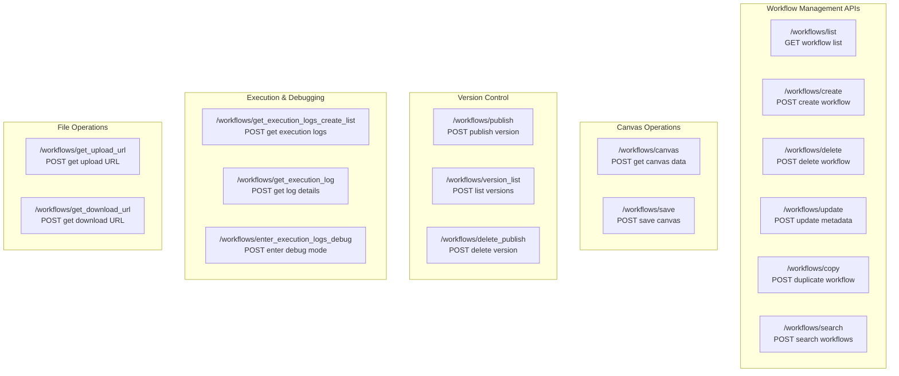
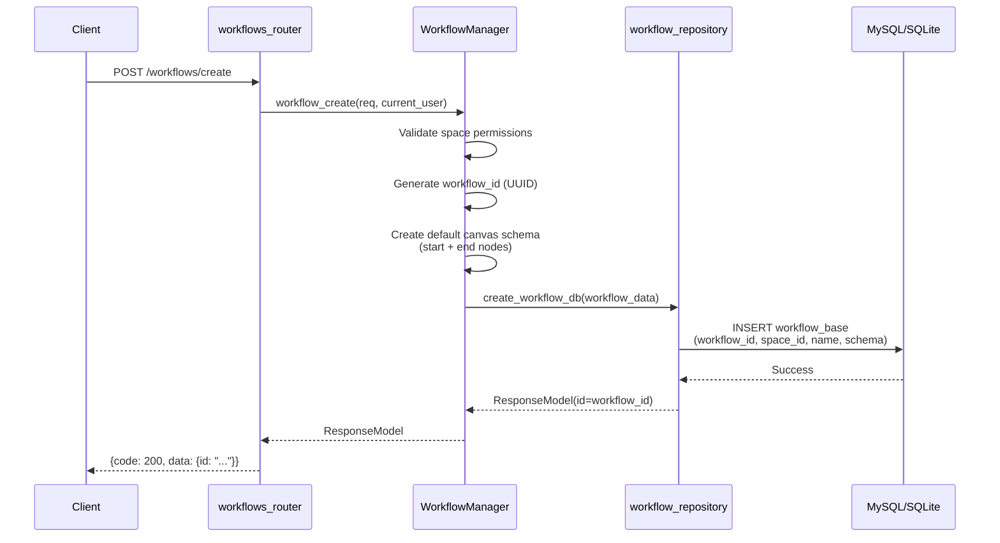
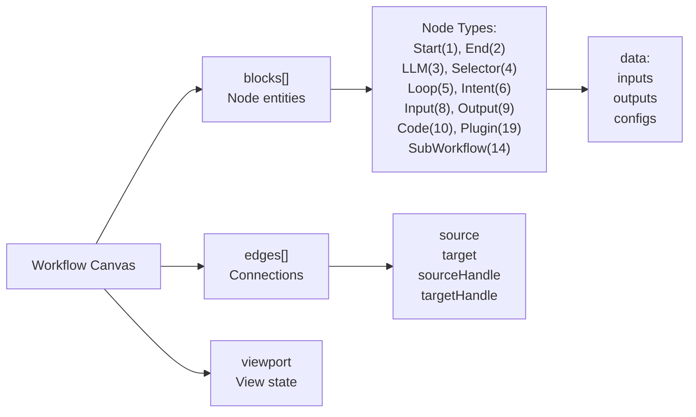
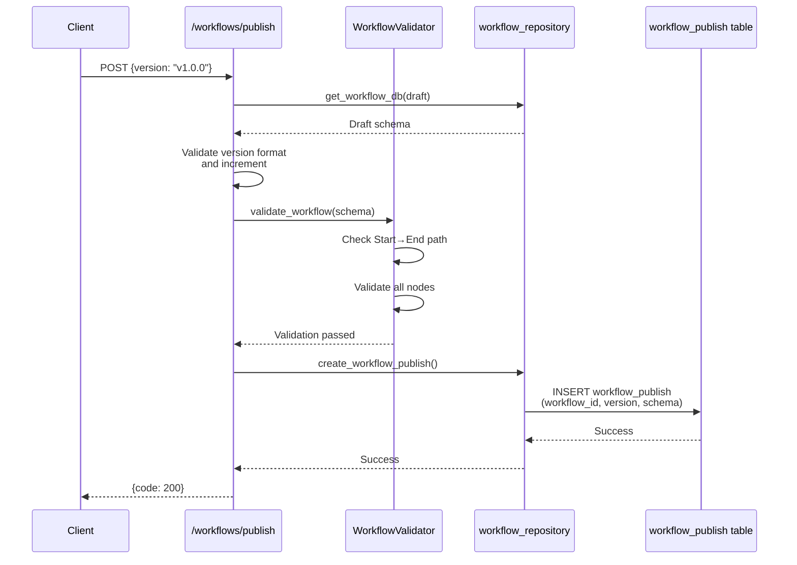
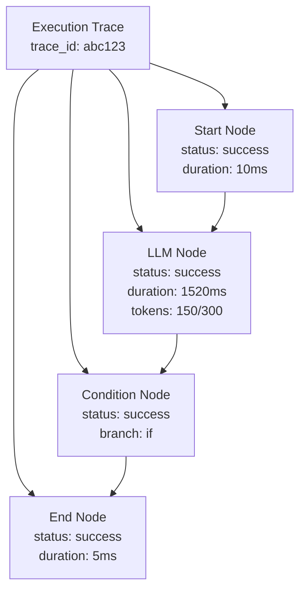
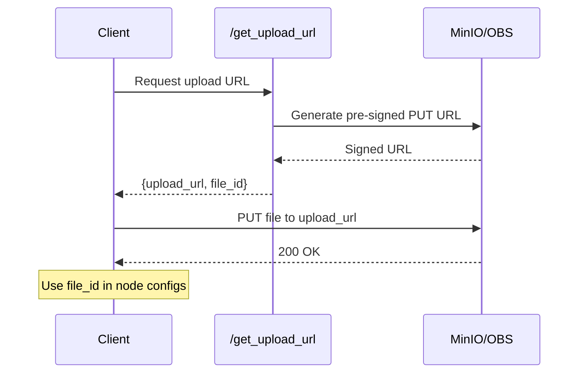
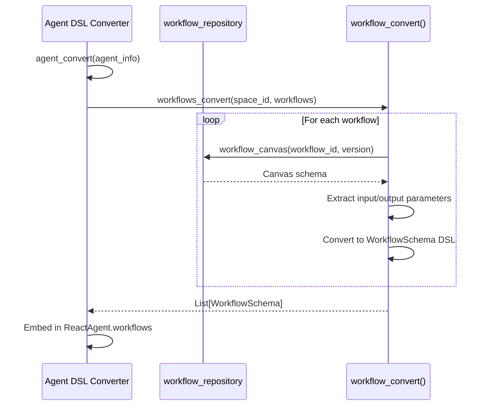
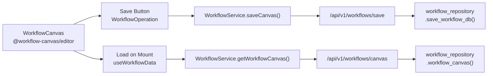
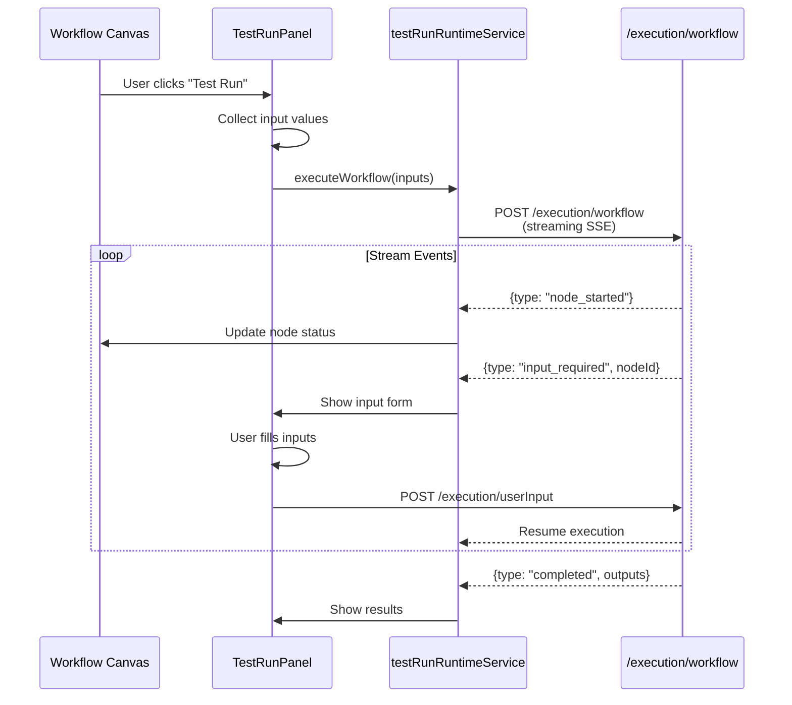
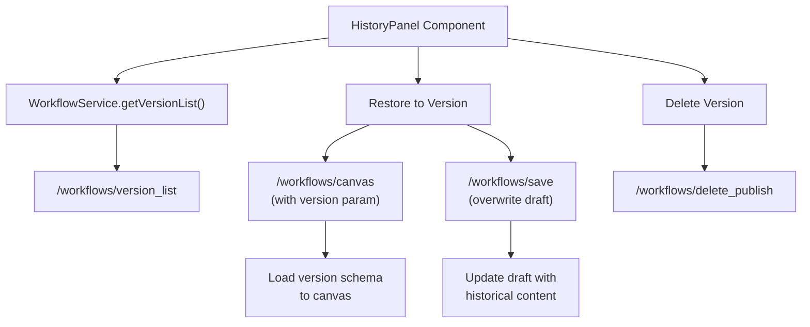

<!-- source: DeepWiki mcp.deepwiki.com · repo openJiuwen-ai/agent-studio · page 8.2 Workflow APIs · fetched 2026-11-02 -->

# Workflow APIs

<details>
<summary>Relevant source files</summary>

The following files were used as context for generating this wiki page:

- [backend/openjiuwen_studio/core/manager/agent.py](backend/openjiuwen_studio/core/manager/agent.py)
- [backend/openjiuwen_studio/core/manager/convertor/agent.py](backend/openjiuwen_studio/core/manager/convertor/agent.py)
- [backend/openjiuwen_studio/core/manager/knowledge_base.py](backend/openjiuwen_studio/core/manager/knowledge_base.py)
- [backend/openjiuwen_studio/core/manager/repositories/agent_repository.py](backend/openjiuwen_studio/core/manager/repositories/agent_repository.py)
- [backend/openjiuwen_studio/core/manager/repositories/plugin_repository.py](backend/openjiuwen_studio/core/manager/repositories/plugin_repository.py)
- [backend/openjiuwen_studio/core/manager/repositories/tool_repository.py](backend/openjiuwen_studio/core/manager/repositories/tool_repository.py)
- [backend/openjiuwen_studio/routers/agents.py](backend/openjiuwen_studio/routers/agents.py)
- [backend/openjiuwen_studio/schemas/agent.py](backend/openjiuwen_studio/schemas/agent.py)
- [frontend/packages/api-client/src/config.ts](frontend/packages/api-client/src/config.ts)
- [frontend/packages/api-client/src/services/agentService.ts](frontend/packages/api-client/src/services/agentService.ts)
- [frontend/packages/workflow-canvas/src/components/testrun/shared/use-input-interruption.ts](frontend/packages/workflow-canvas/src/components/testrun/shared/use-input-interruption.ts)
- [frontend/packages/workflow-canvas/src/components/testrun/testrun-panel/test-run-panel.tsx](frontend/packages/workflow-canvas/src/components/testrun/testrun-panel/test-run-panel.tsx)
- [frontend/packages/workflow-canvas/src/editor.tsx](frontend/packages/workflow-canvas/src/editor.tsx)
- [frontend/packages/workflow-canvas/src/nodes/loop/effects.ts](frontend/packages/workflow-canvas/src/nodes/loop/effects.ts)
- [frontend/packages/workflow-canvas/src/nodes/loop/form-meta.tsx](frontend/packages/workflow-canvas/src/nodes/loop/form-meta.tsx)
- [frontend/packages/workflow-canvas/src/nodes/loop/validation.ts](frontend/packages/workflow-canvas/src/nodes/loop/validation.ts)
- [frontend/packages/workflow-canvas/src/utils/validation/validation-helpers.ts](frontend/packages/workflow-canvas/src/utils/validation/validation-helpers.ts)
- [frontend/packages/workflow-canvas/src/utils/workflow-node-utils.ts](frontend/packages/workflow-canvas/src/utils/workflow-node-utils.ts)
- [frontend/src/locales/workflow/en-US/common.json](frontend/src/locales/workflow/en-US/common.json)
- [frontend/src/locales/workflow/en-US/nodes.json](frontend/src/locales/workflow/en-US/nodes.json)
- [frontend/src/locales/workflow/zh-CN/common.json](frontend/src/locales/workflow/zh-CN/common.json)
- [frontend/src/locales/workflow/zh-CN/nodes.json](frontend/src/locales/workflow/zh-CN/nodes.json)

</details>


## Purpose and Scope

This document describes the REST API endpoints for managing workflows in OpenJiuwen Agent Studio. Workflows are visual node-based automation sequences that can be executed independently or embedded within agents. The Workflow APIs provide CRUD operations, canvas management, version control, execution, and debugging capabilities.

For information about workflow execution, see [Execution APIs](#8.x). For agent integration with workflows, see [Agent APIs](#8.1). For the workflow canvas architecture and node types, see [Workflow Canvas Architecture](#5.7).

---

## API Endpoints Overview

All workflow endpoints are prefixed with `/api/v1/workflows/`. The following diagram maps the API endpoints to their primary functions:



**Sources:** [frontend/packages/api-client/src/config.ts:96-113]()

---

## Workflow Lifecycle Management

### Create Workflow

**Endpoint:** `POST /api/v1/workflows/create`

Creates a new workflow in draft state with default start and end nodes.

**Request Schema:**
```typescript
{
  spaceId: string      // Workspace identifier
  name: string         // Workflow name (1-255 chars)
  desc?: string        // Optional description
  icon?: string        // Optional icon URL
}
```

**Response Schema:**
```typescript
{
  code: 200,
  message: "create workflow success",
  data: {
    id: string        // Generated workflow_id (UUID)
  }
}
```

**Backend Flow:**


---

### Get Workflow List

**Endpoint:** `POST /api/v1/workflows/list`

Retrieves paginated list of workflows for a workspace.

**Request Schema:**
```typescript
{
  spaceId: string
  page?: number        // Default: 1
  pageSize?: number    // Default: 10, max: 1000
  sortBy?: string      // Default: "update_time"
  sortOrder?: string   // "asc" | "desc", default: "desc"
}
```

**Response Schema:**
```typescript
{
  code: 200,
  data: {
    workflow_list: Array<{
      workflow_id: string
      name: string
      desc: string
      icon?: string
      create_time: number    // Milliseconds timestamp
      update_time: number
      tags?: string[]
    }>,
    total: number
    page: number
    page_size: number
    total_pages: number
  }
}
```

**Sources:** [frontend/packages/api-client/src/config.ts:98](), [backend/openjiuwen_studio/core/manager/agent.py:525-527]()

---

### Update Workflow Metadata

**Endpoint:** `POST /api/v1/workflows/update`

Updates workflow name, description, or icon without modifying canvas.

**Request Schema:**
```typescript
{
  spaceId: string
  workflowId: string
  name?: string
  desc?: string
  icon?: string
}
```

**Sources:** [frontend/packages/api-client/src/config.ts:103]()

---

### Delete Workflow

**Endpoint:** `POST /api/v1/workflows/delete`

Deletes workflow and all its versions (draft + published).

**Request Schema:**
```typescript
{
  spaceId: string
  workflowId: string
}
```

**Cleanup Operations:**
1. Delete all published versions from `workflow_publish` table
2. Delete draft from `workflow_base` table
3. Clean up execution logs
4. Remove references from agents using this workflow

**Sources:** [frontend/packages/api-client/src/config.ts:102]()

---

### Copy Workflow

**Endpoint:** `POST /api/v1/workflows/copy`

Creates a duplicate of an existing workflow with a new ID.

**Request Schema:**
```typescript
{
  spaceId: string
  workflowId: string
  name: string          // Name for the copy
  version?: string      // Source version, default: draft
}
```

**Response Schema:**
```typescript
{
  code: 200,
  data: {
    id: string         // New workflow_id
  }
}
```

**Sources:** [frontend/packages/api-client/src/config.ts:104]()

---

## Canvas Operations

### Get Canvas Schema

**Endpoint:** `POST /api/v1/workflows/canvas`

Retrieves the complete canvas schema including nodes, edges, and parameters.

**Request Schema:**
```typescript
{
  spaceId: string
  workflowId: string
  version?: string      // Omit for draft, or specify published version
}
```

**Response Schema:**
```typescript
{
  code: 200,
  data: {
    workflow_id: string
    workflow_version: string    // "draft" or "v1.0.0"
    name: string
    desc: string
    schema: {
      blocks: Array<NodeBlock>
      edges: Array<Edge>
      viewport: {
        x: number
        y: number
        zoom: number
      }
    },
    input_parameters: Array<Parameter>
    output_parameters: Array<Parameter>
    create_time: number
    update_time: number
  }
}
```

**Canvas Schema Structure:**



**Sources:** [frontend/packages/api-client/src/config.ts:100](), [backend/openjiuwen_studio/core/manager/convertor/agent.py:32-65](), [frontend/packages/workflow-canvas/src/editor.tsx:56-62]()

---

### Save Canvas

**Endpoint:** `POST /api/v1/workflows/save`

Persists canvas changes to the draft version.

**Request Schema:**
```typescript
{
  spaceId: string
  workflowId: string
  schema: {
    blocks: Array<NodeBlock>
    edges: Array<Edge>
    viewport: ViewportState
  }
  input_parameters?: Array<Parameter>
  output_parameters?: Array<Parameter>
}
```

**Node Block Structure:**
```typescript
interface NodeBlock {
  id: string              // Node identifier
  type: number            // Node type code (1-19)
  position: {x: number, y: number}
  data: {
    title?: string
    inputs?: Record<string, any>
    outputs?: {
      type: "object"
      properties: Record<string, SchemaProperty>
    }
    configs?: Record<string, any>
  }
  width?: number
  height?: number
}
```

**Validation on Save:**
1. Must contain path from Start(1) to End(2)
2. All node references must be valid
3. Loop nodes must have valid body structure
4. Condition branches must be connected

**Sources:** [frontend/packages/api-client/src/config.ts:101](), [frontend/packages/workflow-canvas/src/nodes/loop/validation.ts:1-150]()

---

## Version Management

### Publish Workflow

**Endpoint:** `POST /api/v1/workflows/publish`

Creates an immutable published version from the current draft.

**Request Schema:**
```typescript
{
  spaceId: string
  workflowId: string
  version: string         // Semantic version: "v1.0.0"
  description: string     // Release notes (5-200 chars)
}
```

**Version Validation:**
- Format: `v{major}.{minor}.{patch}` (e.g., "v1.2.3")
- Must be greater than latest published version
- Workflow must pass validation (complete execution path)

**Publish Flow:**


**Sources:** [frontend/packages/api-client/src/config.ts:106](), [frontend/src/locales/workflow/zh-CN/nodes.json:289-309]()

---

### Get Version List

**Endpoint:** `POST /api/v1/workflows/version_list`

Retrieves all published versions with metadata.

**Request Schema:**
```typescript
{
  spaceId: string
  workflowId: string
  page?: number
  pageSize?: number
}
```

**Response Schema:**
```typescript
{
  code: 200,
  data: {
    versions: Array<{
      workflow_version: string    // "v1.0.0"
      version_description: string
      create_time: number
      update_time: number
      schema: WorkflowSchema      // Optional: include full schema
    }>,
    total: number
  }
}
```

**Sources:** [frontend/packages/api-client/src/config.ts:107]()

---

### Delete Published Version

**Endpoint:** `POST /api/v1/workflows/delete_publish`

Removes a specific published version.

**Request Schema:**
```typescript
{
  spaceId: string
  workflowId: string
  version: string         // "v1.0.0"
}
```

**Constraints:**
- Cannot delete if version is referenced by published agents
- Cannot delete the only published version if agents depend on it
- Deletes execution logs associated with this version

**Sources:** [frontend/packages/api-client/src/config.ts:108]()

---

## Execution and Debugging

### Get Execution Logs

**Endpoint:** `POST /api/v1/workflows/get_execution_logs_create_list`

Retrieves list of workflow execution attempts.

**Request Schema:**
```typescript
{
  spaceId: string
  workflowId: string
  version?: string        // Filter by version
  page?: number
  pageSize?: number
  startTime?: number      // Filter by time range
  endTime?: number
}
```

**Response Schema:**
```typescript
{
  code: 200,
  data: {
    logs: Array<{
      trace_id: string         // Unique execution ID
      workflow_id: string
      workflow_version: string
      status: "running" | "success" | "failed" | "cancelled"
      start_time: number
      end_time?: number
      duration_ms?: number
      inputs: Record<string, any>
      outputs?: Record<string, any>
      error_message?: string
    }>,
    total: number
  }
}
```

**Sources:** [frontend/packages/api-client/src/config.ts:109](), [frontend/packages/workflow-canvas/src/components/testrun/testrun-panel/test-run-panel.tsx:83-108]()

---

### Get Execution Log Detail

**Endpoint:** `POST /api/v1/workflows/get_execution_log`

Retrieves detailed node-by-node execution trace for debugging.

**Request Schema:**
```typescript
{
  spaceId: string
  workflowId: string
  traceId: string          // From execution logs list
}
```

**Response Schema:**
```typescript
{
  code: 200,
  data: {
    trace_id: string
    workflow_id: string
    status: string
    start_time: number
    end_time: number
    nodes: Array<{
      node_id: string
      node_type: number
      node_name: string
      status: "running" | "success" | "failed"
      start_time: number
      end_time: number
      duration_ms: number
      inputs: Record<string, any>
      outputs: Record<string, any>
      error?: string
      token_usage?: {
        input_tokens: number
        output_tokens: number
      }
    }>,
    edges: Array<{
      from_node: string
      to_node: string
      traversed: boolean
    }>
  }
}
```

**Debug Tree Visualization:**



**Sources:** [frontend/packages/api-client/src/config.ts:110](), [frontend/src/locales/workflow/zh-CN/common.json:212-223]()

---

### Enter Execution Debug

**Endpoint:** `POST /api/v1/workflows/enter_execution_logs_debug`

Prepares debug session for step-through execution.

**Request Schema:**
```typescript
{
  spaceId: string
  workflowId: string
  traceId: string
}
```

**Response Schema:**
```typescript
{
  code: 200,
  data: {
    session_id: string       // Debug session identifier
    breakpoints: Array<string>  // Node IDs with breakpoints
    current_node?: string    // Current position in replay
  }
}
```

**Sources:** [frontend/packages/api-client/src/config.ts:111]()

---

## File Operations

### Get Upload URL

**Endpoint:** `POST /api/v1/workflows/get_upload_url`

Generates pre-signed URL for uploading workflow-related files (e.g., file inputs for nodes).

**Request Schema:**
```typescript
{
  spaceId: string
  workflowId: string
  fileName: string
  fileType: string         // MIME type
  fileSize: number
}
```

**Response Schema:**
```typescript
{
  code: 200,
  data: {
    upload_url: string      // Pre-signed URL (valid 1 hour)
    file_id: string         // Reference for download
    expires_at: number
  }
}
```

**Upload Flow:**


**Sources:** [frontend/packages/api-client/src/config.ts:112]()

---

### Get Download URL

**Endpoint:** `POST /api/v1/workflows/get_download_url`

Generates pre-signed URL for downloading workflow execution outputs.

**Request Schema:**
```typescript
{
  spaceId: string
  fileId: string           // From upload or execution output
}
```

**Response Schema:**
```typescript
{
  code: 200,
  data: {
    download_url: string    // Pre-signed URL (valid 1 hour)
    file_name: string
    file_size: number
    expires_at: number
  }
}
```

**Sources:** [frontend/packages/api-client/src/config.ts:113]()

---

## Request/Response Schemas

### Common Workflow Data Types

**Parameter Schema:**
```typescript
interface Parameter {
  name: string              // Variable name (alphanumeric + _)
  type: "string" | "number" | "integer" | "boolean" | "object" | "array"
  description?: string      // Help text for LLM understanding
  default?: any             // Default value if not provided
  required?: boolean        // Default: false
  schema?: JSONSchema       // For complex types (object/array)
}
```

**Node Type Mapping:**
```typescript
enum NodeType {
  Start = 1,
  End = 2,
  LLM = 3,
  Selector = 4,         // Condition/If-Else
  Loop = 5,
  Intent = 6,
  Questioner = 7,
  Input = 8,
  Output = 9,
  Code = 10,
  TextEditor = 11,
  Continue = 12,
  Break = 13,
  SubWorkflow = 14,
  BlockStart = 15,
  BlockEnd = 16,
  Variable = 17,
  VariableMerge = 18,
  Plugin = 19,
  Comment = 99
}
```

**Sources:** [frontend/src/locales/workflow/zh-CN/nodes.json:23-43](), [frontend/packages/workflow-canvas/src/nodes/loop/form-meta.tsx:35-60]()

---

### Error Response Schema

All endpoints follow consistent error format:

```typescript
{
  code: 400 | 404 | 500,
  message: string,
  data?: {
    error_type?: string
    details?: string
    validation_errors?: Array<{
      field: string
      message: string
    }>
  }
}
```

**Common Error Codes:**
- `400` - Bad Request (validation failure, invalid version format)
- `404` - Not Found (workflow_id doesn't exist)
- `403` - Forbidden (no space access)
- `500` - Internal Server Error

**Sources:** [backend/openjiuwen_studio/core/manager/agent.py:162-298]()

---

## Integration Patterns

### Workflow-Agent Integration

Agents can embed workflows as tools. When an agent is converted to executable DSL, workflow schemas are resolved:



**Workflow Schema DSL:**
```python
class WorkflowSchema:
    id: str                  # workflow_id
    version: str             # "draft" or "v1.0.0"
    name: str
    description: str
    inputs: {                # JSONSchema
        "type": "object",
        "properties": {...},
        "required": [...]
    }
    outputs: {...}           # Output properties
    configs: {}              # Execution configs
```

**Sources:** [backend/openjiuwen_studio/core/manager/convertor/agent.py:32-116](), [backend/openjiuwen_studio/core/manager/agent.py:524-540]()

---

### Frontend Canvas-API Integration

The workflow canvas communicates with the backend through save/load operations:



**Canvas Save Flow:**
```typescript
// frontend/packages/workflow-canvas/src/editor.tsx
const handleSave = async () => {
  const schema = document.export()  // Export canvas state
  
  await WorkflowService.saveCanvas({
    workflow_id: workflowId,
    space_id: spaceId,
    schema: schema,
    input_parameters: extractInputParams(schema),
    output_parameters: extractOutputParams(schema)
  })
  
  Toast.success("Workflow saved successfully")
}
```

**Sources:** [frontend/packages/workflow-canvas/src/editor.tsx:1-250](), [frontend/packages/api-client/src/config.ts:96-113]()

---

### Test Run Execution Pattern

Test runs use the execution API with interruption handling for input nodes:



**Input Interruption Handling:**
```typescript
// Handle input_required events from SSE stream
const handleInputRequired = (data: InputInterruption) => {
  setInterruptionQueue(prev => [...prev, data])
  setIsStreamExecuting(false)  // Pause execution
}

// Resume after user input
const resume = async (values: Record<string, unknown>) => {
  await testRunRuntimeService.submitUserInput(
    interruption.nodeId,
    values
  )
  // Stream resumes automatically
}
```

**Sources:** [frontend/packages/workflow-canvas/src/components/testrun/testrun-panel/test-run-panel.tsx:39-280](), [frontend/packages/workflow-canvas/src/components/testrun/shared/use-input-interruption.ts:1-80]()

---

## Version History Panel Integration

The version history panel allows users to view, restore, and delete workflow versions:



**Restore Version Flow:**
```typescript
// Restore a published version to draft
const restoreVersion = async (version: string) => {
  // 1. Fetch version schema
  const response = await WorkflowService.getWorkflowCanvas({
    workflow_id: workflowId,
    space_id: spaceId,
    version: version
  })
  
  // 2. Load into canvas
  const schema = response.data.schema
  document.import(schema)
  
  // 3. Save as draft
  await WorkflowService.saveCanvas({
    workflow_id: workflowId,
    space_id: spaceId,
    schema: schema
  })
}
```

**Sources:** [frontend/src/locales/workflow/zh-CN/nodes.json:264-288](), [frontend/packages/workflow-canvas/src/editor.tsx:45-91]()

---

