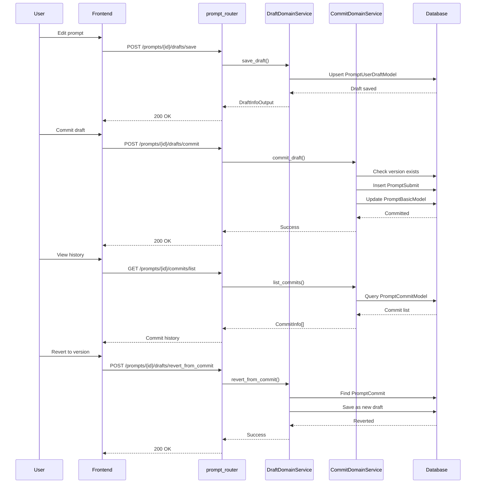
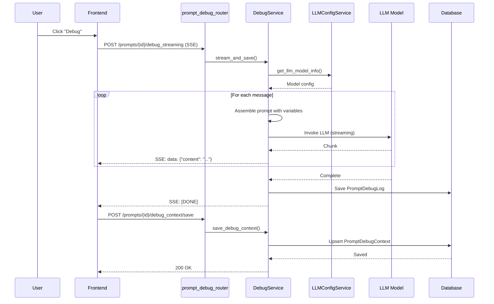
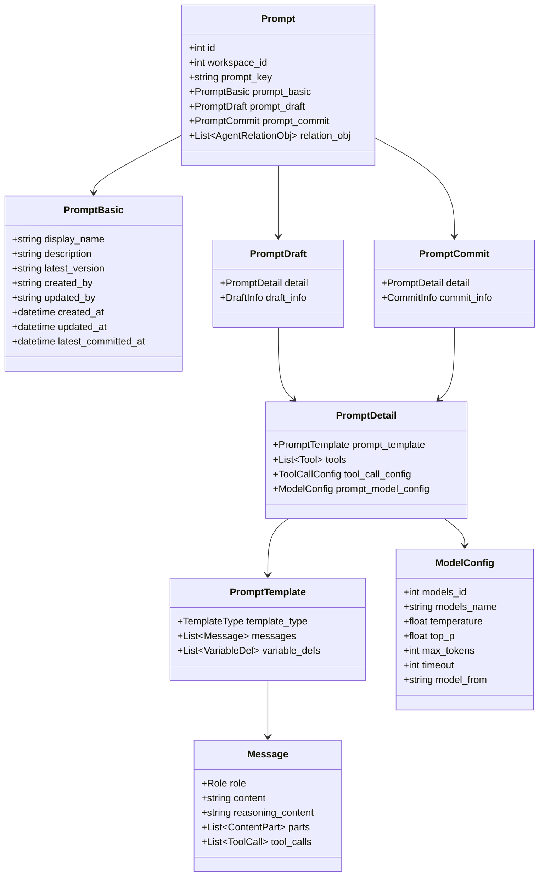
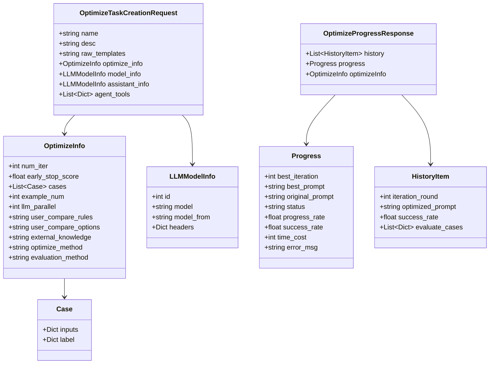
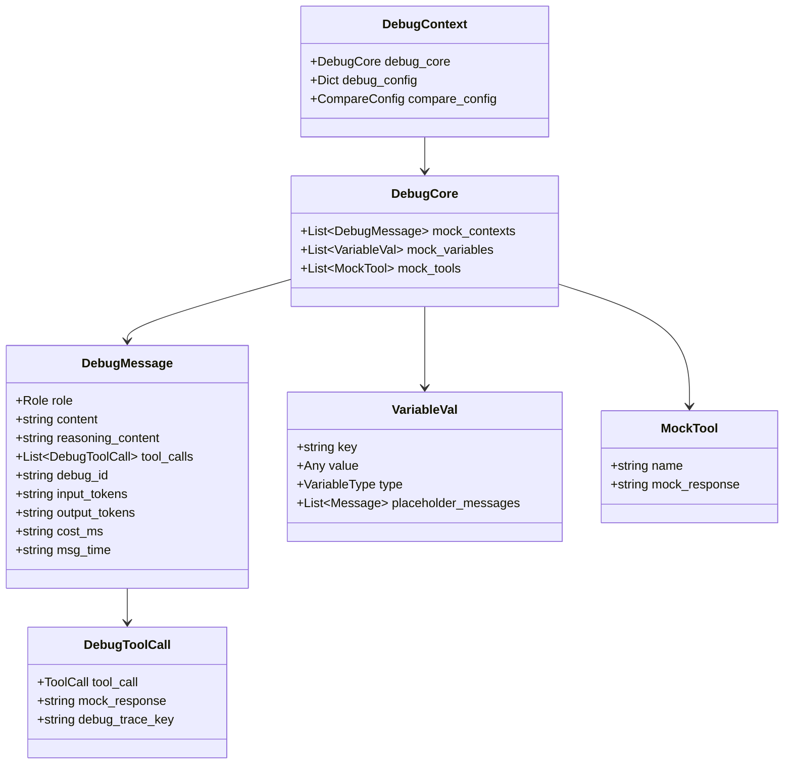
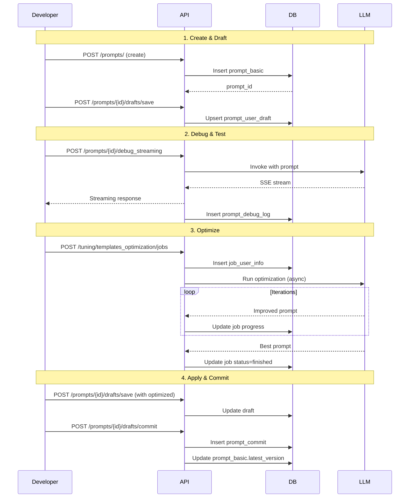

<!-- source: DeepWiki mcp.deepwiki.com · repo openJiuwen-ai/agent-studio · page 8.3 Prompt APIs · fetched 2026-11-02 -->

# Prompt APIs

<details>
<summary>Relevant source files</summary>

The following files were used as context for generating this wiki page:

- [backend/openjiuwen_studio/core/manager/model_manager/managers/model_test_manager.py](backend/openjiuwen_studio/core/manager/model_manager/managers/model_test_manager.py)
- [backend/openjiuwen_studio/ops/modules/llm/llm_config_service.py](backend/openjiuwen_studio/ops/modules/llm/llm_config_service.py)
- [backend/openjiuwen_studio/ops/modules/llm/schema.py](backend/openjiuwen_studio/ops/modules/llm/schema.py)
- [backend/openjiuwen_studio/ops/modules/prompt/domain/debug_entity.py](backend/openjiuwen_studio/ops/modules/prompt/domain/debug_entity.py)
- [backend/openjiuwen_studio/ops/modules/prompt/domain/entities.py](backend/openjiuwen_studio/ops/modules/prompt/domain/entities.py)
- [backend/openjiuwen_studio/ops/modules/prompt/domain/services.py](backend/openjiuwen_studio/ops/modules/prompt/domain/services.py)
- [backend/openjiuwen_studio/ops/modules/prompt/infra/repositories/debug_repo.py](backend/openjiuwen_studio/ops/modules/prompt/infra/repositories/debug_repo.py)
- [backend/openjiuwen_studio/routers/prompt_debug_router.py](backend/openjiuwen_studio/routers/prompt_debug_router.py)
- [backend/openjiuwen_studio/routers/prompt_llm_router.py](backend/openjiuwen_studio/routers/prompt_llm_router.py)
- [backend/openjiuwen_studio/routers/prompt_router.py](backend/openjiuwen_studio/routers/prompt_router.py)
- [backend/openjiuwen_studio/routers/prompt_tuning_router.py](backend/openjiuwen_studio/routers/prompt_tuning_router.py)
- [backend/openjiuwen_studio/schemas/model_config.py](backend/openjiuwen_studio/schemas/model_config.py)
- [frontend/src/components/Agent/ModelDetailForm.tsx](frontend/src/components/Agent/ModelDetailForm.tsx)

</details>


This page documents the REST API endpoints for prompt template management, optimization, debugging, and version control. These APIs enable creating, editing, testing, and optimizing prompts used by AI agents.

For information about agent APIs that consume prompts, see [Agent APIs](#8.1). For workflow-related APIs, see [Workflow APIs](#8.2). For model configuration management, see [Model APIs](#8.4).

---

## Overview

The Prompt APIs provide comprehensive functionality for managing the lifecycle of prompt templates:

- **Template Management**: Create, read, update, delete, and list prompt templates
- **Version Control**: Draft-commit workflow similar to Git, with version history and rollback
- **Debugging**: Interactive testing with SSE streaming, context preservation, and history tracking
- **Optimization**: Automated prompt tuning using LLM-based feedback and evaluation
- **Model Integration**: Configure and test LLM models used for prompts

All prompt endpoints are prefixed with `/api/v1/prompts` and require authentication via JWT tokens passed in the `Authorization` header.

**Sources:** [backend/openjiuwen_studio/routers/prompt_router.py:1-237](), [backend/openjiuwen_studio/routers/prompt_tuning_router.py:1-59](), [backend/openjiuwen_studio/routers/prompt_debug_router.py:1-105]()

---

## API Endpoint Overview

### Prompt Template Management Endpoints

| Method | Endpoint | Description |
|--------|----------|-------------|
| POST | `/api/v1/prompts/` | Create a new prompt template |
| POST | `/api/v1/prompts/list` | List prompts with filtering and pagination |
| GET | `/api/v1/prompts/{prompt_id}` | Get prompt details (draft and/or commit) |
| PUT | `/api/v1/prompts/{prompt_id}` | Update prompt metadata (name, description) |
| DELETE | `/api/v1/prompts/{prompt_id}` | Delete a prompt template |
| POST | `/api/v1/prompts/{prompt_id}/clone` | Clone an existing prompt |
| POST | `/api/v1/prompts/batch-get` | Batch retrieve multiple prompts |

### Version Control Endpoints

| Method | Endpoint | Description |
|--------|----------|-------------|
| POST | `/api/v1/prompts/{prompt_id}/drafts/save` | Save prompt draft |
| GET | `/api/v1/prompts/{prompt_id}/drafts` | Get user's draft for a prompt |
| POST | `/api/v1/prompts/{prompt_id}/drafts/commit` | Commit draft as a new version |
| GET | `/api/v1/prompts/{prompt_id}/commits/list` | List commit history |
| POST | `/api/v1/prompts/{prompt_id}/drafts/revert_from_commit` | Revert draft to a specific commit |

### Debugging Endpoints

| Method | Endpoint | Description |
|--------|----------|-------------|
| POST | `/api/v1/prompts/{prompt_id}/debug_streaming` | Stream debug execution with LLM |
| POST | `/api/v1/prompts/{prompt_id}/debug_context/save` | Save debug context (messages, variables) |
| GET | `/api/v1/prompts/{prompt_id}/debug_context/get` | Get latest debug context |
| GET | `/api/v1/prompts/{prompt_id}/debug_history/list` | List debug execution history |

### Optimization Endpoints

| Method | Endpoint | Description |
|--------|----------|-------------|
| POST | `/api/v1/prompts/tuning/templates_optimization/jobs` | Create optimization task |
| GET | `/api/v1/prompts/tuning/templates_optimization/jobs/{job_id}` | Get optimization progress |
| POST | `/api/v1/prompts/tuning/templates_optimization/jobs/get_infos` | Batch get optimization job details |
| DELETE | `/api/v1/prompts/tuning/templates_optimization/jobs/{job_id}` | Delete optimization job |
| POST | `/api/v1/prompts/tuning/templates_optimization/job_draft/save` | Save optimization job draft |
| GET | `/api/v1/prompts/tuning/templates_optimization/job_draft/get` | Get optimization job draft |
| GET | `/api/v1/prompts/tuning/templates_optimization/job_history/{job_id}` | Get optimization iteration history |
| POST | `/api/v1/prompts/build` | Generate prompt from instructions (SSE) |

### Model Configuration Endpoints

| Method | Endpoint | Description |
|--------|----------|-------------|
| POST | `/api/v1/llm/models/list` | List available LLM models |
| POST | `/api/v1/llm/model/{model_id}` | Get specific model configuration |

**Sources:** [backend/openjiuwen_studio/routers/prompt_router.py:1-237](), [backend/openjiuwen_studio/routers/prompt_tuning_router.py:59-906](), [backend/openjiuwen_studio/routers/prompt_debug_router.py:21-105](), [backend/openjiuwen_studio/routers/prompt_llm_router.py:17-76]()

---

## Prompt Template Management APIs

### Create Prompt

**Endpoint:** `POST /api/v1/prompts/`

**Request Body:** `CreatePromptRequest`

```json
{
  "workspace_id": 1,
  "prompt_name": "Customer Service Agent",
  "prompt_key": "customer_service_v1",
  "prompt_description": "Handles customer inquiries",
  "draft_detail": {
    "prompt_template": {
      "template_type": "normal",
      "messages": [
        {
          "role": "system",
          "content": "You are a helpful customer service agent."
        }
      ],
      "variable_defs": []
    },
    "tools": [],
    "tool_call_config": null,
    "prompt_model_config": {
      "models_id": 1,
      "temperature": 0.7,
      "max_tokens": 4000
    }
  }
}
```

**Response:** `CreatePromptResponse`

```json
{
  "code": 0,
  "msg": "success",
  "prompt_id": 123
}
```

**Sources:** [backend/openjiuwen_studio/routers/prompt_router.py:31-40](), [backend/openjiuwen_studio/ops/modules/prompt/domain/entities.py:289-304]()

### List Prompts

**Endpoint:** `POST /api/v1/prompts/list`

**Request Body:** `ListPromptRequest`

```json
{
  "workspace_id": 1,
  "key_word": "customer",
  "page_num": 1,
  "page_size": 20,
  "order_by": "created_at",
  "asc": false
}
```

**Query Parameters:**
- `key_word` (optional): Search filter
- `created_bys` (optional): Filter by creator user IDs
- `page_num`: Page number (default: 1)
- `page_size`: Items per page (default: 20)
- `order_by`: Sort field (see `ListPromptOrderBy` enum)
- `asc`: Sort ascending if true

**Response:** `ListPromptResponse`

```json
{
  "code": 0,
  "msg": "success",
  "prompts": [...],
  "users": [...],
  "total": 42
}
```

**Sources:** [backend/openjiuwen_studio/routers/prompt_router.py:43-51](), [backend/openjiuwen_studio/ops/modules/prompt/domain/entities.py:331-348]()

### Get Prompt Details

**Endpoint:** `GET /api/v1/prompts/{prompt_id}`

**Query Parameters:**
- `workspace_id` (required): Workspace ID
- `with_draft` (optional, default: true): Include user's draft
- `with_commit` (optional, default: true): Include latest commit
- `commit_version` (optional, default: "-1"): Specific version to retrieve
- `with_default_config` (optional, default: true): Include default model config

**Response:** `GetPromptResponse`

The response includes `prompt_basic` (metadata), `prompt_draft` (user's draft), and `prompt_commit` (committed version).

**Sources:** [backend/openjiuwen_studio/routers/prompt_router.py:54-69](), [backend/openjiuwen_studio/ops/modules/prompt/domain/entities.py:363-368]()

---

## Version Control APIs

### Prompt Version Control Flow



**Sources:** [backend/openjiuwen_studio/routers/prompt_router.py:121-222](), [backend/openjiuwen_studio/ops/modules/prompt/domain/services.py:26-194]()

### Save Draft

**Endpoint:** `POST /api/v1/prompts/{prompt_id}/drafts/save`

**Request Body:** `PromptDraftInput`

```json
{
  "prompt_draft": {
    "detail": {
      "prompt_template": {
        "template_type": "normal",
        "messages": [...],
        "variable_defs": [...]
      },
      "tools": [],
      "tool_call_config": null,
      "prompt_model_config": {...}
    },
    "draft_info": {
      "space_id": "1",
      "base_version": "v1.0.0"
    }
  }
}
```

**Response:** `DraftSaveResponse`

**Sources:** [backend/openjiuwen_studio/routers/prompt_router.py:121-136](), [backend/openjiuwen_studio/ops/modules/prompt/domain/services.py:32-67]()

### Commit Draft

**Endpoint:** `POST /api/v1/prompts/{prompt_id}/drafts/commit`

**Query Parameters:**
- `workspace_id` (required)

**Request Body:** `CommitRequest`

```json
{
  "commit_version": "v1.1.0",
  "commit_description": "Added customer greeting template"
}
```

**Response:** `CommitResponse`

**Implementation Details:**
- Validates that version doesn't already exist
- Converts draft to commit record in `PromptSubmit` table
- Updates `latest_version` and `latest_commit_time` in `PromptBasicModel`
- Draft remains editable for further changes

**Sources:** [backend/openjiuwen_studio/routers/prompt_router.py:155-176](), [backend/openjiuwen_studio/ops/modules/prompt/domain/services.py:121-160]()

### List Commits

**Endpoint:** `GET /api/v1/prompts/{prompt_id}/commits/list`

**Query Parameters:**
- `workspace_id` (required)
- `page_size` (default: 10)

**Response:** `CommitListResponse`

Returns list of `CommitInfo` objects with version, description, timestamp, and related agent information.

**Sources:** [backend/openjiuwen_studio/routers/prompt_router.py:179-198](), [backend/openjiuwen_studio/ops/modules/prompt/domain/services.py:161-193]()

### Revert from Commit

**Endpoint:** `POST /api/v1/prompts/{prompt_id}/drafts/revert_from_commit`

**Request Body:** `RevertFromCommitRequest`

```json
{
  "commit_version_reverting_from": "v1.0.0"
}
```

Loads the specified commit and saves it as the user's current draft.

**Sources:** [backend/openjiuwen_studio/routers/prompt_router.py:201-221](), [backend/openjiuwen_studio/ops/modules/prompt/domain/services.py:80-108]()

---

## Prompt Debugging APIs

### Debug Streaming Flow



**Sources:** [backend/openjiuwen_studio/routers/prompt_debug_router.py:32-56](), [backend/openjiuwen_studio/ops/modules/prompt/application/debug_service.py]()

### Debug Streaming

**Endpoint:** `POST /api/v1/prompts/{prompt_id}/debug_streaming`

**Request Body:** `DebugStreamingRequest`

```json
{
  "workspace_id": 1,
  "prompt": {
    "prompt_draft": {
      "detail": {
        "prompt_template": {...},
        "prompt_model_config": {
          "models_id": 1,
          "model_from": "config"
        }
      }
    }
  },
  "variable_vals": [
    {
      "key": "user_name",
      "value": "John Doe"
    }
  ],
  "mock_tools": [],
  "single_step_debug": false
}
```

**Response:** Server-Sent Events (SSE) stream

Each event contains:
```json
{
  "content": "chunk of response text",
  "debug_id": "12345",
  "finish_reason": null
}
```

Final event:
```json
{
  "finish_reason": "stop",
  "usage": {
    "input_tokens": 100,
    "output_tokens": 50
  }
}
```

**Sources:** [backend/openjiuwen_studio/routers/prompt_debug_router.py:32-56](), [backend/openjiuwen_studio/ops/modules/prompt/domain/debug_entity.py:204-221]()

### Save Debug Context

**Endpoint:** `POST /api/v1/prompts/{prompt_id}/debug_context/save`

**Request Body:** `SaveDebugContextRequest`

Saves the current debug state including:
- `mock_contexts`: Message history with LLM responses
- `mock_variables`: Variable values used in debug session
- `mock_tools`: Tool mock responses
- `debug_config`: Debug settings

**Sources:** [backend/openjiuwen_studio/routers/prompt_debug_router.py:59-72](), [backend/openjiuwen_studio/ops/modules/prompt/domain/debug_entity.py:170-177]()

### Get Debug Context

**Endpoint:** `GET /api/v1/prompts/{prompt_id}/debug_context/get`

**Query Parameters:**
- `workspace_id` (required)

**Response:** `DebugContextResponse`

Returns the latest saved debug context for the user and prompt.

**Sources:** [backend/openjiuwen_studio/routers/prompt_debug_router.py:75-86]()

### List Debug History

**Endpoint:** `GET /api/v1/prompts/{prompt_id}/debug_history/list`

**Query Parameters:**
- `workspace_id` (required)
- `days_limit` (optional): Filter by recent days
- `page_size` (default: 20, max: 100)
- `page_token` (default: 0): Pagination offset

**Response:** `ListDebugHistoryResponse`

```json
{
  "debug_history": [
    {
      "id": "123",
      "prompt_id": "456",
      "debug_id": "789",
      "input_tokens": "100",
      "output_tokens": "50",
      "cost_ms": "1500",
      "status_code": 200,
      "started_at": "1704067200000",
      "ended_at": "1704067201500"
    }
  ],
  "has_more": true,
  "next_page_token": "20"
}
```

**Sources:** [backend/openjiuwen_studio/routers/prompt_debug_router.py:89-104](), [backend/openjiuwen_studio/ops/modules/prompt/domain/debug_entity.py:197-201]()

---

## Prompt Optimization APIs

### Optimization Task Architecture

```mermaid
graph TB
    subgraph "API Layer"
        CreateJob[POST /tuning/templates_optimization/jobs]
        GetProgress[GET /tuning/templates_optimization/jobs/{job_id}]
        SaveDraft[POST /tuning/job_draft/save]
    end
    
    subgraph "Execution Layer"
        Executor[OptimizationTaskExecutor]
        Callbacks[OptimizationCallbacks]
        ThreadPool[ThreadPoolExecutor]
    end
    
    subgraph "SDK Layer"
        Trainer[openjiuwen.dev_tools.tune.trainer.Trainer]
        Optimizer[JointOptimizer]
        Evaluator[DefaultEvaluator]
        Agent[create_chat_agent]
    end
    
    subgraph "Data Layer"
        JobRepo[JobRepository]
        JobUserInfoModel["JobUserInfoModel (ops DB)"]
        JobUserDraftModel["JobUserDraftModel (ops DB)"]
    end
    
    CreateJob-->Executor
    Executor-->ThreadPool
    ThreadPool-->Trainer
    Trainer-->Optimizer
    Trainer-->Evaluator
    Trainer-->Agent
    Callbacks-->JobRepo
    JobRepo-->JobUserInfoModel
    SaveDraft-->JobRepo
    JobRepo-->JobUserDraftModel
    GetProgress-->JobRepo
```

**Sources:** [backend/openjiuwen_studio/routers/prompt_tuning_router.py:278-667](), [backend/openjiuwen_studio/ops/modules/prompt/domain/services.py:342-626]()

### Create Optimization Task

**Endpoint:** `POST /api/v1/prompts/tuning/templates_optimization/jobs`

**Query Parameters:**
- `workspace_id` (required)

**Request Body:** `OptimizeTaskCreationRequest`

```json
{
  "name": "Customer Service Optimization",
  "desc": "Optimize customer service responses",
  "rawTemplates": "You are a customer service agent...",
  "optimizeInfo": {
    "num_iter": 5,
    "cases": [
      {
        "inputs": {"query": "What are your hours?"},
        "label": {"content": "We are open 9am-5pm Mon-Fri"}
      }
    ],
    "user_compare_rules": "Responses should be friendly and accurate",
    "llm_parallel": 3,
    "example_num": 2
  },
  "modelInfo": {
    "id": 1,
    "model_from": "config"
  },
  "assistantInfo": {
    "id": 2,
    "model_from": "config"
  },
  "agentTools": []
}
```

**Key Fields:**
- `rawTemplates`: Initial prompt template to optimize
- `optimizeInfo.cases`: Test cases with inputs and expected outputs
- `optimizeInfo.num_iter`: Number of optimization iterations (max determined by early stopping)
- `modelInfo`: LLM model for optimization (trainer model)
- `assistantInfo`: LLM model for evaluation (agent model)
- `agentTools`: Function tools available to the agent

**Response:** `OptimizeTaskCreationResponse`

```json
{
  "code": 200,
  "msg": "Template optimize start success.",
  "jobInfo": {
    "id": "JNT_abc123...",
    "name": "Customer Service Optimization",
    "desc": "Optimize customer service responses",
    "num_iter": 5,
    "modelInfo": {...},
    "assistantInfo": {...}
  }
}
```

**Validation Rules:**
- Task name: 1-32 characters
- Task description: 1-256 characters
- Cases: Maximum 300 items
- Cases data size: Maximum 16MB
- `num_iter`, `llm_parallel`, `example_num` must be within valid ranges

**Sources:** [backend/openjiuwen_studio/routers/prompt_tuning_router.py:677-764](), [backend/openjiuwen_studio/ops/modules/prompt/domain/entities.py:614-623]()

### Optimization Execution Flow

The optimization task executes asynchronously:

1. **Task Creation**: Record created in `JobUserInfoModel` with status "running"
2. **Agent Creation**: SDK agent created with initial prompt and tools
3. **Baseline Evaluation**: Initial prompt evaluated against test cases
4. **Iterative Training**: 
   - `Trainer.train()` runs optimization iterations
   - Each iteration: `optimizer` generates new prompt, `evaluator` scores it
   - `OptimizationCallbacks.on_train_epoch_end()` updates DB with progress
5. **Best Prompt Selection**: Highest-scoring prompt saved as `bestTemplates`
6. **Completion**: Status updated to "finished", final metrics saved

**Timeout Handling:**
- Default timeout: 12 hours (43200 seconds)
- If exceeded, task marked as "finished" with timeout error message

**Sources:** [backend/openjiuwen_studio/routers/prompt_tuning_router.py:504-667](), [backend/openjiuwen_studio/routers/prompt_tuning_router.py:141-276]()

### Get Optimization Progress

**Endpoint:** `GET /api/v1/prompts/tuning/templates_optimization/jobs/{job_id}`

**Query Parameters:**
- `workspace_id` (required)

**Response:** `OptimizeProgressResponse`

```json
{
  "code": 200,
  "msg": "success",
  "progress": {
    "status": "running",
    "progress_rate": 0.60,
    "success_rate": 0.85,
    "time_cost": 180,
    "best_iteration": 3,
    "best_prompt": "Optimized prompt text...",
    "original_prompt": "Original prompt text...",
    "error_msg": null,
    "job_info": {...}
  },
  "history": [
    {
      "iteration_round": 0,
      "success_rate": 0.70,
      "optimized_prompt": "",
      "evaluate_cases": [...]
    },
    {
      "iteration_round": 1,
      "success_rate": 0.75,
      "optimized_prompt": "First iteration...",
      "evaluate_cases": [...]
    }
  ],
  "optimizeInfo": {...}
}
```

**Progress Fields:**
- `status`: "running", "finished", or "failed"
- `progress_rate`: 0.0 to 1.0
- `success_rate`: Overall best score achieved
- `best_iteration`: Which iteration produced best result
- `best_prompt`: Best optimized prompt text

**Sources:** [backend/openjiuwen_studio/routers/prompt_tuning_router.py:767-783](), [backend/openjiuwen_studio/ops/modules/prompt/domain/entities.py:669-674]()

### Get Optimization History Details

**Endpoint:** `GET /api/v1/prompts/tuning/templates_optimization/job_history/{job_id}`

**Query Parameters:**
- `workspace_id` (required)
- `iteration_round` (required): Which iteration to retrieve
- `page_num` (default: 0): Page number for evaluate_cases
- `page_size` (default: 5): Cases per page

**Response:** `GetOptimizeResponse`

Returns detailed evaluation results for a specific iteration, with paginated test case results.

**Sources:** [backend/openjiuwen_studio/routers/prompt_tuning_router.py:863-906](), [backend/openjiuwen_studio/ops/modules/prompt/domain/entities.py:713-716]()

### Batch Get Optimization Jobs

**Endpoint:** `POST /api/v1/prompts/tuning/templates_optimization/jobs/get_infos`

**Query Parameters:**
- `workspace_id` (required)

**Request Body:** `OptimizeTaskGetInfoRequest`

```json
{
  "id_list": ["JNT_abc123", "JNT_def456", "*"]
}
```

Use `["*"]` to retrieve all jobs for the user.

**Response:** `OptimizeTaskGetInfoResponse`

```json
{
  "code": 200,
  "msg": "success",
  "job_details": {
    "data": [...],
    "total_jobs": 10,
    "running_jobs": 2,
    "finished_jobs": 7,
    "failed_jobs": 1
  }
}
```

Also includes draft optimization jobs (type: "draft").

**Sources:** [backend/openjiuwen_studio/routers/prompt_tuning_router.py:786-797](), [backend/openjiuwen_studio/ops/modules/prompt/domain/services.py:498-606]()

### Delete Optimization Job

**Endpoint:** `DELETE /api/v1/prompts/tuning/templates_optimization/jobs/{job_id}`

**Query Parameters:**
- `workspace_id` (required)
- `job_type` (default: "formal"): "formal" or "draft"

Soft-deletes the job by setting `is_deleted = true`.

**Sources:** [backend/openjiuwen_studio/routers/prompt_tuning_router.py:799-819]()

### Save/Get Optimization Draft

**Save Draft Endpoint:** `POST /api/v1/prompts/tuning/templates_optimization/job_draft/save`

**Query Parameters:**
- `workspace_id` (required)
- `draft_id` (optional): Update existing draft if provided

Allows saving incomplete optimization configurations for later completion.

**Get Draft Endpoint:** `GET /api/v1/prompts/tuning/templates_optimization/job_draft/get`

**Query Parameters:**
- `workspace_id` (required)
- `draft_id` (required)

**Sources:** [backend/openjiuwen_studio/routers/prompt_tuning_router.py:822-861](), [backend/openjiuwen_studio/ops/modules/prompt/domain/services.py:347-406]()

---

## Model Configuration APIs

### List Models

**Endpoint:** `POST /api/v1/llm/models/list`

**Request Body:** `ListModelRequest`

```json
{
  "workspace_id": "1",
  "scenario": "prompt_debug",
  "page_size": 100,
  "page_token": "0",
  "is_active": true,
  "page_num": 1
}
```

**Response:** `ListModelResponse`

Returns both system-configured models and workspace-specific models.

**Sources:** [backend/openjiuwen_studio/routers/prompt_llm_router.py:62-75](), [backend/openjiuwen_studio/ops/modules/llm/llm_config_service.py:127-179]()

### Get Model Configuration

**Endpoint:** `POST /api/v1/llm/model/{model_id}`

**Request Body:** `GetModelRequest`

```json
{
  "workspace_id": "1",
  "model_from": "config"
}
```

**Path Parameters:**
- `model_id`: Model identifier

**Query Field:**
- `model_from`: "config" (system models) or "db" (workspace models)

**Response:**

```json
{
  "code": 0,
  "msg": "success",
  "model": {
    "tags": ["llm"],
    "icon": "",
    "openModel": {
      "workspace_id": "1",
      "desc": "GPT-4 model",
      "name": "gpt-4",
      "model_id": "1",
      "param_config": {
        "param_schemas": [
          {
            "name": "temperature",
            "label": "Temperature",
            "type": "float",
            "min": "0",
            "max": "2",
            "default_val": "0.7"
          },
          ...
        ]
      }
    },
    "series": {...},
    "protocol_config": {
      "base_url": "https://api.openai.com/v1",
      "api_key": "sk-...",
      "model": "gpt-4",
      "provider": "openai",
      "timeout": 60
    },
    "model_from": "config"
  }
}
```

**Sources:** [backend/openjiuwen_studio/routers/prompt_llm_router.py:43-59](), [backend/openjiuwen_studio/ops/modules/llm/llm_config_service.py:25-78]()

---

## Key Data Schemas

### Prompt Template Structure



**Sources:** [backend/openjiuwen_studio/ops/modules/prompt/domain/entities.py:279-287](), [backend/openjiuwen_studio/ops/modules/prompt/domain/entities.py:195-207](), [backend/openjiuwen_studio/ops/modules/prompt/domain/entities.py:142-154]()

### Optimization Schema



**Sources:** [backend/openjiuwen_studio/ops/modules/prompt/domain/entities.py:614-623](), [backend/openjiuwen_studio/ops/modules/prompt/domain/entities.py:563-605](), [backend/openjiuwen_studio/ops/modules/prompt/domain/entities.py:669-674]()

### Debug Context Schema



**Sources:** [backend/openjiuwen_studio/ops/modules/prompt/domain/debug_entity.py:119-144](), [backend/openjiuwen_studio/ops/modules/prompt/domain/debug_entity.py:102-117](), [backend/openjiuwen_studio/ops/modules/prompt/domain/debug_entity.py:74-80]()

---

## Database Schema

### Prompt Management Tables

| Table | Description | Key Fields |
|-------|-------------|-----------|
| `prompt_basic` | Core prompt metadata | `id`, `space_id`, `name`, `prompt_key`, `latest_version` |
| `prompt_user_draft` | User-specific draft versions | `prompt_id`, `user_id`, `space_id`, `messages`, `tools` |
| `prompt_commit` | Committed versions | `prompt_id`, `version`, `messages`, `tools`, `committed_by` |
| `prompt_debug_context` | Latest debug context per user | `prompt_id`, `user_id`, `mock_contexts`, `mock_variables` |
| `prompt_debug_log` | Debug execution history | `prompt_id`, `debug_id`, `input_tokens`, `output_tokens`, `cost_ms` |

### Optimization Tables

| Table | Description | Key Fields |
|-------|-------------|-----------|
| `job_user_info` | Optimization tasks | `job_id`, `space_id`, `user_id`, `status`, `progress_rate`, `history` |
| `job_user_draft` | Optimization drafts | `id`, `space_id`, `user_id`, `rawTemplates`, `optimizeInfo` |

**Sources:** [backend/openjiuwen_studio/ops/modules/prompt/infra/repositories/debug_repo.py:18-71](), [backend/openjiuwen_studio/ops/modules/prompt/domain/services.py:1-851]()

---

## Common Workflows

### Complete Prompt Development Workflow



**Sources:** [backend/openjiuwen_studio/routers/prompt_router.py:1-237](), [backend/openjiuwen_studio/routers/prompt_debug_router.py:32-104](), [backend/openjiuwen_studio/routers/prompt_tuning_router.py:677-906]()

---

## Error Handling

### Common Error Codes

| Code | Message | Cause |
|------|---------|-------|
| 400 | Validation error | Invalid request body, missing required fields |
| 404 | Not found | Prompt, draft, or commit version doesn't exist |
| 409 | Duplicate | Version already exists (commit collision) |
| 500 | Internal error | Database error, LLM invocation failure |

### Validation Errors

Optimization tasks validate:
- Task name length: 1-32 characters
- Description length: 1-256 characters  
- Cases count: Maximum 300
- Cases size: Maximum 16MB
- Numeric ranges for `num_iter`, `llm_parallel`, etc.

**Sources:** [backend/openjiuwen_studio/ops/modules/prompt/domain/entities.py:12-24](), [backend/openjiuwen_studio/ops/modules/prompt/domain/entities.py:582-604]()

---

## Authentication & Authorization

All endpoints require:
- Valid JWT token in `Authorization: Bearer <token>` header
- User must have access to the specified `workspace_id`

The `check_user_space()` function validates workspace access before processing requests.

**Sources:** [backend/openjiuwen_studio/core/manager/login_manager/space.py](), [backend/openjiuwen_studio/routers/prompt_router.py:39]()

---

## Performance Considerations

### Optimization Tasks
- Run asynchronously in `ThreadPoolExecutor` to avoid blocking
- Default timeout: 12 hours (configurable)
- Progress updates every epoch via `OptimizationCallbacks`
- LLM parallel invocations controlled by `llm_parallel` parameter

### Debug Streaming
- Uses SSE for low-latency streaming
- Supports single-step debugging mode
- Context preserved in database for session continuation

### Pagination
- Default page size: 20 (list prompts)
- Maximum page size: 100 (debug history)
- Token-based pagination for large result sets

**Sources:** [backend/openjiuwen_studio/routers/prompt_tuning_router.py:504-551](), [backend/openjiuwen_studio/routers/prompt_debug_router.py:89-104]()

---

