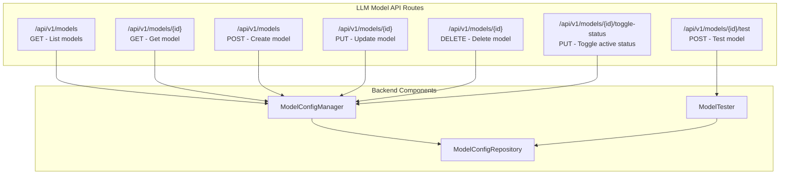
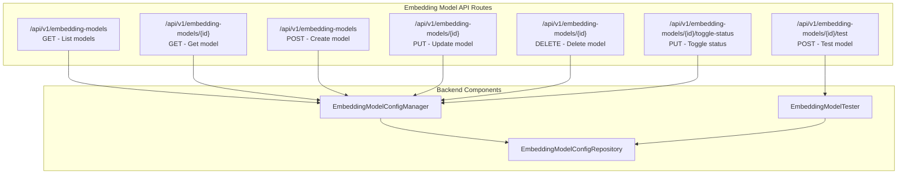
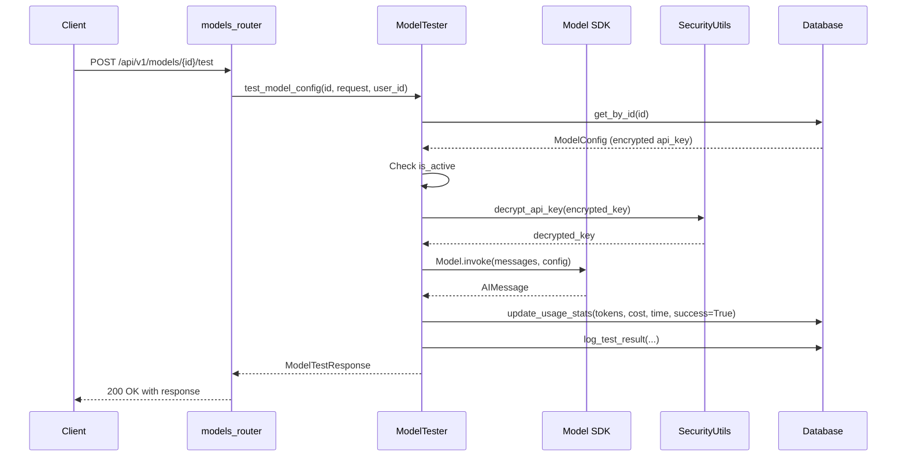
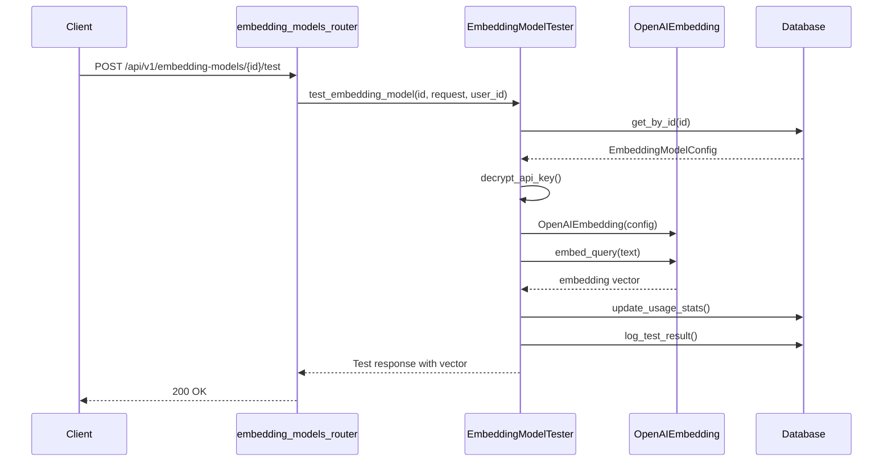
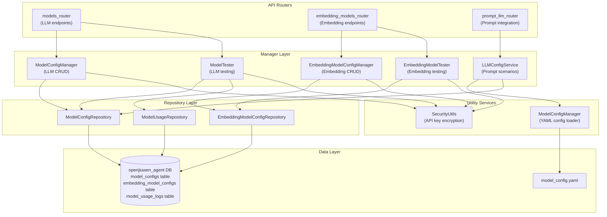
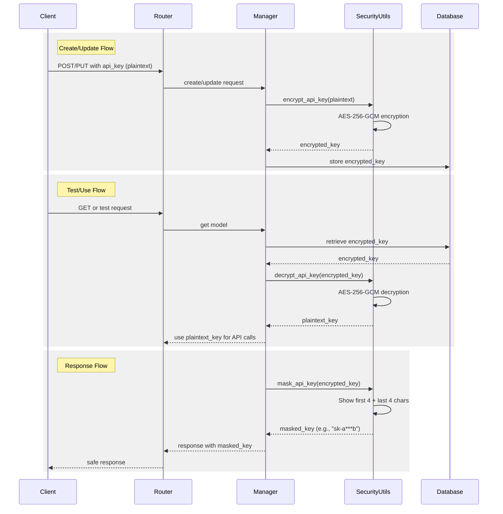
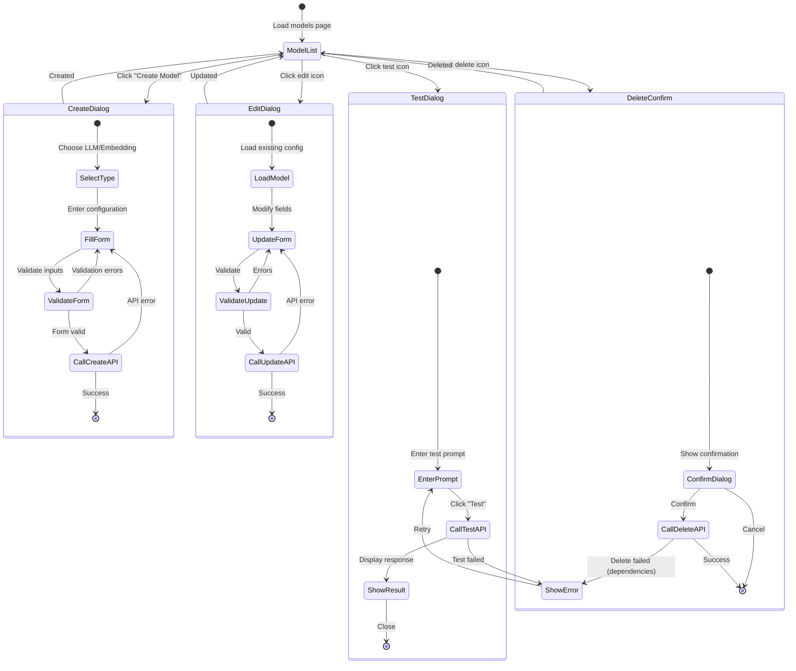

<!-- source: DeepWiki mcp.deepwiki.com · repo openJiuwen-ai/agent-studio · page 8.4 Model APIs · fetched 2026-11-02 -->

# Model APIs

<details>
<summary>Relevant source files</summary>

The following files were used as context for generating this wiki page:

- [backend/openjiuwen_studio/core/manager/model_manager/managers/embedding_model_test_manager.py](backend/openjiuwen_studio/core/manager/model_manager/managers/embedding_model_test_manager.py)
- [backend/openjiuwen_studio/core/manager/model_manager/managers/model_test_manager.py](backend/openjiuwen_studio/core/manager/model_manager/managers/model_test_manager.py)
- [backend/openjiuwen_studio/ops/modules/llm/llm_config_service.py](backend/openjiuwen_studio/ops/modules/llm/llm_config_service.py)
- [backend/openjiuwen_studio/ops/modules/llm/schema.py](backend/openjiuwen_studio/ops/modules/llm/schema.py)
- [backend/openjiuwen_studio/ops/modules/prompt/domain/debug_entity.py](backend/openjiuwen_studio/ops/modules/prompt/domain/debug_entity.py)
- [backend/openjiuwen_studio/ops/modules/prompt/domain/entities.py](backend/openjiuwen_studio/ops/modules/prompt/domain/entities.py)
- [backend/openjiuwen_studio/ops/modules/prompt/domain/services.py](backend/openjiuwen_studio/ops/modules/prompt/domain/services.py)
- [backend/openjiuwen_studio/ops/modules/prompt/infra/repositories/debug_repo.py](backend/openjiuwen_studio/ops/modules/prompt/infra/repositories/debug_repo.py)
- [backend/openjiuwen_studio/routers/embedding_models.py](backend/openjiuwen_studio/routers/embedding_models.py)
- [backend/openjiuwen_studio/routers/prompt_debug_router.py](backend/openjiuwen_studio/routers/prompt_debug_router.py)
- [backend/openjiuwen_studio/routers/prompt_llm_router.py](backend/openjiuwen_studio/routers/prompt_llm_router.py)
- [backend/openjiuwen_studio/routers/prompt_router.py](backend/openjiuwen_studio/routers/prompt_router.py)
- [backend/openjiuwen_studio/routers/prompt_tuning_router.py](backend/openjiuwen_studio/routers/prompt_tuning_router.py)
- [backend/openjiuwen_studio/schemas/model_config.py](backend/openjiuwen_studio/schemas/model_config.py)
- [frontend/src/components/Agent/ModelDetailForm.tsx](frontend/src/components/Agent/ModelDetailForm.tsx)
- [frontend/src/locales/en-US.json](frontend/src/locales/en-US.json)
- [frontend/src/locales/zh-CN.json](frontend/src/locales/zh-CN.json)
- [frontend/src/pages/Auth/PrivacyPolicyPage.tsx](frontend/src/pages/Auth/PrivacyPolicyPage.tsx)
- [frontend/src/pages/Auth/UserLoginPage.tsx](frontend/src/pages/Auth/UserLoginPage.tsx)
- [frontend/src/pages/KnowledgeBase/components/AddDocumentDialog.tsx](frontend/src/pages/KnowledgeBase/components/AddDocumentDialog.tsx)
- [frontend/src/pages/KnowledgeBase/components/KnowledgeBaseFormDialog.tsx](frontend/src/pages/KnowledgeBase/components/KnowledgeBaseFormDialog.tsx)
- [frontend/src/pages/Models/ModelsPage.tsx](frontend/src/pages/Models/ModelsPage.tsx)
- [frontend/src/pages/Models/ModelsPageNew.tsx](frontend/src/pages/Models/ModelsPageNew.tsx)
- [frontend/src/pages/Models/components/EmbeddingModelsTable.tsx](frontend/src/pages/Models/components/EmbeddingModelsTable.tsx)
- [frontend/src/pages/Models/components/LLMModelsTable.tsx](frontend/src/pages/Models/components/LLMModelsTable.tsx)

</details>


This page documents the REST API endpoints for managing LLM (Large Language Model) and Embedding model configurations in OpenJiuwen Agent Studio. These APIs enable creating, updating, testing, and managing AI model configurations that power agents, knowledge bases, and prompt optimization features.

For information about using models within agents, see [Agents](#3.1). For prompt optimization model configuration, see [Prompt APIs](#8.3). For knowledge base embedding configuration, see [Knowledge Base APIs](#8.5).

---

## Model Types

The system supports two distinct model types, each with dedicated API endpoints:

| Model Type | Purpose | Primary Use Cases |
|------------|---------|-------------------|
| **LLM Models** | Text generation and reasoning | Agent responses, prompt optimization, workflow execution, graph extraction |
| **Embedding Models** | Text vectorization | Knowledge base indexing, semantic search, document retrieval |

Both model types share similar CRUD patterns but differ in configuration parameters and testing mechanisms.

**Sources:** [backend/openjiuwen_studio/routers/models.py:1-50](), [backend/openjiuwen_studio/routers/embedding_models.py:1-30]()

---

## API Endpoint Overview

### LLM Model Endpoints



**Sources:** [backend/openjiuwen_studio/routers/models.py:1-500]()

### Embedding Model Endpoints



**Sources:** [backend/openjiuwen_studio/routers/embedding_models.py:1-400]()

### Prompt LLM Integration Endpoints

Additional endpoints exist for prompt debugging and optimization scenarios:

- `POST /api/v1/llm/model/{model_id}` - Get model configuration for prompt scenarios
- `POST /api/v1/llm/models/list` - List models filtered by scenario and workspace

**Sources:** [backend/openjiuwen_studio/routers/prompt_llm_router.py:1-67]()

---

## LLM Model Configuration APIs

### List LLM Models

**Endpoint:** `GET /api/v1/models`

**Query Parameters:**

| Parameter | Type | Required | Default | Description |
|-----------|------|----------|---------|-------------|
| `space_id` | string | Yes | - | Workspace identifier |
| `is_active` | boolean | No | - | Filter by active status |
| `page` | integer | No | 1 | Page number (1-based) |
| `size` | integer | No | 10 | Items per page (1-100) |
| `sort_by` | string | No | "update_time" | Sort field: `name`, `created_at`, `update_time` |
| `sort_order` | string | No | "desc" | Sort order: `asc`, `desc` |

**Response Schema:**

```typescript
{
  code: number          // Status code (200 for success)
  message: string       // Response message
  data: {
    items: ModelConfigResponse[]  // Array of model configurations
    total: number                 // Total count
    page: number                  // Current page
    size: number                  // Page size
    pages: number                 // Total pages
  }
}
```

**Sources:** [backend/openjiuwen_studio/routers/models.py:80-120](), [frontend/src/pages/Models/ModelsPage.tsx:122-135]()

### Create LLM Model

**Endpoint:** `POST /api/v1/models`

**Request Body (`ModelConfigCreate`):**

```typescript
{
  name: string                    // Model name (1-100 chars, required)
  provider: ModelProvider         // Provider enum (required)
  model_type: string              // Model identifier (1-100 chars, required)
  api_key: string                 // API key (required, encrypted at rest)
  base_url: string                // API endpoint URL (required, must start with http/https)
  is_active: boolean              // Active status (default: true)
  description?: string            // Description (max 500 chars)
  tags: string[]                  // Tags for categorization (max 10)
  parameters: {
    temperature: number           // 0.0-2.0 (default: 0.7)
    max_tokens: number            // >= 1 (default: 4096)
    top_p: number                 // 0.0-1.0 (default: 0.9)
  }
  timeout: number                 // 1-3600 seconds (default: 60)
  retry_count: number             // 0-10 (default: 3)
  enable_streaming: boolean       // Default: true
  enable_function_calling: boolean // Default: false
}
```

**ModelProvider Enum:**

```typescript
enum ModelProvider {
  OPENAI = "openai"
  ANTHROPIC = "anthropic"
  DEEPSEEK = "deepseek"
  QWEN = "qwen"
  GOOGLE = "google"
  BAIDU = "baidu"
  ZHIPU = "zhipu"
  SILICONFLOW = "siliconflow"
  CUSTOM = "custom"
}
```

**Response:** `ModelConfigResponse` with generated ID

**Validation Rules:**
- `name`: 1-100 characters, unique within workspace
- `model_type`: 1-100 characters
- `api_key`: Required for all providers except CUSTOM
- `base_url`: Must start with `http://` or `https://`
- `description`: Max 500 characters
- `tags`: Max 10 tags
- `temperature`: 0.0-2.0
- `top_p`: 0.0-1.0
- `timeout`: 1-3600 seconds

**Sources:** [backend/openjiuwen_studio/schemas/model_config.py:27-57](), [backend/openjiuwen_studio/routers/models.py:140-180](), [frontend/src/pages/Models/ModelsPage.tsx:417-633]()

### Update LLM Model

**Endpoint:** `PUT /api/v1/models/{id}`

**Path Parameters:**
- `id`: Model configuration ID (integer)

**Request Body (`ModelConfigUpdate`):**

All fields are optional. Only provided fields will be updated. The `api_key` field has special handling:
- If omitted or empty during update, the existing encrypted key is preserved
- If provided, the new key will be encrypted and stored

**Response:** Updated `ModelConfigResponse`

**Sources:** [backend/openjiuwen_studio/schemas/model_config.py:86-99](), [backend/openjiuwen_studio/routers/models.py:200-240]()

### Get LLM Model

**Endpoint:** `GET /api/v1/models/{id}`

**Path Parameters:**
- `id`: Model configuration ID

**Query Parameters:**
- `space_id`: Workspace identifier (required)

**Response:** `ModelConfigResponse` with masked API key

**API Key Masking:**
API keys are automatically masked in responses for security. Only the first 4 and last 4 characters are shown (e.g., `sk-a***b`).

**Sources:** [backend/openjiuwen_studio/routers/models.py:260-285]()

### Delete LLM Model

**Endpoint:** `DELETE /api/v1/models/{id}`

**Path Parameters:**
- `id`: Model configuration ID

**Query Parameters:**
- `space_id`: Workspace identifier (required)

**Response:**
```typescript
{
  code: number
  message: string
  data: null
}
```

**Cascade Behavior:**
Deleting a model that is referenced by agents, knowledge bases, or workflows may fail with a validation error listing the dependencies. The frontend should handle this by displaying affected resources.

**Sources:** [backend/openjiuwen_studio/routers/models.py:305-330](), [frontend/src/pages/Models/ModelsPage.tsx:860-920]()

### Toggle LLM Model Status

**Endpoint:** `PUT /api/v1/models/{id}/toggle-status`

**Path Parameters:**
- `id`: Model configuration ID

**Query Parameters:**
- `space_id`: Workspace identifier (required)

**Response:** Updated `ModelConfigResponse` with toggled `is_active` status

**Sources:** [backend/openjiuwen_studio/routers/models.py:350-375]()

### Test LLM Model

**Endpoint:** `POST /api/v1/models/{id}/test`

**Path Parameters:**
- `id`: Model configuration ID

**Request Body (`ModelTestRequest`):**

```typescript
{
  prompt: string                  // Test prompt (required)
  parameters?: {
    temperature?: number          // Override model's default
    top_p?: number                // Override model's default
    max_tokens?: number           // Override model's default
  }
}
```

**Response (`ModelTestResponse`):**

```typescript
{
  success: boolean                // Test result
  response: string                // Model's response text
  tokens_used: number             // Tokens consumed
  cost: number                    // Estimated cost in USD
  latency: number                 // Response time in seconds
  error?: string                  // Error message if failed
}
```

**Test Flow:**



**Error Handling:**

The test endpoint maps inference errors to user-friendly messages:

| Error Pattern | User Message |
|---------------|--------------|
| "authentication" / "api key" | "API key authentication failed. Please verify your API key is correct." |
| "timeout" / "timed out" | "Model request timed out. Consider increasing timeout or checking network." |
| "rate limit" | "Rate limit exceeded. Please wait and try again." |
| "invalid" / "model" | "Invalid model configuration. Please check the model identifier." |
| Default | Original error message |

**Sources:** [backend/openjiuwen_studio/core/manager/model_manager/managers/model_test_manager.py:40-220](), [frontend/src/pages/Models/ModelsPage.tsx:930-1045]()

---

## Embedding Model Configuration APIs

### List Embedding Models

**Endpoint:** `GET /api/v1/embedding-models`

**Query Parameters:**

| Parameter | Type | Required | Default | Description |
|-----------|------|----------|---------|-------------|
| `space_id` | string | Yes | - | Workspace identifier |
| `is_active` | boolean | No | - | Filter by active status |
| `page` | integer | No | 1 | Page number |
| `size` | integer | No | 10 | Items per page |
| `sort_by` | string | No | "updated_at" | Sort field |
| `sort_order` | string | No | "desc" | Sort order |

**Response:** Paginated list of `EmbeddingModelConfigResponse`

**Sources:** [backend/openjiuwen_studio/routers/embedding_models.py:36-80]()

### Create Embedding Model

**Endpoint:** `POST /api/v1/embedding-models`

**Request Body (`EmbeddingModelConfigCreate`):**

```typescript
{
  model_name: string              // Model name (1-100 chars, required)
  protocol: EmbeddingProtocol     // Protocol enum (required)
  model_id: string                // Model identifier (1-100 chars, required)
  api_key: string                 // API key (required, encrypted at rest)
  api_base: string                // API endpoint URL (required)
  is_active: boolean              // Active status (default: true)
  max_batch_size: number          // 1-100 (default: 8)
  tags: string[]                  // Tags (max 10)
}
```

**EmbeddingProtocol Enum:**

```typescript
enum EmbeddingProtocol {
  OPENAI = "openai"
  CUSTOM = "custom"
}
```

**Key Differences from LLM Models:**
- Uses `model_name` instead of `name`
- Uses `model_id` for API model identifier
- Has `max_batch_size` instead of generation parameters
- Uses `protocol` instead of `provider`
- No `temperature`, `top_p`, or `max_tokens` parameters

**Sources:** [backend/openjiuwen_studio/routers/embedding_models.py:100-140](), [frontend/src/pages/Models/ModelsPage.tsx:636-815]()

### Update Embedding Model

**Endpoint:** `PUT /api/v1/embedding-models/{id}`

**Request Body (`EmbeddingModelConfigUpdate`):**

All fields optional. API key handling follows same pattern as LLM models.

**Sources:** [backend/openjiuwen_studio/routers/embedding_models.py:160-200]()

### Test Embedding Model

**Endpoint:** `POST /api/v1/embedding-models/{id}/test`

**Request Body (`EmbeddingModelTestRequest`):**

```typescript
{
  text: string                    // Test text to embed (required)
}
```

**Response:**

```typescript
{
  success: boolean                // Test result
  embedding?: number[]            // Generated embedding vector
  dimension?: number              // Vector dimension
  latency?: number                // Response time in seconds
  error?: string                  // Error message if failed
}
```

**Test Implementation:**

The embedding test uses the OpenAI-compatible embedding SDK:



**Sources:** [backend/openjiuwen_studio/core/manager/model_manager/managers/embedding_model_test_manager.py:28-150](), [frontend/src/pages/KnowledgeBase/components/KnowledgeBaseFormDialog.tsx:230-265]()

---

## Prompt LLM Integration APIs

These endpoints provide model configuration specifically for prompt debugging and optimization scenarios.

### Get Model for Prompt Scenario

**Endpoint:** `POST /api/v1/llm/model/{model_id}`

**Path Parameters:**
- `model_id`: Model identifier (can be database ID or config file identifier)

**Request Body (`GetModelRequest`):**

```typescript
{
  workspace_id: string            // Workspace identifier
  model_from?: string             // Source: "config" (file) or "db" (database)
}
```

**Response:**

```typescript
{
  msg: string                     // "success"
  code: number                    // 0 for success
  model: ModelConfig              // Full model configuration
}
```

**Source Resolution:**
- If `model_from` is "config", loads from `model_config.yaml`
- If `model_from` is "db" or omitted, loads from database
- Validates workspace access

**Sources:** [backend/openjiuwen_studio/routers/prompt_llm_router.py:43-59](), [backend/openjiuwen_studio/ops/modules/llm/llm_config_service.py:54-78]()

### List Models for Prompts

**Endpoint:** `POST /api/v1/llm/models/list`

**Request Body (`ListModelRequest`):**

```typescript
{
  workspace_id: string            // Workspace identifier (required)
  scenario: string                // Scenario name (default: "prompt_debug")
  page_size: number               // 1-100 (default: 100)
  page_token: string              // Pagination token (default: "0")
  is_active: boolean              // Filter active models (default: true)
  page_num: number                // Page number (default: 1)
}
```

**Response (`ListModelResponse`):**

```typescript
{
  msg: string                     // "success"
  code: number                    // 0
  has_more: boolean               // More pages available
  models: ModelConfig[]           // Array of model configurations
  next_page_token: string         // Next page token
  total: number                   // Total count
}
```

**Model Sources:**
This endpoint aggregates models from two sources:
1. Static configuration file (`model_config.yaml`)
2. Database models for the workspace

**Sources:** [backend/openjiuwen_studio/routers/prompt_llm_router.py:62-73](), [backend/openjiuwen_studio/ops/modules/llm/llm_config_service.py:127-179]()

---

## Model Configuration Architecture

### Service Layer Architecture



**Sources:** [backend/openjiuwen_studio/routers/models.py:1-500](), [backend/openjiuwen_studio/routers/embedding_models.py:1-400](), [backend/openjiuwen_studio/core/manager/model_manager/managers/model_config_manager.py:1-300]()

### API Key Security

All API keys are encrypted at rest using AES-256-GCM encryption:



**Key Security Features:**
- Plaintext keys never stored in database
- Keys encrypted before persistence using `SecurityUtils.encrypt_api_key()`
- Keys decrypted only for API calls using `SecurityUtils.decrypt_api_key()`
- Response payloads contain masked keys (first 4 + last 4 characters)
- Edit operations preserve existing encrypted keys if no new key provided

**Sources:** [backend/openjiuwen_studio/core/manager/model_manager/utils/security_utils.py:1-100](), [backend/openjiuwen_studio/core/manager/model_manager/managers/model_config_manager.py:120-180]()

---

## Frontend Integration

### API Client Hooks

The frontend uses React Query hooks from `@test-agentstudio/api-client`:

**LLM Model Hooks:**
- `useModels(params)` - List models with filtering and pagination
- `useCreateModel()` - Create model mutation
- `useUpdateModel()` - Update model mutation
- `useDeleteModel()` - Delete model mutation
- `useToggleModelStatus()` - Toggle active status mutation
- `useTestModel()` - Test model mutation

**Embedding Model Hooks:**
- `useEmbeddingModels(params)` - List embedding models
- `useCreateEmbeddingModel()` - Create mutation
- `useUpdateEmbeddingModel()` - Update mutation
- `useDeleteEmbeddingModel()` - Delete mutation
- `useToggleEmbeddingModelStatus()` - Toggle status mutation
- `useTestEmbeddingModel()` - Test mutation

**Usage Example:**

```typescript
// List LLM models with filtering
const { data, isLoading, refetch } = useModels({
  spaceId: user?.spaceId,
  page: 1,
  size: 100,
  sort_by: 'update_time',
  sort_order: 'desc',
})

// Create model
const createMutation = useCreateModel()
await createMutation.mutateAsync({ 
  model: newModelData, 
  spaceId: user?.spaceId 
})

// Test model
const testMutation = useTestModel()
const result = await testMutation.mutateAsync({
  id: modelId,
  prompt: "Test prompt",
  spaceId: user?.spaceId,
})
```

**Sources:** [frontend/src/pages/Models/ModelsPage.tsx:26-40](), [frontend/src/pages/Models/ModelsPage.tsx:296-308]()

### Model Configuration UI Flow



**Sources:** [frontend/src/pages/Models/ModelsPage.tsx:246-277](), [frontend/src/pages/Models/ModelsPage.tsx:374-414](), [frontend/src/pages/Models/ModelsPage.tsx:930-1045]()

---

## Request/Response Schemas

### LLM Model Schemas

**ModelConfigResponse:**

```typescript
interface ModelConfigResponse {
  id: number
  name: string
  provider: ModelProvider
  model_type: string
  api_key: string                 // Masked: "sk-a***b"
  base_url: string
  is_active: boolean
  description: string | null
  tags: string[]
  parameters: {
    temperature: number
    max_tokens: number
    top_p: number
  }
  timeout: number
  retry_count: number
  enable_streaming: boolean
  enable_function_calling: boolean
  created_at: string              // ISO 8601
  updated_at: string              // ISO 8601
  created_by: number
  space_id: string
  usage_stats: ModelUsageStats
}
```

**ModelUsageStats:**

```typescript
interface ModelUsageStats {
  total_requests: number
  total_tokens: number
  total_cost: number              // USD
  success_rate: number            // 0.0-1.0
  avg_response_time: number       // Seconds
  last_used: string | null        // ISO 8601
  daily_requests: number
  daily_tokens: number
  daily_cost: number
  monthly_requests: number
  monthly_tokens: number
  monthly_cost: number
}
```

**Sources:** [backend/openjiuwen_studio/schemas/model_config.py:108-150](), [backend/openjiuwen_studio/schemas/model_config.py:59-72]()

### Embedding Model Schemas

**EmbeddingModelConfigResponse:**

```typescript
interface EmbeddingModelConfigResponse {
  id: number
  model_name: string
  protocol: EmbeddingProtocol
  model_id: string
  api_key: string                 // Masked
  api_base: string
  is_active: boolean
  max_batch_size: number
  tags: string[]
  created_at: string
  updated_at: string
  created_by: number
  space_id: string
  is_system_model: boolean
}
```

**Sources:** [backend/openjiuwen_studio/routers/embedding_models.py:19-23]()

---

## Error Handling

### Common Error Codes

| HTTP Status | Error Type | Description |
|-------------|------------|-------------|
| 400 | `ValidationError` | Invalid request data, field validation failed |
| 404 | `ModelConfigNotFoundError` | Model configuration does not exist |
| 409 | `ConflictError` | Model name already exists in workspace |
| 422 | `UnprocessableEntityError` | Pydantic validation error |
| 500 | `ModelTestError` | Model test execution failed |
| 500 | `ModelApiKeyDecryptError` | API key decryption failed |

### Validation Error Response Format

```typescript
{
  code: number
  message: string
  detail: Array<{
    loc: string[]                 // Field path, e.g., ["body", "name"]
    msg: string                   // Error message
    type: string                  // Error type
  }>
}
```

**Example Validation Error:**

```json
{
  "code": 422,
  "message": "Validation error",
  "detail": [
    {
      "loc": ["body", "name"],
      "msg": "String should have at least 1 character",
      "type": "string_too_short"
    },
    {
      "loc": ["body", "base_url"],
      "msg": "Base URL must start with http:// or https://",
      "type": "value_error"
    }
  ]
}
```

**Frontend Error Handling:**

The frontend maps backend validation errors to user-friendly messages:

```typescript
// Field name mapping
const fieldMap = {
  name: t('models.messages.fieldNames.name'),
  modelId: t('models.messages.fieldNames.modelId'),
  apiKey: t('models.messages.fieldNames.apiKey'),
  provider: t('models.messages.fieldNames.provider'),
  baseUrl: t('models.messages.fieldNames.baseUrl'),
  description: t('models.messages.fieldNames.description'),
}

// Error type mapping
if (msg.includes('at least 1 character')) {
  return t('models.messages.validationErrors.minLength')
} else if (msg.includes('at most') && msg.includes('characters')) {
  return t('models.messages.validationErrors.maxLength', { max: maxLength })
} else if (msg.includes('required')) {
  return t('models.messages.validationErrors.required')
}
```

**Sources:** [frontend/src/pages/Models/ModelsPage.tsx:450-510](), [backend/openjiuwen_studio/core/exceptions.py:1-100]()

---

## Model Testing Details

### LLM Model Test Process

**Test Execution Steps:**

1. **Retrieve Configuration**: Fetch model config from database by ID
2. **Status Check**: Verify model `is_active` is true
3. **API Key Decryption**: Decrypt stored API key using `SecurityUtils`
4. **SDK Initialization**: Create `ModelClientConfig` and `ModelRequestConfig`
5. **Inference Call**: Invoke model with test prompt
6. **Usage Recording**: Log test result and update usage statistics
7. **Response Formatting**: Return test response with metrics

**Model SDK Configuration:**

```python
# Create client config
model_client_config = ModelClientConfig(
    client_provider=compatible_provider(model.provider),
    api_key=decrypted_api_key,
    api_base=model.base_url,
    max_retries=3,
    timeout=model.timeout or 60,
    verify_ssl=os.getenv("LLM_SSL_VERIFY", "true") == "false",
)

# Create request config (parameters can be overridden by test request)
model_config = ModelRequestConfig(
    model=model.model_type,
    top_p=test_request.parameters.top_p or model.parameters.top_p,
    temperature=test_request.parameters.temperature or model.parameters.temperature,
    max_tokens=test_request.parameters.max_tokens or model.parameters.max_tokens,
)

# Create model instance
model_inference = Model(
    model_client_config=model_client_config,
    model_config=model_config
)

# Invoke
ai_message = await model_inference.invoke(messages)
```

**Sources:** [backend/openjiuwen_studio/core/manager/model_manager/managers/model_test_manager.py:85-134]()

### Embedding Model Test Process

**Test Execution Steps:**

1. **Retrieve Configuration**: Fetch embedding model config from database
2. **Status Check**: Verify model is active
3. **API Key Decryption**: Decrypt API key
4. **Embedding SDK Setup**: Create `EmbeddingConfig` with model details
5. **Embedding Generation**: Call `OpenAIEmbedding.embed_query()` with test text
6. **Vector Validation**: Verify embedding vector is returned
7. **Response**: Return vector, dimension, and latency metrics

**Embedding SDK Configuration:**

```python
# Create embedding config
embed_config = EmbeddingConfig(
    model_name=model.model_id,
    api_key=decrypted_api_key,
    base_url=model.api_base,
)

# Create embedding instance
embed_model = OpenAIEmbedding(config=embed_config)

# Generate embedding
embedding = await embed_model.embed_query(test_request.text)

# Return response
return {
    "success": True,
    "embedding": embedding,
    "dimension": len(embedding),
    "latency": time.time() - start_time,
}
```

**Sources:** [backend/openjiuwen_studio/core/manager/model_manager/managers/embedding_model_test_manager.py:74-110]()

### Test Result Logging

Both LLM and embedding tests log results to the database for tracking:

```python
def _log_test_result(
    self,
    model_id: int,
    user_id: int,
    prompt: str,
    response: str,
    tokens_used: int,
    cost: float,
    response_time: float,
    success: bool,
    error_message: Optional[str] = None
):
    """Log model test result to usage logs table"""
    log_entry = ModelUsageLog(
        model_id=model_id,
        user_id=user_id,
        prompt=prompt,
        response=response,
        tokens_used=tokens_used,
        cost=cost,
        response_time=response_time,
        success=success,
        error_message=error_message,
        created_at=datetime.now(timezone.utc),
    )
    self.usage_repo.create(log_entry)
```

**Sources:** [backend/openjiuwen_studio/core/manager/model_manager/managers/model_test_manager.py:221-250]()

---

## Usage Examples

### Complete LLM Model Lifecycle

```typescript
import { 
  useModels, 
  useCreateModel, 
  useUpdateModel, 
  useTestModel,
  useDeleteModel,
  ModelProvider 
} from '@test-agentstudio/api-client'

// 1. List existing models
const { data: modelsData } = useModels({
  spaceId: user?.spaceId,
  is_active: true,
  page: 1,
  size: 10,
})

// 2. Create new model
const createMutation = useCreateModel()
const newModel = await createMutation.mutateAsync({
  spaceId: user?.spaceId,
  model: {
    name: "GPT-4 Production",
    provider: ModelProvider.OPENAI,
    model_type: "gpt-4-turbo-preview",
    api_key: "sk-...",
    base_url: "https://api.openai.com/v1",
    is_active: true,
    description: "Production GPT-4 instance",
    tags: ["production", "gpt4"],
    parameters: {
      temperature: 0.7,
      max_tokens: 4096,
      top_p: 0.9,
    },
    timeout: 60,
    retry_count: 3,
    enable_streaming: true,
    enable_function_calling: true,
  }
})

// 3. Test model
const testMutation = useTestModel()
const testResult = await testMutation.mutateAsync({
  id: newModel.id,
  spaceId: user?.spaceId,
  prompt: "Explain quantum computing in one sentence.",
  parameters: {
    temperature: 0.5,
  }
})

console.log("Response:", testResult.response)
console.log("Tokens used:", testResult.tokens_used)
console.log("Latency:", testResult.latency)

// 4. Update model
const updateMutation = useUpdateModel()
await updateMutation.mutateAsync({
  id: newModel.id,
  spaceId: user?.spaceId,
  model: {
    description: "Production GPT-4 instance (updated)",
    parameters: {
      temperature: 0.8,
    },
  }
})

// 5. Delete model
const deleteMutation = useDeleteModel()
await deleteMutation.mutateAsync({
  id: newModel.id,
  spaceId: user?.spaceId,
})
```

**Sources:** [frontend/src/pages/Models/ModelsPage.tsx:114-815]()

### Complete Embedding Model Lifecycle

```typescript
import {
  useEmbeddingModels,
  useCreateEmbeddingModel,
  useTestEmbeddingModel,
  EmbeddingProtocol,
} from '@test-agentstudio/api-client'

// 1. List embedding models
const { data: embeddingData } = useEmbeddingModels({
  spaceId: user?.spaceId,
  is_active: true,
  page: 1,
  size: 10,
})

// 2. Create embedding model
const createEmbedding = useCreateEmbeddingModel()
const newEmbedding = await createEmbedding.mutateAsync({
  spaceId: user?.spaceId,
  model: {
    model_name: "BGE-M3",
    protocol: EmbeddingProtocol.OPENAI,
    model_id: "BAAI/bge-m3",
    api_key: "sk-...",
    api_base: "https://api.siliconflow.cn/v1",
    is_active: true,
    max_batch_size: 8,
    tags: ["multilingual", "production"],
  }
})

// 3. Test embedding model
const testEmbedding = useTestEmbeddingModel()
const embeddingResult = await testEmbedding.mutateAsync({
  id: newEmbedding.id,
  spaceId: user?.spaceId,
  text: "Sample text for embedding",
})

console.log("Embedding dimension:", embeddingResult.dimension)
console.log("Latency:", embeddingResult.latency)
console.log("Vector (first 5):", embeddingResult.embedding?.slice(0, 5))
```

**Sources:** [frontend/src/pages/Models/ModelsPage.tsx:303-308](), [frontend/src/pages/KnowledgeBase/components/KnowledgeBaseFormDialog.tsx:230-265]()

---

## Integration with Other Systems

### Model Usage in Agents

Agents reference LLM models through the `model_detail` field:

```typescript
// Agent configuration referencing a model
{
  agent_id: "agent-123",
  model_detail: {
    models_id: 42,              // References model_configs.id
    models_name: "GPT-4",
    model_from: "db",           // "db" or "config"
    headers: {
      temperature: 0.8,         // Override model default
      top_p: 0.95,
      timeout: 120,
    }
  }
}
```

When executing agents, the system:
1. Resolves `models_id` to fetch model configuration
2. Decrypts API key for the LLM call
3. Merges model defaults with agent-specific overrides
4. Constructs `ModelClientConfig` and `ModelRequestConfig`
5. Executes agent logic with configured model

**Sources:** [backend/openjiuwen_studio/ops/modules/prompt/domain/entities.py:142-154]()

### Model Usage in Knowledge Bases

Knowledge bases use embedding models for document indexing:

```typescript
// Knowledge base configuration
{
  kb_id: "kb-456",
  embedding_model_config_id: 15,  // References embedding_model_configs.id
  retrieval_config: {
    chunk_size: 512,
    chunk_overlap: 50,
    top_k: 5,
  }
}
```

Document processing flow:
1. Upload document to knowledge base
2. Retrieve embedding model configuration by `embedding_model_config_id`
3. Decrypt API key
4. Parse and chunk document
5. Generate embeddings for each chunk using embedding model
6. Store vectors in vector database (Milvus/Chroma)

**Sources:** [frontend/src/pages/KnowledgeBase/components/AddDocumentDialog.tsx:52-119]()

### Model Usage in Prompt Optimization

Prompt tuning tasks can reference models for optimization:

```typescript
// Prompt optimization configuration
{
  job_id: "job-789",
  optimize_config: {
    llm_model: {
      id: "42",
      model_from: "db",
      headers: {
        temperature: 0.7,
        top_p: 0.9,
      }
    }
  }
}
```

The optimization flow:
1. Load model configuration via `LLMConfigService.get_llm_model_key_info()`
2. Extract `api_key`, `base_url`, and parameters
3. Create optimizer with model configuration
4. Run optimization iterations using the specified model
5. Evaluate results and update best prompt

**Sources:** [backend/openjiuwen_studio/routers/prompt_tuning_router.py:107-138]()

---

## Model Configuration File Format

### Static Model Configuration (YAML)

The system supports loading models from `model_config.yaml` for system-default models:

```yaml
models:
  - id: "openai-gpt-4"
    name: "GPT-4 Turbo"
    provider: "openai"
    protocol_config:
      provider: "openai"
      model: "gpt-4-turbo-preview"
      base_url: "https://api.openai.com/v1"
      api_key: "${OPENAI_API_KEY}"
    openModel:
      param_config:
        param_schemas:
          - name: "temperature"
            label: "Temperature"
            type: "float"
            min: "0"
            max: "2"
            default_val: "0.7"
          - name: "max_tokens"
            label: "Max Tokens"
            type: "int"
            min: "1"
            max: "4096"
            default_val: "4096"
          - name: "top_p"
            label: "Top P"
            type: "float"
            min: "0"
            max: "1"
            default_val: "0.9"
          - name: "timeout"
            label: "Timeout"
            type: "int"
            min: "1"
            max: "3600"
            default_val: "60"
```

**Environment Variable Substitution:**
API keys can reference environment variables using `${VAR_NAME}` syntax.

**Loading Priority:**
1. Models from `model_config.yaml` are loaded first
2. Database models are appended to the list
3. Both sources are combined in list responses

**Sources:** [backend/openjiuwen_studio/ops/modules/llm/llm_config_service.py:127-179](), [backend/openjiuwen_studio/ops/config.py:1-100]()

---

This documentation covers the complete Model APIs for both LLM and Embedding models, including endpoint specifications, request/response schemas, security mechanisms, testing flows, and integration patterns with other system components.

---

