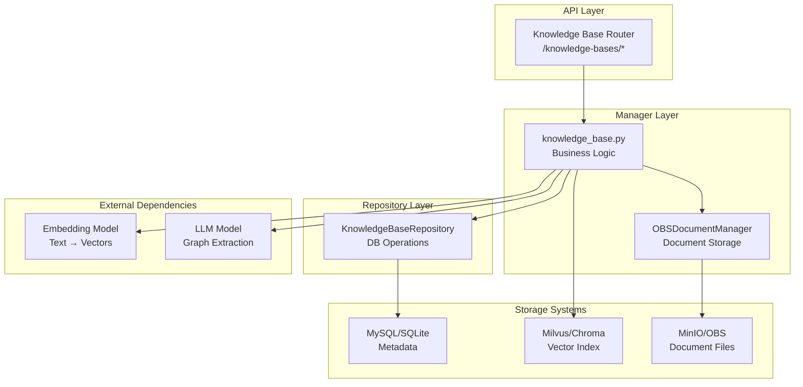
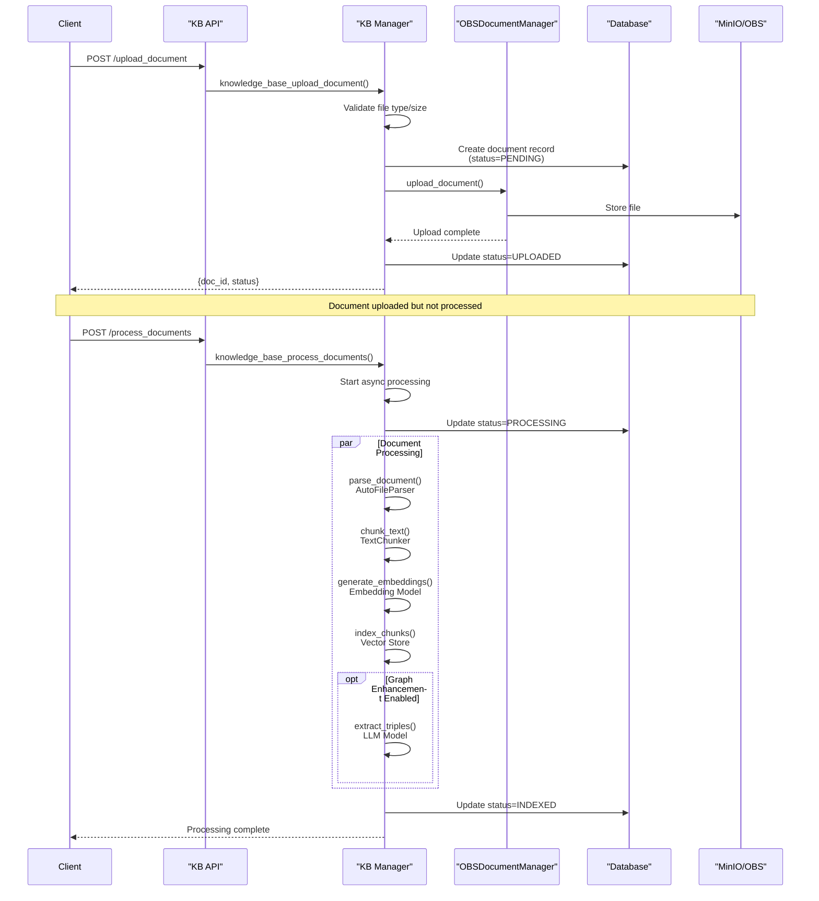
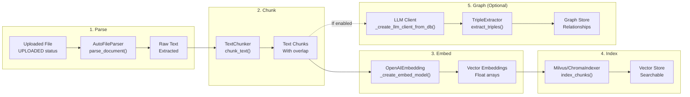
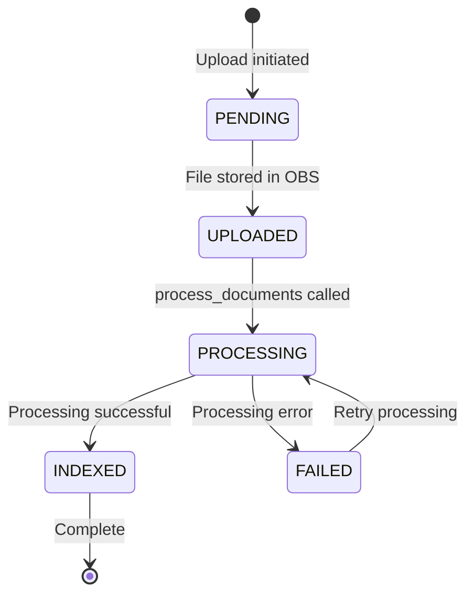

<!-- source: DeepWiki mcp.deepwiki.com · repo openJiuwen-ai/agent-studio · page 8.5 Knowledge Base APIs · fetched 2026-11-02 -->

# Knowledge Base APIs

<details>
<summary>Relevant source files</summary>

The following files were used as context for generating this wiki page:

- [backend/openjiuwen_studio/core/manager/agent.py](backend/openjiuwen_studio/core/manager/agent.py)
- [backend/openjiuwen_studio/core/manager/convertor/agent.py](backend/openjiuwen_studio/core/manager/convertor/agent.py)
- [backend/openjiuwen_studio/core/manager/knowledge_base.py](backend/openjiuwen_studio/core/manager/knowledge_base.py)
- [backend/openjiuwen_studio/core/manager/model_manager/managers/embedding_model_test_manager.py](backend/openjiuwen_studio/core/manager/model_manager/managers/embedding_model_test_manager.py)
- [backend/openjiuwen_studio/core/manager/repositories/agent_repository.py](backend/openjiuwen_studio/core/manager/repositories/agent_repository.py)
- [backend/openjiuwen_studio/core/manager/repositories/plugin_repository.py](backend/openjiuwen_studio/core/manager/repositories/plugin_repository.py)
- [backend/openjiuwen_studio/core/manager/repositories/tool_repository.py](backend/openjiuwen_studio/core/manager/repositories/tool_repository.py)
- [backend/openjiuwen_studio/routers/agents.py](backend/openjiuwen_studio/routers/agents.py)
- [backend/openjiuwen_studio/routers/embedding_models.py](backend/openjiuwen_studio/routers/embedding_models.py)
- [backend/openjiuwen_studio/schemas/agent.py](backend/openjiuwen_studio/schemas/agent.py)
- [frontend/packages/api-client/src/config.ts](frontend/packages/api-client/src/config.ts)
- [frontend/packages/api-client/src/services/agentService.ts](frontend/packages/api-client/src/services/agentService.ts)
- [frontend/src/locales/en-US.json](frontend/src/locales/en-US.json)
- [frontend/src/locales/zh-CN.json](frontend/src/locales/zh-CN.json)
- [frontend/src/pages/Auth/PrivacyPolicyPage.tsx](frontend/src/pages/Auth/PrivacyPolicyPage.tsx)
- [frontend/src/pages/Auth/UserLoginPage.tsx](frontend/src/pages/Auth/UserLoginPage.tsx)
- [frontend/src/pages/KnowledgeBase/components/AddDocumentDialog.tsx](frontend/src/pages/KnowledgeBase/components/AddDocumentDialog.tsx)
- [frontend/src/pages/KnowledgeBase/components/KnowledgeBaseFormDialog.tsx](frontend/src/pages/KnowledgeBase/components/KnowledgeBaseFormDialog.tsx)
- [frontend/src/pages/Models/ModelsPage.tsx](frontend/src/pages/Models/ModelsPage.tsx)
- [frontend/src/pages/Models/ModelsPageNew.tsx](frontend/src/pages/Models/ModelsPageNew.tsx)
- [frontend/src/pages/Models/components/EmbeddingModelsTable.tsx](frontend/src/pages/Models/components/EmbeddingModelsTable.tsx)
- [frontend/src/pages/Models/components/LLMModelsTable.tsx](frontend/src/pages/Models/components/LLMModelsTable.tsx)

</details>


This page documents the REST API endpoints for knowledge base management in OpenJiuwen Agent Studio. These APIs enable creation, configuration, and querying of knowledge bases, along with document upload, processing, and retrieval operations.

For information about embedding model configuration used by knowledge bases, see [Model APIs](#8.4). For knowledge base integration with agents, see [Agent APIs](#8.1).

---

## Overview

The Knowledge Base API provides endpoints for managing vector-based knowledge repositories that support RAG (Retrieval-Augmented Generation) workflows. Key capabilities include:

- **Knowledge Base CRUD** - Create, read, update, and delete knowledge base configurations
- **Document Management** - Upload, process, and manage documents within knowledge bases
- **Document Processing** - Parse, chunk, embed, and index documents with configurable strategies
- **Search & Retrieval** - Query knowledge bases for relevant document chunks
- **Task Monitoring** - Track asynchronous document processing tasks
- **Graph Enhancement** - Optional LLM-based knowledge graph extraction

All endpoints are prefixed with `/api/v1/knowledge-bases/` and require authentication via JWT token.

Sources: [backend/openjiuwen_studio/core/manager/knowledge_base.py:1-1875](), [frontend/packages/api-client/src/config.ts:164-182]()

---

## API Endpoints Summary

### Knowledge Base Management Endpoints

| Endpoint | Method | Purpose |
|----------|--------|---------|
| `/knowledge-bases/list` | POST | List all knowledge bases with pagination and filtering |
| `/knowledge-bases/create` | POST | Create a new knowledge base |
| `/knowledge-bases/get` | POST | Get knowledge base details by ID |
| `/knowledge-bases/update` | POST | Update knowledge base configuration |
| `/knowledge-bases/delete` | POST | Delete a knowledge base and all its documents |

### Document Management Endpoints

| Endpoint | Method | Purpose |
|----------|--------|---------|
| `/knowledge-bases/upload_document` | POST | Upload a single document to a knowledge base |
| `/knowledge-bases/upload_documents` | POST | Upload multiple documents in batch |
| `/knowledge-bases/process_documents` | POST | Start processing uploaded documents |
| `/knowledge-bases/get_documents` | POST | List documents in a knowledge base |
| `/knowledge-bases/get_document_status` | POST | Get processing status of a single document |
| `/knowledge-bases/get_documents_status` | POST | Get processing status of multiple documents |
| `/knowledge-bases/update_document` | POST | Update document metadata |
| `/knowledge-bases/delete_document` | POST | Delete a document from knowledge base |

### Search & Monitoring Endpoints

| Endpoint | Method | Purpose |
|----------|--------|---------|
| `/knowledge-bases/search` | POST | Search knowledge base for relevant chunks |
| `/knowledge-bases/get_task_progress` | POST | Get progress of document processing tasks |

Sources: [frontend/packages/api-client/src/config.ts:164-182](), [backend/openjiuwen_studio/core/manager/knowledge_base.py:455-1875]()

---

## System Architecture

### Knowledge Base Component Relationships



Sources: [backend/openjiuwen_studio/core/manager/knowledge_base.py:86-452](), [backend/openjiuwen_studio/core/manager/repositories/knowledge_base_repository.py:1-500]()

---

## Knowledge Base CRUD Operations

### Create Knowledge Base

**Endpoint:** `POST /knowledge-bases/create`

**Request Schema:** `KnowledgeBaseCreate`

```typescript
{
  spaceId: string              // User workspace ID
  name: string                 // KB name (1-100 chars)
  description: string          // KB description (1-500 chars)
  embeddingModelConfigId: number  // ID of embedding model to use
  indexManagerType: string     // "milvus" | "chroma"
}
```

**Response Schema:** `KnowledgeBaseResponseCreate`

```typescript
{
  code: number
  message: string
  data: {
    kb_id: string             // Generated knowledge base ID
  }
}
```

**Implementation Details:**

The `knowledge_base_create` function performs the following steps:

1. **Validation** - Validates user space permissions via `check_user_space()`
2. **KB ID Generation** - Creates UUID for the knowledge base
3. **Embedding Model Validation** - Verifies embedding model exists and is active
4. **Database Creation** - Persists KB metadata to database
5. **Vector Store Initialization** - Creates collection in Milvus/Chroma

Sources: [backend/openjiuwen_studio/core/manager/knowledge_base.py:457-542](), [backend/openjiuwen_studio/schemas/knowledge_base.py:1-150]()

### Get Knowledge Base

**Endpoint:** `POST /knowledge-bases/get`

**Request Schema:** `KnowledgeBaseGet`

```typescript
{
  spaceId: string
  kb_id: string
  indexManagerType: string
}
```

**Response:**

```typescript
{
  code: number
  message: string
  data: {
    kb_id: string
    name: string
    description: string
    embedding_model_config_id: number
    index_manager_type: string
    create_time: number
    update_time: number
    document_count: number      // Total documents
    indexed_count: number       // Successfully indexed documents
  }
}
```

Sources: [backend/openjiuwen_studio/core/manager/knowledge_base.py:544-610](), [backend/openjiuwen_studio/core/manager/repositories/knowledge_base_repository.py:1-500]()

### List Knowledge Bases

**Endpoint:** `POST /knowledge-bases/list`

**Request Schema:** `KnowledgeBaseListRequest`

```typescript
{
  spaceId: string
  page?: number               // Default: 1
  page_size?: number          // Default: 10
  sort_by?: string           // "create_time" | "update_time" | "name"
  sort_order?: string        // "asc" | "desc"
  search_term?: string       // Search by name or description
}
```

**Response Schema:** `KnowledgeBaseListResponse`

```typescript
{
  code: number
  message: string
  data: {
    items: Array<KnowledgeBaseListItem>
    total: number
    page: number
    page_size: number
  }
}
```

Sources: [backend/openjiuwen_studio/core/manager/knowledge_base.py:612-702](), [backend/openjiuwen_studio/schemas/knowledge_base.py:50-100]()

### Update Knowledge Base

**Endpoint:** `POST /knowledge-bases/update`

**Request Schema:** `KnowledgeBaseUpdateRequest`

```typescript
{
  spaceId: string
  kb_id: string
  name?: string              // New name
  description?: string       // New description
}
```

**Note:** The embedding model cannot be changed after creation, as it would invalidate existing vector embeddings.

Sources: [backend/openjiuwen_studio/core/manager/knowledge_base.py:704-770]()

### Delete Knowledge Base

**Endpoint:** `POST /knowledge-bases/delete`

**Request Schema:** `KnowledgeBaseGet`

**Deletion Process:**

1. Deletes all document metadata from database
2. Drops vector collection from Milvus/Chroma
3. Deletes document files from OBS/MinIO storage
4. Removes KB metadata from database

Sources: [backend/openjiuwen_studio/core/manager/knowledge_base.py:772-850]()

---

## Document Management

### Document Upload and Processing Flow



Sources: [backend/openjiuwen_studio/core/manager/knowledge_base.py:852-1400]()

### Upload Single Document

**Endpoint:** `POST /knowledge-bases/upload_document`

**Request:** Multipart form data

```typescript
{
  spaceId: string
  kb_id: string
  file: File                 // Document file
  indexManagerType: string
}
```

**Supported File Types:**
- PDF (`.pdf`)
- Microsoft Word (`.doc`, `.docx`)
- Text files (`.txt`)
- Markdown (`.md`)

**File Size Limits:**
- Maximum file size: 50MB (configurable)
- Maximum filename length: 255 characters

**Response Schema:** `DocumentUploadResponse`

```typescript
{
  code: number
  message: string
  data: {
    doc_id: string           // Generated document ID
    status: string           // "UPLOADED"
    file_name: string
    file_path: string        // OBS object path
  }
}
```

Sources: [backend/openjiuwen_studio/core/manager/knowledge_base.py:852-980]()

### Upload Batch Documents

**Endpoint:** `POST /knowledge-bases/upload_documents`

**Request:** Multipart form data with multiple files

**Response Schema:** `DocumentUploadBatchResponse`

```typescript
{
  code: number
  message: string
  data: {
    uploaded: Array<{
      doc_id: string
      file_name: string
      status: "UPLOADED"
    }>
    failed: Array<{
      file_name: string
      error: string
    }>
  }
}
```

Sources: [backend/openjiuwen_studio/core/manager/knowledge_base.py:982-1150]()

### Process Documents

**Endpoint:** `POST /knowledge-bases/process_documents`

**Request Schema:** `DocumentProcessRequest`

```typescript
{
  spaceId: string
  kb_id: string
  doc_ids: string[]          // Documents to process
  indexManagerType: string
  
  // Processing configuration
  parsing_strategy: "1" | "2"      // 1=Fast, 2=Detailed
  segmentation_strategy: "1" | "2" // 1=Auto, 2=Custom
  max_tokens?: number              // Chunk size (default: 512)
  chunk_overlap_percent?: number   // Overlap (default: 10)
  
  // Optional graph enhancement
  enable_graph_enhancement?: boolean
  llm_model_config_id?: number    // Required if graph enabled
}
```

**Processing Strategies:**

| Strategy | Value | Description |
|----------|-------|-------------|
| Parsing | `"1"` | Fast parsing - basic text extraction |
| Parsing | `"2"` | Detailed parsing - preserves formatting |
| Segmentation | `"1"` | Auto segmentation - intelligent chunking |
| Segmentation | `"2"` | Custom segmentation - user-defined `max_tokens` |

**Response Schema:** `DocumentProcessResponse`

```typescript
{
  code: number
  message: string
  data: {
    task_id: string         // For progress tracking
    processing_count: number
    status: "PROCESSING"
  }
}
```

Sources: [backend/openjiuwen_studio/core/manager/knowledge_base.py:1152-1400]()

### Document Processing Pipeline Internals



**Processing Functions:**

- **`_parse_document()`** [knowledge_base.py:1450-1520]() - Calls `AutoFileParser` to extract text from various file formats
- **`_chunk_text()`** [knowledge_base.py:1522-1600]() - Uses `TextChunker` with configurable token limits and overlap
- **`_generate_embeddings()`** [knowledge_base.py:1602-1680]() - Batch generates vectors using embedding model
- **`_index_chunks()`** [knowledge_base.py:1682-1760]() - Stores vectors in Milvus/Chroma with metadata
- **`_extract_graph()`** [knowledge_base.py:1762-1850]() - Optional LLM-based triple extraction for knowledge graphs

Sources: [backend/openjiuwen_studio/core/manager/knowledge_base.py:1152-1875]()

### Get Document Status

**Endpoint:** `POST /knowledge-bases/get_document_status`

**Request Schema:** `DocumentStatusRequest`

```typescript
{
  spaceId: string
  kb_id: string
  doc_id: string
  indexManagerType: string
}
```

**Response Schema:** `DocumentStatusResponse`

```typescript
{
  code: number
  message: string
  data: {
    doc_id: string
    status: DocumentStatus    // Enum: PENDING, UPLOADED, PROCESSING, INDEXED, FAILED
    file_name: string
    error_message?: string    // If status=FAILED
    created_at: number
    updated_at: number
  }
}
```

**Document Status States:**



Sources: [backend/openjiuwen_studio/core/manager/knowledge_base.py:1402-1480](), [backend/openjiuwen_studio/models/knowledge_base_document.py:1-100]()

### Get Documents List

**Endpoint:** `POST /knowledge-bases/get_documents`

**Request Schema:** `DocumentListRequest`

```typescript
{
  spaceId: string
  kb_id: string
  indexManagerType: string
  page?: number
  page_size?: number
  status_filter?: DocumentStatus  // Optional filter
}
```

**Response Schema:** `DocumentListResponse`

```typescript
{
  code: number
  message: string
  data: {
    items: Array<DocumentListItem>
    total: number
    page: number
    page_size: number
  }
}
```

Sources: [backend/openjiuwen_studio/core/manager/knowledge_base.py:1482-1580]()

### Delete Document

**Endpoint:** `POST /knowledge-bases/delete_document`

**Request Schema:** `DocumentDeleteRequest`

**Deletion Process:**

1. Removes vectors from Milvus/Chroma collection
2. Deletes file from OBS/MinIO storage
3. Removes document metadata from database

Sources: [backend/openjiuwen_studio/core/manager/knowledge_base.py:1582-1650]()

---

## Search and Retrieval

### Search Knowledge Base

**Endpoint:** `POST /knowledge-bases/search`

**Request Schema:** `KnowledgeBaseSearchRequest`

```typescript
{
  spaceId: string
  kb_id: string
  indexManagerType: string
  query: string              // Search query text
  top_k?: number            // Number of results (default: 5)
  score_threshold?: number  // Minimum similarity score (0-1)
}
```

**Response Schema:** `KnowledgeBaseSearchResponse`

```typescript
{
  code: number
  message: string
  data: {
    results: Array<{
      chunk_id: string
      text: string           // Chunk content
      score: number         // Similarity score (0-1)
      metadata: {
        doc_id: string
        file_name: string
        chunk_index: number
        source_page?: number
      }
    }>
  }
}
```

**Search Process:**

1. Generate embedding for query using KB's embedding model
2. Perform vector similarity search in Milvus/Chroma
3. Filter results by `score_threshold` if provided
4. Return top-k most similar chunks with metadata

Sources: [backend/openjiuwen_studio/core/manager/knowledge_base.py:1652-1750]()

---

## Object Storage Integration

### OBSDocumentManager

The `OBSDocumentManager` class handles all interactions with MinIO/OBS object storage for document files.

**Key Methods:**

```python
class OBSDocumentManager:
    def __init__(self, bucket: str = None)
    
    @staticmethod
    def obs_name(space_id: str, kb_id: str, file_name: str) -> str
        # Returns: "{space_id}/{kb_id}/{file_name}"
    
    @classmethod
    def local_path(cls, space_id: str, kb_id: str, file_name: str) -> Path
        # Returns local storage path
    
    async def upload_document(self, object_name: str, file_path: Path)
    async def download_document(self, object_name: str, file_path: Path)
    async def delete_document(self, object_name: str)
    async def download_if_updated(self, object_name: str, file_path: str)
```

**Storage Path Structure:**

```
{OBS_BUCKET}/
  {space_id}/
    {kb_id}/
      {document_filename_1}.pdf
      {document_filename_2}.docx
      ...
```

**Configuration:**

Required environment variables:
- `OBS_BUCKET` - Bucket name
- `OBS_SERVER` - MinIO/OBS server endpoint
- `OBS_ACCESS_KEY_ID` - Access key (encrypted)
- `OBS_SECRET_ACCESS_KEY` - Secret key (encrypted)

Sources: [backend/openjiuwen_studio/core/manager/knowledge_base.py:86-186]()

---

## Model Integration

### Embedding Model Configuration

Knowledge bases require an embedding model to convert text into vector representations. The embedding model is specified during KB creation and cannot be changed afterward.

**Creating Embedding Model Instance:**

```python
def _create_embed_model(kb_id: str, space_id: str) -> OpenAIEmbedding:
    """
    1. Query KB to get embedding_model_config_id
    2. Fetch embedding model config from database
    3. Decrypt API key using SecurityUtils
    4. Create OpenAIEmbedding instance with config
    """
```

**Embedding Configuration Schema:**

```python
class EmbeddingConfig:
    model_name: str        # e.g., "text-embedding-ada-002"
    api_key: str          # Decrypted at runtime
    base_url: str         # API endpoint
```

**Default Parameters:**
- `timeout`: 60 seconds
- `max_retries`: 3
- `max_batch_size`: Configured in embedding model settings

Sources: [backend/openjiuwen_studio/core/manager/knowledge_base.py:369-452]()

### LLM Model for Graph Enhancement

When graph enhancement is enabled, an LLM model extracts knowledge graph triples from text chunks.

**Creating LLM Client:**

```python
def _create_llm_client_from_db(llm_model_id: str, space_id: str):
    """
    1. Fetch LLM model config from database
    2. Verify model is active
    3. Decrypt API key
    4. Create LLM client with minimum 120s timeout
    5. Configure for TripleExtractor usage
    """
```

**Graph Enhancement Process:**

1. Text chunks are sent to LLM with triple extraction prompt
2. LLM identifies entities and relationships
3. Triples are stored in graph database for enhanced retrieval
4. Enables semantic relationship queries

Sources: [backend/openjiuwen_studio/core/manager/knowledge_base.py:298-367]()

---

## Task Progress Monitoring

### Get Task Progress

**Endpoint:** `POST /knowledge-bases/get_task_progress`

**Request Schema:** `TaskProgressRequest`

```typescript
{
  spaceId: string
  kb_id: string
  task_id: string          // From process_documents response
  indexManagerType: string
}
```

**Response Schema:** `TaskProgressResponse`

```typescript
{
  code: number
  message: string
  data: {
    task_id: string
    status: "PENDING" | "PROCESSING" | "COMPLETED" | "FAILED"
    total_documents: number
    processed_documents: number
    failed_documents: number
    progress_items: Array<TaskProgressItem>
  }
}
```

**TaskProgressItem Schema:**

```typescript
{
  doc_id: string
  file_name: string
  status: DocumentStatus
  error_message?: string
  processed_at?: number
}
```

Sources: [backend/openjiuwen_studio/core/manager/knowledge_base.py:1752-1875](), [backend/openjiuwen_studio/schemas/knowledge_base.py:150-200]()

---

## Error Handling

### Error Message Formatting

The Knowledge Base API implements comprehensive error handling with user-friendly messages.

**Error Processing Pipeline:**

```python
def _extract_full_error_message(error: Exception) -> str:
    """Traverses exception chain to collect all error messages"""
    
def _format_error_message_for_frontend(error_msg: str) -> str:
    """
    1. Remove technical prefixes ("File parsing failed: ")
    2. Remove status codes [155xxx]
    3. Replace arrows (->) with semicolons
    4. Truncate at "reason:" if present
    5. Ensure first letter capitalization
    """
```

**Common Error Scenarios:**

| Error Type | Code | Message Format |
|------------|------|----------------|
| KB Not Found | 404 | "Knowledge base not found" |
| Document Not Found | 404 | "Document not found" |
| Invalid File Type | 400 | "File type not supported: {extension}" |
| File Size Exceeded | 400 | "File size exceeds maximum: {size}MB" |
| Processing Failed | 500 | Cleaned error from parsing/indexing |
| Model Not Active | 400 | "Embedding model is not active" |
| Graph Enhancement Failed | 500 | "Graph extraction failed: {reason}" |

Sources: [backend/openjiuwen_studio/core/manager/knowledge_base.py:190-296]()

### Exception Handling Decorator

All Knowledge Base API functions use the `@with_exception_handling` decorator:

```python
def with_exception_handling(func):
    """
    Handles both sync and async functions
    Catches and formats ValidationError, ValueError, etc.
    Returns ResponseModel with appropriate status codes
    """
```

Sources: [backend/openjiuwen_studio/core/manager/knowledge_base.py:457-463]()

---

## Frontend Integration Examples

### Creating a Knowledge Base

```typescript
import { KnowledgeBaseService } from '@test-agentstudio/api-client'

const createKB = async () => {
  const request = {
    spaceId: user.spaceId,
    name: "Technical Documentation",
    description: "Product docs and API references",
    embeddingModelConfigId: 123,
    indexManagerType: "milvus"
  }
  
  const response = await KnowledgeBaseService.createKnowledgeBase(request)
  
  if (response.code === 200) {
    const kbId = response.data.kb_id
    // Proceed to upload documents
  }
}
```

Sources: [frontend/src/pages/KnowledgeBase/components/KnowledgeBaseFormDialog.tsx:1-500]()

### Uploading and Processing Documents

```typescript
import { KnowledgeBaseService } from '@test-agentstudio/api-client'

const uploadAndProcess = async (files: File[]) => {
  // Step 1: Upload documents
  const formData = new FormData()
  formData.append('spaceId', user.spaceId)
  formData.append('kb_id', kbId)
  formData.append('indexManagerType', 'milvus')
  files.forEach(file => formData.append('files', file))
  
  const uploadResponse = await KnowledgeBaseService.uploadDocumentsBatch(formData)
  
  const docIds = uploadResponse.data.uploaded.map(doc => doc.doc_id)
  
  // Step 2: Process documents
  const processRequest = {
    spaceId: user.spaceId,
    kb_id: kbId,
    doc_ids: docIds,
    indexManagerType: 'milvus',
    parsing_strategy: '1',
    segmentation_strategy: '1',
    max_tokens: 512,
    chunk_overlap_percent: 10,
    enable_graph_enhancement: false
  }
  
  const processResponse = await KnowledgeBaseService.processDocuments(processRequest)
  const taskId = processResponse.data.task_id
  
  // Step 3: Monitor progress
  pollTaskProgress(taskId)
}
```

Sources: [frontend/src/pages/KnowledgeBase/components/AddDocumentDialog.tsx:1-800]()

### Searching Knowledge Base

```typescript
const searchKB = async (query: string) => {
  const request = {
    spaceId: user.spaceId,
    kb_id: kbId,
    indexManagerType: 'milvus',
    query: query,
    top_k: 5,
    score_threshold: 0.7
  }
  
  const response = await KnowledgeBaseService.searchKnowledgeBase(request)
  
  response.data.results.forEach(result => {
    console.log(`Score: ${result.score}`)
    console.log(`Text: ${result.text}`)
    console.log(`Source: ${result.metadata.file_name}`)
  })
}
```

Sources: [backend/openjiuwen_studio/core/manager/knowledge_base.py:1652-1750]()

---

## Database Schema

### Knowledge Base Tables

**knowledge_base table:**

| Column | Type | Description |
|--------|------|-------------|
| kb_id | VARCHAR(100) | Primary key |
| space_id | VARCHAR(100) | Foreign key to user space |
| name | VARCHAR(255) | KB name |
| description | TEXT | KB description |
| embedding_model_config_id | INTEGER | FK to embedding model |
| index_manager_type | VARCHAR(50) | "milvus" or "chroma" |
| create_time | BIGINT | Milliseconds timestamp |
| update_time | BIGINT | Milliseconds timestamp |

**knowledge_base_document table:**

| Column | Type | Description |
|--------|------|-------------|
| doc_id | VARCHAR(100) | Primary key |
| kb_id | VARCHAR(100) | FK to knowledge_base |
| space_id | VARCHAR(100) | FK to user space |
| file_name | VARCHAR(255) | Original filename |
| file_path | VARCHAR(500) | OBS object path |
| status | VARCHAR(50) | DocumentStatus enum |
| error_message | TEXT | Error if status=FAILED |
| file_size | BIGINT | File size in bytes |
| chunk_count | INTEGER | Number of chunks indexed |
| create_time | BIGINT | Upload timestamp |
| update_time | BIGINT | Last status change |

Sources: [backend/openjiuwen_studio/models/knowledge_base_document.py:1-100](), [backend/openjiuwen_studio/core/manager/repositories/knowledge_base_repository.py:1-500]()

---

## Vector Store Collections

### Milvus Collection Schema

Each knowledge base creates a dedicated Milvus collection with the following schema:

```python
collection_name = f"kb_{kb_id}"

fields = [
    FieldSchema(name="chunk_id", dtype=DataType.VARCHAR, is_primary=True, max_length=100),
    FieldSchema(name="vector", dtype=DataType.FLOAT_VECTOR, dim=embedding_dimension),
    FieldSchema(name="text", dtype=DataType.VARCHAR, max_length=65535),
    FieldSchema(name="doc_id", dtype=DataType.VARCHAR, max_length=100),
    FieldSchema(name="file_name", dtype=DataType.VARCHAR, max_length=255),
    FieldSchema(name="chunk_index", dtype=DataType.INT64),
]

index_params = {
    "metric_type": "COSINE",  # or "L2", "IP"
    "index_type": "IVF_FLAT",
    "params": {"nlist": 1024}
}
```

### Chroma Collection

Chroma collections use a simpler schema with automatic metadata handling:

```python
collection_name = f"kb_{kb_id}"

# Embeddings and metadata stored automatically
# Metadata includes: doc_id, file_name, chunk_index, etc.
```

Sources: [backend/openjiuwen_studio/core/manager/knowledge_base.py:1682-1760]()

---

## Configuration Constants

### Environment Variables

| Variable | Required | Default | Description |
|----------|----------|---------|-------------|
| `INDEX_MANAGER_TYPE` | No | `"milvus"` | Vector store type |
| `OBS_BUCKET` | Yes | - | Object storage bucket |
| `OBS_SERVER` | Yes | - | MinIO/OBS endpoint |
| `OBS_ACCESS_KEY_ID` | Yes | - | Access key (encrypted) |
| `OBS_SECRET_ACCESS_KEY` | Yes | - | Secret key (encrypted) |

### Processing Limits

| Limit | Value | Configurable |
|-------|-------|--------------|
| Max file size | 50 MB | Yes (env) |
| Max filename length | 255 chars | No |
| Max chunk size | 2048 tokens | Yes (request) |
| Min chunk overlap | 0% | Yes (request) |
| Max chunk overlap | 50% | Yes (request) |
| Default timeout (embedding) | 60s | No |
| Min timeout (LLM graph) | 120s | No |

Sources: [backend/openjiuwen_studio/core/manager/knowledge_base.py:83-84](), [backend/openjiuwen_studio/core/manager/knowledge_base.py:369-452]()

---

