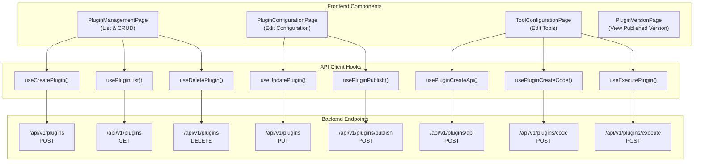
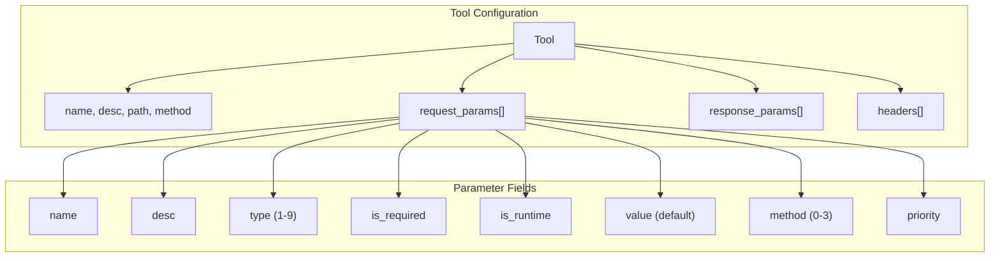
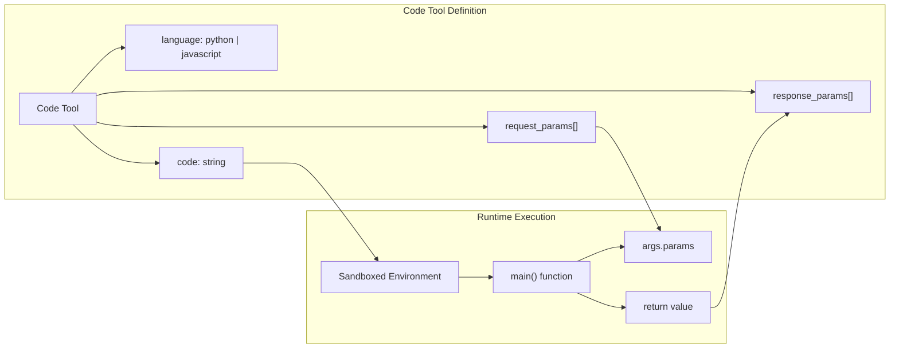

<!-- source: DeepWiki mcp.deepwiki.com · repo openJiuwen-ai/agent-studio · page 8.6 Plugin APIs · fetched 2026-11-02 -->

# Plugin APIs

<details>
<summary>Relevant source files</summary>

The following files were used as context for generating this wiki page:

- [frontend/src/components/Plugins/CloudPluginFormDialog.tsx](frontend/src/components/Plugins/CloudPluginFormDialog.tsx)
- [frontend/src/components/Plugins/CodeEditor.tsx](frontend/src/components/Plugins/CodeEditor.tsx)
- [frontend/src/components/Plugins/CodePluginToolFormDialog.tsx](frontend/src/components/Plugins/CodePluginToolFormDialog.tsx)
- [frontend/src/components/Plugins/IDEPluginFormDialog.tsx](frontend/src/components/Plugins/IDEPluginFormDialog.tsx)
- [frontend/src/components/Plugins/MarketPluginCard.tsx](frontend/src/components/Plugins/MarketPluginCard.tsx)
- [frontend/src/components/Plugins/MarketPluginList.tsx](frontend/src/components/Plugins/MarketPluginList.tsx)
- [frontend/src/components/Plugins/PluginVersionHistory.tsx](frontend/src/components/Plugins/PluginVersionHistory.tsx)
- [frontend/src/components/Plugins/PublishDialog.tsx](frontend/src/components/Plugins/PublishDialog.tsx)
- [frontend/src/components/Plugins/ToolFormDialog.tsx](frontend/src/components/Plugins/ToolFormDialog.tsx)
- [frontend/src/pages/Plugins/PluginConfigurationPage.tsx](frontend/src/pages/Plugins/PluginConfigurationPage.tsx)
- [frontend/src/pages/Plugins/PluginManagementPage.tsx](frontend/src/pages/Plugins/PluginManagementPage.tsx)
- [frontend/src/pages/Plugins/PluginVersionPage.tsx](frontend/src/pages/Plugins/PluginVersionPage.tsx)
- [frontend/src/pages/Plugins/ToolConfigurationPage.tsx](frontend/src/pages/Plugins/ToolConfigurationPage.tsx)
- [frontend/src/pages/Plugins/components/CodePluginConfiguration.tsx](frontend/src/pages/Plugins/components/CodePluginConfiguration.tsx)
- [frontend/src/pages/Plugins/components/URLPluginConfiguration.tsx](frontend/src/pages/Plugins/components/URLPluginConfiguration.tsx)

</details>


This page documents the REST API endpoints for managing plugins and tools in OpenJiuwen Agent Studio. Plugins extend the system's capabilities by providing reusable tools that agents can invoke. This reference covers plugin CRUD operations, version management, tool configuration, and execution endpoints.

For information about using plugins in agents, see [Plugins & Tools](#3.6). For the plugin service implementation architecture, see [Backend Architecture](#5.3).

---

## Overview

The Plugin API is organized into five main categories:

| Category | Purpose | Base Path |
|----------|---------|-----------|
| **Plugin Management** | Create, read, update, delete plugins | `/api/v1/plugins` |
| **Publishing** | Version control and publication | `/api/v1/plugins/publish` |
| **API Tools** | Manage URL-based tools (plugin_type=1) | `/api/v1/plugins/api` |
| **Code Tools** | Manage code-based tools (plugin_type=2) | `/api/v1/plugins/code` |
| **Execution** | Test and execute plugin tools | `/api/v1/plugins/execute` |

### Plugin Types

- **Type 1 (URL/Cloud)**: Tools that call external HTTP APIs
- **Type 2 (Code/IDE)**: Tools that execute Python or JavaScript code in sandboxed environments

**Sources:** [frontend/src/pages/Plugins/PluginConfigurationPage.tsx:1-583]()

---

## System Architecture

### Plugin Management Flow



**Sources:** [frontend/src/pages/Plugins/PluginManagementPage.tsx:1-677](), [frontend/src/pages/Plugins/PluginConfigurationPage.tsx:1-583](), [frontend/src/pages/Plugins/ToolConfigurationPage.tsx:1-1186]()

---

## Plugin Management APIs

### Create Plugin

Creates a new plugin in the system.

**Endpoint:** `POST /api/v1/plugins`

**Request Body:**
```json
{
  "space_id": "string",
  "name": "string (max 128 chars)",
  "desc": "string (max 258 chars)",
  "desc_mk": "string (optional, markdown format)",
  "plugin_type": 1 | 2,
  "url": "string (required for type 1)",
  "icon_uri": "string (emoji or image URL)"
}
```

**Response:**
```json
{
  "code": 200,
  "message": "success",
  "data": {
    "plugin_id": "string",
    "plugin_version": "string"
  }
}
```

**Sources:** [frontend/src/pages/Plugins/PluginManagementPage.tsx:298-367](), [frontend/src/components/Plugins/CloudPluginFormDialog.tsx:1-184](), [frontend/src/components/Plugins/IDEPluginFormDialog.tsx:1-170]()

---

### List Plugins

Retrieves all plugins in a space with pagination.

**Endpoint:** `GET /api/v1/plugins`

**Query Parameters:**

| Parameter | Type | Required | Description |
|-----------|------|----------|-------------|
| `space_id` | string | Yes | Space identifier |
| `page` | integer | Yes | Page number (1-indexed) |
| `size` | integer | Yes | Page size (max 100) |

**Response:**
```json
{
  "code": 200,
  "message": "success",
  "data": {
    "plugin_infos": [
      {
        "space_id": "string",
        "plugin_id": "string",
        "plugin_version": "string",
        "name": "string",
        "desc": "string",
        "desc_mk": "string",
        "plugin_type": 1 | 2,
        "published": true | false,
        "url": "string",
        "icon_uri": "string",
        "request_params": []
      }
    ],
    "pagination": {
      "total": 0,
      "total_pages": 0,
      "current_page": 1,
      "page_size": 9
    }
  }
}
```

**Sources:** [frontend/src/pages/Plugins/PluginManagementPage.tsx:109-148]()

---

### Get Plugin

Retrieves detailed configuration for a specific plugin.

**Endpoint:** `GET /api/v1/plugins/{plugin_id}`

**Query Parameters:**

| Parameter | Type | Required | Description |
|-----------|------|----------|-------------|
| `space_id` | string | Yes | Space identifier |
| `plugin_id` | string | Yes | Plugin identifier |
| `plugin_version` | string | No | Specific version (defaults to latest) |

**Response:**
```json
{
  "code": 200,
  "message": "success",
  "data": {
    "plugin_info": {
      "space_id": "string",
      "plugin_id": "string",
      "plugin_version": "string",
      "name": "string",
      "desc": "string",
      "desc_mk": "string",
      "plugin_type": 1 | 2,
      "published": true | false,
      "url": "string",
      "icon_uri": "string",
      "request_params": []
    }
  }
}
```

**Sources:** [frontend/src/pages/Plugins/PluginConfigurationPage.tsx:219-281]()

---

### Update Plugin

Updates plugin configuration.

**Endpoint:** `PUT /api/v1/plugins`

**Request Body:**
```json
{
  "space_id": "string",
  "plugin_id": "string",
  "plugin_version": "string",
  "name": "string (max 128 chars)",
  "desc": "string (max 258 chars)",
  "desc_mk": "string",
  "plugin_type": 1 | 2,
  "published": true | false,
  "url": "string (for type 1)",
  "icon_uri": "string",
  "request_params": []
}
```

**Plugin-Level Request Parameters:**

Plugin-level parameters apply to all tools in the plugin. Each parameter has:

```json
{
  "name": "string",
  "desc": "string",
  "type": 1-9,
  "is_required": true | false,
  "value": "string (default value)",
  "is_runtime": true | false,
  "method": 0-3,
  "priority": "PLUGIN | TOOL"
}
```

**Parameter Types:**

| Type Code | Type Name | Description |
|-----------|-----------|-------------|
| 1 | `string` | Text string |
| 2 | `int` | Integer number |
| 3 | `float` | Floating-point number |
| 4 | `boolean` | Boolean value |
| 5 | `object` | JSON object |
| 6 | `array_string` | Array of strings |
| 7 | `array_int` | Array of integers |
| 8 | `array_float` | Array of floats |
| 9 | `array_boolean` | Array of booleans |

**Parameter Send Methods:**

| Method Code | Method Name | Description |
|-------------|-------------|-------------|
| 0 | `NONE` | No specific method |
| 1 | `HEADER` | Send in HTTP headers |
| 2 | `QUERY` | Send as query parameters |
| 3 | `BODY` | Send in request body |

**Response:**
```json
{
  "code": 200,
  "message": "success",
  "data": {}
}
```

**Sources:** [frontend/src/pages/Plugins/PluginConfigurationPage.tsx:283-366](), [frontend/src/pages/Plugins/components/URLPluginConfiguration.tsx:454-516](), [frontend/src/pages/Plugins/ToolConfigurationPage.tsx:371-402]()

---

### Delete Plugin

Deletes a plugin and all its tools.

**Endpoint:** `DELETE /api/v1/plugins`

**Request Body:**
```json
{
  "space_id": "string",
  "plugin_id": "string",
  "plugin_version": "string"
}
```

**Response:**
```json
{
  "code": 200,
  "message": "success",
  "data": {}
}
```

**Sources:** [frontend/src/pages/Plugins/PluginManagementPage.tsx:246-287]()

---

## Plugin Publishing APIs

### Publish Version

Publishes a plugin version, making it immutable and shareable.

**Endpoint:** `POST /api/v1/plugins/publish`

**Request Body:**
```json
{
  "space_id": "string",
  "plugin_id": "string",
  "plugin_version": "string (e.g., 'v1.0.0')",
  "version_desc": "string (max 256 chars)",
  "force": true | false
}
```

**Response:**
```json
{
  "code": 200,
  "message": "success",
  "data": {}
}
```

**Sources:** [frontend/src/pages/Plugins/PluginConfigurationPage.tsx:404-437](), [frontend/src/components/Plugins/PublishDialog.tsx:1-192]()

---

### List Published Versions

Retrieves all published versions of a plugin.

**Endpoint:** `GET /api/v1/plugins/publish/list`

**Query Parameters:**

| Parameter | Type | Required | Description |
|-----------|------|----------|-------------|
| `space_id` | string | Yes | Space identifier |
| `plugin_id` | string | Yes | Plugin identifier |

**Response:**
```json
{
  "code": 200,
  "message": "success",
  "data": {
    "plugin_infos": [
      {
        "space_id": "string",
        "plugin_id": "string",
        "plugin_version": "string",
        "name": "string",
        "desc": "string",
        "desc_mk": "string",
        "plugin_type": 1 | 2,
        "published": true,
        "url": "string",
        "icon_uri": "string",
        "version_desc": "string",
        "tools": []
      }
    ]
  }
}
```

**Sources:** [frontend/src/pages/Plugins/PluginConfigurationPage.tsx:165-210](), [frontend/src/components/Plugins/PluginVersionHistory.tsx:49-74]()

---

### Get Published Version

Retrieves a specific published version's details.

**Endpoint:** `GET /api/v1/plugins/publish/get`

**Query Parameters:**

| Parameter | Type | Required | Description |
|-----------|------|----------|-------------|
| `space_id` | string | Yes | Space identifier |
| `plugin_id` | string | Yes | Plugin identifier |
| `plugin_version` | string | Yes | Version string |

**Response:**
```json
{
  "code": 200,
  "message": "success",
  "data": {
    "plugin_info": {
      "space_id": "string",
      "plugin_id": "string",
      "plugin_version": "string",
      "name": "string",
      "desc": "string",
      "desc_mk": "string",
      "plugin_type": 1 | 2,
      "published": true,
      "url": "string",
      "icon_uri": "string",
      "version_desc": "string",
      "tools": [],
      "request_params": []
    }
  }
}
```

**Sources:** [frontend/src/pages/Plugins/PluginVersionPage.tsx:162-222]()

---

### Delete Published Version

Deletes a published version (if not in use).

**Endpoint:** `DELETE /api/v1/plugins/publish`

**Request Body:**
```json
{
  "space_id": "string",
  "plugin_id": "string",
  "plugin_version": "string"
}
```

**Response:**
```json
{
  "code": 200,
  "message": "success",
  "data": {}
}
```

**Sources:** [frontend/src/components/Plugins/PluginVersionHistory.tsx:105-124]()

---

## API Tool Management

API tools (plugin_type=1) are URL-based tools that make HTTP requests to external services.

### Tool Parameter Structure



**Sources:** [frontend/src/pages/Plugins/ToolConfigurationPage.tsx:50-79](), [frontend/src/pages/Plugins/ToolConfigurationPage.tsx:610-662]()

---

### Create API Tool

Creates a new API-based tool within a plugin.

**Endpoint:** `POST /api/v1/plugins/api`

**Request Body:**
```json
{
  "space_id": "string",
  "plugin_id": "string",
  "name": "string (max 128 chars)",
  "desc": "string (max 256 chars)",
  "path": "string (must start with /)",
  "method": 1-5
}
```

**HTTP Method Codes:**

| Code | Method |
|------|--------|
| 1 | GET |
| 2 | POST |
| 3 | PUT |
| 4 | DELETE |
| 5 | PATCH |

**Response:**
```json
{
  "code": 200,
  "message": "success",
  "data": {
    "tool_id": "string"
  }
}
```

**Sources:** [frontend/src/pages/Plugins/components/URLPluginConfiguration.tsx:256-333](), [frontend/src/components/Plugins/ToolFormDialog.tsx:1-169]()

---

### List API Tools

Lists all API tools for a plugin.

**Endpoint:** `GET /api/v1/plugins/api/list`

**Query Parameters:**

| Parameter | Type | Required | Description |
|-----------|------|----------|-------------|
| `space_id` | string | Yes | Space identifier |
| `plugin_id` | string | Yes | Plugin identifier |
| `page` | integer | Yes | Page number |
| `size` | integer | Yes | Page size |
| `plugin_version` | string | No | Specific version |

**Response:**
```json
{
  "code": 200,
  "message": "success",
  "data": {
    "api_info": [
      {
        "tool_id": "string",
        "name": "string",
        "desc": "string",
        "path": "string",
        "method": 1-5,
        "request_params": [],
        "response_params": [],
        "headers": [],
        "available": true | false
      }
    ],
    "total": 0
  }
}
```

**Sources:** [frontend/src/pages/Plugins/components/URLPluginConfiguration.tsx:167-175]()

---

### Get API Tool

Retrieves configuration for a specific API tool.

**Endpoint:** `GET /api/v1/plugins/api/get`

**Query Parameters:**

| Parameter | Type | Required | Description |
|-----------|------|----------|-------------|
| `space_id` | string | Yes | Space identifier |
| `plugin_id` | string | Yes | Plugin identifier |
| `tool_id` | string | Yes | Tool identifier |
| `plugin_version` | string | No | Specific version |

**Response:**
```json
{
  "code": 200,
  "message": "success",
  "data": {
    "api_info": [
      {
        "tool_id": "string",
        "name": "string",
        "desc": "string",
        "path": "string",
        "method": 1-5,
        "request_params": [
          {
            "name": "string",
            "desc": "string",
            "type": 1-9,
            "is_required": true | false,
            "value": "string",
            "is_runtime": true | false,
            "method": 0-3,
            "priority": 0-1
          }
        ],
        "response_params": [],
        "headers": [
          {
            "name": "string",
            "value": "string"
          }
        ],
        "available": true | false
      }
    ],
    "total": 1
  }
}
```

**Sources:** [frontend/src/pages/Plugins/ToolConfigurationPage.tsx:209-248](), [frontend/src/pages/Plugins/ToolConfigurationPage.tsx:264-346]()

---

### Update API Tool

Updates API tool configuration.

**Endpoint:** `PUT /api/v1/plugins/api`

**Request Body:**
```json
{
  "space_id": "string",
  "plugin_id": "string",
  "tool_id": "string",
  "name": "string",
  "desc": "string",
  "path": "string",
  "method": 1-5,
  "plugin_version": "string",
  "request_params": [],
  "response_params": [],
  "headers": []
}
```

**Response:**
```json
{
  "code": 200,
  "message": "success",
  "data": {}
}
```

**Sources:** [frontend/src/pages/Plugins/ToolConfigurationPage.tsx:922-960]()

---

### Delete API Tool

Deletes an API tool.

**Endpoint:** `DELETE /api/v1/plugins/api`

**Request Body:**
```json
{
  "space_id": "string",
  "plugin_id": "string",
  "tool_id": "string"
}
```

**Response:**
```json
{
  "code": 200,
  "message": "success",
  "data": {}
}
```

**Sources:** [frontend/src/pages/Plugins/components/URLPluginConfiguration.tsx:341-373]()

---

## Code Tool Management

Code tools (plugin_type=2) execute sandboxed Python or JavaScript code.

### Code Tool Execution Flow



**Sources:** [frontend/src/pages/Plugins/ToolConfigurationPage.tsx:83-131](), [frontend/src/components/Plugins/CodePluginToolFormDialog.tsx:26-49]()

---

### Create Code Tool

Creates a new code-based tool within a plugin.

**Endpoint:** `POST /api/v1/plugins/code`

**Request Body:**
```json
{
  "space_id": "string",
  "plugin_id": "string",
  "name": "string (max 128 chars)",
  "desc": "string (max 256 chars)",
  "language": "python | javascript",
  "code": "string (source code)"
}
```

**Code Template (Python):**
```python
def add_test(a: int, b: int):
    return a + b

def main(args: Args):
    a = args.params['add1']
    b = args.params['add2']
    c = add_test(a, b)
    
    return {'res': c}
```

**Code Template (JavaScript):**
```javascript
function main() {
  const result = {
    message: "Hello World!",
    status: "success",
    timestamp: new Date().toISOString()
  };
  
  return result;
}

module.exports = { main };
```

**Response:**
```json
{
  "code": 200,
  "message": "success",
  "data": {
    "tool_id": "string"
  }
}
```

**Sources:** [frontend/src/pages/Plugins/components/CodePluginConfiguration.tsx:218-276](), [frontend/src/components/Plugins/CodePluginToolFormDialog.tsx:55-140]()

---

### List Code Tools

Lists all code tools for a plugin.

**Endpoint:** `GET /api/v1/plugins/code/list`

**Query Parameters:**

| Parameter | Type | Required | Description |
|-----------|------|----------|-------------|
| `space_id` | string | Yes | Space identifier |
| `plugin_id` | string | Yes | Plugin identifier |
| `page` | integer | Yes | Page number |
| `size` | integer | Yes | Page size |

**Response:**
```json
{
  "code": 200,
  "message": "success",
  "data": {
    "code_info": [
      {
        "tool_id": "string",
        "name": "string",
        "desc": "string",
        "language": "python | javascript",
        "code": "string",
        "request_params": [],
        "response_params": [],
        "headers": [],
        "available": true | false
      }
    ],
    "total": 0
  }
}
```

**Sources:** [frontend/src/pages/Plugins/components/CodePluginConfiguration.tsx:126-134]()

---

### Get Code Tool

Retrieves configuration for a specific code tool.

**Endpoint:** `GET /api/v1/plugins/code/get`

**Query Parameters:**

| Parameter | Type | Required | Description |
|-----------|------|----------|-------------|
| `space_id` | string | Yes | Space identifier |
| `plugin_id` | string | Yes | Plugin identifier |
| `tool_id` | string | Yes | Tool identifier |
| `plugin_version` | string | No | Specific version |

**Response:**
```json
{
  "code": 200,
  "message": "success",
  "data": {
    "code_info": [
      {
        "tool_id": "string",
        "name": "string",
        "desc": "string",
        "language": "python | javascript",
        "code": "string",
        "request_params": [],
        "response_params": [],
        "headers": [],
        "available": true | false
      }
    ],
    "total": 1
  }
}
```

**Sources:** [frontend/src/pages/Plugins/ToolConfigurationPage.tsx:245-246]()

---

### Update Code Tool

Updates code tool configuration.

**Endpoint:** `PUT /api/v1/plugins/code`

**Request Body:**
```json
{
  "space_id": "string",
  "plugin_id": "string",
  "tool_id": "string",
  "name": "string",
  "desc": "string",
  "language": "python | javascript",
  "code": "string",
  "plugin_version": "string",
  "request_params": [],
  "response_params": [],
  "headers": []
}
```

**Response:**
```json
{
  "code": 200,
  "message": "success",
  "data": {}
}
```

**Sources:** [frontend/src/pages/Plugins/ToolConfigurationPage.tsx:624-641]()

---

### Delete Code Tool

Deletes a code tool.

**Endpoint:** `DELETE /api/v1/plugins/code`

**Request Body:**
```json
{
  "space_id": "string",
  "plugin_id": "string",
  "tool_id": "string"
}
```

**Response:**
```json
{
  "code": 200,
  "message": "success",
  "data": {}
}
```

**Sources:** [frontend/src/pages/Plugins/components/CodePluginConfiguration.tsx:284-318]()

---

## Tool Execution APIs

### Execute Plugin Tool

Executes a plugin tool for testing purposes.

**Endpoint:** `POST /api/v1/plugins/execute`

**Request Body:**
```json
{
  "space_id": "string",
  "plugin_id": "string",
  "tool_id": "string",
  "params": {
    "param_name": "value",
    "another_param": 123
  }
}
```

**Parameter Type Conversion:**

When sending parameters, values are automatically converted based on their configured type:

| Type | Expected Format | Example |
|------|----------------|---------|
| `string` | String value | `"hello"` |
| `int` | Integer | `42` |
| `float` | Float | `3.14` |
| `boolean` | Boolean | `true` |
| `object` | JSON object | `{"key": "value"}` |
| `array_string` | JSON array | `["a", "b", "c"]` |
| `array_int` | JSON array | `[1, 2, 3]` |
| `array_float` | JSON array | `[1.5, 2.3]` |
| `array_boolean` | JSON array | `[true, false]` |

**Response:**
```json
{
  "code": 200,
  "message": "success",
  "data": {
    "execution_success": true,
    "error_code": null,
    "error_message": null,
    "output": {
      "result_field": "value",
      "another_field": 123
    },
    "raw_response": {},
    "timestamp": "2024-01-15T10:30:00Z"
  }
}
```

**Error Response:**
```json
{
  "code": 200,
  "message": "success",
  "data": {
    "execution_success": false,
    "error_code": 500,
    "error_message": "Error details",
    "output": null,
    "raw_response": {},
    "timestamp": "2024-01-15T10:30:00Z"
  }
}
```

**Sources:** [frontend/src/pages/Plugins/ToolConfigurationPage.tsx:1103-1235](), [frontend/src/pages/Plugins/ToolConfigurationPage.tsx:452-484]()

---

## Request/Response Patterns

### Common Request Headers

All API requests should include:

```http
Content-Type: application/json
Authorization: Bearer <token>
```

**Sources:** [frontend/src/stores/useAuthStore.ts]()

---

### Standard Response Format

All responses follow this structure:

```json
{
  "code": 200,
  "message": "success",
  "data": {}
}
```

**Common Status Codes:**

| Code | Meaning |
|------|---------|
| 200 | Success |
| 400 | Bad request / validation error |
| 401 | Unauthorized |
| 404 | Resource not found |
| 500 | Internal server error |

**Sources:** [frontend/src/pages/Plugins/PluginConfigurationPage.tsx:230-280]()

---

### Pagination Pattern

List endpoints support pagination with these parameters:

```json
{
  "page": 1,
  "size": 20
}
```

Response includes pagination metadata:

```json
{
  "data": {
    "items": [],
    "pagination": {
      "total": 100,
      "total_pages": 5,
      "current_page": 1,
      "page_size": 20
    }
  }
}
```

**Sources:** [frontend/src/pages/Plugins/PluginManagementPage.tsx:104-148]()

---

### Error Handling

Error responses include detailed error information:

```json
{
  "code": 400,
  "message": "Validation error: name is required",
  "data": null
}
```

Frontend error handling pattern:

```typescript
try {
  const response = await apiMutation.mutateAsync(request)
  if (response.code === 200) {
    // Success
  } else {
    // Handle API error
    showError(`Failed: ${response.message}`)
  }
} catch (error) {
  // Handle network/client error
  const errorMessage = error?.response?.data?.message || 
                       error?.message || 
                       'Network error'
  showError(errorMessage)
}
```

**Sources:** [frontend/src/pages/Plugins/PluginConfigurationPage.tsx:283-366]()

---

### Parameter Priority System

When both plugin-level and tool-level parameters share the same name, the priority field determines which takes precedence:

```typescript
enum Priority {
  PLUGIN = 0,  // Plugin-level parameter
  TOOL = 1     // Tool-level parameter (higher priority)
}
```

Tool-level parameters with `priority: TOOL` override plugin-level parameters with the same name.

**Sources:** [frontend/src/pages/Plugins/ToolConfigurationPage.tsx:456-483](), [frontend/src/pages/Plugins/components/URLPluginConfiguration.tsx:153-163]()

---

### Runtime vs Default Parameters

Parameters can be configured as runtime or default:

- **Runtime parameters** (`is_runtime: true`): Must be provided at execution time
- **Default parameters** (`is_runtime: false`): Use the configured `value` field as default

```json
{
  "name": "api_key",
  "type": 1,
  "is_runtime": false,
  "value": "default-key-here",
  "is_required": true
}
```

**Sources:** [frontend/src/pages/Plugins/ToolConfigurationPage.tsx:664-676](), [frontend/src/pages/Plugins/ToolConfigurationPage.tsx:1000-1027]()

---

