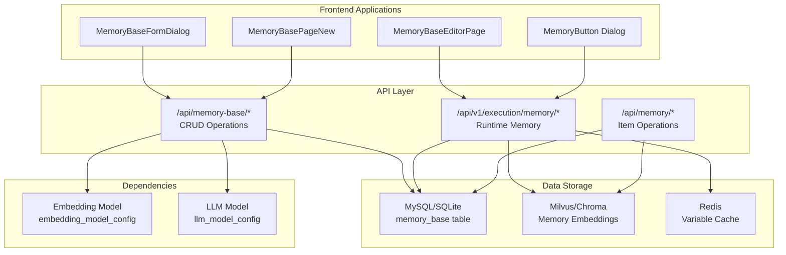
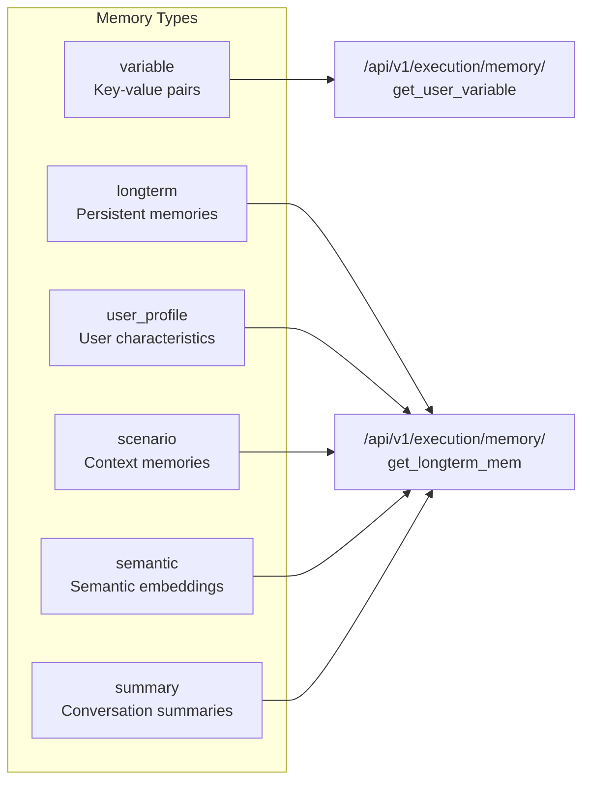
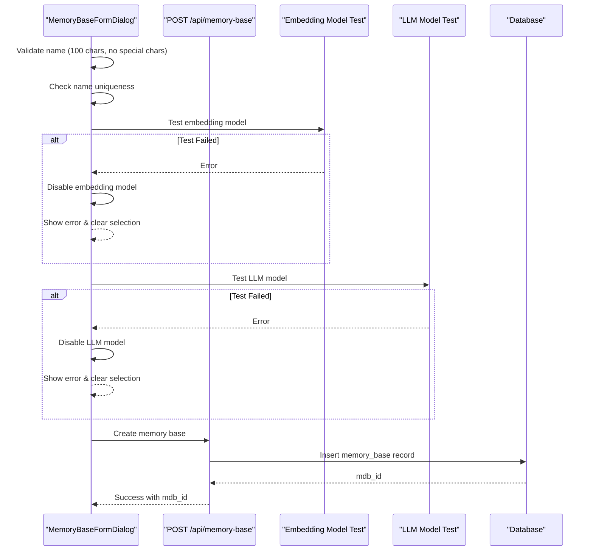
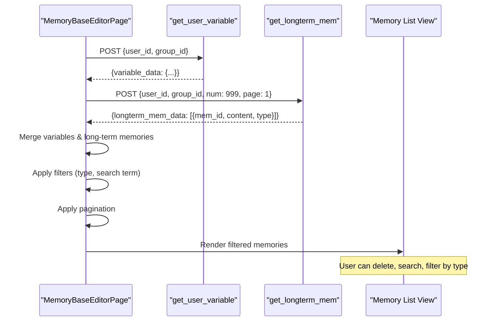
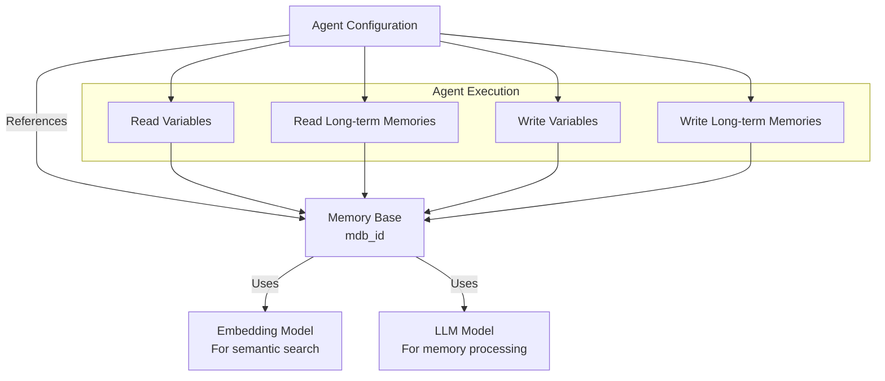

<!-- source: DeepWiki mcp.deepwiki.com · repo openJiuwen-ai/agent-studio · page 8.7 Memory APIs · fetched 2026-11-02 -->

# Memory APIs

<details>
<summary>Relevant source files</summary>

The following files were used as context for generating this wiki page:

- [frontend/src/pages/MemoryBase/MemoryBaseEditorPage.tsx](frontend/src/pages/MemoryBase/MemoryBaseEditorPage.tsx)
- [frontend/src/pages/MemoryBase/MemoryBasePageNew.tsx](frontend/src/pages/MemoryBase/MemoryBasePageNew.tsx)
- [frontend/src/pages/MemoryBase/MemoryButton.tsx](frontend/src/pages/MemoryBase/MemoryButton.tsx)
- [frontend/src/pages/MemoryBase/components/MemoryBaseCard.tsx](frontend/src/pages/MemoryBase/components/MemoryBaseCard.tsx)
- [frontend/src/pages/MemoryBase/components/MemoryBaseCardNew.tsx](frontend/src/pages/MemoryBase/components/MemoryBaseCardNew.tsx)
- [frontend/src/pages/MemoryBase/components/MemoryBaseFormDialog.tsx](frontend/src/pages/MemoryBase/components/MemoryBaseFormDialog.tsx)
- [frontend/src/pages/MemoryBase/components/MemoryBaseTableView.tsx](frontend/src/pages/MemoryBase/components/MemoryBaseTableView.tsx)
- [frontend/src/pages/MemoryBase/index.ts](frontend/src/pages/MemoryBase/index.ts)
- [frontend/src/pages/MemoryBase/utils/validation.ts](frontend/src/pages/MemoryBase/utils/validation.ts)

</details>


This document describes the REST API endpoints for managing memory systems in OpenJiuwen Agent Studio. Memory APIs enable the creation, management, and retrieval of both structured variables and long-term semantic memories that agents can use during execution.

For information about the memory system architecture and concepts, see [Memory Systems](#3.7). For the frontend implementation of memory management interfaces, see [Using Memory Systems](#4.7).

---

## Overview

The Memory APIs are divided into three main categories:

1. **Memory Base Management APIs** - Create and configure memory base containers that hold memory items
2. **Execution Memory APIs** - Runtime APIs for storing and retrieving variables and long-term memories during agent execution
3. **Memory Item Management APIs** - Batch operations and maintenance tasks for memory items

Memory bases act as isolated containers for storing agent context, user preferences, and conversation history. Each memory base is associated with an embedding model for semantic search and an LLM model for memory processing.

**Sources:** [frontend/src/pages/MemoryBase/MemoryBaseEditorPage.tsx:1-1633](), [frontend/src/pages/MemoryBase/MemoryButton.tsx:1-476]()

---

## Memory System Architecture



**Sources:** [frontend/src/pages/MemoryBase/MemoryBaseEditorPage.tsx:68-206](), [frontend/src/pages/MemoryBase/components/MemoryBaseFormDialog.tsx:128-473]()

---

## Memory Base Management APIs

Memory bases are containers that hold memory items. Each memory base requires an embedding model and an LLM model.

### Create Memory Base

**Endpoint:** `POST /api/memory-base`

Creates a new memory base with specified configuration.

**Request Body:**
```typescript
{
  space_id: string;           // Workspace identifier
  name: string;               // Memory base name (max 100 chars)
  description?: string;       // Optional description (max 2000 chars)
  embedding_model_config_id: number;  // Required embedding model
  llm_model_config_id: number;        // Required LLM model
}
```

**Response:**
```typescript
{
  code: number;
  message: string;
  data: {
    mdb_id: string;           // Generated memory base ID
    name: string;
    description: string;
    embedding_model_config_id: number;
    llm_model_config_id: number;
    space_id: string;
    created_at: string;
    updated_at: string;
  }
}
```

**Validation Rules:**
- Name must be 1-100 characters
- Name cannot contain: `< > : " / \ | ? *` or control characters
- Name must be unique within the workspace
- Both embedding and LLM models must exist and be active

**Sources:** [frontend/src/pages/MemoryBase/components/MemoryBaseFormDialog.tsx:280-449](), [frontend/src/pages/MemoryBase/utils/validation.ts:10-39]()

---

### Get Memory Base Detail

**Endpoint:** `GET /api/memory-base/{id}`

**Query Parameters:**
```typescript
{
  space_id: string;  // Workspace identifier
}
```

**Response:**
```typescript
{
  code: number;
  message: string;
  data: {
    mdb_id: string;
    name: string;
    description: string;
    type: string;
    embedding_model_config_id: number;
    llm_model_config_id: number;
    space_id: string;
    status: string;
    created_at: string;
    updated_at: string;
  }
}
```

**Sources:** [frontend/src/pages/MemoryBase/MemoryBaseEditorPage.tsx:145-150]()

---

### Update Memory Base

**Endpoint:** `PUT /api/memory-base`

Updates an existing memory base's metadata or LLM model configuration.

**Request Body:**
```typescript
{
  space_id: string;
  mdb_id: string;             // Memory base ID to update
  name: string;               // New name
  description?: string;       // New description
  llm_model_config_id?: number;  // Optional: update LLM model
}
```

**Notes:**
- Embedding model cannot be changed after creation
- LLM model can be updated to any active model
- Name uniqueness is validated excluding the current memory base

**Sources:** [frontend/src/pages/MemoryBase/MemoryBaseEditorPage.tsx:152-155](), [frontend/src/pages/MemoryBase/components/MemoryBaseFormDialog.tsx:346-360]()

---

### Delete Memory Base

**Endpoint:** `DELETE /api/memory-base`

Deletes a memory base and all associated memory items.

**Request Body:**
```typescript
{
  space_id: string;
  mdb_id: string;
}
```

**Response:**
```typescript
{
  code: number;
  message: string;
  data: {}
}
```

**Warning:** This operation cannot be undone. All variables and long-term memories in the base are permanently deleted.

**Sources:** [frontend/src/pages/MemoryBase/MemoryBaseEditorPage.tsx:157-160]()

---

### List Memory Bases

**Endpoint:** `GET /api/memory-bases`

Retrieves paginated list of memory bases for a workspace.

**Query Parameters:**
```typescript
{
  space_id: string;
  page: number;          // Page number (1-indexed)
  page_size: number;     // Items per page (default: 20)
}
```

**Response:**
```typescript
{
  code: number;
  message: string;
  data: {
    items: MemoryBase[];
    total: number;
    page: number;
    page_size: number;
  }
}
```

**Sources:** [frontend/src/pages/MemoryBase/components/MemoryBaseFormDialog.tsx:207-225]()

---

### Search Memory Bases

**Endpoint:** `POST /api/memory-base/search`

Searches memory bases by name or description.

**Request Body:**
```typescript
{
  space_id: string;
  query: string;         // Search term
  page: number;
  page_size: number;
}
```

**Response:** Same structure as List Memory Bases

**Sources:** [frontend/src/pages/MemoryBase/MemoryBaseEditorPage.tsx:197-200]()

---

### Get Referencing Agents

**Endpoint:** (Via `MemoryBaseService.getReferencingAgents`)

Retrieves list of agents that reference a specific memory base.

**Request:**
```typescript
{
  space_id: string;
  mb_id: string;
}
```

**Response:**
```typescript
{
  agent_names: string[];  // Array of agent names using this memory base
}
```

**Use Case:** Used before deletion to warn users about dependent agents.

**Sources:** [frontend/src/pages/MemoryBase/MemoryBasePageNew.tsx:176-193]()

---

## Execution Memory APIs

These APIs manage runtime memory during agent execution, including variables and long-term memories.

### Memory Types



**Sources:** [frontend/src/pages/MemoryBase/MemoryBaseEditorPage.tsx:52-66](), [frontend/src/pages/MemoryButton.tsx:9-88]()

---

### Get User Variables

**Endpoint:** `POST /api/v1/execution/memory/get_user_variable`

Retrieves all variables stored for a specific user in a memory base.

**Request Body:**
```typescript
{
  user_id: string;    // User identifier (typically space_id)
  group_id: string;   // Memory base ID (mdb_id)
}
```

**Response:**
```typescript
{
  code: number;
  message: string;
  data: {
    variable_data: {
      [key: string]: string | number | object;
    }
  }
}
```

**Example Response:**
```json
{
  "code": 200,
  "message": "success",
  "data": {
    "variable_data": {
      "user_name": "John Doe",
      "preference_language": "en",
      "session_count": 5
    }
  }
}
```

**Sources:** [frontend/src/pages/MemoryBase/MemoryBaseEditorPage.tsx:70-88](), [frontend/src/pages/MemoryButton.tsx:14-32]()

---

### Delete User Variable

**Endpoint:** `POST /api/v1/execution/memory/delete_user_variable`

Deletes a specific variable by key.

**Request Body:**
```typescript
{
  user_id: string;
  group_id: string;
  name: string;       // Variable key to delete
}
```

**Response:** Standard success/error response

**Sources:** [frontend/src/pages/MemoryBase/MemoryBaseEditorPage.tsx:89-105](), [frontend/src/pages/MemoryButton.tsx:33-49]()

---

### Get Long-term Memories

**Endpoint:** `POST /api/v1/execution/memory/get_longterm_mem`

Retrieves long-term memories with pagination support.

**Request Body:**
```typescript
{
  user_id: string;
  group_id: string;
  num: number;        // Number of memories to retrieve
  page: number;       // Page number
}
```

**Response:**
```typescript
{
  code: number;
  message: string;
  data: {
    longterm_mem_data: Array<{
      mem_id: string;
      content: string;
      type: 'longterm' | 'user_profile' | 'scenario' | 'semantic';
    }>
  }
}
```

**Memory Types:**
- `longterm` - General persistent memories
- `user_profile` - User characteristics and preferences
- `scenario` - Contextual situation memories
- `semantic` - Semantically embedded memories

**Sources:** [frontend/src/pages/MemoryBase/MemoryBaseEditorPage.tsx:108-125](), [frontend/src/pages/MemoryButton.tsx:52-69]()

---

### Delete Long-term Memory

**Endpoint:** `POST /api/v1/execution/memory/delete_longterm_mem`

Deletes a specific long-term memory by ID.

**Request Body:**
```typescript
{
  user_id: string;
  group_id: string;
  mem_id: string;     // Memory ID to delete
}
```

**Response:** Standard success/error response

**Sources:** [frontend/src/pages/MemoryBase/MemoryBaseEditorPage.tsx:126-142](), [frontend/src/pages/MemoryButton.tsx:70-86]()

---

## Memory Item Management APIs

These APIs handle batch operations and maintenance tasks for memory items.

### Update Memory Item

**Endpoint:** `PUT /api/memory`

Updates metadata or content of a specific memory item.

**Request Body:**
```typescript
{
  memory_id: string;
  content?: string;
  metadata?: object;
}
```

**Sources:** [frontend/src/pages/MemoryBase/MemoryBaseEditorPage.tsx:187-190]()

---

### Batch Add Memories

**Endpoint:** `POST /api/memory/batch`

Adds multiple memory items in a single request.

**Request Body:**
```typescript
{
  mb_id: string;            // Memory base ID
  memories: Array<{
    content: string;
    type: string;
    metadata?: object;
  }>
}
```

**Response:**
```typescript
{
  code: number;
  message: string;
  data: {
    created_count: number;
    failed_count: number;
  }
}
```

**Use Case:** Bulk import of memories or initialization of memory base with predefined content.

**Sources:** [frontend/src/pages/MemoryBase/MemoryBaseEditorPage.tsx:192-195]()

---

### Clean Expired Memories

**Endpoint:** `POST /api/memory/clean-expired`

Removes expired memory items based on TTL (Time To Live) settings.

**Request Body:**
```typescript
{
  mb_id: string;
  before_date?: string;     // Optional: clean memories before this date
}
```

**Response:**
```typescript
{
  code: number;
  message: string;
  data: {
    deleted_count: number;
  }
}
```

**Sources:** [frontend/src/pages/MemoryBase/MemoryBaseEditorPage.tsx:202-205]()

---

## Data Flow Diagrams

### Memory Base Creation Flow



**Sources:** [frontend/src/pages/MemoryBase/components/MemoryBaseFormDialog.tsx:280-449]()

---

### Memory Retrieval and Display Flow



**Sources:** [frontend/src/pages/MemoryBase/MemoryBaseEditorPage.tsx:340-520]()

---

## Memory Type Handling

### Frontend Memory Type Mapping

The system supports multiple memory types with different display characteristics:

| Type | Icon | Display Name | Storage API |
|------|------|--------------|-------------|
| `variable` | Hash | Variable | `get_user_variable` |
| `longterm` | Brain | Long-term Memory | `get_longterm_mem` |
| `user_profile` | User | User Profile | `get_longterm_mem` |
| `scenario` | User | Scenario | `get_longterm_mem` |
| `semantic` | User | Semantic | `get_longterm_mem` |
| `summary` | MessageSquare | Summary | `get_longterm_mem` |

**Display Format:**
- Variables: `{key : value}` format
- Long-term memories: Direct content display with type label

**Sources:** [frontend/src/pages/MemoryBase/MemoryBaseEditorPage.tsx:614-647](), [frontend/src/pages/MemoryButton.tsx:311-326]()

---

## Error Handling

### Common Error Scenarios

**Memory Base Creation Errors:**

| Error | HTTP Code | Message | Resolution |
|-------|-----------|---------|------------|
| Name exists | 400 | Name already exists | Choose unique name |
| Invalid embedding model | 400 | Embedding model unavailable | Select different model or reactivate |
| Invalid LLM model | 400 | LLM model unavailable | Select different model or reactivate |
| Model test failed | 500 | Model test failed | Check model configuration and connectivity |

**Memory Operation Errors:**

| Error | Cause | Frontend Handling |
|-------|-------|-------------------|
| Variable not found | Variable deleted or never existed | Silent handling, no error display |
| Long-term memory not found | Memory ID invalid | Show error message |
| Pagination out of range | Invalid page number | Reset to page 1 |

**Sources:** [frontend/src/pages/MemoryBase/components/MemoryBaseFormDialog.tsx:452-471](), [frontend/src/pages/MemoryBase/MemoryBaseEditorPage.tsx:380-387]()

---

## Authentication & Authorization

All Memory APIs require authentication via JWT token in the `Authorization` header:

```
Authorization: Bearer <token>
```

The token is obtained from the authentication system and stored in `useAuthStore`. Each request includes:
- `space_id`: Identifies the workspace/tenant
- `user_id`: Identifies the user (often same as `space_id`)

**Scope Isolation:**
- Memory bases are isolated by `space_id`
- Users can only access memory bases within their workspace
- Variables and memories are scoped by `user_id` and `group_id` (memory base ID)

**Sources:** [frontend/src/pages/MemoryBase/MemoryBaseEditorPage.tsx:71-80](), [frontend/src/pages/MemoryButton.tsx:15-25]()

---

## Integration with Agent System

Memory bases integrate with agents through configuration:



**Agent Dependencies:**
- Agents can reference multiple memory bases
- Deleting a memory base requires checking agent references via `getReferencingAgents`
- Memory base deletion shows warning if agents depend on it

**Sources:** [frontend/src/pages/MemoryBase/MemoryBasePageNew.tsx:176-193](), [frontend/src/pages/MemoryBase/MemoryBasePageNew.tsx:356-384]()

---

## Best Practices

### Naming Conventions
- Use descriptive, alphanumeric names for memory bases
- Avoid special characters that may cause issues in URLs or file systems
- Keep names under 100 characters for display compatibility

### Memory Organization
- Use variables for frequently changing data (session state, counters)
- Use long-term memories for persistent knowledge (user preferences, conversation history)
- Use appropriate types: `user_profile` for user characteristics, `scenario` for contextual data

### Performance Considerations
- Limit pagination size (recommended: 10-100 items per page)
- Use search/filter APIs to narrow results instead of loading all memories
- Clean expired memories periodically to maintain performance

### Model Selection
- Choose embedding models optimized for your memory content language
- Ensure embedding model supports semantic similarity search
- Select LLM models with sufficient context window for memory processing

**Sources:** [frontend/src/pages/MemoryBase/utils/validation.ts:10-39](), [frontend/src/pages/MemoryBase/MemoryBaseEditorPage.tsx:341-387]()

---

