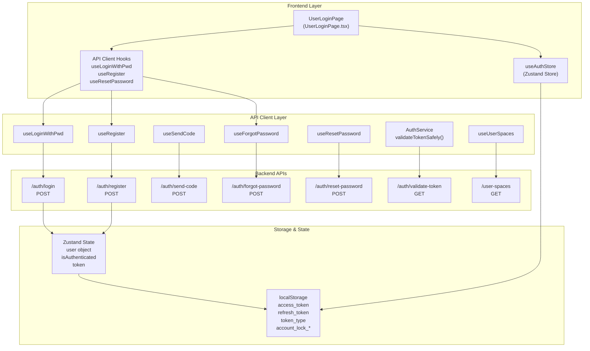
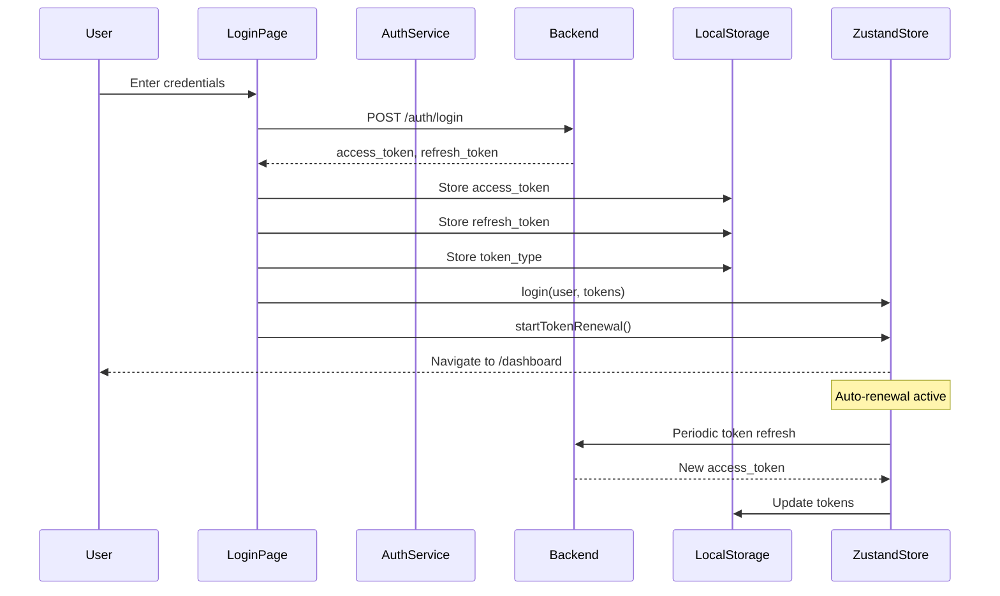
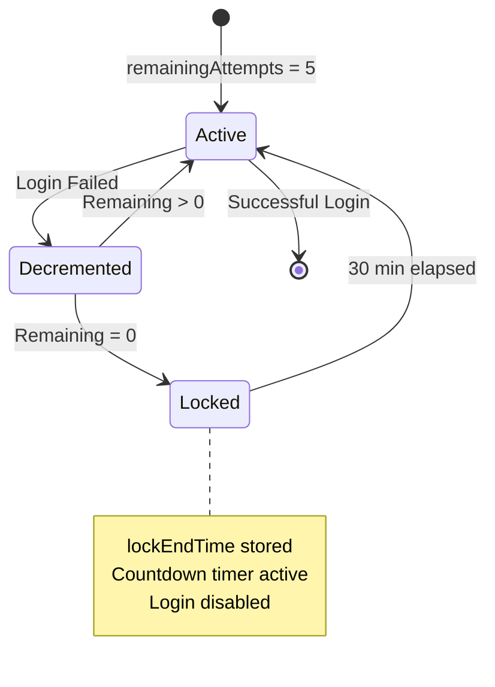
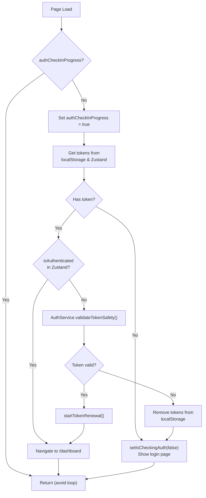
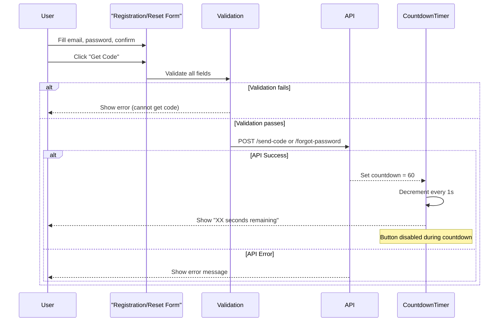

<!-- source: DeepWiki mcp.deepwiki.com · repo openJiuwen-ai/agent-studio · page 8.8 Authentication APIs · fetched 2026-11-02 -->

# Authentication APIs

<details>
<summary>Relevant source files</summary>

The following files were used as context for generating this wiki page:

- [backend/openjiuwen_studio/core/manager/model_manager/managers/embedding_model_test_manager.py](backend/openjiuwen_studio/core/manager/model_manager/managers/embedding_model_test_manager.py)
- [backend/openjiuwen_studio/routers/embedding_models.py](backend/openjiuwen_studio/routers/embedding_models.py)
- [frontend/src/locales/en-US.json](frontend/src/locales/en-US.json)
- [frontend/src/locales/zh-CN.json](frontend/src/locales/zh-CN.json)
- [frontend/src/pages/Auth/PrivacyPolicyPage.tsx](frontend/src/pages/Auth/PrivacyPolicyPage.tsx)
- [frontend/src/pages/Auth/UserLoginPage.tsx](frontend/src/pages/Auth/UserLoginPage.tsx)
- [frontend/src/pages/KnowledgeBase/components/AddDocumentDialog.tsx](frontend/src/pages/KnowledgeBase/components/AddDocumentDialog.tsx)
- [frontend/src/pages/KnowledgeBase/components/KnowledgeBaseFormDialog.tsx](frontend/src/pages/KnowledgeBase/components/KnowledgeBaseFormDialog.tsx)
- [frontend/src/pages/Models/ModelsPage.tsx](frontend/src/pages/Models/ModelsPage.tsx)
- [frontend/src/pages/Models/ModelsPageNew.tsx](frontend/src/pages/Models/ModelsPageNew.tsx)
- [frontend/src/pages/Models/components/EmbeddingModelsTable.tsx](frontend/src/pages/Models/components/EmbeddingModelsTable.tsx)
- [frontend/src/pages/Models/components/LLMModelsTable.tsx](frontend/src/pages/Models/components/LLMModelsTable.tsx)

</details>


This document describes the authentication APIs that handle user login, registration, password management, and token-based session management in OpenJiuwen Agent Studio. The authentication system uses JWT tokens for stateless authentication and includes security features such as account locking, verification codes, and automatic token renewal.

For information about user profile management and settings, see page 8.8 (this page focuses on authentication flow only). For API authorization and permission management, see the backend service architecture documentation.

---

## System Overview

The authentication system consists of frontend pages, API client hooks, backend endpoints, and state management components working together to provide secure user authentication. The system supports multiple authentication flows including login with password, user registration with email verification, and password reset functionality.

**Key Components:**
- JWT-based token authentication with access and refresh tokens
- Email verification code system for registration and password reset
- Account locking mechanism after failed login attempts
- Automatic token renewal to maintain user sessions
- Zustand-based state management for authentication context

Sources: [frontend/src/pages/Auth/UserLoginPage.tsx:1-850]()

---

## Authentication Flow Diagram



Sources: [frontend/src/pages/Auth/UserLoginPage.tsx:164-527]()

---

## API Endpoints

### Login with Password

**Endpoint:** `POST /auth/login`

Authenticates a user with email and password credentials. Returns JWT tokens upon successful authentication.

**Request Body:**
```typescript
{
  username: string,  // Email address
  password: string   // User password
}
```

**Response:**
```typescript
{
  code: 200,
  message: "Login successful",
  data: {
    user_id_str: string,
    username: string,
    email: string,
    avatar_url: string,
    role_type: number,  // 1 = developer, 2 = admin
    access_token: string,
    refresh_token: string,
    token_type: string  // "Bearer"
  }
}
```

**Frontend Integration:**
- Mutation hook: `useLoginWithPwd({ login })`
- Handles account locking on repeated failures (5 attempts)
- Stores tokens in `localStorage` and Zustand state
- Triggers token auto-renewal mechanism

Sources: [frontend/src/pages/Auth/UserLoginPage.tsx:168-169](), [frontend/src/pages/Auth/UserLoginPage.tsx:529-583]()

---

### User Registration

**Endpoint:** `POST /auth/register`

Creates a new user account with email verification.

**Request Body:**
```typescript
{
  username: string,      // Email address (must be valid email format)
  password: string,      // Min 6 chars, max 20 chars, must contain 2+ character types
  confirmPassword: string,
  verifyCode: string     // 6-digit verification code
}
```

**Response:**
```typescript
{
  code: 200,
  message: "Registration successful",
  data: {
    user_id_str: string,
    username: string,
    email: string,
    access_token: string,
    refresh_token: string,
    token_type: string
  }
}
```

**Validation Rules:**
- Email format validation
- Password length: 6-20 characters
- Password must contain at least 2 of: digits, lowercase, uppercase, special characters
- Verification code must be 6 digits
- Username/email max length: 50 characters

Sources: [frontend/src/pages/Auth/UserLoginPage.tsx:34-49](), [frontend/src/pages/Auth/UserLoginPage.tsx:170]()

---

### Send Verification Code

**Endpoint:** `POST /auth/send-code`

Sends a 6-digit verification code to the user's email for registration purposes.

**Request Body:**
```typescript
{
  email: string  // User's email address
}
```

**Response:**
```typescript
{
  code: 200,
  message: "Verification code sent successfully",
  data: boolean
}
```

**Frontend Behavior:**
- Triggers 60-second countdown timer
- Validates email, password, and confirmPassword before sending
- Prevents multiple requests during countdown period

Sources: [frontend/src/pages/Auth/UserLoginPage.tsx:172](), [frontend/src/pages/Auth/UserLoginPage.tsx:373-414]()

---

### Forgot Password

**Endpoint:** `POST /auth/forgot-password`

Sends a verification code to the user's email for password reset flow.

**Request Body:**
```typescript
{
  email: string  // User's email address
}
```

**Response:**
```typescript
{
  code: 200,
  message: "Password reset code sent",
  data: boolean
}
```

**Frontend Integration:**
- Similar to send-code but for password reset
- Validates email, newPassword, and confirmNewPassword before sending
- 60-second countdown timer

Sources: [frontend/src/pages/Auth/UserLoginPage.tsx:174](), [frontend/src/pages/Auth/UserLoginPage.tsx:417-455]()

---

### Reset Password

**Endpoint:** `POST /auth/reset-password`

Resets user password using verification code.

**Request Body:**
```typescript
{
  email: string,
  newPassword: string,
  confirmNewPassword: string,
  verifyCode: string  // 6-digit code from forgot-password
}
```

**Response:**
```typescript
{
  code: 200,
  message: "Password reset successful",
  data: boolean
}
```

Sources: [frontend/src/pages/Auth/UserLoginPage.tsx:176]()

---

### Validate Token

**Endpoint:** `GET /auth/validate-token`

Validates the current JWT access token without triggering redirects.

**Request Headers:**
```
Authorization: Bearer <access_token>
```

**Response:**
```typescript
{
  code: 200,
  data: {
    valid: boolean
  }
}
```

**Usage:**
- Called during initial page load to check authentication status
- Uses `AuthService.validateTokenSafely()` to avoid redirect loops on login page
- If token is invalid, clears localStorage and shows login page

Sources: [frontend/src/pages/Auth/UserLoginPage.tsx:500]()

---

### Get User Spaces

**Endpoint:** `GET /user-spaces`

Retrieves the list of user spaces after successful authentication.

**Request Headers:**
```
Authorization: Bearer <access_token>
```

**Response:**
```typescript
{
  code: 200,
  data: {
    space_list: Array<{
      space_id: string,
      space_name: string,
      // ... other space properties
    }>
  }
}
```

**Integration:**
- Called after login/registration to get the first available space
- Space ID is stored in `localStorage` as `selectedSpaceId`
- Updates user object in Zustand store with `spaceId`

Sources: [frontend/src/pages/Auth/UserLoginPage.tsx:177](), [frontend/src/pages/Auth/UserLoginPage.tsx:552-565]()

---

## Token Management

### Token Storage and Lifecycle



### Token Renewal Process

The system implements automatic token renewal to maintain user sessions:

1. **Token Storage:**
   - `access_token` - Primary authentication token
   - `refresh_token` - Used to obtain new access tokens
   - `token_type` - Token type (typically "Bearer")

2. **Renewal Mechanism:**
   - Triggered by `startTokenRenewal()` after successful login
   - Runs periodically to refresh tokens before expiration
   - Managed by Zustand store

3. **Validation Flow:**
   - On page load, checks for existing tokens in `localStorage`
   - Calls `AuthService.validateTokenSafely()` to verify token validity
   - If valid, activates token renewal and navigates to dashboard
   - If invalid, clears storage and shows login page

Sources: [frontend/src/pages/Auth/UserLoginPage.tsx:469-527](), [frontend/src/pages/Auth/UserLoginPage.tsx:571-573]()

---

## Account Security Features

### Account Locking Mechanism

The system implements client-side account locking to prevent brute force attacks:

**Configuration:**
- Maximum login attempts: 5 (`MAX_ATTEMPT_NUM`)
- Lock duration: 30 minutes (1800 seconds)
- Lock information stored in `localStorage` with key pattern: `account_lock_{email}`

**Lock State Management:**



**Storage Structure:**
```typescript
interface LoginInfo {
  remainingAttempts: number,  // 0-5
  isLocked: boolean,
  lockEndTime: number  // Unix timestamp in milliseconds
}
```

**Key Features:**
- Automatic cleanup of expired lock records on page load
- Maximum 20 lock records stored (oldest removed first)
- Lock state persists across browser sessions
- Countdown timer shows remaining lock time
- Lock information tied to specific email address

Sources: [frontend/src/pages/Auth/UserLoginPage.tsx:29-127](), [frontend/src/pages/Auth/UserLoginPage.tsx:143-148](), [frontend/src/pages/Auth/UserLoginPage.tsx:237-287](), [frontend/src/pages/Auth/UserLoginPage.tsx:585-614]()

---

## Form Validation and Error Handling

### Login Form Validation

| Field | Validation Rules | Error Messages |
|-------|-----------------|----------------|
| `username` (email) | - Valid email format<br/>- Max 50 characters<br/>- Email prefix ≥ 3 characters | `auth.login.invalidEmailFormat`<br/>`auth.login.invalidEmailLength` |
| `password` | - Min 6 characters<br/>- Max 20 characters | `auth.login.passwordTooShort` |

### Registration Form Validation

| Field | Validation Rules | Error Messages |
|-------|-----------------|----------------|
| `username` (email) | - Valid email format<br/>- Max 50 characters | `auth.common.invalidEmailFormat`<br/>`auth.common.maxEmailLength` |
| `password` | - Length: 6-20 characters<br/>- Must contain ≥2 of: digits, lowercase, uppercase, special chars | `auth.common.minPasswordLength`<br/>`auth.common.maxPasswordLength`<br/>Custom strength message |
| `confirmPassword` | - Must match `password` | `auth.register.passwordsNotMatch` |
| `verifyCode` | - Must be 6 digits | `auth.common.invalidCode` |

### Password Reset Validation

| Field | Validation Rules | Error Messages |
|-------|-----------------|----------------|
| `username` (email) | - Valid email format<br/>- Max 50 characters | Same as registration |
| `newPassword` | - Length: 6-20 characters<br/>- Strength requirements | Same as registration |
| `confirmNewPassword` | - Must match `newPassword` | `auth.forgotPassword.passwordsNotMatch` |
| `verifyCode` | - Must be 6 digits | `auth.common.invalidCode` |

### Error Response Handling

Common error scenarios and their handling:

```typescript
// Network errors
catch (error) {
  const backendDetail = error?.response?.data?.detail 
    || error?.response?.data?.message 
    || error?.message
  setError('root', {
    type: 'manual',
    message: backendDetail || t('auth.login.networkError')
  })
}
```

Sources: [frontend/src/pages/Auth/UserLoginPage.tsx:34-49](), [frontend/src/pages/Auth/UserLoginPage.tsx:184-234](), [frontend/src/pages/Auth/UserLoginPage.tsx:373-454]()

---

## State Management Integration

### Zustand Store Interface

The `useAuthStore` manages authentication state globally:

```typescript
interface AuthStore {
  // State
  user: {
    id: string,
    username: string,
    email: string,
    avatar: string,
    role: 'developer' | 'admin',
    permissions: string[],
    spaceId: string
  } | null,
  token: string | null,
  isAuthenticated: boolean,
  
  // Actions
  login: (user, accessToken, refreshToken) => void,
  logout: () => void,
  updateUser: (updates) => void,
  startTokenRenewal: () => void
}
```

### Authentication Success Handler

Unified handler for login and registration success:

```typescript
const handleAuthSuccess = async (
  userInfo: any,
  accessToken: string,
  refreshToken: string,
  tokenType: string
) => {
  // 1. Store user in Zustand
  login(userObject, accessToken, refreshToken)
  
  // 2. Persist tokens to localStorage
  localStorage.setItem('access_token', accessToken)
  localStorage.setItem('refresh_token', refreshToken)
  localStorage.setItem('token_type', tokenType)
  
  // 3. Fetch user spaces
  const spaceResponse = await userSpacesQuery.refetch()
  const spaceId = spaceResponse.data.space_list[0].space_id
  localStorage.setItem('selectedSpaceId', spaceId)
  
  // 4. Update user with spaceId
  updateUser({ spaceId })
  
  // 5. Start token auto-renewal
  startTokenRenewal()
  
  // 6. Navigate to dashboard
  return true
}
```

Sources: [frontend/src/pages/Auth/UserLoginPage.tsx:164](), [frontend/src/pages/Auth/UserLoginPage.tsx:529-583]()

---

## Initial Authentication Check

### Page Load Authentication Flow



**Implementation Details:**
- Uses `useRef` to prevent duplicate authentication checks
- Checks both `localStorage` (`access_token`) and Zustand state (`token`)
- Calls `validateTokenSafely()` to avoid redirect loops on login page
- Cleans up invalid tokens by calling `removeLocalCache()`
- Sets `isCheckingAuth` state to show/hide loading indicators

Sources: [frontend/src/pages/Auth/UserLoginPage.tsx:457-527]()

---

## Verification Code System

### Code Request Flow



**Countdown Timer Logic:**
- Initial countdown: 60 seconds
- Decrements every second using `setInterval`
- Button disabled during countdown (`isCountdownActive`)
- Auto-cleanup of timer on component unmount
- Countdown stored in state (`countdown`, `isCountdownActive`)

**Validation Requirements Before Code Request:**

For **Registration**:
- `username` (email) must be valid and filled
- `password` must be valid and filled
- `confirmPassword` must match `password`

For **Password Reset**:
- `username` (email) must be valid and filled
- `newPassword` must be valid and filled
- `confirmNewPassword` must match `newPassword`

Sources: [frontend/src/pages/Auth/UserLoginPage.tsx:139-142](), [frontend/src/pages/Auth/UserLoginPage.tsx:355-370](), [frontend/src/pages/Auth/UserLoginPage.tsx:373-455]()

---

## Multi-Tab Authentication Support

### Tab States and Transitions

The login page supports three tabs:
- `'login'` - Login with email and password
- `'register'` - User registration with verification
- `'forgot'` - Password reset flow

**State Reset on Tab Change:**
```typescript
useEffect(() => {
  // Clear errors
  setLoginError('')
  setCommonError('')
  clearErrors()
  
  // Reset countdown
  setCountdown(0)
  setIsCountdownActive(false)
}, [activeTab, clearErrors])
```

**Password Visibility Toggle:**
- Managed per-field in `passwordVisible` state object
- Fields: `password`, `newPassword`, `confirmPassword`, `confirmNewPassword`
- Toggle icons: Eye (visible) / EyeOff (hidden)

**Cross-Field Validation:**
- Auto-triggers `confirmPassword` validation when `password` changes (registration)
- Auto-triggers `confirmNewPassword` validation when `newPassword` changes (reset)
- Uses `trigger()` from react-hook-form to manually validate fields

Sources: [frontend/src/pages/Auth/UserLoginPage.tsx:131-136](), [frontend/src/pages/Auth/UserLoginPage.tsx:139](), [frontend/src/pages/Auth/UserLoginPage.tsx:214-234]()

---

## Error Message Localization

### Common Error Keys

The system uses i18n for all error messages. Key translation namespaces:

**Login Errors:**
- `auth.login.invalidCredentials` - Wrong username/password
- `auth.login.networkError` - Network request failed
- `auth.login.remainingAttempts` - Shows remaining login attempts
- `auth.login.lockedMessage` - Account locked message with time

**Registration Errors:**
- `auth.register.sendCodeFailed` - Code send failure
- `auth.register.registerFailed` - Registration failure
- `auth.common.invalidEmailFormat` - Invalid email
- `auth.common.minPasswordLength` - Password too short
- `auth.register.passwordsNotMatch` - Passwords don't match

**Password Reset Errors:**
- `auth.forgotPassword.sendCodeFailed` - Code send failure
- `auth.forgotPassword.resetFailed` - Reset failure
- `auth.forgotPassword.passwordsNotMatch` - Passwords don't match

**Success Messages:**
- `auth.login.loginSuccess` - Login successful
- `auth.forgotPassword.resetSuccess` - Password reset successful

Sources: [frontend/src/locales/zh-CN.json:337-417](), [frontend/src/locales/en-US.json:337-406]()

---

## Session Expiration Handling

### Session Expired Flow

When a session expires (e.g., token becomes invalid):

1. **Detection:**
   - Backend returns 401 Unauthorized
   - Token validation fails during API calls
   - `validateTokenSafely()` returns `{ valid: false }`

2. **Cleanup:**
   ```typescript
   const removeLocalCache = () => {
     localStorage.removeItem('token_type')
     localStorage.removeItem('refresh_token')
     localStorage.removeItem('access_token')
     localStorage.removeItem('auth-storage')
   }
   ```

3. **User Notification:**
   - Show message: `auth.sessionExpired` ("Login has expired, please log in again")
   - Redirect to login page
   - Clear all authentication state

4. **State Reset:**
   - Clear Zustand store authentication state
   - Stop token renewal timer
   - Reset form fields and errors

Sources: [frontend/src/pages/Auth/UserLoginPage.tsx:457-463](), [frontend/src/pages/Auth/UserLoginPage.tsx:469-527]()

---

## Integration with Model APIs Example

While authentication itself is separate from model management, the authentication system provides the foundation for all authenticated API calls. Here's an example of how models use the authentication context:

```typescript
// Model APIs require authentication
const { user } = useAuthStore()  // Get authenticated user

const { data: modelsData } = useModels({
  spaceId: user?.spaceId,  // User's space ID from auth
  is_active: true,
  size: 100,
})

// Model testing also uses authentication
const testModelMutation = useTestModel()
await testModelMutation.mutateAsync({
  id: String(modelId),
  prompt: 'Test prompt',
  spaceId: spaceId,  // From authenticated user
})
```

The `spaceId` obtained during login is essential for API calls throughout the application.

Sources: [frontend/src/pages/KnowledgeBase/components/AddDocumentDialog.tsx:30-31](), [frontend/src/pages/KnowledgeBase/components/AddDocumentDialog.tsx:62-72](), [frontend/src/pages/Models/ModelsPage.tsx:117-118]()

---

