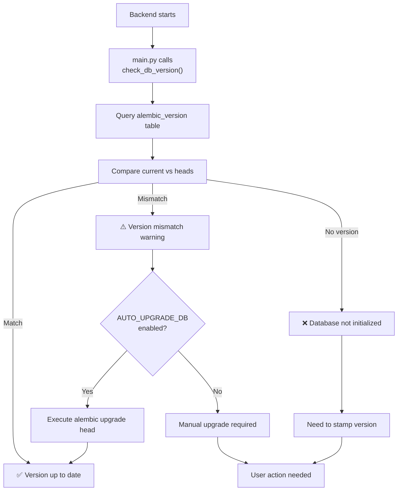
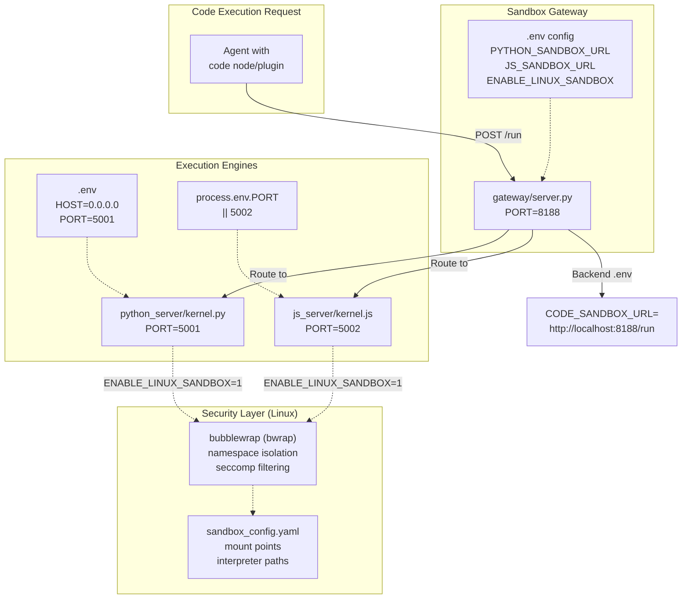
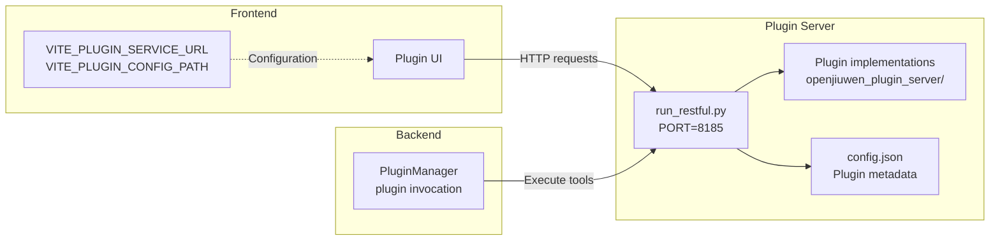
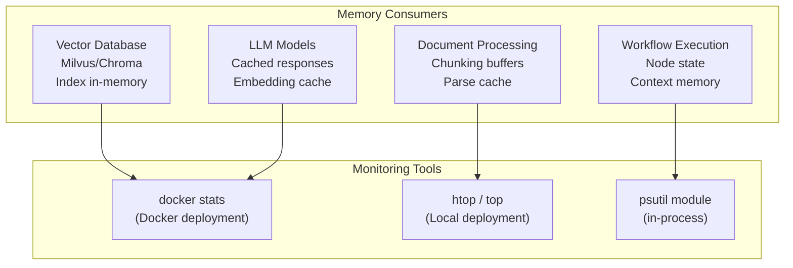
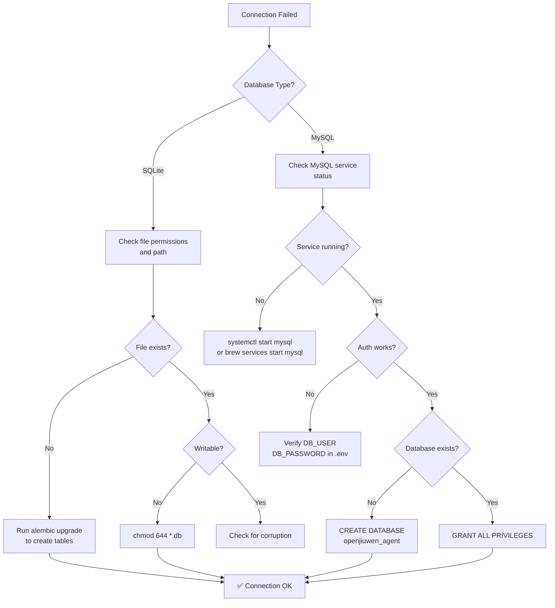
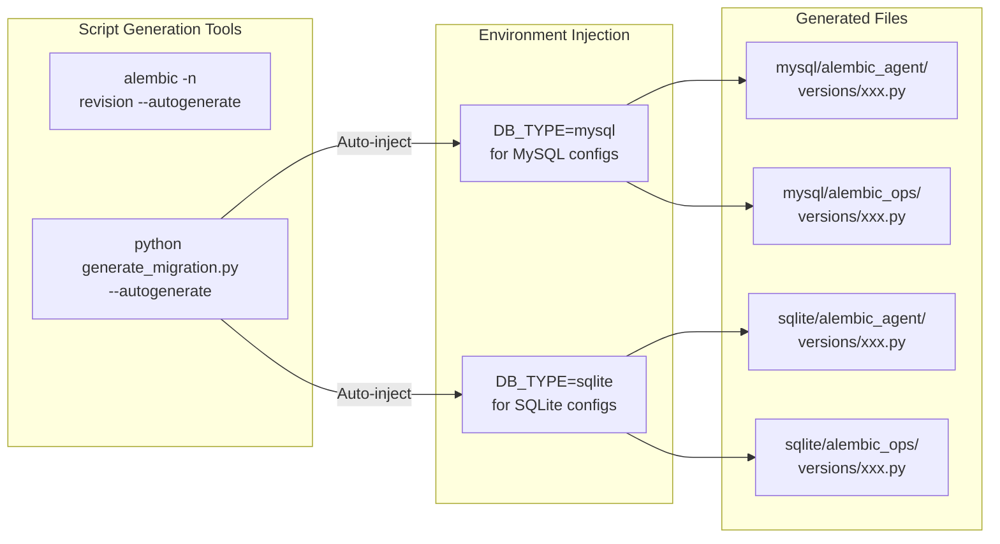
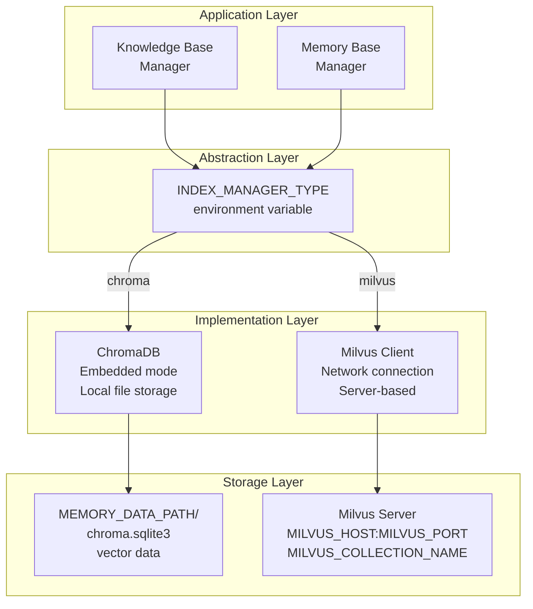
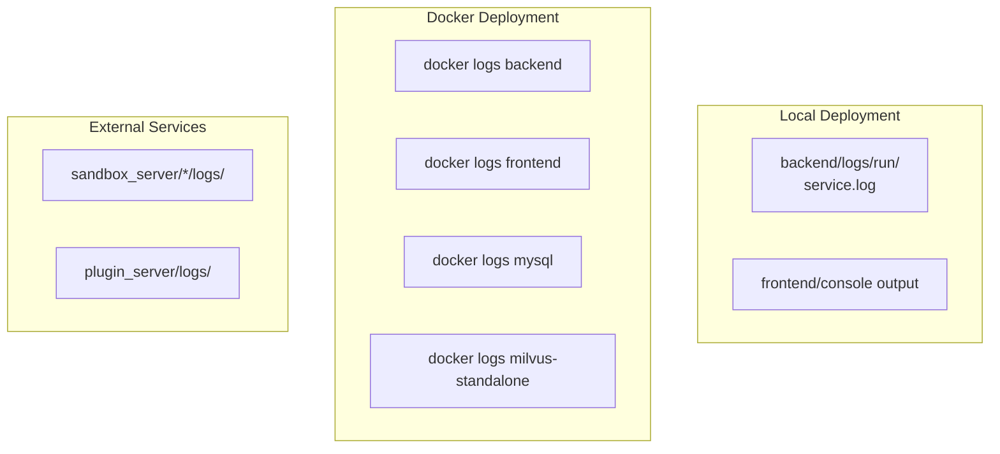

<!-- source: DeepWiki mcp.deepwiki.com · repo openJiuwen-ai/agent-studio · page 9 Troubleshooting · fetched 2026-11-02 -->

# Troubleshooting

<details>
<summary>Relevant source files</summary>

The following files were used as context for generating this wiki page:

- [backend/DATABASE_MIGRATION_DEVELOPMENT_GUIDE_EN.md](backend/DATABASE_MIGRATION_DEVELOPMENT_GUIDE_EN.md)
- [backend/GENERATE_MIGRATION_USAGE_EN.md](backend/GENERATE_MIGRATION_USAGE_EN.md)
- [backend/pyproject.toml](backend/pyproject.toml)
- [docs/en/2.Installation Guide/Install via Docker/Linux_Installation.md](docs/en/2.Installation Guide/Install via Docker/Linux_Installation.md)
- [docs/en/2.Installation Guide/Install via Docker/MacOS_Installation.md](docs/en/2.Installation Guide/Install via Docker/MacOS_Installation.md)
- [docs/en/2.Installation Guide/Install via Docker/Windows_Installation.md](docs/en/2.Installation Guide/Install via Docker/Windows_Installation.md)
- [docs/en/2.Installation Guide/Local Installation/Linux_Installation.md](docs/en/2.Installation Guide/Local Installation/Linux_Installation.md)
- [docs/en/2.Installation Guide/Local Installation/MacOS_Installation.md](docs/en/2.Installation Guide/Local Installation/MacOS_Installation.md)
- [docs/en/2.Installation Guide/Local Installation/Windows_Installation.md](docs/en/2.Installation Guide/Local Installation/Windows_Installation.md)

</details>


This document provides solutions to common issues encountered when installing, configuring, and running OpenJiuwen Agent Studio. It covers problems across different deployment methods (Docker and local installation), operating systems (Linux, macOS, Windows), and runtime scenarios.

For information about database schema changes and version management, see [Database Migrations](#6.2). For deployment configuration, see [Production Configuration](#7.2). For development environment setup, see [Development Environment Setup](#6.1).

---

## 9.1 Installation Issues

### 9.1.1 Docker Installation Problems

#### Milvus Container Exits Unexpectedly

**Problem**: Milvus container starts but exits immediately during Docker deployment.

**Root Cause**: Milvus 2.6.2 requires CPU support for AVX (Advanced Vector Extensions) instruction set. If the CPU lacks AVX support, Milvus cannot run.

**Diagnosis**:
```bash
# Check if CPU supports AVX
lscpu | grep Flags | grep avx
```

**Solution**:
- **Option 1**: Use a CPU with AVX support
- **Option 2**: Switch to Chroma vector database by setting `INDEX_MANAGER_TYPE=chroma` in `.env.deploy.custom`

**Related Configuration**:
```yaml
# docker-compose.yml (generated)
milvus-standalone:
  image: milvusdb/milvus:v2.6.2
  # Requires AVX CPU instruction set
```

Sources: [docs/en/2.Installation Guide/Install via Docker/Linux_Installation.md:105-105]()

---

#### Docker Deployment Fails on openEuler

**Problem**: Docker containers fail to start on openEuler systems with thread creation errors.

**Root Cause**: The kernel security mechanism `seccomp` (Secure Computing Mode) restricts thread creation operations in Docker containers.

**Solution**:
1. Modify seccomp security policy for Docker
2. Update the Docker Compose configuration file at `conf/docker-jiuwen.template.yml`
3. Refer to openEuler official documentation for specific seccomp policy adjustments

Sources: [docs/en/2.Installation Guide/Install via Docker/Linux_Installation.md:108-111]()

---

#### Windows LinuxKit Kernel Issues (D State Processes)

**Problem**: Backend container fails to restart with error:
```
Error response from daemon: Cannot restart container 6e0fa44910e0: tried to kill container, but did not receive an exit event
```

**Root Cause**: LinuxKit kernel (Docker's legacy Windows virtualization backend) has poor process resource management. Processes can enter uninterruptible sleep (D state) and become zombies that cannot be killed.

**Why It Happens**:
- LinuxKit lacks self-healing logic for D state processes
- Low I/O forwarding efficiency increases probability of D state
- Neither `kill -9` nor `docker rm` can terminate D state processes

**Solution**:
1. **Immediate workaround**: Restart Docker Desktop to reset the VM
2. **Permanent fix**: Switch to WSL 2 backend (recommended)
   - WSL 2 uses full Linux kernel with proper D state handling
   - Automatically recovers D state processes within 30-60 seconds
   - Superior compatibility and lower resource consumption

**Configuration**:
```bash
# Enable WSL 2 (Windows PowerShell as Administrator)
wsl --install

# In Docker Desktop settings
# General > Use WSL 2 based engine (checked)
```

Sources: [docs/en/2.Installation Guide/Install via Docker/Windows_Installation.md:123-132]()

---

### 9.1.2 Local Installation Problems

#### Dependency Installation Failures

**Problem**: `uv sync` hangs for more than 20 minutes or fails during backend setup.

**Common Causes**:
1. Network connectivity to PyPI mirrors
2. TLS/SSL certificate validation issues
3. Incompatible package index configuration

**Solution 1 - Change Package Index**:
```bash
# Edit backend/pyproject.toml
# Change [[tool.uv.index]] url to an alternative mirror
[[tool.uv.index]]
url = "https://pypi.tuna.tsinghua.edu.cn/simple/"  # Alternative mirror
```

**Solution 2 - Force Native TLS**:
```bash
# If HTTPS download fails
uv sync --native-tls
```

**Configuration File**: [backend/pyproject.toml:43-44]()

Sources: [docs/en/2.Installation Guide/Local Installation/Linux_Installation.md:339-341](), [docs/en/2.Installation Guide/Local Installation/MacOS_Installation.md:304-306](), [docs/en/2.Installation Guide/Local Installation/Windows_Installation.md:335-337]()

---

#### MySQL Database Setup Issues

**Problem**: Database connection fails after MySQL installation.

**Common Issues**:

| Issue | Symptom | Solution |
|-------|---------|----------|
| **Special characters in password** | Connection error with special chars | URL-encode special characters (see table below) |
| **Wrong credentials** | Authentication failed | Verify `DB_USER` and `DB_PASSWORD` in `.env` |
| **Database not created** | Database doesn't exist | Execute `CREATE DATABASE` commands |
| **Privileges not granted** | Access denied | Run `GRANT ALL PRIVILEGES` commands |

**Special Character URL Encoding Table**:

| Character | URL Encoding | Character | URL Encoding | Character | URL Encoding |
|-----------|--------------|-----------|--------------|-----------|--------------|
| Space     | %20          | "         | %22          | #         | %23          |
| %         | %25          | &         | %26          | (         | %28          |
| )         | %29          | +         | %2B          | ,         | %2C          |
| /         | %2F          | :         | %3A          | ;         | %3B          |
| <         | %3C          | =         | %3D          | >         | %3E          |
| ?         | %3F          | @         | %40          | \         | %5C          |
| \|        | %7C          |           |              |           |              |

**Example Configuration**:
```env
# Password with special chars: P@ssw0rd!#$
DB_PASSWORD=P%40ssw0rd%21%23%24
```

Sources: [docs/en/2.Installation Guide/Local Installation/Linux_Installation.md:543-549](), [docs/en/2.Installation Guide/Local Installation/MacOS_Installation.md:491-498](), [docs/en/2.Installation Guide/Local Installation/Windows_Installation.md:535-542]()

---

#### Frontend npm Vulnerabilities Warning

**Problem**: Running `npm install` shows vulnerability warnings:
```
found X vulnerabilities (Y moderate, Z high)
run `npm audit fix` to fix them, or `npm audit` for details
```

**Root Cause**: Known npm security advisories for development dependencies that do not affect runtime.

**Solution**: 
- **No action required** - These are known issues in development dependencies
- Warnings do not affect application functionality
- The vulnerabilities exist in build-time tools, not production runtime code

Sources: [docs/en/2.Installation Guide/Local Installation/Linux_Installation.md:360-362](), [docs/en/2.Installation Guide/Local Installation/MacOS_Installation.md:329-331](), [docs/en/2.Installation Guide/Local Installation/Windows_Installation.md:361-363]()

---

### 9.1.3 Platform-Specific Issues

#### macOS: Missing greenlet Module

**Problem**: Backend startup fails with error:
```python
ModuleNotFoundError: No module named 'greenlet'
```

**Root Cause**: On Apple Silicon (ARM) Macs, the `greenlet` package may not be included in the standard Python environment due to compatibility issues.

**Solution**:
```bash
# Exit virtual environment if active
deactivate

# Add greenlet to the virtual environment
uv add greenlet

# Re-enter virtual environment
source .venv/bin/activate

# Start backend
python main.py
```

**Verification**:
```bash
# Check if greenlet is installed
pip list | grep greenlet
```

Sources: [docs/en/2.Installation Guide/Local Installation/MacOS_Installation.md:478-489]()

---

#### Windows: PowerShell Execution Policy

**Problem**: Cannot run PowerShell setup scripts due to execution policy restrictions.

**Error Message**:
```
.\setup.ps1 : File cannot be loaded because running scripts is disabled on this system.
```

**Solution**:
```powershell
# Run PowerShell as Administrator
Set-ExecutionPolicy Unrestricted -Scope CurrentUser
```

**Security Note**: This setting allows script execution for the current user only, not system-wide.

Sources: [docs/en/2.Installation Guide/Local Installation/Windows_Installation.md:72-75]()

---

## 9.2 Runtime Errors

### 9.2.1 Backend Service Errors

#### Database Version Mismatch

**Problem**: Backend startup shows database version mismatch warning:
```log
⚠️ Warning: agent database version mismatch
   Current version: f458c7fb17a5
   Latest version: 8f4846812221
```

**Diagnosis Flow**:



**Solution 1 - Automatic Upgrade** (if enabled):
```env
# .env configuration
AUTO_UPGRADE_DB=true  # Enable automatic migration
```

**Solution 2 - Manual Upgrade**:
```bash
# Check current version
alembic -n alembic_sqlite_agent current

# View latest version
alembic -n alembic_sqlite_agent heads

# Upgrade to latest
alembic -n alembic_sqlite_agent upgrade head
```

**Solution 3 - Stamp Existing Database** (for databases without Alembic history):
```bash
# For database at v0.1.2 baseline
alembic -n alembic_sqlite_agent stamp f458c7fb17a5

# For MySQL at v0.1.2
alembic -n alembic_mysql_agent stamp 54351e123cf0
```

**Version Baselines**:

| Database Type | Component | v0.1.2 Revision | v0.1.3 Revision | v0.1.4 Revision |
|---------------|-----------|-----------------|-----------------|-----------------|
| MySQL         | Agent     | `54351e123cf0`  | `06a1f79bce8b`  | `072ac1293a02`  |
| MySQL         | Ops       | `80f110f929fc`  | `13377a900fe2`  | `13377a900fe2`  |
| SQLite        | Agent     | `f458c7fb17a5`  | `031b34b4dd30`  | `8f4846812221`  |
| SQLite        | Ops       | `b4f4c6589bc5`  | `f6e49cd8c97d`  | `f6e49cd8c97d`  |

Sources: [backend/DATABASE_MIGRATION_DEVELOPMENT_GUIDE_EN.md:289-336](), [backend/DATABASE_MIGRATION_DEVELOPMENT_GUIDE_EN.md:397-428]()

---

#### Milvus Connection Failed

**Problem**: Error when using memory or knowledge base features:
```
Milvus connection failed: <MilvusException: (code=2, message=Fail connecting to server on milvus-standalone:19530, illegal connection params or server unavailable)>
```

**Root Cause**: The `MILVUS_HOST` configuration in `.env` does not match the actual Milvus service IP address.

**Diagnosis**:
```bash
# Check if Milvus container is running
docker ps | grep milvus

# Test connection
telnet localhost 19530
```

**Solution**:
```env
# Update .env file
MILVUS_HOST=127.0.0.1  # Use actual IP address, not hostname
MILVUS_PORT=19530
MILVUS_COLLECTION_NAME=memory_vector
```

**Alternative - Switch to Chroma**:
```env
# Use embedded Chroma instead (no additional setup)
INDEX_MANAGER_TYPE=chroma
MEMORY_DATA_PATH=memory-data
```

Sources: [docs/en/2.Installation Guide/Local Installation/Linux_Installation.md:430-434](), [docs/en/2.Installation Guide/Local Installation/MacOS_Installation.md:410-414](), [docs/en/2.Installation Guide/Local Installation/Windows_Installation.md:467-471]()

---

### 9.2.2 Optional Service Configuration

#### Sandbox Service Configuration

**Problem**: Code nodes or code plugins fail with sandbox unavailable error.

**Service Architecture**:



**Setup Steps**:

1. **Configure Python Sandbox**:
```bash
# Create sandbox_server/python_server/.env
cat > sandbox_server/python_server/.env << EOF
HOST=0.0.0.0
PORT=5001
EOF

# Start Python sandbox
python sandbox_server/python_server/openjiuwen_sandbox_pyserver/kernel.py
```

2. **Configure JavaScript Sandbox**:
```bash
# Start JS sandbox (reads PORT from environment)
PORT=5002 node sandbox_server/js_server/kernel.js
```

3. **Configure Gateway**:
```bash
# Create sandbox_server/gateway/.env
cat > sandbox_server/gateway/.env << EOF
ENABLE_LINUX_SANDBOX=0  # Set to 1 for bwrap isolation
HOST=0.0.0.0
PORT=8188
PYTHON_SANDBOX_URL=http://localhost:5001/run
JS_SANDBOX_URL=http://localhost:5002/run
EOF

# Start gateway
python sandbox_server/gateway/openjiuwen_sandbox_gateway/server.py
```

4. **Configure Backend**:
```env
# backend/.env
CODE_SANDBOX_URL=http://localhost:8188/run
```

**Linux Sandbox Security Configuration** (optional):

To enable `bwrap` sandboxing, edit `sandbox_server/gateway/openjiuwen_sandbox_gateway/conf/sandbox_config.yaml`:

```yaml
seccomp:  # System call whitelist
  allow:
    x86_64: ["read", "write", "open", "close", "mmap", ...]
    aarch64: ["read", "write", "openat", "close", ...]

namespace:  # Kernel namespace isolation
  user: False
  net: True   # Network isolation
  pid: True   # Process isolation
  ipc: True   # IPC isolation

mount:  # Filesystem mounts (read-only)
  - {src: '/lib', dst: '/lib', mode: 'read'}
  - {src: '/usr/lib', dst: '/usr/lib', mode: 'read'}
  - {src: '/usr/bin', dst: '/usr/bin', mode: 'read'}

interpreter:
  python_path: python3
  javascript_path: node

environment:
  PATH: /bin:/usr/bin
```

**Important**: Ensure Python and Node.js interpreters are in mounted paths.

Sources: [docs/en/2.Installation Guide/Local Installation/Linux_Installation.md:456-531](), [docs/en/2.Installation Guide/Local Installation/MacOS_Installation.md:435-468](), [docs/en/2.Installation Guide/Local Installation/Windows_Installation.md:492-525]()

---

#### Plugin Server Configuration

**Problem**: Plugin features are unavailable or fail to load.

**Service Architecture**:



**Setup Steps**:

1. **Configure Plugin Server**:
```bash
# Implement plugin services in:
# plugin_server/openjiuwen_plugin_server/

# Start plugin server
python plugin_server/openjiuwen_plugin_server/run_restful.py
```

2. **Configure Backend and Frontend**:
```env
# backend/.env and frontend/.env
VITE_PLUGIN_SERVICE_URL=http://localhost:8185
VITE_PLUGIN_CONFIG_PATH=/config.json
```

3. **Verify Plugin Server**:
```bash
# Check if server is running
curl http://localhost:8185/config.json
```

Sources: [docs/en/2.Installation Guide/Local Installation/Linux_Installation.md:534-541](), [docs/en/2.Installation Guide/Local Installation/MacOS_Installation.md:470-476](), [docs/en/2.Installation Guide/Local Installation/Windows_Installation.md:527-533]()

---

## 9.3 Performance Issues

### 9.3.1 Slow Startup Times

**Problem**: Backend takes excessive time to start.

**Common Causes and Solutions**:

| Cause | Symptom | Solution |
|-------|---------|----------|
| **Database migration** | First startup after upgrade | Normal behavior - migrations run once |
| **Model loading** | Delay during LLM initialization | Pre-cache models or use lazy loading |
| **Dependency import** | Slow import of heavy libraries | Use import profiling to identify bottlenecks |
| **Network requests** | Timeout waiting for external services | Configure timeouts, use local caching |

**Diagnosis**:
```bash
# Time individual import statements
python -m cProfile -s cumulative main.py

# Check database migration time
time alembic -n alembic_sqlite_agent upgrade head
```

---

### 9.3.2 High Memory Usage

**Problem**: Application consumes excessive RAM.

**Monitoring Memory Usage**:



**Configuration Adjustments**:

```env
# Limit document processing batch size
MAX_CHUNK_BATCH_SIZE=100

# Reduce vector database cache
MILVUS_CACHE_SIZE=1024  # MB

# Limit concurrent workflow executions
MAX_CONCURRENT_WORKFLOWS=5
```

**Docker Resource Limits**:
```yaml
# docker-compose.yml
services:
  backend:
    deploy:
      resources:
        limits:
          memory: 4G
```

Sources: [backend/pyproject.toml:28-28]()

---

## 9.4 Database Issues

### 9.4.1 Connection Problems

**Problem**: Database connection failures at runtime.

**Diagnostic Decision Tree**:



**Configuration Validation**:

```bash
# Test SQLite connection
sqlite3 backend/agent.db "SELECT 1;"

# Test MySQL connection
mysql -h $DB_HOST -P $DB_PORT -u $DB_USER -p$DB_PASSWORD -e "SHOW DATABASES;"
```

**Environment Variables**:
```env
# .env - check these settings
DB_TYPE=sqlite  # or mysql
DB_HOST=localhost
DB_PORT=3306
DB_USER=your_user
DB_PASSWORD=your_password  # URL-encode special chars
```

Sources: [backend/pyproject.toml:16-16](), [backend/pyproject.toml:21-21]()

---

### 9.4.2 Migration Issues

**Problem**: Alembic migration fails or produces errors.

**Multi-Database Configuration Errors**:

**Error**: "Multiple Configurations found"
```bash
# ❌ Incorrect - missing -n parameter
alembic upgrade head

# ✅ Correct - specify database configuration
alembic -n alembic_sqlite_agent upgrade head
```

**Available Database Configurations**:

| Config Name | Database | Component | Path |
|-------------|----------|-----------|------|
| `alembic_sqlite_agent` | SQLite | Agent | `backend/upgrade/sqlite/alembic_agent/` |
| `alembic_sqlite_ops` | SQLite | Ops | `backend/upgrade/sqlite/alembic_ops/` |
| `alembic_mysql_agent` | MySQL | Agent | `backend/upgrade/mysql/alembic_agent/` |
| `alembic_mysql_ops` | MySQL | Ops | `backend/upgrade/mysql/alembic_ops/` |

**Migration Script Generation**:



**Recommended Workflow**:
```bash
# 1. Generate migrations for all databases
python generate_migration.py --autogenerate -m "feat: add user status field"

# 2. Review generated scripts
ls upgrade/*/alembic_*/versions/*.py

# 3. Apply migrations
alembic -n alembic_sqlite_agent upgrade head
alembic -n alembic_sqlite_ops upgrade head
```

**Idempotent Migration Pattern**:
```python
# Use helper functions to prevent re-running DDL
from openjiuwen_studio.core.database.migration_utils import (
    table_exists, column_exists, index_exists
)

def upgrade() -> None:
    # Safe to run multiple times
    if not table_exists('my_new_table'):
        op.create_table('my_new_table', ...)
    
    if not column_exists('users', 'status'):
        op.add_column('users', sa.Column('status', sa.String(20)))
    
    if not index_exists('users', 'idx_user_email'):
        op.create_index('idx_user_email', 'users', ['email'])
```

Sources: [backend/DATABASE_MIGRATION_DEVELOPMENT_GUIDE_EN.md:86-155](), [backend/DATABASE_MIGRATION_DEVELOPMENT_GUIDE_EN.md:224-252](), [backend/GENERATE_MIGRATION_USAGE_EN.md:1-174]()

---

### 9.4.3 Data Integrity Issues

**Problem**: Database contains inconsistent or corrupted data.

**Version Mismatch Between Databases**:

**Scenario**: Agent and Ops databases have different schema versions after partial upgrade.

```bash
# Check versions
alembic -n alembic_sqlite_agent current
alembic -n alembic_sqlite_ops current

# Both should be at same release version
# If not, upgrade the lagging database
alembic -n alembic_sqlite_ops upgrade head
```

**Rollback Procedure**:
```bash
# Rollback one migration
alembic -n alembic_sqlite_agent downgrade -1

# Rollback to specific version
alembic -n alembic_sqlite_agent downgrade <revision_id>

# View migration history
alembic -n alembic_sqlite_agent history
```

**Database Backup Before Migration**:
```bash
# SQLite - copy database files
cp backend/agent.db backend/agent.db.backup
cp backend/ops.db backend/ops.db.backup

# MySQL - dump databases
mysqldump -u $DB_USER -p$DB_PASSWORD openjiuwen_agent > agent_backup.sql
mysqldump -u $DB_USER -p$DB_PASSWORD openjiuwen_ops > ops_backup.sql
```

**Recovery from Backup**:
```bash
# SQLite - restore files
cp backend/agent.db.backup backend/agent.db

# MySQL - restore dump
mysql -u $DB_USER -p$DB_PASSWORD openjiuwen_agent < agent_backup.sql
```

Sources: [backend/DATABASE_MIGRATION_DEVELOPMENT_GUIDE_EN.md:34-49](), [backend/DATABASE_MIGRATION_DEVELOPMENT_GUIDE_EN.md:176-201]()

---

## 9.5 Vector Database Issues

### 9.5.1 Chroma vs Milvus Selection

**Problem**: Unclear which vector database to use or how to switch.

**Comparison and Selection**:

| Aspect | Chroma | Milvus |
|--------|--------|--------|
| **Installation** | Embedded, no setup | Requires Docker or standalone server |
| **Configuration** | `INDEX_MANAGER_TYPE=chroma` | `INDEX_MANAGER_TYPE=milvus` |
| **CPU Requirements** | Any CPU | Requires AVX instruction set |
| **Use Case** | Development, testing, small datasets | Production, large datasets |
| **Data Path** | `MEMORY_DATA_PATH=memory-data` | Milvus collection in server |
| **Migration** | Not compatible with Milvus | Not compatible with Chroma |

**Switching Vector Database**:

**Warning**: Data is not transferable between Chroma and Milvus. You will lose existing vector data.

```env
# Switch to Chroma (embedded)
INDEX_MANAGER_TYPE=chroma
MEMORY_DATA_PATH=memory-data
# Remove Milvus config
# MILVUS_HOST=
# MILVUS_PORT=
# MILVUS_COLLECTION_NAME=

# Switch to Milvus (requires running server)
INDEX_MANAGER_TYPE=milvus
MILVUS_HOST=127.0.0.1
MILVUS_PORT=19530
MILVUS_COLLECTION_NAME=memory_vector
```

**Vector Database Architecture**:



Sources: [docs/en/2.Installation Guide/Local Installation/Linux_Installation.md:209-216](), [docs/en/2.Installation Guide/Local Installation/MacOS_Installation.md:169-176](), [docs/en/2.Installation Guide/Local Installation/Windows_Installation.md:189-196]()

---

## 9.6 SSL/TLS and HTTPS Issues

### 9.6.1 Local Installation Uses HTTP

**Problem**: Local installation doesn't support HTTPS out of the box.

**Explanation**:
- Local installations default to HTTP to reduce initial setup complexity
- Development and testing environments typically don't require TLS certificates
- Docker deployments include built-in HTTPS support with auto-generated certificates

**When HTTPS is Needed**:
- Production deployments
- External API integrations requiring secure callbacks
- Compliance requirements

**Manual HTTPS Setup for Local Installation**:

1. **Generate TLS Certificates**:
```bash
# Self-signed certificate (development only)
openssl req -x509 -newkey rsa:4096 -keyout key.pem -out cert.pem -days 365 -nodes
```

2. **Configure Backend** (FastAPI/Uvicorn):
```bash
# Start backend with TLS
uvicorn main:app --host 0.0.0.0 --port 8000 \
  --ssl-keyfile key.pem \
  --ssl-certfile cert.pem
```

3. **Configure Frontend** (Vite):
```javascript
// frontend/vite.config.js
import { defineConfig } from 'vite'
import fs from 'fs'

export default defineConfig({
  server: {
    https: {
      key: fs.readFileSync('../key.pem'),
      cert: fs.readFileSync('../cert.pem'),
    }
  }
})
```

**Docker Deployment** (recommended for HTTPS):
- Automatically configures HTTPS with nginx
- Includes certificate management
- Production-ready TLS configuration

Sources: [docs/en/2.Installation Guide/Local Installation/Linux_Installation.md:551-557](), [docs/en/2.Installation Guide/Local Installation/MacOS_Installation.md:500-506](), [docs/en/2.Installation Guide/Local Installation/Windows_Installation.md:544-550]()

---

## 9.7 Docker-Specific Issues

### 9.7.1 Port Conflicts

**Problem**: Docker container fails to start due to port already in use.

**Common Port Conflicts**:

| Service | Default Port | Config Location |
|---------|--------------|-----------------|
| Frontend (Nginx) | 443 (HTTPS), 80 (HTTP) | `conf/docker-jiuwen.template.yml` |
| Backend (FastAPI) | 8000 | `conf/docker-jiuwen.template.yml` |
| MySQL | 3306 | `conf/docker-jiuwen.template.yml` |
| Milvus | 19530 | `conf/docker-jiuwen.template.yml` |
| MinIO | 9000, 9001 | `conf/docker-jiuwen.template.yml` |

**Check Port Usage**:
```bash
# Linux/macOS
lsof -i :443
netstat -an | grep 443

# Windows
netstat -ano | findstr :443
```

**Modify Port Configuration**:

See `scripts/README.md` for instructions on changing frontend service ports using the `service.sh` configuration options.

---

### 9.7.2 Container Health Issues

**Problem**: Container shows as unhealthy or exits unexpectedly.

**Health Check Commands**:
```bash
# View all containers and their status
docker ps -a

# Check specific container logs
docker logs <container_name>

# Inspect container health
docker inspect <container_name> | grep -A 10 Health

# View resource usage
docker stats
```

**Common Issues**:

| Container | Issue | Solution |
|-----------|-------|----------|
| `milvus-standalone` | Exits on startup | Check AVX CPU support with `lscpu` |
| `mysql` | Fails health check | Check disk space, verify credentials |
| `backend` | OOMKilled | Increase memory limit in docker-compose |
| `frontend` | Connection refused | Check backend URL in environment config |

Sources: [docs/en/2.Installation Guide/Install via Docker/Linux_Installation.md:72-94](), [docs/en/2.Installation Guide/Install via Docker/Windows_Installation.md:77-96](), [docs/en/2.Installation Guide/Install via Docker/MacOS_Installation.md:50-76]()

---

## 9.8 Getting Additional Help

### 9.8.1 Log Files and Debugging

**Log File Locations**:



**Collecting Diagnostic Information**:
```bash
# System information
uname -a
python --version
node --version
docker --version

# Database version
alembic -n alembic_sqlite_agent current

# Service status (local)
ps aux | grep python
ps aux | grep node

# Service status (Docker)
docker ps -a
docker-compose ps

# Recent logs
tail -n 100 backend/logs/run/service.log
docker logs --tail 100 backend
```

### 9.8.2 Related Documentation

For specific issues not covered here, refer to:

- **[Installation & Setup](#2)**: Initial installation and configuration
- **[Configuration Guide](#2.3)**: Environment variable reference
- **[Database Migrations](#6.2)**: Schema changes and version management
- **[Development Environment Setup](#6.1)**: Development-specific troubleshooting
- **[Deployment & Operations](#7)**: Production deployment issues
- **[Monitoring & Logging](#7.4)**: Log analysis and monitoring setup

---

Sources: All sections synthesized from [docs/en/2.Installation Guide/Local Installation/Linux_Installation.md](), [docs/en/2.Installation Guide/Local Installation/MacOS_Installation.md](), [docs/en/2.Installation Guide/Local Installation/Windows_Installation.md](), [docs/en/2.Installation Guide/Install via Docker/Linux_Installation.md](), [docs/en/2.Installation Guide/Install via Docker/Windows_Installation.md](), [docs/en/2.Installation Guide/Install via Docker/MacOS_Installation.md](), [backend/DATABASE_MIGRATION_DEVELOPMENT_GUIDE_EN.md](), [backend/GENERATE_MIGRATION_USAGE_EN.md](), [backend/pyproject.toml]()

---

