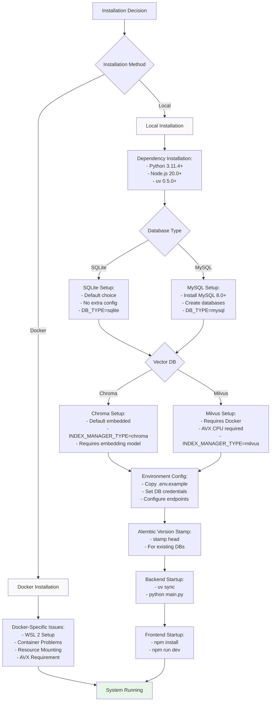
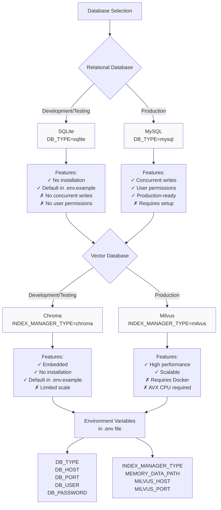
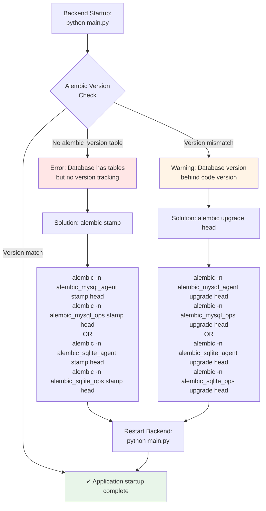
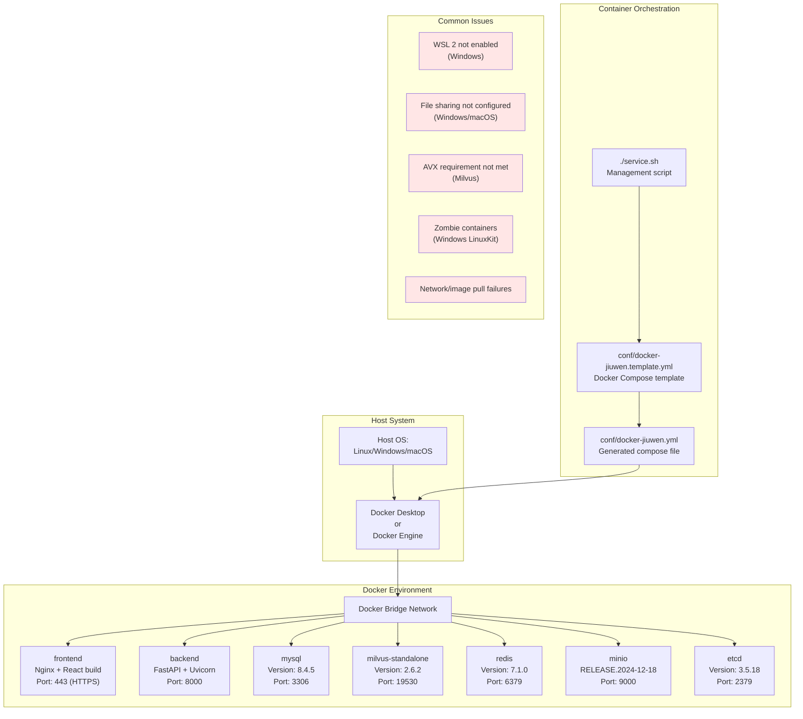
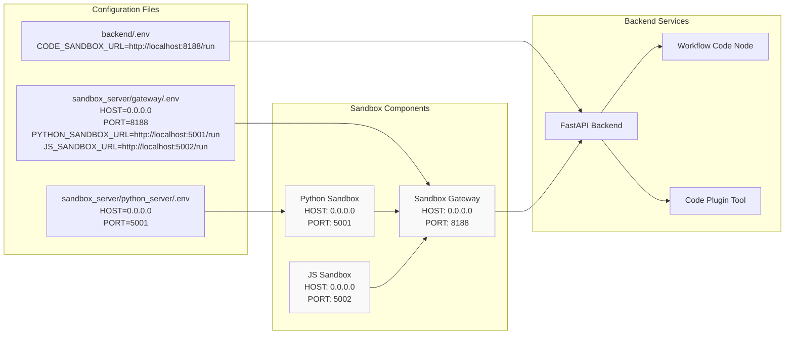

<!-- source: DeepWiki mcp.deepwiki.com · repo openJiuwen-ai/agent-studio · page 9.1 Installation Issues · fetched 2026-11-02 -->

# Installation Issues

<details>
<summary>Relevant source files</summary>

The following files were used as context for generating this wiki page:

- [backend/DATABASE_MIGRATION_DEVELOPMENT_GUIDE_EN.md](backend/DATABASE_MIGRATION_DEVELOPMENT_GUIDE_EN.md)
- [backend/GENERATE_MIGRATION_USAGE_EN.md](backend/GENERATE_MIGRATION_USAGE_EN.md)
- [backend/pyproject.toml](backend/pyproject.toml)
- [docs/en/2.Installation Guide/Install via Docker/Linux_Installation.md](docs/en/2.Installation Guide/Install via Docker/Linux_Installation.md)
- [docs/en/2.Installation Guide/Install via Docker/MacOS_Installation.md](docs/en/2.Installation Guide/Install via Docker/MacOS_Installation.md)
- [docs/en/2.Installation Guide/Install via Docker/Windows_Installation.md](docs/en/2.Installation Guide/Install via Docker/Windows_Installation.md)
- [docs/en/2.Installation Guide/Local Installation/Linux_Installation.md](docs/en/2.Installation Guide/Local Installation/Linux_Installation.md)
- [docs/en/2.Installation Guide/Local Installation/MacOS_Installation.md](docs/en/2.Installation Guide/Local Installation/MacOS_Installation.md)
- [docs/en/2.Installation Guide/Local Installation/Windows_Installation.md](docs/en/2.Installation Guide/Local Installation/Windows_Installation.md)

</details>


This page documents common problems encountered during OpenJiuwen Agent Studio installation and their solutions. It covers issues specific to different installation methods (Local vs Docker) and platforms (Linux, macOS, Windows), as well as component-specific problems.

For general installation instructions, see [Installation & Setup](#2). For production deployment issues, see [Deployment & Operations](#7).

---

## Installation Method Overview



**Sources:** 
- [docs/en/2.Installation Guide/Local Installation/Linux_Installation.md:1-558]()
- [docs/en/2.Installation Guide/Install via Docker/Linux_Installation.md:1-128]()

---

## Python Environment Issues

### Issue 1: Python Version Too Old

**Symptom:** Installation script reports Python version incompatibility or `uv sync` fails with version errors.

**Cause:** OpenJiuwen requires Python 3.11.4 or newer.

**Solution by Platform:**

| Platform | Solution |
|----------|----------|
| **Linux** | `sudo add-apt-repository ppa:deadsnakes/ppa`<br/>`sudo apt install python3.11` |
| **macOS** | `brew install python@3.11` |
| **Windows** | Download from <a href="https://www.python.org/ftp/python/3.11.4/python-3.11.4-amd64.exe">python.org</a> |

**Note:** For Ubuntu 20.04 and older, the Deadsnakes PPA no longer provides support. Use Miniconda instead:
```bash
# Install Miniconda and create Python 3.11 environment
conda create -n openjiuwen python=3.11
conda activate openjiuwen
```

**Sources:** 
- [backend/pyproject.toml:9-9]()
- [docs/en/2.Installation Guide/Local Installation/Linux_Installation.md:147-156]()
- [docs/en/2.Installation Guide/Local Installation/MacOS_Installation.md:110-124]()

---

### Issue 2: `uv sync` Hangs or Times Out

**Symptom:** The command `uv sync` runs for over 20 minutes without completing or shows network timeout errors.

**Causes:**
1. Slow or blocked connection to default Python package index
2. Network proxy issues
3. TLS/SSL certificate verification failures

**Solutions:**

#### Solution A: Change Package Index Mirror

Edit `backend/pyproject.toml` line 44:
```toml
[[tool.uv.index]]
url = "https://mirrors.aliyun.com/pypi/simple/"  # Change to another mirror
```

Alternative mirrors:
- `https://pypi.tuna.tsinghua.edu.cn/simple`
- `https://mirrors.cloud.tencent.com/pypi/simple`
- `https://pypi.doubanio.com/simple`

#### Solution B: Use Native TLS

```bash
uv sync --native-tls
```

This forces uv to use the system's native TLS library instead of its bundled one.

#### Solution C: Configure Proxy (Linux/macOS)

In the setup script's `user_config.sh`:
```bash
HTTP_PROXY="http://127.0.0.1:7890"
HTTPS_PROXY="http://127.0.0.1:7890"
PIP_INDEX_URL="https://pypi.tuna.tsinghua.edu.cn/simple"
PIP_TRUSTED_HOST="pypi.tuna.tsinghua.edu.cn"
```

#### Solution C: Configure Proxy (Windows)

In the setup script's `user_config.ps1`:
```powershell
$HTTP_PROXY="http://127.0.0.1:7890"
$HTTPS_PROXY="http://127.0.0.1:7890"
$PIP_INDEX_URL="https://pypi.tuna.tsinghua.edu.cn/simple"
$PIP_TRUSTED_HOST="pypi.tuna.tsinghua.edu.cn"
```

**Sources:**
- [docs/en/2.Installation Guide/Local Installation/Linux_Installation.md:339-341]()
- [docs/en/2.Installation Guide/Local Installation/MacOS_Installation.md:304-306]()
- [docs/en/2.Installation Guide/Local Installation/Windows_Installation.md:335-337]()

---

### Issue 3: Missing `greenlet` Module on macOS

**Symptom:** When running `python main.py`, error appears:
```
ModuleNotFoundError: No module named 'greenlet'
```

**Cause:** On some Macs with Apple Silicon (M1/M2/M3), the `greenlet` package may be missing from the virtual environment due to Python compatibility issues.

**Solution:**
```bash
# Exit virtual environment
deactivate

# Add greenlet to dependencies
uv add greenlet

# Re-enter virtual environment
source .venv/bin/activate

# Start backend
python main.py
```

**Sources:**
- [docs/en/2.Installation Guide/Local Installation/MacOS_Installation.md:478-489]()
- [backend/pyproject.toml:33-33]()

---

## Node.js and npm Issues

### Issue 4: Node.js or npm Version Too Old

**Symptom:** Frontend installation fails with `npm install` errors or compatibility warnings.

**Required Versions:**
- Node.js: 20.0 or newer
- npm: 10.0 or newer (usually bundled with Node.js)

**Verification:**
```bash
node -v   # Should show v20.x or higher
npm -v    # Should show 10.x or higher
```

**Solutions by Platform:**

| Platform | Solution |
|----------|----------|
| **Linux** | Use NVM: `curl -o- https://raw.githubusercontent.com/nvm-sh/nvm/v0.39.0/install.sh \| bash`<br/>`nvm install 20`<br/>`nvm use 20` |
| **macOS** | `brew install node@20` or download from <a href="http://nodejs.cn/download/">nodejs.cn</a> |
| **Windows** | Download Node.js 22.x installer from <a href="https://nodejs.org/dist/v22.21.1/node-v22.21.1-x64.msi">nodejs.org</a> |

**Sources:**
- [docs/en/2.Installation Guide/Local Installation/Linux_Installation.md:134-144]()
- [docs/en/2.Installation Guide/Local Installation/MacOS_Installation.md:105-107]()
- [docs/en/2.Installation Guide/Local Installation/Windows_Installation.md:123-126]()

---

### Issue 5: npm Security Vulnerabilities Warning

**Symptom:** After running `npm install`, output shows:
```
found X vulnerabilities (Y moderate, Z high)
run `npm audit fix` to fix them
```

**Cause:** Known vulnerabilities in transitive dependencies reported by npm's security scanner.

**Solution:** This is a known issue and **does not affect** the application. The warnings can be safely ignored. Do not run `npm audit fix` as it may break dependency compatibility.

**Sources:**
- [docs/en/2.Installation Guide/Local Installation/Linux_Installation.md:360-362]()
- [docs/en/2.Installation Guide/Local Installation/MacOS_Installation.md:329-331]()
- [docs/en/2.Installation Guide/Local Installation/Windows_Installation.md:361-363]()

---

## Database Configuration Issues

### Database Selection Decision Flow



**Sources:**
- [docs/en/2.Installation Guide/Local Installation/Linux_Installation.md:168-176]()
- [docs/en/2.Installation Guide/Local Installation/Linux_Installation.md:209-216]()

---

### Issue 6: MySQL Database Creation Fails

**Symptom:** When following setup instructions, MySQL commands fail or database creation errors occur.

**Common Causes:**

#### Cause A: MySQL Not Running

**Verification:**
```bash
# Linux
sudo systemctl status mysql

# macOS
brew services list | grep mysql

# Windows
# Check Services app for MySQL80 service
```

**Solution:** Start MySQL service using platform-specific commands.

#### Cause B: Root Password Not Set or Forgotten

**Solution (Reset Root Password):**
```bash
# Linux/macOS
sudo mysql -u root
ALTER USER 'root'@'localhost' IDENTIFIED BY 'new_password';
FLUSH PRIVILEGES;

# Windows - Use MySQL Installer to reset password
```

#### Cause C: Database Already Exists

**Error Message:** `ERROR 1007 (HY000): Can't create database 'openjiuwen_agent'; database exists`

**Solution:**
```sql
-- Drop existing databases if needed
DROP DATABASE IF EXISTS openjiuwen_agent;
DROP DATABASE IF EXISTS openjiuwen_ops;

-- Then recreate
CREATE DATABASE openjiuwen_agent;
CREATE DATABASE openjiuwen_ops;
```

**Sources:**
- [docs/en/2.Installation Guide/Local Installation/Linux_Installation.md:188-207]()
- [docs/en/2.Installation Guide/Local Installation/MacOS_Installation.md:147-167]()
- [docs/en/2.Installation Guide/Local Installation/Windows_Installation.md:169-187]()

---

### Issue 7: Special Characters in Database Password

**Symptom:** Backend fails to connect to MySQL with password containing special characters like `@`, `#`, `%`, `&`, etc.

**Cause:** Special characters in URLs (including database connection strings) must be URL-encoded.

**Solution:** Replace special characters with their URL-encoded equivalents in the `.env` file:

| Character | URL Encoding | Character | URL Encoding | Character | URL Encoding |
|-----------|--------------|-----------|--------------|-----------|--------------|
| Space     | `%20`        | `"`       | `%22`        | `#`       | `%23`        |
| `%`       | `%25`        | `&`       | `%26`        | `(`       | `%28`        |
| `)`       | `%29`        | `+`       | `%2B`        | `,`       | `%2C`        |
| `/`       | `%2F`        | `:`       | `%3A`        | `;`       | `%3B`        |
| `<`       | `%3C`        | `=`       | `%3D`        | `>`       | `%3E`        |
| `?`       | `%3F`        | `@`       | `%40`        | `\`       | `%5C`        |
| `|`       | `%7C`        |           |              |           |              |

**Example:**
```env
# Original password: Pass@word#123
DB_PASSWORD=Pass%40word%23123
```

**Sources:**
- [docs/en/2.Installation Guide/Local Installation/Linux_Installation.md:543-549]()
- [docs/en/2.Installation Guide/Local Installation/MacOS_Installation.md:491-498]()
- [docs/en/2.Installation Guide/Local Installation/Windows_Installation.md:535-542]()

---

### Issue 8: Alembic Migration Errors



**Sources:**
- [backend/DATABASE_MIGRATION_DEVELOPMENT_GUIDE_EN.md:305-343]()
- [docs/en/2.Installation Guide/Local Installation/Linux_Installation.md:326-338]()

---

#### Issue 8A: Database Has No Version Table

**Symptom:** Backend fails to start with error about missing `alembic_version` table, but database tables already exist.

**Cause:** Database was created or populated before Alembic migration tracking was initialized.

**Solution - Stamp the Database:**

```bash
cd backend

# For MySQL users
alembic -n alembic_mysql_agent stamp head
alembic -n alembic_mysql_ops stamp head

# For SQLite users
alembic -n alembic_sqlite_agent stamp head
alembic -n alembic_sqlite_ops stamp head
```

**What `stamp` does:** Records the current code version to the database without executing any SQL migrations.

**Sources:**
- [backend/DATABASE_MIGRATION_DEVELOPMENT_GUIDE_EN.md:354-395]()
- [docs/en/2.Installation Guide/Local Installation/Linux_Installation.md:326-338]()

---

#### Issue 8B: Version Mismatch After Git Pull

**Symptom:** After pulling latest code, backend warns about database version being behind.

**Solution - Upgrade the Database:**

```bash
cd backend

# Check current version
alembic -n alembic_sqlite_agent current

# Check latest available version
alembic -n alembic_sqlite_agent heads

# Upgrade to latest
alembic -n alembic_sqlite_agent upgrade head
alembic -n alembic_sqlite_ops upgrade head
```

**For MySQL:**
```bash
alembic -n alembic_mysql_agent upgrade head
alembic -n alembic_mysql_ops upgrade head
```

**Sources:**
- [backend/DATABASE_MIGRATION_DEVELOPMENT_GUIDE_EN.md:297-343]()

---

#### Issue 8C: Multiple Alembic Configurations Error

**Symptom:** Running `alembic upgrade head` without `-n` flag shows:
```
ERROR: ConfigurationError: Multiple Configurations found
```

**Cause:** OpenJiuwen uses 4 separate Alembic configurations (MySQL/SQLite × Agent/Ops), and `-n` parameter is required to specify which one.

**Database Configuration Mapping:**

| Configuration Name | Database Type | Database Name | Config Path |
|-------------------|---------------|---------------|-------------|
| `alembic_mysql_agent` | MySQL | Agent | `backend/upgrade/mysql/alembic_agent/` |
| `alembic_mysql_ops` | MySQL | Ops | `backend/upgrade/mysql/alembic_ops/` |
| `alembic_sqlite_agent` | SQLite | Agent | `backend/upgrade/sqlite/alembic_agent/` |
| `alembic_sqlite_ops` | SQLite | Ops | `backend/upgrade/sqlite/alembic_ops/` |

**Solution:** Always specify the database instance with `-n`:
```bash
# Correct
alembic -n alembic_sqlite_agent upgrade head

# Incorrect - will fail
alembic upgrade head
```

**Sources:**
- [backend/DATABASE_MIGRATION_DEVELOPMENT_GUIDE_EN.md:86-154]()

---

## Vector Database Issues

### Issue 9: Milvus Connection Failed

**Symptom:** When using memory or knowledge base features, error appears:
```
Milvus connection failed: <MilvusException: (code=2, message=Fail connecting to server on milvus-standalone:19530, illegal connection params or server unavailable)>
```

**Causes and Solutions:**

#### Cause A: MILVUS_HOST Misconfigured

**Check `.env` file:**
```env
MILVUS_HOST=127.0.0.1  # Should match actual Milvus container IP
MILVUS_PORT=19530
```

**Solution:**
```bash
# Find Milvus container IP
docker inspect milvus-standalone | grep IPAddress

# Update .env with correct IP
MILVUS_HOST=<container_ip>
```

#### Cause B: Milvus Container Not Running

**Verification:**
```bash
docker ps | grep milvus-standalone
```

**Solution - Start Milvus:**
```bash
# Linux/macOS
bash standalone_embed.sh start

# Windows
./standalone.bat start
```

#### Cause C: Port Conflict

**Symptom:** Milvus fails to start due to port 19530 already in use.

**Check port usage:**
```bash
# Linux/macOS
lsof -i :19530

# Windows
netstat -ano | findstr :19530
```

**Solution:** Either stop the conflicting service or configure Milvus to use a different port.

**Sources:**
- [docs/en/2.Installation Guide/Local Installation/Linux_Installation.md:430-434]()
- [docs/en/2.Installation Guide/Local Installation/MacOS_Installation.md:410-414]()
- [docs/en/2.Installation Guide/Local Installation/Windows_Installation.md:467-471]()

---

### Issue 10: Milvus Container Exits Immediately (AVX Issue)

**Symptom:** On Docker installations, the Milvus container starts but exits immediately. Running `docker logs milvus-standalone` shows AVX-related errors.

**Cause:** Milvus 2.6.2 requires the AVX (Advanced Vector Extensions) CPU instruction set. Older or virtual CPUs may not support it.

**Verification:**
```bash
# Linux
lscpu | grep Flags | grep avx

# macOS
sysctl -a | grep machdep.cpu.features | grep AVX

# Windows (PowerShell)
Get-WmiObject Win32_Processor | Select-Object -ExpandProperty Caption
```

**Solutions:**

| Scenario | Solution |
|----------|----------|
| **Physical machine without AVX** | Use Chroma instead (`INDEX_MANAGER_TYPE=chroma`) |
| **VM without AVX passthrough** | Enable AVX in hypervisor settings or use Chroma |
| **Docker Desktop on VM** | Use Chroma (AVX not available in nested virtualization) |

**Switching to Chroma:**
```env
# In .env file
INDEX_MANAGER_TYPE=chroma
MEMORY_DATA_PATH=memory-data

# Remove Milvus settings
# MILVUS_HOST=...
# MILVUS_PORT=...
```

**Sources:**
- [docs/en/2.Installation Guide/Install via Docker/Linux_Installation.md:104-105]()

---

### Issue 11: Missing Embedding Model for Chroma

**Symptom:** Memory or knowledge base features fail with errors about missing embedding model configuration.

**Cause:** Both Chroma and Milvus require an embedding model to generate vectors from text. The model API credentials are not configured.

**Solution - Configure Embedding Model:**

The system needs an embedding model from an LLM provider. Example using Huawei Cloud ModelArts:

1. **Access Model Provider:**
   - Go to provider's model marketplace (e.g., Huawei Cloud ModelArts Model Square)
   - Search for embedding models (向量模型)
   - Select a model (e.g., BGE-M3)

2. **Get API Credentials:**
   - Click "Inference Call" (推理调用)
   - Record the API endpoint and model name
   - Get API key from "API Key Management"

3. **Configure in OpenJiuwen:**
   - Add the embedding model in the Model Management page
   - Select "Embedding Model" type
   - Enter API endpoint, model name, and API key
   - Test the configuration

**Sources:**
- [docs/en/2.Installation Guide/Local Installation/Linux_Installation.md:437-454]()
- [docs/en/2.Installation Guide/Local Installation/MacOS_Installation.md:417-433]()
- [docs/en/2.Installation Guide/Local Installation/Windows_Installation.md:473-490]()

---

## Docker-Specific Issues

### Docker Installation Architecture



**Sources:**
- [docs/en/2.Installation Guide/Install via Docker/Linux_Installation.md:1-128]()
- [docs/en/2.Installation Guide/Install via Docker/Windows_Installation.md:1-132]()
- [docs/en/2.Installation Guide/Install via Docker/MacOS_Installation.md:1-103]()

---

### Issue 12: WSL 2 Not Enabled (Windows)

**Symptom:** Docker Desktop installation fails or refuses to start on Windows with message about WSL 2.

**Cause:** Windows Subsystem for Linux 2 (WSL 2) is required for Docker Desktop on Windows.

**Solution:**

1. **Check Windows Version:**
   - Required: Windows 10 version 2004+ (Build 19041+) or Windows 11
   - Verify: Press `Win+R`, type `winver`, press Enter

2. **Install WSL 2:**
   ```powershell
   # Run as Administrator
   wsl --install
   ```

3. **Restart Computer**

4. **Verify Installation:**
   ```powershell
   wsl --list --verbose
   ```

**For Older Windows Versions:**
If automatic installation doesn't work, follow manual steps at: <a href="https://learn.microsoft.com/en-us/windows/wsl/install">Microsoft WSL Install Guide</a>

**Sources:**
- [docs/en/2.Installation Guide/Install via Docker/Windows_Installation.md:18-34]()
- [docs/en/2.Installation Guide/Local Installation/Windows_Installation.md:386-402]()

---

### Issue 13: Docker File Sharing Not Configured (Windows/macOS)

**Symptom:** On Windows or macOS, Docker containers fail to access local directories or volumes fail to mount.

**Cause:** Docker Desktop requires explicit permission to access host directories.

**Solution for Windows:**

1. Open Docker Desktop
2. Click ⚙️ (Settings) in upper-right corner
3. Navigate to "Resources" → "File sharing"
4. Add your openJiuwen installation directory (e.g., `D:\openJiuwen`)
5. Click "➕" button to add
6. Click "Apply & restart"

**Solution for macOS:**

Docker Desktop on macOS typically has broader file access by default, but if issues occur:

1. Open Docker Desktop
2. Navigate to Settings → Resources → File sharing
3. Ensure `/Users` (or your specific directory) is listed
4. Add additional paths if needed

**Sources:**
- [docs/en/2.Installation Guide/Install via Docker/Windows_Installation.md:62-72]()
- [docs/en/2.Installation Guide/Local Installation/Windows_Installation.md:421-427]()

---

### Issue 14: Container Zombie Process (Windows LinuxKit)

**Symptom:** Docker container cannot be restarted or removed:
```
Error response from daemon: Cannot restart container: tried to kill container, but did not receive an exit event
```

**Cause:** Process entered D state (uninterruptible sleep) in LinuxKit kernel. LinuxKit is a minimalist Linux kernel used by Docker Desktop on Windows/macOS in non-WSL mode.

**Immediate Solution:**
The only way to recover is to restart Docker Desktop entirely (which restarts the VM).

**Long-term Solution (Windows):**
Use WSL 2 backend instead of LinuxKit:

1. Enable WSL 2 (see Issue 12)
2. In Docker Desktop settings:
   - Settings → General
   - Check "Use the WSL 2 based engine"
   - Click "Apply & restart"

**Why WSL 2 is Better:**
- Full Linux kernel with proper process management
- Automatic recovery from D state processes (30-60 seconds)
- Better I/O performance
- Lower resource consumption

**Sources:**
- [docs/en/2.Installation Guide/Install via Docker/Windows_Installation.md:123-132]()

---

### Issue 15: Docker Image Pull Failures

**Symptom:** Running `./service.sh up` fails with messages like:
```
Error: failed pulling image "mysql:8.4.5": error pulling image configuration
```

**Causes:**
1. Network connectivity issues
2. Docker Hub rate limiting
3. Regional access restrictions
4. Insufficient disk space in `/var/lib/docker`

**Solutions:**

#### Solution A: Retry with Alternate Mirror (China)

For users in China, the default setup script already uses Huawei Cloud mirrors. Verify the mirror configuration:

```bash
# Check image sources in service.sh
grep "swr.cn-north-4.myhuaweicloud.com" service.sh
```

Images used:
- `swr.cn-north-4.myhuaweicloud.com/openjiuwen/milvusdb/milvus-amd64:v2.6.2`
- Standard Docker Hub images (mysql, minio, etcd, redis)

#### Solution B: Pre-pull Images Manually

```bash
# Pull images one by one to identify which fails
docker pull mysql:8.4.5
docker pull minio/minio:RELEASE.2024-12-18T13-15-44Z
docker pull swr.cn-north-4.myhuaweicloud.com/openjiuwen/milvusdb/milvus-amd64:v2.6.2
docker pull quay.io/coreos/etcd:v3.5.18
docker pull redis:7.1.0
```

#### Solution C: Check Disk Space

```bash
# Linux/macOS
df -h /var/lib/docker

# Windows (PowerShell)
Get-PSDrive C
```

Ensure at least 10 GB free space.

#### Solution D: Configure Docker Registry Mirror

Edit Docker daemon configuration:
```bash
# Linux: /etc/docker/daemon.json
# macOS/Windows: Docker Desktop Settings → Docker Engine

{
  "registry-mirrors": [
    "https://mirror.ccs.tencentyun.com",
    "https://docker.mirrors.ustc.edu.cn"
  ]
}
```

Restart Docker after editing.

**Sources:**
- [docs/en/2.Installation Guide/Install via Docker/Linux_Installation.md:88-89]()
- [docs/en/2.Installation Guide/Install via Docker/Windows_Installation.md:92-92]()

---

## Optional Component Issues

### Issue 16: Sandbox Server Not Working

**Symptom:** Code execution in workflow nodes or code plugins fails with timeout or connection errors.

**Cause:** The sandbox server components are not started. OpenJiuwen requires three sandbox services for code execution:

1. Python Sandbox (`sandbox_server/python_server/openjiuwen_sandbox_pyserver/kernel.py`)
2. JavaScript Sandbox (`sandbox_server/js_server/kernel.js`)
3. Gateway (`sandbox_server/gateway/openjiuwen_sandbox_gateway/server.py`)

**Configuration Flow:**



**Solution:**

1. **Configure Python Sandbox:**
   ```bash
   # Create sandbox_server/python_server/.env
   HOST=0.0.0.0
   PORT=5001
   ```

2. **Configure Gateway:**
   ```bash
   # Create sandbox_server/gateway/.env
   HOST=0.0.0.0
   PORT=8188
   PYTHON_SANDBOX_URL=http://localhost:5001/run
   JS_SANDBOX_URL=http://localhost:5002/run
   ```

3. **Start Services:**
   ```bash
   # Terminal 1 - Python sandbox
   cd sandbox_server/python_server
   python openjiuwen_sandbox_pyserver/kernel.py
   
   # Terminal 2 - JS sandbox
   cd sandbox_server/js_server
   node kernel.js
   
   # Terminal 3 - Gateway
   cd sandbox_server/gateway
   python openjiuwen_sandbox_gateway/server.py
   ```

4. **Configure Backend:**
   ```bash
   # In backend/.env
   CODE_SANDBOX_URL=http://localhost:8188/run
   ```

**Linux-Specific: bwrap Sandbox (Advanced)**

On Linux, you can enable additional sandboxing using bubblewrap (`bwrap`):

```bash
# In sandbox_server/gateway/.env
ENABLE_LINUX_SANDBOX=1
```

Then edit `sandbox_server/gateway/openjiuwen_sandbox_gateway/conf/sandbox_config.yaml` to configure syscall whitelisting, namespaces, and filesystem mounts.

**Sources:**
- [docs/en/2.Installation Guide/Local Installation/Linux_Installation.md:455-533]()
- [docs/en/2.Installation Guide/Local Installation/MacOS_Installation.md:435-468]()
- [docs/en/2.Installation Guide/Local Installation/Windows_Installation.md:492-525]()

---

### Issue 17: Plugin Server Not Working

**Symptom:** Custom plugins fail to load or execute with connection errors.

**Cause:** The plugin server is not started or not configured in the backend.

**Solution:**

1. **Implement Plugin Services:**
   ```bash
   # Reference implementation in:
   plugin_server/openjiuwen_plugin_server/
   ```

2. **Start Plugin Server:**
   ```bash
   cd plugin_server/openjiuwen_plugin_server
   python run_restful.py
   
   # Default: http://localhost:8185
   ```

3. **Configure Backend:**
   ```bash
   # In backend/.env
   VITE_PLUGIN_SERVICE_URL=http://localhost:8185
   VITE_PLUGIN_CONFIG_PATH=/config.json
   ```

**Sources:**
- [docs/en/2.Installation Guide/Local Installation/Linux_Installation.md:534-541]()
- [docs/en/2.Installation Guide/Local Installation/MacOS_Installation.md:470-476]()
- [docs/en/2.Installation Guide/Local Installation/Windows_Installation.md:527-533]()

---

## Environment Configuration Issues

### Issue 18: OBS Configuration Confusion

**Symptom:** User unsure whether to fill OBS-related environment variables for local/standalone deployment.

**Clarification:** For standalone or local development deployments, OBS (Object Storage Service) variables are **not required** and should be left empty.

**When to Configure OBS:**

| Deployment Type | OBS Required | Reason |
|----------------|--------------|--------|
| **Local Development** | ❌ No | Files stored locally |
| **Standalone Server** | ❌ No | Files stored locally or MinIO |
| **Distributed Cluster** | ✅ Yes | Shared storage needed across nodes |

**OBS Variables in `.env.example`:**
```env
# These are empty by default and can stay empty for local deployment
OBS_BUCKET=
OBS_SERVER=
OBS_ACCESS_KEY_ID=
OBS_SECRET_ACCESS_KEY=
```

**For distributed deployments only:** See [Distributed Installation](../Distributed%20Installation/README.md) guide.

**Sources:**
- [docs/en/2.Installation Guide/Local Installation/Linux_Installation.md:273-273]()
- [docs/en/2.Installation Guide/Local Installation/MacOS_Installation.md:238-238]()
- [docs/en/2.Installation Guide/Local Installation/Windows_Installation.md:269-269]()

---

### Issue 19: Port Conflicts

**Symptom:** Backend or frontend fails to start with "address already in use" errors.

**Default Ports:**

| Service | Default Port | Environment Variable |
|---------|--------------|---------------------|
| Frontend (dev) | 5173 | N/A (npm config) |
| Frontend (Docker) | 443 (HTTPS) | `VITE_PORT` |
| Backend | 8000 | `BACKEND_PORT` |
| MySQL | 3306 | `DB_PORT` |
| Milvus | 19530 | `MILVUS_PORT` |
| Redis | 6379 | `REDIS_PORT` |
| MinIO | 9000 | `MINIO_PORT` |

**Checking Port Usage:**

```bash
# Linux/macOS
lsof -i :<port_number>
netstat -tuln | grep <port_number>

# Windows (PowerShell)
netstat -ano | findstr :<port_number>
```

**Changing Frontend Port (Docker):**

See the deployment tool documentation for Docker port configuration: `scripts/README.md`

**Changing Backend Port:**
```bash
# In backend/.env or environment
BACKEND_PORT=8001
```

**Sources:**
- [docs/en/2.Installation Guide/Install via Docker/Linux_Installation.md:80-80]()
- [docs/en/2.Installation Guide/Install via Docker/Windows_Installation.md:84-84]()

---

## Common Error Message Reference

### Error Message to Solution Mapping

| Error Message | Component | Solution Reference |
|--------------|-----------|-------------------|
| `Python 3.11.4 or newer required` | Python | [Issue 1](#issue-1-python-version-too-old) |
| `uv sync` hangs >20 minutes | uv/pip | [Issue 2](#issue-2-uv-sync-hangs-or-times-out) |
| `ModuleNotFoundError: No module named 'greenlet'` | Python (macOS) | [Issue 3](#issue-3-missing-greenlet-module-on-macos) |
| `Node.js 20.0 or newer required` | Node.js | [Issue 4](#issue-4-nodejs-or-npm-version-too-old) |
| `X vulnerabilities found` after npm install | npm | [Issue 5](#issue-5-npm-security-vulnerabilities-warning) |
| `Can't create database; database exists` | MySQL | [Issue 6](#issue-6-mysql-database-creation-fails) |
| Database connection fails with special chars | MySQL | [Issue 7](#issue-7-special-characters-in-database-password) |
| `alembic_version` table not found | Alembic | [Issue 8A](#issue-8a-database-has-no-version-table) |
| Database version behind code | Alembic | [Issue 8B](#issue-8b-version-mismatch-after-git-pull) |
| `Multiple Configurations found` | Alembic | [Issue 8C](#issue-8c-multiple-alembic-configurations-error) |
| `Milvus connection failed` | Milvus | [Issue 9](#issue-9-milvus-connection-failed) |
| Milvus container exits immediately | Milvus/AVX | [Issue 10](#issue-10-milvus-container-exits-immediately-avx-issue) |
| Embedding model configuration missing | Chroma/Milvus | [Issue 11](#issue-11-missing-embedding-model-for-chroma) |
| WSL 2 not enabled on Windows | Docker/WSL | [Issue 12](#issue-12-wsl-2-not-enabled-windows) |
| Docker file access denied | Docker | [Issue 13](#issue-13-docker-file-sharing-not-configured-windowsmacos) |
| `tried to kill container, but did not receive an exit event` | Docker/LinuxKit | [Issue 14](#issue-14-container-zombie-process-windows-linuxkit) |
| Docker image pull fails | Docker/Network | [Issue 15](#issue-15-docker-image-pull-failures) |
| Code execution sandbox timeout | Sandbox | [Issue 16](#issue-16-sandbox-server-not-working) |
| Plugin execution fails | Plugin Server | [Issue 17](#issue-17-plugin-server-not-working) |

---

## Installation Checklist

Use this checklist to verify your installation:

### Pre-Installation Checklist

- [ ] **System Requirements Met:**
  - [ ] CPU: 2+ cores (4+ recommended)
  - [ ] RAM: 4+ GB (8+ recommended)
  - [ ] Disk: 10+ GB free space

- [ ] **Software Prerequisites (Local Installation):**
  - [ ] Git 2.40+
  - [ ] Python 3.11.4+
  - [ ] Node.js 20.0+
  - [ ] npm 10.0+
  - [ ] uv 0.5.0+

- [ ] **Software Prerequisites (Docker Installation):**
  - [ ] Docker 20.10+
  - [ ] Docker Compose v2.19.1+
  - [ ] (Windows) WSL 2 enabled

### Installation Checklist

- [ ] **Code Retrieved:**
  - [ ] Repository cloned
  - [ ] Correct branch checked out

- [ ] **Database Configured:**
  - [ ] Database type chosen (SQLite/MySQL)
  - [ ] `DB_TYPE` set in `.env`
  - [ ] (MySQL only) Databases created
  - [ ] (MySQL only) User created and permissions granted
  - [ ] Database credentials in `.env`

- [ ] **Vector Database Configured:**
  - [ ] Vector DB type chosen (Chroma/Milvus)
  - [ ] `INDEX_MANAGER_TYPE` set in `.env`
  - [ ] (Milvus only) Milvus started
  - [ ] (Milvus only) Milvus connection settings in `.env`
  - [ ] Embedding model configured

- [ ] **Backend Setup:**
  - [ ] `.env` file created from `.env.example`
  - [ ] All required environment variables set
  - [ ] `uv venv` completed
  - [ ] `uv sync` completed
  - [ ] Alembic migrations stamped/upgraded
  - [ ] Backend starts successfully

- [ ] **Frontend Setup:**
  - [ ] `npm install` completed
  - [ ] Frontend starts successfully

- [ ] **Optional Components (if needed):**
  - [ ] Sandbox server configured and running
  - [ ] Plugin server configured and running

### Post-Installation Verification

- [ ] **Access Verification:**
  - [ ] Can open web interface in browser
  - [ ] Can log in successfully
  - [ ] Dashboard loads without errors

- [ ] **Functionality Tests:**
  - [ ] Can create an agent
  - [ ] (If using memory/KB) Can create memory base
  - [ ] (If using memory/KB) Can upload documents to knowledge base
  - [ ] (If using sandbox) Code nodes execute
  - [ ] (If using plugins) Plugins work

---

## Getting Additional Help

If your issue is not covered in this page:

1. **Check Related Documentation:**
   - [Installation & Setup](#2) - General installation guides
   - [Configuration Guide](#2.3) - Environment variable reference
   - [Database Issues](#9.4) - Database-specific problems
   - [Runtime Errors](#9.2) - Backend/frontend runtime issues

2. **Enable Debug Logging:**
   ```bash
   # In backend/.env
   LOG_LEVEL=DEBUG
   
   # Check logs
   tail -f backend/logs/run/*.log
   ```

3. **Check Container Logs (Docker):**
   ```bash
   docker logs backend
   docker logs mysql
   docker logs milvus-standalone
   ```

4. **Verify Configuration:**
   ```bash
   # Check environment
   cd backend
   python -c "from openjiuwen_studio.core.config import settings; print(settings.model_dump())"
   ```

**Sources:**
- [docs/en/2.Installation Guide/Local Installation/Linux_Installation.md:1-558]()
- [backend/DATABASE_MIGRATION_DEVELOPMENT_GUIDE_EN.md:1-792]()

---

