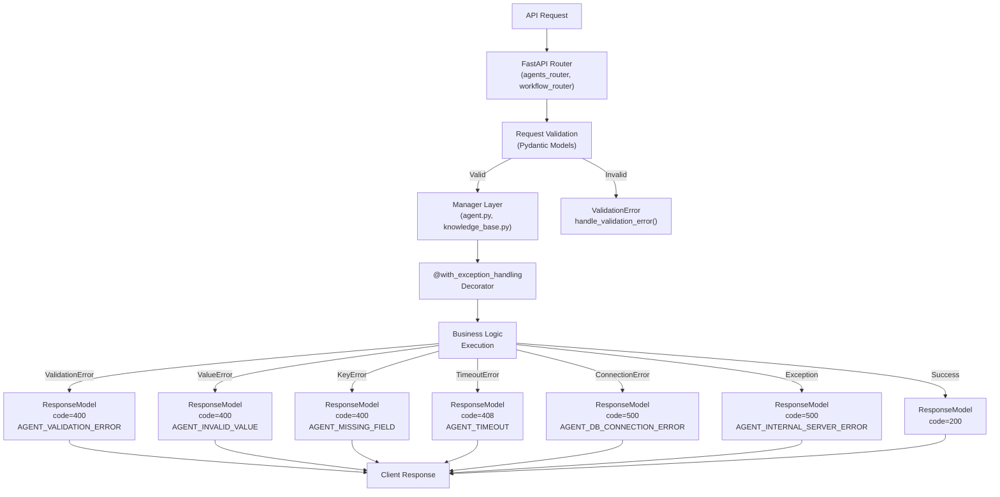
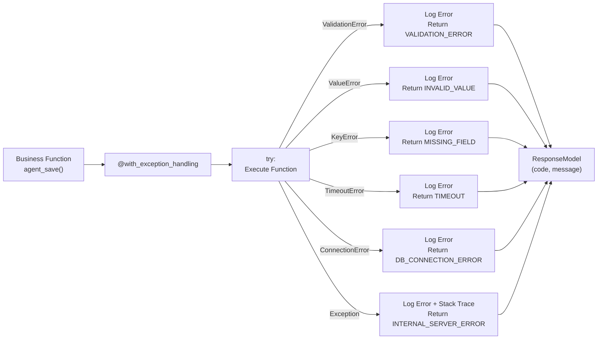
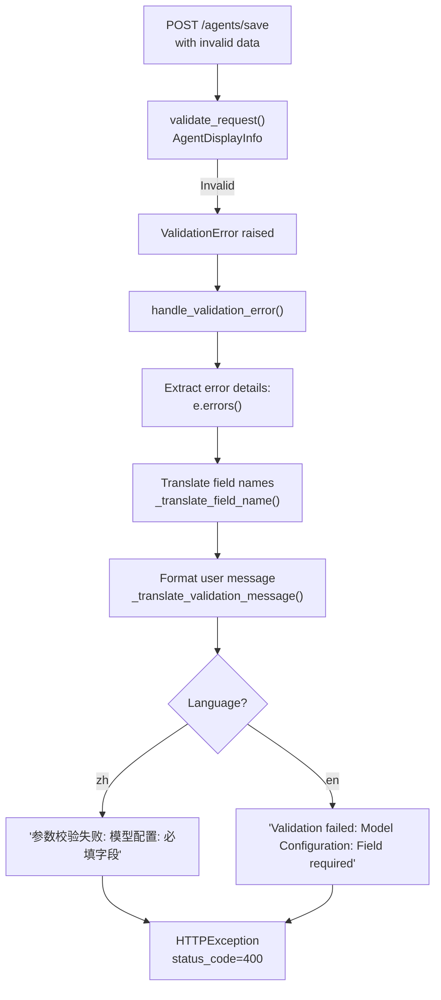
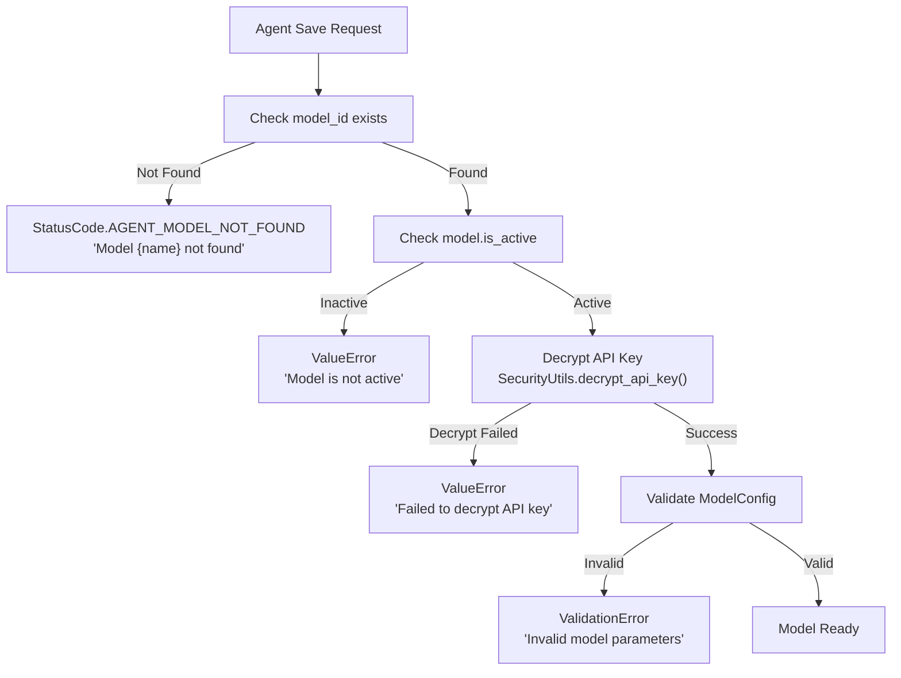
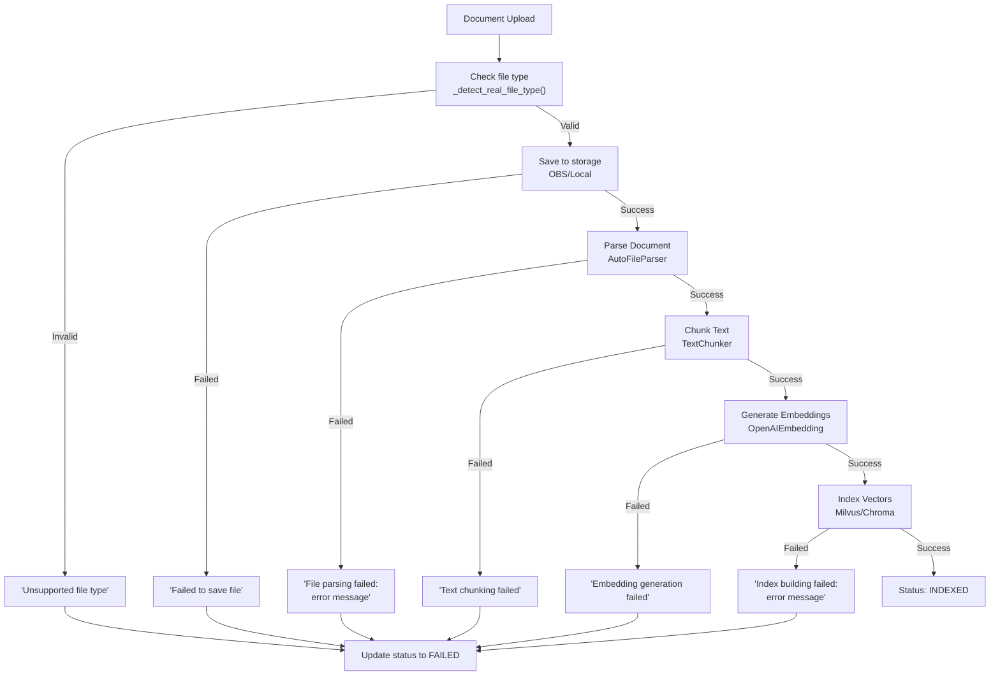
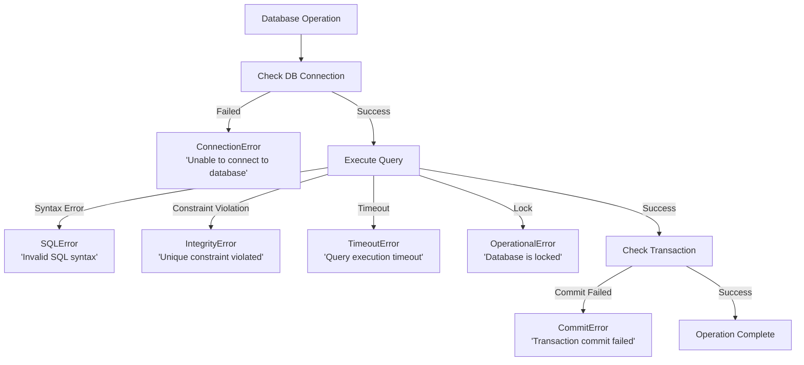
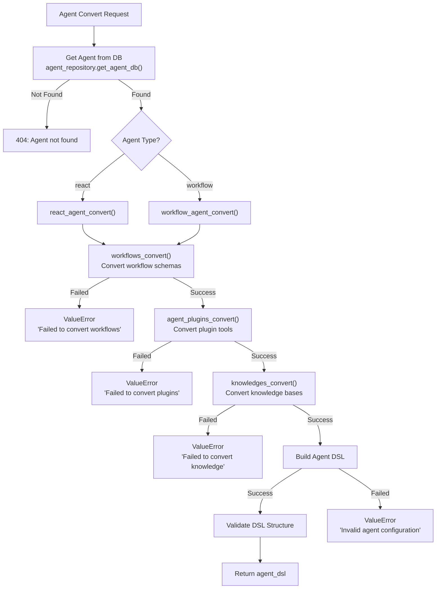
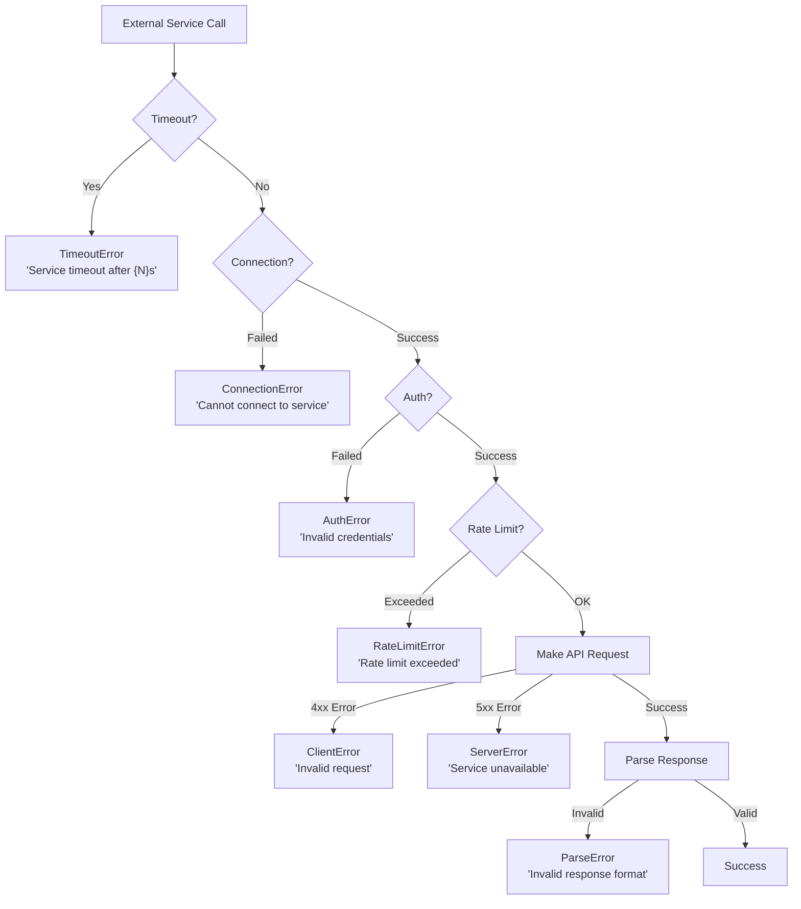
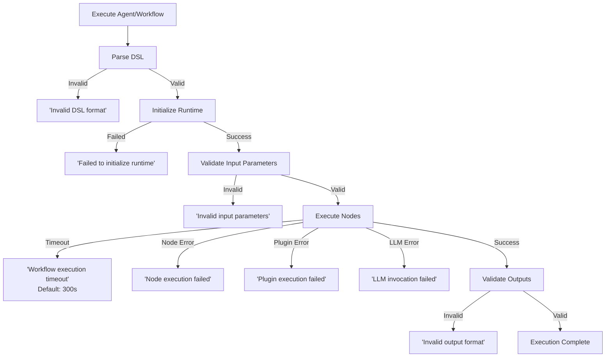
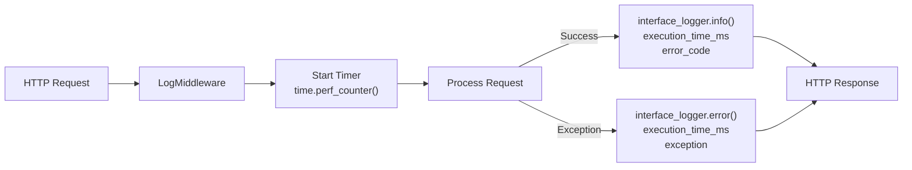

<!-- source: DeepWiki mcp.deepwiki.com · repo openJiuwen-ai/agent-studio · page 9.2 Runtime Errors · fetched 2026-11-02 -->

# Runtime Errors

<details>
<summary>Relevant source files</summary>

The following files were used as context for generating this wiki page:

- [.env.example](.env.example)
- [backend/openjiuwen_studio/core/common/logging/__init__.py](backend/openjiuwen_studio/core/common/logging/__init__.py)
- [backend/openjiuwen_studio/core/common/logging/events.py](backend/openjiuwen_studio/core/common/logging/events.py)
- [backend/openjiuwen_studio/core/config.py](backend/openjiuwen_studio/core/config.py)
- [backend/openjiuwen_studio/core/manager/agent.py](backend/openjiuwen_studio/core/manager/agent.py)
- [backend/openjiuwen_studio/core/manager/convertor/agent.py](backend/openjiuwen_studio/core/manager/convertor/agent.py)
- [backend/openjiuwen_studio/core/manager/convertor/components/sub_workflow.py](backend/openjiuwen_studio/core/manager/convertor/components/sub_workflow.py)
- [backend/openjiuwen_studio/core/manager/email_manager/__init__.py](backend/openjiuwen_studio/core/manager/email_manager/__init__.py)
- [backend/openjiuwen_studio/core/manager/email_manager/email_template.py](backend/openjiuwen_studio/core/manager/email_manager/email_template.py)
- [backend/openjiuwen_studio/core/manager/email_manager/email_utils.py](backend/openjiuwen_studio/core/manager/email_manager/email_utils.py)
- [backend/openjiuwen_studio/core/manager/knowledge_base.py](backend/openjiuwen_studio/core/manager/knowledge_base.py)
- [backend/openjiuwen_studio/core/manager/redis_manager/__init__.py](backend/openjiuwen_studio/core/manager/redis_manager/__init__.py)
- [backend/openjiuwen_studio/core/manager/repositories/agent_repository.py](backend/openjiuwen_studio/core/manager/repositories/agent_repository.py)
- [backend/openjiuwen_studio/core/manager/repositories/plugin_repository.py](backend/openjiuwen_studio/core/manager/repositories/plugin_repository.py)
- [backend/openjiuwen_studio/core/manager/repositories/tool_repository.py](backend/openjiuwen_studio/core/manager/repositories/tool_repository.py)
- [backend/openjiuwen_studio/core/manager/utils/utils.py](backend/openjiuwen_studio/core/manager/utils/utils.py)
- [backend/openjiuwen_studio/main.py](backend/openjiuwen_studio/main.py)
- [backend/openjiuwen_studio/routers/agents.py](backend/openjiuwen_studio/routers/agents.py)
- [backend/openjiuwen_studio/schemas/agent.py](backend/openjiuwen_studio/schemas/agent.py)
- [frontend/packages/api-client/src/config.ts](frontend/packages/api-client/src/config.ts)
- [frontend/packages/api-client/src/services/agentService.ts](frontend/packages/api-client/src/services/agentService.ts)

</details>


This page documents common runtime errors encountered in OpenJiuwen Agent Studio, their causes, and resolution strategies. Runtime errors occur during application execution and can stem from various sources including configuration issues, database problems, validation failures, external service timeouts, and resource constraints.

For installation-related issues, see [Installation Issues](#9.1). For performance-related problems, see [Performance Issues](#9.3). For database-specific troubleshooting, see [Database Issues](#9.4).

---

## Error Handling Architecture

OpenJiuwen Agent Studio implements a structured error handling system with standardized response formats and comprehensive exception catching at multiple layers.

### Error Handling Flow



**Sources:** [backend/openjiuwen_studio/core/manager/agent.py:162-298](), [backend/openjiuwen_studio/routers/agents.py:125-152]()

### Exception Handling Decorator Pattern

The `@with_exception_handling` decorator provides centralized error handling across manager functions:



**Sources:** [backend/openjiuwen_studio/core/manager/agent.py:162-298](), [backend/openjiuwen_studio/core/manager/knowledge_base.py:457-483]()

---

## Error Response Format

All runtime errors return a standardized `ResponseModel` structure:

| Field | Type | Description |
|-------|------|-------------|
| `code` | `int` | HTTP status code (200, 400, 404, 500, etc.) |
| `message` | `str` | Human-readable error message |
| `data` | `dict \| None` | Optional additional error context |

### Example Error Responses

**Validation Error:**
```json
{
  "code": 400,
  "message": "参数校验失败: 模型配置.名称: 必填字段"
}
```

**Missing Field Error:**
```json
{
  "code": 400,
  "message": "Missing required field: agent_id"
}
```

**Database Connection Error:**
```json
{
  "code": 500,
  "message": "Database connection error: unable to connect to MySQL server"
}
```

**Sources:** [backend/openjiuwen_studio/schemas/common.py](), [backend/openjiuwen_studio/core/manager/agent.py:208-296]()

---

## Common Runtime Error Categories

### 1. Validation Errors

Validation errors occur when request data fails Pydantic schema validation.

#### Common Causes

| Error Type | Cause | Example |
|------------|-------|---------|
| `missing` | Required field not provided | Missing `agent_name` in create request |
| `type_error` | Incorrect field type | Passing string where integer expected |
| `value_error` | Invalid field value | Temperature outside range [0.0, 2.0] |
| `extra_forbidden` | Unexpected field in request | Extra field in strict schema |

#### Error Flow for Validation



**Sources:** [backend/openjiuwen_studio/routers/agents.py:125-152](), [backend/openjiuwen_studio/routers/agents.py:287-350]()

#### Resolution Strategies

1. **Check field requirements**: Verify all required fields are present in request
2. **Validate field types**: Ensure data types match schema definitions
3. **Review field constraints**: Check min/max lengths, numeric ranges, enum values
4. **Inspect error details**: Use `e.errors()` to see specific validation failures

**Example Resolution:**
```python
# Problem: Missing model configuration
{
  "id": "agent_123",
  "name": "My Agent"
  # Missing: "model" field
}

# Solution: Add required model field
{
  "id": "agent_123",
  "name": "My Agent",
  "model": {
    "model_provider": "openai",
    "model_info": {
      "model_name": "gpt-4",
      "model_type": "gpt-4",
      "temperature": 0.7,
      "top_p": 0.9
    }
  }
}
```

**Sources:** [backend/openjiuwen_studio/schemas/agent.py:110-129](), [backend/openjiuwen_studio/routers/agents.py:267-350]()

---

### 2. Model Configuration Errors

Errors related to LLM model configuration, credentials, and availability.

#### Error Scenarios



**Sources:** [backend/openjiuwen_studio/core/manager/agent.py:641-687](), [backend/openjiuwen_studio/core/manager/knowledge_base.py:298-366]()

#### Common Model Errors

| Error | Cause | Resolution |
|-------|-------|------------|
| `AGENT_MODEL_NOT_FOUND` | Model ID doesn't exist in database | Verify model exists, check `model_id` value |
| Model not active | `is_active=False` for model | Activate model in Model Management |
| Decryption failure | Invalid encryption key or corrupted data | Re-configure model with valid API key |
| API key invalid | Wrong or expired API key | Update API key in model configuration |
| Base URL unreachable | Incorrect `base_url` or network issue | Verify URL format and connectivity |

**Resolution Example:**
```python
# Check if model exists and is active
from openjiuwen_studio.core.manager.model_manager.managers import ModelConfigManager

models, _ = manager.get_paginated_configs(
    page=1, size=1, 
    filters={"id": model_id, "space_id": space_id}
)

if not models:
    # Error: Model not found
    raise ValueError(f"Model {model_id} not found")

if not models[0].is_active:
    # Error: Model not active
    raise ValueError(f"Model {models[0].name} is not active")
```

**Sources:** [backend/openjiuwen_studio/core/manager/agent.py:643-687](), [backend/openjiuwen_studio/core/manager/convertor/agent.py:323-368]()

---

### 3. Knowledge Base Processing Errors

Errors during document upload, parsing, indexing, and retrieval.

#### Document Processing Error Flow



**Sources:** [backend/openjiuwen_studio/core/manager/knowledge_base.py:874-1086](), [backend/openjiuwen_studio/core/manager/knowledge_base.py:1162-1412]()

#### Common Knowledge Base Errors

| Error Category | Specific Errors | Resolution |
|----------------|-----------------|------------|
| **File Type** | Unsupported format, corrupted file | Check supported types: PDF, DOCX, TXT, MD |
| **Parsing** | Encoding issues, malformed document | Verify file encoding, check file integrity |
| **Embedding** | Model not active, API key invalid, rate limits | Check embedding model config, verify credentials |
| **Indexing** | Milvus/Chroma connection failed, dimension mismatch | Verify vector store connection, check embedding dimensions |
| **Model Mismatch** | Multiple KBs with different embedding models | Use same embedding model for all KBs in agent |

**Error Message Formatting:**

The system formats error messages for frontend display by:
1. Removing technical prefixes (`File parsing failed:`)
2. Removing status codes (`[155xxx]`)
3. Replacing arrows `->` with semicolons `;`
4. Truncating after `reason:` keyword
5. Capitalizing first letter

```python
# Raw error from backend
"File parsing failed: [155001] Failed to parse PDF -> Document corrupted, reason: Invalid header"

# Formatted for frontend
"Failed to parse PDF; Document corrupted"
```

**Sources:** [backend/openjiuwen_studio/core/manager/knowledge_base.py:228-295]()

---

### 4. Database Errors

Errors related to database connections, queries, and transactions.

#### Database Error Types



**Sources:** [backend/openjiuwen_studio/core/database.py](), [backend/openjiuwen_studio/core/manager/repositories/agent_repository.py:31-41]()

#### Common Database Errors

| Error Type | Cause | Resolution |
|------------|-------|------------|
| **Connection Failed** | DB_TYPE misconfigured, wrong credentials, DB not running | Check `.env` settings, verify DB service status |
| **Table Not Found** | Migrations not run, wrong database | Run Alembic migrations: `alembic upgrade head` |
| **Unique Constraint** | Duplicate ID or name | Check for existing records, use unique identifiers |
| **SQLite Lock** | Concurrent writes in single-process mode | Use MySQL for multi-worker deployments |
| **Timeout** | Long-running query, insufficient resources | Optimize queries, increase timeout limits |

**Configuration-Related Database Errors:**

From [.env.example:92-107]():

```bash
# Wrong DB_TYPE value
DB_TYPE=postgres  # ❌ Only 'mysql' or 'sqlite' supported

# MySQL connection failures
DB_HOST=wrong-host  # ❌ Cannot resolve hostname
DB_PORT=3307        # ❌ Wrong port
DB_USER=wrong_user  # ❌ User doesn't exist
DB_PASSWORD=wrong   # ❌ Authentication failed

# SQLite path issues
SQLITE_DB_PATH=/invalid/path  # ❌ Directory doesn't exist
```

**Sources:** [backend/openjiuwen_studio/core/config.py:26-38](), [.env.example:92-107]()

---

### 5. Agent Conversion Errors

Errors during agent DSL conversion for execution.

#### Agent Conversion Flow



**Sources:** [backend/openjiuwen_studio/core/manager/convertor/agent.py:311-457](), [backend/openjiuwen_studio/core/manager/convertor/agent.py:460-544]()

#### Common Conversion Errors

| Error | Cause | Resolution |
|-------|-------|------------|
| Workflow not found | Referenced workflow ID doesn't exist | Remove invalid workflow or create missing one |
| Plugin tool missing | Tool ID not found in database | Update plugin reference or recreate tool |
| Knowledge base missing | KB ID doesn't exist | Remove KB reference or recreate KB |
| Model config invalid | Model parameters incomplete | Complete model configuration |
| Version mismatch | Agent references wrong version | Update version references |

**Example Error Handling:**

```python
# From agent_convert() in agent.py:311-457
try:
    workflows_dsl = workflows_convert(space_id, agent_info.workflows)
except Exception as e:
    logger.error(f"[AGENT_CONVERT] Failed to convert workflows: {e}")
    return ResponseModel(
        code=status.HTTP_400_BAD_REQUEST,
        message=f"Agent validation failed: Failed to convert workflows - {e}"
    )
```

**Sources:** [backend/openjiuwen_studio/core/manager/convertor/agent.py:68-116](), [backend/openjiuwen_studio/core/manager/convertor/agent.py:174-205]()

---

### 6. External Service Errors

Errors when communicating with external services (LLM APIs, vector stores, email servers).

#### External Service Error Scenarios



#### LLM Service Errors

From [backend/openjiuwen_studio/core/manager/convertor/agent.py:323-368]():

| Error | Cause | Resolution |
|-------|-------|------------|
| API key invalid | Wrong or expired key | Update API key in model config |
| Rate limit exceeded | Too many requests | Implement retry with backoff, upgrade plan |
| Timeout | Slow model response | Increase timeout value (default: 60s, min: 120s for graph indexing) |
| Model not found | Invalid model name | Check model name matches provider |
| Context length exceeded | Input too long | Reduce input size or use model with larger context |

#### Vector Store Errors

Common Milvus/Chroma connection issues:

| Error | Cause | Resolution |
|-------|-------|------------|
| Connection refused | Vector store not running | Start Milvus/Chroma service |
| Collection not found | Index not created | Create collection/index for KB |
| Dimension mismatch | Wrong embedding model | Use consistent embedding model |
| Timeout | Slow indexing/search | Increase timeout, check resources |

**Configuration Check:**
```bash
# From .env.example:135-144
INDEX_MANAGER_TYPE="chroma"  # or "milvus"

# Milvus Configuration
MILVUS_HOST="jiuwen-milvus-standalone"
MILVUS_PORT="19530"
MILVUS_TOKEN=""

# Check connection
docker ps | grep milvus  # Verify Milvus container running
```

**Sources:** [.env.example:135-144](), [backend/openjiuwen_studio/core/manager/knowledge_base.py:83]()

#### Email Service Errors

From [backend/openjiuwen_studio/core/manager/email_manager/email_utils.py:16-52]():

| Error | Cause | Resolution |
|-------|-------|------------|
| `SMTPAuthenticationError` | Invalid credentials | Verify `SMTP_USER` and `SMTP_PASSWORD` |
| `socket.timeout` | Connection timeout | Check `SMTP_HOST` and `SMTP_PORT`, verify firewall |
| `SMTPConnectError` | Cannot connect | Verify SMTP server is reachable |
| SSL/TLS error | Certificate issues | Check SSL configuration |

**Sources:** [backend/openjiuwen_studio/core/manager/email_manager/email_utils.py:18-52]()

---

### 7. Execution Errors

Errors during workflow or agent execution.

#### Execution Error Types



**Sources:** [backend/openjiuwen_studio/core/manager/agent.py](), [.env.example:145-146]()

#### Common Execution Errors

| Error | Cause | Resolution |
|-------|-------|------------|
| Timeout | Execution exceeds `WORKFLOW_EXECUTE_TIMEOUT` | Increase timeout or optimize workflow |
| Missing input | Required input parameter not provided | Provide all required inputs |
| Node failure | Individual node throws error | Check node configuration and inputs |
| Memory error | Insufficient memory for execution | Reduce batch size or increase resources |
| Plugin unavailable | Plugin service not reachable | Verify plugin service is running |

**Timeout Configuration:**
```bash
# From .env.example:145-146
WORKFLOW_EXECUTE_TIMEOUT=300  # Increase for long-running workflows
```

**Sources:** [.env.example:145-146]()

---

## Debugging Runtime Errors

### 1. Enable Debug Logging

Set `DEBUG=true` in `.env` to enable detailed logging:

```bash
DEBUG=true
```

**Sources:** [.env.example:48-49](), [backend/openjiuwen_studio/main.py:39]()

### 2. Check Application Logs

Monitor logs for error details:

```bash
# Backend logs contain detailed error traces
tail -f logs/backend.log

# Look for error patterns
grep "ERROR" logs/backend.log
grep "Exception" logs/backend.log
```

### 3. Use LogMiddleware for Request Tracking

The `LogMiddleware` logs all API requests with timing and error codes:



**Sources:** [backend/openjiuwen_studio/main.py:166-221]()

### 4. Verify Configuration

Check all environment variables are correctly set:

| Category | Key Variables | File |
|----------|---------------|------|
| Database | `DB_TYPE`, `DB_HOST`, `DB_USER`, `DB_PASSWORD` | `.env` |
| Vector Store | `INDEX_MANAGER_TYPE`, `MILVUS_HOST` | `.env` |
| Security | `SECRET_KEY`, `SERVER_AES_MASTER_KEY` | `.env` |
| Timeouts | `WORKFLOW_EXECUTE_TIMEOUT` | `.env` |

**Sources:** [.env.example:1-196]()

### 5. Check Service Status

Verify all required services are running:

```bash
# Check backend
curl http://localhost:8000/api/health

# Check database
mysql -h localhost -u root -p openjiuwen_agent  # MySQL
sqlite3 data/databases/agent.db .tables  # SQLite

# Check Milvus (if using)
docker ps | grep milvus

# Check Redis (if enabled)
redis-cli ping
```

**Sources:** [backend/openjiuwen_studio/main.py:235-241]()

---

## Error Resolution Reference Table

| Error Code | Category | Common Cause | Quick Fix |
|------------|----------|--------------|-----------|
| 400 | Validation | Missing required field | Add missing field to request |
| 400 | Validation | Invalid field type | Correct data type |
| 400 | Agent | Model not found | Configure model in Model Management |
| 400 | Agent | Invalid version format | Use semantic versioning (e.g., `1.0.0`) |
| 401 | Auth | Invalid token | Re-authenticate |
| 403 | Auth | Insufficient permissions | Check space permissions |
| 404 | Resource | Entity not found | Verify ID exists |
| 408 | Timeout | Operation timeout | Increase timeout or optimize operation |
| 409 | Conflict | Duplicate entry | Use unique identifier |
| 422 | Validation | Unprocessable entity | Check request schema |
| 500 | Database | Connection failed | Check DB configuration and service |
| 500 | Internal | Unexpected error | Check logs for stack trace |
| 502 | Gateway | Service unavailable | Verify external service connectivity |
| 503 | Service | Service unavailable | Wait for service recovery |

**Sources:** [frontend/packages/api-client/src/config.ts:346-360](), [backend/openjiuwen_studio/core/manager/agent.py:162-296]()

---

## Prevention Best Practices

### 1. Request Validation

Always validate input before making API calls:

```typescript
// Frontend validation before API call
if (!agentData.model || !agentData.model.model_info) {
  throw new Error('Model configuration is required');
}
```

**Sources:** [frontend/packages/api-client/src/services/agentService.ts:113-123]()

### 2. Graceful Error Handling

Catch and handle errors appropriately:

```python
# Backend error handling pattern
try:
    result = perform_operation()
except ValidationError as e:
    logger.error(f"Validation failed: {e.errors()}")
    return ResponseModel(code=400, message=format_validation_error(e))
except ConnectionError as e:
    logger.error(f"Connection failed: {e}")
    return ResponseModel(code=500, message="Database connection error")
```

**Sources:** [backend/openjiuwen_studio/core/manager/agent.py:162-298]()

### 3. Configuration Validation

Validate configuration on startup:

```python
# Check critical configuration
if not settings.secret_key or settings.secret_key == "your-secret-key-change-in-production":
    logger.warning("Using default SECRET_KEY - change in production!")

if settings.db_type not in ["mysql", "sqlite"]:
    raise ValueError(f"Invalid DB_TYPE: {settings.db_type}")
```

**Sources:** [backend/openjiuwen_studio/core/config.py:1-105]()

### 4. Resource Cleanup

Always clean up resources in error scenarios:

```python
# Context manager for automatic cleanup
with get_db_jw() as db:
    try:
        # Perform database operations
        result = db.query(...)
    except Exception as e:
        db.rollback()
        raise
```

**Sources:** [backend/openjiuwen_studio/core/manager/repositories/jiuwen_base_repository.py]()

---

## Summary of Key Error Sources

| File | Key Error Handling |
|------|-------------------|
| `backend/openjiuwen_studio/core/manager/agent.py` | Centralized agent operation error handling with `@with_exception_handling` decorator |
| `backend/openjiuwen_studio/routers/agents.py` | API layer validation error handling and user-friendly message formatting |
| `backend/openjiuwen_studio/core/manager/knowledge_base.py` | Document processing and vector store error handling |
| `backend/openjiuwen_studio/core/manager/convertor/agent.py` | Agent DSL conversion error handling |
| `backend/openjiuwen_studio/main.py` | Application startup and request logging via middleware |

**Sources:** [backend/openjiuwen_studio/core/manager/agent.py:162-298](), [backend/openjiuwen_studio/routers/agents.py:125-152](), [backend/openjiuwen_studio/core/manager/knowledge_base.py:457-483](), [backend/openjiuwen_studio/main.py:166-221]()

---

