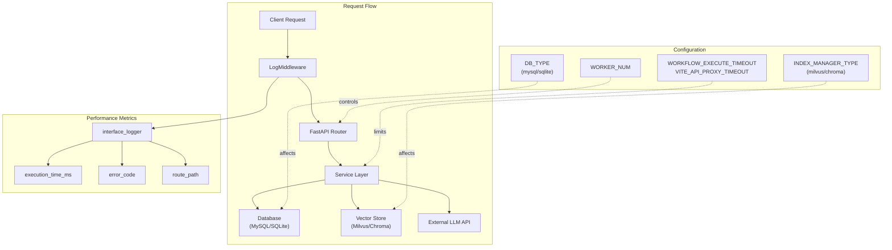
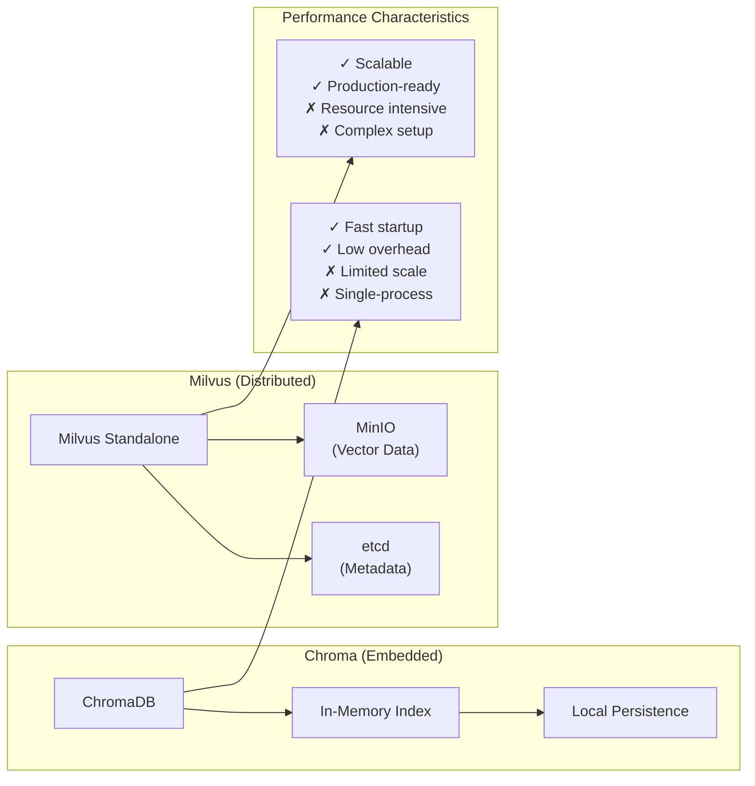
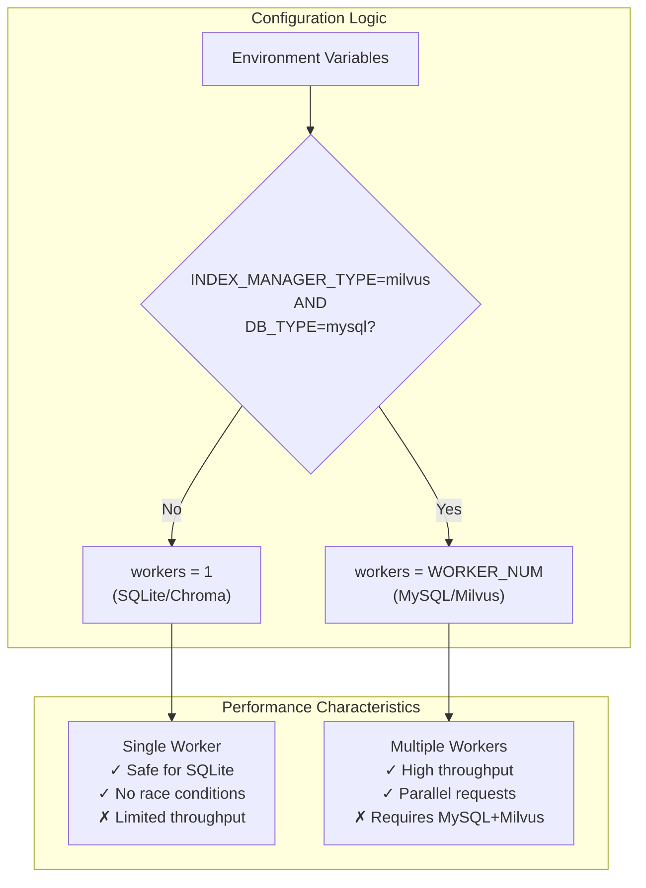
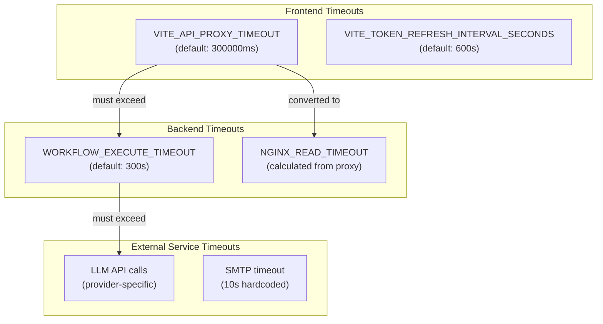
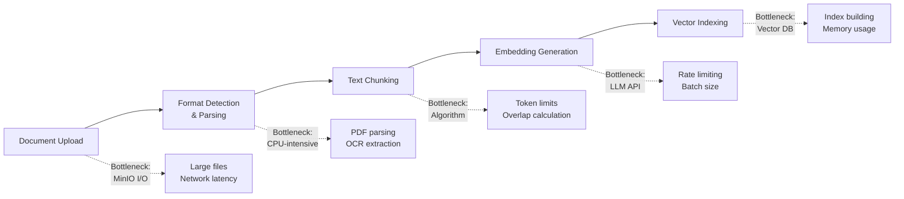
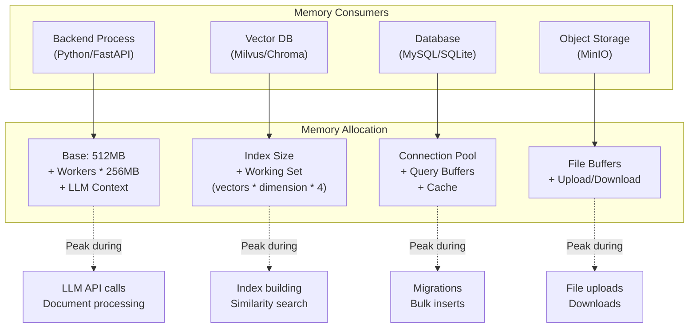
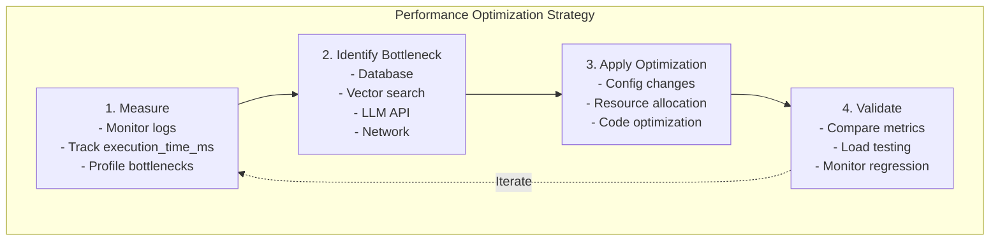

<!-- source: DeepWiki mcp.deepwiki.com · repo openJiuwen-ai/agent-studio · page 9.3 Performance Issues · fetched 2026-11-02 -->

# Performance Issues

<details>
<summary>Relevant source files</summary>

The following files were used as context for generating this wiki page:

- [.env.example](.env.example)
- [backend/openjiuwen_studio/core/common/logging/__init__.py](backend/openjiuwen_studio/core/common/logging/__init__.py)
- [backend/openjiuwen_studio/core/common/logging/events.py](backend/openjiuwen_studio/core/common/logging/events.py)
- [backend/openjiuwen_studio/core/config.py](backend/openjiuwen_studio/core/config.py)
- [backend/openjiuwen_studio/core/manager/convertor/components/sub_workflow.py](backend/openjiuwen_studio/core/manager/convertor/components/sub_workflow.py)
- [backend/openjiuwen_studio/core/manager/email_manager/__init__.py](backend/openjiuwen_studio/core/manager/email_manager/__init__.py)
- [backend/openjiuwen_studio/core/manager/email_manager/email_template.py](backend/openjiuwen_studio/core/manager/email_manager/email_template.py)
- [backend/openjiuwen_studio/core/manager/email_manager/email_utils.py](backend/openjiuwen_studio/core/manager/email_manager/email_utils.py)
- [backend/openjiuwen_studio/core/manager/redis_manager/__init__.py](backend/openjiuwen_studio/core/manager/redis_manager/__init__.py)
- [backend/openjiuwen_studio/core/manager/utils/utils.py](backend/openjiuwen_studio/core/manager/utils/utils.py)
- [backend/openjiuwen_studio/main.py](backend/openjiuwen_studio/main.py)
- [scripts/.env.deploy.default](scripts/.env.deploy.default)
- [scripts/args_handler.sh](scripts/args_handler.sh)
- [scripts/common.sh](scripts/common.sh)
- [scripts/conf/docker-deepsearch.template.yml](scripts/conf/docker-deepsearch.template.yml)
- [scripts/conf/docker-jiuwen.template.yml](scripts/conf/docker-jiuwen.template.yml)
- [scripts/conf/docker-plugin.template.yml](scripts/conf/docker-plugin.template.yml)
- [scripts/envfile_handler.sh](scripts/envfile_handler.sh)
- [scripts/gen_ssl.sh](scripts/gen_ssl.sh)
- [scripts/global_vars.sh](scripts/global_vars.sh)
- [scripts/prompt_handler.sh](scripts/prompt_handler.sh)
- [scripts/service.sh](scripts/service.sh)
- [scripts/template_handler.sh](scripts/template_handler.sh)
- [scripts/vars_handler.sh](scripts/vars_handler.sh)

</details>


This page covers common performance bottlenecks in OpenJiuwen Agent Studio and provides guidance on diagnosing and resolving them. Performance issues typically manifest as slow response times, timeouts, high resource usage, or system unresponsiveness.

For installation and setup issues, see [Installation Issues](#9.1). For general runtime errors, see [Runtime Errors](#9.2). For database-specific problems, see [Database Issues](#9.4).

---

## Common Performance Bottlenecks

Performance issues in OpenJiuwen Agent Studio typically occur in one or more of the following areas:

| Component | Common Issues | Impact |
|-----------|--------------|---------|
| Database Operations | Slow queries, connection pool exhaustion | Slow API responses, timeouts |
| Vector Store | Inefficient similarity search, large collections | Delayed knowledge retrieval |
| LLM API Calls | Network latency, rate limiting | Workflow execution delays |
| Document Processing | Large file parsing, embedding generation | Upload/indexing timeouts |
| Worker Configuration | Insufficient concurrency, resource contention | Request queuing, bottlenecks |
| Memory Usage | Large agent contexts, memory leaks | OOM errors, swapping |

---

## Performance Monitoring Architecture



**Sources:** [backend/openjiuwen_studio/main.py:166-222](), [.env.example:45-146](), [backend/openjiuwen_studio/core/common/logging/events.py:19-28]()

---

## Database Performance

### SQLite vs MySQL Performance Characteristics

The system supports both SQLite and MySQL databases with different performance profiles:

| Aspect | SQLite | MySQL |
|--------|--------|-------|
| **Concurrency** | Single writer, serialized writes | Multiple concurrent connections |
| **Best For** | Development, single-user, low-traffic | Production, multi-user, high-traffic |
| **Read Performance** | Fast for small datasets | Consistent for large datasets |
| **Write Performance** | Limited by single-writer lock | Parallel writes with proper indexing |
| **Connection Pooling** | Not applicable | Essential for performance |

**Configuration:**

```bash
# .env configuration
DB_TYPE=mysql  # or sqlite

# MySQL settings (production recommended)
DB_HOST=localhost
DB_PORT=3306
DB_USER=root
DB_PASSWORD=root
AGENT_DB_NAME=openjiuwen_agent
OPS_DB_NAME=openjiuwen_ops

# SQLite settings (development)
SQLITE_DB_PATH=data/databases
AGENT_SQLITE_DB=agent.db
OPS_SQLITE_DB=ops.db
```

**Worker Configuration Impact:**

The system automatically adjusts worker count based on database type:

```python
# backend/openjiuwen_studio/main.py:255-257
workers = int(os.getenv("WORKER_NUM", 1)) \
    if (os.getenv("INDEX_MANAGER_TYPE") == "milvus" and os.getenv("DB_TYPE") == "mysql") \
    else 1
```

**Critical:** SQLite **must use single worker** (`WORKER_NUM=1`) to avoid database locking issues. Only MySQL + Milvus deployments can safely use multiple workers.

**Sources:** [backend/openjiuwen_studio/main.py:247-258](), [.env.example:92-106](), [backend/openjiuwen_studio/core/config.py:26-38]()

### Index Renaming for SQLite Performance

On SQLite startup, the system renames duplicate indexes to avoid conflicts:

```python
# backend/openjiuwen_studio/main.py:94-107
if engine.url.drivername == "sqlite":
    renamed_count = 0
    for table in target_tables:
        for idx in table.indexes:
            old_idx_name = idx.name
            idx.name = f"{old_idx_name}_{table.name}"
            renamed_count += 1
```

This prevents SQLite from failing on duplicate index names across tables, which can cause performance degradation during query planning.

**Sources:** [backend/openjiuwen_studio/main.py:94-107]()

### Database Connection Optimization

**Symptoms:**
- "Too many connections" errors
- Slow API responses under load
- Connection pool exhaustion messages

**Diagnosis:**

Check connection pool status by monitoring database connections:

```bash
# MySQL
SHOW PROCESSLIST;
SHOW STATUS LIKE 'Threads_connected';

# Check worker configuration
echo $WORKER_NUM
```

**Solutions:**

1. **For MySQL deployments:**
   - Increase max connections in MySQL configuration
   - Optimize worker count based on CPU cores
   - Monitor connection pool usage

2. **For SQLite deployments:**
   - Ensure `WORKER_NUM=1` (enforced by system)
   - Consider migrating to MySQL for production
   - Optimize query patterns to reduce lock contention

**Sources:** [backend/openjiuwen_studio/main.py:247-258](), [.env.example:45-46]()

---

## Vector Store Performance

### Milvus vs Chroma Performance



**Configuration:**

```bash
# .env configuration
INDEX_MANAGER_TYPE=chroma  # or milvus

# Milvus settings (production)
MILVUS_HOST=jiuwen-milvus-standalone
MILVUS_PORT=19530
MILVUS_COLLECTION_NAME=memory_vector
EMBEDDING_MODEL_DIMENTION=1024

# Milvus dependencies (auto-configured in Docker)
ETCD_HOST=jiuwen-etcd
MINIO_HOST=jiuwen-minio
```

**Performance Recommendations:**

| Deployment | Vector Store | Rationale |
|------------|--------------|-----------|
| Development | Chroma | Minimal resource usage, fast startup |
| Small Production (<10K vectors) | Chroma | Sufficient for small knowledge bases |
| Large Production (>10K vectors) | Milvus | Better scaling, consistent performance |
| Multi-worker Setup | Milvus | Thread-safe for concurrent access |

**Sources:** [.env.example:135-143](), [scripts/vars_handler.sh:109-125]()

### Embedding Dimension Impact

The `EMBEDDING_MODEL_DIMENTION` setting affects vector storage and search performance:

```bash
# Common dimensions
EMBEDDING_MODEL_DIMENTION=1024  # BGE-M3 (default)
EMBEDDING_MODEL_DIMENTION=1536  # OpenAI text-embedding-ada-002
EMBEDDING_MODEL_DIMENTION=768   # Smaller models
```

**Performance Impact:**

- **Storage:** Higher dimensions = larger storage requirements (linear growth)
- **Search Speed:** Higher dimensions = slower similarity calculations (quadratic growth for some algorithms)
- **Memory Usage:** Higher dimensions = more RAM needed for index

**Recommendation:** Use the smallest dimension that maintains acceptable retrieval quality.

**Sources:** [.env.example:143]()

### Vector Search Optimization

**Symptoms:**
- Slow knowledge base retrieval
- High memory usage during search
- Timeout errors in RAG workflows

**Diagnosis:**

Monitor vector collection sizes and search latency:

```bash
# Check Milvus collection stats (if using Milvus)
docker exec jiuwen-milvus-standalone \
  python -c "from pymilvus import connections, Collection; \
             connections.connect(); \
             col = Collection('memory_vector'); \
             print(f'Entities: {col.num_entities}')"

# Check memory usage
docker stats jiuwen-backend
```

**Solutions:**

1. **Optimize collection size:**
   - Implement periodic cleanup of unused vectors
   - Use collection partitioning for large datasets
   - Archive old knowledge base entries

2. **Tune search parameters:**
   - Reduce `top_k` in retrieval queries
   - Use appropriate index types (IVF, HNSW)
   - Adjust `nprobe` parameter for IVF indexes

3. **Resource allocation:**
   - Increase memory for Milvus container
   - Use SSD storage for better I/O performance

**Sources:** [.env.example:135-143]()

---

## Worker and Concurrency Configuration

### Worker Count Optimization



**Configuration:**

```bash
# .env configuration
WORKER_NUM=1  # Default: single worker

# For production with MySQL + Milvus:
WORKER_NUM=4  # Recommended: 2 * CPU_cores
DB_TYPE=mysql
INDEX_MANAGER_TYPE=milvus
```

**Worker Count Guidelines:**

| Setup | Recommended Workers | Rationale |
|-------|-------------------|-----------|
| SQLite + Chroma | 1 (forced) | Prevent database locks |
| MySQL + Chroma | 1 | Chroma not thread-safe |
| SQLite + Milvus | 1 (forced) | SQLite limitation |
| MySQL + Milvus | 2-4 | Optimal for CPU utilization |

**Formula for production:**
```
workers = min(2 * CPU_cores, available_memory_GB / 2)
```

**Sources:** [backend/openjiuwen_studio/main.py:247-258](), [.env.example:45-46]()

### Concurrency Bottlenecks

**Symptoms:**
- Requests queued despite low CPU usage
- 504 Gateway Timeout errors
- Slow response times under concurrent load

**Diagnosis:**

```bash
# Check active connections
docker exec jiuwen-backend \
  sh -c 'lsof -i :8000 | wc -l'

# Monitor worker processes
docker exec jiuwen-backend ps aux | grep uvicorn

# Check request queue
curl -s http://localhost:8000/api/health
```

**Solutions:**

1. **Increase workers (MySQL + Milvus only):**
   ```bash
   # .env.custom
   WORKER_NUM=4
   ```

2. **Optimize async operations:**
   - Ensure service methods use `async/await`
   - Use connection pooling for database
   - Implement request queuing for LLM calls

3. **Enable Redis checkpointing:**
   ```bash
   ENABLE_REDIS_CHECKPOINT=true
   REDIS_HOST=localhost
   REDIS_PORT=6379
   ```

**Sources:** [backend/openjiuwen_studio/main.py:128-138](), [backend/openjiuwen_studio/core/config.py:69-81]()

---

## Timeout Configuration

### Timeout Hierarchy



**Configuration:**

```bash
# Frontend proxy timeout (milliseconds)
VITE_API_PROXY_TIMEOUT=300000  # 5 minutes default

# Backend workflow timeout (seconds)
WORKFLOW_EXECUTE_TIMEOUT=300  # 5 minutes default

# Nginx timeout (auto-calculated)
# NGINX_READ_TIMEOUT = VITE_API_PROXY_TIMEOUT / 1000
```

**Timeout Relationship:**

The system enforces: `VITE_API_PROXY_TIMEOUT >= WORKFLOW_EXECUTE_TIMEOUT * 1000`

Nginx timeout is automatically calculated:

```bash
# scripts/vars_handler.sh:73-79
local tms=${RUNTIME_VARS["VITE_API_PROXY_TIMEOUT"]}
local nginx_read_timeout=$(( tms / 1000 ))
DEPLOY_VARS["NGINX_READ_TIMEOUT"]=${nginx_read_timeout}
```

**Sources:** [.env.example:28-146](), [scripts/vars_handler.sh:73-79]()

### Timeout Troubleshooting

**Symptoms:**
- 504 Gateway Timeout errors
- "Workflow execution timeout" errors
- Incomplete agent responses

**Diagnosis:**

Check timeout configuration and actual execution times:

```bash
# Check configured timeouts
grep TIMEOUT .env

# Monitor workflow execution in logs
docker logs jiuwen-backend | grep "execution_time_ms"

# Check for timeout errors
docker logs jiuwen-backend | grep -i timeout
```

**Solutions:**

1. **For long-running workflows:**
   ```bash
   # .env.custom
   WORKFLOW_EXECUTE_TIMEOUT=600  # 10 minutes
   VITE_API_PROXY_TIMEOUT=600000  # 10 minutes (must match)
   ```

2. **For LLM-heavy operations:**
   - Reduce context window size
   - Use streaming responses where possible
   - Implement circuit breakers for external APIs

3. **For document processing:**
   - Process large documents in chunks
   - Use asynchronous processing
   - Implement progress callbacks

**Sources:** [.env.example:28-146](), [scripts/vars_handler.sh:73-79]()

---

## Document Processing Performance

### Processing Pipeline Bottlenecks



**Common Performance Issues:**

| Stage | Bottleneck | Solution |
|-------|-----------|----------|
| Upload | Large file transfer to MinIO | Increase timeout, optimize network |
| Parsing | CPU-intensive PDF/DOCX parsing | Use faster parsers, process async |
| Chunking | Inefficient text splitting | Tune chunk size/overlap parameters |
| Embedding | LLM API rate limits | Batch requests, use local models |
| Indexing | Vector DB write throughput | Batch inserts, optimize collection |

**Configuration:**

```bash
# MinIO configuration
MINIO_HOST=localhost
MINIO_PORT=9000
MINIO_BUCKET=jiuwen-bucket

# Embedding model dimension (affects processing time)
EMBEDDING_MODEL_DIMENTION=1024

# Memory data path (affects I/O)
MEMORY_DATA_PATH=memory-data
```

**Sources:** [.env.example:108-148]()

### Optimizing Document Upload Performance

**Symptoms:**
- Upload timeouts for large documents
- High memory usage during upload
- Slow indexing after upload

**Diagnosis:**

```bash
# Check MinIO performance
docker stats jiuwen-minio

# Monitor upload progress in logs
docker logs jiuwen-backend | grep -i upload

# Check object storage size
docker exec jiuwen-minio mc du local/jiuwen-bucket
```

**Solutions:**

1. **Increase timeout for large files:**
   ```bash
   # .env.custom
   VITE_API_PROXY_TIMEOUT=600000  # 10 minutes for large uploads
   ```

2. **Optimize MinIO configuration:**
   ```bash
   # Use local MinIO for development
   MINIO_HOST=localhost
   MINIO_PORT=9000
   
   # For production, use external object storage
   OBS_ACCESS_KEY_ID=your_key
   OBS_SECRET_ACCESS_KEY=your_secret
   OBS_SERVER=your_server
   OBS_BUCKET=your_bucket
   ```

3. **Batch processing:**
   - Upload multiple small documents instead of one large document
   - Implement chunked upload for files >10MB
   - Use asynchronous processing queue

**Sources:** [.env.example:108-114](), [.env.example:192-196]()

### Embedding Generation Optimization

**Symptoms:**
- Slow knowledge base creation
- High API costs
- Rate limit errors from embedding providers

**Diagnosis:**

Monitor embedding API calls and performance:

```bash
# Check embedding model usage in logs
docker logs jiuwen-backend | grep -i embedding

# Monitor API response times
docker logs jiuwen-backend | grep "execution_time_ms" | grep embedding
```

**Solutions:**

1. **Use local embedding models:**
   - Deploy BGE-M3 locally to avoid API rate limits
   - Reduce network latency
   - Lower operational costs

2. **Optimize chunk size:**
   - Larger chunks = fewer API calls but less granular retrieval
   - Smaller chunks = more API calls but better precision
   - Recommended: 512-1024 tokens per chunk

3. **Batch embedding requests:**
   - Send multiple chunks in single API call
   - Reduces overhead and improves throughput

**Sources:** [.env.example:143]()

---

## Memory and Resource Management

### Memory Usage Patterns



**Memory Requirements:**

| Component | Minimum | Recommended | Notes |
|-----------|---------|-------------|-------|
| Backend (1 worker) | 512MB | 1GB | +256MB per additional worker |
| MySQL | 512MB | 2GB | Depends on dataset size |
| SQLite | 128MB | 256MB | File-based, minimal overhead |
| Milvus | 2GB | 4GB | Depends on vector count |
| Chroma | 256MB | 512MB | Embedded, scales with data |
| MinIO | 512MB | 1GB | Depends on file upload size |

**Total System Requirements:**

- **Development (SQLite + Chroma):** 2GB RAM minimum
- **Production (MySQL + Milvus):** 8GB RAM minimum

**Sources:** [scripts/conf/docker-jiuwen.template.yml:1-72]()

### Memory Leak Diagnosis

**Symptoms:**
- Gradual memory increase over time
- Container OOM kills
- Swap usage increasing

**Diagnosis:**

```bash
# Monitor container memory over time
docker stats --no-stream jiuwen-backend

# Check for memory leaks in Python
docker exec jiuwen-backend \
  python -c "import gc; gc.collect(); print(len(gc.get_objects()))"

# Check swap usage (host system)
free -h
```

**Solutions:**

1. **Restart containers periodically:**
   ```bash
   # Set restart policy
   docker update --restart unless-stopped jiuwen-backend
   ```

2. **Optimize garbage collection:**
   - Ensure proper cleanup of LLM responses
   - Close database connections properly
   - Clear vector search caches

3. **Limit resource usage:**
   ```bash
   # In docker-compose or docker run
   docker update --memory 2g --memory-swap 2g jiuwen-backend
   ```

**Sources:** [scripts/conf/docker-jiuwen.template.yml:1-72]()

---

## Network and External API Performance

### LLM API Call Optimization

**Symptoms:**
- Slow agent responses
- Frequent timeout errors
- High API costs

**Diagnosis:**

```bash
# Monitor LLM API call duration
docker logs jiuwen-backend | grep -i "llm\|model" | grep "execution_time_ms"

# Check for SSL verification overhead
docker logs jiuwen-backend | grep "LLM_SSL_VERIFY"
```

**Configuration:**

```bash
# Disable SSL verification (development only)
LLM_SSL_VERIFY=False

# Configure proxy for external APIs
HTTP_PROXY=http://proxy:8080
HTTPS_PROXY=http://proxy:8080
```

**Solutions:**

1. **Reduce context size:**
   - Limit system prompt length (see `VITE_API_PROMPT_LENGTH=8000`)
   - Use prompt compression techniques
   - Implement context windowing

2. **Implement caching:**
   - Cache identical LLM requests
   - Use Redis for prompt/response caching
   - Implement semantic caching for similar prompts

3. **Optimize network path:**
   - Deploy LLM services in same region
   - Use dedicated network routes
   - Enable HTTP/2 for multiplexing

**Sources:** [.env.example:29-30](), [.env.example:76-77]()

### Proxy and CORS Configuration

Network performance can be affected by proxy settings and CORS preflight requests.

**Configuration:**

```bash
# No-proxy configuration for internal services
# Auto-generated by deployment scripts
no_proxy=localhost,127.0.0.1,jiuwen-backend,jiuwen-mysql,...
NO_PROXY=localhost,127.0.0.1,jiuwen-backend,jiuwen-mysql,...

# CORS origins
ALLOWED_ORIGINS=["http://localhost:3000","http://127.0.0.1:3000"]
```

The deployment scripts automatically configure no-proxy settings to bypass proxy for internal container-to-container communication:

```bash
# scripts/vars_handler.sh:17-46
setup_no_proxy_vars() {
    local no_proxy_addrs="localhost,127.0.0.1"
    
    # Add all container addresses
    for addr in "${CONTAINERS_ADDRS[@]}"; do
        no_proxy_addrs="${no_proxy_addrs},${DEPLOY_VARS[${addr}]}"
    done
}
```

**Sources:** [.env.example:67-68](), [scripts/vars_handler.sh:17-46]()

---

## Logging and Monitoring Performance

### Log Overhead

Excessive logging can impact performance. The system implements structured logging with performance tracking:

```python
# backend/openjiuwen_studio/main.py:166-199
class LogMiddleware(BaseHTTPMiddleware):
    async def dispatch(self, request: Request, call_next):
        start_time = time.perf_counter()
        # ... process request
        interface_logger.info(
            "",
            event_type=CustomLogEventType.INTERFACE_SRV.value,
            interface_name=endpoint_name,
            execution_time_ms=round((time.perf_counter() - start_time) * 1000),
            error_code=str(response.status_code),
            metadata={"route_path": route_path}
        )
```

**Performance Impact:**

- Each request logs execution time
- Path truncation reduces log size: `_truncate_path(path, max_parts=3)`
- Structured logging enables efficient querying

**Optimization:**

```bash
# Reduce log verbosity in production
DEBUG=false

# Use efficient log rotation
# Configure in docker-compose volumes
volumes:
  - ../log-dirs/logs-${NAME_SUFFIX}/server:/app/logs
```

**Sources:** [backend/openjiuwen_studio/main.py:166-222](), [backend/openjiuwen_studio/core/common/logging/events.py:19-28]()

### Health Check Overhead

Health checks run periodically and consume resources. Optimize their frequency:

```yaml
# scripts/conf/docker-jiuwen.template.yml:29-34
healthcheck:
  test: ["CMD", "curl", "-f", "http://localhost:8000/api/health"]
  interval: 30s  # Check every 30 seconds
  timeout: 10s   # Allow 10 seconds for response
  retries: 5     # Retry 5 times before marking unhealthy
  start_period: 60s  # Grace period after container start
```

**Recommendations:**

- **Development:** Increase interval to 60s to reduce overhead
- **Production:** Keep default 30s for quick failure detection
- **Under Load:** Increase timeout to 15-20s to prevent false positives

**Sources:** [scripts/conf/docker-jiuwen.template.yml:29-34]()

---

## Performance Tuning Checklist

### Quick Wins

| Action | Expected Improvement | Difficulty |
|--------|---------------------|------------|
| Switch SQLite → MySQL | 2-5x write throughput | Medium |
| Switch Chroma → Milvus | 2-3x vector search speed | Medium |
| Increase `WORKER_NUM` (MySQL+Milvus) | 2-4x request throughput | Easy |
| Disable SSL verification (dev) | 10-20% API call speedup | Easy |
| Enable Redis checkpointing | Faster workflow resumption | Easy |
| Optimize timeout settings | Prevent false timeout errors | Easy |

### Advanced Optimization



**Systematic Approach:**

1. **Baseline Measurement:**
   ```bash
   # Monitor request latency
   docker logs jiuwen-backend | grep "execution_time_ms" | \
     awk '{print $NF}' | sort -n | tail -20
   
   # Track resource usage
   docker stats --no-stream
   ```

2. **Identify Bottlenecks:**
   - Check which endpoints have highest `execution_time_ms`
   - Monitor CPU/memory usage patterns
   - Analyze slow query logs (MySQL)

3. **Apply Targeted Optimizations:**
   - Start with highest-impact, lowest-effort changes
   - Change one variable at a time
   - Document before/after metrics

4. **Validate Results:**
   - Re-measure after each change
   - Use load testing tools (e.g., `locust`, `ab`)
   - Monitor for regression

**Sources:** [backend/openjiuwen_studio/main.py:166-199]()

---

## Production Performance Configuration Example

Complete production-optimized configuration for high-performance deployment:

```bash
# Database: MySQL for high concurrency
DB_TYPE=mysql
DB_HOST=mysql-server.internal
DB_PORT=3306
DB_USER=jiuwen
DB_PASSWORD=<secure-password>

# Vector Store: Milvus for large-scale vector search
INDEX_MANAGER_TYPE=milvus
MILVUS_HOST=milvus-server.internal
MILVUS_PORT=19530
EMBEDDING_MODEL_DIMENTION=1024

# Workers: Multiple workers for parallelism
WORKER_NUM=4  # 2x CPU cores

# Timeouts: Generous for complex workflows
WORKFLOW_EXECUTE_TIMEOUT=600  # 10 minutes
VITE_API_PROXY_TIMEOUT=600000  # 10 minutes

# Redis: Enable for workflow checkpointing
ENABLE_REDIS_CHECKPOINT=true
REDIS_HOST=redis-server.internal
REDIS_PORT=6379

# Network: Disable SSL verification for internal services
LLM_SSL_VERIFY=False  # Internal LLM deployment
RESTFUL_SSL_VERIFY=False

# Resources: External object storage
OBS_ACCESS_KEY_ID=<access-key>
OBS_SECRET_ACCESS_KEY=<secret-key>
OBS_SERVER=https://obs.internal
OBS_BUCKET=jiuwen-production

# Debug: Disable in production
DEBUG=false
```

**Expected Performance:**

- **Throughput:** 50-100 concurrent requests
- **Latency:** P50 < 500ms, P95 < 2s (excluding LLM calls)
- **Vector Search:** < 100ms for collections under 1M vectors
- **Database Queries:** < 50ms for indexed queries

**Sources:** [.env.example:1-196]()

---

