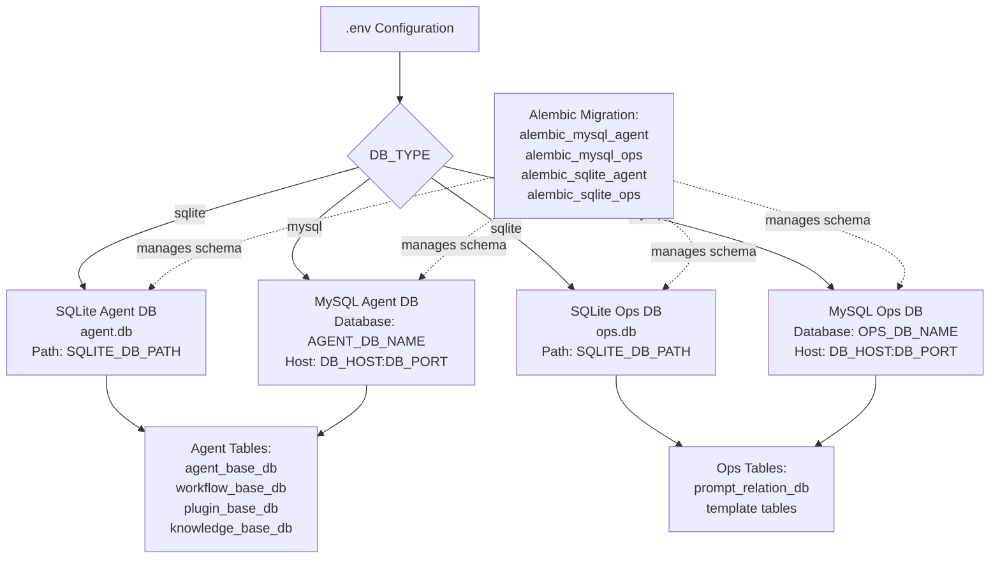
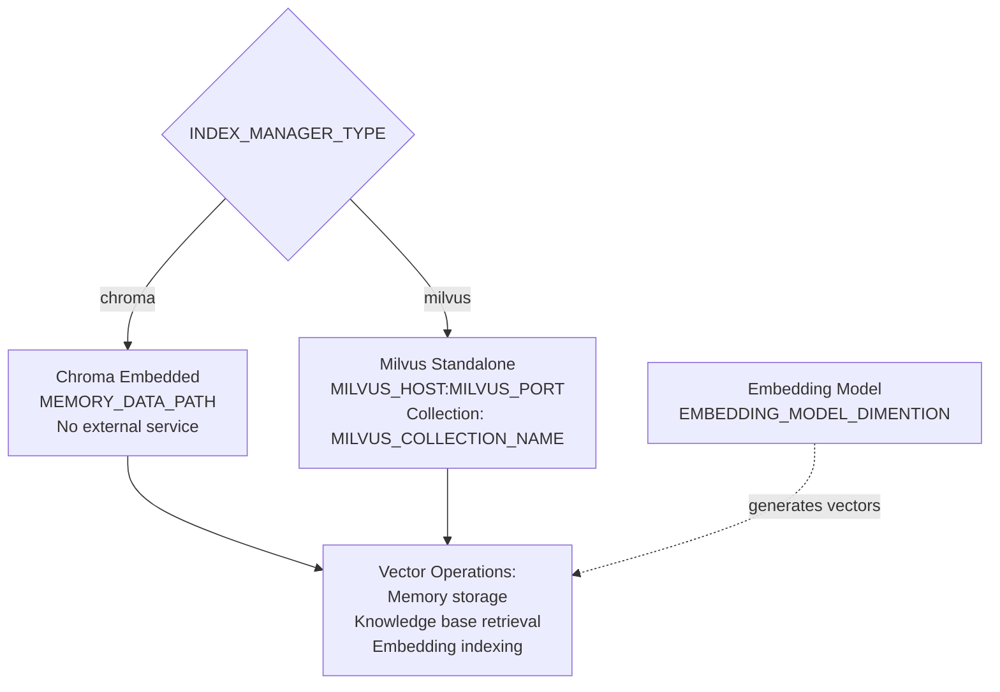
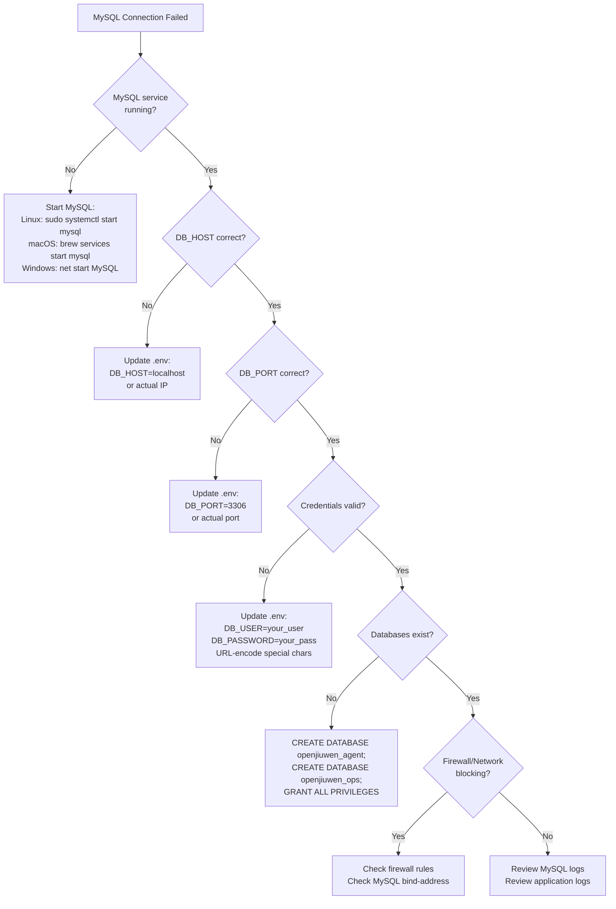
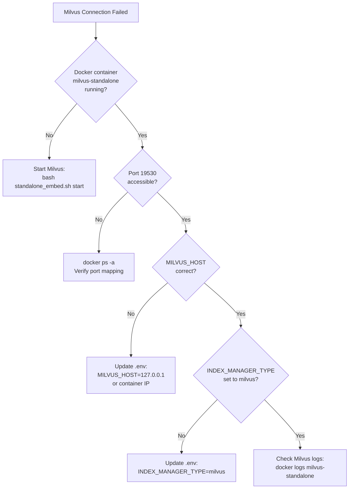
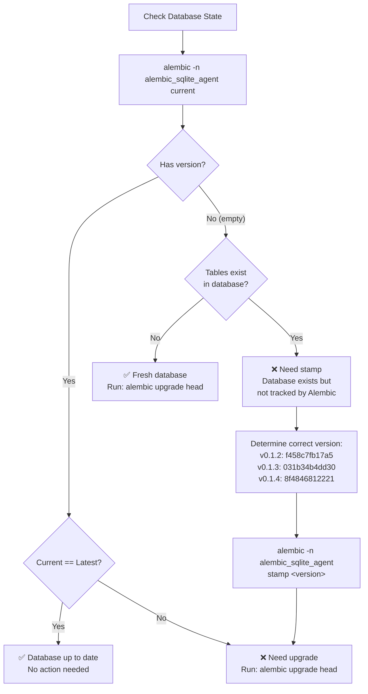
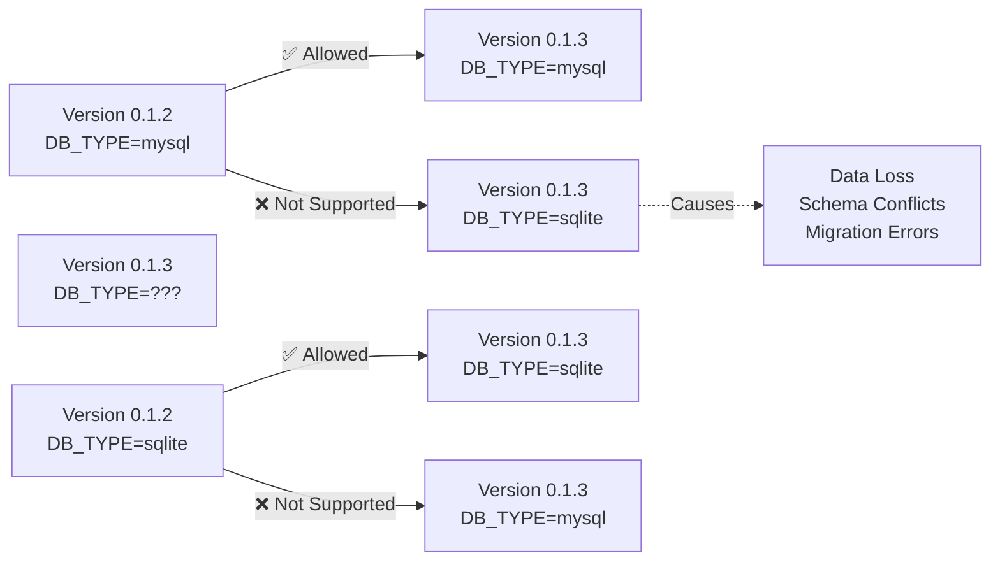
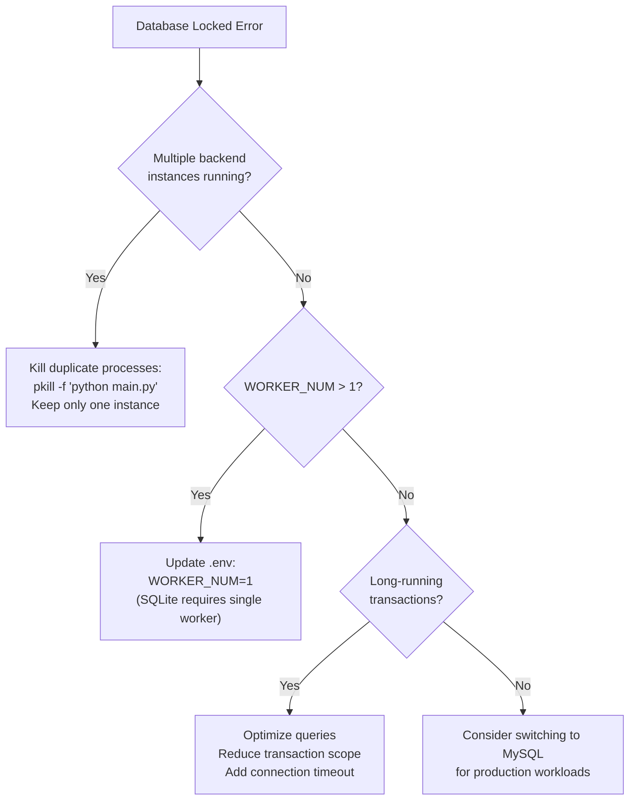

<!-- source: DeepWiki mcp.deepwiki.com · repo openJiuwen-ai/agent-studio · page 9.4 Database Issues · fetched 2026-11-02 -->

# Database Issues

<details>
<summary>Relevant source files</summary>

The following files were used as context for generating this wiki page:

- [.env.example](.env.example)
- [backend/DATABASE_MIGRATION_DEVELOPMENT_GUIDE_EN.md](backend/DATABASE_MIGRATION_DEVELOPMENT_GUIDE_EN.md)
- [backend/GENERATE_MIGRATION_USAGE_EN.md](backend/GENERATE_MIGRATION_USAGE_EN.md)
- [backend/openjiuwen_studio/core/common/logging/__init__.py](backend/openjiuwen_studio/core/common/logging/__init__.py)
- [backend/openjiuwen_studio/core/common/logging/events.py](backend/openjiuwen_studio/core/common/logging/events.py)
- [backend/openjiuwen_studio/core/config.py](backend/openjiuwen_studio/core/config.py)
- [backend/openjiuwen_studio/core/manager/convertor/components/sub_workflow.py](backend/openjiuwen_studio/core/manager/convertor/components/sub_workflow.py)
- [backend/openjiuwen_studio/core/manager/email_manager/__init__.py](backend/openjiuwen_studio/core/manager/email_manager/__init__.py)
- [backend/openjiuwen_studio/core/manager/email_manager/email_template.py](backend/openjiuwen_studio/core/manager/email_manager/email_template.py)
- [backend/openjiuwen_studio/core/manager/email_manager/email_utils.py](backend/openjiuwen_studio/core/manager/email_manager/email_utils.py)
- [backend/openjiuwen_studio/core/manager/redis_manager/__init__.py](backend/openjiuwen_studio/core/manager/redis_manager/__init__.py)
- [backend/openjiuwen_studio/core/manager/utils/utils.py](backend/openjiuwen_studio/core/manager/utils/utils.py)
- [backend/openjiuwen_studio/main.py](backend/openjiuwen_studio/main.py)
- [docs/en/2.Installation Guide/Local Installation/Linux_Installation.md](docs/en/2.Installation Guide/Local Installation/Linux_Installation.md)
- [docs/en/2.Installation Guide/Local Installation/MacOS_Installation.md](docs/en/2.Installation Guide/Local Installation/MacOS_Installation.md)
- [docs/en/2.Installation Guide/Local Installation/Windows_Installation.md](docs/en/2.Installation Guide/Local Installation/Windows_Installation.md)

</details>


This page covers common database-related problems encountered when deploying, configuring, or operating OpenJiuwen Agent Studio. It provides troubleshooting steps for connection failures, migration errors, version conflicts, and data corruption scenarios.

For database architecture and design patterns, see [Data Layer](#5.4). For development guidelines on database schema changes, see [Database Migrations](#6.2). For deployment configuration, see [Production Configuration](#7.2).

---

## Database Architecture Overview

OpenJiuwen Agent Studio uses a multi-database architecture to separate concerns and support different data storage needs.

### Relational Databases



**Sources:** [.env.example:92-106](), [backend/openjiuwen_studio/core/config.py:26-38](), [backend/openjiuwen_studio/main.py:54-145]()

### Vector Databases



**Sources:** [.env.example:135-144](), [backend/openjiuwen_studio/core/config.py:1-105]()

---

## Connection Issues

### MySQL Connection Failures

#### Symptom
Application fails to start with connection errors:
```
sqlalchemy.exc.OperationalError: (pymysql.err.OperationalError) 
(2003, "Can't connect to MySQL server on 'localhost' ([Errno 61] Connection refused)")
```

#### Diagnostic Steps



**Sources:** [.env.example:95-101](), [docs/en/2.Installation Guide/Local Installation/Linux_Installation.md:194-207]()

#### Common Fixes

| Issue | Configuration Variable | Solution |
|-------|----------------------|----------|
| Wrong host | `DB_HOST` | Set to `localhost` for local, or actual IP for remote |
| Wrong port | `DB_PORT` | Default is `3306`, verify MySQL is listening |
| Authentication failure | `DB_USER`, `DB_PASSWORD` | Verify credentials with `mysql -u user -p` |
| Database missing | `AGENT_DB_NAME`, `OPS_DB_NAME` | Create databases: `openjiuwen_agent`, `openjiuwen_ops` |
| Special characters in password | `DB_PASSWORD` | URL-encode: `@` → `%40`, `:` → `%3A`, etc. |

**Password URL Encoding Table:**

| Character | Encoding | Character | Encoding | Character | Encoding |
|-----------|----------|-----------|----------|-----------|----------|
| Space     | `%20`    | `#`       | `%23`    | `%`       | `%25`    |
| `&`       | `%26`    | `@`       | `%40`    | `:`       | `%3A`    |
| `;`       | `%3B`    | `=`       | `%3D`    | `?`       | `%3F`    |

**Sources:** [docs/en/2.Installation Guide/Local Installation/Linux_Installation.md:543-549](), [.env.example:95-101]()

### SQLite File Issues

#### Symptom
```
sqlite3.OperationalError: unable to open database file
PermissionError: [Errno 13] Permission denied: 'data/databases/agent.db'
```

#### Resolution

1. **Verify database path configuration:**
   ```bash
   # Check .env configuration
   SQLITE_DB_PATH=data/databases
   AGENT_SQLITE_DB=agent.db
   OPS_SQLITE_DB=ops.db
   ```

2. **Create directory with correct permissions:**
   ```bash
   mkdir -p data/databases
   chmod 755 data/databases
   ```

3. **Verify file permissions:**
   ```bash
   ls -la data/databases/
   # Should show user read/write permissions
   ```

4. **Check disk space:**
   ```bash
   df -h data/databases/
   ```

**Sources:** [.env.example:103-106](), [backend/openjiuwen_studio/core/config.py:36-38]()

### Milvus Connection Failures

#### Symptom
```
MilvusException: (code=2, message=Fail connecting to server on milvus-standalone:19530, 
illegal connection params or server unavailable)
```

#### Diagnostic Flow



**Sources:** [.env.example:135-144](), [docs/en/2.Installation Guide/Local Installation/Linux_Installation.md:396-434]()

#### Resolution Steps

1. **Verify Milvus is running:**
   ```bash
   docker ps | grep milvus-standalone
   # Should show container on port 19530
   ```

2. **Check configuration in `.env`:**
   ```bash
   INDEX_MANAGER_TYPE=milvus
   MILVUS_HOST=127.0.0.1
   MILVUS_PORT=19530
   MILVUS_COLLECTION_NAME=memory_vector
   ```

3. **Test Milvus connectivity:**
   ```bash
   # Try connecting to port
   nc -zv 127.0.0.1 19530
   # or
   telnet 127.0.0.1 19530
   ```

4. **Restart Milvus if needed:**
   ```bash
   bash standalone_embed.sh stop
   bash standalone_embed.sh start
   ```

**Sources:** [docs/en/2.Installation Guide/Local Installation/Windows_Installation.md:419-471](), [.env.example:138-143]()

---

## Migration Issues

### Alembic Version Conflicts

#### Symptom
Application startup logs show version mismatch:
```
⚠️ agent database: version mismatch!
   Current version: f458c7fb17a5
   Latest version: 7883f1b07bc3
```

Or migration fails with:
```
sqlalchemy.exc.IntegrityError: (pymysql.err.IntegrityError) 
(1050, "Table 'agent_base_db' already exists")
```

#### Migration State Diagnosis



**Sources:** [backend/DATABASE_MIGRATION_DEVELOPMENT_GUIDE_EN.md:298-445](), [backend/openjiuwen_studio/main.py:120-121]()

#### Version Baseline Reference Table

| Database Type | Component | v0.1.2 Revision | v0.1.3 Revision | v0.1.4 Revision |
|--------------|-----------|----------------|----------------|----------------|
| **MySQL** | Agent | `54351e123cf0` | `06a1f79bce8b` | `072ac1293a02` |
| **MySQL** | Ops | `80f110f929fc` | `13377a900fe2` | `13377a900fe2` |
| **SQLite** | Agent | `f458c7fb17a5` | `031b34b4dd30` | `8f4846812221` |
| **SQLite** | Ops | `b4f4c6589bc5` | `f6e49cd8c97d` | `f6e49cd8c97d` |

**Sources:** [backend/DATABASE_MIGRATION_DEVELOPMENT_GUIDE_EN.md:396-406]()

### Stamping Existing Database

When database exists but has no `alembic_version` table (common when upgrading from pre-Alembic versions):

```bash
# 1. Determine your current database version (e.g., v0.1.2)

# 2. Stamp with appropriate revision ID
# For SQLite Agent database at v0.1.2:
alembic -n alembic_sqlite_agent stamp f458c7fb17a5

# For SQLite Ops database at v0.1.2:
alembic -n alembic_sqlite_ops stamp b4f4c6589bc5

# For MySQL Agent database at v0.1.2:
alembic -n alembic_mysql_agent stamp 54351e123cf0

# For MySQL Ops database at v0.1.2:
alembic -n alembic_mysql_ops stamp 80f110f929fc

# 3. Verify stamp succeeded
alembic -n alembic_sqlite_agent current
# Output should show: f458c7fb17a5

# 4. Now upgrade to latest
alembic -n alembic_sqlite_agent upgrade head
alembic -n alembic_sqlite_ops upgrade head
```

**Sources:** [backend/DATABASE_MIGRATION_DEVELOPMENT_GUIDE_EN.md:354-410](), [docs/en/2.Installation Guide/Local Installation/Linux_Installation.md:322-337]()

### Failed Migration Recovery

#### Symptom
Migration partially applied, subsequent runs fail:
```
sqlalchemy.exc.ProgrammingError: (pymysql.err.ProgrammingError) 
(1050, "Table 'new_table' already exists")
```

#### Resolution Using Idempotent Checks

The codebase provides helper functions for idempotent migrations:

```python
from openjiuwen_studio.core.database.migration_utils import (
    table_exists, 
    column_exists, 
    index_exists
)

def upgrade() -> None:
    # Check before creating table
    if not table_exists('my_new_table'):
        op.create_table('my_new_table', ...)
    
    # Check before adding column
    if not column_exists('users', 'new_column'):
        op.add_column('users', sa.Column('new_column', sa.String(100)))
    
    # Check before creating index
    if not index_exists('users', 'idx_user_email'):
        op.create_index('idx_user_email', 'users', ['email'])
```

**Manual Recovery Steps:**

1. **Check current database state:**
   ```bash
   alembic -n alembic_sqlite_agent current
   ```

2. **Inspect what was created:**
   ```sql
   -- SQLite
   .schema table_name
   
   -- MySQL
   DESCRIBE table_name;
   SHOW INDEXES FROM table_name;
   ```

3. **Options:**
   - **Option A:** Downgrade and retry
     ```bash
     alembic -n alembic_sqlite_agent downgrade -1
     alembic -n alembic_sqlite_agent upgrade head
     ```
   
   - **Option B:** Manually complete migration
     - Edit migration script to add idempotent checks
     - Manually execute missing SQL statements
     - Mark migration as complete:
       ```bash
       alembic -n alembic_sqlite_agent stamp head
       ```

**Sources:** [backend/DATABASE_MIGRATION_DEVELOPMENT_GUIDE_EN.md:225-251]()

### Multi-Database Synchronization

When working with both MySQL and SQLite configurations:

```bash
# Check status of all database instances
for db in alembic_sqlite_agent alembic_sqlite_ops alembic_mysql_agent alembic_mysql_ops; do
    echo "=== $db ==="
    alembic -n $db current
done

# Upgrade all databases to latest
alembic -n alembic_sqlite_agent upgrade head
alembic -n alembic_sqlite_ops upgrade head
alembic -n alembic_mysql_agent upgrade head
alembic -n alembic_mysql_ops upgrade head
```

**Important:** Each database instance has independent `alembic_version` table and migration history. Version numbers between different instances are not comparable.

**Sources:** [backend/DATABASE_MIGRATION_DEVELOPMENT_GUIDE_EN.md:86-155](), [backend/GENERATE_MIGRATION_USAGE_EN.md:117-139]()

---

## Database Type Mismatch

### Switching Between MySQL and SQLite

#### Symptom
Attempting to switch database type after initial setup causes errors or data loss.

#### Important Constraints



**Rule:** The database type (`DB_TYPE`) must remain constant across version upgrades. Cross-database migration is not supported by the upgrade process.

**Sources:** [backend/DATABASE_MIGRATION_DEVELOPMENT_GUIDE_EN.md:38-49]()

#### Forced Migration (Manual Process)

If you must switch database types:

1. **Export data from old database:**
   ```bash
   # MySQL export
   mysqldump -u user -p openjiuwen_agent > agent_backup.sql
   mysqldump -u user -p openjiuwen_ops > ops_backup.sql
   
   # SQLite export
   sqlite3 data/databases/agent.db .dump > agent_backup.sql
   sqlite3 data/databases/ops.db .dump > ops_backup.sql
   ```

2. **Update `.env` configuration:**
   ```bash
   # Change from mysql to sqlite
   DB_TYPE=sqlite
   SQLITE_DB_PATH=data/databases
   AGENT_SQLITE_DB=agent.db
   OPS_SQLITE_DB=ops.db
   ```

3. **Initialize new database:**
   ```bash
   # Remove old database files/tables
   # Create fresh database structure
   alembic -n alembic_sqlite_agent upgrade head
   alembic -n alembic_sqlite_ops upgrade head
   ```

4. **Manually import data:**
   - Convert SQL syntax if needed (MySQL vs SQLite differences)
   - Adjust data types and constraints
   - Test thoroughly

**Warning:** This is a complex manual process. Plan for downtime and thorough testing.

**Sources:** [.env.example:92-106](), [backend/DATABASE_MIGRATION_DEVELOPMENT_GUIDE_EN.md:38-49]()

---

## Vector Database Issues

### Chroma Storage Corruption

#### Symptom
```
ValueError: Chroma storage directory corrupted
FileNotFoundError: [Errno 2] No such file or directory: 'memory-data/chroma.sqlite3'
```

#### Resolution

```bash
# 1. Check storage path configuration
grep MEMORY_DATA_PATH .env
# Default: MEMORY_DATA_PATH=memory-data

# 2. Verify directory exists and permissions
ls -la memory-data/
chmod 755 memory-data

# 3. If corrupted, backup and recreate
mv memory-data memory-data.backup
mkdir -p memory-data

# 4. Restart application (will recreate Chroma storage)
python backend/main.py
```

**Note:** This will lose existing memory and knowledge base vector data. Re-upload documents to knowledge bases to rebuild indexes.

**Sources:** [.env.example:148](), [backend/openjiuwen_studio/memory_engine_start.py:1-25]()

### Milvus Collection Issues

#### Symptom
```
MilvusException: collection memory_vector does not exist
```

#### Resolution

```bash
# 1. Verify collection name in configuration
grep MILVUS_COLLECTION_NAME .env
# Should be: MILVUS_COLLECTION_NAME=memory_vector

# 2. Check Milvus is running
docker ps | grep milvus-standalone

# 3. Collection will be auto-created on first use
# Restart application to trigger creation
```

#### Dimension Mismatch

```
MilvusException: dimension mismatch: expected 1024, got 768
```

**Cause:** Embedding model changed, producing different vector dimensions.

**Resolution:**

1. **Verify embedding model configuration:**
   ```bash
   grep EMBEDDING_MODEL_DIMENTION .env
   # Should match your embedding model output
   ```

2. **If changed, must recreate collection:**
   ```bash
   # Stop application
   
   # Drop old collection (use Milvus tools or Python)
   # Reconnect to Milvus and drop collection
   
   # Update dimension in .env
   EMBEDDING_MODEL_DIMENTION=768  # Match new model
   
   # Restart application (recreates collection)
   # Re-upload documents to rebuild with new dimensions
   ```

**Sources:** [.env.example:143]()

---

## Performance and Corruption

### Database Lock Issues (SQLite)

#### Symptom
```
sqlite3.OperationalError: database is locked
```

#### Cause
SQLite does not support concurrent writes. Multiple processes or threads attempting to write simultaneously.

#### Resolution



**Configuration Fix:**

```bash
# In .env file
DB_TYPE=sqlite
WORKER_NUM=1  # MUST be 1 for SQLite
```

**Long-term Solution:**

For production deployments with concurrent users, switch to MySQL:
```bash
DB_TYPE=mysql
WORKER_NUM=4  # Can use multiple workers
```

**Sources:** [backend/openjiuwen_studio/main.py:255-258](), [.env.example:45-46]()

### MySQL Connection Pool Exhaustion

#### Symptom
```
sqlalchemy.exc.TimeoutError: QueuePool limit of size 5 overflow 10 reached
```

#### Cause
Too many concurrent connections, pool size insufficient.

#### Resolution

Edit database configuration in `backend/openjiuwen_studio/core/database.py` to increase pool size:

```python
# Locate engine creation
# Increase pool_size and max_overflow
engine = create_engine(
    database_url,
    pool_size=20,        # Increase from default 5
    max_overflow=40,     # Increase from default 10
    pool_pre_ping=True,  # Keep enabled
    pool_recycle=3600    # Keep enabled
)
```

**Sources:** [backend/openjiuwen_studio/core/database.py:1-50]()

### Database Corruption

#### SQLite Corruption

**Symptom:**
```
sqlite3.DatabaseError: database disk image is malformed
```

**Recovery:**

```bash
# 1. Stop application
pkill -f 'python main.py'

# 2. Backup corrupted database
cp data/databases/agent.db data/databases/agent.db.corrupted

# 3. Attempt recovery
sqlite3 data/databases/agent.db.corrupted ".recover" | sqlite3 data/databases/agent.db.recovered

# 4. Verify integrity
sqlite3 data/databases/agent.db.recovered "PRAGMA integrity_check;"

# 5. If OK, replace
mv data/databases/agent.db.recovered data/databases/agent.db

# 6. Restart application
```

**Prevention:**
- Avoid killing processes during write operations
- Ensure adequate disk space
- Use journaling mode (enabled by default)
- Regular backups

**Sources:** [.env.example:103-106]()

#### MySQL Corruption

**Symptom:**
```
pymysql.err.InternalError: (1030, 'Got error 28 from storage engine')
```

**Recovery:**

```bash
# 1. Check table status
mysql -u user -p
USE openjiuwen_agent;
CHECK TABLE agent_base_db;

# 2. Repair if needed
REPAIR TABLE agent_base_db;

# 3. If repair fails, restore from backup
# Stop application
# Restore from mysqldump backup
mysql -u user -p openjiuwen_agent < agent_backup.sql
```

---

## Configuration Validation

### Startup Checks

The application performs validation on startup. Review logs for configuration issues:

```python
# Check backend/openjiuwen_studio/main.py:54-145
# Startup creates tables and checks versions
# Look for these log patterns:

# ✅ Success
"✅ Database tables created"
"✅ agent database: version is already up to date"

# ⚠️ Warning
"⚠️ agent database: version mismatch!"
"Warning: Table {name} has no indexes attribute"

# ❌ Error
"Failed to connect to database"
"MilvusException: ..."
```

**Sources:** [backend/openjiuwen_studio/main.py:56-146]()

### Environment Variable Checklist

Use this checklist to verify database configuration:

**Relational Database:**
```bash
# Required for all deployments
DB_TYPE=sqlite  # or mysql

# Required for MySQL only
DB_HOST=localhost
DB_PORT=3306
DB_USER=your_user
DB_PASSWORD=your_password  # URL-encoded if special chars
AGENT_DB_NAME=openjiuwen_agent
OPS_DB_NAME=openjiuwen_ops

# Required for SQLite only
SQLITE_DB_PATH=data/databases
AGENT_SQLITE_DB=agent.db
OPS_SQLITE_DB=ops.db
```

**Vector Database:**
```bash
# Required for all deployments
INDEX_MANAGER_TYPE=chroma  # or milvus
MEMORY_DATA_PATH=memory-data

# Required for Milvus only
MILVUS_HOST=127.0.0.1
MILVUS_PORT=19530
MILVUS_COLLECTION_NAME=memory_vector
EMBEDDING_MODEL_DIMENTION=1024
```

**Worker Configuration:**
```bash
# SQLite: MUST be 1
# MySQL with Milvus: can be > 1
WORKER_NUM=1
```

**Sources:** [.env.example:90-148](), [backend/openjiuwen_studio/core/config.py:7-105]()

---

## Diagnostic Commands

### Database Status Commands

```bash
# Check Alembic version for all instances
alembic -n alembic_sqlite_agent current
alembic -n alembic_sqlite_ops current
alembic -n alembic_mysql_agent current
alembic -n alembic_mysql_ops current

# Check migration history
alembic -n alembic_sqlite_agent history
alembic -n alembic_sqlite_agent heads  # Latest available version

# Test database connection
# MySQL
mysql -h localhost -P 3306 -u your_user -p -e "SHOW DATABASES;"

# SQLite
sqlite3 data/databases/agent.db "SELECT name FROM sqlite_master WHERE type='table';"

# Test Milvus connection
nc -zv 127.0.0.1 19530
docker logs milvus-standalone
```

### Log File Locations

```bash
# Backend logs (if configured)
tail -f logs/run/backend.log

# Application startup logs (stdout)
# Check when running: python main.py

# Database-specific logs
# MySQL: /var/log/mysql/error.log (Linux)
# SQLite: No separate log file
# Milvus: docker logs milvus-standalone
```

**Sources:** [backend/DATABASE_MIGRATION_DEVELOPMENT_GUIDE_EN.md:77-85](), [docs/en/2.Installation Guide/Local Installation/Linux_Installation.md:318-349]()

---

## Common Error Codes

| Error Code/Message | Database | Cause | Solution Reference |
|-------------------|----------|-------|-------------------|
| `2003: Can't connect to MySQL server` | MySQL | Service not running or wrong host/port | [MySQL Connection Failures](#mysql-connection-failures) |
| `1045: Access denied for user` | MySQL | Wrong credentials | Update `DB_USER`/`DB_PASSWORD` in `.env` |
| `1049: Unknown database` | MySQL | Database not created | Create `openjiuwen_agent` and `openjiuwen_ops` |
| `1050: Table already exists` | MySQL | Migration already applied | [Failed Migration Recovery](#failed-migration-recovery) |
| `database is locked` | SQLite | Concurrent writes | [Database Lock Issues](#database-lock-issues-sqlite) |
| `unable to open database file` | SQLite | Permission or path issue | [SQLite File Issues](#sqlite-file-issues) |
| `database disk image is malformed` | SQLite | Corruption | [Database Corruption](#database-corruption) |
| `Fail connecting to server on ...19530` | Milvus | Service not running | [Milvus Connection Failures](#milvus-connection-failures) |
| `collection ... does not exist` | Milvus | Collection not created | [Milvus Collection Issues](#milvus-collection-issues) |
| `dimension mismatch` | Milvus | Embedding model changed | [Dimension Mismatch](#dimension-mismatch) |

**Sources:** Multiple files covering connection and migration issues throughout documentation