# Page: Overview

# Overview

<details>
<summary>Relevant source files</summary>

The following files were used as context for generating this wiki page:

- [.env.example](.env.example)
- [backend/openjiuwen_studio/core/common/logging/__init__.py](backend/openjiuwen_studio/core/common/logging/__init__.py)
- [backend/openjiuwen_studio/core/common/logging/events.py](backend/openjiuwen_studio/core/common/logging/events.py)
- [backend/openjiuwen_studio/core/config.py](backend/openjiuwen_studio/core/config.py)
- [backend/openjiuwen_studio/core/manager/agent.py](backend/openjiuwen_studio/core/manager/agent.py)
- [backend/openjiuwen_studio/core/manager/convertor/agent.py](backend/openjiuwen_studio/core/manager/convertor/agent.py)
- [backend/openjiuwen_studio/core/manager/convertor/components/sub_workflow.py](backend/openjiuwen_studio/core/manager/convertor/components/sub_workflow.py)
- [backend/openjiuwen_studio/core/manager/email_manager/__init__.py](backend/openjiuwen_studio/core/manager/email_manager/__init__.py)
- [backend/openjiuwen_studio/core/manager/email_manager/email_template.py](backend/openjiuwen_studio/core/manager/email_manager/email_template.py)
- [backend/openjiuwen_studio/core/manager/email_manager/email_utils.py](backend/openjiuwen_studio/core/manager/email_manager/email_utils.py)
- [backend/openjiuwen_studio/core/manager/knowledge_base.py](backend/openjiuwen_studio/core/manager/knowledge_base.py)
- [backend/openjiuwen_studio/core/manager/model_manager/managers/embedding_model_test_manager.py](backend/openjiuwen_studio/core/manager/model_manager/managers/embedding_model_test_manager.py)
- [backend/openjiuwen_studio/core/manager/redis_manager/__init__.py](backend/openjiuwen_studio/core/manager/redis_manager/__init__.py)
- [backend/openjiuwen_studio/core/manager/repositories/agent_repository.py](backend/openjiuwen_studio/core/manager/repositories/agent_repository.py)
- [backend/openjiuwen_studio/core/manager/repositories/plugin_repository.py](backend/openjiuwen_studio/core/manager/repositories/plugin_repository.py)
- [backend/openjiuwen_studio/core/manager/repositories/tool_repository.py](backend/openjiuwen_studio/core/manager/repositories/tool_repository.py)
- [backend/openjiuwen_studio/core/manager/utils/utils.py](backend/openjiuwen_studio/core/manager/utils/utils.py)
- [backend/openjiuwen_studio/main.py](backend/openjiuwen_studio/main.py)
- [backend/openjiuwen_studio/routers/agents.py](backend/openjiuwen_studio/routers/agents.py)
- [backend/openjiuwen_studio/routers/embedding_models.py](backend/openjiuwen_studio/routers/embedding_models.py)
- [backend/openjiuwen_studio/schemas/agent.py](backend/openjiuwen_studio/schemas/agent.py)
- [frontend/packages/api-client/src/config.ts](frontend/packages/api-client/src/config.ts)
- [frontend/packages/api-client/src/services/agentService.ts](frontend/packages/api-client/src/services/agentService.ts)
- [frontend/src/locales/en-US.json](frontend/src/locales/en-US.json)
- [frontend/src/locales/zh-CN.json](frontend/src/locales/zh-CN.json)
- [frontend/src/pages/Auth/PrivacyPolicyPage.tsx](frontend/src/pages/Auth/PrivacyPolicyPage.tsx)
- [frontend/src/pages/Auth/UserLoginPage.tsx](frontend/src/pages/Auth/UserLoginPage.tsx)
- [frontend/src/pages/KnowledgeBase/components/AddDocumentDialog.tsx](frontend/src/pages/KnowledgeBase/components/AddDocumentDialog.tsx)
- [frontend/src/pages/KnowledgeBase/components/KnowledgeBaseFormDialog.tsx](frontend/src/pages/KnowledgeBase/components/KnowledgeBaseFormDialog.tsx)
- [frontend/src/pages/Models/ModelsPage.tsx](frontend/src/pages/Models/ModelsPage.tsx)
- [frontend/src/pages/Models/ModelsPageNew.tsx](frontend/src/pages/Models/ModelsPageNew.tsx)
- [frontend/src/pages/Models/components/EmbeddingModelsTable.tsx](frontend/src/pages/Models/components/EmbeddingModelsTable.tsx)
- [frontend/src/pages/Models/components/LLMModelsTable.tsx](frontend/src/pages/Models/components/LLMModelsTable.tsx)

</details>


OpenJiuwen Agent Studio is a comprehensive AI agent development platform that enables users to build, deploy, and manage intelligent agents through visual interfaces and automated workflows. The system provides a complete toolkit for creating both autonomous (ReAct) and orchestrated (Workflow) agents, with integrated support for knowledge bases, model management, prompt optimization, and plugin extensibility.

This page provides a technical overview of the system architecture, major components, and how they interconnect. For detailed guides on specific features, see:
- Agent development and lifecycle: [Agents](#3.1)
- Workflow design and execution: [Workflows](#3.2)
- Database architecture and migrations: [Data Layer](#5.4)
- API endpoint reference: [API Reference](#8)

## System Architecture

The platform follows a modern three-tier architecture with clear separation between presentation (React frontend), business logic (FastAPI backend), and data persistence (multi-database strategy).

### High-Level Component Architecture

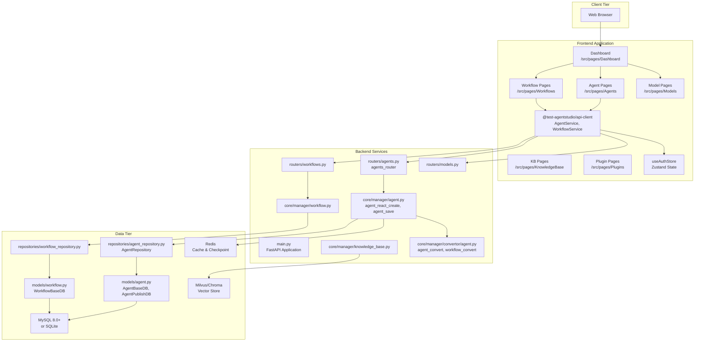

**Sources:** 
- [frontend/src/pages/Models/ModelsPage.tsx:1-114]()
- [backend/openjiuwen_studio/main.py:1-262]()
- [backend/openjiuwen_studio/routers/agents.py:1-70]()
- [backend/openjiuwen_studio/core/manager/agent.py:1-160]()

### Application Initialization and Lifecycle

The application follows a structured startup and shutdown process managed by FastAPI's lifespan context:

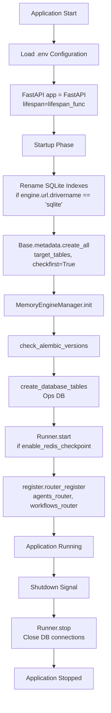

**Key initialization classes and functions:**

| Component | Code Entity | Location |
|-----------|-------------|----------|
| Application Factory | `FastAPI(lifespan=lifespan_func)` | [backend/openjiuwen_studio/main.py:149-163]() |
| Database Tables | `Base.metadata.create_all()` | [backend/openjiuwen_studio/main.py:110-114]() |
| Table Models | `AgentBaseDB`, `AgentPublishDB`, `WorkflowBaseDB`, etc. | [backend/openjiuwen_studio/main.py:28-43]() |
| Memory Engine | `MemoryEngineManager.init()` | [backend/openjiuwen_studio/main.py:115]() |
| Version Check | `check_alembic_versions()` | [backend/openjiuwen_studio/main.py:121]() |
| Runner Initialization | `Runner.start()` | [backend/openjiuwen_studio/main.py:140]() |

**Sources:**
- [backend/openjiuwen_studio/main.py:54-146]()
- [backend/openjiuwen_studio/core/config.py:1-80]()

## Technology Stack

### Frontend Stack

| Layer | Technologies | Key Files |
|-------|-------------|-----------|
| **Framework** | React 18, TypeScript, Vite | [frontend/src/main.tsx](), [frontend/vite.config.ts]() |
| **UI Components** | Material-UI (MUI), Lucide Icons | [frontend/src/pages/Models/ModelsPage.tsx:1-50]() |
| **State Management** | Zustand (`useAuthStore`, `useAgentStore`) | [frontend/src/stores/useAuthStore.ts]() |
| **API Client** | React Query, Axios | [frontend/packages/api-client/src/services/agentService.ts:1-50]() |
| **Routing** | React Router v6 | [frontend/src/App.tsx]() |
| **i18n** | react-i18next | [frontend/src/locales/zh-CN.json](), [frontend/src/locales/en-US.json]() |
| **Workflow Canvas** | Custom React Flow implementation | [@workflow-canvas package]() |

**Sources:**
- [frontend/src/pages/Models/ModelsPage.tsx:1-45]()
- [frontend/packages/api-client/src/config.ts:1-70]()
- [frontend/src/locales/zh-CN.json:1-100]()

### Backend Stack

| Layer | Technologies | Key Files |
|-------|-------------|-----------|
| **Framework** | FastAPI, Uvicorn | [backend/openjiuwen_studio/main.py:1-50]() |
| **ORM** | SQLAlchemy 2.x | [backend/openjiuwen_studio/models/agent.py]() |
| **Validation** | Pydantic v2 | [backend/openjiuwen_studio/schemas/agent.py:1-50]() |
| **Migration** | Alembic (multi-head: MySQL + SQLite) | [backend/alembic/]() |
| **Authentication** | JWT (PyJWT) | [backend/openjiuwen_studio/core/manager/login_manager/]() |
| **AI Integration** | `openjiuwen` package (LLM, RAG, Agents) | [backend/openjiuwen_studio/core/manager/convertor/agent.py:1-50]() |
| **Task Queue** | Redis (optional) | [backend/openjiuwen_studio/core/manager/redis_manager/]() |

**Sources:**
- [backend/openjiuwen_studio/main.py:1-262]()
- [backend/openjiuwen_studio/schemas/agent.py:1-100]()
- [backend/openjiuwen_studio/core/config.py:1-80]()

### Database Architecture

The system supports multiple database backends for different data types:

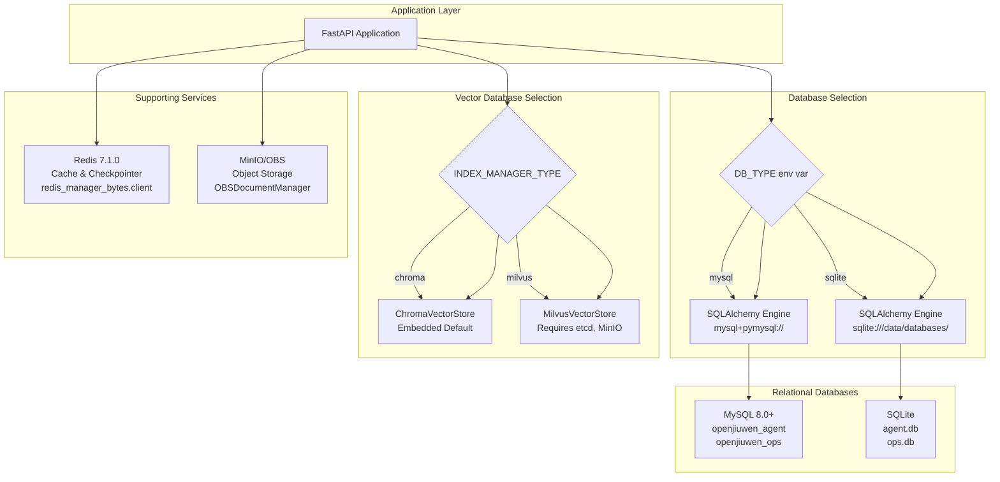

**Database configuration mapping:**

| Purpose | Environment Variable | Code Entity | Default Value |
|---------|---------------------|-------------|---------------|
| DB Type | `DB_TYPE` | `settings.db_type` | `sqlite` |
| MySQL Host | `DB_HOST` | `settings.db_host` | `localhost` |
| SQLite Path | `SQLITE_DB_PATH` | `settings.sqlite_db_path` | `data/databases` |
| Vector DB Type | `INDEX_MANAGER_TYPE` | `_CURR_INDEX_TYPE` | `chroma` |
| Milvus Host | `MILVUS_HOST` | `settings.milvus_host` | `jiuwen-milvus-standalone` |
| Redis Host | `REDIS_HOST` | `settings.redis_host` | `localhost` |

**Sources:**
- [.env.example:88-149]()
- [backend/openjiuwen_studio/core/config.py:26-80]()
- [backend/openjiuwen_studio/core/manager/knowledge_base.py:83-152]()

## Core Components and Data Flow

### Agent Development Flow

The following diagram maps the natural language user journey to concrete code entities:

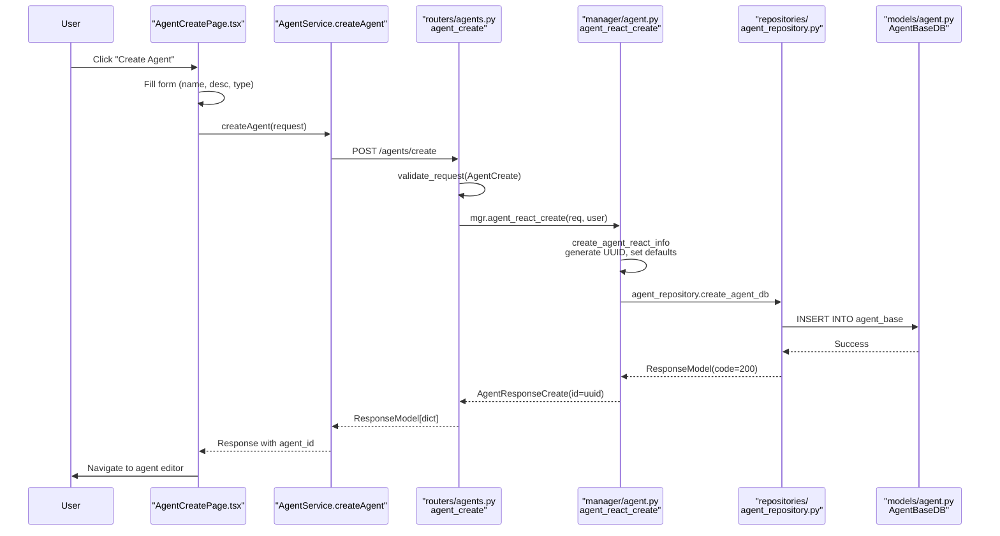

**Key code entities in agent creation:**

| Stage | Frontend Entity | Backend Entity | Data Model |
|-------|----------------|----------------|------------|
| UI Form | `AgentCreatePage` | - | `CreateAgentRequest` |
| API Call | `AgentService.createAgent()` | `POST /agents/create` | `AgentCreate` schema |
| Validation | - | `validate_request()` | Pydantic validation |
| Business Logic | - | `agent_react_create()` | `AgentBaseDBPd` |
| Persistence | - | `AgentRepository.create_agent_db()` | `AgentBaseDB` model |

**Sources:**
- [frontend/packages/api-client/src/services/agentService.ts:44-54]()
- [backend/openjiuwen_studio/routers/agents.py:157-179]()
- [backend/openjiuwen_studio/core/manager/agent.py:329-376]()
- [backend/openjiuwen_studio/core/manager/repositories/agent_repository.py:1-50]()

### Agent Configuration and Execution

Agents are configured in "display mode" and converted to executable DSL format:

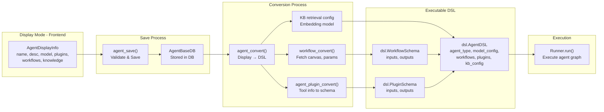

**Conversion function mapping:**

| Conversion Task | Function | Input | Output |
|----------------|----------|-------|--------|
| Main conversion | `agent_convert()` | `AgentBaseDBPd` | `dsl.AgentDSL` |
| Workflow list | `workflows_convert()` | `List[dict]` | `List[dsl.WorkflowSchema]` |
| Single workflow | `workflow_convert()` | `AgentWorkflowListNodeBase` | `(inputs, outputs)` |
| Plugin list | `agent_plugins_convert()` | `List[AgentPlugin]` | `List[dsl.PluginSchema]` |
| Single plugin | `agent_plugin_convert()` | `AgentPlugin` | `dsl.PluginSchema` |
| Model config | `model_convert()` | `AgentBaseDBPd.model_id` | `dsl.ModelConfig` |
| Knowledge base | KB retrieval logic | `kb_list` | `dsl.KBRetrievalConfig` |

**Sources:**
- [backend/openjiuwen_studio/core/manager/agent.py:613-695]()
- [backend/openjiuwen_studio/core/manager/convertor/agent.py:1-400]()
- [backend/openjiuwen_studio/schemas/agent.py:1-200]()

### Model Management Architecture

The system supports two types of models with distinct configurations:

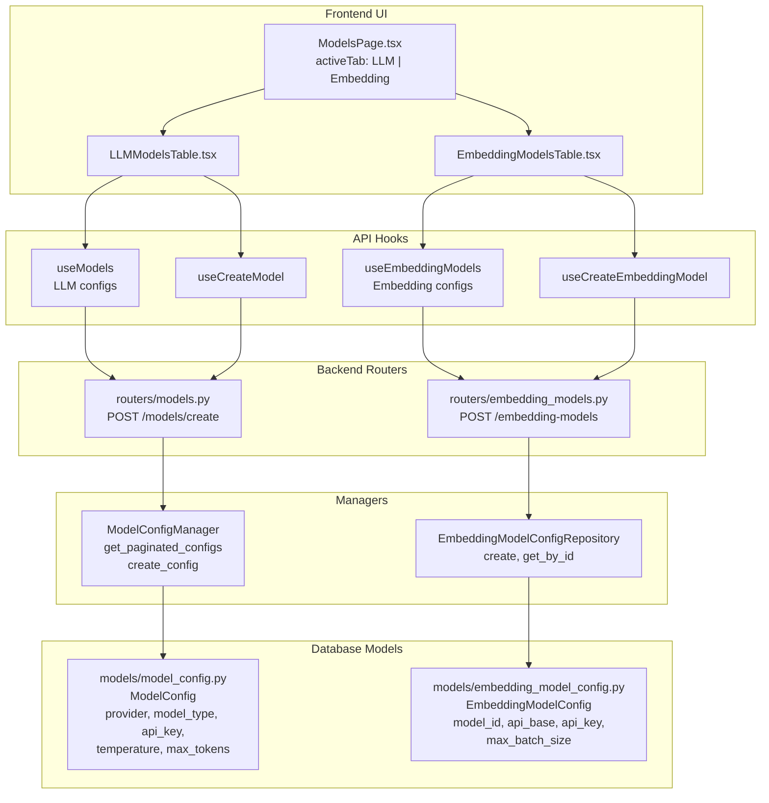

**Model type comparison:**

| Aspect | LLM Models | Embedding Models |
|--------|-----------|------------------|
| **Frontend Component** | `LLMModelsTable.tsx` | `EmbeddingModelsTable.tsx` |
| **API Hook** | `useModels()` | `useEmbeddingModels()` |
| **Backend Router** | `routers/models.py` | `routers/embedding_models.py` |
| **Manager** | `ModelConfigManager` | `EmbeddingModelConfigRepository` |
| **DB Model** | `ModelConfig` | `EmbeddingModelConfig` |
| **Key Parameters** | `temperature`, `max_tokens`, `top_p`, `timeout` | `max_batch_size` |
| **Usage** | Agent reasoning, tool calls | Document embedding, RAG retrieval |

**Sources:**
- [frontend/src/pages/Models/ModelsPage.tsx:1-300]()
- [frontend/src/pages/Models/components/LLMModelsTable.tsx:1-100]()
- [frontend/src/pages/Models/components/EmbeddingModelsTable.tsx:1-100]()
- [backend/openjiuwen_studio/routers/embedding_models.py:1-200]()

### Knowledge Base Document Processing Pipeline

Documents flow through a multi-stage processing pipeline:

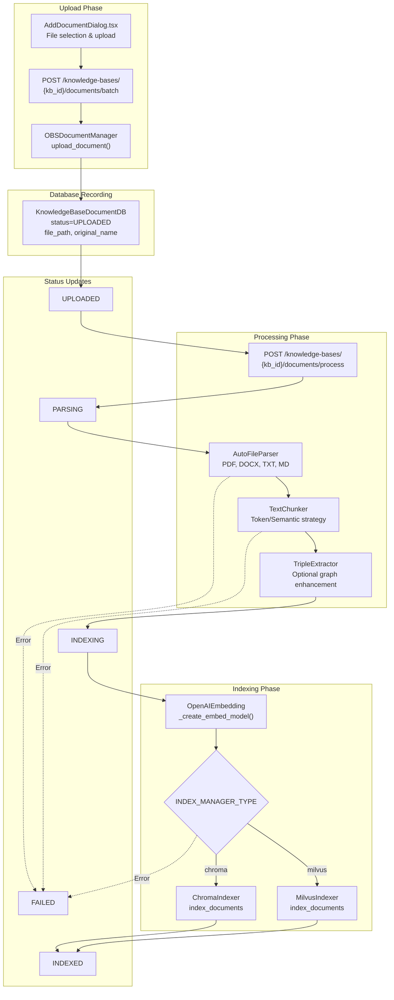

**Processing function mapping:**

| Stage | Code Entity | Key Parameters | Location |
|-------|-------------|----------------|----------|
| **Upload** | `document_upload_batch()` | `files: List[UploadFile]` | [knowledge_base.py:700-800]() |
| **Save to storage** | `OBSDocumentManager.upload_document()` | `object_name`, `file_path` | [knowledge_base.py:144-151]() |
| **Parse** | `AutoFileParser.parse()` | `file_path` | Via `openjiuwen` package |
| **Chunk** | `TextChunker.chunk()` | `chunk_size`, `overlap` | Via `openjiuwen` package |
| **Extract triples** | `TripleExtractor.extract()` | `llm_client`, `documents` | Via `openjiuwen` package |
| **Embed** | `OpenAIEmbedding.embed()` | `texts`, `batch_size` | [knowledge_base.py:369-451]() |
| **Index** | `ChromaIndexer.index_documents()` | `documents`, `collection_name` | Via `openjiuwen` package |
| **Status update** | `knowledge_base_repository.update_document_status()` | `doc_id`, `status` | [knowledge_base.py:1000-1100]() |

**Sources:**
- [frontend/src/pages/KnowledgeBase/components/AddDocumentDialog.tsx:1-200]()
- [backend/openjiuwen_studio/core/manager/knowledge_base.py:86-451]()
- [backend/openjiuwen_studio/schemas/knowledge_base.py:1-100]()

## Configuration and Environment

The system is configured through environment variables defined in `.env`:

**Critical configuration mapping:**

| Category | Variable | Code Reference | Default | Purpose |
|----------|----------|----------------|---------|---------|
| **Database** | `DB_TYPE` | `settings.db_type` | `sqlite` | `mysql` or `sqlite` |
| | `DB_HOST` | `settings.db_host` | `localhost` | MySQL host |
| | `SQLITE_DB_PATH` | `settings.sqlite_db_path` | `data/databases` | SQLite file location |
| **Vector DB** | `INDEX_MANAGER_TYPE` | `_CURR_INDEX_TYPE` | `chroma` | `milvus` or `chroma` |
| | `MILVUS_HOST` | `settings.milvus_host` | `jiuwen-milvus-standalone` | Milvus server |
| **Authentication** | `SECRET_KEY` | `settings.secret_key` | (required) | JWT signing key |
| | `ACCESS_TOKEN_EXPIRE_MINUTES` | `settings.access_token_expire_minutes` | `2880` | Token lifetime |
| **Services** | `BACKEND_PORT` | `settings.port` | `8000` | Backend port |
| | `FRONTEND_PORT` | - | `3000` | Frontend dev server |
| | `REDIS_HOST` | `settings.redis_host` | `localhost` | Redis cache |
| | `CODE_SANDBOX_URL` | `settings.code_sandbox_url` | - | Plugin execution sandbox |
| **Object Storage** | `OBS_BUCKET` | `OBSDocumentManager.bucket` | - | MinIO/OBS bucket |
| | `OBS_SERVER` | Used in `AioBotoClient` | - | Object storage endpoint |
| **Email** | `SMTP_HOST` | `settings.smtp_host` | - | Email server |
| | `SMTP_PORT` | `settings.smtp_port` | `465` | Email port |

**Frontend environment variables:**

| Variable | Purpose | Default | Code Usage |
|----------|---------|---------|------------|
| `VITE_API_BASE_URL` | Backend API endpoint | `/api/v1` | `API_CONFIG.BASE_URL` |
| `VITE_API_PROXY_TARGET` | Dev proxy target | `http://localhost:8000/` | `vite.config.ts` |
| `VITE_TOKEN_REFRESH_INTERVAL_SECONDS` | Token refresh frequency | `600` | `useAuthStore` |
| `VITE_ENABLE_NEW_AUTH` | Enable registration system | `False` | Auth routing |
| `VITE_PLUGIN_SERVICE_URL` | External plugin server | - | Plugin execution |

**Sources:**
- [.env.example:1-196]()
- [backend/openjiuwen_studio/core/config.py:1-80]()
- [frontend/packages/api-client/src/config.ts:1-70]()

## Request-Response Flow Example

A complete request flow for saving an agent configuration:

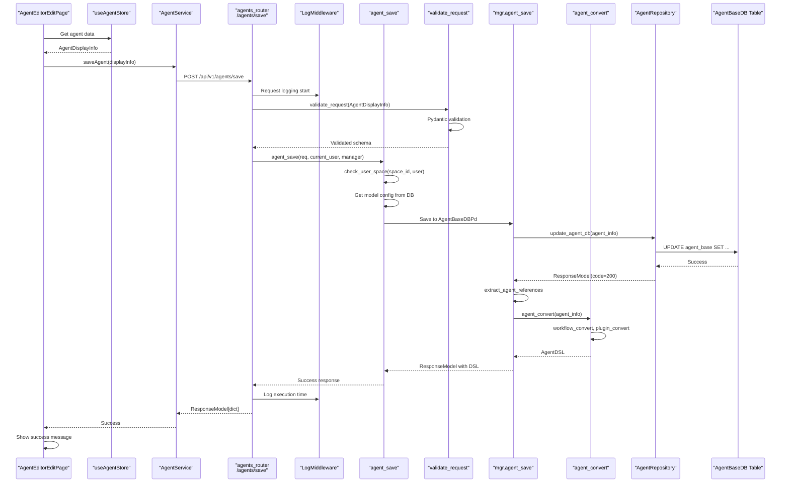

**Key validation and error handling points:**

| Stage | Code Location | Error Handling |
|-------|--------------|----------------|
| Schema validation | `validate_request(AgentDisplayInfo)` | `ValidationError` → `handle_validation_error()` → HTTP 400 |
| User permission | `check_user_space()` | Raises exception if unauthorized |
| Model lookup | `manager.get_config_by_id()` | Returns `AGENT_MODEL_NOT_FOUND` if missing |
| Database save | `agent_repository.update_agent_db()` | Returns `ResponseModel` with error code |
| DSL conversion | `agent_convert()` | Catches conversion errors, logs warnings |

**Sources:**
- [backend/openjiuwen_studio/routers/agents.py:200-250]()
- [backend/openjiuwen_studio/core/manager/agent.py:613-800]()
- [backend/openjiuwen_studio/main.py:166-222]()

## Internationalization (i18n)

The platform supports English and Chinese through react-i18next:

**Language resolution strategy (backend):**

```python
def _resolve_language(current_user: Optional[dict]) -> str:
    """Sticky English strategy - prefers 'en' if specified in header or profile"""
    # 1. Check HTTP Header
    language = get_language()  # From Accept-Language or custom header
    if language and language.lower() not in {"cn"}:
        header_lang = _normalize_language(language)
        if header_lang == "en":
            return "en"
    
    # 2. Check user profile
    if current_user:
        locale = (current_user.get("data") or {}).get("locale")
        if locale and _normalize_language(locale) == "en":
            return "en"
    
    # 3. Default to Chinese
    return "zh"
```

**Translation file structure:**

| File | Keys | Usage |
|------|------|-------|
| `frontend/src/locales/zh-CN.json` | ~2500+ keys | Chinese translations |
| `frontend/src/locales/en-US.json` | ~2500+ keys | English translations |

**Key translation domains:**

- `common.*` - Buttons, messages, status
- `agents.*` - Agent-specific UI
- `workflows.*` - Workflow editor
- `models.*` - Model management
- `knowledgeBases.*` - Knowledge base UI
- `auth.*` - Authentication flows

**Sources:**
- [frontend/src/locales/zh-CN.json:1-500]()
- [frontend/src/locales/en-US.json:1-500]()
- [backend/openjiuwen_studio/routers/agents.py:28-68]()

---

This overview provides the foundation for understanding OpenJiuwen Agent Studio's architecture. For detailed information on specific subsystems, refer to the subsequent sections linked at the beginning of this document.

---

# Page: Key Features

# Key Features

<details>
<summary>Relevant source files</summary>

The following files were used as context for generating this wiki page:

- [backend/openjiuwen_studio/core/manager/agent.py](backend/openjiuwen_studio/core/manager/agent.py)
- [backend/openjiuwen_studio/core/manager/convertor/agent.py](backend/openjiuwen_studio/core/manager/convertor/agent.py)
- [backend/openjiuwen_studio/core/manager/knowledge_base.py](backend/openjiuwen_studio/core/manager/knowledge_base.py)
- [backend/openjiuwen_studio/core/manager/model_manager/managers/embedding_model_test_manager.py](backend/openjiuwen_studio/core/manager/model_manager/managers/embedding_model_test_manager.py)
- [backend/openjiuwen_studio/core/manager/repositories/agent_repository.py](backend/openjiuwen_studio/core/manager/repositories/agent_repository.py)
- [backend/openjiuwen_studio/core/manager/repositories/plugin_repository.py](backend/openjiuwen_studio/core/manager/repositories/plugin_repository.py)
- [backend/openjiuwen_studio/core/manager/repositories/tool_repository.py](backend/openjiuwen_studio/core/manager/repositories/tool_repository.py)
- [backend/openjiuwen_studio/routers/agents.py](backend/openjiuwen_studio/routers/agents.py)
- [backend/openjiuwen_studio/routers/embedding_models.py](backend/openjiuwen_studio/routers/embedding_models.py)
- [backend/openjiuwen_studio/schemas/agent.py](backend/openjiuwen_studio/schemas/agent.py)
- [frontend/packages/api-client/src/config.ts](frontend/packages/api-client/src/config.ts)
- [frontend/packages/api-client/src/services/agentService.ts](frontend/packages/api-client/src/services/agentService.ts)
- [frontend/src/components/Agent/AgentModelSelector.tsx](frontend/src/components/Agent/AgentModelSelector.tsx)
- [frontend/src/components/Agent/OverridePromptTemplateDialog.tsx](frontend/src/components/Agent/OverridePromptTemplateDialog.tsx)
- [frontend/src/locales/agent/en-US/common.json](frontend/src/locales/agent/en-US/common.json)
- [frontend/src/locales/agent/en-US/editor.json](frontend/src/locales/agent/en-US/editor.json)
- [frontend/src/locales/agent/zh-CN/common.json](frontend/src/locales/agent/zh-CN/common.json)
- [frontend/src/locales/agent/zh-CN/editor.json](frontend/src/locales/agent/zh-CN/editor.json)
- [frontend/src/locales/en-US.json](frontend/src/locales/en-US.json)
- [frontend/src/locales/zh-CN.json](frontend/src/locales/zh-CN.json)
- [frontend/src/pages/Agents/AgentCreatePage.tsx](frontend/src/pages/Agents/AgentCreatePage.tsx)
- [frontend/src/pages/Agents/AgentEditorEditPage.tsx](frontend/src/pages/Agents/AgentEditorEditPage.tsx)
- [frontend/src/pages/Agents/AgentsPage.tsx](frontend/src/pages/Agents/AgentsPage.tsx)
- [frontend/src/pages/Auth/PrivacyPolicyPage.tsx](frontend/src/pages/Auth/PrivacyPolicyPage.tsx)
- [frontend/src/pages/Auth/UserLoginPage.tsx](frontend/src/pages/Auth/UserLoginPage.tsx)
- [frontend/src/pages/KnowledgeBase/components/AddDocumentDialog.tsx](frontend/src/pages/KnowledgeBase/components/AddDocumentDialog.tsx)
- [frontend/src/pages/KnowledgeBase/components/KnowledgeBaseFormDialog.tsx](frontend/src/pages/KnowledgeBase/components/KnowledgeBaseFormDialog.tsx)
- [frontend/src/pages/Models/ModelsPage.tsx](frontend/src/pages/Models/ModelsPage.tsx)
- [frontend/src/pages/Models/ModelsPageNew.tsx](frontend/src/pages/Models/ModelsPageNew.tsx)
- [frontend/src/pages/Models/components/EmbeddingModelsTable.tsx](frontend/src/pages/Models/components/EmbeddingModelsTable.tsx)
- [frontend/src/pages/Models/components/LLMModelsTable.tsx](frontend/src/pages/Models/components/LLMModelsTable.tsx)

</details>


This document provides an overview of the main capabilities provided by OpenJiuwen Agent Studio. It describes the platform's core feature set at a functional level, including agent development modes, workflow orchestration, knowledge management, and extensibility mechanisms.

For detailed architectural implementation, see [Architecture Overview](#1.2). For installation and setup instructions, see [Installation & Setup](#2).

---

## Agent Development

OpenJiuwen Agent Studio supports two distinct agent development paradigms, each suited to different use cases.

### Agent Modes

The platform provides two agent creation modes, differentiated by the `agent_type` field in [backend/openjiuwen_studio/schemas/agent.py:26]():

| Mode | Type Value | Description | Use Case |
|------|------------|-------------|----------|
| **ReAct Mode** | `react` | Autonomous planning with LLM-driven reasoning and tool invocation | Complex tasks requiring dynamic planning and adaptation |
| **Workflow Mode** | `workflow` | Orchestrated execution through pre-defined workflow graphs | Business processes with clear, deterministic steps |

### Agent Creation Flow

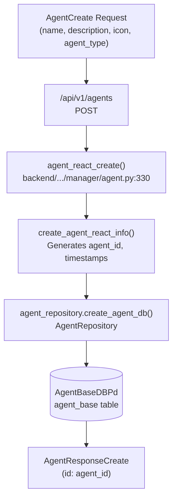

**Sources:** 
- [backend/openjiuwen_studio/routers/agents.py:70-100]()
- [backend/openjiuwen_studio/core/manager/agent.py:301-376]()
- [frontend/src/pages/Agents/AgentCreatePage.tsx:1-50]()

### Agent Configuration Components

Each agent consists of multiple configurable components managed through the `SaveAgentRequest` schema:

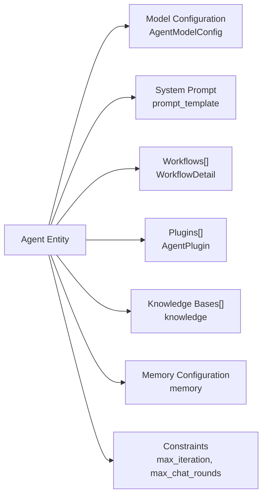

**Sources:**
- [backend/openjiuwen_studio/schemas/agent.py:80-150]()
- [frontend/src/components/Agent/AgentModelSelector.tsx:108-150]()
- [frontend/src/pages/Agents/AgentEditorEditPage.tsx:40-100]()

---

## Workflow Orchestration

The workflow system enables visual design of multi-step processes using a node-based canvas editor.

### Workflow Canvas Architecture

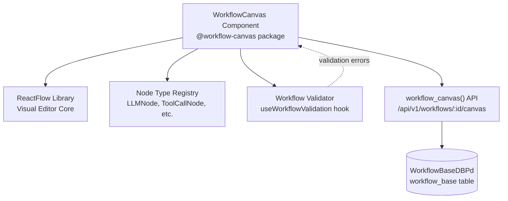

**Workflow Node Types:**

| Node Type | Class/Component | Purpose |
|-----------|-----------------|---------|
| `llm` | `LLMNode` | LLM inference with prompt templates |
| `tool_call` | `ToolCallNode` | Invoke external tools/plugins |
| `code` | `CodeNode` | Execute Python/JavaScript code |
| `condition` | `ConditionNode` | Conditional branching logic |
| `start` | `StartNode` | Workflow entry point |
| `end` | `EndNode` | Workflow termination |

**Sources:**
- [frontend/packages/workflow-canvas/src/components/]()
- [backend/openjiuwen_studio/core/manager/repositories/workflow_repository.py:1-50]()
- [frontend/src/hooks/useWorkflowValidation.ts]()

### Workflow Execution Pipeline

When an agent with `agent_type: workflow` executes, the system converts the workflow graph into executable DSL:

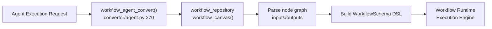

**Sources:**
- [backend/openjiuwen_studio/core/manager/convertor/agent.py:32-66]()
- [backend/openjiuwen_studio/core/manager/convertor/agent.py:270-350]()

---

## Prompt Management

The platform provides sophisticated prompt template management with version control and optimization capabilities.

### Prompt Template System

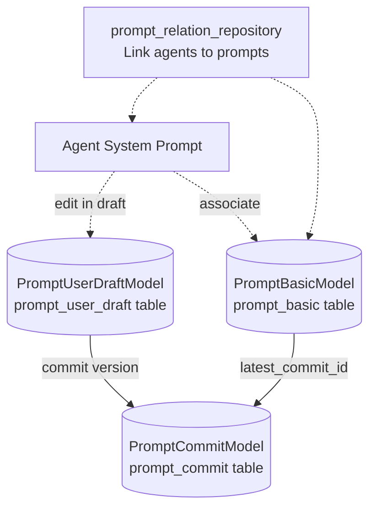

**Key Operations:**

| Operation | Endpoint/Function | Description |
|-----------|-------------------|-------------|
| Create Template | `POST /api/v1/prompts` | Create new prompt template with unique key |
| Draft Edit | `PUT /api/v1/prompts/:key/draft` | Update user's draft version |
| Commit Version | `POST /api/v1/prompts/:key/commit` | Publish version (e.g., 1.0.0) |
| Associate Agent | `prompt_relation_repository` | Link prompt to agent's system prompt |

**Sources:**
- [backend/openjiuwen_studio/ops/modules/prompt/infra/repositories/orm_repo.py:1-100]()
- [backend/openjiuwen_studio/core/manager/repositories/prompt_relation_repository.py:1-50]()
- [frontend/src/components/Agent/SystemPromptTab.tsx:1-100]()

### Prompt Optimization

The system includes an AI-powered prompt optimization feature:

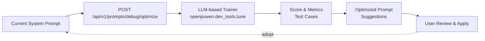

**Sources:**
- [frontend/src/locales/agent/en-US/editor.json:151-160]()
- [backend/openjiuwen_studio/routers/agents.py:1-50]()

---

## Model Management

The platform supports configuration and management of both LLM and Embedding models.

### Model Types and Configuration

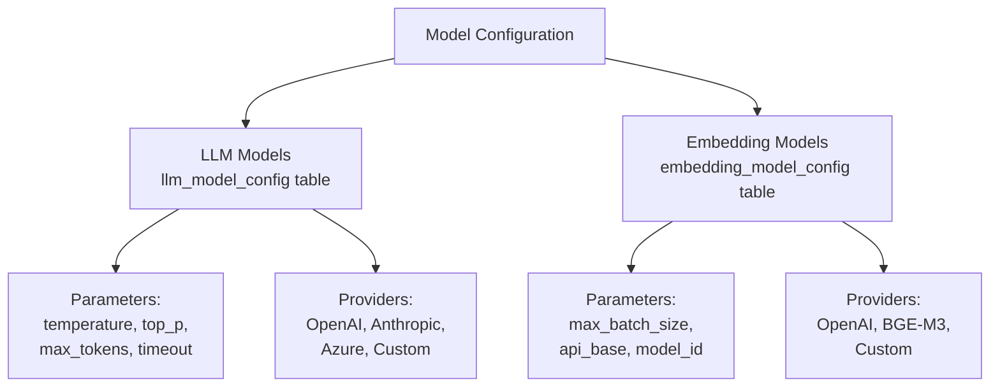

**LLM Model Configuration Fields:**

| Field | Type | Purpose |
|-------|------|---------|
| `name` | string | User-defined model name |
| `provider` | enum | Model provider (OpenAI, Anthropic, etc.) |
| `model_type` | string | Actual model identifier (e.g., gpt-4) |
| `api_key` | encrypted | Encrypted API credentials |
| `base_url` | string | API endpoint URL |
| `temperature` | float | Sampling temperature (0-2) |
| `max_tokens` | int | Maximum generation tokens |
| `timeout` | int | Request timeout in seconds |
| `enable_streaming` | bool | Enable SSE streaming responses |

**Sources:**
- [frontend/src/pages/Models/ModelsPage.tsx:84-113]()
- [backend/openjiuwen_studio/core/manager/model_manager/managers.py:1-100]()
- [frontend/packages/api-client/src/types/models.ts:1-50]()

### Model Security

API keys are encrypted using the `SecurityUtils` class before storage:

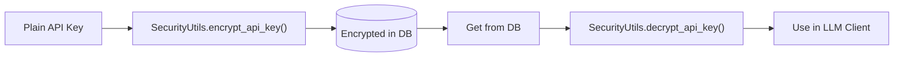

**Sources:**
- [backend/openjiuwen_studio/core/manager/model_manager/utils.py:1-100]()
- [backend/openjiuwen_studio/core/manager/knowledge_base.py:99-106]()

---

## Knowledge Base Management

The knowledge base system provides document ingestion, processing, and retrieval capabilities with optional graph enhancement.

### Document Processing Pipeline

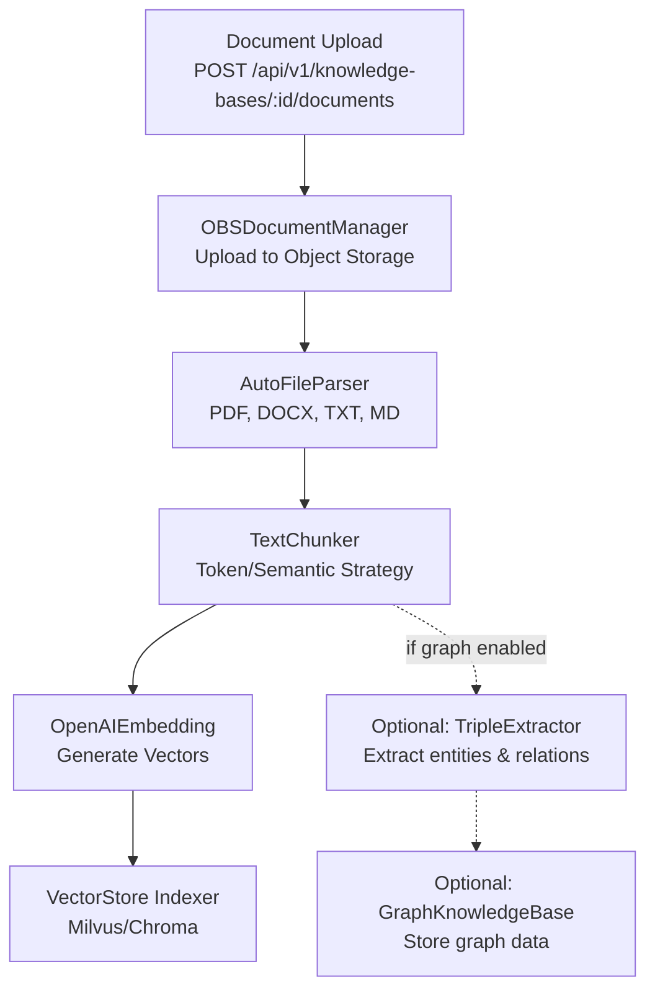

**Processing Configuration:**

| Strategy | Options | Description |
|----------|---------|-------------|
| **Parsing** | `auto_detect` | Automatically detect file format and parse |
| **Chunking** | `token`, `semantic` | Split by token count or semantic boundaries |
| **Indexing** | `text`, `graph`, `hybrid` | Vector-only, graph-only, or combined |

**Sources:**
- [backend/openjiuwen_studio/core/manager/knowledge_base.py:86-186]()
- [backend/openjiuwen_studio/core/manager/knowledge_base.py:456-650]()
- [frontend/src/pages/KnowledgeBase/components/AddDocumentDialog.tsx:1-100]()

### Knowledge Base Retrieval

Agents can access knowledge bases with configurable retrieval strategies:

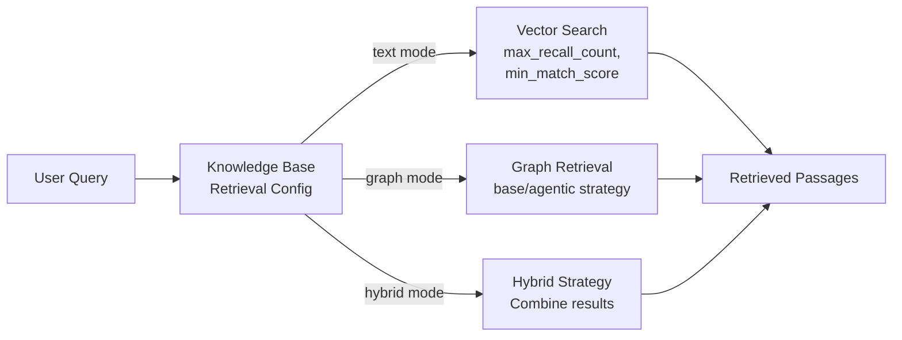

**Retrieval Configuration Fields:**

- `max_recall_count`: Maximum number of passages to return (default: 5)
- `min_match_score`: Minimum similarity threshold (default: 0.5)
- `graph_retrieval_strategy`: `base` (entity/relation graph) or `agentic` (multi-step reasoning)
- `retrieval_source`: `text`, `triple`, or `hybrid`

**Sources:**
- [frontend/src/components/Agent/AgentModelSelector.tsx:165-175]()
- [backend/openjiuwen_studio/core/manager/convertor/agent.py:390-450]()

---

## Plugin & Tool System

The platform supports two types of plugins for extending agent capabilities.

### Plugin Types

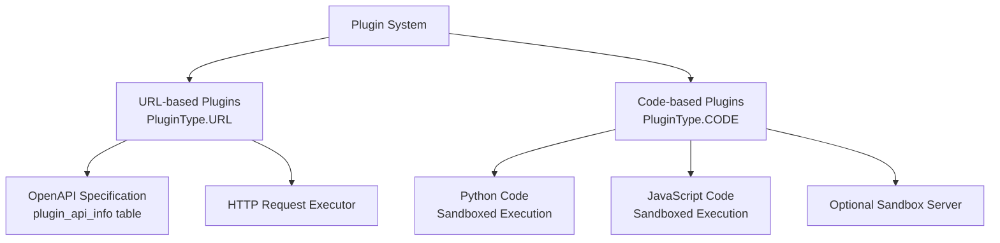

**Plugin Configuration:**

| Plugin Type | Storage | Execution |
|-------------|---------|-----------|
| **URL** | API endpoint, method, parameters in DB | Direct HTTP request to external service |
| **Code** | Python/JS code in `plugin_code_info` table | Execute in optional sandbox environment |

**URL Plugin Structure:**
```
PluginApiInfo:
  - api_name: string
  - url: string
  - method: GET/POST/PUT/DELETE
  - parameters: PluginApiParameter[]
  - description: string
```

**Sources:**
- [backend/openjiuwen_studio/schemas/plugin.py:1-100]()
- [backend/openjiuwen_studio/core/manager/repositories/plugin_repository.py:1-50]()
- [frontend/packages/workflow-canvas/src/components/PluginSelector.tsx:1-100]()

### Tool Invocation in Agents

When an agent uses a plugin, the system converts it to a tool schema:

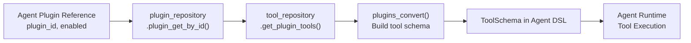

**Sources:**
- [backend/openjiuwen_studio/core/manager/convertor/agent.py:120-170]()
- [backend/openjiuwen_studio/core/manager/repositories/tool_repository.py:1-50]()

---

## Memory Systems

The platform provides two memory mechanisms: variable storage and long-term memory.

### Memory Architecture

```mermaid
graph TB
    Agent["Agent Memory Config"]
    MemoryBase[("MemoryBaseItem<br/>mdb_id, name")]
    Variables["Memory Variables<br/>name, description, enabled"]
    LongTerm["Long-term Memory<br/>User info & preferences"]
    
    Agent --> MemoryBase
    Agent --> Variables
    Agent --> LongTerm
    
    MemoryBase --> EmbedModel["Embedding Model<br/>embedding_model_config_id"]
    MemoryBase --> LLMModel["LLM Model<br/>llm_model_config_id"]
    
    Variables --> VectorStore["Store in Vector DB<br/>Per-user context"]
    LongTerm --> VectorStore
```

**Memory Variable Configuration:**

| Field | Type | Description |
|-------|------|-------------|
| `id` | string | Unique variable identifier |
| `name` | string | Variable name (user-defined) |
| `description` | string | Variable purpose description |
| `enabled` | boolean | Whether variable is active |

**Long-term Memory:**
- Stores user personal information and preferences across conversations
- Requires binding a memory base with both embedding and LLM models
- Automatically updates based on conversation context

**Sources:**
- [frontend/src/components/Agent/AgentModelSelector.tsx:80-106]()
- [frontend/src/components/Agent/AgentModelSelector.tsx:179-186]()

---

## Version Control & Publishing

The system includes comprehensive version control for agents, prompts, and plugins.

### Agent Version Management

```mermaid
graph TB
    Draft[("AgentBaseDBPd<br/>Draft Version<br/>agent_version=NULL")]
    Publish["Publish Action<br/>POST /api/v1/agents/:id/publish"]
    Published[("AgentPublishDBPd<br/>Published Version<br/>agent_version='1.0.0'")]
    History["Version History<br/>GET /api/v1/agents/:id/versions"]
    
    Draft -->|save changes| Draft
    Draft -->|publish| Publish
    Publish --> Published
    Published -.->|view history| History
    History -.->|restore to draft| Draft
```

**Version Fields:**
- `agent_version`: Semantic version string (e.g., "1.0.0")
- `create_time`: Version creation timestamp
- `update_time`: Last modification timestamp

**Sources:**
- [backend/openjiuwen_studio/core/manager/agent.py:850-950]()
- [frontend/src/components/Agent/AgentPublishDialog.tsx:1-100]()
- [frontend/src/components/Agent/AgentVersionListPanel.tsx:1-100]()

---

## Multi-Database Support

The platform supports flexible database backend selection via environment configuration.

### Database Selection

```mermaid
graph TB
    EnvConfig["Environment Variable:<br/>DB_TYPE"]
    DBSwitch{DB_TYPE value}
    MySQL["MySQL 8.0+<br/>openjiuwen_agent<br/>openjiuwen_ops"]
    SQLite["SQLite<br/>agent.db<br/>ops.db"]
    
    EnvConfig --> DBSwitch
    DBSwitch -->|mysql| MySQL
    DBSwitch -->|sqlite| SQLite
    
    VectorSwitch{INDEX_MANAGER_TYPE}
    Milvus["Milvus 2.6.2+<br/>Vector Store"]
    Chroma["Chroma<br/>Embedded Vector Store"]
    
    EnvConfig --> VectorSwitch
    VectorSwitch -->|milvus| Milvus
    VectorSwitch -->|chroma| Chroma
```

**Database Configuration:**

| Database | Environment Variable | Default | Use Case |
|----------|---------------------|---------|----------|
| **Relational** | `DB_TYPE` | `sqlite` | `mysql` for production, `sqlite` for development |
| **Vector Store** | `INDEX_MANAGER_TYPE` | `chroma` | `milvus` for scale, `chroma` for simplicity |

**Schema Management:**
- Alembic migrations for both MySQL and SQLite variants
- Separate migration scripts: `alembic_mysql_agent`, `alembic_sqlite_agent`, etc.

**Sources:**
- [backend/openjiuwen_studio/core/manager/agent.py:132]()
- [backend/openjiuwen_studio/core/manager/knowledge_base.py:83]()

---

## Import/Export Functionality

Agents can be exported and imported as portable packages for sharing and backup.

### Export Format

```mermaid
graph LR
    Agent["Agent Configuration"]
    Export["POST /api/v1/agents/export"]
    Package["ZIP Archive"]
    Metadata["agent_export.json<br/>AgentExportMetadata"]
    Dependencies["Dependencies:<br/>workflows/, prompts/,<br/>plugins/, knowledge/"]
    
    Agent --> Export
    Export --> Package
    Package --> Metadata
    Package --> Dependencies
```

**Export Package Structure:**
```
agent_export_<name>_<timestamp>.zip
├── agent_export.json (metadata)
├── workflows/
│   ├── workflow_1.json
│   └── workflow_2.json
├── prompts/
│   └── prompt_template.json
├── plugins/
│   └── plugin_config.json
└── knowledge/
    └── kb_references.json
```

**Sources:**
- [backend/openjiuwen_studio/core/manager/agent.py:1100-1400]()
- [backend/openjiuwen_studio/schemas/agent.py:200-250]()
- [frontend/src/pages/Agents/AgentsPage.tsx:60-70]()

---

# Page: Architecture Overview

# Architecture Overview

<details>
<summary>Relevant source files</summary>

The following files were used as context for generating this wiki page:

- [.env.example](.env.example)
- [backend/openjiuwen_studio/core/common/logging/__init__.py](backend/openjiuwen_studio/core/common/logging/__init__.py)
- [backend/openjiuwen_studio/core/common/logging/events.py](backend/openjiuwen_studio/core/common/logging/events.py)
- [backend/openjiuwen_studio/core/config.py](backend/openjiuwen_studio/core/config.py)
- [backend/openjiuwen_studio/core/manager/convertor/components/sub_workflow.py](backend/openjiuwen_studio/core/manager/convertor/components/sub_workflow.py)
- [backend/openjiuwen_studio/core/manager/email_manager/__init__.py](backend/openjiuwen_studio/core/manager/email_manager/__init__.py)
- [backend/openjiuwen_studio/core/manager/email_manager/email_template.py](backend/openjiuwen_studio/core/manager/email_manager/email_template.py)
- [backend/openjiuwen_studio/core/manager/email_manager/email_utils.py](backend/openjiuwen_studio/core/manager/email_manager/email_utils.py)
- [backend/openjiuwen_studio/core/manager/redis_manager/__init__.py](backend/openjiuwen_studio/core/manager/redis_manager/__init__.py)
- [backend/openjiuwen_studio/core/manager/utils/utils.py](backend/openjiuwen_studio/core/manager/utils/utils.py)
- [backend/openjiuwen_studio/main.py](backend/openjiuwen_studio/main.py)
- [backend/pyproject.toml](backend/pyproject.toml)
- [docs/en/2.Installation Guide/Install via Docker/Linux_Installation.md](docs/en/2.Installation Guide/Install via Docker/Linux_Installation.md)
- [docs/en/2.Installation Guide/Install via Docker/MacOS_Installation.md](docs/en/2.Installation Guide/Install via Docker/MacOS_Installation.md)
- [docs/en/2.Installation Guide/Install via Docker/Windows_Installation.md](docs/en/2.Installation Guide/Install via Docker/Windows_Installation.md)
- [scripts/.env.deploy.default](scripts/.env.deploy.default)
- [scripts/args_handler.sh](scripts/args_handler.sh)
- [scripts/common.sh](scripts/common.sh)
- [scripts/conf/docker-deepsearch.template.yml](scripts/conf/docker-deepsearch.template.yml)
- [scripts/conf/docker-jiuwen.template.yml](scripts/conf/docker-jiuwen.template.yml)
- [scripts/conf/docker-plugin.template.yml](scripts/conf/docker-plugin.template.yml)
- [scripts/envfile_handler.sh](scripts/envfile_handler.sh)
- [scripts/gen_ssl.sh](scripts/gen_ssl.sh)
- [scripts/global_vars.sh](scripts/global_vars.sh)
- [scripts/prompt_handler.sh](scripts/prompt_handler.sh)
- [scripts/service.sh](scripts/service.sh)
- [scripts/template_handler.sh](scripts/template_handler.sh)
- [scripts/vars_handler.sh](scripts/vars_handler.sh)

</details>


This document provides a high-level technical overview of the OpenJiuwen Agent Studio system architecture. It describes the major subsystems, their interactions, technology stack, deployment options, and configuration management. For detailed information about specific subsystems, see:
- Frontend architecture details: [Frontend Architecture](#5.2)
- Backend architecture details: [Backend Architecture](#5.3)
- Database and storage systems: [Data Layer](#5.4)
- Production deployment configurations: [Docker Deployment](#7.1)

## Purpose and Scope

OpenJiuwen Agent Studio is a full-stack AI agent development platform with a clear separation between presentation (React), business logic (FastAPI), and data persistence (multi-database). The system supports two deployment modes: containerized Docker deployment for production, and local development setup for rapid iteration. This document focuses on the architectural patterns, component relationships, and technology choices that enable flexible, scalable agent development.

---

## System Layers

The architecture follows a classic three-tier pattern with additional external service integrations:

**Three-Tier Architecture**

```mermaid
graph TB
    subgraph "Presentation Layer"
        Browser["Web Browser<br/>(HTTPS)"]
    end
    
    subgraph "Frontend Layer - React Application"
        Nginx["Nginx<br/>(SSL Termination)"]
        ReactApp["React + Vite<br/>Port: 3000/5173"]
        
        Dashboard["Dashboard"]
        AgentMgmt["Agent Management"]
        WorkflowCanvas["Workflow Canvas"]
        PromptStudio["Prompt Studio"]
        ModelMgmt["Model Management"]
        KBMgmt["Knowledge Base Mgmt"]
        PluginMgmt["Plugin Management"]
        MemoryMgmt["Memory Management"]
    end
    
    subgraph "Application Layer - FastAPI Backend"
        UvicornApp["Uvicorn Server<br/>openjiuwen_studio.main:app<br/>Port: 8000"]
        
        AgentRouter["agents_router<br/>/api/v1/agents/*"]
        WorkflowRouter["workflow_router<br/>/api/v1/workflows/*"]
        PromptRouter["prompt_tuning_router<br/>/api/v1/prompts/*"]
        ModelRouter["model_router<br/>/api/v1/models/*"]
        KBRouter["knowledge_base_router<br/>/api/v1/knowledge-bases/*"]
        PluginRouter["plugin_router<br/>/api/v1/plugins/*"]
        MemoryRouter["memory_router<br/>/api/v1/memory/*"]
    end
    
    subgraph "Data Layer"
        RelationalDB["Relational DB<br/>MySQL 8.4.5 or SQLite<br/>agent.db / ops.db"]
        VectorDB["Vector Store<br/>Milvus 2.6.2 or Chroma"]
        ObjectStore["Object Storage<br/>MinIO RELEASE.2024-12-18"]
        CacheStore["Cache & Checkpoint<br/>Redis 7.1.0"]
    end
    
    subgraph "External Services"
        LLMProviders["LLM Providers<br/>OpenAI, Anthropic, etc."]
        EmbedProviders["Embedding Models<br/>BGE-M3, OpenAI, etc."]
    end
    
    Browser --> Nginx
    Nginx --> ReactApp
    ReactApp --> Dashboard & AgentMgmt & WorkflowCanvas & PromptStudio & ModelMgmt & KBMgmt & PluginMgmt & MemoryMgmt
    
    Dashboard & AgentMgmt & WorkflowCanvas & PromptStudio & ModelMgmt & KBMgmt & PluginMgmt & MemoryMgmt --> UvicornApp
    
    UvicornApp --> AgentRouter & WorkflowRouter & PromptRouter & ModelRouter & KBRouter & PluginRouter & MemoryRouter
    
    AgentRouter & WorkflowRouter & PromptRouter & ModelRouter & KBRouter & PluginRouter & MemoryRouter --> RelationalDB
    KBRouter & MemoryRouter --> VectorDB
    KBRouter --> ObjectStore
    AgentRouter & WorkflowRouter --> CacheStore
    
    ModelRouter & PromptRouter --> LLMProviders & EmbedProviders
```

Sources: [backend/openjiuwen_studio/main.py:1-278](), [scripts/conf/docker-jiuwen.template.yml:1-72](), [.env.example:1-196]()

---

## Technology Stack

The platform is built on modern, production-ready technologies with configurable alternatives:

| Layer | Technology | Version | Configuration |
|-------|-----------|---------|---------------|
| **Frontend** | React + Vite | - | `NODE_ENV`, `VITE_API_BASE_URL` |
| **Backend** | FastAPI + Uvicorn | 0.115.11 / 0.35+ | `BACKEND_PORT=8000` |
| **Relational DB** | MySQL or SQLite | 8.4.5 / built-in | `DB_TYPE=mysql\|sqlite` |
| **Vector Store** | Milvus or Chroma | 2.6.2 / embedded | `INDEX_MANAGER_TYPE=milvus\|chroma` |
| **Object Storage** | MinIO | RELEASE.2024-12-18 | `MINIO_HOST`, `MINIO_PORT=9000` |
| **Cache** | Redis | 7.1.0 | `ENABLE_REDIS_CHECKPOINT=False` |
| **Web Server** | Nginx | - | SSL termination, proxy |
| **Container** | Docker + Compose | 20.10+ / v2.19.1+ | `docker-compose.yml` |
| **Python** | CPython | 3.11.4+ | `requires-python = ">=3.11.4"` |

Sources: [backend/pyproject.toml:1-70](), [.env.example:90-143](), [scripts/.env.deploy.default:1-76]()

---

## Core Backend Services

The FastAPI backend is organized into modular services with clear separation of concerns:

**Backend Service Architecture**

```mermaid
graph TB
    subgraph "Entry Point"
        MainApp["main.py<br/>FastAPI app instance<br/>lifespan_func"]
    end
    
    subgraph "Router Layer - openjiuwen_studio/routers/"
        RegisterFunc["register.router_register"]
        
        AgentsRouter["agents_router.py"]
        WorkflowsRouter["workflows_router.py"]
        PromptsRouter["prompt_tuning_router.py"]
        ModelsRouter["model_router.py"]
        KBRouter["knowledge_base_router.py"]
        PluginsRouter["plugin_router.py"]
        MemoryRouter["memory_router.py"]
        AuthRouter["auth_router.py"]
    end
    
    subgraph "Manager Layer - Core Business Logic"
        AgentManager["AgentManager<br/>+ Converter"]
        WorkflowManager["WorkflowManager<br/>+ Canvas Parser"]
        PromptOptimizer["PromptOptimizer<br/>+ Callbacks"]
        ModelManager["ModelManager<br/>+ Testing"]
        KBManager["KnowledgeBaseManager<br/>+ Document Processor"]
        PluginManager["PluginManager<br/>+ Tool Executor"]
        MemoryManager["MemoryBaseManager"]
    end
    
    subgraph "Repository Layer - Data Access"
        AgentRepo["AgentRepository"]
        WorkflowRepo["WorkflowRepository"]
        PromptRepo["PromptRepository"]
        ModelRepo["ModelRepository"]
        KBRepo["KnowledgeBaseRepository"]
        PluginRepo["PluginRepository"]
        MemoryRepo["MemoryRepository"]
    end
    
    subgraph "Database Engine"
        SQLAlchemyEngine["SQLAlchemy engine<br/>openjiuwen_studio.core.database"]
        BaseModels["Base.metadata<br/>models.db_fun_base"]
    end
    
    MainApp --> RegisterFunc
    RegisterFunc --> AgentsRouter & WorkflowsRouter & PromptsRouter & ModelsRouter & KBRouter & PluginsRouter & MemoryRouter & AuthRouter
    
    AgentsRouter --> AgentManager
    WorkflowsRouter --> WorkflowManager
    PromptsRouter --> PromptOptimizer
    ModelsRouter --> ModelManager
    KBRouter --> KBManager
    PluginsRouter --> PluginManager
    MemoryRouter --> MemoryManager
    
    AgentManager --> AgentRepo
    WorkflowManager --> WorkflowRepo
    PromptOptimizer --> PromptRepo
    ModelManager --> ModelRepo
    KBManager --> KBRepo
    PluginManager --> PluginRepo
    MemoryManager --> MemoryRepo
    
    AgentRepo & WorkflowRepo & PromptRepo & ModelRepo & KBRepo & PluginRepo & MemoryRepo --> SQLAlchemyEngine
    SQLAlchemyEngine --> BaseModels
```

Sources: [backend/openjiuwen_studio/main.py:24-244](), [backend/openjiuwen_studio/core/database.py]()

---

## Database Models and Tables

The system uses SQLAlchemy ORM with explicit table creation during startup:

**Database Tables (Initialized in lifespan_func)**

| Model Class | Table Purpose | Database |
|-------------|---------------|----------|
| `AgentBaseDB` | Agent drafts and metadata | `agent.db` / `openjiuwen_agent` |
| `AgentPublishDB` | Published agent versions | `agent.db` / `openjiuwen_agent` |
| `WorkflowBaseDB` | Workflow drafts | `agent.db` / `openjiuwen_agent` |
| `WorkflowPublishDB` | Published workflow versions | `agent.db` / `openjiuwen_agent` |
| `PluginBaseDB` | Plugin drafts | `agent.db` / `openjiuwen_agent` |
| `PluginPublishDB` | Published plugin versions | `agent.db` / `openjiuwen_agent` |
| `ToolBaseDB` | Tool configurations | `agent.db` / `openjiuwen_agent` |
| `KnowledgeBaseDB` | Knowledge base metadata | `agent.db` / `openjiuwen_agent` |
| `KnowledgeBaseDocumentDB` | Document tracking | `agent.db` / `openjiuwen_agent` |
| `MemoryBaseDB` | Memory base configurations | `agent.db` / `openjiuwen_agent` |
| `ModelConfig` | LLM configurations | `agent.db` / `openjiuwen_agent` |
| `EmbeddingModelConfig` | Embedding model configs | `agent.db` / `openjiuwen_agent` |
| `SystemLLMModelDB` | System-level LLM registry | `agent.db` / `openjiuwen_agent` |
| `SystemEmbeddingModelDB` | System-level embedding registry | `agent.db` / `openjiuwen_agent` |
| `WorkflowExecutionDB` | Workflow run history | `agent.db` / `openjiuwen_agent` |
| `WorkflowExecutionDetailsDB` | Workflow step details | `agent.db` / `openjiuwen_agent` |
| `AgentExecutionDB` | Agent run history | `agent.db` / `openjiuwen_agent` |
| `AgentExecutionDetailsDB` | Agent execution details | `agent.db` / `openjiuwen_agent` |
| `TraceDetailDB` | Trace details | `agent.db` / `openjiuwen_agent` |
| `TraceSummaryDB` | Trace summaries | `agent.db` / `openjiuwen_agent` |
| `UserDB` | User accounts | `ops.db` / `openjiuwen_ops` |
| `SpaceDB` | Workspace/tenant data | `ops.db` / `openjiuwen_ops` |
| `SpaceUserDB` | User-space associations | `ops.db` / `openjiuwen_ops` |
| `PromptRelationDB` | Prompt templates (ops) | `ops.db` / `openjiuwen_ops` |
| `TagDB` | Tags for categorization | `agent.db` / `openjiuwen_agent` |
| `ReferenceDB` | Reference data | `agent.db` / `openjiuwen_agent` |

Sources: [backend/openjiuwen_studio/main.py:59-118]()

The system uses Alembic for schema migrations with separate migration paths for MySQL and SQLite:

```
backend/alembic_mysql_agent/    # MySQL agent DB migrations
backend/alembic_mysql_ops/      # MySQL ops DB migrations
backend/alembic_sqlite_agent/   # SQLite agent DB migrations
backend/alembic_sqlite_ops/     # SQLite ops DB migrations
```

Sources: [backend/openjiuwen_studio/main.py:120-121](), [scripts/global_vars.sh:207-223]()

---

## Multi-Database Configuration

One of the key architectural features is the ability to switch between database backends via environment variables:

**Database Selection Logic**

```mermaid
graph TB
    AppStart["Application Startup<br/>main.py"]
    
    CheckDBType{"DB_TYPE<br/>environment variable"}
    
    MySQLMode["MySQL Mode"]
    SQLiteMode["SQLite Mode"]
    
    MySQLConfig["DB_HOST, DB_PORT<br/>DB_USER, DB_PASSWORD<br/>AGENT_DB_NAME=openjiuwen_agent<br/>OPS_DB_NAME=openjiuwen_ops"]
    
    SQLiteConfig["SQLITE_DB_PATH=data/databases<br/>AGENT_SQLITE_DB=agent.db<br/>OPS_SQLITE_DB=ops.db"]
    
    MySQLEngine["MySQL Engine<br/>aiomysql driver<br/>pymysql fallback"]
    
    SQLiteEngine["SQLite Engine<br/>aiosqlite driver"]
    
    IndexType{"INDEX_MANAGER_TYPE<br/>environment variable"}
    
    MilvusMode["Milvus Mode"]
    ChromaMode["Chroma Mode"]
    
    MilvusConfig["MILVUS_HOST<br/>MILVUS_PORT=19530<br/>MILVUS_COLLECTION_NAME<br/>EMBEDDING_MODEL_DIMENTION=1024"]
    
    ChromaConfig["Embedded Chroma<br/>No external service"]
    
    AppStart --> CheckDBType
    CheckDBType -->|mysql| MySQLMode
    CheckDBType -->|sqlite| SQLiteMode
    
    MySQLMode --> MySQLConfig --> MySQLEngine
    SQLiteMode --> SQLiteConfig --> SQLiteEngine
    
    AppStart --> IndexType
    IndexType -->|milvus| MilvusMode
    IndexType -->|chroma| ChromaMode
    
    MilvusMode --> MilvusConfig
    ChromaMode --> ChromaConfig
```

Sources: [.env.example:92-143](), [backend/openjiuwen_studio/core/config.py:26-46]()

---

## Deployment Architectures

The system supports two primary deployment modes:

### Docker Deployment (Production)

**Docker Service Orchestration**

```mermaid
graph TB
    subgraph "Orchestration Scripts"
        ServiceScript["service.sh<br/>Main entry point"]
        GlobalVars["global_vars.sh<br/>NAMES, PORTS, MODULES"]
        EnvHandler["envfile_handler.sh<br/>generate_env_file"]
        TemplateHandler["template_handler.sh<br/>generate_config_files"]
        ContainerHandler["container_handler.sh<br/>Docker Compose commands"]
    end
    
    subgraph "Environment Files"
        EnvExample[".env.example<br/>Template"]
        EnvCustom[".env.custom<br/>User overrides"]
        EnvDeploy[".env.deploy.default<br/>Docker defaults"]
        EnvRuntime[".env.runtime.default<br/>Runtime vars"]
        EnvFinal[".env<br/>Generated final"]
    end
    
    subgraph "Docker Compose Templates"
        JiuwenTemplate["docker-jiuwen.template.yml<br/>Backend + Frontend"]
        MySQLTemplate["docker-mysql.template.yml<br/>MySQL 8.4.5"]
        MilvusTemplate["docker-milvus.template.yml<br/>Milvus + etcd + MinIO"]
        PluginTemplate["docker-plugin.template.yml<br/>Plugin Server"]
        SandboxTemplate["docker-sandbox.template.yml<br/>Code Execution"]
        DeepsearchTemplate["docker-deepsearch.template.yml<br/>DeepSearch Agent"]
    end
    
    subgraph "Generated Compose Files"
        JiuwenCompose["docker-jiuwen.yml"]
        MySQLCompose["docker-mysql.yml"]
        MilvusCompose["docker-milvus.yml"]
        PluginCompose["docker-plugin.yml"]
        SandboxCompose["docker-sandbox.yml"]
        DeepsearchCompose["docker-deepsearch.yml"]
    end
    
    subgraph "Docker Containers"
        Backend["jiuwen-backend-xxxxx<br/>studio-backend:latest"]
        Frontend["jiuwen-frontend-xxxxx<br/>studio-frontend:latest"]
        MySQL["jiuwen-mysql-xxxxx<br/>mysql:8.4.5"]
        Milvus["jiuwen-milvus-standalone-xxxxx<br/>milvusdb/milvus:v2.6.2"]
        MinIO["jiuwen-minio-xxxxx<br/>minio/minio:RELEASE.2024-12-18"]
        Redis["Redis 7.1.0<br/>(optional)"]
    end
    
    ServiceScript --> GlobalVars & EnvHandler & TemplateHandler & ContainerHandler
    
    EnvExample & EnvCustom & EnvDeploy & EnvRuntime --> EnvHandler
    EnvHandler --> EnvFinal
    
    EnvFinal --> TemplateHandler
    JiuwenTemplate & MySQLTemplate & MilvusTemplate & PluginTemplate & SandboxTemplate & DeepsearchTemplate --> TemplateHandler
    
    TemplateHandler --> JiuwenCompose & MySQLCompose & MilvusCompose & PluginCompose & SandboxCompose & DeepsearchCompose
    
    JiuwenCompose --> ContainerHandler --> Backend & Frontend
    MySQLCompose --> ContainerHandler --> MySQL
    MilvusCompose --> ContainerHandler --> Milvus & MinIO
```

**Service Naming Convention:**
All Docker containers follow the pattern `jiuwen-{service}-{random-suffix}` where the random suffix is a 5-character alphanumeric string generated during deployment to allow multiple instances. This is defined in [scripts/global_vars.sh:28-61]().

**Module-Based Deployment:**
The deployment script supports selective module deployment:
- `MYSQL`: MySQL database service
- `MILVUS`: Milvus vector store + etcd + MinIO
- `PLUGIN`: Plugin execution server
- `SANDBOX`: Code sandbox (Python + JS + Gateway)
- `JIUWEN`: Core backend + frontend
- `DEEPSEARCH`: DeepSearch agent service

Sources: [scripts/service.sh:1-40](), [scripts/global_vars.sh:1-224](), [scripts/envfile_handler.sh:1-195](), [scripts/template_handler.sh:1-125]()

### Local Development Setup

For local development, the system runs without Docker:

```mermaid
graph LR
    subgraph "Frontend Dev Server"
        ViteServer["npm run dev<br/>Vite Dev Server<br/>Port 5173"]
    end
    
    subgraph "Backend Dev Server"
        UvicornDev["python main.py<br/>uvicorn --reload<br/>Port 8000"]
    end
    
    subgraph "Local Databases"
        SQLiteFiles["data/databases/<br/>agent.db<br/>ops.db"]
        ChromaEmbedded["Chroma Embedded<br/>No external service"]
    end
    
    ViteServer -->|Proxy /api/v1| UvicornDev
    UvicornDev --> SQLiteFiles
    UvicornDev --> ChromaEmbedded
```

Sources: [backend/openjiuwen_studio/main.py:247-277](), [.env.example:10-28]()

---

## Configuration Management

Configuration is managed through a hierarchical environment variable system:

**Configuration Precedence (Highest to Lowest)**

1. **Runtime Environment Variables**: Exported in shell before execution
2. **`.env.custom`**: User customizations (not version controlled)
3. **`.env.runtime.default`**: Runtime variable defaults
4. **`.env.deploy.default`**: Docker deployment defaults
5. **`.env.example`**: Template with all available options

**Key Configuration Files:**

| File | Purpose | When Used |
|------|---------|-----------|
| `.env.example` | Template, documentation | Reference for all options |
| `.env.custom` | User overrides | Docker and local |
| `.env.deploy.default` | Docker container configs | Docker only |
| `.env.runtime.default` | Runtime variable defaults | Both modes |
| `.env` (generated) | Final merged config | Docker deployment |

**Critical Environment Variables:**

| Variable | Values | Impact |
|----------|--------|--------|
| `DB_TYPE` | `mysql` \| `sqlite` | Database backend selection |
| `INDEX_MANAGER_TYPE` | `milvus` \| `chroma` | Vector store selection |
| `BACKEND_PORT` | Integer (default: `8000`) | Backend service port |
| `FRONTEND_PORT` | Integer (default: `3000`) | Frontend service port |
| `DEBUG` | `true` \| `false` | Debug mode toggle |
| `ENABLE_REDIS_CHECKPOINT` | `true` \| `false` | Redis checkpointing |
| `WORKER_NUM` | Integer (default: `1`) | Uvicorn worker count |

Sources: [.env.example:1-196](), [scripts/envfile_handler.sh:5-28](), [scripts/vars_handler.sh:49-63]()

---

## Application Lifecycle

The FastAPI application uses a lifecycle context manager for initialization and cleanup:

**Startup and Shutdown Sequence**

```mermaid
graph TB
    Start["Application Start"]
    
    LifespanStart["lifespan_func context enter<br/>main.py:54-146"]
    
    IndexRename["SQLite Index Renaming<br/>Avoid duplicate index names<br/>Lines 94-107"]
    
    TableCreate["Base.metadata.create_all<br/>Create target_tables<br/>checkfirst=True<br/>Lines 110-114"]
    
    MemoryInit["MemoryEngineManager.init<br/>Line 115"]
    
    TagTableCreate["workflow_tag_association.create<br/>Line 118"]
    
    AlembicCheck["check_alembic_versions<br/>Line 121"]
    
    OpsDBCreate["create_database_tables (ops)<br/>Line 124"]
    
    RedisCheckpoint{"ENABLE_REDIS_CHECKPOINT<br/>?"}
    
    RunnerConfig["Configure Runner<br/>with Redis Checkpointer<br/>Lines 129-138"]
    
    RunnerStart["Runner.start<br/>Line 140"]
    
    YieldApp["Yield FastAPI app<br/>Line 142"]
    
    AppRunning["Application Running<br/>Handling Requests"]
    
    LifespanEnd["lifespan_func context exit<br/>Shutdown Log<br/>Line 145"]
    
    Stop["Application Stop"]
    
    Start --> LifespanStart
    LifespanStart --> IndexRename
    IndexRename --> TableCreate
    TableCreate --> MemoryInit
    MemoryInit --> TagTableCreate
    TagTableCreate --> AlembicCheck
    AlembicCheck --> OpsDBCreate
    OpsDBCreate --> RedisCheckpoint
    RedisCheckpoint -->|True| RunnerConfig --> RunnerStart
    RedisCheckpoint -->|False| RunnerStart
    RunnerStart --> YieldApp
    YieldApp --> AppRunning
    AppRunning --> LifespanEnd
    LifespanEnd --> Stop
```

Sources: [backend/openjiuwen_studio/main.py:54-146]()

---

## Logging and Middleware

The application uses structured logging with custom event types:

**Request Logging Middleware**

```mermaid
graph LR
    Request["Incoming Request"]
    
    LogMiddleware["LogMiddleware<br/>BaseHTTPMiddleware<br/>Lines 166-222"]
    
    StartTimer["start_time = perf_counter<br/>Line 168"]
    
    CallNext["await call_next(request)<br/>Lines 169-184"]
    
    Success["Response Success<br/>interface_logger.info<br/>Lines 189-199"]
    
    Error["Exception Caught<br/>interface_logger.error<br/>Lines 172-183"]
    
    LogEvent["CustomLogEventType.INTERFACE_SRV<br/>execution_time_ms<br/>error_code"]
    
    Response["HTTP Response"]
    
    Request --> LogMiddleware
    LogMiddleware --> StartTimer
    StartTimer --> CallNext
    CallNext -->|Success| Success --> LogEvent --> Response
    CallNext -->|Error| Error --> LogEvent --> Response
```

Sources: [backend/openjiuwen_studio/main.py:166-222](), [backend/openjiuwen_studio/core/common/logging/events.py:1-50]()

---

## Security Features

The system implements multiple security layers:

| Feature | Implementation | Configuration |
|---------|----------------|---------------|
| **JWT Authentication** | PyJWT library | `SECRET_KEY`, `ALGORITHM=HS256` |
| **Token Expiration** | Configurable lifetimes | `ACCESS_TOKEN_EXPIRE_MINUTES=2880` |
| **SSL/TLS** | Nginx with auto-generated certs | `generate_ssl_certs` function |
| **CORS** | FastAPI CORSMiddleware | `ALLOWED_ORIGINS` |
| **API Key Encryption** | AES-256 encryption | `SERVER_AES_MASTER_KEY` |
| **SSRF Protection** | Optional SSRF guard | `SSRF_PROTECT_ENABLED=False` |
| **Email Verification** | SMTP with templates | `SMTP_HOST`, `SMTP_PORT=465` |

**Encryption Key Management:**
- Development: `SERVER_AES_MASTER_KEY` in `.env`
- Production: `SERVER_AES_MASTER_KEY_ENV` (base64 encoded)
- Optional: Huawei Cloud KMS integration (`HUAWEICLOUD_KMS_ENABLED`)

Sources: [.env.example:51-62](), [.env.example:72-89](), [scripts/gen_ssl.sh:1-62](), [backend/openjiuwen_studio/core/manager/email_manager/email_utils.py:1-67]()

---

## Version Management

The system tracks versions at multiple levels:

**Version Tracking**

```mermaid
graph TB
    ProjectVersion["Project Version<br/>pyproject.toml<br/>version = '0.1.5'"]
    
    AgentVersions["Agent Versions<br/>AgentPublishDB<br/>Semantic versioning"]
    
    WorkflowVersions["Workflow Versions<br/>WorkflowPublishDB<br/>Semantic versioning"]
    
    PluginVersions["Plugin Versions<br/>PluginPublishDB<br/>Semantic versioning"]
    
    AlembicVersions["Alembic Revisions<br/>REVISION_ID mapping<br/>global_vars.sh:207-223"]
    
    UtilityFunc["Version.string_to_object<br/>is_incremental<br/>check_version<br/>utils.py:11-88"]
    
    ProjectVersion --> UtilityFunc
    AgentVersions --> UtilityFunc
    WorkflowVersions --> UtilityFunc
    PluginVersions --> UtilityFunc
    
    AlembicVersions -.->|Migration target| ProjectVersion
```

The `Version` class provides structured version parsing with prefix support (e.g., `v1.2.3`), validation, and incremental version checking.

Sources: [backend/pyproject.toml:5-7](), [backend/openjiuwen_studio/core/manager/utils/utils.py:11-88](), [scripts/global_vars.sh:207-223]()

---

## External Service Integration

The platform integrates with external AI services through abstraction layers:

| Service Type | Purpose | Configuration Example |
|--------------|---------|----------------------|
| **LLM Providers** | Text generation, reasoning | `openai_api_key`, custom endpoints |
| **Embedding Models** | Vector embeddings | `EMBEDDING_MODEL_DIMENTION=1024` |
| **MinIO/OBS** | Object storage | `OBS_ACCESS_KEY_ID`, `OBS_BUCKET` |
| **SMTP** | Email delivery | `SMTP_HOST`, `SMTP_USER`, `SMTP_PASSWORD` |

**SSL Verification:**
- `LLM_SSL_VERIFY=False`: LLM provider SSL verification
- `RESTFUL_SSL_VERIFY=False`: RESTful plugin SSL verification
- `RESTFUL_SSL_CERT=False`: Client certificate usage

Sources: [.env.example:76-78](), [.env.example:131-133](), [.env.example:192-196]()

---

## Summary

OpenJiuwen Agent Studio's architecture provides:

1. **Flexible Deployment**: Docker for production, local setup for development
2. **Multi-Database Support**: MySQL/SQLite for relational, Milvus/Chroma for vectors
3. **Modular Services**: Clear separation between routers, managers, and repositories
4. **Configuration-Driven**: Environment variables control all major behaviors
5. **Version Management**: Comprehensive versioning across all entity types
6. **Security-First**: JWT, SSL, encryption, and optional SSRF protection
7. **Extensibility**: Plugin system, custom workflows, external LLM integration

The system's design emphasizes operational flexibility while maintaining clear architectural boundaries, enabling teams to deploy at any scale from single-developer laptops to multi-container production clusters.

---

# Page: Installation & Setup

# Installation & Setup

<details>
<summary>Relevant source files</summary>

The following files were used as context for generating this wiki page:

- [backend/DATABASE_MIGRATION_DEVELOPMENT_GUIDE_EN.md](backend/DATABASE_MIGRATION_DEVELOPMENT_GUIDE_EN.md)
- [backend/GENERATE_MIGRATION_USAGE_EN.md](backend/GENERATE_MIGRATION_USAGE_EN.md)
- [backend/pyproject.toml](backend/pyproject.toml)
- [docs/en/2.Installation Guide/Install via Docker/Linux_Installation.md](docs/en/2.Installation Guide/Install via Docker/Linux_Installation.md)
- [docs/en/2.Installation Guide/Install via Docker/MacOS_Installation.md](docs/en/2.Installation Guide/Install via Docker/MacOS_Installation.md)
- [docs/en/2.Installation Guide/Install via Docker/Windows_Installation.md](docs/en/2.Installation Guide/Install via Docker/Windows_Installation.md)
- [docs/en/2.Installation Guide/Local Installation/Linux_Installation.md](docs/en/2.Installation Guide/Local Installation/Linux_Installation.md)
- [docs/en/2.Installation Guide/Local Installation/MacOS_Installation.md](docs/en/2.Installation Guide/Local Installation/MacOS_Installation.md)
- [docs/en/2.Installation Guide/Local Installation/Windows_Installation.md](docs/en/2.Installation Guide/Local Installation/Windows_Installation.md)

</details>


This document provides comprehensive guidance for installing and configuring OpenJiuwen Agent Studio. It covers both production-ready Docker deployment and local development setup, along with configuration options for databases, vector stores, and optional services.

For deployment to production environments with scaling considerations, see [Deployment & Operations](#7). For setting up a development environment with hot reload and debugging, see [Development Environment Setup](#6.1).

## Installation Methods Overview

OpenJiuwen Agent Studio supports two primary installation approaches, each suited to different use cases:

```mermaid
graph TB
    Start["Installation Start"]
    
    Choice{"Choose Method"}
    
    Docker["Docker Installation<br/>(service.sh)"]
    Local["Local Installation<br/>(setup.sh/setup.ps1)"]
    
    DockerPrereq["Prerequisites:<br/>- Docker 20.10+<br/>- Docker Compose v2.19.1+"]
    LocalPrereq["Prerequisites:<br/>- Python 3.11+<br/>- Node.js 20.0+<br/>- uv 0.5.0+"]
    
    DockerDB["Database: MySQL 8.4.5<br/>Vector: Milvus 2.6.2<br/>Storage: MinIO"]
    LocalDB["Database: SQLite/MySQL<br/>Vector: Chroma/Milvus<br/>Storage: Local FS"]
    
    DockerRun["Run: ./service.sh up"]
    LocalRun["Run: python main.py<br/>npm run dev"]
    
    Ready["System Ready"]
    
    Start --> Choice
    Choice -->|"Production-Ready"| Docker
    Choice -->|"Development"| Local
    
    Docker --> DockerPrereq --> DockerDB --> DockerRun --> Ready
    Local --> LocalPrereq --> LocalDB --> LocalRun --> Ready
```

**Sources:** [docs/en/2.Installation Guide/Install via Docker/Linux_Installation.md:1-127](), [docs/en/2.Installation Guide/Local Installation/Linux_Installation.md:1-32]()

| Installation Method | Best For | Complexity | Database Options | Vector Store Options |
|---------------------|----------|------------|------------------|---------------------|
| **Docker** | Production, quick evaluation | Low | MySQL (bundled) | Milvus (bundled) |
| **Local** | Development, customization | Medium | SQLite, MySQL | Chroma, Milvus |

## System Requirements

### Hardware Requirements

| Component | Minimum | Recommended |
|-----------|---------|-------------|
| CPU Cores | 2 | 4+ |
| RAM | 4 GB | 8+ GB |
| Disk Space | 10 GB | 20+ GB |

**Note:** Milvus requires AVX instruction set support. Check with `lscpu | grep Flags` on Linux or equivalent commands on other platforms.

**Sources:** [docs/en/2.Installation Guide/Local Installation/Linux_Installation.md:6-12](), [docs/en/2.Installation Guide/Install via Docker/Linux_Installation.md:3-19]()

### Software Requirements by Platform

#### Linux (Ubuntu 22.04+ recommended)

| Software | Minimum Version | Docker Method | Local Method |
|----------|----------------|---------------|--------------|
| Docker | 20.10 | Required | Not required |
| Docker Compose | v2.19.1 | Required | Not required |
| Git | 2.40 | Optional | Required |
| Node.js | 20.0 | Not needed | Required |
| npm | 10.0 | Not needed | Required |
| Python | 3.11.4 | Not needed | Required |
| uv | 0.5.0 | Not needed | Required |
| MySQL | 8.0 | Bundled | Optional |

#### Windows (Windows 10+)

| Software | Minimum Version | Notes |
|----------|----------------|-------|
| PowerShell | 5.1 | Check with `$PSVersionTable.PSVersion` |
| WSL 2 | N/A | Required for Docker Desktop |

#### macOS (macOS 14.0 Sonoma+)

| Software | Minimum Version | Notes |
|----------|----------------|-------|
| Homebrew | Latest | For package management |
| Xcode Command Line Tools | Latest | For Git and compilation |

**Sources:** [docs/en/2.Installation Guide/Local Installation/Linux_Installation.md:6-26](), [docs/en/2.Installation Guide/Local Installation/Windows_Installation.md:6-25](), [docs/en/2.Installation Guide/Local Installation/MacOS_Installation.md:6-24]()

## Installation Decision Tree

```mermaid
graph TD
    Start["Need to Install?"]
    
    UseCase{"Primary Use Case?"}
    
    Production["Production Deployment"]
    Development["Development/Testing"]
    
    DockerAvail{"Docker Available?"}
    
    DockerInstall["Install Docker Desktop/<br/>Docker Engine"]
    UseDocker["Use Docker Installation<br/>(service.sh)"]
    
    DBChoice{"Database Preference?"}
    
    UseSQLite["Use SQLite + Chroma<br/>(No additional setup)"]
    UseMySQL["Use MySQL + Milvus<br/>(Manual install)"]
    
    LocalInstall["Use Local Installation<br/>(setup.sh/setup.ps1)"]
    
    Start --> UseCase
    
    UseCase -->|"Production/Evaluation"| Production
    UseCase -->|"Development"| Development
    
    Production --> DockerAvail
    DockerAvail -->|"Yes"| UseDocker
    DockerAvail -->|"No"| DockerInstall --> UseDocker
    
    Development --> DBChoice
    DBChoice -->|"Simple Setup"| UseSQLite --> LocalInstall
    DBChoice -->|"Production-like"| UseMySQL --> LocalInstall
```

**Sources:** [docs/en/2.Installation Guide/Local Installation/Linux_Installation.md:28-115](), [docs/en/2.Installation Guide/Install via Docker/Linux_Installation.md:36-52]()

## Docker Installation

Docker installation provides a fully-configured environment with all dependencies bundled, suitable for production deployment and quick evaluation.

### Architecture Components

The Docker deployment includes the following containers:

```mermaid
graph TB
    subgraph "Docker Network: agent-studio-network"
        Frontend["Frontend Container<br/>nginx:alpine<br/>Port: 443/8443"]
        Backend["Backend Container<br/>openjiuwen-backend<br/>Port: 8000"]
        MySQL["MySQL Container<br/>mysql:8.4.5<br/>Port: 3306"]
        Milvus["Milvus Container<br/>milvus:v2.6.2<br/>Port: 19530"]
        Etcd["etcd Container<br/>etcd:3.5.18<br/>Port: 2379"]
        MinIO["MinIO Container<br/>RELEASE.2024-12-18<br/>Port: 9000"]
        Redis["Redis Container<br/>redis:7.1.0<br/>Port: 6379"]
        Sandbox["Sandbox Gateway<br/>(Optional)<br/>Port: 8188"]
        PluginServer["Plugin Server<br/>(Optional)<br/>Port: 8185"]
    end
    
    Frontend --> Backend
    Backend --> MySQL
    Backend --> Milvus
    Backend --> MinIO
    Backend --> Redis
    Backend --> Sandbox
    Backend --> PluginServer
    Milvus --> Etcd
    Milvus --> MinIO
```

**Sources:** [docs/en/2.Installation Guide/Install via Docker/Linux_Installation.md:113-121]()

### Installation Steps

#### 1. Download Deployment Package

Download the appropriate architecture package:

**x86_64 Architecture:**
```bash
wget https://openjiuwen-ci.obs.cn-north-4.myhuaweicloud.com/agentstudio/deployTool_0.1.3_amd64.zip
```

**ARM64 Architecture:**
```bash
wget https://openjiuwen-ci.obs.cn-north-4.myhuaweicloud.com/agentstudio/deployTool_0.1.3_arm64.zip
```

**Sources:** [docs/en/2.Installation Guide/Install via Docker/Linux_Installation.md:38-50]()

#### 2. Extract and Prepare

```bash
# Extract package
unzip deployTool_0.1.3_amd64.zip  # or arm64
cd deployTool_0.1.3_amd64

# Verify Docker is running
sudo systemctl start docker
sudo systemctl status docker
```

**Sources:** [docs/en/2.Installation Guide/Install via Docker/Linux_Installation.md:52-78]()

#### 3. Start Services

The `service.sh` script orchestrates all container lifecycle operations:

```bash
# Start all services
./service.sh up

# Check status
./service.sh status

# Stop all services
./service.sh down

# Restart all services
./service.sh restart
```

**File Structure:**
- `service.sh` - Main orchestration script
- `conf/docker-jiuwen.template.yml` - Docker Compose template
- `.env.deploy.default` - Default environment variables
- `.env.custom` - User customizations (optional)

**Sources:** [docs/en/2.Installation Guide/Install via Docker/Linux_Installation.md:80-94](), [scripts/README.md:1-100]()

#### 4. Access the System

After successful startup, the system outputs access URLs:

```
Local access: https://localhost:8443
Network access: https://<your-ip>:8443
```

**Default Credentials:**
- Username: `admin`
- Password: Check deployment documentation

**Sources:** [docs/en/2.Installation Guide/Install via Docker/Linux_Installation.md:96-101]()

### Platform-Specific Notes

#### Windows Docker Installation

Windows requires WSL 2 for optimal Docker performance:

```powershell
# Enable WSL 2
wsl --install

# After reboot, install Docker Desktop
# Download from: https://www.docker.com/products/docker-desktop/
```

**Docker Desktop Configuration:**
1. Use WSL 2 backend (not Hyper-V)
2. Configure file sharing for installation directory
3. Allocate sufficient resources (4GB+ RAM recommended)

**Sources:** [docs/en/2.Installation Guide/Install via Docker/Windows_Installation.md:18-46]()

#### macOS Docker Installation

macOS uses Docker Desktop natively:

```bash
# Install via Homebrew
brew install --cask docker

# Or download directly from Docker website
# https://www.docker.com/products/docker-desktop/
```

**Sources:** [docs/en/2.Installation Guide/Install via Docker/MacOS_Installation.md:23-36]()

## Local Development Installation

Local installation provides full control over components and configuration, ideal for development workflows with hot reload capabilities.

### Installation Script Architecture

```mermaid
graph LR
    subgraph "Linux/macOS: setup.sh"
        MainScript["setup.sh"]
        Utils["utils.sh"]
        CheckCurl["check_curl.sh"]
        CheckGit["check_git.sh"]
        CheckNode["check_nodejs.sh"]
        CheckPython["check_python.sh"]
        CheckMySQL["check_mysql.sh"]
        ConfigMySQL["config_mysql.sh"]
        FetchCode["fetch_codes.sh"]
        UserConfig["user_config.sh"]
    end
    
    subgraph "Windows: setup.ps1"
        MainPS["setup.ps1"]
        UtilsPS["utils.ps1"]
        CheckGitPS["check_git.ps1"]
        CheckNodePS["check_nodejs.ps1"]
        CheckPythonPS["check_python.ps1"]
        CheckMySQLPS["check_mysql.ps1"]
        ConfigMySQLPS["config_mysql.ps1"]
        FetchCodePS["fetch_codes.ps1"]
        UserConfigPS["user_config.ps1"]
    end
    
    MainScript --> Utils
    MainScript --> CheckCurl
    MainScript --> CheckGit
    MainScript --> CheckNode
    MainScript --> CheckPython
    MainScript --> CheckMySQL
    MainScript --> ConfigMySQL
    MainScript --> FetchCode
    MainScript --> UserConfig
    
    MainPS --> UtilsPS
    MainPS --> CheckGitPS
    MainPS --> CheckNodePS
    MainPS --> CheckPythonPS
    MainPS --> CheckMySQLPS
    MainPS --> ConfigMySQLPS
    MainPS --> FetchCodePS
    MainPS --> UserConfigPS
```

**Sources:** [docs/en/2.Installation Guide/Local Installation/Linux_Installation.md:30-46](), [docs/en/2.Installation Guide/Local Installation/Windows_Installation.md:30-44]()

### Quick Start with Installation Script

#### Linux/macOS

```bash
# Download and extract setup scripts
# Grant execution permissions
chmod +x *.sh

# Run with default settings (MySQL)
./setup.sh

# Or specify SQLite
./setup.sh --db_type=sqlite

# Common operations
./setup.sh --status    # Check service status
./setup.sh --stop      # Stop services
./setup.sh --restart   # Restart services
```

**Sources:** [docs/en/2.Installation Guide/Local Installation/Linux_Installation.md:75-114]()

#### Windows

```powershell
# Set execution policy
Set-ExecutionPolicy Unrestricted -Scope CurrentUser

# Run with default settings (MySQL)
.\setup.ps1

# Or specify SQLite
.\setup.ps1 -DbType sqlite

# Common operations
.\setup.ps1 -Status    # Check service status
.\setup.ps1 -Stop      # Stop services
.\setup.ps1 -Restart   # Restart services
```

**Sources:** [docs/en/2.Installation Guide/Local Installation/Windows_Installation.md:69-108]()

### Manual Installation Process

For developers who need full control or custom configurations:

#### 1. Install Dependencies

**Python and uv:**
```bash
# Linux
sudo apt install python3.11 python3-pip
pip3 install uv

# macOS
brew install python@3.11
brew install uv

# Windows
# Download from https://www.python.org/downloads/
pip install uv
```

**Node.js and npm:**
```bash
# Linux
sudo apt install nodejs npm

# macOS
brew install node

# Windows
# Download from https://nodejs.org/
```

**Sources:** [docs/en/2.Installation Guide/Local Installation/Linux_Installation.md:122-165](), [backend/pyproject.toml:9-10]()

#### 2. Clone Repository

```bash
# Configure Git credentials
git config --global credential.helper store
git config --global user.name "your_username"
git config --global user.email "your_email"

# Clone repository
git clone https://github.com/openJiuwen-ai/agent-studio.git
cd agent-studio
```

**Sources:** [docs/en/2.Installation Guide/Local Installation/Linux_Installation.md:220-243]()

#### 3. Configure Environment

```bash
# Copy environment template
cp .env.example .env

# Edit configuration (see Configuration Guide section below)
# vim .env
```

**Sources:** [docs/en/2.Installation Guide/Local Installation/Linux_Installation.md:260-299]()

#### 4. Backend Setup

```bash
cd backend

# Create virtual environment and install dependencies
uv venv
uv sync

# Initialize database version
alembic -n alembic_sqlite_agent stamp head
alembic -n alembic_sqlite_ops stamp head

# Create log directories
mkdir -p logs/run

# Activate virtual environment and start
source .venv/bin/activate  # Linux/macOS
# .\.venv\Scripts\Activate.ps1  # Windows PowerShell

python main.py
```

The backend dependencies are managed in `pyproject.toml`:

**Key Dependencies:**
- `fastapi==0.115.11` - Web framework
- `uvicorn[standard]>=0.35` - ASGI server
- `sqlalchemy==2.0.41` - ORM
- `alembic==1.13.1` - Database migrations
- `openjiuwen[chromadb,obs]==0.1.7` - Core library

**Sources:** [docs/en/2.Installation Guide/Local Installation/Linux_Installation.md:318-348](), [backend/pyproject.toml:1-35]()

#### 5. Frontend Setup

```bash
cd frontend

# Install dependencies
npm install

# Start development server
npm run dev
```

The frontend will start on port `5173` by default and output:
```
Local: http://localhost:5173
Network: http://<your-ip>:5173
```

**Sources:** [docs/en/2.Installation Guide/Local Installation/Linux_Installation.md:354-380]()

## Configuration Guide

### Environment Variable Structure

The configuration is managed through `.env` files with the following hierarchy:

```mermaid
graph TD
    EnvExample[".env.example<br/>(Template with defaults)"]
    EnvFile[".env<br/>(User configuration)"]
    EnvCustom[".env.custom<br/>(Docker overrides)"]
    
    EnvExample -->|"cp .env.example .env"| EnvFile
    EnvFile -->|"Read by backend/main.py"| Backend["Backend Application"]
    EnvCustom -->|"Read by service.sh"| DockerCompose["Docker Compose"]
    
    Backend --> DBConfig["Database Configuration<br/>DB_TYPE, DB_HOST, etc."]
    Backend --> VectorConfig["Vector Store Configuration<br/>INDEX_MANAGER_TYPE, etc."]
    Backend --> ServiceConfig["Service URLs<br/>CODE_SANDBOX_URL, etc."]
```

**Sources:** [docs/en/2.Installation Guide/Local Installation/Linux_Installation.md:260-316]()

### Core Configuration Variables

| Variable Name | Purpose | Values | Default |
|---------------|---------|--------|---------|
| `DB_TYPE` | Database backend selection | `sqlite`, `mysql` | `sqlite` |
| `DB_HOST` | Database host address | hostname/IP | `localhost` |
| `DB_PORT` | Database port | port number | `3306` |
| `DB_USER` | Database username | string | - |
| `DB_PASSWORD` | Database password | string | - |
| `INDEX_MANAGER_TYPE` | Vector store selection | `chroma`, `milvus` | `chroma` |
| `MEMORY_DATA_PATH` | Memory data storage path | directory path | `memory-data` |
| `MILVUS_HOST` | Milvus service host | hostname/IP | `127.0.0.1` |
| `MILVUS_PORT` | Milvus service port | port number | `19530` |
| `MILVUS_COLLECTION_NAME` | Milvus collection name | string | `memory_vector` |
| `CODE_SANDBOX_URL` | Sandbox service endpoint | URL | `http://localhost:8188/run` |
| `VITE_PLUGIN_SERVICE_URL` | Plugin server endpoint | URL | `http://localhost:8185` |
| `VITE_PLUGIN_CONFIG_PATH` | Plugin config path | file path | `/config.json` |

**Sources:** [docs/en/2.Installation Guide/Local Installation/Linux_Installation.md:303-316](), [docs/en/2.Installation Guide/Local Installation/MacOS_Installation.md:268-281]()

### Database Configuration

#### SQLite vs MySQL Decision Matrix

| Criterion | SQLite | MySQL |
|-----------|--------|-------|
| Setup Complexity | None (embedded) | Requires server installation |
| Concurrent Writes | Limited | Full support |
| User Management | No | Yes |
| Production Ready | Development/Testing | Production |
| Performance | Good for small datasets | Better for large datasets |

**Configuration for SQLite:**
```env
DB_TYPE=sqlite
# No additional DB_HOST, DB_PORT, DB_USER, DB_PASSWORD needed
```

**Configuration for MySQL:**
```env
DB_TYPE=mysql
DB_HOST=localhost
DB_PORT=3306
DB_USER=your_user_name
DB_PASSWORD=your_password
```

**Creating MySQL Databases:**
```sql
-- Connect to MySQL
mysql -u root -p

-- Create databases
CREATE DATABASE openjiuwen_agent;
CREATE DATABASE openjiuwen_ops;

-- Create user
CREATE USER 'your_user_name'@'localhost' IDENTIFIED BY 'your_password';

-- Grant privileges
GRANT ALL PRIVILEGES ON openjiuwen_agent.* TO 'your_user_name'@'localhost';
GRANT ALL PRIVILEGES ON openjiuwen_ops.* TO 'your_user_name'@'localhost';
FLUSH PRIVILEGES;
```

**Sources:** [docs/en/2.Installation Guide/Local Installation/Linux_Installation.md:166-207]()

### Vector Store Configuration

#### Chroma vs Milvus Decision Matrix

| Criterion | Chroma | Milvus |
|-----------|--------|--------|
| Setup Complexity | None (embedded) | Docker/standalone installation |
| CPU Requirements | Standard | AVX instruction set required |
| Scalability | Limited | High |
| Production Ready | Development/Testing | Production |
| Graph Extraction | Not supported | Supported |

**Configuration for Chroma:**
```env
INDEX_MANAGER_TYPE=chroma
# No additional configuration needed
```

**Configuration for Milvus:**
```env
INDEX_MANAGER_TYPE=milvus
MILVUS_HOST=127.0.0.1
MILVUS_PORT=19530
MILVUS_COLLECTION_NAME=memory_vector
```

**Starting Milvus (Docker method):**
```bash
# Download startup script
curl -fsSL https://raw.githubusercontent.com/milvus-io/milvus/master/scripts/standalone_embed.sh -o standalone_embed.sh

# Pull image (x86_64)
docker pull swr.cn-north-4.myhuaweicloud.com/openjiuwen/milvusdb/milvus-amd64:v2.6.2

# Edit script to use mirror image
# Replace milvusdb/milvus:v2.6.7 with mirror URL

# Start Milvus
bash standalone_embed.sh start

# Stop Milvus
bash standalone_embed.sh stop
```

**Sources:** [docs/en/2.Installation Guide/Local Installation/Linux_Installation.md:209-216](), [docs/en/2.Installation Guide/Local Installation/Linux_Installation.md:384-434]()

### Database Migration Management

The system uses Alembic for database schema versioning:

```mermaid
graph LR
    Models["SQLAlchemy Models<br/>backend/openjiuwen_studio/models/"]
    
    AlembicConfigs["Alembic Configurations"]
    
    MySQLAgent["alembic_mysql_agent<br/>upgrade/mysql/alembic_agent/"]
    MySQLOps["alembic_mysql_ops<br/>upgrade/mysql/alembic_ops/"]
    SQLiteAgent["alembic_sqlite_agent<br/>upgrade/sqlite/alembic_agent/"]
    SQLiteOps["alembic_sqlite_ops<br/>upgrade/sqlite/alembic_ops/"]
    
    Versions["Migration Scripts<br/>versions/*.py"]
    
    DBs["Databases<br/>alembic_version table"]
    
    Models -->|"generate_migration.py<br/>--autogenerate"| AlembicConfigs
    
    AlembicConfigs --> MySQLAgent
    AlembicConfigs --> MySQLOps
    AlembicConfigs --> SQLiteAgent
    AlembicConfigs --> SQLiteOps
    
    MySQLAgent --> Versions
    MySQLOps --> Versions
    SQLiteAgent --> Versions
    SQLiteOps --> Versions
    
    Versions -->|"alembic upgrade head"| DBs
```

**Initial Database Stamping:**

When setting up an existing database for the first time:

```bash
# SQLite Agent Database
alembic -n alembic_sqlite_agent stamp head
alembic -n alembic_sqlite_ops stamp head

# MySQL Agent Database
alembic -n alembic_mysql_agent stamp head
alembic -n alembic_mysql_ops stamp head
```

**Version Baselines:**

| Database | Component | v0.1.2 | v0.1.3 | v0.1.4 |
|----------|-----------|--------|--------|--------|
| MySQL | Agent | `54351e123cf0` | `06a1f79bce8b` | `072ac1293a02` |
| MySQL | Ops | `80f110f929fc` | `13377a900fe2` | `13377a900fe2` |
| SQLite | Agent | `f458c7fb17a5` | `031b34b4dd30` | `8f4846812221` |
| SQLite | Ops | `b4f4c6589bc5` | `f6e49cd8c97d` | `f6e49cd8c97d` |

**Sources:** [backend/DATABASE_MIGRATION_DEVELOPMENT_GUIDE_EN.md:1-157](), [backend/DATABASE_MIGRATION_DEVELOPMENT_GUIDE_EN.md:398-427]()

### Optional Services Configuration

#### Code Sandbox (for Code Execution Nodes)

The sandbox architecture provides isolated code execution:

```mermaid
graph LR
    Backend["Backend Application"]
    
    Gateway["Sandbox Gateway<br/>sandbox_server/gateway/<br/>PORT: 8188"]
    
    PythonSandbox["Python Sandbox<br/>sandbox_server/python_server/<br/>PORT: 5001"]
    
    JSSandbox["JS Sandbox<br/>sandbox_server/js_server/<br/>PORT: 5002"]
    
    Bwrap["Bubblewrap<br/>(Linux only)<br/>ENABLE_LINUX_SANDBOX=1"]
    
    Backend -->|"CODE_SANDBOX_URL"| Gateway
    Gateway -->|"PYTHON_SANDBOX_URL"| PythonSandbox
    Gateway -->|"JS_SANDBOX_URL"| JSSandbox
    Gateway -.->|"Optional"| Bwrap
```

**Configuration Steps:**

1. **Python Sandbox:** Create `sandbox_server/python_server/.env`
```env
HOST=0.0.0.0
PORT=5001
```

2. **JS Sandbox:** Create `sandbox_server/js_server/.env` (or use default port 5002)

3. **Gateway:** Create `sandbox_server/gateway/.env`
```env
HOST=0.0.0.0
PORT=8188
PYTHON_SANDBOX_URL=http://localhost:5001/run
JS_SANDBOX_URL=http://localhost:5002/run
ENABLE_LINUX_SANDBOX=0  # Set to 1 for Bubblewrap on Linux
```

4. **Backend:** Add to `.env`
```env
CODE_SANDBOX_URL=http://localhost:8188/run
```

**Sources:** [docs/en/2.Installation Guide/Local Installation/Linux_Installation.md:456-533]()

#### Plugin Server

For URL-based and code-based plugins:

**Configuration:**
1. Configure plugin services in `plugin_server/openjiuwen_plugin_server/`
2. Add to `.env`:
```env
VITE_PLUGIN_SERVICE_URL=http://localhost:8185
VITE_PLUGIN_CONFIG_PATH=/config.json
```

**Sources:** [docs/en/2.Installation Guide/Local Installation/Linux_Installation.md:535-541]()

### Security Configuration

#### AES Master Key Generation

For encrypting sensitive data at rest:

```bash
cd scripts
bash build_AES_master_key.sh

# Export key
export SERVER_AES_MASTER_KEY_ENV=your_generated_key
```

**Important:** The AES key must remain unchanged. Changing it will make previously encrypted data undecipherable.

**Sources:** [docs/en/2.Installation Guide/Local Installation/Linux_Installation.md:245-258]()

#### Password Special Characters

If database passwords contain special characters, URL-encode them:

| Character | URL Encoding | Character | URL Encoding |
|-----------|--------------|-----------|--------------|
| Space | `%20` | `"` | `%22` |
| `#` | `%23` | `%` | `%25` |
| `&` | `%26` | `(` | `%28` |
| `)` | `%29` | `+` | `%2B` |
| `/` | `%2F` | `:` | `%3A` |
| `<` | `%3C` | `=` | `%3D` |
| `>` | `%3E` | `?` | `%3F` |
| `@` | `%40` | `\` | `%5C` |
| `\|` | `%7C` | | |

**Sources:** [docs/en/2.Installation Guide/Local Installation/Linux_Installation.md:543-549]()

## Verification and Troubleshooting

### Startup Verification Checklist

**Backend Verification:**
```bash
# Check backend is running
curl http://localhost:8000/health

# Check database versions match
alembic -n alembic_sqlite_agent current
alembic -n alembic_sqlite_ops current

# Check logs
tail -f backend/logs/run/agent-studio.log
```

**Frontend Verification:**
```bash
# Access frontend
curl http://localhost:5173

# Check for build errors in terminal output
```

**Docker Verification:**
```bash
# Check all containers are running
docker ps

# Check container logs
docker logs agent-studio-backend
docker logs agent-studio-frontend
docker logs agent-studio-mysql

# Verify network connectivity
docker network inspect agent-studio-network
```

**Sources:** [backend/DATABASE_MIGRATION_DEVELOPMENT_GUIDE_EN.md:298-343]()

### Common Issues and Solutions

#### Milvus Container Exits

**Symptom:** Milvus container stops unexpectedly

**Cause:** Missing AVX instruction set support

**Solution:**
```bash
# Check CPU flags
lscpu | grep Flags

# If AVX is missing, use Chroma instead
# Edit .env:
INDEX_MANAGER_TYPE=chroma
```

**Sources:** [docs/en/2.Installation Guide/Install via Docker/Linux_Installation.md:104-105]()

#### Database Connection Failures

**Symptom:** Milvus connection errors

**Error Message:**
```
Milvus connection failed: <MilvusException: (code=2, message=Fail connecting to server on milvus-standalone:19530)>
```

**Solution:** Update `MILVUS_HOST` in `.env` to match actual service IP

**Sources:** [docs/en/2.Installation Guide/Local Installation/Linux_Installation.md:430-434]()

#### Module Import Errors (macOS)

**Symptom:** `No module named 'greenlet'` error on Apple Silicon

**Solution:**
```bash
deactivate  # Exit virtual environment
uv add greenlet  # Add missing dependency
source .venv/bin/activate  # Re-enter environment
```

**Sources:** [docs/en/2.Installation Guide/Local Installation/MacOS_Installation.md:478-489]()

#### Docker Zombie Containers (Windows)

**Symptom:** Container enters D state, cannot be killed

**Cause:** LinuxKit backend limitations

**Solution:** Use WSL 2 backend instead of Hyper-V/LinuxKit

**Sources:** [docs/en/2.Installation Guide/Install via Docker/Windows_Installation.md:123-132]()

### HTTP vs HTTPS in Local Installation

Local installations default to HTTP for simplicity. Docker installations include HTTPS with self-signed certificates.

To enable HTTPS in local installations, manually configure TLS certificates according to deployment requirements.

**Sources:** [docs/en/2.Installation Guide/Local Installation/Linux_Installation.md:551-557]()

### Port Configuration

**Default Ports:**
- Frontend (Docker): `8443` (HTTPS), `8080` (HTTP)
- Frontend (Local): `5173`
- Backend: `8000`
- MySQL: `3306`
- Milvus: `19530`
- Redis: `6379`
- MinIO: `9000`
- Sandbox Gateway: `8188`
- Plugin Server: `8185`

To modify ports, refer to the deployment tool documentation in `scripts/README.md`.

**Sources:** [docs/en/2.Installation Guide/Install via Docker/Linux_Installation.md:80-94]()

---

# Page: Docker Installation

# Docker Installation

<details>
<summary>Relevant source files</summary>

The following files were used as context for generating this wiki page:

- [backend/pyproject.toml](backend/pyproject.toml)
- [docs/en/2.Installation Guide/Install via Docker/Linux_Installation.md](docs/en/2.Installation Guide/Install via Docker/Linux_Installation.md)
- [docs/en/2.Installation Guide/Install via Docker/MacOS_Installation.md](docs/en/2.Installation Guide/Install via Docker/MacOS_Installation.md)
- [docs/en/2.Installation Guide/Install via Docker/Windows_Installation.md](docs/en/2.Installation Guide/Install via Docker/Windows_Installation.md)
- [scripts/.env.deploy.default](scripts/.env.deploy.default)
- [scripts/args_handler.sh](scripts/args_handler.sh)
- [scripts/common.sh](scripts/common.sh)
- [scripts/conf/docker-deepsearch.template.yml](scripts/conf/docker-deepsearch.template.yml)
- [scripts/conf/docker-jiuwen.template.yml](scripts/conf/docker-jiuwen.template.yml)
- [scripts/conf/docker-plugin.template.yml](scripts/conf/docker-plugin.template.yml)
- [scripts/envfile_handler.sh](scripts/envfile_handler.sh)
- [scripts/gen_ssl.sh](scripts/gen_ssl.sh)
- [scripts/global_vars.sh](scripts/global_vars.sh)
- [scripts/prompt_handler.sh](scripts/prompt_handler.sh)
- [scripts/service.sh](scripts/service.sh)
- [scripts/template_handler.sh](scripts/template_handler.sh)
- [scripts/vars_handler.sh](scripts/vars_handler.sh)

</details>


This document provides step-by-step instructions for deploying OpenJiuwen Agent Studio using Docker across Linux, Windows, and macOS platforms. The deployment uses a modular Bash-based orchestration script (`service.sh`) that automates container provisioning, configuration generation, and service management.

For local development without Docker, see [Local Development Setup](#2.2). For detailed configuration options, see [Configuration Guide](#2.3).

---

## Prerequisites

### Hardware Requirements

| Resource | Minimum | Recommended |
|----------|---------|-------------|
| CPU | 2 cores | 4+ cores |
| RAM | 4 GB | 8+ GB |
| Disk Space | 10 GB | 20+ GB |

**Note**: Milvus 2.6.2 requires CPUs with AVX instruction set support. Verify with `lscpu | grep Flags` (Linux) or system profiler (macOS).

Sources: [docs/en/2.Installation Guide/Install via Docker/Linux_Installation.md:6-9](), [docs/en/2.Installation Guide/Install via Docker/Windows_Installation.md:7-9]()

### Software Requirements by Platform

#### Linux
- **Operating System**: Ubuntu 20.04+ (Ubuntu 22.04 recommended) or EulerOS 2.0+
- **Docker**: 20.10+
- **Docker Compose**: v2.19.1+
- **Bash**: 5.0+ (verified in [scripts/service.sh:3-8]())

#### Windows
- **Operating System**: Windows 10 (Build 19041+) or Windows 11
- **Docker Desktop**: Latest version with embedded Docker Engine 20.10+ and Docker Compose v2.19.1+
- **WSL 2**: Enabled and configured as Docker Desktop backend
- **Git for Windows**: 2.51.0+

#### macOS
- **Operating System**: macOS 14.0 (Sonoma)+
- **Docker Desktop**: Latest version with embedded Docker Engine 20.10+ and Docker Compose v2.19.1+
- **Homebrew**: For installing dependencies
- **Bash**: 5.0+ (default macOS bash is 3.x, upgrade required)
- **Git**: Installed via Homebrew

Sources: [docs/en/2.Installation Guide/Install via Docker/Linux_Installation.md:11-34](), [docs/en/2.Installation Guide/Install via Docker/Windows_Installation.md:11-49](), [docs/en/2.Installation Guide/Install via Docker/MacOS_Installation.md:5-36]()

---

## Deployment Architecture

### Module-Based Service Orchestration

The Docker deployment uses a modular architecture where services are grouped into logical modules that can be deployed independently or together. The orchestration is controlled by `service.sh` and associated handler scripts.

```mermaid
graph TB
    subgraph "Entry Point"
        ServiceSh["service.sh<br/>(Main Orchestration)"]
    end
    
    subgraph "Handler Scripts"
        ArgsHandler["args_handler.sh<br/>Command Parsing"]
        EnvHandler["envfile_handler.sh<br/>Config Generation"]
        TemplateHandler["template_handler.sh<br/>Docker Compose Generation"]
        ContainerHandler["container_handler.sh<br/>Docker Operations"]
        PortsHandler["ports_handler.sh<br/>Port Allocation"]
        VarsHandler["vars_handler.sh<br/>Variable Processing"]
    end
    
    subgraph "Configuration Files"
        EnvDeploy[".env.deploy.default<br/>DEPLOY_VARS"]
        EnvRuntime[".env.runtime.default<br/>RUNTIME_VARS"]
        EnvCustom[".env.custom<br/>User Overrides"]
        GeneratedEnv[".envs/env.runtime.<suffix><br/>Generated Runtime Config"]
    end
    
    subgraph "Docker Compose Templates"
        JiuwenTpl["docker-jiuwen.template.yml"]
        MysqlTpl["docker-mysql.template.yml"]
        MilvusTpl["docker-milvus.template.yml"]
        PluginTpl["docker-plugin.template.yml"]
        SandboxTpl["docker-sandbox.template.yml"]
        DeepsearchTpl["docker-deepsearch.template.yml"]
    end
    
    subgraph "Generated Compose Files"
        JiuwenYml["docker-jiuwen.yml"]
        MysqlYml["docker-mysql.yml"]
        MilvusYml["docker-milvus.yml"]
        PluginYml["docker-plugin.yml"]
        SandboxYml["docker-sandbox.yml"]
        DeepsearchYml["docker-deepsearch.yml"]
    end
    
    ServiceSh --> ArgsHandler
    ArgsHandler --> EnvHandler
    EnvHandler --> EnvDeploy
    EnvHandler --> EnvRuntime
    EnvHandler --> EnvCustom
    EnvHandler --> VarsHandler
    VarsHandler --> PortsHandler
    EnvHandler --> GeneratedEnv
    EnvHandler --> TemplateHandler
    
    TemplateHandler --> JiuwenTpl
    TemplateHandler --> MysqlTpl
    TemplateHandler --> MilvusTpl
    TemplateHandler --> PluginTpl
    TemplateHandler --> SandboxTpl
    TemplateHandler --> DeepsearchTpl
    
    TemplateHandler --> JiuwenYml
    TemplateHandler --> MysqlYml
    TemplateHandler --> MilvusYml
    TemplateHandler --> PluginYml
    TemplateHandler --> SandboxYml
    TemplateHandler --> DeepsearchYml
    
    JiuwenYml --> ContainerHandler
    MysqlYml --> ContainerHandler
    MilvusYml --> ContainerHandler
    PluginYml --> ContainerHandler
    SandboxYml --> ContainerHandler
    DeepsearchYml --> ContainerHandler
```

Sources: [scripts/service.sh:12-39](), [scripts/global_vars.sh:158-194]()

### Deployable Modules

The deployment system defines seven modules as specified in `ALL_MODULES` array:

| Module | Components | Purpose |
|--------|------------|---------|
| `JIUWEN` | `BACKEND`, `FRONTEND` | Core Agent Studio backend (FastAPI) and frontend (Nginx + React) |
| `MYSQL` | `MYSQL` | MySQL 8.4.5 relational database |
| `MILVUS` | `ETCD`, `MINIO`, `MILVUS` | Vector database stack with dependencies |
| `PLUGIN` | `PLUGIN_SERVER` | Plugin execution service |
| `SANDBOX` | `PYTHON_SERVER`, `JS_SERVER`, `SANDBOX_GATEWAY` | Code execution sandboxes |
| `DEEPSEARCH` | `DEEPSEARCH` | DeepSearch agent service |
| `UPGRADE` | `UPGRADE_TOOL` | Database migration utility |

Sources: [scripts/global_vars.sh:159-170]()

### Container Naming and Network

All containers are assigned unique names with a random 5-character suffix to allow multiple deployments on the same host:

```mermaid
graph LR
    subgraph "Name Generation"
        BaseNames["NAMES associative array<br/>scripts/global_vars.sh:28-61"]
        RandomSuffix["generate_random_chars()<br/>5-char suffix"]
        FinalNames["DEPLOY_VARS with _DOCKER/_SERVICE keys"]
    end
    
    subgraph "Example Output"
        Example1["jiuwen-backend-a3x9z"]
        Example2["jiuwen-mysql-a3x9z"]
        Example3["jiuwen-milvus-standalone-a3x9z"]
    end
    
    BaseNames --> RandomSuffix
    RandomSuffix --> FinalNames
    FinalNames --> Example1
    FinalNames --> Example2
    FinalNames --> Example3
    
    subgraph "Docker Network"
        BridgeNet["jiuwen-network-a3x9z<br/>Bridge Network<br/>Inter-container Communication"]
    end
    
    Example1 -.-> BridgeNet
    Example2 -.-> BridgeNet
    Example3 -.-> BridgeNet
```

Sources: [scripts/vars_handler.sh:5-15](), [scripts/common.sh:30-63](), [scripts/global_vars.sh:28-61]()

---

## Installation Procedures

### Linux Installation (Ubuntu 22.04)

#### 1. Install Docker and Docker Compose

```bash
# Install Docker using official script
curl -fsSL https://get.docker.com -o get-docker.sh
sudo sh get-docker.sh

# Verify installation
docker version
docker compose version
```

Ensure versions meet minimum requirements: Docker 20.10+, Docker Compose v2.19.1+.

#### 2. Download Deployment Package

Download the appropriate architecture package:

```bash
# For x86_64
wget https://openjiuwen-ci.obs.cn-north-4.myhuaweicloud.com/agentstudio/deployTool_0.1.3_amd64.zip

# For ARM64
wget https://openjiuwen-ci.obs.cn-north-4.myhuaweicloud.com/agentstudio/deployTool_0.1.3_arm64.zip
```

#### 3. Extract and Prepare

```bash
# Install unzip if needed
sudo apt update && sudo apt install unzip -y

# Extract (example for amd64)
unzip deployTool_0.1.3_amd64.zip
cd deployTool_0.1.3_amd64
```

#### 4. Start Services

```bash
# Ensure Docker daemon is running
sudo systemctl start docker
sudo systemctl status docker

# Start all services
./service.sh up
```

The script will:
- Generate `.env` configuration files in `.envs/` directory
- Allocate available ports starting from `START_PORT=3000` ([scripts/global_vars.sh:22]())
- Generate SSL certificates in `conf/.ssl-dirs/`
- Create Docker Compose files from templates in `conf/`
- Start containers via `docker compose up -d`

#### 5. Access the Platform

Upon successful startup, the script outputs:

```
=== openJiuwen Agent Platform: ===
    Local access: https://localhost:3001
    Network access: https://<detected-ip>:3001
```

Sources: [docs/en/2.Installation Guide/Install via Docker/Linux_Installation.md:36-101](), [scripts/prompt_handler.sh:5-12]()

### Windows Installation

#### 1. Enable WSL 2

Open PowerShell as Administrator and run:

```powershell
wsl --install
```

Restart your computer after installation completes.

**Why WSL 2?** The LinuxKit kernel used by Docker Desktop on Windows has known issues with process management, particularly processes entering uninterruptible sleep (D state). WSL 2 provides a full Linux kernel with proper resource recycling. See [docs/en/2.Installation Guide/Install via Docker/Windows_Installation.md:123-132]() for details on the LinuxKit zombie container issue.

#### 2. Install Docker Desktop

- Download from the [Docker website](https://www.docker.com/products/docker-desktop/) (AMD64 version for x86 machines)
- During installation, select:
  - ✓ Use WSL 2 instead of Hyper-V
  - ✓ Add shortcut to desktop
- Restart computer after installation
- Launch Docker Desktop and wait for initialization (5-10 minutes on first launch)

Verify versions: Docker Engine 20.10+, Docker Compose v2.19.1+

#### 3. Download Deployment Package

Download the appropriate architecture:
- [x86_64 package](https://openjiuwen-ci.obs.cn-north-4.myhuaweicloud.com/agentstudio/deployTool_0.1.3_amd64.zip)
- [ARM64 package](https://openjiuwen-ci.obs.cn-north-4.myhuaweicloud.com/agentstudio/deployTool_0.1.3_arm64.zip)

#### 4. Configure Docker Desktop File Sharing

- Open Docker Desktop → Settings (⚙️ icon)
- Navigate to Resources → File sharing
- Add the installation directory (e.g., `D:\openJiuwen`)
- Click "Apply & restart"

This allows Docker containers to mount volumes from the installation directory.

#### 5. Start Services

Extract the deployment package to your installation directory. Right-click in the directory and select "Git Bash Here", then:

```bash
# Verify Docker Desktop is running
docker info >nul 2>&1 && (echo Docker Desktop is running) || (echo Docker Desktop is not running)

# Start all services
./service.sh up
```

**Note**: The script requires Bash 5.0+. Git for Windows includes a compatible Bash version.

Sources: [docs/en/2.Installation Guide/Install via Docker/Windows_Installation.md:1-96]()

### macOS Installation

#### 1. Install Prerequisites

```bash
# Install Homebrew if not present
/bin/bash -c "$(curl -fsSL https://raw.githubusercontent.com/Homebrew/install/HEAD/install.sh)"

# Install Git
brew install git

# Upgrade Bash to 5.0+ (macOS default is 3.x)
brew install bash
```

#### 2. Install Docker Desktop

- Download from [Docker Desktop website](https://www.docker.com/products/docker-desktop/)
- Double-click the `.dmg` installer
- Drag Docker to Applications folder
- Launch Docker and authorize installation when prompted
- Wait for initialization (downloads base images)

Verify embedded versions: Docker Engine 20.10+, Docker Compose v2.19.1+

#### 3. Download and Extract Deployment Package

Download the appropriate architecture:
- [x86_64 package](https://openjiuwen-ci.obs.cn-north-4.myhuaweicloud.com/agentstudio/deployTool_0.1.3_amd64.zip)
- [ARM64 package](https://openjiuwen-ci.obs.cn-north-4.myhuaweicloud.com/agentstudio/deployTool_0.1.3_arm64.zip)

Create an installation directory, place the package there, and extract it.

#### 4. Start Services

Open Terminal and navigate to the installation directory:

```bash
# Start all services
./service.sh up
```

Sources: [docs/en/2.Installation Guide/Install via Docker/MacOS_Installation.md:1-77]()

---

## Deployment Script Architecture

### Script Execution Flow

```mermaid
graph TD
    Start["./service.sh up"]
    ParseArgs["parse_args()<br/>args_handler.sh<br/>Parse command and modules"]
    DetectOS["detect_os()<br/>common.sh<br/>Set DEPLOY_VARS[OS_TYPE]"]
    CheckDeps["check_software_dependency()<br/>cmd.sh<br/>Verify docker/docker-compose"]
    ProcessEnv["process_env_file()<br/>envfile_handler.sh"]
    
    subgraph "Environment Processing"
        ReadDefaults["read_env_from_file()<br/>.env.deploy.default<br/>.env.runtime.default"]
        ReadCustom["read_custom_env_file()<br/>.env.custom if exists"]
        ProcessVars["process_env_vars()<br/>vars_handler.sh"]
        AllocPorts["process_ports()<br/>ports_handler.sh<br/>Allocate PORTS array"]
        GenNames["generate_final_names()<br/>Append NAME_SUFFIX"]
        ValidVars["valid_env_vars()<br/>Check mandatory fields"]
        WriteEnv["write_env_to_file()<br/>.envs/env.runtime.<suffix>"]
    end
    
    GenSSL["generate_ssl_certs()<br/>gen_ssl.sh<br/>Create self-signed certs"]
    GenConfigs["generate_config_files()<br/>template_handler.sh"]
    
    subgraph "Template Processing"
        ExtractPlaceholders["extract_placeholders()<br/>Find <<VARIABLE>>"]
        ReplaceVars["replace_placeholder()<br/>Substitute with values"]
        WriteCompose["Generate docker-*.yml"]
    end
    
    ProcessServices["process_all_services()<br/>service_handler.sh<br/>docker compose up -d"]
    ShowPrompt["show_deploy_prompt()<br/>Display access URLs"]
    
    Start --> ParseArgs
    ParseArgs --> DetectOS
    DetectOS --> CheckDeps
    CheckDeps --> ProcessEnv
    
    ProcessEnv --> ReadDefaults
    ReadDefaults --> ReadCustom
    ReadCustom --> ProcessVars
    ProcessVars --> AllocPorts
    AllocPorts --> GenNames
    GenNames --> ValidVars
    ValidVars --> WriteEnv
    
    ProcessEnv --> GenSSL
    ProcessEnv --> GenConfigs
    
    GenConfigs --> ExtractPlaceholders
    ExtractPlaceholders --> ReplaceVars
    ReplaceVars --> WriteCompose
    
    GenConfigs --> ProcessServices
    ProcessServices --> ShowPrompt
```

Sources: [scripts/service.sh:28-36](), [scripts/envfile_handler.sh:169-195](), [scripts/template_handler.sh:96-124]()

### Configuration Variables

The deployment system uses two primary associative arrays defined in [scripts/global_vars.sh:106-134]():

**`DEPLOY_VARS`**: Deployment-time variables (written to `.env`)
- Container/service/volume names with unique suffix
- Port allocations (host-side ports)
- Module enable flags (`HAS_MYSQL`, `HAS_MILVUS`, etc.)
- Service start flags (`IS_UP_BACKEND`, `IS_UP_FRONTEND`, etc.)
- Infrastructure settings (`DB_ROOT_PASSWORD`, `ENABLE_LINUX_SANDBOX`)

**`RUNTIME_VARS`**: Runtime configuration (written to `.envs/env.runtime.<suffix>`)
- Database connection parameters (`DB_TYPE`, `DB_HOST`, `DB_PORT`)
- Vector store configuration (`INDEX_MANAGER_TYPE`, `MILVUS_HOST`)
- API endpoints (`VITE_API_PROXY_TARGET`, `CODE_SANDBOX_URL`)
- Application settings (loaded by containers at startup)

### Port Allocation Strategy

Ports are dynamically allocated from the range 3000-65535 to avoid conflicts:

```mermaid
graph LR
    PortsArray["PORTS array<br/>FRONTEND_HOST_PORT<br/>MYSQL_HOST_PORT<br/>BACKEND_HOST_PORT<br/>etc."]
    ScanPorts["scan_available_ports()<br/>ports_handler.sh<br/>netstat/lsof scan"]
    AvailPorts["AVAILABLE_PORTS<br/>Sorted available ports"]
    AllocPorts["allocate_port_to_service()<br/>Sequential allocation"]
    DeployVars["DEPLOY_VARS<br/>FRONTEND_HOST_PORT=3001<br/>MYSQL_HOST_PORT=3307<br/>etc."]
    
    PortsArray --> ScanPorts
    ScanPorts --> AvailPorts
    AvailPorts --> AllocPorts
    AllocPorts --> DeployVars
```

The script scans for occupied ports using platform-specific commands (netstat/lsof) and allocates the first N available ports sequentially.

Sources: [scripts/global_vars.sh:64-78](), [scripts/ports_handler.sh]()

### Docker Compose Template Substitution

Templates use `<<VARIABLE>>` placeholders that are replaced with actual values:

**Example**: [scripts/conf/docker-jiuwen.template.yml:1-72]()

```yaml
services:
  <<BACKEND_SERVICE>>:
    image: <<BACKEND_IMAGE>>
    container_name: <<BACKEND_DOCKER>>
    ports:
      - "<<BACKEND_HOST_PORT>>:<<BACKEND_PORT>>"
    env_file:
      - ../.envs/env.runtime.<<NAME_SUFFIX>>
    volumes:
      - <<SQLITE_VOLUME>>:/app/data
```

The template handler extracts placeholders using regex `<<[^>]+>>`, looks up values in `ALL_VARS` (merged `DEPLOY_VARS` + `RUNTIME_VARS`), and performs sed/awk-based substitution.

Sources: [scripts/template_handler.sh:4-61]()

---

## Post-Installation

### Accessing the System

After successful deployment, the system outputs two URLs:

- **Local access**: `https://localhost:<FRONTEND_HOST_PORT>`
- **Network access**: `https://<detected-ip>:<FRONTEND_HOST_PORT>`

The IP address is auto-detected using platform-specific methods defined in [scripts/common.sh:66-115]():
- **Linux**: `ip route` to find default gateway interface, then extract IPv4
- **macOS**: `ifconfig` to find first non-loopback interface
- **Windows**: PowerShell `Get-NetIPAddress` with WLAN/Ethernet filtering

### SSL Certificate Handling

The deployment automatically generates self-signed SSL certificates:

1. Checks for `mkcert` tool; if unavailable, uses `openssl`
2. Generates unencrypted private key and certificate
3. Encrypts private key with AES-256 using random 32-character password
4. Stores password in `SSL_PASSWORD` environment variable (ephemeral)
5. Removes unencrypted key

Certificates are stored in `conf/.ssl-dirs/ssl-<NAME_SUFFIX>/` and mounted into the frontend container.

**Security Note**: The SSL password is only available during the `docker compose up` session. If containers are stopped and restarted, new certificates with a new password are generated. This ensures the password never persists in configuration files.

Sources: [scripts/gen_ssl.sh:5-62]()

### Verifying Installation

Check container health status:

```bash
docker ps --filter "name=jiuwen-"
```

All containers should show `Up` status with healthy healthchecks:
- `jiuwen-backend-*`: Checks `http://localhost:8000/api/health`
- `jiuwen-frontend-*`: Checks `https://localhost:<port>/`
- `jiuwen-mysql-*`: MySQL readiness probe
- `jiuwen-milvus-standalone-*`: Milvus service probe

View logs for a specific service:

```bash
docker logs jiuwen-backend-<suffix>
```

Logs are also persisted to `log-dirs/logs-<suffix>/` directory:
- `server/`: Backend application logs
- `deepsearch/`: DeepSearch agent logs

Sources: [scripts/conf/docker-jiuwen.template.yml:29-34](), [scripts/conf/docker-jiuwen.template.yml:57-62]()

### Managing Services

| Command | Description |
|---------|-------------|
| `./service.sh up` | Start services (auto-detects existing vs new deployment) |
| `./service.sh up -f .envs/env.deploy.<suffix>` | Start specific deployment instance |
| `./service.sh up -n` | Force new deployment (ignore existing `.env`) |
| `./service.sh stop` | Pause services (containers remain) |
| `./service.sh down` | Stop and remove containers, networks (volumes persist) |

**Selective Module Deployment**:

```bash
# Deploy only MySQL and Milvus
./service.sh mysql milvus up

# Deploy only core platform (backend + frontend)
./service.sh jiuwen up
```

Sources: [scripts/args_handler.sh:115-172]()

---

## Troubleshooting

### Milvus Container Exits Immediately

**Symptom**: `jiuwen-milvus-standalone-*` container starts then exits after a few seconds.

**Cause**: Milvus 2.6.2 requires CPU with AVX instruction set. Check availability:

```bash
# Linux
lscpu | grep -i avx

# macOS
sysctl -a | grep machdep.cpu.features
```

If AVX is not present, the vector database cannot run. Consider using Chroma instead by setting `INDEX_MANAGER_TYPE=chroma` in `.env.custom` before deployment.

Sources: [docs/en/2.Installation Guide/Install via Docker/Linux_Installation.md:104-105]()

### Plugin/Sandbox Startup Failures

**Symptom**: "up Plugin + Sandbox Server failed" error during deployment.

**Cause**: Network issues downloading Docker images.

**Solution**: Re-run `./service.sh up`. The script is idempotent and will resume from where it failed.

Sources: [docs/en/2.Installation Guide/Install via Docker/Linux_Installation.md:88]()

### Port Allocation Conflicts

**Symptom**: Deployment fails with "port already in use" error.

**Cause**: Allocated port is already occupied by another service.

**Solution**: 
1. The port scanner should detect this automatically. If it fails, modify `.env.custom`:
   ```
   FRONTEND_HOST_PORT=3002
   ```
2. Delete `.env` file to force re-allocation
3. Re-run deployment

Alternatively, customize the port range in [scripts/global_vars.sh:22-23]() by editing `START_PORT` and `END_PORT`.

Sources: [scripts/ports_handler.sh]()

### OpenEuler seccomp Restrictions

**Symptom**: Containers fail to start on openEuler with "operation not permitted" errors.

**Cause**: Kernel seccomp security policy blocks thread creation in containers.

**Solution**: Adjust seccomp policy following the [official openEuler guide](https://docs.openeuler.openatom.cn/zh/docs/24.03_LTS/docs/Container/%E5%AE%89%E5%85%A8%E7%89%B9%E6%80%A7.html). Modify the Docker Compose templates in `conf/docker-*.template.yml` to add appropriate seccomp profiles.

Sources: [docs/en/2.Installation Guide/Install via Docker/Linux_Installation.md:108-111]()

### Windows Docker Desktop D-State Process Issue

**Symptom**: Container restart fails with "tried to kill container, but did not receive an exit event".

**Cause**: LinuxKit kernel (legacy Docker Desktop backend) has poor process management. Processes entering D state (uninterruptible sleep) become zombies.

**Solution**: 
1. **Immediate**: Restart Docker Desktop to reset the virtual machine
2. **Permanent**: Ensure WSL 2 is enabled as the Docker Desktop backend (see Windows Installation section). WSL 2 has kernel-level D-state recovery mechanisms.

Sources: [docs/en/2.Installation Guide/Install via Docker/Windows_Installation.md:123-132]()

### Database Connection Failures

**Symptom**: Backend container logs show database connection errors.

**Cause**: MySQL container not fully initialized before backend starts.

**Solution**: The backend container has a healthcheck dependency on MySQL readiness. Wait 60 seconds (healthcheck `start_period`) for MySQL initialization to complete. View MySQL logs:

```bash
docker logs jiuwen-mysql-<suffix>
```

Look for "ready for connections" message.

Sources: [scripts/conf/docker-jiuwen.template.yml:29-34]()

### SSL Certificate Warnings

**Symptom**: Browser shows "Your connection is not private" warning when accessing the platform.

**Cause**: Self-signed SSL certificates are not trusted by browsers.

**Solution**: This is expected behavior. Either:
1. Click "Advanced" → "Proceed to localhost (unsafe)" in the browser
2. Install `mkcert` before deployment to generate locally-trusted certificates:
   ```bash
   # Linux
   sudo apt install mkcert
   
   # macOS
   brew install mkcert
   mkcert -install
   
   # Windows (via Chocolatey)
   choco install mkcert
   mkcert -install
   ```

Then redeploy. The script will detect `mkcert` and generate trusted certificates automatically.

Sources: [scripts/gen_ssl.sh:28-49]()

---

## Docker Images

The deployment includes the following third-party Docker images:

| Image | Version | License | Source Repository |
|-------|---------|---------|------------------|
| mysql | 8.4.5 | GPL 2.0 | [Source](https://github.com/mysql/mysql-server/tree/mysql-8.4.5) |
| minio | RELEASE.2024-12-18T13-15-44Z | GNU AGPL 3.0 | [Source](https://github.com/minio/minio/tree/RELEASE.2024-12-18T13-15-44Z) |
| milvus | 2.6.2 | Apache 2.0 | - |
| etcd | 3.5.18 | Apache 2.0 | - |

OpenJiuwen-specific images (backend, frontend, plugin-server, etc.) are defined in [scripts/.env.deploy.default:5-76]() and built from the repository codebase.

Sources: [docs/en/2.Installation Guide/Install via Docker/Linux_Installation.md:113-120](), [scripts/.env.deploy.default:5-76]()

---

# Page: Local Development Setup

# Local Development Setup

<details>
<summary>Relevant source files</summary>

The following files were used as context for generating this wiki page:

- [backend/DATABASE_MIGRATION_DEVELOPMENT_GUIDE_EN.md](backend/DATABASE_MIGRATION_DEVELOPMENT_GUIDE_EN.md)
- [backend/GENERATE_MIGRATION_USAGE_EN.md](backend/GENERATE_MIGRATION_USAGE_EN.md)
- [docs/en/2.Installation Guide/Local Installation/Linux_Installation.md](docs/en/2.Installation Guide/Local Installation/Linux_Installation.md)
- [docs/en/2.Installation Guide/Local Installation/MacOS_Installation.md](docs/en/2.Installation Guide/Local Installation/MacOS_Installation.md)
- [docs/en/2.Installation Guide/Local Installation/Windows_Installation.md](docs/en/2.Installation Guide/Local Installation/Windows_Installation.md)

</details>


This page provides instructions for setting up a local development environment for OpenJiuwen Agent Studio using manual installation. This setup is intended for developers who need flexible configuration and hot-reload capabilities during development. For production deployments or quick evaluation, see [Docker Installation](#2.1). For detailed configuration of environment variables and services, see [Configuration Guide](#2.3).

**Sources:** [docs/en/2.Installation Guide/Local Installation/Linux_Installation.md:1-10](), [docs/en/2.Installation Guide/Local Installation/MacOS_Installation.md:1-5](), [docs/en/2.Installation Guide/Local Installation/Windows_Installation.md:1-5]()

## Prerequisites

Local development requires the following minimum hardware and software specifications:

### Hardware Requirements

| Component | Minimum | Recommended |
|-----------|---------|-------------|
| CPU | 2 cores | 4+ cores |
| RAM | 4GB | 8GB+ |
| Disk Space | 10GB | 20GB+ |

### Software Dependencies

| Dependency | Version | Purpose |
|------------|---------|---------|
| **Git** | 2.40+ | Source code management |
| **Node.js** | 20.0+ | Frontend development server |
| **npm** | 10.0+ (9.0+ for macOS) | Frontend package management |
| **Python** | 3.11+ | Backend runtime |
| **uv** | 0.5.0+ | Python dependency management |
| **MySQL** | 8.0+ | Optional relational database |
| **Milvus** | 2.6.2+ | Optional vector database |

### Operating System Support

- **Linux**: Ubuntu 20.04+ (Ubuntu 22.04 Jammy recommended)
- **macOS**: macOS 14.0 Sonoma or later
- **Windows**: Windows 10 or later (with PowerShell 5.1+)

**Sources:** [docs/en/2.Installation Guide/Local Installation/Linux_Installation.md:6-26](), [docs/en/2.Installation Guide/Local Installation/MacOS_Installation.md:6-23](), [docs/en/2.Installation Guide/Local Installation/Windows_Installation.md:6-25]()

## Installation Methods Overview

OpenJiuwen Agent Studio provides two installation approaches for local development:

| Method | Description | Best For |
|--------|-------------|----------|
| **One-Click Script** | Automated installation using shell scripts (`setup.sh` for Linux/macOS, `setup.ps1` for Windows). Handles dependency checks, code fetching, and service startup. | Quick setup, first-time installation, standardized environments |
| **Manual Installation** | Step-by-step installation of all dependencies and services. Requires manual configuration of each component. | Custom configurations, development workflows, troubleshooting |

The one-click script provides:
- Automatic dependency detection and installation (`check_git.sh`, `check_nodejs.sh`, `check_python.sh`, `check_mysql.sh`)
- Repository cloning via `fetch_codes.sh`
- AES key generation
- `.env` configuration setup
- Backend virtual environment creation and dependency installation
- Automatic service startup

**Sources:** [docs/en/2.Installation Guide/Local Installation/Linux_Installation.md:27-115](), [docs/en/2.Installation Guide/Local Installation/MacOS_Installation.md:25-86](), [docs/en/2.Installation Guide/Local Installation/Windows_Installation.md:26-109]()

## Development Environment Architecture

```mermaid
graph TB
    subgraph "Source Code"
        Repo["agent-studio<br/>Repository"]
    end
    
    subgraph "Backend Environment"
        PyEnv[".venv<br/>Python Virtual Env"]
        UV["uv<br/>Dependency Manager"]
        BackendSrc["backend/<br/>FastAPI App"]
        MainPy["main.py<br/>Entry Point"]
        EnvFile[".env<br/>Configuration"]
    end
    
    subgraph "Frontend Environment"
        NodeModules["node_modules/<br/>Dependencies"]
        NPM["npm<br/>Package Manager"]
        FrontendSrc["frontend/<br/>React App"]
        DevServer["npm run dev<br/>Vite Dev Server"]
    end
    
    subgraph "Database Layer"
        DBChoice{"DB_TYPE"}
        SQLite["SQLite<br/>agent.db<br/>ops.db"]
        MySQL["MySQL 8.0+<br/>openjiuwen_agent<br/>openjiuwen_ops"]
        
        VectorChoice{"INDEX_MANAGER_TYPE"}
        Chroma["Chroma<br/>Embedded Vector DB<br/>MEMORY_DATA_PATH"]
        Milvus["Milvus 2.6.2+<br/>Port 19530<br/>MILVUS_HOST"]
    end
    
    subgraph "Optional Services"
        PySandbox["sandbox_server/python_server<br/>kernel.py Port 5001"]
        JSSandbox["sandbox_server/js_server<br/>kernel.js Port 5002"]
        Gateway["sandbox_server/gateway<br/>server.py Port 8188"]
        PluginServer["plugin_server<br/>run_restful.py Port 8185"]
    end
    
    subgraph "Migration Management"
        Alembic["alembic<br/>Database Versioning"]
        MigrationScripts["upgrade/mysql/<br/>upgrade/sqlite/<br/>versions/"]
    end
    
    Repo --> BackendSrc
    Repo --> FrontendSrc
    
    UV --> PyEnv
    PyEnv --> MainPy
    BackendSrc --> MainPy
    EnvFile --> MainPy
    
    NPM --> NodeModules
    NodeModules --> DevServer
    FrontendSrc --> DevServer
    
    MainPy --> DBChoice
    DBChoice -->|"DB_TYPE=sqlite"| SQLite
    DBChoice -->|"DB_TYPE=mysql"| MySQL
    
    MainPy --> VectorChoice
    VectorChoice -->|"INDEX_MANAGER_TYPE=chroma"| Chroma
    VectorChoice -->|"INDEX_MANAGER_TYPE=milvus"| Milvus
    
    MainPy -.->|"CODE_SANDBOX_URL"| Gateway
    Gateway --> PySandbox
    Gateway --> JSSandbox
    
    MainPy -.->|"VITE_PLUGIN_SERVICE_URL"| PluginServer
    
    Alembic --> MigrationScripts
    MigrationScripts --> SQLite
    MigrationScripts --> MySQL
```

**Diagram: Local Development Environment Component Structure**

This diagram maps the development setup to actual code entities and configuration files used in the repository.

**Sources:** [docs/en/2.Installation Guide/Local Installation/Linux_Installation.md:218-381](), [backend/DATABASE_MIGRATION_DEVELOPMENT_GUIDE_EN.md:1-17]()

## Platform-Specific Setup

### Linux Setup

#### Dependency Installation (Ubuntu 22.04)

1. **Install Git**:
   ```bash
   sudo apt update
   sudo apt install git
   ```

2. **Install Node.js and npm**:
   ```bash
   sudo apt install -y nodejs
   node -v && npm -v  # Verify installation
   ```
   If versions are below Node.js 20.0 or npm 10.0, install from the official Node.js repository.

3. **Install Python 3.11 and uv**:
   ```bash
   sudo add-apt-repository ppa:deadsnakes/ppa
   sudo apt update
   sudo apt install python3.11 python3-pip
   pip3 install uv
   ```
   Note: Deadsnakes PPA does not support Ubuntu 20.04 Focal. Use Miniconda for older versions.

4. **Install MySQL (Optional)**:
   ```bash
   sudo apt install mysql-server
   sudo apt install libmysqlclient-dev pkg-config build-essential python3-dev
   ```

**Sources:** [docs/en/2.Installation Guide/Local Installation/Linux_Installation.md:122-186]()

### macOS Setup

#### Dependency Installation

1. **Install Homebrew (if not installed)**:
   ```bash
   /bin/bash -c "$(curl -fsSL https://raw.githubusercontent.com/Homebrew/install/HEAD/install.sh)"
   ```

2. **Install Git**:
   ```bash
   brew install git
   git --version  # Verify installation
   ```

3. **Install Node.js and npm**:
   Download the macOS installer from the Node.js official website (version 20.0+) or use Homebrew:
   ```bash
   brew install node
   node -v && npm -v  # Verify installation
   ```

4. **Install Python 3.11 and uv**:
   ```bash
   brew install python@3.11
   brew install uv
   python3 --version  # Verify installation
   uv --version  # Verify installation
   ```

5. **Install MySQL (Optional)**:
   ```bash
   brew install pkg-config  # Required for MySQL discovery
   brew install mysql
   brew services start mysql
   ```

**Sources:** [docs/en/2.Installation Guide/Local Installation/MacOS_Installation.md:88-167]()

### Windows Setup

#### Dependency Installation

1. **Install Git**:
   Download the [Git installer](https://mirrors.huaweicloud.com/git-for-windows/v2.51.0.windows.1/Git-2.51.0-64-bit.exe) and follow the installation wizard.
   ```powershell
   git --version  # Verify installation
   ```

2. **Install Node.js and npm**:
   Download the [Node.js installer](https://nodejs.org/dist/v22.21.1/node-v22.21.1-x64.msi) and install.
   ```powershell
   node -v
   npm -v  # Verify installation
   ```

3. **Install Python 3.11 and uv**:
   Download the [Python 3.11.4 installer](https://www.python.org/ftp/python/3.11.4/python-3.11.4-amd64.exe) and check "Add Python to PATH" during installation.
   ```powershell
   python --version  # Verify installation
   pip install uv
   uv --version  # Verify installation
   ```

4. **Install MySQL (Optional)**:
   Download the [MySQL 8.4 installer](https://dev.mysql.com/get/Downloads/MySQL-8.4/mysql-8.4.7-winx64.msi). Use Typical installation mode.
   
   Add MySQL bin directory to PATH:
   ```powershell
   rundll32.exe sysdm.cpl,EditEnvironmentVariables
   ```
   Add `C:\Program Files\MySQL\MySQL Server 8.4\bin` to the Path variable.

**Sources:** [docs/en/2.Installation Guide/Local Installation/Windows_Installation.md:110-187]()

## Source Code Acquisition

### Repository Access

The OpenJiuwen Agent Studio codebase is hosted on GitCode. You need access to the [openJiuwen organization](https://gitcode.com/org/openJiuwen).

1. **Configure Git globally**:
   ```bash
   git config --global user.name your_username
   git config --global user.email your_useremail
   git config --global credential.helper store  # Cache credentials
   ```

2. **Clone the repository**:
   ```bash
   git clone https://gitcode.com/openJiuwen/agent-studio.git
   cd agent-studio
   ```

You will be prompted for your GitCode username and personal access token during clone.

**Sources:** [docs/en/2.Installation Guide/Local Installation/Linux_Installation.md:220-243](), [docs/en/2.Installation Guide/Local Installation/MacOS_Installation.md:179-203](), [docs/en/2.Installation Guide/Local Installation/Windows_Installation.md:197-222]()

## Database Configuration

### Relational Database Setup

OpenJiuwen supports both SQLite and MySQL. The choice is controlled by the `DB_TYPE` environment variable in `.env`.

```mermaid
graph LR
    subgraph "Database Type Selection"
        EnvDBType["DB_TYPE in .env"]
        EnvDBType -->|"sqlite"| SQLiteConfig["SQLite Configuration"]
        EnvDBType -->|"mysql"| MySQLConfig["MySQL Configuration"]
    end
    
    subgraph "SQLite Setup"
        SQLiteConfig --> SQLiteDBs["agent.db<br/>ops.db<br/>Auto-created"]
        SQLiteConfig --> SQLiteAlembic["alembic_sqlite_agent<br/>alembic_sqlite_ops"]
        SQLiteNote["No installation<br/>No configuration"]
    end
    
    subgraph "MySQL Setup"
        MySQLConfig --> MySQLService["MySQL 8.0+ Service"]
        MySQLService --> CreateDBs["CREATE DATABASE<br/>openjiuwen_agent<br/>openjiuwen_ops"]
        CreateDBs --> CreateUser["CREATE USER<br/>GRANT PRIVILEGES"]
        MySQLConfig --> MySQLEnv["DB_HOST=localhost<br/>DB_PORT=3306<br/>DB_USER=your_user<br/>DB_PASSWORD=your_pass"]
        MySQLConfig --> MySQLAlembic["alembic_mysql_agent<br/>alembic_mysql_ops"]
    end
    
    subgraph "Migration Management"
        SQLiteAlembic --> VersionsDir["upgrade/sqlite/<br/>alembic_agent/versions/<br/>alembic_ops/versions/"]
        MySQLAlembic --> VersionsDir2["upgrade/mysql/<br/>alembic_agent/versions/<br/>alembic_ops/versions/"]
    end
```

**Diagram: Relational Database Configuration Paths**

#### SQLite (Default, No Configuration Required)

SQLite is the default database type. It requires no installation or configuration:

- Database files are auto-created: `agent.db` and `ops.db`
- No user management or connection setup needed
- Suitable for development and testing
- Limitations: No concurrent write support, no user permissions

#### MySQL Configuration

If using MySQL, create the required databases and user:

```sql
-- Create databases
CREATE DATABASE openjiuwen_agent;
CREATE DATABASE openjiuwen_ops;

-- Create user (replace placeholders)
CREATE USER 'your_user_name'@'localhost' IDENTIFIED BY 'your_password';

-- Grant privileges
GRANT ALL PRIVILEGES ON openjiuwen_agent.* TO 'your_user_name'@'localhost';
GRANT ALL PRIVILEGES ON openjiuwen_ops.* TO 'your_user_name'@'localhost';
FLUSH PRIVILEGES;
```

Update `.env` configuration:
```env
DB_TYPE=mysql
DB_HOST=localhost
DB_PORT=3306
DB_USER=your_user_name
DB_PASSWORD=your_password
```

If the password contains special characters, URL-encode them (e.g., `@` → `%40`, `#` → `%23`).

**Sources:** [docs/en/2.Installation Guide/Local Installation/Linux_Installation.md:166-207](), [docs/en/2.Installation Guide/Local Installation/MacOS_Installation.md:126-167](), [docs/en/2.Installation Guide/Local Installation/Windows_Installation.md:138-187]()

### Vector Database Setup

Vector databases are required for memory and knowledge base features. The choice is controlled by `INDEX_MANAGER_TYPE` in `.env`.

| Feature | Chroma (Default) | Milvus |
|---------|------------------|--------|
| **Installation** | None required (embedded) | Docker required |
| **Configuration** | Minimal | Moderate (host, port, collection) |
| **Use Case** | Development, testing | Production, complex scenarios |
| **Performance** | Suitable for small-medium datasets | Optimized for large-scale |
| **Dependencies** | Embedding model only | Docker, etcd, MinIO (via standalone script) |

#### Chroma Setup (Default)

Chroma is embedded and requires no installation:

```env
INDEX_MANAGER_TYPE=chroma
MEMORY_DATA_PATH=memory-data  # Storage path for vector data
```

You only need to configure an embedding model provider (see [Model Management](#4.3)).

#### Milvus Setup

Milvus requires Docker. For detailed installation, see the platform-specific guides:

**Linux (Docker)**:
1. Install Docker and Docker Compose
2. Download the `standalone_embed.sh` script:
   ```bash
   curl -sfL https://raw.githubusercontent.com/milvus-io/milvus/master/scripts/standalone_embed.sh -o standalone_embed.sh
   ```
3. Pull the Milvus image:
   ```bash
   # x86 architecture
   docker pull swr.cn-north-4.myhuaweicloud.com/openjiuwen/milvusdb/milvus-amd64:v2.6.2
   ```
4. Edit `standalone_embed.sh` to use the pulled image name
5. Start Milvus:
   ```bash
   bash standalone_embed.sh start
   ```

**macOS/Windows (Docker Desktop)**:
Similar steps using Docker Desktop. For Windows, use `standalone.bat` instead.

Update `.env` configuration:
```env
INDEX_MANAGER_TYPE=milvus
MILVUS_HOST=127.0.0.1
MILVUS_PORT=19530
MILVUS_COLLECTION_NAME=memory_vector
```

**Sources:** [docs/en/2.Installation Guide/Local Installation/Linux_Installation.md:209-216](), [docs/en/2.Installation Guide/Local Installation/Linux_Installation.md:383-434](), [docs/en/2.Installation Guide/Local Installation/MacOS_Installation.md:353-414](), [docs/en/2.Installation Guide/Local Installation/Windows_Installation.md:379-471]()

## Backend Setup

### Environment Preparation

1. **Generate AES Key (Optional)**:
   
   If you need to encrypt sensitive fields in the database, generate an AES master key:
   ```bash
   cd scripts
   bash build_AES_master_key.sh
   ```
   
   Export the generated key:
   ```bash
   export SERVER_AES_MASTER_KEY_ENV=your_aes_key
   ```
   
   **Important**: The AES key must remain unchanged after initial setup. Changing it will make previously encrypted data undecipherable.

2. **Copy Environment Configuration**:
   ```bash
   cp .env.example .env
   ```

3. **Edit `.env` file**:
   
   Configure the following variables according to your setup:
   
   ```env
   # Database configuration
   DB_TYPE=sqlite  # or mysql
   DB_HOST=localhost
   DB_PORT=3306
   DB_USER=your_user_name
   DB_PASSWORD=your_password
   
   # Vector database
   INDEX_MANAGER_TYPE=chroma  # or milvus
   MEMORY_DATA_PATH=memory-data
   
   # Milvus (only if INDEX_MANAGER_TYPE=milvus)
   MILVUS_HOST=127.0.0.1
   MILVUS_PORT=19530
   MILVUS_COLLECTION_NAME=memory_vector
   
   # Optional: Code sandbox
   CODE_SANDBOX_URL=http://localhost:8188/run
   
   # Optional: Plugin server
   VITE_PLUGIN_SERVICE_URL=http://localhost:8185
   VITE_PLUGIN_CONFIG_PATH=/config.json
   ```

**Sources:** [docs/en/2.Installation Guide/Local Installation/Linux_Installation.md:245-317](), [docs/en/2.Installation Guide/Local Installation/MacOS_Installation.md:205-282](), [docs/en/2.Installation Guide/Local Installation/Windows_Installation.md:224-313]()

### Python Environment and Dependencies

```mermaid
graph TB
    subgraph "Backend Directory Structure"
        BackendRoot["backend/"]
        BackendRoot --> PyProject["pyproject.toml<br/>Project metadata<br/>Dependencies"]
        BackendRoot --> MainPy["main.py<br/>Application entry"]
        BackendRoot --> EnvFile[".env<br/>Configuration"]
        BackendRoot --> VenvDir[".venv/<br/>Virtual environment"]
        BackendRoot --> UpgradeDir["upgrade/<br/>Migration scripts"]
        BackendRoot --> LogsDir["logs/run/<br/>Application logs"]
    end
    
    subgraph "Dependency Installation Process"
        UVVenv["uv venv<br/>Create virtual env"]
        UVSync["uv sync<br/>Install dependencies"]
        ActivateVenv["source .venv/bin/activate<br/>.venv\Scripts\Activate.ps1"]
        
        UVVenv --> VenvDir
        UVSync --> VenvDir
        PyProject --> UVSync
    end
    
    subgraph "Database Migration Process"
        AlembicStamp["alembic -n <config> stamp head<br/>Mark current version"]
        AlembicUpgrade["alembic -n <config> upgrade head<br/>Apply migrations"]
        
        AlembicStamp --> AlembicVersion["alembic_version table<br/>Version tracking"]
        AlembicUpgrade --> AlembicVersion
        UpgradeDir --> AlembicUpgrade
    end
    
    subgraph "Application Startup"
        ActivateVenv --> PythonMain["python main.py<br/>Start FastAPI server"]
        EnvFile --> PythonMain
        AlembicVersion --> PythonMain
        PythonMain --> AppRunning["Application startup complete<br/>Backend API available"]
    end
```

**Diagram: Backend Setup and Startup Process**

1. **Navigate to backend directory**:
   ```bash
   cd backend
   ```

2. **Create virtual environment and install dependencies**:
   ```bash
   uv venv
   uv sync
   ```
   
   This reads [backend/pyproject.toml]() and installs all dependencies into `.venv/`.
   
   **Note**: If `uv sync` hangs for more than 20 minutes, try changing the `[[tool.uv.index]]` URL in `pyproject.toml` to an alternate Python package index, or use `uv sync --native-tls` to force system TLS library usage.

3. **Initialize database version stamps**:
   
   Mark the current database as the latest version without executing migrations:
   
   ```bash
   # For MySQL
   alembic -n alembic_mysql_agent stamp head
   alembic -n alembic_mysql_ops stamp head
   
   # For SQLite
   alembic -n alembic_sqlite_agent stamp head
   alembic -n alembic_sqlite_ops stamp head
   ```
   
   This creates the `alembic_version` table in each database and records the current version. See [Database Migrations](#database-migrations) for details.

4. **Create log directories**:
   ```bash
   # Linux/macOS
   mkdir -p logs/run
   
   # Windows
   mkdir logs
   mkdir logs\run
   ```

5. **Activate virtual environment and start backend**:
   
   **Linux/macOS**:
   ```bash
   source .venv/bin/activate
   python main.py
   ```
   
   **Windows PowerShell**:
   ```powershell
   .\.venv\Scripts\Activate.ps1
   python main.py
   ```
   
   **Windows Command Prompt**:
   ```cmd
   .venv\Scripts\activate
   python main.py
   ```

On successful startup, you will see:
```
Application startup complete
```

**macOS Note**: On Apple Silicon chips, if you encounter `No module named 'greenlet'`, run:
```bash
deactivate
uv add greenlet
source .venv/bin/activate
```

**Sources:** [docs/en/2.Installation Guide/Local Installation/Linux_Installation.md:318-351](), [docs/en/2.Installation Guide/Local Installation/MacOS_Installation.md:283-320](), [docs/en/2.Installation Guide/Local Installation/Windows_Installation.md:314-353](), [backend/DATABASE_MIGRATION_DEVELOPMENT_GUIDE_EN.md:326-337]()

## Frontend Setup

The frontend is a React application built with Vite. It communicates with the backend via the API client defined in `frontend/packages/api-client/`.

1. **Navigate to frontend directory**:
   ```bash
   cd frontend
   ```

2. **Install dependencies**:
   ```bash
   npm install
   ```
   
   This installs all packages defined in [frontend/package.json](). 
   
   **Note**: You may see vulnerability warnings from npm. These are known issues and do not affect functionality.

3. **Start development server**:
   ```bash
   npm run dev
   ```
   
   On successful startup, you will see:
   ```
   Local:   http://localhost:5173/
   Network: http://<your-ip>:5173/
   ```

4. **Access the application**:
   
   - **Local access**: Open `http://localhost:5173/` in your browser
   - **Network access**: Use the network URL to access from other devices on the same network

The Vite development server provides hot module replacement (HMR), automatically reloading the browser when you make changes to frontend code.

**Sources:** [docs/en/2.Installation Guide/Local Installation/Linux_Installation.md:354-381](), [docs/en/2.Installation Guide/Local Installation/MacOS_Installation.md:323-349](), [docs/en/2.Installation Guide/Local Installation/Windows_Installation.md:355-376]()

## Optional Services

### Code Sandbox

The code sandbox is required for executing code nodes in workflows and code-based plugins. It consists of three components:

```mermaid
graph LR
    subgraph "Code Sandbox Architecture"
        Gateway["sandbox_server/gateway/<br/>server.py<br/>Port 8188"]
        PySandbox["sandbox_server/python_server/<br/>kernel.py<br/>Port 5001"]
        JSSandbox["sandbox_server/js_server/<br/>kernel.js<br/>Port 5002"]
        
        Backend["Backend<br/>CODE_SANDBOX_URL"] --> Gateway
        Gateway -->|"PYTHON_SANDBOX_URL"| PySandbox
        Gateway -->|"JS_SANDBOX_URL"| JSSandbox
    end
    
    subgraph "Linux Sandbox (Optional)"
        BwrapConfig["sandbox_config.yaml<br/>seccomp, namespace, mount"]
        Gateway -.->|"ENABLE_LINUX_SANDBOX=1"| BwrapConfig
        BwrapConfig --> Bwrap["bwrap<br/>Bubblewrap isolation"]
    end
```

**Diagram: Code Sandbox Service Architecture**

#### Setup Steps

1. **Configure Python Sandbox**:
   
   Create `sandbox_server/python_server/.env`:
   ```env
   HOST=0.0.0.0
   PORT=5001
   ```
   
   Start the Python sandbox:
   ```bash
   python sandbox_server/python_server/openjiuwen_sandbox_pyserver/kernel.py
   ```

2. **Start JS Sandbox**:
   
   The JS sandbox port is defined in [sandbox_server/js_server/kernel.js:471-475]():
   ```javascript
   const PORT = process.env.PORT || 5002;
   server.listen(PORT, "0.0.0.0", () => {
     console.log(`✅ JS sandbox listening on http://0.0.0.0:${PORT}`);
   });
   ```
   
   Start the JS sandbox:
   ```bash
   node sandbox_server/js_server/kernel.js
   ```

3. **Configure and Start Gateway**:
   
   Create `sandbox_server/gateway/.env`:
   ```env
   ENABLE_LINUX_SANDBOX=0  # Set to 1 for bwrap isolation (Linux only)
   HOST=0.0.0.0
   PORT=8188
   PYTHON_SANDBOX_URL=http://localhost:5001/run
   JS_SANDBOX_URL=http://localhost:5002/run
   ```
   
   **Linux Only - Bubblewrap Sandbox**:
   If `ENABLE_LINUX_SANDBOX=1`, configure [sandbox_server/gateway/openjiuwen_sandbox_gateway/conf/sandbox_config.yaml]() with seccomp rules, namespaces, and mount points. Ensure Python and Node interpreters are mounted and included in PATH.
   
   Start the gateway:
   ```bash
   python sandbox_server/gateway/openjiuwen_sandbox_gateway/server.py
   ```

4. **Configure Backend**:
   
   Update `.env` to enable sandbox:
   ```env
   CODE_SANDBOX_URL=http://localhost:8188/run
   ```

**Sources:** [docs/en/2.Installation Guide/Local Installation/Linux_Installation.md:455-531](), [docs/en/2.Installation Guide/Local Installation/MacOS_Installation.md:435-468](), [docs/en/2.Installation Guide/Local Installation/Windows_Installation.md:492-526]()

### Plugin Server

The plugin server hosts external plugin services for the platform. It is required if you use plugins that are not URL-based.

1. **Configure Plugin Services**:
   
   Implement plugin services according to [plugin_server/openjiuwen_plugin_server/]() structure.

2. **Start Plugin Server**:
   ```bash
   python plugin_server/openjiuwen_plugin_server/run_restful.py
   ```
   
   Default port: `8185`

3. **Configure Backend**:
   
   Update `.env`:
   ```env
   VITE_PLUGIN_SERVICE_URL=http://localhost:8185
   VITE_PLUGIN_CONFIG_PATH=/config.json
   ```

**Sources:** [docs/en/2.Installation Guide/Local Installation/Linux_Installation.md:533-540](), [docs/en/2.Installation Guide/Local Installation/MacOS_Installation.md:470-476](), [docs/en/2.Installation Guide/Local Installation/Windows_Installation.md:527-533]()

## Database Migrations

During development, database schema changes are managed using Alembic. OpenJiuwen uses four independent Alembic configurations:

| Configuration Name | Database Type | Purpose | Migration Path |
|--------------------|---------------|---------|----------------|
| `alembic_sqlite_agent` | SQLite | Agent database (agents, workflows, knowledge bases) | `backend/upgrade/sqlite/alembic_agent/versions/` |
| `alembic_sqlite_ops` | SQLite | Ops database (prompt templates, management data) | `backend/upgrade/sqlite/alembic_ops/versions/` |
| `alembic_mysql_agent` | MySQL | Agent database | `backend/upgrade/mysql/alembic_agent/versions/` |
| `alembic_mysql_ops` | MySQL | Ops database | `backend/upgrade/mysql/alembic_ops/versions/` |

### Migration Workflow

```mermaid
graph TB
    subgraph "Development Workflow"
        PullCode["git pull<br/>Get latest code"]
        CheckVersion["alembic -n <config> current<br/>Check DB version"]
        UpgradeDB["alembic -n <config> upgrade head<br/>Update local DB"]
        
        PullCode --> CheckVersion
        CheckVersion -->|"Behind"| UpgradeDB
        CheckVersion -->|"Up to date"| ModifyModels
        UpgradeDB --> ModifyModels
    end
    
    subgraph "Making Changes"
        ModifyModels["Modify SQLAlchemy models<br/>backend/openjiuwen_studio/models/"]
        GenerateScript["python generate_migration.py<br/>--autogenerate -m 'feat: description'"]
        ReviewScript["Review generated scripts<br/>Check upgrade/downgrade logic"]
        
        ModifyModels --> GenerateScript
        GenerateScript --> ReviewScript
    end
    
    subgraph "Testing and Committing"
        TestMigration["alembic -n <config> upgrade head<br/>Test locally"]
        TestDowngrade["alembic -n <config> downgrade -1<br/>Test rollback"]
        CommitCode["git add && git commit<br/>Commit models + migrations"]
        
        ReviewScript --> TestMigration
        TestMigration --> TestDowngrade
        TestDowngrade --> CommitCode
    end
    
    subgraph "Generated Files"
        MigrationVersions["upgrade/{mysql,sqlite}/alembic_{agent,ops}/versions/<br/>timestamp_description_revid.py"]
        AlembicVersion["Database: alembic_version table<br/>Tracks current revision"]
        
        GenerateScript --> MigrationVersions
        TestMigration --> AlembicVersion
    end
```

**Diagram: Database Migration Development Workflow**

### Standard Development Process

1. **Synchronize with latest code**:
   ```bash
   git pull
   cd backend
   ```

2. **Check database version**:
   ```bash
   # For SQLite Agent database
   alembic -n alembic_sqlite_agent current
   alembic -n alembic_sqlite_agent heads
   
   # For MySQL Agent database
   alembic -n alembic_mysql_agent current
   alembic -n alembic_mysql_agent heads
   ```

3. **Upgrade if needed**:
   ```bash
   # If current is behind heads
   alembic -n alembic_sqlite_agent upgrade head
   alembic -n alembic_sqlite_ops upgrade head
   ```

4. **Modify models**:
   
   Edit model files in [backend/openjiuwen_studio/models/]() or [backend/openjiuwen_studio/ops/modules/prompt/infra/repositories/orm_repo.py]().

5. **Generate migration scripts**:
   
   **Recommended**: Use the unified generation tool:
   ```bash
   python generate_migration.py --autogenerate -m "feat: add user profile table"
   ```
   
   This generates migrations for all four database configurations simultaneously. The description must start with `feat:` or `fix:`.
   
   **Alternative**: Generate manually for specific databases:
   ```bash
   alembic -n alembic_sqlite_agent revision --autogenerate -m "feat: add user profile table"
   alembic -n alembic_mysql_agent revision --autogenerate -m "feat: add user profile table"
   ```

6. **Review generated scripts**:
   
   Check the generated files in `upgrade/{mysql,sqlite}/alembic_{agent,ops}/versions/` to ensure:
   - `upgrade()` function contains correct operations
   - `downgrade()` function can properly rollback changes
   - Idempotent checks are in place for DDL operations (use `table_exists()`, `column_exists()`, `index_exists()` helpers)

7. **Test migration**:
   ```bash
   # Apply migration
   alembic -n alembic_sqlite_agent upgrade head
   
   # Test rollback
   alembic -n alembic_sqlite_agent downgrade -1
   
   # Re-apply
   alembic -n alembic_sqlite_agent upgrade head
   ```

8. **Commit changes**:
   ```bash
   git add backend/openjiuwen_studio/models/
   git add backend/upgrade/
   git commit -m "feat: add user profile table with migrations"
   ```

### Common Migration Commands

| Operation | Command | Description |
|-----------|---------|-------------|
| **Check current version** | `alembic -n <config> current` | Display current database revision |
| **View migration history** | `alembic -n <config> history` | Show all migration versions |
| **Upgrade to latest** | `alembic -n <config> upgrade head` | Apply all pending migrations |
| **Downgrade one step** | `alembic -n <config> downgrade -1` | Rollback the most recent migration |
| **Stamp version** | `alembic -n <config> stamp <revision>` | Mark database with version without executing migrations |
| **Generate migration** | `python generate_migration.py --autogenerate -m "description"` | Auto-generate for all databases |

### Handling Existing Databases

If you have an existing database that hasn't used Alembic migrations:

1. **Determine your database version** (e.g., corresponds to v0.1.3)

2. **Find the revision ID** from [backend/DATABASE_MIGRATION_DEVELOPMENT_GUIDE_EN.md:396-406]():
   
   | Database Type | Component | v0.1.2 | v0.1.3 | v0.1.4 |
   |---------------|-----------|--------|--------|--------|
   | MySQL | Agent | `54351e123cf0` | `06a1f79bce8b` | `072ac1293a02` |
   | MySQL | Ops | `80f110f929fc` | `13377a900fe2` | `13377a900fe2` |
   | SQLite | Agent | `f458c7fb17a5` | `031b34b4dd30` | `8f4846812221` |
   | SQLite | Ops | `b4f4c6589bc5` | `f6e49cd8c97d` | `f6e49cd8c97d` |

3. **Stamp the database**:
   ```bash
   # Example: SQLite database at v0.1.3
   alembic -n alembic_sqlite_agent stamp 031b34b4dd30
   alembic -n alembic_sqlite_ops stamp f6e49cd8c97d
   ```

4. **Verify**:
   ```bash
   alembic -n alembic_sqlite_agent current
   # Should show: 031b34b4dd30
   ```

5. **Upgrade to latest**:
   ```bash
   alembic -n alembic_sqlite_agent upgrade head
   alembic -n alembic_sqlite_ops upgrade head
   ```

**Important**: Do not run `upgrade` before stamping an existing database, as it will attempt to create tables that already exist.

**Sources:** [backend/DATABASE_MIGRATION_DEVELOPMENT_GUIDE_EN.md:289-428](), [backend/GENERATE_MIGRATION_USAGE_EN.md:1-110]()

## System Startup Summary

After completing all setup steps, your development environment should have:

1. **Backend Service**: Running on default port (check `main.py` startup logs)
2. **Frontend Dev Server**: Running on `http://localhost:5173/`
3. **Database**: SQLite files in `backend/` or MySQL service running
4. **Vector Database**: Chroma embedded or Milvus container running
5. **Optional Services**: Code sandbox gateway on port 8188, plugin server on port 8185

### Verification Steps

1. **Check backend logs**: Backend console should show "Application startup complete"
2. **Check frontend**: Open `http://localhost:5173/` in browser
3. **Verify database connections**: Frontend login page should load without errors
4. **Check optional services**: If configured, verify sandbox and plugin server are accepting connections

### Default Access URLs

| Service | URL | Notes |
|---------|-----|-------|
| Frontend | `http://localhost:5173/` | Vite dev server with HMR |
| Backend API | Check backend startup logs | FastAPI with auto-reload |
| Code Sandbox Gateway | `http://localhost:8188/` | If configured |
| Plugin Server | `http://localhost:8185/` | If configured |

**Note**: Local installation defaults to HTTP. For HTTPS, you must manually generate and configure TLS certificates. Docker installation includes built-in HTTPS support.

**Sources:** [docs/en/2.Installation Guide/Local Installation/Linux_Installation.md:376-381](), [docs/en/2.Installation Guide/Local Installation/MacOS_Installation.md:345-349](), [docs/en/2.Installation Guide/Local Installation/Windows_Installation.md:371-376]()

## Troubleshooting

### Backend Issues

| Problem | Solution |
|---------|----------|
| `uv sync` hangs | Change `[[tool.uv.index]]` URL in `pyproject.toml` or use `uv sync --native-tls` |
| `No module named 'greenlet'` (macOS) | Run `deactivate`, `uv add greenlet`, then `source .venv/bin/activate` |
| Database connection failed | Verify `DB_TYPE`, `DB_HOST`, `DB_PORT`, `DB_USER`, `DB_PASSWORD` in `.env` |
| MySQL privilege denied | Re-run `GRANT ALL PRIVILEGES` SQL commands |
| Alembic "no '[alembic]' section" | Add `-n <config>` parameter (e.g., `alembic -n alembic_sqlite_agent`) |

### Frontend Issues

| Problem | Solution |
|---------|----------|
| `npm install` vulnerabilities | Known npm advisories, safe to ignore |
| Frontend won't connect to backend | Verify backend is running and check CORS configuration |
| Port 5173 already in use | Kill the process or change port in Vite config |

### Vector Database Issues

| Problem | Solution |
|---------|----------|
| Milvus connection failed | Verify `MILVUS_HOST` in `.env` matches the IP used to start Milvus |
| Chroma errors | Check `MEMORY_DATA_PATH` is writable and embedding model is configured |

### Migration Issues

| Problem | Solution |
|---------|----------|
| "table already exists" on upgrade | Use `alembic stamp <revision>` to mark existing database version first |
| Multiple heads detected | Run `alembic -n <config> merge heads -m "merge"` |
| Version mismatch warning on startup | Run `alembic -n <config> upgrade head` to sync database |

**Sources:** [docs/en/2.Installation Guide/Local Installation/Linux_Installation.md:382-550](), [docs/en/2.Installation Guide/Local Installation/MacOS_Installation.md:351-506](), [docs/en/2.Installation Guide/Local Installation/Windows_Installation.md:377-551](), [backend/DATABASE_MIGRATION_DEVELOPMENT_GUIDE_EN.md:605-657]()

---

# Page: Configuration Guide

# Configuration Guide

<details>
<summary>Relevant source files</summary>

The following files were used as context for generating this wiki page:

- [.env.example](.env.example)
- [backend/openjiuwen_studio/core/common/logging/__init__.py](backend/openjiuwen_studio/core/common/logging/__init__.py)
- [backend/openjiuwen_studio/core/common/logging/events.py](backend/openjiuwen_studio/core/common/logging/events.py)
- [backend/openjiuwen_studio/core/config.py](backend/openjiuwen_studio/core/config.py)
- [backend/openjiuwen_studio/core/manager/convertor/components/sub_workflow.py](backend/openjiuwen_studio/core/manager/convertor/components/sub_workflow.py)
- [backend/openjiuwen_studio/core/manager/email_manager/__init__.py](backend/openjiuwen_studio/core/manager/email_manager/__init__.py)
- [backend/openjiuwen_studio/core/manager/email_manager/email_template.py](backend/openjiuwen_studio/core/manager/email_manager/email_template.py)
- [backend/openjiuwen_studio/core/manager/email_manager/email_utils.py](backend/openjiuwen_studio/core/manager/email_manager/email_utils.py)
- [backend/openjiuwen_studio/core/manager/redis_manager/__init__.py](backend/openjiuwen_studio/core/manager/redis_manager/__init__.py)
- [backend/openjiuwen_studio/core/manager/utils/utils.py](backend/openjiuwen_studio/core/manager/utils/utils.py)
- [backend/openjiuwen_studio/main.py](backend/openjiuwen_studio/main.py)
- [backend/pyproject.toml](backend/pyproject.toml)
- [docs/en/2.Installation Guide/Install via Docker/Linux_Installation.md](docs/en/2.Installation Guide/Install via Docker/Linux_Installation.md)
- [docs/en/2.Installation Guide/Install via Docker/MacOS_Installation.md](docs/en/2.Installation Guide/Install via Docker/MacOS_Installation.md)
- [docs/en/2.Installation Guide/Install via Docker/Windows_Installation.md](docs/en/2.Installation Guide/Install via Docker/Windows_Installation.md)
- [scripts/.env.deploy.default](scripts/.env.deploy.default)
- [scripts/args_handler.sh](scripts/args_handler.sh)
- [scripts/common.sh](scripts/common.sh)
- [scripts/conf/docker-deepsearch.template.yml](scripts/conf/docker-deepsearch.template.yml)
- [scripts/conf/docker-jiuwen.template.yml](scripts/conf/docker-jiuwen.template.yml)
- [scripts/conf/docker-plugin.template.yml](scripts/conf/docker-plugin.template.yml)
- [scripts/envfile_handler.sh](scripts/envfile_handler.sh)
- [scripts/gen_ssl.sh](scripts/gen_ssl.sh)
- [scripts/global_vars.sh](scripts/global_vars.sh)
- [scripts/prompt_handler.sh](scripts/prompt_handler.sh)
- [scripts/service.sh](scripts/service.sh)
- [scripts/template_handler.sh](scripts/template_handler.sh)
- [scripts/vars_handler.sh](scripts/vars_handler.sh)

</details>


This guide explains how to configure OpenJiuwen Agent Studio through environment variables, database selection, and service configuration. For installation instructions, see [Docker Installation](#2.1) or [Local Development Setup](#2.2). For deployment-specific configurations, see [Production Configuration](#7.2).

## Overview

OpenJiuwen uses environment variables to configure all aspects of the system, including frontend settings, backend services, database connections, vector stores, and optional features. The configuration system supports multiple deployment modes and provides flexibility for both development and production environments.

## Configuration File Structure

```mermaid
graph TB
    subgraph "Configuration Sources"
        EnvExample[".env.example<br/>Template with all variables"]
        EnvFile[".env<br/>Active configuration"]
        EnvCustom[".env.custom<br/>User overrides"]
    end
    
    subgraph "Deployment Scripts"
        DefaultDeploy[".env.deploy.default<br/>Docker deployment defaults"]
        DefaultRuntime[".env.runtime.default<br/>Runtime defaults"]
        GeneratedEnv[".envs/env.runtime.&lt;suffix&gt;<br/>Generated runtime config"]
    end
    
    subgraph "Application Loading"
        Settings["Settings<br/>(pydantic_settings.BaseSettings)"]
        MainApp["main.py<br/>FastAPI application"]
    end
    
    EnvExample -->|"Copy & modify"| EnvFile
    EnvCustom -->|"Overrides"| EnvFile
    DefaultDeploy -->|"service.sh merges"| GeneratedEnv
    DefaultRuntime -->|"service.sh merges"| GeneratedEnv
    EnvCustom -->|"service.sh merges"| GeneratedEnv
    
    EnvFile -->|"load_dotenv()"| Settings
    GeneratedEnv -->|"Docker env_file"| MainApp
    Settings --> MainApp
```

**Configuration Loading Order:**
1. **Local Development**: `.env.example` → `.env` (manually created) → `Settings` class loads via `load_dotenv()`
2. **Docker Deployment**: `.env.deploy.default` + `.env.runtime.default` + `.env.custom` → `service.sh` merges → `.envs/env.runtime.<suffix>` → Container environment

Sources: [.env.example:1-196](), [backend/openjiuwen_studio/core/config.py:1-105](), [backend/openjiuwen_studio/main.py:17-19](), [scripts/envfile_handler.sh:1-195]()

## Configuration Categories

| Category | Environment Variables | Configuration File Section |
|----------|----------------------|---------------------------|
| Frontend | `VITE_*`, `NODE_ENV`, `FRONTEND_PORT` | Lines 6-31 |
| Backend Server | `BACKEND_PORT`, `HOST`, `WORKER_NUM`, `DEBUG` | Lines 39-50 |
| Security | `SECRET_KEY`, `ALGORITHM`, `ACCESS_TOKEN_EXPIRE_MINUTES` | Lines 51-66 |
| Database | `DB_TYPE`, `DB_HOST`, `DB_PORT`, `DB_USER`, `DB_PASSWORD` | Lines 92-106 |
| Vector Store | `INDEX_MANAGER_TYPE`, `MILVUS_HOST`, `MILVUS_PORT` | Lines 135-144 |
| Object Storage | `MINIO_HOST`, `MINIO_PORT`, `MINIO_ACCESS_KEY` | Lines 108-114 |
| Redis | `ENABLE_REDIS_CHECKPOINT`, `REDIS_HOST`, `REDIS_PORT` | Lines 117-121 |
| Email/Auth | `SMTP_HOST`, `SMTP_USER`, `VITE_ENABLE_NEW_AUTH` | Lines 154-164 |
| Optional Services | `CODE_SANDBOX_URL`, `VITE_PLUGIN_SERVICE_URL` | Lines 74, 127 |

Sources: [.env.example:1-196]()

## Frontend Configuration

### Core Frontend Settings

| Variable | Default | Description |
|----------|---------|-------------|
| `NODE_ENV` | `development` | Node.js environment mode |
| `FRONTEND_PORT` | `3000` | Port for frontend service |
| `VITE_API_BASE_URL` | `/api/v1` | Backend API base URL for frontend |
| `VITE_API_PROXY_TARGET` | `http://localhost:8000/` | Proxy target for backend in development |
| `VITE_API_PROXY_TIMEOUT` | `300000` | API request timeout (milliseconds) |
| `VITE_API_PROMPT_LENGTH` | `8000` | Maximum prompt length in workflow components |

**Development vs Production:**

```mermaid
graph LR
    subgraph "Development Mode"
        DevBrowser["Browser"]
        ViteDev["Vite Dev Server<br/>:5173"]
        Backend1["Backend<br/>:8000"]
        
        DevBrowser -->|"http://localhost:5173"| ViteDev
        ViteDev -->|"Proxy /api/v1 →<br/>VITE_API_PROXY_TARGET"| Backend1
    end
    
    subgraph "Production Mode"
        ProdBrowser["Browser"]
        Nginx["Nginx<br/>:3001"]
        Backend2["Backend<br/>:8000"]
        
        ProdBrowser -->|"https://host:3001"| Nginx
        Nginx -->|"location /api →<br/>proxy_pass"| Backend2
    end
```

**Vite Proxy Configuration** (development only):
- `VITE_API_PROXY_CHANGE_ORIGIN=true` - Modifies the origin header
- `VITE_API_PROXY_SECURE=false` - Disables SSL verification
- `VITE_API_PROXY_REWRITE=/api` - Rewrites path prefix

Sources: [.env.example:6-31](), [scripts/conf/nginx.template.conf](), [scripts/vars_handler.sh:72-80]()

### Frontend Feature Flags

| Variable | Default | Description |
|----------|---------|-------------|
| `VITE_ENABLE_NEW_AUTH` | `false` | Enable registration/password management (vs simple login) |
| `VITE_PLUGIN_CONFIG_PATH` | `/config.json` | Path to plugin configuration file |
| `VITE_PLUGIN_SERVICE_URL` | `""` | External plugin service URL (empty = use Docker service) |
| `VITE_TOKEN_REFRESH_INTERVAL_SECONDS` | `600` | JWT token refresh interval |

Sources: [.env.example:64-66, 127-129, 164](), [backend/openjiuwen_studio/core/config.py:91]()

## Backend Configuration

### Server Settings

```mermaid
graph TB
    subgraph "Backend Startup Flow"
        MainPy["main.py<br/>Entry point"]
        Settings["Settings class<br/>(config.py)"]
        Uvicorn["uvicorn.run()"]
        
        MainPy -->|"loads .env"| Settings
        MainPy -->|"config = { host, port, workers }"| Uvicorn
        
        EnvVars["Environment Variables<br/>HOST, BACKEND_PORT,<br/>WORKER_NUM, DEBUG"]
        EnvVars --> Settings
        Settings --> Uvicorn
    end
    
    subgraph "Worker Configuration Logic"
        WorkerCheck{"INDEX_MANAGER_TYPE == 'milvus'<br/>AND DB_TYPE == 'mysql'"}
        WorkerCheck -->|"Yes"| MultiWorker["workers = WORKER_NUM"]
        WorkerCheck -->|"No"| SingleWorker["workers = 1<br/>(Force single worker)"]
    end
    
    Uvicorn --> WorkerCheck
```

| Variable | Default | Description |
|----------|---------|-------------|
| `BACKEND_PORT` | `8000` | Backend service port |
| `HOST` | `0.0.0.0` | Host binding (0.0.0.0 = all interfaces) |
| `WORKER_NUM` | `1` | Number of Uvicorn workers (multi-worker requires MySQL + Milvus) |
| `DEBUG` | `false` | Debug mode (set to `false` for production) |

**Important Worker Limitation:**
Multi-worker mode (`WORKER_NUM > 1`) is only supported when both:
- `DB_TYPE=mysql` (SQLite does not support concurrent writes)
- `INDEX_MANAGER_TYPE=milvus` (Chroma embedded mode is single-process)

Sources: [.env.example:39-49](), [backend/openjiuwen_studio/main.py:247-258](), [backend/openjiuwen_studio/core/config.py:13-16]()

### Security Configuration

| Variable | Default | Production Requirement |
|----------|---------|----------------------|
| `SECRET_KEY` | `your-secret-key-change-in-production` | **MUST CHANGE** - Generate with: `python -c "import secrets; print(secrets.token_urlsafe(32))"` |
| `ALGORITHM` | `HS256` | Keep default (JWT signing algorithm) |
| `ACCESS_TOKEN_EXPIRE_MINUTES` | `2880` | 48 hours (adjust based on security policy) |
| `REFRESH_TOKEN_EXPIRE_DAYS` | `2` | 2 days (adjust based on security policy) |
| `ALLOWED_ORIGINS` | `["http://localhost:3000",...]` | Add your production domains |

**Service Mode and Encryption:**

| Variable | Values | Description |
|----------|--------|-------------|
| `SERVICE_MODE` | `develop` / `product` | Controls encryption key source |
| `SERVER_AES_MASTER_KEY` | 32-byte AES key | Used in `develop` mode for encrypting API keys |
| `SERVER_AES_MASTER_KEY_ENV` | Base64-encoded AES key | Used in `product` mode (not persisted to disk) |
| `LLM_SSL_VERIFY` | `True` / `False` | Enable SSL verification for LLM API calls |
| `RESTFUL_SSL_VERIFY` | `True` / `False` | Enable SSL verification for RESTful plugin calls |

**Encryption Key Generation:**
```bash
# Generate 32-byte (256-bit) AES key
python -c "import secrets; print(secrets.token_urlsafe(32))"
```

Sources: [.env.example:51-88](), [backend/openjiuwen_studio/core/config.py:52-61](), [backend/openjiuwen_studio/core/manager/model_manager/utils/security_utils.py]()

### CORS Configuration

The `ALLOWED_ORIGINS` variable accepts a JSON array of allowed origins for CORS:

```bash
# Development
ALLOWED_ORIGINS=["http://localhost:3000","http://127.0.0.1:3000"]

# Production - add your domains
ALLOWED_ORIGINS=["https://yourdomain.com","https://www.yourdomain.com"]
```

Sources: [.env.example:67-68](), [backend/openjiuwen_studio/main.py:226-232]()

## Database Configuration

### Database Type Selection

```mermaid
graph TB
    DbType{"DB_TYPE"}
    DbType -->|"sqlite"| SqliteConfig["SQLite Configuration"]
    DbType -->|"mysql"| MysqlConfig["MySQL Configuration"]
    
    subgraph "SQLite Mode"
        SqliteConfig
        SqlitePath["SQLITE_DB_PATH=data/databases"]
        OpsDb["OPS_SQLITE_DB=ops.db"]
        AgentDb["AGENT_SQLITE_DB=agent.db"]
        
        SqliteConfig --> SqlitePath
        SqliteConfig --> OpsDb
        SqliteConfig --> AgentDb
        
        SqliteFiles["Local Files:<br/>data/databases/ops.db<br/>data/databases/agent.db"]
        AgentDb --> SqliteFiles
    end
    
    subgraph "MySQL Mode"
        MysqlConfig
        MysqlHost["DB_HOST=localhost"]
        MysqlPort["DB_PORT=3306"]
        MysqlUser["DB_USER=root"]
        MysqlPwd["DB_PASSWORD=root"]
        OpsMysql["OPS_DB_NAME=openjiuwen_ops"]
        AgentMysql["AGENT_DB_NAME=openjiuwen_agent"]
        
        MysqlConfig --> MysqlHost
        MysqlConfig --> MysqlPort
        MysqlConfig --> MysqlUser
        MysqlConfig --> MysqlPwd
        MysqlConfig --> OpsMysql
        MysqlConfig --> AgentMysql
    end
```

### SQLite Configuration (Default)

| Variable | Default | Description |
|----------|---------|-------------|
| `DB_TYPE` | `sqlite` | Database type selector |
| `SQLITE_DB_PATH` | `data/databases` | Directory for SQLite database files |
| `OPS_SQLITE_DB` | `ops.db` | Operations database filename |
| `AGENT_SQLITE_DB` | `agent.db` | Agent data database filename |

**SQLite Characteristics:**
- ✅ No external dependencies
- ✅ Simple setup for development
- ✅ Embedded vector store (Chroma) compatible
- ❌ Single-worker only (no concurrent writes)
- ❌ Limited scalability

Sources: [.env.example:93-106](), [backend/openjiuwen_studio/core/config.py:26-38]()

### MySQL Configuration

| Variable | Default | Description |
|----------|---------|-------------|
| `DB_TYPE` | `mysql` | Database type selector |
| `DB_HOST` | `localhost` | MySQL server hostname |
| `DB_PORT` | `3306` | MySQL server port |
| `DB_USER` | `root` | MySQL username |
| `DB_PASSWORD` | `root` | MySQL password |
| `OPS_DB_NAME` | `openjiuwen_ops` | Operations database name |
| `AGENT_DB_NAME` | `openjiuwen_agent` | Agent data database name |

**MySQL Characteristics:**
- ✅ Multi-worker support
- ✅ Production-ready scalability
- ✅ ACID transactions
- ✅ Better concurrent performance
- ❌ Requires external MySQL server (8.0+)

**Docker Deployment:** If `DB_HOST` is empty and `DB_TYPE=mysql`, the deployment script automatically starts a MySQL container.

Sources: [.env.example:92-102](), [scripts/vars_handler.sh:95-108](), [backend/openjiuwen_studio/core/config.py:26-35]()

### Database Connection String Construction

```mermaid
graph LR
    subgraph "Database Engine Initialization"
        ConfigPy["config.py<br/>Settings class"]
        DatabasePy["core/database.py"]
        
        ConfigPy -->|"db_type, db_host, etc."| DatabasePy
        
        DbSwitch{"settings.db_type"}
        DbSwitch -->|"sqlite"| SqliteUrl["sqlite+aiosqlite:///<br/>{SQLITE_DB_PATH}/{DB_NAME}.db"]
        DbSwitch -->|"mysql"| MysqlUrl["mysql+aiomysql://<br/>{USER}:{PASSWORD}@{HOST}:{PORT}/{DB_NAME}"]
        
        DatabasePy --> DbSwitch
        SqliteUrl --> Engine["create_async_engine()"]
        MysqlUrl --> Engine
        Engine --> SessionMaker["async_sessionmaker"]
    end
```

The connection URL is built dynamically based on `DB_TYPE`:

**SQLite URL Pattern:**
```
sqlite+aiosqlite:///{SQLITE_DB_PATH}/{AGENT_SQLITE_DB}
```

**MySQL URL Pattern:**
```
mysql+aiomysql://{DB_USER}:{DB_PASSWORD}@{DB_HOST}:{DB_PORT}/{AGENT_DB_NAME}
```

Sources: [backend/openjiuwen_studio/core/database.py](), [backend/openjiuwen_studio/core/config.py:26-38]()

### Database Schema Management

Database schemas are managed using **Alembic** migrations with separate migration trees for each database type and database:

```mermaid
graph TB
    subgraph "Alembic Migration Structure"
        Backend["backend/"]
        
        MysqlAgent["alembic_mysql_agent/<br/>MySQL agent DB migrations"]
        MysqlOps["alembic_mysql_ops/<br/>MySQL ops DB migrations"]
        SqliteAgent["alembic_sqlite_agent/<br/>SQLite agent DB migrations"]
        SqliteOps["alembic_sqlite_ops/<br/>SQLite ops DB migrations"]
        
        Backend --> MysqlAgent
        Backend --> MysqlOps
        Backend --> SqliteAgent
        Backend --> SqliteOps
        
        MysqlAgent --> AgentTables["Agent tables:<br/>agents, workflows,<br/>plugins, knowledge_bases"]
        MysqlOps --> OpsTables["Ops tables:<br/>prompts, tuning,<br/>optimization"]
        SqliteAgent --> AgentTables
        SqliteOps --> OpsTables
    end
    
    subgraph "Version Check on Startup"
        MainPy["main.py:121"]
        CheckFunc["check_alembic_versions()"]
        
        MainPy --> CheckFunc
        CheckFunc -->|"Validates DB schema<br/>matches code version"| RevisionCheck["Compares current<br/>vs expected revision"]
    end
```

**Alembic Configuration Files:**
- MySQL Agent: `backend/alembic_mysql_agent/alembic.ini`
- MySQL Ops: `backend/alembic_mysql_ops/alembic.ini`
- SQLite Agent: `backend/alembic_sqlite_agent/alembic.ini`
- SQLite Ops: `backend/alembic_sqlite_ops/alembic.ini`

For migration management, see [Database Migrations](#6.2).

Sources: [backend/openjiuwen_studio/main.py:120-121](), [backend/openjiuwen_studio/core/alembic_version_check.py](), [scripts/global_vars.sh:207-223]()

## Vector Store Configuration

### Vector Store Type Selection

```mermaid
graph TB
    IndexType{"INDEX_MANAGER_TYPE"}
    IndexType -->|"chroma"| ChromaConfig["Chroma Configuration"]
    IndexType -->|"milvus"| MilvusConfig["Milvus Configuration"]
    
    subgraph "Chroma Mode (Default)"
        ChromaConfig
        ChromaEmbed["Embedded mode<br/>No external dependencies"]
        ChromaData["Data stored in:<br/>MEMORY_DATA_PATH"]
        ChromaDim["EMBEDDING_MODEL_DIMENTION"]
        
        ChromaConfig --> ChromaEmbed
        ChromaConfig --> ChromaData
        ChromaConfig --> ChromaDim
        
        ChromaLimit["Limitations:<br/>• Single-process only<br/>• No horizontal scaling<br/>• Lower concurrent performance"]
        ChromaEmbed -.-> ChromaLimit
    end
    
    subgraph "Milvus Mode (Production)"
        MilvusConfig
        MilvusHost["MILVUS_HOST"]
        MilvusPort["MILVUS_PORT=19530"]
        MilvusToken["MILVUS_TOKEN (optional)"]
        MilvusCollection["MILVUS_COLLECTION_NAME"]
        MilvusDim["EMBEDDING_MODEL_DIMENTION"]
        
        MilvusConfig --> MilvusHost
        MilvusConfig --> MilvusPort
        MilvusConfig --> MilvusToken
        MilvusConfig --> MilvusCollection
        MilvusConfig --> MilvusDim
        
        MilvusReq["Requirements:<br/>• etcd (metadata)<br/>• MinIO (object storage)<br/>• CPU with AVX support"]
        MilvusHost -.-> MilvusReq
    end
```

| Variable | Default | Description |
|----------|---------|-------------|
| `INDEX_MANAGER_TYPE` | `chroma` | Vector store type: `chroma` or `milvus` |
| `EMBEDDING_MODEL_DIMENTION` | `1024` | Vector dimension (must match embedding model) |
| `MEMORY_DATA_PATH` | `memory-data` | Path for vector data storage (relative path) |

Sources: [.env.example:135-148](), [backend/openjiuwen_studio/core/config.py]()

### Chroma Configuration (Embedded)

**Chroma** is the default vector store, running in embedded mode:

| Characteristic | Details |
|----------------|---------|
| Deployment | Embedded in backend process |
| Dependencies | None (built-in) |
| Data Location | `{MEMORY_DATA_PATH}/` directory |
| Scalability | Single-process only |
| Best For | Development, small deployments, simple setups |

**No additional configuration required** - Chroma works out of the box.

Sources: [.env.example:136]()

### Milvus Configuration (Distributed)

**Milvus** is a production-grade distributed vector database:

| Variable | Default | Description |
|----------|---------|-------------|
| `MILVUS_HOST` | `jiuwen-milvus-standalone` | Milvus server hostname |
| `MILVUS_PORT` | `19530` | Milvus gRPC port |
| `MILVUS_TOKEN` | `""` | Authentication token (optional) |
| `MILVUS_COLLECTION_NAME` | `memory_vector` | Collection name for vectors |

**Milvus Dependencies:**
- **etcd**: Metadata storage and service discovery
- **MinIO**: Object storage for vector data
- **CPU Requirement**: AVX instruction set (check with `lscpu | grep avx`)

**Docker Deployment:** If `MILVUS_HOST` is empty and `INDEX_MANAGER_TYPE=milvus`, the deployment script automatically starts:
- etcd container
- MinIO container
- Milvus standalone container

Sources: [.env.example:138-143](), [scripts/vars_handler.sh:109-125](), [docs/en/2.Installation Guide/Install via Docker/Linux_Installation.md:105]()

### Embedding Model Dimension

The `EMBEDDING_MODEL_DIMENTION` must match your embedding model's output dimension:

| Common Embedding Models | Dimension |
|------------------------|-----------|
| BGE-M3 | 1024 |
| OpenAI text-embedding-ada-002 | 1536 |
| OpenAI text-embedding-3-small | 1536 |
| OpenAI text-embedding-3-large | 3072 |

**Important:** Changing this value requires recreating all vector collections.

Sources: [.env.example:143]()

## Object Storage Configuration

### MinIO Configuration

MinIO is used for storing uploaded documents, knowledge base files, and other binary data:

| Variable | Default | Description |
|----------|---------|-------------|
| `MINIO_HOST` | `localhost` | MinIO server hostname |
| `MINIO_PORT` | `9000` | MinIO service port |
| `MINIO_ACCESS_KEY` | `minioadmin` | MinIO access key (like AWS_ACCESS_KEY_ID) |
| `MINIO_SECRET_KEY` | `minioadmin` | MinIO secret key (like AWS_SECRET_ACCESS_KEY) |
| `MINIO_SECURE` | `False` | Use HTTPS (set to `True` for production) |
| `MINIO_BUCKET` | `jiuwen-bucket` | Default bucket name |

**Docker Deployment:** If `MINIO_HOST` is empty, the deployment script automatically starts a MinIO container with a management console accessible at port 9001.

Sources: [.env.example:108-114](), [backend/openjiuwen_studio/core/config.py:40-46](), [scripts/vars_handler.sh:109-125]()

### Huawei Cloud OBS Configuration (Alternative)

For Huawei Cloud deployments, you can use OBS instead of MinIO:

| Variable | Description |
|----------|-------------|
| `OBS_ACCESS_KEY_ID` | OBS access key |
| `OBS_SECRET_ACCESS_KEY` | OBS secret key |
| `OBS_SERVER` | OBS endpoint URL |
| `OBS_BUCKET` | OBS bucket name |

**Note:** When OBS variables are configured, they take precedence over MinIO configuration.

Sources: [.env.example:192-196](), [backend/pyproject.toml:19]()

## Redis Configuration

Redis is used for checkpointing workflow execution state and caching:

| Variable | Default | Description |
|----------|---------|-------------|
| `ENABLE_REDIS_CHECKPOINT` | `False` | Enable Redis-based workflow checkpointing |
| `REDIS_HOST` | `localhost` | Redis server hostname |
| `REDIS_PORT` | `6379` | Redis server port |
| `REDIS_DB` | `0` | Redis database number (0-15) |
| `REDIS_PASSWORD` | `""` | Redis password (empty = no auth) |

**Redis URL Construction:**
```python
# Without password
redis://localhost:6379/0

# With password
redis://:password@localhost:6379/0
```

**Checkpointing Feature:**
When `ENABLE_REDIS_CHECKPOINT=True`, workflow execution states are persisted to Redis, enabling:
- Resume from interruption
- Workflow state inspection
- Debugging long-running workflows

Sources: [.env.example:117-121](), [backend/openjiuwen_studio/core/config.py:69-81](), [backend/openjiuwen_studio/main.py:128-138]()

## Email and Authentication Configuration

### SMTP Configuration

Configure email sending for password reset and verification codes:

| Variable | Default | Description |
|----------|---------|-------------|
| `SMTP_HOST` | `""` | SMTP server hostname (e.g., smtp.gmail.com) |
| `SMTP_PORT` | `465` | SMTP port (465 for SSL, 587 for TLS) |
| `SMTP_USER` | `""` | SMTP username / email address |
| `SMTP_PASSWORD` | `""` | SMTP password or app-specific password |
| `SMTP_ALIAS` | `openJiuwen` | Sender display name |

**Email Templates:**
The system includes built-in HTML templates for:
- Registration verification codes (10-minute validity)
- Password reset codes (10-minute validity)

Sources: [.env.example:154-159](), [backend/openjiuwen_studio/core/manager/email_manager/email_utils.py:1-67](), [backend/openjiuwen_studio/core/manager/email_manager/email_template.py:1-86]()

### Authentication Mode

| Variable | Default | Description |
|----------|---------|-------------|
| `VITE_ENABLE_NEW_AUTH` | `False` | Enable full authentication system |

**Authentication Modes:**

```mermaid
graph TB
    AuthMode{"VITE_ENABLE_NEW_AUTH"}
    
    AuthMode -->|"false"| SimpleAuth["Simple Login Mode"]
    AuthMode -->|"true"| FullAuth["Full Authentication Mode"]
    
    subgraph "Simple Mode (Default)"
        SimpleAuth
        SimpleFeatures["• Direct login<br/>• No registration<br/>• No password management<br/>• Long-lived tokens (10 years)<br/>• Best for single-user/dev"]
    end
    
    subgraph "Full Mode"
        FullAuth
        FullFeatures["• User registration<br/>• Email verification<br/>• Password reset<br/>• Short-lived tokens (15min/7days)<br/>• Best for multi-user/production"]
        RequiresSMTP["Requires:<br/>SMTP configuration<br/>for email sending"]
        
        FullAuth --> FullFeatures
        FullAuth --> RequiresSMTP
    end
```

**Token Expiration by Mode:**

| Mode | Access Token | Refresh Token |
|------|-------------|---------------|
| Simple (`false`) | 10 years | 10 years |
| Full (`true`) | 15 minutes | 7 days |

Sources: [.env.example:162-164](), [backend/openjiuwen_studio/core/config.py:55-61, 91]()

## Optional Services Configuration

### Plugin Service

| Variable | Default | Description |
|----------|---------|-------------|
| `VITE_PLUGIN_SERVICE_URL` | `""` | External plugin service URL |
| `VITE_PLUGIN_CONFIG_PATH` | `/config.json` | Plugin configuration file path |

**Deployment Behavior:**
- If `VITE_PLUGIN_SERVICE_URL` is empty → Docker deployment starts plugin-server container
- If URL is provided → Uses external plugin service

Sources: [.env.example:127-129](), [scripts/vars_handler.sh:126-136]()

### Code Sandbox

| Variable | Default | Description |
|----------|---------|-------------|
| `CODE_SANDBOX_URL` | `""` | Sandbox gateway URL |
| `RESTFUL_SSL_VERIFY` | `False` | SSL verification for plugin REST calls |
| `RESTFUL_SSL_CERT` | `False` | Custom SSL certificate path |

**Deployment Behavior:**
- If `CODE_SANDBOX_URL` is empty → Docker deployment starts sandbox-gateway, python-server, and js-server containers
- If URL is provided → Uses external sandbox service

Sources: [.env.example:74, 132-133](), [scripts/vars_handler.sh:137-154]()

### DeepSearch Integration

| Variable | Default | Description |
|----------|---------|-------------|
| `DEEPSEARCH_AGENT_HOST` | `localhost` | DeepSearch agent hostname |
| `DEEPSEARCH_AGENT_PORT` | `6000` | DeepSearch agent port |

**Deployment Behavior:**
- If `DEEPSEARCH_AGENT_HOST` is empty → Docker deployment starts deepsearch container
- If host is provided → Uses external DeepSearch service

Sources: [.env.example:151-152](), [scripts/vars_handler.sh:167-176](), [scripts/template_handler.sh:74-94]()

## Advanced Configuration

### Workflow Configuration

| Variable | Default | Description |
|----------|---------|-------------|
| `WORKFLOW_EXECUTE_TIMEOUT` | `300` | Workflow execution timeout (seconds) |
| `FORCE_DEL_WORKFLOW_STATE` | `True` | Force delete workflow state on completion |

Sources: [.env.example:85-86, 145]()

### Security and Compliance

| Variable | Default | Description |
|----------|---------|-------------|
| `IS_SENSITIVE` | `False` | Enable sensitive data handling mode |
| `SSRF_PROTECT_ENABLED` | `False` | Enable SSRF (Server-Side Request Forgery) protection |
| `SYSTEM_ADMIN_TOKEN` | `""` | System administrator token for privileged operations |

Sources: [.env.example:86-87, 172]()

### Legacy Database Sync

| Variable | Default | Description |
|----------|---------|-------------|
| `AUTO_SYNC_DB` | `False` | Run legacy DB sync on startup (deprecated) |

**Warning:** Keep this `False`. Use Alembic migrations instead. See [Database Migrations](#6.2).

Sources: [.env.example:169]()

### Huawei Cloud KMS Integration

For advanced secret protection using Huawei Cloud Key Management Service:

| Variable | Description |
|----------|-------------|
| `HUAWEICLOUD_KMS_ENABLED` | Enable KMS-based encryption |
| `HUAWEICLOUD_USERNAME` | IAM username |
| `HUAWEICLOUD_DOMAIN_NAME` | Domain name |
| `HUAWEICLOUD_IAM_ENDPOINT` | IAM endpoint URL |
| `HUAWEICLOUD_PROJECT_NAME` | Project name (e.g., ap-southeast-1) |
| `HUAWEICLOUD_PROJECT_ID` | Project ID |
| `HUAWEICLOUD_REGION` | Region code |
| `HUAWEICLOUD_KMS_KEY_ID` | KMS key ID for encryption |
| `HUAWEICLOUD_KMS_ENDPOINT` | KMS endpoint URL |
| `ENCRYPTED_ROOT_KEY` | Encrypted root key |
| `HUAWEICLOUD_KMS_ENCRYPTION_ALGORITHM` | Encryption algorithm (default: RSAES_OAEP_SHA_256) |

Sources: [.env.example:174-190]()

## Configuration Validation

### Validation Rules

The system validates configuration on startup. Key validation rules include:

```mermaid
graph TB
    Startup["Application Startup"]
    
    Startup --> V1["MEMORY_DATA_PATH<br/>must be relative path"]
    Startup --> V2["DB_HOST required<br/>if DB_TYPE=mysql"]
    Startup --> V3["VITE_API_PROXY_TIMEOUT<br/>must be numeric"]
    Startup --> V4["Worker count logic:<br/>multi-worker only if<br/>MySQL + Milvus"]
    
    V1 -->|"fails"| Error1["Error: absolute paths<br/>not supported for containers"]
    V2 -->|"fails"| Error2["Error: DB_HOST<br/>is mandatory"]
    V3 -->|"fails"| Error3["Error: invalid<br/>timeout value"]
    V4 -->|"adjusts"| Worker["Force workers=1<br/>if SQLite or Chroma"]
    
    V1 -->|"passes"| Success["Configuration Valid"]
    V2 -->|"passes"| Success
    V3 -->|"passes"| Success
    Worker --> Success
```

**Validation Functions:**
- Path validation: [scripts/vars_handler.sh:49-63]()
- Timeout validation: [scripts/vars_handler.sh:73-76]()
- Worker validation: [backend/openjiuwen_studio/main.py:255-257]()

Sources: [scripts/vars_handler.sh:49-72](), [backend/openjiuwen_studio/main.py:247-258]()

### Configuration Precedence

```mermaid
graph LR
    subgraph "Configuration Hierarchy (Lowest to Highest Priority)"
        L1["1. .env.example<br/>(Template)"]
        L2["2. .env.deploy.default<br/>(Docker defaults)"]
        L3["3. .env.runtime.default<br/>(Runtime defaults)"]
        L4["4. .env.custom<br/>(User overrides)"]
        L5["5. .env<br/>(Active config)"]
        L6["6. Environment variables<br/>(Container/Shell)"]
        
        L1 -->|"Copy as base"| L2
        L2 --> L3
        L3 -->|"Merged by service.sh"| L4
        L4 --> L5
        L5 -->|"Overridden by"| L6
    end
```

**Override Strategy:**
1. Start with template defaults from `.env.example`
2. Apply deployment defaults from `.env.deploy.default`
3. Apply runtime defaults from `.env.runtime.default`
4. Apply user customizations from `.env.custom`
5. Environment variables (set directly in shell or Docker) override all file-based settings

Sources: [scripts/envfile_handler.sh:46-106](), [backend/openjiuwen_studio/main.py:17-19]()

## Docker Deployment Environment Generation

### Environment File Generation Process

```mermaid
graph TB
    subgraph "Input Files"
        DefaultDeploy[".env.deploy.default<br/>Container names, images"]
        DefaultRuntime[".env.runtime.default<br/>Runtime config"]
        CustomEnv[".env.custom<br/>User overrides (optional)"]
    end
    
    subgraph "service.sh Processing"
        ParseArgs["parse_args()<br/>Parse command line"]
        ReadDefaults["read_env_from_file()<br/>Load defaults"]
        ReadCustom["read_custom_env_file()<br/>Load overrides"]
        ProcessEnv["process_env_vars()<br/>Generate ports, names,<br/>validate, merge"]
    end
    
    subgraph "Output Files"
        DeployEnv[".envs/env.deploy.&lt;suffix&gt;<br/>Deployment config"]
        RuntimeEnv[".envs/env.runtime.&lt;suffix&gt;<br/>Runtime config"]
        MainEnv[".env<br/>Combined config"]
        NginxConf["conf/.nginx-files/nginx.conf.&lt;suffix&gt;"]
        ComposeFiles["conf/docker-*.yml<br/>Generated compose files"]
    end
    
    DefaultDeploy --> ReadDefaults
    DefaultRuntime --> ReadDefaults
    CustomEnv --> ReadCustom
    
    ParseArgs --> ReadDefaults
    ReadDefaults --> ReadCustom
    ReadCustom --> ProcessEnv
    
    ProcessEnv --> DeployEnv
    ProcessEnv --> RuntimeEnv
    ProcessEnv --> MainEnv
    ProcessEnv --> NginxConf
    ProcessEnv --> ComposeFiles
```

**Key Functions:**
- Argument parsing: [scripts/args_handler.sh:5-71]()
- Environment file reading: [scripts/envfile_handler.sh:110-155]()
- Custom environment merging: [scripts/envfile_handler.sh:46-106]()
- Variable processing: [scripts/vars_handler.sh:66-81]()
- File generation: [scripts/envfile_handler.sh:6-28]()

Sources: [scripts/service.sh:28-36](), [scripts/envfile_handler.sh:1-195](), [scripts/vars_handler.sh:1-179]()

### Instance ID and Naming

Each deployment generates a unique **instance ID** (5-character random suffix) used to:
- Prevent naming conflicts between multiple deployments
- Isolate Docker containers, volumes, and networks
- Track configuration files

```mermaid
graph LR
    Generate["generate_random_chars()"]
    Suffix["NAME_SUFFIX=abc12"]
    
    Generate --> Suffix
    
    Suffix --> C1["Container names:<br/>jiuwen-backend-abc12<br/>jiuwen-frontend-abc12"]
    Suffix --> C2["Service names:<br/>backend-abc12<br/>frontend-abc12"]
    Suffix --> C3["Volumes:<br/>sqlite-data-abc12<br/>memory-data-abc12"]
    Suffix --> C4["Config files:<br/>.envs/env.runtime.abc12<br/>conf/nginx.conf.abc12"]
```

**Name Generation:** [scripts/vars_handler.sh:5-15]()
**Name Application:** [scripts/global_vars.sh:27-61]()

Sources: [scripts/vars_handler.sh:5-15](), [scripts/global_vars.sh:1-224]()

### Port Allocation

The deployment script automatically allocates available ports to avoid conflicts:

```mermaid
graph TB
    Start["Start port scan"]
    Range["Port range:<br/>3000-65535"]
    
    Start --> Range
    Range --> Scan["Scan for available ports"]
    
    Scan --> Allocate["Allocate ports to services:<br/>• FRONTEND_HOST_PORT<br/>• BACKEND_HOST_PORT<br/>• MYSQL_HOST_PORT<br/>• MILVUS_HOST_PORT<br/>• PLUGIN_SERVER_HOST_PORT<br/>• etc."]
    
    Allocate --> Check{"Port already<br/>in use?"}
    Check -->|"Yes"| Skip["Skip, try next port"]
    Check -->|"No"| Assign["Assign to service"]
    
    Skip --> Scan
    Assign --> Done["Ports allocated"]
```

**Port allocation logic:** [scripts/ports_handler.sh]()

Sources: [scripts/global_vars.sh:64-78](), [scripts/ports_handler.sh]()

## Troubleshooting Configuration Issues

### Common Configuration Errors

| Error | Cause | Solution |
|-------|-------|----------|
| "DB_HOST is mandatory" | `DB_TYPE=mysql` but `DB_HOST` empty | Set `DB_HOST` in `.env.custom` or leave empty to auto-start MySQL container |
| "MEMORY_DATA_PATH only supports relative paths" | Absolute path used for `MEMORY_DATA_PATH` | Change to relative path (e.g., `memory-data`) |
| "Invalid timeout value" | `VITE_API_PROXY_TIMEOUT` not numeric | Set to numeric value in milliseconds (e.g., `300000`) |
| Multi-worker not starting | Using SQLite or Chroma | Switch to MySQL + Milvus, or accept single-worker limitation |
| Milvus exits immediately | CPU lacks AVX instruction set | Check with `lscpu \| grep avx`, consider using Chroma instead |

Sources: [scripts/vars_handler.sh:49-72](), [docs/en/2.Installation Guide/Install via Docker/Linux_Installation.md:105]()

### Configuration Verification

**Verify Active Configuration:**
```bash
# View current environment file
cat .env

# For Docker deployments, view generated runtime config
cat .envs/env.runtime.<suffix>

# Check backend configuration loading
docker logs jiuwen-backend-<suffix> | grep "Starting Jiuwen"
```

**Test Database Connection:**
```bash
# MySQL
docker exec jiuwen-backend-<suffix> python -c "
from openjiuwen_studio.core.database import get_db_session
import asyncio
async def test():
    async with get_db_session() as db:
        print('Database connection successful')
asyncio.run(test())
"

# SQLite - check file exists
ls -lh data/databases/agent.db
```

**Test Vector Store Connection:**
```bash
# Milvus
docker exec jiuwen-milvus-standalone healthcheck

# Chroma - check memory data directory
ls -lh memory-data/
```

Sources: [backend/openjiuwen_studio/core/database.py]()

### Configuration Debugging

Enable debug logging to troubleshoot configuration issues:

```bash
# In .env or .env.custom
DEBUG=true
LOG_LEVEL=DEBUG
```

**Log Locations:**
- Docker deployment: `log-dirs/logs-<suffix>/server/`
- Local development: `backend/logs/`

Sources: [.env.example:48](), [backend/openjiuwen_studio/main.py:253]()

## Configuration Best Practices

### Development Environment

```bash
# .env for local development
DB_TYPE=sqlite
INDEX_MANAGER_TYPE=chroma
DEBUG=true
VITE_ENABLE_NEW_AUTH=false
WORKER_NUM=1
```

**Characteristics:**
- ✅ No external dependencies
- ✅ Fast startup
- ✅ Easy to reset (delete SQLite files)
- ❌ No concurrent access testing

### Production Environment

```bash
# .env.custom for Docker production
DB_TYPE=mysql
DB_HOST=  # Empty = auto-start MySQL container
INDEX_MANAGER_TYPE=milvus
MILVUS_HOST=  # Empty = auto-start Milvus
DEBUG=false
SECRET_KEY=<generate-with-secrets.token_urlsafe>
VITE_ENABLE_NEW_AUTH=true
SMTP_HOST=smtp.yourprovider.com
SMTP_USER=noreply@yourdomain.com
SMTP_PASSWORD=<your-smtp-password>
WORKER_NUM=4
```

**Characteristics:**
- ✅ Multi-worker support
- ✅ Horizontal scalability
- ✅ Production-grade vector search
- ✅ Full authentication system
- ⚠️ Requires more resources

### Security Checklist

- [ ] Change `SECRET_KEY` from default value
- [ ] Use strong database passwords
- [ ] Enable SSL for production (`MINIO_SECURE=True`)
- [ ] Configure CORS to specific domains only
- [ ] Use `SERVICE_MODE=product` with `SERVER_AES_MASTER_KEY_ENV`
- [ ] Enable SSL verification (`LLM_SSL_VERIFY=True`, `RESTFUL_SSL_VERIFY=True`)
- [ ] Secure Redis with password if exposed
- [ ] Use short token expiration times (`VITE_ENABLE_NEW_AUTH=true`)

Sources: [.env.example:51-88]()

---

**Related Pages:**
- For installation procedures, see [Docker Installation](#2.1) and [Local Development Setup](#2.2)
- For production deployment, see [Production Configuration](#7.2)
- For database migration management, see [Database Migrations](#6.2)
- For overall architecture, see [System Architecture](#5.1)

---

# Page: Core Concepts

# Core Concepts

<details>
<summary>Relevant source files</summary>

The following files were used as context for generating this wiki page:

- [backend/openjiuwen_studio/core/manager/agent.py](backend/openjiuwen_studio/core/manager/agent.py)
- [backend/openjiuwen_studio/core/manager/convertor/agent.py](backend/openjiuwen_studio/core/manager/convertor/agent.py)
- [backend/openjiuwen_studio/core/manager/knowledge_base.py](backend/openjiuwen_studio/core/manager/knowledge_base.py)
- [backend/openjiuwen_studio/core/manager/model_manager/managers/embedding_model_test_manager.py](backend/openjiuwen_studio/core/manager/model_manager/managers/embedding_model_test_manager.py)
- [backend/openjiuwen_studio/core/manager/repositories/agent_repository.py](backend/openjiuwen_studio/core/manager/repositories/agent_repository.py)
- [backend/openjiuwen_studio/core/manager/repositories/plugin_repository.py](backend/openjiuwen_studio/core/manager/repositories/plugin_repository.py)
- [backend/openjiuwen_studio/core/manager/repositories/tool_repository.py](backend/openjiuwen_studio/core/manager/repositories/tool_repository.py)
- [backend/openjiuwen_studio/routers/agents.py](backend/openjiuwen_studio/routers/agents.py)
- [backend/openjiuwen_studio/routers/embedding_models.py](backend/openjiuwen_studio/routers/embedding_models.py)
- [backend/openjiuwen_studio/schemas/agent.py](backend/openjiuwen_studio/schemas/agent.py)
- [frontend/packages/api-client/src/config.ts](frontend/packages/api-client/src/config.ts)
- [frontend/packages/api-client/src/services/agentService.ts](frontend/packages/api-client/src/services/agentService.ts)
- [frontend/src/components/Agent/AgentModelSelector.tsx](frontend/src/components/Agent/AgentModelSelector.tsx)
- [frontend/src/components/Agent/OverridePromptTemplateDialog.tsx](frontend/src/components/Agent/OverridePromptTemplateDialog.tsx)
- [frontend/src/locales/agent/en-US/common.json](frontend/src/locales/agent/en-US/common.json)
- [frontend/src/locales/agent/en-US/editor.json](frontend/src/locales/agent/en-US/editor.json)
- [frontend/src/locales/agent/zh-CN/common.json](frontend/src/locales/agent/zh-CN/common.json)
- [frontend/src/locales/agent/zh-CN/editor.json](frontend/src/locales/agent/zh-CN/editor.json)
- [frontend/src/locales/en-US.json](frontend/src/locales/en-US.json)
- [frontend/src/locales/zh-CN.json](frontend/src/locales/zh-CN.json)
- [frontend/src/pages/Agents/AgentCreatePage.tsx](frontend/src/pages/Agents/AgentCreatePage.tsx)
- [frontend/src/pages/Agents/AgentEditorEditPage.tsx](frontend/src/pages/Agents/AgentEditorEditPage.tsx)
- [frontend/src/pages/Agents/AgentsPage.tsx](frontend/src/pages/Agents/AgentsPage.tsx)
- [frontend/src/pages/Auth/PrivacyPolicyPage.tsx](frontend/src/pages/Auth/PrivacyPolicyPage.tsx)
- [frontend/src/pages/Auth/UserLoginPage.tsx](frontend/src/pages/Auth/UserLoginPage.tsx)
- [frontend/src/pages/KnowledgeBase/components/AddDocumentDialog.tsx](frontend/src/pages/KnowledgeBase/components/AddDocumentDialog.tsx)
- [frontend/src/pages/KnowledgeBase/components/KnowledgeBaseFormDialog.tsx](frontend/src/pages/KnowledgeBase/components/KnowledgeBaseFormDialog.tsx)
- [frontend/src/pages/Models/ModelsPage.tsx](frontend/src/pages/Models/ModelsPage.tsx)
- [frontend/src/pages/Models/ModelsPageNew.tsx](frontend/src/pages/Models/ModelsPageNew.tsx)
- [frontend/src/pages/Models/components/EmbeddingModelsTable.tsx](frontend/src/pages/Models/components/EmbeddingModelsTable.tsx)
- [frontend/src/pages/Models/components/LLMModelsTable.tsx](frontend/src/pages/Models/components/LLMModelsTable.tsx)

</details>


This page introduces the fundamental concepts and terminology used throughout the OpenJiuwen Agent Studio platform. Understanding these concepts is essential for working with the system, whether you are creating agents, designing workflows, or integrating external services.

For detailed information about specific concepts, refer to the child pages: [Agents](#3.1), [Workflows](#3.2), [Prompts & Templates](#3.3), [Models](#3.4), [Knowledge Bases](#3.5), [Plugins & Tools](#3.6), and [Memory Systems](#3.7). For system architecture details, see [Architecture](#5).

---

## System Overview

OpenJiuwen Agent Studio is an AI agent development platform built around several interconnected concepts that work together to create intelligent, autonomous systems.

### Core Entity Relationships

```mermaid
graph TB
    Agent["Agent<br/>(AgentBaseDBPd)"]
    Model["Model Config<br/>(ModelConfig/EmbeddingModelConfig)"]
    Workflow["Workflow<br/>(WorkflowBaseDBPd)"]
    Plugin["Plugin<br/>(PluginDBPd)"]
    KB["Knowledge Base<br/>(KnowledgeBaseDB)"]
    Memory["Memory Base<br/>(MemoryBaseDB)"]
    Prompt["Prompt Template<br/>(PromptBasicModel)"]
    
    Agent -->|"model_id"| Model
    Agent -->|"workflows[]"| Workflow
    Agent -->|"plugins[]"| Plugin
    Agent -->|"knowledge[]"| KB
    Agent -->|"memory.memory_base"| Memory
    Agent -->|"prompt_template_name"| Prompt
    
    Workflow -->|"uses"| Plugin
    KB -->|"embedding_model_config_id"| Model
    Memory -->|"embedding_model_config_id"| Model
    Memory -->|"llm_model_config_id"| Model
    
    style Agent fill:#e3f2fd
    style Model fill:#fff3e0
    style Workflow fill:#f3e5f5
    style Plugin fill:#e8f5e9
    style KB fill:#fce4ec
    style Memory fill:#fff9c4
    style Prompt fill:#e0f2f1
```

**Key Relationships:**
- **Agent** is the central entity that orchestrates all other components
- **Models** provide LLM inference and embedding capabilities
- **Workflows** define structured execution paths
- **Plugins** extend agent capabilities with external tools
- **Knowledge Bases** provide retrieval-augmented generation (RAG)
- **Memory** maintains state and context across interactions
- **Prompts** define agent behavior and personality

Sources: [backend/openjiuwen_studio/models/agent.py:1-100](), [backend/openjiuwen_studio/schemas/agent.py:1-150](), [backend/openjiuwen_studio/core/manager/agent.py:1-100]()

---

## Agent Lifecycle and States

Agents in the system follow a structured lifecycle with distinct states for development and deployment.

### Agent State Diagram

```mermaid
stateDiagram-v2
    [*] --> Draft: agent_react_create()
    
    Draft --> Draft: agent_save()
    Draft --> Published: agent_publish()
    Draft --> [*]: agent_delete()
    
    Published --> Draft: Edit creates new draft
    Published --> NewVersion: agent_publish() with version
    Published --> [*]: agent_publish_delete()
    
    NewVersion --> Published
    
    note right of Draft
        Stored in agent_base table
        agent_version = NULL
        Editable, not versioned
    end note
    
    note right of Published
        Stored in agent_publish table
        agent_version = "1.0.0", "1.1.0", etc.
        Immutable, versioned
        Used for execution
    end note
```

**State Descriptions:**

| State | Database Table | Version Field | Mutability | Purpose |
|-------|---------------|---------------|------------|---------|
| **Draft** | `agent_base` | `NULL` or empty | Mutable | Active development and editing |
| **Published** | `agent_publish` | Semantic version (e.g., "1.0.0") | Immutable | Stable execution and deployment |

**Key Operations:**
- `agent_react_create()` - Creates new agent in draft state
- `agent_save()` - Updates draft agent configuration
- `agent_publish()` - Promotes draft to published version
- `agent_delete()` - Removes agent and all versions
- `agent_publish_delete()` - Removes specific published version

Sources: [backend/openjiuwen_studio/core/manager/agent.py:329-436](), [backend/openjiuwen_studio/models/agent.py:1-50](), [backend/openjiuwen_studio/core/manager/repositories/agent_repository.py:1-100]()

---

## Agent Types and Modes

Agents can operate in two distinct modes, each suited for different use cases.

### Agent Mode Comparison

```mermaid
graph TB
    subgraph ReactMode["React Mode (agent_type='react')"]
        ReactAgent["Agent"]
        LLM1["LLM Model"]
        Tools1["Tools/Plugins"]
        Prompt1["System Prompt"]
        
        ReactAgent --> LLM1
        ReactAgent --> Tools1
        ReactAgent --> Prompt1
        
        Note1["Autonomous planning<br/>Self-reflection<br/>Dynamic tool invocation"]
    end
    
    subgraph WorkflowMode["Workflow Mode (agent_type='workflow')"]
        WorkflowAgent["Agent"]
        WF["Workflow Canvas"]
        Nodes["Workflow Nodes"]
        
        WorkflowAgent --> WF
        WF --> Nodes
        
        Note2["Structured execution<br/>Predefined steps<br/>Clear control flow"]
    end
    
    style ReactAgent fill:#e3f2fd
    style WorkflowAgent fill:#f3e5f5
```

| Aspect | React Mode | Workflow Mode |
|--------|-----------|---------------|
| **Identifier** | `agent_type: "react"` | `agent_type: "workflow"` |
| **Execution** | LLM-driven autonomous planning | Predefined workflow graph |
| **Control Flow** | Model decides next steps | Fixed node connections |
| **Flexibility** | High - adapts to context | Structured - follows design |
| **Use Cases** | Complex reasoning, open-ended tasks | Predictable processes, business logic |
| **Configuration** | System prompt + tools + constraints | Workflow canvas + node configuration |

**Conversion Process:**

When an agent executes, it undergoes conversion from display format to executable DSL:
- `react_agent_convert()` - Converts React mode agent to DSL
- `workflow_agent_convert()` - Converts Workflow mode agent to DSL

Sources: [backend/openjiuwen_studio/core/manager/convertor/agent.py:1-100](), [frontend/src/locales/agent/en-US/editor.json:4-14](), [backend/openjiuwen_studio/core/common/dsl.py:1-50]()

---

## Resource Dependencies and Configuration

Agents depend on multiple resources that must be properly configured before execution.

### Resource Dependency Graph

```mermaid
graph TB
    Agent["Agent Configuration<br/>(SaveAgentRequest)"]
    
    subgraph Required["Required Resources"]
        Model["Model<br/>(model.model_info)"]
        Prompt["System Prompt<br/>(prompt_template)"]
    end
    
    subgraph Optional["Optional Resources"]
        WF["Workflows<br/>(workflows[])"]
        Plugin["Plugins<br/>(plugins[])"]
        KB["Knowledge Bases<br/>(knowledge[])"]
        Mem["Memory Base<br/>(memory.memory_base)"]
    end
    
    Agent --> Model
    Agent --> Prompt
    Agent -.->|optional| WF
    Agent -.->|optional| Plugin
    Agent -.->|optional| KB
    Agent -.->|optional| Mem
    
    Model --> ModelValidation["Validation:<br/>- is_active = true<br/>- API key configured<br/>- Base URL valid"]
    
    KB --> EmbedModel["Embedding Model<br/>(embedding_model_config_id)"]
    KB --> IndexType["Index Type<br/>('milvus' or 'chroma')"]
    
    Mem --> EmbedModel2["Embedding Model"]
    Mem --> LLMModel["LLM Model<br/>(for long-term memory)"]
    
    style Agent fill:#e3f2fd
    style Model fill:#fff3e0
    style Prompt fill:#e0f2f1
    style WF fill:#f3e5f5
    style Plugin fill:#e8f5e9
    style KB fill:#fce4ec
    style Mem fill:#fff9c4
```

**Configuration Structure:**

The `SaveAgentRequest` schema defines agent configuration:

```
SaveAgentRequest
├── model: ModelConfig
│   ├── model_provider: str
│   └── model_info: ModelDetail
│       ├── model_id: str
│       ├── model_name: str
│       ├── temperature: float
│       ├── top_p: float
│       └── timeout: int
├── prompt_template: str
├── workflows: List[WorkflowDetail]
├── plugins: List[AgentPlugin]
├── knowledge: List[KnowledgeBaseConfig]
├── memory: MemoryConfig
│   ├── memory_base: MemoryBaseItem
│   ├── variables: List[MemoryVariable]
│   └── long_term_memory_enabled: bool
└── configs: Dict[str, Any]
```

Sources: [backend/openjiuwen_studio/schemas/agent.py:50-150](), [frontend/src/types/agentTypes.ts:1-100](), [backend/openjiuwen_studio/core/manager/agent.py:614-710]()

---

## Version Management System

The platform implements comprehensive version control for agents, prompts, and plugins.

### Version Control Architecture

```mermaid
graph TB
    subgraph AgentVersioning["Agent Versioning"]
        Draft["Draft<br/>(agent_base)"]
        V1["v1.0.0<br/>(agent_publish)"]
        V2["v1.1.0<br/>(agent_publish)"]
        V3["v2.0.0<br/>(agent_publish)"]
        
        Draft -->|agent_publish| V1
        V1 --> V2
        V2 --> V3
        V3 -.->|Edit| Draft
    end
    
    subgraph PromptVersioning["Prompt Versioning"]
        PDraft["Draft<br/>(prompt_user_draft)"]
        PC1["Commit v1.0.0<br/>(prompt_commit)"]
        PC2["Commit v1.1.0<br/>(prompt_commit)"]
        
        PDraft -->|Commit| PC1
        PC1 --> PC2
    end
    
    subgraph PluginVersioning["Plugin Versioning"]
        PlugDraft["Draft"]
        Plug1["v1.0.0"]
        Plug2["v1.1.0"]
        
        PlugDraft -->|Publish| Plug1
        Plug1 --> Plug2
    end
    
    Agent["Agent References"]
    Agent -->|prompt_template_version| PC2
    Agent -->|plugin version| Plug2
    
    style Draft fill:#fff9c4
    style PDraft fill:#fff9c4
    style PlugDraft fill:#fff9c4
    style V3 fill:#c8e6c9
    style PC2 fill:#c8e6c9
    style Plug2 fill:#c8e6c9
```

**Version Format:**

All versions follow semantic versioning (SemVer): `MAJOR.MINOR.PATCH`
- **MAJOR** - Incompatible API changes
- **MINOR** - Backward-compatible functionality additions
- **PATCH** - Backward-compatible bug fixes

**Version Storage:**

| Entity | Draft Table | Publish Table | Version Field |
|--------|-------------|---------------|---------------|
| Agent | `agent_base` | `agent_publish` | `agent_version` |
| Prompt | `prompt_user_draft` | `prompt_commit` | `version` |
| Plugin | `plugin` (draft flag) | `plugin` (published) | `version` |
| Workflow | `workflow` (version NULL) | `workflow` (version set) | `workflow_version` |

Sources: [backend/openjiuwen_studio/models/agent.py:1-100](), [backend/openjiuwen_studio/ops/modules/prompt/infra/repositories/orm_repo.py:1-100](), [backend/openjiuwen_studio/core/manager/utils/utils.py:1-50]()

---

## Model Configuration and Types

The system supports two types of models, each serving different purposes in the AI pipeline.

### Model Type Architecture

```mermaid
graph TB
    subgraph LLMModels["LLM Models"]
        LLM["ModelConfigDB"]
        LLMParams["Parameters:<br/>- temperature<br/>- top_p<br/>- max_tokens<br/>- timeout"]
        LLMUsage["Usage:<br/>- Agent reasoning<br/>- Prompt generation<br/>- Tool invocation<br/>- Memory extraction"]
        
        LLM --> LLMParams
        LLM --> LLMUsage
    end
    
    subgraph EmbeddingModels["Embedding Models"]
        Embed["EmbeddingModelConfig"]
        EmbedParams["Parameters:<br/>- max_batch_size<br/>- model_id<br/>- api_base"]
        EmbedUsage["Usage:<br/>- Knowledge base indexing<br/>- Semantic search<br/>- Memory storage<br/>- Document retrieval"]
        
        Embed --> EmbedParams
        Embed --> EmbedUsage
    end
    
    Agent["Agent"] -->|model_id| LLM
    KB["Knowledge Base"] -->|embedding_model_config_id| Embed
    Memory["Memory Base"] -->|embedding_model_config_id| Embed
    Memory -->|llm_model_config_id| LLM
    
    style LLM fill:#fff3e0
    style Embed fill:#e8f5e9
```

**Model Provider Support:**

The system supports multiple model providers through a unified interface:

| Provider | Identifier | LLM Support | Embedding Support |
|----------|-----------|-------------|-------------------|
| OpenAI | `ModelProvider.OPENAI` | ✓ | ✓ |
| Anthropic | `ModelProvider.ANTHROPIC` | ✓ | ✗ |
| Azure | `ModelProvider.AZURE` | ✓ | ✓ |
| Huawei | `ModelProvider.HUAWEI` | ✓ | ✓ |
| Custom | Provider-specific | ✓ | ✓ |

**Configuration Storage:**

Model configurations include encrypted API keys:
- `api_key` - Encrypted using `SecurityUtils.encrypt_api_key()`
- Decryption occurs at runtime: `SecurityUtils.decrypt_api_key()`
- Base URL and timeout settings per model
- Active/inactive status (`is_active` flag)

Sources: [frontend/src/pages/Models/ModelsPage.tsx:1-100](), [backend/openjiuwen_studio/core/manager/model_manager/managers.py:1-100](), [backend/openjiuwen_studio/models/embedding_model_config.py:1-50]()

---

## Knowledge Base and RAG Pipeline

Knowledge bases provide retrieval-augmented generation through document processing, indexing, and retrieval.

### Knowledge Base Processing Pipeline

```mermaid
graph LR
    Upload["Document Upload<br/>(OBSDocumentManager)"]
    Parse["Parse<br/>(AutoFileParser)"]
    Chunk["Chunk<br/>(TextChunker)"]
    Embed["Embed<br/>(OpenAIEmbedding)"]
    Index["Index<br/>(MilvusIndexer/ChromaIndexer)"]
    Graph["Optional: Graph Extract<br/>(TripleExtractor)"]
    
    Upload -->|"File"| Parse
    Parse -->|"Document"| Chunk
    Chunk -->|"Chunks"| Embed
    Embed -->|"Vectors"| Index
    Chunk -->|"Text"| Graph
    Graph -->|"Triples"| Index
    
    Index --> VectorStore["Vector Store<br/>(Milvus/Chroma)"]
    
    Query["Query"] --> Retrieve["Retrieval"]
    Retrieve --> VectorStore
    Retrieve -->|"Results"| Agent["Agent Context"]
    
    style Upload fill:#e3f2fd
    style Index fill:#fff3e0
    style VectorStore fill:#f3e5f5
    style Agent fill:#e8f5e9
```

**Processing Stages:**

1. **Upload** - Documents stored in MinIO/OBS via `OBSDocumentManager`
2. **Parse** - File format detection and content extraction via `AutoFileParser`
3. **Chunk** - Text segmentation using token or semantic strategies
4. **Embed** - Vector generation using configured embedding model
5. **Index** - Vector storage in Milvus or Chroma
6. **Graph** (Optional) - Entity-relation extraction for graph-enhanced retrieval

**Retrieval Configuration:**

Knowledge bases support multiple retrieval strategies:

```
KBRetrievalConfig
├── graph_retrieval_strategy: "base" | "agentic"
├── enable_graph_retrieval: bool
├── retrieval_source: "hybrid" | "text" | "triple"
├── max_recall_count: int (default: 5)
└── min_match_score: float (default: 0.5)
```

Sources: [backend/openjiuwen_studio/core/manager/knowledge_base.py:86-186](), [frontend/src/pages/KnowledgeBase/components/AddDocumentDialog.tsx:1-100](), [backend/openjiuwen_studio/schemas/knowledge_base.py:1-100]()

---

## Plugin and Tool System

Plugins extend agent capabilities by providing access to external APIs and code execution environments.

### Plugin Type Architecture

```mermaid
graph TB
    Plugin["Plugin<br/>(PluginDBPd)"]
    
    subgraph URLPlugin["URL-Based Plugin"]
        API["API Endpoint"]
        Method["HTTP Method"]
        Params["Parameters"]
        
        API --> Request["HTTP Request"]
        Method --> Request
        Params --> Request
    end
    
    subgraph CodePlugin["Code-Based Plugin"]
        Lang["Language<br/>(Python/JavaScript)"]
        Code["Code Content"]
        Sandbox["Sandbox Environment"]
        
        Lang --> Exec["Execution"]
        Code --> Exec
        Sandbox --> Exec
    end
    
    Plugin -->|plugin_type: "url"| URLPlugin
    Plugin -->|plugin_type: "code"| CodePlugin
    
    Agent["Agent"] -->|plugins[]| Plugin
    Workflow["Workflow"] -->|tool nodes| Plugin
    
    Tool["Tool<br/>(tool table)"]
    Plugin --> Tool
    
    style Plugin fill:#e8f5e9
    style URLPlugin fill:#fff3e0
    style CodePlugin fill:#f3e5f5
```

**Plugin Configuration:**

URL-based plugins define API specifications:

```
PluginApiInfo
├── api_name: str
├── api_url: str
├── http_method: "GET" | "POST" | "PUT" | "DELETE"
├── headers: Dict[str, str]
├── query_params: List[ParamDefinition]
├── body_params: List[ParamDefinition]
└── description: str
```

Code-based plugins include executable code:

```
PluginCodeInfo
├── language: "python" | "javascript"
├── code_content: str
├── entry_function: str
├── parameters: List[ParamDefinition]
└── timeout: int
```

**Tool Repository:**

Plugins create tools stored in the `tool` table, which:
- Map plugin functions to agent-callable tools
- Include parameter schemas for validation
- Support versioning alongside plugins
- Enable reuse across multiple agents

Sources: [backend/openjiuwen_studio/schemas/plugin.py:1-100](), [backend/openjiuwen_studio/core/manager/repositories/plugin_repository.py:1-100](), [backend/openjiuwen_studio/core/manager/repositories/tool_repository.py:1-100]()

---

## Memory System Architecture

The memory system provides both short-term context (variables) and long-term knowledge storage for agents.

### Memory Components

```mermaid
graph TB
    Memory["Memory Configuration<br/>(memory field in SaveAgentRequest)"]
    
    subgraph Variables["Memory Variables"]
        Var1["Variable 1<br/>(id, name, description)"]
        Var2["Variable 2<br/>(id, name, description)"]
        VarN["Variable N"]
        
        State["Runtime State:<br/>- Stored in Redis<br/>- Session-scoped<br/>- Mutable"]
    end
    
    subgraph LongTerm["Long-Term Memory"]
        MemBase["Memory Base<br/>(MemoryBaseDB)"]
        VectorDB["Vector Storage<br/>(Milvus/Chroma)"]
        Extract["Information Extraction<br/>(LLM-based)"]
        
        MemBase --> VectorDB
        MemBase --> Extract
    end
    
    Memory -->|variables[]| Variables
    Memory -->|memory_base| LongTerm
    Memory -->|long_term_memory_enabled| LongTerm
    
    Variables --> State
    
    Agent["Agent Execution"] --> Variables
    Agent --> LongTerm
    
    style Memory fill:#fff9c4
    style Variables fill:#e3f2fd
    style LongTerm fill:#f3e5f5
```

**Memory Variable Structure:**

```
MemoryVariable
├── id: str (UUID)
├── name: str (unique within agent)
├── description: str (optional)
└── enabled: bool (default: true)
```

Variables provide:
- Temporary context storage during agent execution
- Parameter passing between workflow nodes
- User-specific state management
- Session-scoped data retention

**Long-Term Memory:**

When `long_term_memory_enabled: true`:
1. Agent conversations are processed by LLM to extract key information
2. Extracted information is embedded using embedding model
3. Embeddings stored in vector database
4. Future conversations retrieve relevant historical context

**Memory Base Configuration:**

```
MemoryBaseItem
├── mdb_id: str
├── name: str
├── embedding_model_config_id: int
├── llm_model_config_id: int (for extraction)
└── status: str
```

Sources: [frontend/src/components/Agent/AgentModelSelector.tsx:80-106](), [backend/openjiuwen_studio/models/memory_base.py:1-50](), [backend/openjiuwen_studio/schemas/agent.py:100-150]()

---

## Data Flow: Agent Creation to Execution

This section illustrates the complete flow from agent creation through execution, bridging UI interactions to backend processing.

### End-to-End Data Flow

```mermaid
sequenceDiagram
    participant UI as Frontend<br/>(AgentCreatePage)
    participant Store as State<br/>(useAgentStore)
    participant API as API Router<br/>(/api/v1/agents)
    participant Manager as AgentManager<br/>(agent.py)
    participant Repo as AgentRepository<br/>(agent_repository)
    participant DB as Database<br/>(agent_base table)
    
    UI->>UI: User fills form
    UI->>API: POST /agents/react_create<br/>(AgentCreate)
    API->>Manager: agent_react_create(req)
    Manager->>Manager: create_agent_react_info()
    Manager->>Manager: Generate agent_id (UUID)
    Manager->>Repo: create_agent_db(agent_info)
    Repo->>DB: INSERT INTO agent_base
    DB-->>Repo: Success
    Repo-->>Manager: ResponseModel(code=200)
    Manager-->>API: AgentResponseCreate(id)
    API-->>UI: Response with agent_id
    UI->>UI: Navigate to /agents/{id}/edit
    
    Note over UI,DB: Agent is now in DRAFT state
    
    UI->>Store: Load agent detail
    Store->>API: GET /agents/{id}
    API->>Manager: get_single_agent_info()
    Manager->>Repo: get_agent_db(agent_query)
    Repo->>DB: SELECT FROM agent_base
    DB-->>Repo: AgentBaseDBPd
    Repo-->>Manager: Agent data
    Manager->>Manager: Fetch workflows, models
    Manager-->>API: AgentDetailResponse
    API-->>Store: Complete agent config
    Store-->>UI: Render editor
```

**Key Code Paths:**

1. **Creation**: `AgentCreatePage` → `useCreateAgent` → `POST /agents/react_create` → `agent_react_create()` → `AgentRepository.create_agent_db()`

2. **Editing**: `AgentEditorEditPage` → `useAgentStore` → `PUT /agents/save` → `agent_save()` → `AgentRepository.update_agent_db()`

3. **Publishing**: `AgentPublishDialog` → `POST /agents/publish` → `agent_publish()` → `AgentRepository.create_agent_publish_db()`

4. **Execution**: Client request → `POST /agents/convert` → `agent_convert()` → DSL generation → Workflow execution

Sources: [frontend/src/pages/Agents/AgentCreatePage.tsx:1-100](), [frontend/src/pages/Agents/AgentEditorEditPage.tsx:1-150](), [backend/openjiuwen_studio/routers/agents.py:1-100](), [backend/openjiuwen_studio/core/manager/agent.py:329-620]()

---

## Configuration Validation and Constraints

The system enforces validation rules to ensure agent configurations are valid before execution.

### Validation Rules

| Component | Validation Rule | Enforced By | Error Code |
|-----------|----------------|-------------|------------|
| **Agent Name** | 1-255 characters | `AgentCreate.agent_name` | `AGENT_VALIDATION_ERROR` |
| **Model** | Must be active (`is_active=true`) | `agent_save()` model lookup | `AGENT_MODEL_NOT_FOUND` |
| **Workflow** | Must have valid canvas | Workflow validation service | Workflow-specific |
| **Knowledge Base** | Must have embedding model configured | KB configuration check | KB-specific |
| **Memory Variable** | Name must be unique within agent | Frontend/backend validation | Duplicate warning |
| **Version** | Must follow SemVer (x.y.z) | `check_version()` utility | `AGENT_VERSION_INVALID` |
| **Plugin** | Must have valid API/code definition | Plugin repository validation | Plugin-specific |

**Constraint Configuration:**

Agents have execution constraints defined in `ConstrainConfig`:

```python
ConstrainConfig
├── max_iteration: int = 5      # Maximum reasoning iterations
├── max_chat_rounds: int = 10   # Maximum conversation turns
└── timeout: int = 300           # Execution timeout in seconds
```

These are configurable in the UI via the Orchestration tab.

**Model Selection Validation:**

When a model is selected for an agent:
1. Check `is_active` status from `ModelConfigDB`
2. Verify API key is configured and decryptable
3. Validate base URL format
4. Ensure timeout >= 1 and <= 3600 seconds

If validation fails, the UI displays an alert directing users to the model management page.

Sources: [backend/openjiuwen_studio/schemas/agent.py:20-40](), [frontend/src/components/Agent/AgentModelSelector.tsx:220-350](), [backend/openjiuwen_studio/core/manager/agent.py:614-710](), [backend/openjiuwen_studio/core/common/dsl.py:1-100]()

---

## Multi-Database Architecture

The platform uses different database types for different data storage needs, with configurable backends.

### Database Selection Logic

```mermaid
graph TB
    App["Application<br/>(main.py)"]
    
    EnvVar{"Environment Variable<br/>DB_TYPE"}
    EnvVar -->|"mysql"| MySQL["MySQL 8.0+<br/>openjiuwen_agent<br/>openjiuwen_ops"]
    EnvVar -->|"sqlite"| SQLite["SQLite<br/>agent.db<br/>ops.db"]
    
    VectorEnv{"Environment Variable<br/>INDEX_MANAGER_TYPE"}
    VectorEnv -->|"milvus"| Milvus["Milvus 2.6.2+<br/>Vector Store"]
    VectorEnv -->|"chroma"| Chroma["Chroma<br/>Embedded Vector Store"]
    
    App --> EnvVar
    App --> VectorEnv
    
    AgentData["Agent/Workflow/Plugin<br/>Relational Data"]
    KBData["Knowledge Base<br/>Vector Data"]
    
    MySQL --> AgentData
    SQLite --> AgentData
    Milvus --> KBData
    Chroma --> KBData
    
    style MySQL fill:#ffcdd2
    style SQLite fill:#f8bbd0
    style Milvus fill:#a5d6a7
    style Chroma fill:#c8e6c9
```

**Database Usage Pattern:**

| Data Type | Database | Access Pattern | Implementation |
|-----------|----------|----------------|----------------|
| Agent metadata | MySQL/SQLite | CRUD via repositories | `AgentRepository` |
| Workflow definitions | MySQL/SQLite | CRUD via repositories | `WorkflowRepository` |
| Plugin configs | MySQL/SQLite | CRUD via repositories | `PluginRepository` |
| Knowledge vectors | Milvus/Chroma | Similarity search | `MilvusIndexer` / `ChromaIndexer` |
| Memory vectors | Milvus/Chroma | Semantic retrieval | Vector stores |
| Object storage | MinIO/OBS | File operations | `OBSDocumentManager` |
| Cache/sessions | Redis | Key-value operations | Redis client |

**Repository Pattern:**

All relational database access uses the repository pattern:
- `get_db_agent()` - Agent database session generator
- `get_db_ops()` - Ops database session generator  
- `get_db_jw()` - Jiuwen base database context manager

**Vector Store Selection:**

The `_CURR_INDEX_TYPE` variable (from `INDEX_MANAGER_TYPE` env var) determines which vector store to use:
- `"milvus"` - Production deployment, requires etcd and MinIO
- `"chroma"` - Development/testing, embedded mode

Sources: [backend/openjiuwen_studio/core/manager/knowledge_base.py:83-84](), [backend/openjiuwen_studio/core/manager/repositories/jiuwen_base_repository.py:1-50](), [backend/openjiuwen_studio/ops/dependencies.py:1-50]()

---

This document provides a foundation for understanding the core concepts in OpenJiuwen Agent Studio. For detailed implementation specifics, refer to the child pages under [Agents](#3.1), [Workflows](#3.2), [Prompts & Templates](#3.3), [Models](#3.4), [Knowledge Bases](#3.5), [Plugins & Tools](#3.6), and [Memory Systems](#3.7).

---

# Page: Agents

# Agents

<details>
<summary>Relevant source files</summary>

The following files were used as context for generating this wiki page:

- [backend/openjiuwen_studio/core/manager/agent.py](backend/openjiuwen_studio/core/manager/agent.py)
- [backend/openjiuwen_studio/core/manager/convertor/agent.py](backend/openjiuwen_studio/core/manager/convertor/agent.py)
- [backend/openjiuwen_studio/core/manager/knowledge_base.py](backend/openjiuwen_studio/core/manager/knowledge_base.py)
- [backend/openjiuwen_studio/core/manager/repositories/agent_repository.py](backend/openjiuwen_studio/core/manager/repositories/agent_repository.py)
- [backend/openjiuwen_studio/core/manager/repositories/plugin_repository.py](backend/openjiuwen_studio/core/manager/repositories/plugin_repository.py)
- [backend/openjiuwen_studio/core/manager/repositories/tool_repository.py](backend/openjiuwen_studio/core/manager/repositories/tool_repository.py)
- [backend/openjiuwen_studio/routers/agents.py](backend/openjiuwen_studio/routers/agents.py)
- [backend/openjiuwen_studio/schemas/agent.py](backend/openjiuwen_studio/schemas/agent.py)
- [frontend/packages/api-client/src/config.ts](frontend/packages/api-client/src/config.ts)
- [frontend/packages/api-client/src/services/agentService.ts](frontend/packages/api-client/src/services/agentService.ts)
- [frontend/src/components/Agent/AgentModelSelector.tsx](frontend/src/components/Agent/AgentModelSelector.tsx)
- [frontend/src/components/Agent/OverridePromptTemplateDialog.tsx](frontend/src/components/Agent/OverridePromptTemplateDialog.tsx)
- [frontend/src/locales/agent/en-US/common.json](frontend/src/locales/agent/en-US/common.json)
- [frontend/src/locales/agent/en-US/editor.json](frontend/src/locales/agent/en-US/editor.json)
- [frontend/src/locales/agent/zh-CN/common.json](frontend/src/locales/agent/zh-CN/common.json)
- [frontend/src/locales/agent/zh-CN/editor.json](frontend/src/locales/agent/zh-CN/editor.json)
- [frontend/src/pages/Agents/AgentCreatePage.tsx](frontend/src/pages/Agents/AgentCreatePage.tsx)
- [frontend/src/pages/Agents/AgentEditorEditPage.tsx](frontend/src/pages/Agents/AgentEditorEditPage.tsx)
- [frontend/src/pages/Agents/AgentsPage.tsx](frontend/src/pages/Agents/AgentsPage.tsx)

</details>


Agents are the core building blocks of the OpenJiuwen Agent Studio platform. An agent is an AI-powered assistant that combines large language models (LLMs) with various capabilities such as workflows, plugins, knowledge bases, and memory systems to accomplish tasks autonomously or through structured orchestration.

This page covers agent types, lifecycle management, component structure, and operations. For information about workflow orchestration within agents, see [Workflows](#3.2). For prompt template management used in agents, see [Prompts & Templates](#3.3). For execution details, see [Agent Execution Pipeline](#5.5).

---

## Agent Types

OpenJiuwen Agent Studio supports two primary agent modes, each suited to different use cases:

### ReAct Mode (Autonomous Planning)

ReAct mode agents use LLM-based autonomous planning and reflection to accomplish tasks. The agent independently decides which tools to invoke, in what order, and how to process results. This mode is suitable for scenarios requiring complex reasoning, multi-step planning, and adaptive problem-solving.

**Key characteristics:**
- Agent type identifier: `"react"`
- Autonomous decision-making powered by LLM
- Dynamic tool selection and orchestration
- Iterative planning with reflection
- Constraint-based execution (max iterations, chat rounds)

### Workflow Mode (Multi-Workflow)

Workflow mode agents execute predefined workflows in response to user input. The LLM acts as a controller that selects the appropriate workflow based on the user's query, then executes it with structured parameters. This mode is ideal for scenarios with clear, repeatable business processes.

**Key characteristics:**
- Agent type identifier: `"workflow"`
- LLM-based workflow selection
- Structured execution through predefined workflows
- Deterministic process flow
- Support for multiple workflows per agent

**Agent Mode Comparison**

```mermaid
graph TB
    subgraph "ReAct Mode"
        RA[User Input] --> RB[LLM Planning]
        RB --> RC{Select Tool}
        RC --> RD[Tool 1]
        RC --> RE[Tool 2]
        RC --> RF[Tool N]
        RD --> RG[LLM Reflection]
        RE --> RG
        RF --> RG
        RG --> RH{Task Complete?}
        RH -->|No| RC
        RH -->|Yes| RI[Response]
    end
    
    subgraph "Workflow Mode"
        WA[User Input] --> WB[LLM Controller]
        WB --> WC{Select Workflow}
        WC --> WD[Workflow 1]
        WC --> WE[Workflow 2]
        WC --> WF[Workflow N]
        WD --> WG[Execute Nodes]
        WE --> WG
        WF --> WG
        WG --> WH[Response]
    end
```

Sources: [backend/openjiuwen_studio/schemas/agent.py:20-27](), [frontend/src/locales/agent/en-US/editor.json:5-13](), [backend/openjiuwen_studio/core/manager/agent.py:301-327]()

---

## Agent Lifecycle

Agents follow a draft-publish lifecycle with semantic versioning support. This enables iterative development while maintaining stable published versions.

### Lifecycle States

**Draft State Diagram**

```mermaid
stateDiagram-v2
    [*] --> Draft: agent_react_create
    Draft --> Draft: agent_save
    Draft --> Published: agent_publish
    Published --> Draft: Continue editing
    Published --> NewVersion: agent_publish
    NewVersion --> Published: New version created
    Draft --> [*]: agent_delete
    Published --> [*]: agent_delete
    
    note right of Draft
        agent_version = NULL
        Stored in AgentBaseDB
    end note
    
    note right of Published
        agent_version = "1.0.0"
        Stored in AgentPublishDB
    end note
```

### Version Management

- **Draft Version**: Represented by `agent_version=NULL` or empty string. Only one draft exists per agent.
- **Published Versions**: Immutable versions with semantic versioning (e.g., `"1.0.0"`, `"1.2.3"`). Multiple published versions can coexist.
- **Version Validation**: Each new published version must be greater than the previous version (checked via `Version.string_to_object` and `check_version`).
- **History Navigation**: Users can view and switch between different published versions in the UI, though only the draft is editable.

**Version Database Storage**

| Version Type | Table | agent_version Value | Mutability |
|-------------|-------|---------------------|------------|
| Draft | `AgentBaseDB` | `NULL` | Editable |
| Published | `AgentPublishDB` | `"1.0.0"`, `"2.1.3"`, etc. | Read-only |

Sources: [backend/openjiuwen_studio/core/manager/agent.py:922-1092](), [backend/openjiuwen_studio/models/agent.py](), [backend/openjiuwen_studio/core/manager/repositories/agent_repository.py:43-95]()

---

## Agent Structure

An agent comprises multiple interconnected components that define its behavior, capabilities, and execution context.

**Agent Component Architecture**

```mermaid
graph TB
    Agent["Agent<br/>(AgentBaseDBPd)"]
    
    Agent --> Model["Model Configuration<br/>(AgentModel)"]
    Agent --> Prompts["Prompt Templates<br/>(AgentPromptTemplate[])"]
    Agent --> Workflows["Workflows<br/>(AgentWorkflow[])"]
    Agent --> Plugins["Plugins<br/>(AgentPlugin[])"]
    Agent --> Knowledge["Knowledge Bases<br/>(knowledge: string[])"]
    Agent --> Memory["Memory Configuration<br/>(AgentMemoryConfig)"]
    Agent --> Constraint["Constraints<br/>(AgentConstraint)"]
    Agent --> Config["Additional Configs<br/>(configs: dict)"]
    
    Model --> ModelInfo["model_info:<br/>- model_name<br/>- model_type<br/>- temperature<br/>- top_p<br/>- timeout"]
    
    Prompts --> PromptRole["role: system/user/assistant"]
    Prompts --> PromptContent["content: template text"]
    
    Workflows --> WorkflowID["workflow_id"]
    Workflows --> WorkflowVersion["workflow_version"]
    
    Plugins --> PluginID["plugin_id"]
    Plugins --> ToolID["tool_id"]
    Plugins --> PluginVersion["plugin_version"]
    
    Memory --> MemVars["variable_config:<br/>Memory variables"]
    Memory --> MemLongterm["longterm_memory_config:<br/>boolean"]
    Memory --> MemBase["memory_base:<br/>MemoryBaseConfig"]
    
    Constraint --> MaxIter["max_iteration: int"]
    Constraint --> MaxRounds["reserved_max_chat_rounds: int"]
    
    Config --> Retrieval["retrieval_config:<br/>- use_agent<br/>- use_sync<br/>- source<br/>- topk<br/>- score_threshold"]
```

### Core Components

#### 1. Model Configuration (`AgentModel`)

Defines the LLM used for agent execution:
- `model_provider`: Provider name (e.g., "openai", "anthropic")
- `model_info`: Detailed model settings including name, type, temperature, top_p, timeout
- `model_id`: Reference to configured model in model management system

The model configuration is validated against available models when saving and publishing.

#### 2. Prompt Templates (`AgentPromptTemplate[]`)

System prompts that define the agent's role, behavior, and capabilities:
- `role`: "system", "user", or "assistant"
- `content`: Template text with optional variable placeholders
- Supports linking to managed prompt templates via `prompt_template_name`

#### 3. Workflows (`AgentWorkflow[]`)

References to workflows that the agent can execute:
- `workflow_id`: Unique workflow identifier
- `workflow_version`: Version to use ("draft" or semantic version)
- `workflow_name` and `description`: Display information

Workflows are validated before publishing to ensure they are executable.

#### 4. Plugins (`AgentPlugin[]`)

Tools and capabilities available to the agent:
- `plugin_id`: Parent plugin identifier
- `tool_id`: Specific tool within the plugin
- `plugin_version`: Version to use

Each plugin provides functions that the agent can invoke.

#### 5. Knowledge Bases (`knowledge: string[]`)

Array of knowledge base IDs that provide retrieval-augmented generation (RAG) capabilities. Knowledge bases must use compatible embedding models.

#### 6. Memory Configuration (`AgentMemoryConfig`)

Manages agent memory across conversations:
- `variable_config`: Custom variables (name, description, enabled state)
- `longterm_memory_config`: Boolean flag for long-term memory
- `memory_base`: Reference to memory base (mdb_id, embedding/LLM model configs)

#### 7. Constraints (`AgentConstraint`)

Execution limits:
- `max_iteration`: Maximum planning iterations (default: 5)
- `reserved_max_chat_rounds`: Maximum conversation history rounds (default: 10)

#### 8. Additional Configurations (`configs`)

Extended settings such as:
- `retrieval_config`: Knowledge base retrieval strategies (graph retrieval, source types, topk, score thresholds)

Sources: [backend/openjiuwen_studio/schemas/agent.py:44-129](), [backend/openjiuwen_studio/models/agent.py](), [frontend/src/components/Agent/AgentModelSelector.tsx:80-189]()

---

## Agent Operations

### Create Agent

**Endpoint**: `POST /api/v1/agents/create`

**Function**: `agent_react_create(req: AgentCreate, current_user: dict)`

Creates a new agent in draft state with default values:

```mermaid
sequenceDiagram
    participant UI as AgentCreatePage
    participant Router as agents_router
    participant Mgr as agent.py::agent_react_create
    participant Repo as agent_repository
    participant DB as AgentBaseDB
    
    UI->>Router: POST /agents/create<br/>{name, desc, icon, type}
    Router->>Mgr: AgentCreate request
    Mgr->>Mgr: check_user_space(space_id)
    Mgr->>Mgr: Generate agent_id (UUID)
    Mgr->>Mgr: create_agent_react_info()<br/>Set defaults
    Mgr->>Repo: create_agent_db(agent_info)
    Repo->>DB: INSERT INTO agent_base
    DB-->>Repo: Success
    Repo-->>Mgr: ResponseModel(code=200)
    Mgr-->>Router: AgentResponseCreate{id}
    Router-->>UI: {code: 200, data: {id}}
```

**Default values** applied during creation:
- `agent_id`: Generated via `uuid.uuid4()`
- `edit_mode`: `AgentEditMode.Manual`
- `constraint`: `AgentConstraint()` with default limits
- `opening_remarks`: Default greeting from `AgentDefaults.OPENING_REMARKS`
- `create_time` and `update_time`: Current timestamp via `milliseconds()`

Sources: [backend/openjiuwen_studio/core/manager/agent.py:301-376](), [backend/openjiuwen_studio/routers/agents.py:157-183](), [frontend/src/pages/Agents/AgentCreatePage.tsx:36-263]()

---

### Save Agent (Draft)

**Endpoint**: `POST /api/v1/agents/save`

**Function**: `agent_save(req: AgentDisplayInfo, current_user: dict, manager: ModelConfigManager)`

Updates the draft version of an agent. This operation:
1. Validates that `agent_version` is NULL or empty (only drafts can be saved)
2. Resolves and validates the model configuration
3. Updates the agent record in `AgentBaseDB`
4. Manages reference relationships with other resources

**Model Resolution Flow**:
```mermaid
graph LR
    A["agent_save receives<br/>AgentDisplayInfo"] --> B{model_id present?}
    B -->|Yes| C["Get model by ID<br/>from ModelConfigManager"]
    B -->|No| D["Get model by name<br/>from ModelConfigManager"]
    C --> E{Model found?}
    D --> E
    E -->|Yes| F["Extract model_id<br/>Build agent_model_config"]
    E -->|No| G["Return error:<br/>AGENT_MODEL_NOT_FOUND"]
    F --> H["agent_repository.save_agent_db"]
    H --> I["Update references"]
```

**Reference Management**:
After saving, the system manages references to:
- Workflows (by workflow_id and version)
- Plugins (by plugin_id, tool_id, and version)
- Knowledge bases (by kb_id)
- Prompt templates (by prompt key/name)

References are stored in the `reference` table and updated via:
1. Delete old draft references: `reference_delete_by_referer_with_version(space_id, "AGENT", agent_id, "draft")`
2. Extract new references: `extract_agent_references(req.model_dump(), space_id, "draft")`
3. Create new references: `reference_create(ref)` for each reference

Sources: [backend/openjiuwen_studio/core/manager/agent.py:614-754](), [backend/openjiuwen_studio/routers/agents.py:219-250](), [frontend/src/pages/Agents/AgentEditorEditPage.tsx:148-176]()

---

### Publish Agent

**Endpoint**: `POST /api/v1/agents/publish`

**Function**: `agent_publish(req: AgentPublish, current_user: dict)`

Publishes a new immutable version of the agent:

**Publish Flow**

```mermaid
sequenceDiagram
    participant UI as AgentPublishDialog
    participant Router as agents_router
    participant Mgr as agent.py::agent_publish
    participant Conv as agent_convert
    participant Repo as agent_repository
    participant DB as AgentPublishDB
    
    UI->>Router: POST /agents/publish<br/>{agent_id, version, description}
    Router->>Mgr: AgentPublish request
    Mgr->>Mgr: check_user_space
    Mgr->>Repo: get_agent_latest_publish_version_db
    Repo-->>Mgr: Latest version or None
    Mgr->>Mgr: check_version<br/>(validate new > latest)
    Mgr->>Repo: get_agent_db (draft)
    Repo-->>Mgr: Draft agent data
    Mgr->>Conv: agent_convert(space_id, agent_data)<br/>Validate executability
    Conv-->>Mgr: Success or error
    Mgr->>Mgr: Create AgentPublishDBPd<br/>with version info
    Mgr->>Repo: create_agent_publish_db
    Repo->>DB: INSERT INTO agent_publish
    DB-->>Repo: Success
    Repo-->>Mgr: ResponseModel
    Mgr->>Mgr: Update references for<br/>published version
    Mgr-->>Router: AgentResponsePublish
    Router-->>UI: Success response
```

**Version Validation Rules**:
- Version must follow semantic versioning format: `x.y.z`
- New version must be strictly greater than the latest published version
- First publish can be any valid semantic version

**Conversion Validation**:
Before publishing, the agent is converted to executable DSL format to ensure:
- All referenced workflows exist and are valid
- All referenced plugins/tools exist and are valid
- Model configuration is complete
- Required resources are available

Sources: [backend/openjiuwen_studio/core/manager/agent.py:922-1092](), [backend/openjiuwen_studio/routers/agents.py:252-282](), [frontend/src/components/Agent/AgentPublishDialog.tsx]()

---

### Delete Agent

**Endpoint**: `POST /api/v1/agents/delete`

**Function**: `agent_delete(req: AgentGet, current_user: dict)`

Deletes all versions (draft and published) of an agent:

1. Validates user permissions via `check_user_space`
2. Deletes all records from both `AgentBaseDB` and `AgentPublishDB` via `delete_agent_db(agent_query)`
3. Cleans up references via `reference_delete_by_referer(space_id, "AGENT", agent_id)`

**Delete Published Version Only**:
- **Endpoint**: `POST /api/v1/agents/delete_publish`
- **Function**: `agent_publish_delete(req: AgentId, current_user: dict)`
- Deletes a specific published version while preserving draft and other versions
- Cleans up version-specific references via `reference_delete_by_referer_with_version`

Sources: [backend/openjiuwen_studio/core/manager/agent.py:379-498](), [backend/openjiuwen_studio/routers/agents.py:185-211]()

---

### Copy Agent

**Endpoint**: `POST /api/v1/agents/copy`

**Function**: `agent_copy(req: AgentCopy, current_user: dict)`

Creates a duplicate of an existing agent with a new `agent_id`:
- Copies all configuration from the source agent
- Appends " (copy)" to the agent name
- Creates a new draft version (published versions are not copied)
- Generates new UUID for the copied agent

Sources: [backend/openjiuwen_studio/core/manager/agent.py:1226-1288](), [frontend/src/pages/Agents/AgentsPage.tsx:244-272]()

---

### Export and Import

**Export Endpoint**: `POST /api/v1/agents/export`

**Function**: `agent_export(req: AgentExportRequest, current_user: dict)`

Exports agent configuration along with dependencies:
- **JSON Format**: Simple export with agent config and metadata
- **ZIP Format**: Includes agent config plus dependent resources (workflows, plugins, knowledge bases, prompts)

**Export Data Structure** (`AgentExportData`):
- `metadata`: Export timestamp, version, format
- `agent`: Complete agent configuration
- `dependencies`: Referenced workflows, plugins, knowledge bases, prompts
- `model_references`: LLM and embedding model information

**Import Endpoint**: `POST /api/v1/agents/import`

**Function**: `agent_import(req: AgentImportRequest, current_user: dict)`

Imports agent from exported file with conflict resolution:
- Checks for name conflicts in the target space
- Supports overwrite or create-as-copy modes
- Validates and imports dependencies
- Resolves model references

Sources: [backend/openjiuwen_studio/core/manager/agent.py:1290-1674](), [backend/openjiuwen_studio/routers/agents.py:284-371](), [frontend/src/pages/Agents/AgentsPage.tsx:275-435]()

---

## Agent Conversion (Display to DSL)

Before execution or publishing, agents must be converted from their display format (`AgentDisplayInfo`) to an executable DSL format. This conversion is handled by the agent converter module.

**Conversion Architecture**

```mermaid
graph TB
    subgraph "Display Format (UI/DB)"
        Display["AgentDisplayInfo<br/>(from AgentBaseDB)"]
        Display --> DModel["model: AgentModel"]
        Display --> DWorkflows["workflows: AgentWorkflow[]"]
        Display --> DPlugins["plugins: AgentPlugin[]"]
        Display --> DKnowledge["knowledge: string[]"]
        Display --> DMemory["memory: AgentMemoryConfig"]
    end
    
    subgraph "Converter Module"
        Convert["agent_convert(space_id, agent_data, model_details)"]
        Convert --> ConvWorkflows["workflows_convert()<br/>AgentWorkflowListNodeBase → WorkflowSchema"]
        Convert --> ConvPlugins["agent_plugins_convert()<br/>AgentPlugin → PluginSchema"]
        Convert --> ConvKnowledge["knowledges_convert()<br/>string → KnowledgeSchema"]
        Convert --> ConvMemory["memory_convert()<br/>AgentMemoryConfig → MemorySchema"]
        Convert --> ConvModel["Build ModelConfig<br/>from model_details"]
    end
    
    subgraph "Executable DSL"
        DSL["AgentDSL"]
        DSL --> DSLModel["model: ModelConfig<br/>- client_config<br/>- request_config"]
        DSL --> DSLWorkflows["workflows: WorkflowSchema[]<br/>- inputs<br/>- outputs<br/>- validation"]
        DSL --> DSLPlugins["plugins: PluginSchema[]<br/>- inputs<br/>- outputs<br/>- execution"]
        DSL --> DSLKnowledge["knowledge: KnowledgeSchema[]<br/>- retrieval_config"]
        DSL --> DSLMemory["memory: MemorySchema<br/>- variables<br/>- long_term"]
    end
    
    Display --> Convert
    Convert --> DSL
```

### Conversion Functions

#### `agent_convert(space_id: str, agent_data: AgentBaseDBPd, model_details: Optional[dict])`
Main entry point that orchestrates the conversion based on agent type:
- For `agent_type="react"`: Calls `react_agent_convert`
- For `agent_type="workflow"`: Calls `workflow_agent_convert`

#### `workflows_convert(space_id: str, workflows: List[dict])`
Converts workflow references to `WorkflowSchema[]`:
1. For each workflow, fetches canvas data via `workflow_repository.workflow_canvas`
2. Extracts `input_parameters` and `output_parameters`
3. Converts to JSON Schema format via `convert_to_properties_format`
4. Creates `WorkflowSchema` with id, version, name, description, inputs, outputs

#### `agent_plugins_convert(space_id: str, plugins: List[AgentPlugin])`
Converts plugin references to `PluginSchema[]`:
1. For each plugin, fetches tool info via `tool_repository.tool_get`
2. Extracts input/output parameters
3. Converts to JSON Schema format
4. Creates `PluginSchema` with id, plugin_id, version, name, description, inputs, outputs

#### `knowledges_convert(space_id: str, knowledge_ids: List[str])`
Converts knowledge base IDs to `KnowledgeSchema[]`:
1. For each kb_id, fetches knowledge base info via `knowledge_base_repository.knowledge_base_get`
2. Creates `KnowledgeSchema` with id, name, description

#### `memory_convert(memory_config: AgentMemoryConfig)`
Converts memory configuration to `MemorySchema`:
1. Processes variable configurations
2. Handles long-term memory settings
3. Links to memory base if configured

### Model Configuration Conversion

The model configuration requires special handling to integrate with the LLM foundation:

```python
# Build ModelClientConfig
client_config = ModelClientConfig(
    base_url=model_details["base_url"],
    api_key=model_details["api_key"],
    timeout=model_details["timeout"]
)

# Build ModelRequestConfig
request_config = ModelRequestConfig(
    model=model_details["model_type"],
    temperature=parameters.get("temperature", 0.7),
    top_p=parameters.get("top_p", 0.9),
    max_tokens=parameters.get("max_tokens", 4096)
)

# Combine into ModelConfig
model_config = ModelConfig(
    provider=model_details["provider"],
    client_config=client_config,
    request_config=request_config
)
```

### Validation During Conversion

The converter performs validation to ensure executability:
- **Workflow validation**: Checks that workflows exist and have valid inputs/outputs
- **Plugin validation**: Verifies tools exist and are callable
- **Knowledge validation**: Ensures knowledge bases are accessible
- **Model validation**: Confirms model configuration is complete

Validation errors prevent publishing and are reported back to the user.

Sources: [backend/openjiuwen_studio/core/manager/convertor/agent.py](), [backend/openjiuwen_studio/core/manager/agent.py:1004-1061]()

---

## Data Model

### Database Schema

**AgentBaseDB Table** (Draft versions)

| Column | Type | Description |
|--------|------|-------------|
| `agent_id` | String (UUID) | Primary key |
| `space_id` | String | Workspace identifier |
| `agent_name` | String | Display name (max 255 chars) |
| `description` | String | Description (max 500 chars) |
| `agent_type` | String | "react" or "workflow" |
| `icon` | String | Emoji or icon identifier |
| `edit_mode` | String | "Manual" or other edit modes |
| `model_id` | Integer | Reference to model config |
| `agent_model_config` | JSON | Model parameters override |
| `plugins` | JSON | Array of AgentPlugin |
| `workflows` | JSON | Array of AgentWorkflow |
| `knowledge` | JSON | Array of knowledge base IDs |
| `memory` | JSON | AgentMemoryConfig |
| `prompt_template_name` | String | Linked prompt template |
| `prompt_template` | JSON | Array of AgentPromptTemplate |
| `constraint` | JSON | AgentConstraint |
| `configs` | JSON | Additional configurations |
| `opening_remarks` | String | Greeting message |
| `default_response` | String | Fallback response |
| `create_time` | BigInteger | Timestamp (milliseconds) |
| `update_time` | BigInteger | Timestamp (milliseconds) |

**AgentPublishDB Table** (Published versions)

Same schema as `AgentBaseDB` with additional columns:
- `agent_version`: Semantic version string (e.g., "1.0.0")
- `version_description`: Description of changes in this version

### Key Schema Classes

**AgentDisplayInfo** (Frontend ↔ Backend)
```python
class AgentDisplayInfo(AgentCreate):
    agent_id: str
    agent_version: Optional[str]
    configs: Dict[str, Any]
    edit_mode: str
    plugins: list[AgentPlugin]
    workflows: list[AgentWorkflow]
    model: AgentModel
    prompt_template_name: str
    prompt_template: list[AgentPromptTemplate]
    constraint: AgentConstraint
    prompt_tuning: dict[str, Any]
    knowledge: list[str]
    memory: AgentMemoryConfig
    opening_remarks: str
    default_response: Optional[str]
```

**AgentBaseDBPd** (Database Persistence)
Pydantic model representing database records with serialization/deserialization for JSON columns.

**SaveAgentRequest** (Frontend → Backend)
Request schema for saving agent changes, contains same fields as `AgentDisplayInfo` but with different naming conventions (using aliases).

Sources: [backend/openjiuwen_studio/models/agent.py](), [backend/openjiuwen_studio/schemas/agent.py]()

---

## Frontend Components

### AgentCreatePage

Entry point for creating new agents. Users select:
- Agent mode (ReAct vs Workflow)
- Agent name, description, and icon
- Agent type is derived from mode selection

Location: [frontend/src/pages/Agents/AgentCreatePage.tsx]()

### AgentEditorEditPage

Main editing interface with three-panel layout:
- **Left Panel**: System prompt configuration (`SystemPromptTab`)
- **Middle Panel**: Orchestration configuration (`AgentModelSelector` or `MultiWorkflowSelector`)
- **Right Panel**: Debug and preview (`AgentDebugChat`)

The page handles:
- Loading agent details via `AgentService.getAgentDetail`
- Saving changes via `AgentService.saveAgent`
- Publishing versions via `AgentPublishDialog`
- Version history via `AgentVersionListPanel`
- Settings via `AgentSettingsDialog`

Location: [frontend/src/pages/Agents/AgentEditorEditPage.tsx]()

### AgentModelSelector

Configuration panel for ReAct mode agents, managing:
- Model selection and parameters
- Workflow list (with validation)
- Plugin list
- Knowledge base list (with retrieval settings)
- Memory configuration (variables, long-term memory, memory base)
- Constraints (max iterations, chat rounds)
- Greeting message

Location: [frontend/src/components/Agent/AgentModelSelector.tsx]()

### AgentsPage

List view for browsing and managing agents:
- Grid and table view modes
- Search and sorting
- Agent operations: edit, copy, export, delete
- Import with conflict resolution

Location: [frontend/src/pages/Agents/AgentsPage.tsx]()

Sources: [frontend/src/pages/Agents/AgentCreatePage.tsx](), [frontend/src/pages/Agents/AgentEditorEditPage.tsx](), [frontend/src/components/Agent/AgentModelSelector.tsx](), [frontend/src/pages/Agents/AgentsPage.tsx]()

---

## API Endpoints

All agent endpoints are prefixed with `/api/v1/agents/`.

| Endpoint | Method | Function | Description |
|----------|--------|----------|-------------|
| `/create` | POST | `agent_react_create` | Create new agent |
| `/save` | POST | `agent_save` | Save draft changes |
| `/delete` | POST | `agent_delete` | Delete all versions |
| `/delete_publish` | POST | `agent_publish_delete` | Delete specific version |
| `/update` | POST | `agent_meta_update` | Update metadata only |
| `/detail` | POST | `get_single_agent_info` | Get agent details |
| `/list` | POST | `agent_get_list` | List agents with pagination |
| `/search` | POST | `agent_search` | Search agents |
| `/publish` | POST | `agent_publish` | Publish new version |
| `/version_list` | POST | `agent_get_version_list` | Get version history |
| `/copy` | POST | `agent_copy` | Duplicate agent |
| `/export` | POST | `agent_export` | Export agent with dependencies |
| `/import` | POST | `agent_import` | Import agent from file |
| `/convert` | POST | `agent_convert_api` | Convert to DSL (for validation) |

Sources: [backend/openjiuwen_studio/routers/agents.py](), [frontend/packages/api-client/src/config.ts:120-139]()

---

# Page: Workflows

# Workflows

<details>
<summary>Relevant source files</summary>

The following files were used as context for generating this wiki page:

- [backend/openjiuwen_studio/core/manager/agent.py](backend/openjiuwen_studio/core/manager/agent.py)
- [backend/openjiuwen_studio/core/manager/convertor/agent.py](backend/openjiuwen_studio/core/manager/convertor/agent.py)
- [backend/openjiuwen_studio/core/manager/knowledge_base.py](backend/openjiuwen_studio/core/manager/knowledge_base.py)
- [backend/openjiuwen_studio/core/manager/repositories/agent_repository.py](backend/openjiuwen_studio/core/manager/repositories/agent_repository.py)
- [backend/openjiuwen_studio/core/manager/repositories/plugin_repository.py](backend/openjiuwen_studio/core/manager/repositories/plugin_repository.py)
- [backend/openjiuwen_studio/core/manager/repositories/tool_repository.py](backend/openjiuwen_studio/core/manager/repositories/tool_repository.py)
- [backend/openjiuwen_studio/routers/agents.py](backend/openjiuwen_studio/routers/agents.py)
- [backend/openjiuwen_studio/schemas/agent.py](backend/openjiuwen_studio/schemas/agent.py)
- [frontend/packages/api-client/src/config.ts](frontend/packages/api-client/src/config.ts)
- [frontend/packages/api-client/src/services/agentService.ts](frontend/packages/api-client/src/services/agentService.ts)
- [frontend/packages/workflow-canvas/src/components/testrun/shared/use-input-interruption.ts](frontend/packages/workflow-canvas/src/components/testrun/shared/use-input-interruption.ts)
- [frontend/packages/workflow-canvas/src/components/testrun/testrun-panel/test-run-panel.tsx](frontend/packages/workflow-canvas/src/components/testrun/testrun-panel/test-run-panel.tsx)
- [frontend/packages/workflow-canvas/src/editor.tsx](frontend/packages/workflow-canvas/src/editor.tsx)
- [frontend/packages/workflow-canvas/src/nodes/loop/effects.ts](frontend/packages/workflow-canvas/src/nodes/loop/effects.ts)
- [frontend/packages/workflow-canvas/src/nodes/loop/form-meta.tsx](frontend/packages/workflow-canvas/src/nodes/loop/form-meta.tsx)
- [frontend/packages/workflow-canvas/src/nodes/loop/validation.ts](frontend/packages/workflow-canvas/src/nodes/loop/validation.ts)
- [frontend/packages/workflow-canvas/src/utils/validation/validation-helpers.ts](frontend/packages/workflow-canvas/src/utils/validation/validation-helpers.ts)
- [frontend/packages/workflow-canvas/src/utils/workflow-node-utils.ts](frontend/packages/workflow-canvas/src/utils/workflow-node-utils.ts)
- [frontend/src/locales/workflow/en-US/common.json](frontend/src/locales/workflow/en-US/common.json)
- [frontend/src/locales/workflow/en-US/nodes.json](frontend/src/locales/workflow/en-US/nodes.json)
- [frontend/src/locales/workflow/zh-CN/common.json](frontend/src/locales/workflow/zh-CN/common.json)
- [frontend/src/locales/workflow/zh-CN/nodes.json](frontend/src/locales/workflow/zh-CN/nodes.json)

</details>


## Purpose and Scope

Workflows in OpenJiuwen Agent Studio are visual, node-based orchestration tools that define structured execution logic for AI agents and automation tasks. They provide a drag-and-drop canvas where users can connect different types of nodes (LLM calls, code execution, conditional logic, loops, etc.) to create complex, reusable processing pipelines.

This page covers workflow structure, the visual canvas editor, node types, execution model, and version management. For information about how workflows are used within agents, see [Agents](#3.1). For details on the workflow execution runtime and debugging, see [Workflow Canvas Architecture](#5.7).

---

## Workflow Structure

### Core Components

A workflow consists of three main structural elements:

1. **Nodes** - Individual processing units that perform specific tasks
2. **Edges** - Connections between nodes that define execution flow
3. **Parameters** - Typed input/output variables that define the workflow interface

Every workflow must contain at minimum:
- One **Start node** (node type `1`) - the entry point for execution
- One **End node** (node type `2`) - the exit point that returns results

**Sources:** [backend/openjiuwen_studio/core/manager/convertor/agent.py:32-66]()

### Data Model

```mermaid
graph TB
    WorkflowBase["WorkflowBase<br/>(workflow_repository)"]
    WorkflowBaseDBPd["WorkflowBaseDBPd<br/>(Database Model)"]
    WorkflowPublishDBPd["WorkflowPublishDBPd<br/>(Published Versions)"]
    
    WorkflowBase -->|"draft version"| WorkflowBaseDBPd
    WorkflowBase -->|"published versions"| WorkflowPublishDBPd
    
    WorkflowBaseDBPd -->|"workflow_id<br/>space_id<br/>name<br/>desc"| Metadata["Metadata"]
    WorkflowBaseDBPd -->|"canvas_schema<br/>(JSON)"| CanvasData["Canvas Schema<br/>Nodes & Edges"]
    WorkflowBaseDBPd -->|"input_parameters<br/>output_parameters"| Parameters["Interface Schema"]
    
    WorkflowPublishDBPd -->|"workflow_version<br/>(v1.0.0)"| Versions["Version History"]
```

**Diagram: Workflow Data Model**

The workflow data is stored in two tables:
- `workflow_base` table stores draft versions with `workflow_version = NULL`
- `workflow_publish` table stores published versions with semantic version numbers

**Sources:** [backend/openjiuwen_studio/models/workflow.py](), [backend/openjiuwen_studio/core/manager/repositories/workflow_repository.py:1-100]()

### Input and Output Parameters

Workflows define typed input and output parameters that create a contract for execution:

```mermaid
graph LR
    subgraph "Input Parameters"
        I1["name: string<br/>type: string<br/>required: boolean<br/>default: any<br/>description: string"]
    end
    
    subgraph "Workflow Execution"
        Start["Start Node"] --> Process["Processing Nodes"]
        Process --> End["End Node"]
    end
    
    subgraph "Output Parameters"
        O1["name: string<br/>type: string<br/>value: any"]
    end
    
    I1 -->|"validates inputs"| Start
    End -->|"returns outputs"| O1
```

**Diagram: Workflow Parameter Flow**

Input parameters are defined on the Start node and validated before execution. Output parameters are collected from the End node's configuration and returned as the workflow result.

**Sources:** [backend/openjiuwen_studio/core/manager/convertor/agent.py:48-61](), [frontend/packages/workflow-canvas/src/nodes/]()

---

## Node Types

The workflow canvas supports multiple node types, each serving a specific purpose:

| Node Type | Type ID | Purpose | Key Configuration |
|-----------|---------|---------|-------------------|
| Start | 1, 15 | Workflow entry point | Input parameters |
| End | 2, 16 | Workflow exit point | Output parameters, content template |
| LLM | 3 | Large Language Model invocation | Model selection, prompts, output format |
| Selector (Condition) | 4 | Conditional branching | If/Else-If/Else conditions, operators |
| Loop | 5 | Iterative execution | Loop count or array iteration |
| Intent | 6 | Intent recognition | Multiple intent branches |
| Questioner | 7 | User interaction | Max questions, response collection |
| Input | 8 | Runtime input pause | Field definitions |
| Output | 9 | Intermediate output | Display values |
| Code | 10 | Custom code execution | JavaScript or Python code |
| TextEditor | 11 | Text processing | Concatenation or splitting |
| Continue | 12 | Skip loop iteration | (Used within loops) |
| Break | 13 | Exit loop early | (Used within loops) |
| Workflow (Sub) | 14 | Nested workflow | Workflow selection, version |
| Variable | 17, 18 | Variable assignment | Assignment operations |
| Plugin | 19 | Plugin tool execution | Tool selection, parameters |
| Comment | 99 | Documentation | Text annotation |

**Sources:** [frontend/src/locales/workflow/zh-CN/nodes.json:1-189](), [frontend/packages/workflow-canvas/src/nodes/]()

### Special Node Types: Blocks

Loop nodes create **execution blocks** with their own Start and End nodes (types 15 and 16). These block nodes define the boundaries of the loop body:

```mermaid
graph TB
    Loop["Loop Node<br/>(type: 5)"]
    BlockStart["Block Start<br/>(type: 15)"]
    BlockEnd["Block End<br/>(type: 16)"]
    
    Loop -->|"contains"| BlockStart
    BlockStart --> Processing["Loop Body Nodes"]
    Processing --> BlockEnd
    BlockEnd -->|"next iteration or exit"| Loop
    
    Continue["Continue Node<br/>(type: 12)"] -.->|"skip to next iteration"| Loop
    Break["Break Node<br/>(type: 13)"] -.->|"exit loop"| Loop
```

**Diagram: Loop Block Structure**

**Sources:** [frontend/packages/workflow-canvas/src/nodes/loop/](), [frontend/src/locales/workflow/zh-CN/nodes.json:159-166]()

---

## Node Configuration Details

### LLM Node

The LLM node invokes language models with configurable parameters:

```mermaid
graph LR
    subgraph "LLM Node Configuration"
        Model["Model Selection<br/>(model_id)"]
        SystemPrompt["System Prompt<br/>(template with vars)"]
        UserPrompt["User Prompt<br/>(template with vars)"]
        OutputFormat["Output Format<br/>(text/markdown/json)"]
        History["Conversation History<br/>(optional)"]
    end
    
    Model --> Execution["LLM Invocation"]
    SystemPrompt --> Execution
    UserPrompt --> Execution
    OutputFormat --> Execution
    History --> Execution
    
    Execution --> Response["Response<br/>(string or structured)"]
```

**Diagram: LLM Node Configuration**

The node supports prompt templates with variable interpolation using `{{variableName}}` syntax and can link to versioned prompts from the prompt studio.

**Sources:** [frontend/src/locales/workflow/zh-CN/nodes.json:3-12](), [frontend/packages/workflow-canvas/src/nodes/llm/]()

### Loop Node

Loop nodes support two iteration modes:

```mermaid
graph TB
    LoopType{{"Loop Type"}}
    
    LoopType -->|"numLoop"| CountLoop["Count-based Loop"]
    LoopType -->|"arrayLoop"| ArrayLoop["Array-based Loop"]
    
    CountLoop -->|"loopNum: number"| CountExec["Execute N times<br/>(max 1000)"]
    ArrayLoop -->|"loopArray: Record"| ArrayExec["Iterate over arrays<br/>(multiple arrays supported)"]
    
    CountExec --> IntermediateVars["Intermediate Variables<br/>(index, result)"]
    ArrayExec --> IntermediateVars2["Intermediate Variables<br/>(array items, result)"]
    
    IntermediateVars --> LoopBody["Loop Body Execution"]
    IntermediateVars2 --> LoopBody
```

**Diagram: Loop Node Types**

**Count-based loop configuration:**
- `inputs.loopParam.type = "numLoop"`
- `inputs.loopParam.loopNum` - number of iterations (constant or variable reference)

**Array-based loop configuration:**
- `inputs.loopParam.type = "arrayLoop"`
- `inputs.loopParam.loopArray` - object with array variables
- Each array element becomes accessible as intermediate variables inside the loop

**Sources:** [frontend/packages/workflow-canvas/src/nodes/loop/form-meta.tsx:36-61](), [frontend/src/locales/workflow/zh-CN/nodes.json:68-88]()

### Condition Node (Selector)

The Condition node evaluates expressions and routes execution to different branches:

```mermaid
graph TB
    Condition["Condition Node"]
    
    Condition -->|"if branch"| If["If Branch<br/>(conditions met)"]
    Condition -->|"elseIf branches"| ElseIf["Else-If Branches<br/>(evaluated in order)"]
    Condition -->|"else branch"| Else["Else Branch<br/>(default)"]
    
    If --> IfNode["Target Node"]
    ElseIf --> ElseIfNode["Target Node"]
    Else --> ElseNode["Target Node"]
    
    subgraph "Operators"
        Op1["eq, neq, gt, gte, lt, lte"]
        Op2["contains, notContains"]
        Op3["isEmpty, isNotEmpty"]
    end
    
    subgraph "Logic"
        And["AND (all conditions)"]
        Or["OR (any condition)"]
    end
```

**Diagram: Condition Node Branching**

All branches must be connected to downstream nodes. Conditions support complex logic with multiple comparisons combined using AND/OR operators.

**Sources:** [frontend/src/locales/workflow/zh-CN/nodes.json:22-66](), [frontend/packages/workflow-canvas/src/nodes/condition/]()

### Plugin Node

Plugin nodes execute external tools:

```mermaid
graph LR
    PluginNode["Plugin Node"] -->|"plugin_id<br/>tool_id<br/>version"| PluginRef["Plugin Reference"]
    
    PluginRef -->|"fetch tool schema"| ToolInfo["Tool Definition<br/>(input/output params)"]
    
    ToolInfo --> ParamMapping["Parameter Mapping<br/>(workflow vars to tool inputs)"]
    
    ParamMapping --> Execution["Tool Execution"]
    
    Execution --> Output["Tool Outputs<br/>(mapped to workflow vars)"]
```

**Diagram: Plugin Node Execution Flow**

The plugin tool's input parameters are dynamically rendered based on the tool's schema definition, allowing variable references or constant values.

**Sources:** [frontend/src/locales/workflow/zh-CN/common.json:2-22](), [backend/openjiuwen_studio/core/manager/convertor/agent.py:119-172]()

---

## Workflow Canvas Editor

### Editor Architecture

```mermaid
graph TB
    subgraph "Frontend Canvas Package"
        EditorRenderer["EditorRenderer<br/>(@flowgram.ai/free-layout-editor)"]
        NodeRegistries["nodeRegistries<br/>(node type definitions)"]
        WorkflowDocument["WorkflowDocument<br/>(canvas state)"]
    end
    
    subgraph "Core Services"
        WorkflowSelectService["WorkflowSelectService"]
        HistoryService["HistoryService"]
        ValidationService["ValidationService"]
        ExecutionContext["ExecutionContext"]
    end
    
    subgraph "UI Components"
        Tools["Tools<br/>(zoom, undo/redo, layout)"]
        NodePanel["Node Panel<br/>(add nodes)"]
        SidebarPanel["Sidebar Panel<br/>(node config)"]
        TestRunPanel["Test Run Panel"]
        DebugPanel["Debug Panel"]
    end
    
    EditorRenderer --> NodeRegistries
    EditorRenderer --> WorkflowDocument
    
    WorkflowDocument --> WorkflowSelectService
    WorkflowDocument --> HistoryService
    WorkflowDocument --> ValidationService
    
    EditorRenderer --> Tools
    EditorRenderer --> NodePanel
    NodePanel --> SidebarPanel
    
    ExecutionContext --> TestRunPanel
    ExecutionContext --> DebugPanel
```

**Diagram: Workflow Canvas Architecture**

The canvas is built on the `@flowgram.ai/free-layout-editor` package, which provides the core graph editing capabilities. Each node type is registered with rendering, validation, and form configuration.

**Sources:** [frontend/packages/workflow-canvas/src/editor.tsx:1-200](), [frontend/packages/workflow-canvas/src/nodes/]()

### Node Registration System

Each node type implements a `FlowNodeRegistry` with the following structure:

```typescript
interface FlowNodeRegistry {
  info: NodeInfo | (() => NodeInfo)
  render?: NodeRenderFunction
  formMeta?: FormMeta
  validation?: ValidationFunction
  effects?: EffectFunction[]
}
```

**Sources:** [frontend/packages/workflow-canvas/src/nodes/]()

### Validation System

Workflows are validated before execution:

```mermaid
graph TB
    Trigger["Validation Trigger<br/>(test run, publish)"]
    
    Trigger --> PathValidation["Path Validation<br/>(Start to End)"]
    Trigger --> NodeValidation["Node Validation<br/>(each node's rules)"]
    
    PathValidation -->|"check"| CompletePath["Complete path exists?"]
    NodeValidation -->|"check each"| NodeRules["Required fields<br/>Type matching<br/>Variable references"]
    
    CompletePath -->|"fail"| Error1["Error: No valid path"]
    NodeRules -->|"fail"| Error2["Error: Node config invalid"]
    
    CompletePath -->|"pass"| Success["Validation Success"]
    NodeRules -->|"pass"| Success
```

**Diagram: Workflow Validation Process**

Common validation errors include:
- Missing required parameters
- Invalid variable references
- Unconnected branch ports (in Condition, Loop nodes)
- Missing path from Start to End node

**Sources:** [frontend/packages/workflow-canvas/src/nodes/loop/validation.ts:1-200](), [frontend/packages/workflow-canvas/src/utils/validation/]()

---

## Workflow Lifecycle

### Version Management

```mermaid
stateDiagram-v2
    [*] --> Draft: Create Workflow
    
    Draft --> Editing: Save Changes
    Editing --> Draft
    
    Draft --> Publishing: Publish
    Publishing --> V1: Version 1.0.0
    
    V1 --> Editing: Create New Draft
    V1 --> V2: Publish New Version
    
    V2 --> V3: Incremental Versions
    
    state Publishing {
        [*] --> Validation
        Validation --> SchemaSnapshot: Valid
        Validation --> [*]: Invalid
        SchemaSnapshot --> VersionRecord
        VersionRecord --> [*]
    }
```

**Diagram: Workflow Lifecycle States**

Workflow versioning follows semantic versioning (v1.0.0). When publishing:
1. The current draft is validated
2. A snapshot of `canvas_schema`, `input_parameters`, and `output_parameters` is saved
3. A new record is created in `workflow_publish` table with the version number
4. The draft remains editable for future changes

**Sources:** [backend/openjiuwen_studio/core/manager/repositories/workflow_repository.py](), [frontend/src/locales/workflow/zh-CN/nodes.json:289-309]()

### API Operations

| Operation | Endpoint | Description |
|-----------|----------|-------------|
| Create | `POST /workflows/create` | Create new workflow (draft) |
| Get Canvas | `POST /workflows/canvas` | Retrieve canvas schema by version |
| Save | `POST /workflows/save` | Update draft workflow |
| Publish | `POST /workflows/publish` | Create versioned snapshot |
| Delete | `POST /workflows/delete` | Delete all versions |
| Delete Version | `POST /workflows/delete_publish` | Delete specific published version |
| List | `POST /workflows/list` | Get workflows with pagination |
| Version List | `POST /workflows/version_list` | Get version history |
| Copy | `POST /workflows/copy` | Duplicate workflow |

**Sources:** [frontend/packages/api-client/src/config.ts:96-114](), [backend/openjiuwen_studio/routers/workflows.py]()

---

## Workflow Execution

### Execution Flow

```mermaid
graph TB
    Request["Execution Request"] --> Validate["Workflow Validation"]
    
    Validate -->|"fail"| ValidationError["Return Validation Errors"]
    Validate -->|"pass"| LoadCanvas["Load Canvas Schema"]
    
    LoadCanvas --> ParseGraph["Parse Node Graph"]
    ParseGraph --> InitState["Initialize Execution State"]
    
    InitState --> ExecuteStart["Execute Start Node"]
    ExecuteStart --> TraverseGraph["Traverse Node Graph"]
    
    TraverseGraph --> NodeExec["Execute Node"]
    NodeExec --> UpdateState["Update Variables"]
    UpdateState --> NextNode["Next Node"]
    
    NextNode -->|"more nodes"| NodeExec
    NextNode -->|"End node"| CollectOutputs["Collect Outputs"]
    
    NodeExec -->|"Input node"| InputInterruption["Pause for User Input"]
    InputInterruption --> Resume["Resume Execution"]
    Resume --> NodeExec
    
    CollectOutputs --> ExecutionComplete["Return Results"]
    
    NodeExec -->|"error"| ErrorHandler["Error Handling<br/>(retry/fail/custom)"]
    ErrorHandler --> NodeExec
```

**Diagram: Workflow Execution Process**

Execution is handled by the runtime service which maintains:
- **Variable scope** - values from previous nodes
- **Execution state** - status of each node (pending, running, success, failed)
- **Interruption queue** - paused inputs waiting for user interaction

**Sources:** [frontend/packages/workflow-canvas/src/components/testrun/runtime/testrun-runtime-service.ts](), [backend/openjiuwen_studio/routers/execution.py]()

### Node Execution States

During execution, each node can be in one of these states:

```mermaid
stateDiagram-v2
    [*] --> Pending: Queued
    Pending --> Running: Execute
    Running --> Success: Completed
    Running --> Failed: Error
    Running --> Cancelled: User Cancel
    
    Failed --> Running: Retry
    Failed --> [*]: Max Retries
    
    Success --> [*]
    Cancelled --> [*]
```

**Diagram: Node Execution States**

Node status is tracked in real-time and displayed in the canvas and debug panel.

**Sources:** [frontend/src/locales/workflow/zh-CN/common.json:228-239](), [frontend/packages/workflow-canvas/src/components/testrun/runtime/types.ts]()

### Stream Execution Events

Workflow execution uses Server-Sent Events (SSE) for real-time updates:

| Event Type | Data | Purpose |
|------------|------|---------|
| `node_started` | nodeId, nodeName | Node execution begins |
| `node_completed` | nodeId, outputs | Node execution succeeds |
| `node_failed` | nodeId, error | Node execution fails |
| `input_required` | nodeId, message, schema | User input needed |
| `stream_chunk` | nodeId, content | LLM streaming content |
| `completed` | inputs, outputs | Workflow finished |
| `error` | message | Workflow error |

**Sources:** [frontend/packages/workflow-canvas/src/components/testrun/runtime/types.ts](), [frontend/packages/workflow-canvas/src/components/testrun/shared/use-stream-messages.ts]()

---

## Sub-Workflows

Workflows can be nested within other workflows or agents using the Workflow node (type 14):

```mermaid
graph TB
    subgraph "Parent Workflow"
        StartP["Start Node"]
        WorkflowNode["Workflow Node<br/>(type: 14)"]
        EndP["End Node"]
        
        StartP --> WorkflowNode
        WorkflowNode --> EndP
    end
    
    subgraph "Sub-Workflow"
        StartS["Start Node"]
        Process["Processing Nodes"]
        EndS["End Node"]
        
        StartS --> Process
        Process --> EndS
    end
    
    WorkflowNode -->|"input params mapping"| StartS
    EndS -->|"output params mapping"| WorkflowNode
    
    WorkflowRef["Workflow Reference<br/>(workflow_id, version)"] -.->|"loads schema"| WorkflowNode
```

**Diagram: Sub-Workflow Execution**

When a Workflow node executes:
1. The referenced workflow's published version is loaded by `workflow_id` and `version`
2. Input parameters are mapped from parent workflow variables to sub-workflow inputs
3. The sub-workflow executes independently
4. Output parameters are mapped back to parent workflow variables

**Sources:** [backend/openjiuwen_studio/core/manager/convertor/agent.py:32-66](), [frontend/src/locales/workflow/zh-CN/nodes.json:144-148]()

---

## Workflow Conversion for Agent Execution

When an agent references a workflow, the workflow is converted to a DSL format:

```mermaid
graph LR
    WorkflowRecord["Workflow DB Record<br/>(workflow_base or<br/>workflow_publish)"]
    
    WorkflowRecord -->|"fetch"| CanvasSchema["canvas_schema<br/>(JSON)"]
    WorkflowRecord -->|"fetch"| InputParams["input_parameters"]
    WorkflowRecord -->|"fetch"| OutputParams["output_parameters"]
    
    InputParams --> ConvertInput["convert_to_properties_format()"]
    OutputParams --> ConvertOutput["convert_to_properties_format()"]
    
    ConvertInput --> InputSchema["JSON Schema<br/>(type: object, properties)"]
    ConvertOutput --> OutputSchema["JSON Schema<br/>(type: object, properties)"]
    
    InputSchema --> DSL["WorkflowSchema<br/>(DSL format)"]
    OutputSchema --> DSL
    CanvasSchema --> DSL
    
    DSL --> AgentDSL["Agent DSL<br/>(workflows list)"]
```

**Diagram: Workflow to DSL Conversion**

The conversion process (`workflow_convert()` function):
1. Fetches the workflow by `workflow_id` and `workflow_version`
2. Extracts `input_parameters` and `output_parameters`
3. Converts parameter arrays to JSON Schema format using `convert_to_properties_format()`
4. Creates a `WorkflowSchema` object with inputs, outputs, and metadata

**Sources:** [backend/openjiuwen_studio/core/manager/convertor/agent.py:32-117]()

---

## Integration with Agents

Agents can use workflows in two ways:

### 1. Workflow-Mode Agents

An agent configured in "Workflow" mode directly executes a single workflow:

```mermaid
graph LR
    Agent["Agent<br/>(mode: workflow)"] -->|"references"| Workflow["Main Workflow<br/>(workflow_id, version)"]
    
    Workflow -->|"contains"| SubWorkflows["Sub-Workflow Nodes"]
    
    UserRequest["User Request"] --> Agent
    Agent --> WorkflowExecution["Execute Workflow"]
    WorkflowExecution --> Response["Agent Response"]
```

**Diagram: Workflow-Mode Agent**

The agent's entire logic is defined by the workflow. When the agent receives a message, it executes the workflow with the message as input.

### 2. ReAct-Mode Agents with Workflow Skills

ReAct-mode agents can call workflows as "skills" or tools:

```mermaid
graph TB
    Agent["Agent<br/>(mode: react)"]
    
    Agent -->|"has"| LLM["LLM Decision Making"]
    Agent -->|"has"| Skills["Available Skills"]
    
    Skills --> Plugins["Plugin Tools"]
    Skills --> Workflows["Workflow Skills"]
    Skills --> Knowledge["Knowledge Bases"]
    
    LLM -->|"decides to use"| InvokeWorkflow["Invoke Workflow Skill"]
    InvokeWorkflow --> WorkflowExec["Execute Workflow"]
    WorkflowExec --> Results["Workflow Results"]
    Results --> LLM
```

**Diagram: ReAct Agent with Workflow Skills**

The LLM can choose when to invoke workflows based on the conversation context. Workflows appear as function calls with input/output schemas.

**Sources:** [backend/openjiuwen_studio/core/manager/convertor/agent.py:68-117](), [backend/openjiuwen_studio/models/agent.py]()

---

## Test Execution and Debugging

### Test Run Panel

The workflow canvas includes a Test Run panel for immediate execution:

```mermaid
graph TB
    Canvas["Workflow Canvas"] --> SaveDraft["Auto-save Draft"]
    SaveDraft --> TestRun["Trigger Test Run"]
    
    TestRun --> ValidateInputs["Validate Input Parameters"]
    ValidateInputs -->|"fail"| ShowForm["Show Input Form"]
    ValidateInputs -->|"pass"| StartExecution["Start Execution"]
    
    ShowForm --> UserFills["User Fills Inputs"]
    UserFills --> StartExecution
    
    StartExecution --> StreamEvents["Stream Execution Events"]
    StreamEvents --> UpdateCanvas["Update Node Status<br/>in Real-time"]
    
    StreamEvents --> InputNode["Input Node Encountered"]
    InputNode --> PauseExecution["Pause & Show Input Form"]
    PauseExecution --> UserInput["User Provides Input"]
    UserInput --> ResumeExecution["Resume Execution"]
    ResumeExecution --> StreamEvents
    
    StreamEvents --> Complete["Execution Complete"]
    Complete --> ShowResults["Display Outputs"]
```

**Diagram: Test Run Flow**

The test run system (`testRunRuntimeService`):
- Maintains node execution status
- Handles input interruptions (Input nodes)
- Collects streaming messages from LLM nodes
- Displays real-time debug information

**Sources:** [frontend/packages/workflow-canvas/src/components/testrun/testrun-panel/test-run-panel.tsx:1-300](), [frontend/packages/workflow-canvas/src/components/testrun/runtime/testrun-runtime-service.ts]()

### Debug Panel

The Debug Panel shows detailed execution logs:

```mermaid
graph LR
    ExecutionLog["Execution Log"] -->|"log_id"| LogSummary["Log Summary<br/>(execution tree)"]
    
    LogSummary --> NodeLogs["Node Execution Details"]
    NodeLogs --> InputData["Input Data"]
    NodeLogs --> OutputData["Output Data"]
    NodeLogs --> Timing["Execution Time"]
    NodeLogs --> TokenUsage["Token Usage<br/>(for LLM nodes)"]
    NodeLogs --> ErrorInfo["Error Info<br/>(if failed)"]
    
    LogSummary --> DebugTree["Debug Tree Visualization"]
    DebugTree --> NodeStatus["Node Status Icons"]
    DebugTree --> Duration["Duration Display"]
```

**Diagram: Debug Panel Data Structure**

Users can:
- Select historical execution logs from a list
- View the execution tree with node statuses
- Inspect input/output data for each node
- Analyze token usage and costs for LLM nodes

**Sources:** [frontend/src/locales/workflow/zh-CN/nodes.json:348-379](), [frontend/packages/workflow-canvas/src/components/debug-panel/]()

---

## Version History

Workflows support comprehensive version management:

### Version Operations

| Operation | Description | Implementation |
|-----------|-------------|----------------|
| Save Draft | Update draft without creating version | Updates `workflow_base` record |
| Publish | Create new version | Creates `workflow_publish` record |
| Restore | Copy version back to draft | Loads version canvas into draft |
| Delete Version | Remove published version | Deletes `workflow_publish` record |
| Create Copy | Duplicate version as new workflow | Creates new workflow_id |

**Sources:** [frontend/src/locales/workflow/zh-CN/nodes.json:264-288](), [backend/openjiuwen_studio/core/manager/repositories/workflow_repository.py]()

### Version Snapshot Contents

Each published version captures:
- Complete `canvas_schema` (all nodes, edges, configurations)
- `input_parameters` definition
- `output_parameters` definition
- `version_description` (user-provided changelog)
- `workflow_version` (semantic version string)
- Timestamp (`create_time`, `update_time`)

This ensures workflows can be restored or referenced at any point in their history.

**Sources:** [backend/openjiuwen_studio/models/workflow.py]()

---

## Sources Summary

**Core Backend Files:**
- [backend/openjiuwen_studio/core/manager/convertor/agent.py:32-117]() - Workflow conversion to DSL
- [backend/openjiuwen_studio/core/manager/repositories/workflow_repository.py]() - Workflow data operations
- [backend/openjiuwen_studio/models/workflow.py]() - Workflow database models
- [backend/openjiuwen_studio/routers/workflows.py]() - Workflow API routes

**Core Frontend Files:**
- [frontend/packages/workflow-canvas/src/editor.tsx]() - Main canvas editor
- [frontend/packages/workflow-canvas/src/nodes/]() - Node type implementations
- [frontend/src/locales/workflow/zh-CN/nodes.json]() - Node type translations and documentation
- [frontend/packages/workflow-canvas/src/components/testrun/]() - Test execution system
- [frontend/packages/api-client/src/config.ts:96-114]() - Workflow API endpoints

---

# Page: Prompts & Templates

# Prompts & Templates

<details>
<summary>Relevant source files</summary>

The following files were used as context for generating this wiki page:

- [backend/openjiuwen_studio/core/manager/model_manager/managers/model_test_manager.py](backend/openjiuwen_studio/core/manager/model_manager/managers/model_test_manager.py)
- [backend/openjiuwen_studio/ops/modules/llm/llm_config_service.py](backend/openjiuwen_studio/ops/modules/llm/llm_config_service.py)
- [backend/openjiuwen_studio/ops/modules/llm/schema.py](backend/openjiuwen_studio/ops/modules/llm/schema.py)
- [backend/openjiuwen_studio/ops/modules/prompt/domain/debug_entity.py](backend/openjiuwen_studio/ops/modules/prompt/domain/debug_entity.py)
- [backend/openjiuwen_studio/ops/modules/prompt/domain/entities.py](backend/openjiuwen_studio/ops/modules/prompt/domain/entities.py)
- [backend/openjiuwen_studio/ops/modules/prompt/domain/services.py](backend/openjiuwen_studio/ops/modules/prompt/domain/services.py)
- [backend/openjiuwen_studio/ops/modules/prompt/infra/repositories/debug_repo.py](backend/openjiuwen_studio/ops/modules/prompt/infra/repositories/debug_repo.py)
- [backend/openjiuwen_studio/routers/prompt_debug_router.py](backend/openjiuwen_studio/routers/prompt_debug_router.py)
- [backend/openjiuwen_studio/routers/prompt_llm_router.py](backend/openjiuwen_studio/routers/prompt_llm_router.py)
- [backend/openjiuwen_studio/routers/prompt_router.py](backend/openjiuwen_studio/routers/prompt_router.py)
- [backend/openjiuwen_studio/routers/prompt_tuning_router.py](backend/openjiuwen_studio/routers/prompt_tuning_router.py)
- [backend/openjiuwen_studio/schemas/model_config.py](backend/openjiuwen_studio/schemas/model_config.py)
- [frontend/src/components/Agent/ModelDetailForm.tsx](frontend/src/components/Agent/ModelDetailForm.tsx)

</details>


This document describes the prompt template system in OpenJiuwen Agent Studio, including template structure, version control, optimization, and debugging capabilities.

**Scope**: This page covers the prompt template data model, draft-commit workflow, prompt optimization/tuning features, template building tools, and debugging infrastructure. For information about how prompts are used within agents, see [Agents](#3.1). For model configuration details, see [Models](#3.4).

## Overview

The prompt template system provides a comprehensive framework for creating, versioning, optimizing, and debugging prompts used by AI agents. Key features include:

- **Structured Templates**: Support for multi-message conversations with variables, tools, and model configurations
- **Version Control**: Git-like draft-commit workflow with version history and rollback capabilities
- **Prompt Optimization**: Automated LLM-based prompt tuning using test cases and iterative refinement
- **Template Building**: AI-assisted prompt generation using meta-templates and feedback
- **Debugging Tools**: Interactive debugging with mock contexts, variables, and SSE streaming

**Sources**: [backend/openjiuwen_studio/ops/modules/prompt/domain/entities.py:1-717](), [backend/openjiuwen_studio/routers/prompt_router.py:1-237]()

---

## Prompt Template Structure

### Core Components

A prompt template consists of several key components organized in a hierarchical structure:

```mermaid
graph TB
    subgraph "Prompt"
        Basic["PromptBasic<br/>metadata & versions"]
        Draft["PromptDraft<br/>working copy"]
        Commit["PromptCommit<br/>published version"]
    end
    
    subgraph "PromptDetail"
        Template["PromptTemplate<br/>messages & variables"]
        Tools["Tools[]<br/>function definitions"]
        ToolConfig["ToolCallConfig<br/>tool_choice setting"]
        ModelConfig["ModelConfig<br/>LLM parameters"]
    end
    
    Draft --> Template
    Draft --> Tools
    Draft --> ToolConfig
    Draft --> ModelConfig
    
    Commit --> Template
    Commit --> Tools
    Commit --> ToolConfig
    Commit --> ModelConfig
    
    Template --> Messages["Message[]<br/>conversation history"]
    Template --> VarDefs["VariableDef[]<br/>variable declarations"]
    
    Messages --> System["role: system<br/>content"]
    Messages --> User["role: user<br/>content with {{vars}}"]
    Messages --> Assistant["role: assistant<br/>content"]
    Messages --> Tool["role: tool<br/>tool responses"]
    Messages --> Placeholder["role: placeholder<br/>{{variable_key}}"]
```

**Sources**: [backend/openjiuwen_studio/ops/modules/prompt/domain/entities.py:195-207](), [backend/openjiuwen_studio/ops/modules/prompt/domain/entities.py:279-287]()

### Message Structure

Messages support multiple content types and roles:

| Field | Type | Description |
|-------|------|-------------|
| `role` | `Role` enum | system, user, assistant, tool, placeholder |
| `content` | `str` | Text content, may contain variable placeholders like `{{variable_name}}` |
| `reasoning_content` | `str` | Optional reasoning/chain-of-thought content |
| `parts` | `List[ContentPart]` | Multi-modal content (text, images) |
| `tool_call_id` | `str` | ID for tool response messages |
| `tool_calls` | `List[ToolCall]` | Tool invocations from assistant |

**Template Types**:
- `normal`: Plain text with `{{variable}}` placeholders
- `jinja2`: Jinja2 templating syntax support

**Sources**: [backend/openjiuwen_studio/ops/modules/prompt/domain/entities.py:185-193](), [backend/openjiuwen_studio/ops/modules/prompt/domain/entities.py:75-78]()

### Model Configuration

Each prompt template includes model-specific parameters:

```mermaid
graph LR
    ModelConfig["ModelConfig"]
    ModelConfig --> models_id["models_id<br/>LLM identifier"]
    ModelConfig --> temp["temperature<br/>0.0 - 2.0"]
    ModelConfig --> top_p["top_p<br/>0.0 - 1.0"]
    ModelConfig --> max_tokens["max_tokens<br/>generation limit"]
    ModelConfig --> timeout["timeout<br/>API timeout (s)"]
    ModelConfig --> model_from["model_from<br/>config|db"]
```

**Parameter Constraints** (from ModelDetailForm.tsx):
- **temperature**: 0.0 - 2.0, step 0.1 (controls randomness)
- **top_p**: 0.0 - 1.0, step 0.1 (nucleus sampling)
- **timeout**: 1 - 3600 seconds, integer only
- **max_tokens**: 100+ (output length limit)

**Sources**: [backend/openjiuwen_studio/ops/modules/prompt/domain/entities.py:142-154](), [frontend/src/components/Agent/ModelDetailForm.tsx:53-68]()

---

## Variable System

### Variable Types

Variables enable dynamic content injection into prompts:

| Type | Usage | Example |
|------|-------|---------|
| `string` | Simple text substitution | `{{user_query}}` |
| `placeholder` | Multi-message insertion | `{{conversation_history}}` |
| `integer` | Numeric values | `{{max_results}}` |
| `float` | Decimal values | `{{confidence_threshold}}` |
| `boolean` | True/false flags | `{{include_sources}}` |
| `object` | JSON structures | `{{context_data}}` |

### Variable Definition

Variables are declared in `PromptTemplate.variable_defs`:

```python
class VariableDef(BaseModel):
    key: str          # Variable name (without braces)
    desc: str         # Human-readable description
    type: VariableType  # Data type
```

**Placeholder Variables**: When `type="placeholder"`, the variable contains a list of messages that are inserted into the conversation at the placeholder position.

**Sources**: [backend/openjiuwen_studio/ops/modules/prompt/domain/entities.py:179-183](), [backend/openjiuwen_studio/ops/modules/prompt/domain/entities.py:102-109]()

---

## Version Control Workflow

### Draft-Commit Model

The prompt system implements a Git-like version control workflow:

```mermaid
stateDiagram-v2
    [*] --> Created: create_prompt
    Created --> Draft: auto-create draft
    
    state Draft {
        [*] --> Editing
        Editing --> Editing: save_draft
    }
    
    Draft --> Committed: commit_draft<br/>(version: "1.0.0")
    Committed --> Draft: edit creates<br/>new draft
    
    state Committed {
        [*] --> V1["v1.0.0"]
        V1 --> V2["v1.1.0"]: commit_draft
        V2 --> V3["v2.0.0"]: commit_draft
    }
    
    Committed --> Draft: revert_from_commit<br/>(restores to draft)
    Draft --> ClonedPrompt: clone_prompt<br/>(new prompt_id)
```

### Database Tables

**Prompt Basic** (`prompt_basic` table):
- `id`: Primary key (prompt_id)
- `space_id`: Workspace identifier
- `prompt_key`: Unique key within workspace
- `name`, `description`: Metadata
- `latest_version`: Current version string
- `latest_commit_time`: Last commit timestamp

**Prompt User Draft** (`prompt_user_draft` table):
- `prompt_id`: References prompt_basic
- `user_id`: Owner of this draft
- `template_type`, `messages`, `variable_defs`, `tools`, etc.: Serialized prompt details
- `base_version`: Version this draft was created from
- `is_draft_edited`: Boolean flag

**Prompt Commit** (`prompt_submit` table):
- `prompt_id`: References prompt_basic
- `version`: Semantic version string
- `base_version`: Parent version
- `committed_by`, `description`: Commit metadata
- All prompt detail fields (same as draft)

**Sources**: [backend/openjiuwen_studio/ops/modules/prompt/domain/entities.py:226-234](), [backend/openjiuwen_studio/ops/modules/prompt/domain/entities.py:410-426](), [backend/openjiuwen_studio/ops/modules/prompt/domain/entities.py:442-459]()

### API Operations

| Operation | Endpoint | Description |
|-----------|----------|-------------|
| Create | `POST /api/v1/prompts/` | Create new prompt with auto-draft |
| Save Draft | `POST /api/v1/prompts/{id}/drafts/save` | Update draft |
| Get Draft | `GET /api/v1/prompts/{id}/drafts` | Retrieve user's draft |
| Commit | `POST /api/v1/prompts/{id}/drafts/commit` | Publish version |
| List Commits | `GET /api/v1/prompts/{id}/commits/list` | Version history |
| Revert | `POST /api/v1/prompts/{id}/drafts/revert_from_commit` | Restore from version |
| Clone | `POST /api/v1/prompts/{id}/clone` | Duplicate prompt |

**Sources**: [backend/openjiuwen_studio/routers/prompt_router.py:31-222]()

---

## Prompt Optimization

### Overview

The prompt optimization system uses LLM-based iterative refinement to improve prompt performance against test cases.

```mermaid
graph TB
    subgraph "Optimization Job Creation"
        Request["OptimizeTaskCreationRequest"]
        Request --> name["name: job name"]
        Request --> rawTemplates["rawTemplates: initial prompt"]
        Request --> optimizeInfo["optimizeInfo: config & cases"]
        Request --> modelInfo["modelInfo: optimizer LLM"]
        Request --> assistantInfo["assistantInfo: agent LLM"]
        Request --> agentTools["agentTools: available functions"]
    end
    
    subgraph "Optimization Loop"
        Init["Initial Evaluation"]
        Init --> Iter1["Iteration 1:<br/>analyze + optimize"]
        Iter1 --> Eval1["Evaluate Cases"]
        Eval1 --> Iter2["Iteration 2:<br/>analyze + optimize"]
        Iter2 --> Eval2["Evaluate Cases"]
        Eval2 --> IterN["Iteration N"]
        IterN --> EvalN["Evaluate Cases"]
        EvalN --> Best["Select Best<br/>Prompt"]
    end
    
    Request --> Init
    Best --> Result["OptimizeTaskCreationResponse"]
```

### Optimization Configuration

**OptimizeInfo** structure (from `OptimizeTaskCreationRequest`):

| Field | Type | Description | Default | Range |
|-------|------|-------------|---------|-------|
| `num_iter` | int | Number of optimization iterations | - | - |
| `early_stop_score` | float | Score threshold to stop early | - | 0.0-1.0 |
| `cases` | List[Case] | Test cases (max 300) | [] | - |
| `example_num` | int | Number of examples to use | 0 | 0-10 |
| `llm_parallel` | int | Parallel LLM calls | 1 | 1-10 |
| `user_compare_rules` | str | Evaluation rules | - | - |
| `user_compare_options` | str | Evaluation options | - | - |
| `external_knowledge` | str | Background knowledge | - | - |

**Case Structure**:
```python
class Case(BaseModel):
    inputs: Dict[str, Any]   # Variable values
    label: Dict[str, Any]    # Expected output (content, tool_calls, etc.)
```

**Validation**:
- Maximum 300 cases per job
- Total cases data size ≤ 16MB

**Sources**: [backend/openjiuwen_studio/ops/modules/prompt/domain/entities.py:563-604](), [backend/openjiuwen_studio/ops/modules/prompt/domain/entities.py:558-561](), [backend/openjiuwen_studio/routers/prompt_tuning_router.py:614-624]()

### Optimization Execution Flow

```mermaid
sequenceDiagram
    participant Client
    participant API as prompt_tuning_router
    participant Executor as OptimizationTaskExecutor
    participant DB as job_user_info table
    participant Trainer
    participant Agent as Chat Agent
    participant LLM as Optimizer LLM
    
    Client->>API: POST /tuning/templates_optimization/jobs
    API->>DB: Create job record (status: running)
    API-->>Client: Return job_id
    API->>Executor: execute_optimization (async)
    
    Executor->>Agent: Create agent with initial prompt
    Executor->>Trainer: Create trainer with optimizer
    
    loop Optimization Iterations
        Trainer->>Agent: Evaluate with test cases
        Agent->>LLM: Run inference
        LLM-->>Agent: Response
        Agent-->>Trainer: Evaluation results
        
        Trainer->>LLM: Optimize prompt based on failures
        LLM-->>Trainer: Improved prompt
        Trainer->>Agent: Update system prompt
        
        Trainer->>DB: Update progress via callbacks
    end
    
    Trainer->>Executor: Return optimized prompt
    Executor->>DB: Update job (status: finished)
    
    Client->>API: GET /tuning/templates_optimization/jobs/{job_id}
    API->>DB: Query job info
    DB-->>API: Job progress & results
    API-->>Client: OptimizeProgressResponse
```

### Model Configuration Conversion

The optimizer requires specific model configuration format:

```python
# Convert from studio format to SDK format
def convert_to_sdk_format(llm_service, model_info):
    model_config = llm_service.get_llm_model_key_info(
        model_info["id"], 
        model_info["model_from"]
    )
    return {
        "base_url": model_config["base_url"],
        "api_key": model_config["api_key"],
        "provider": model_config["provider"],
        "model_name": model_config["model_name"],
        "params": {
            "temperature": model_info.get("temperature") or default,
            "top_p": model_info.get("top_p") or default,
            "timeout": model_info.get("timeout") or default
        }
    }
```

**Two LLMs Used**:
1. **Optimizer LLM** (`modelInfo`): Analyzes failures and generates improved prompts
2. **Assistant LLM** (`assistantInfo`): The agent being optimized

**Sources**: [backend/openjiuwen_studio/routers/prompt_tuning_router.py:107-139](), [backend/openjiuwen_studio/routers/prompt_tuning_router.py:287-291]()

### Optimization Callbacks

Real-time progress updates via `OptimizationCallbacks`:

```python
class OptimizationCallbacks(Callbacks):
    def on_train_begin(self, agent, progress, eval_info):
        # Record baseline performance
        
    def on_train_epoch_end(self, agent, progress, eval_info):
        # Update DB with:
        # - current_epoch, current_epoch_score
        # - best_score, best_iteration
        # - optimized_prompt
        # - evaluate_cases (case-by-case results)
        
    def on_train_end(self, agent, progress, eval_info):
        # Mark job as finished
        # Record final metrics
```

**Database Updates**:
- `progress_rate`: 0.0 to 1.0 (completion percentage)
- `success_rate`: Best score achieved
- `bestIteration`: Iteration number with best score
- `bestTemplates`: Best prompt text
- `history`: JSON array of iteration results
- `timeCost`: Elapsed time in seconds

**Sources**: [backend/openjiuwen_studio/routers/prompt_tuning_router.py:141-276]()

### Job Management

**Job Draft** (for incomplete configurations):
- Save partial optimization configs as drafts
- Resume optimization job creation
- API: `POST /tuning/templates_optimization/job_draft/save`

**Job Monitoring**:
- `GET /tuning/templates_optimization/jobs/{job_id}`: Poll for progress
- Returns `OptimizeProgressResponse` with history and current status

**Job History Pagination**:
- `GET /tuning/templates_optimization/job_history/{job_id}`: Get detailed iteration results
- Query params: `iteration_round`, `page_num`, `page_size`

**Sources**: [backend/openjiuwen_studio/routers/prompt_tuning_router.py:822-906](), [backend/openjiuwen_studio/ops/modules/prompt/domain/services.py:342-425]()

---

## Prompt Building & Generation

### Meta-Template System

The system provides AI-assisted prompt generation using meta-templates:

```mermaid
graph LR
    subgraph "Input"
        Instruct["User Instruction<br/>(what the prompt should do)"]
        TemplateInfo["Meta-Template Type"]
        Tools["Optional: Tool Definitions"]
        ModelInfo["LLM Configuration"]
    end
    
    subgraph "Builders"
        MetaBuilder["MetaTemplateBuilder<br/>general purpose"]
        FeedbackBuilder["FeedbackPromptBuilder<br/>user feedback"]
        BadCaseBuilder["BadCasePromptBuilder<br/>badcase analysis"]
    end
    
    subgraph "Meta-Templates"
        General["GeneralTemplate-PanguUnify71B"]
        Plan["PlanTemplate-PanguUnify71B"]
        GeneralXY["GeneralTemplate-Xiaoyi"]
        PlanXY["PlanTemplate-Xiaoyi"]
        DeepSeek["DeepSeekR1-PlanTemplate-XiaoYi"]
    end
    
    Instruct --> MetaBuilder
    TemplateInfo --> MetaBuilder
    Tools --> MetaBuilder
    ModelInfo --> MetaBuilder
    
    MetaBuilder --> General
    MetaBuilder --> Plan
    MetaBuilder --> GeneralXY
    MetaBuilder --> PlanXY
    MetaBuilder --> DeepSeek
    
    MetaBuilder --> Output["Generated Prompt<br/>(SSE stream)"]
```

### Template Types

**Enum Values** (MetaTemplateTypeEnum):
- `GeneralTemplate-PanguUnify71B`: General-purpose template
- `PlanTemplate-PanguUnify71B`: Planning/reasoning template
- `GeneralTemplate-Xiaoyi`: Xiaoyi model variant
- `PlanTemplate-Xiaoyi`: Xiaoyi planning variant
- `DeepSeekR1-PlanTemplate-XiaoYi`: DeepSeek R1 with Xiaoyi

**Sources**: [backend/openjiuwen_studio/ops/modules/prompt/domain/entities.py:676-681]()

### Build API

**Endpoint**: `POST /api/v1/prompts/tuning/build`

**Request Body**:
```json
{
  "instruct": "Create a prompt for customer support chatbot",
  "modelInfo": {
    "id": "1",
    "model_from": "config"
  },
  "templateInfo": {
    "metaTemplateType": "GeneralTemplate-Xiaoyi"
  },
  "tools": [...],  // Optional tool definitions
  "stream": true,
  "workspace_id": "123"
}
```

**Response**: SSE stream of generated prompt content

**Builder Classes**:
- `MetaTemplateBuilder`: Uses LLM to generate prompts from instructions
- `FeedbackPromptBuilder`: Refines prompts based on user feedback
- `BadCasePromptBuilder`: Improves prompts based on failure cases

**Sources**: [backend/openjiuwen_studio/routers/prompt_tuning_router.py:919-1049](), [backend/openjiuwen_studio/ops/modules/prompt/domain/entities.py:684-687]()

---

## Prompt Debugging

### Debug Architecture

```mermaid
graph TB
    subgraph "Frontend Debug UI"
        DebugChat["Debug Chat Interface"]
        MockCtx["Mock Context Editor"]
        MockVars["Mock Variables Panel"]
        MockTools["Mock Tool Responses"]
    end
    
    subgraph "Backend Debug Flow"
        StreamAPI["POST /prompts/{id}/debug_streaming"]
        Assembler["Prompt Assembler<br/>(variables + context)"]
        LLM["LLM Invocation"]
        SSE["SSE Response Stream"]
        SaveCtx["Save Debug Context"]
    end
    
    subgraph "Debug Storage"
        DebugContext["prompt_debug_context<br/>(latest state)"]
        DebugLog["prompt_debug_log<br/>(history)"]
    end
    
    DebugChat --> StreamAPI
    MockCtx --> StreamAPI
    MockVars --> StreamAPI
    MockTools --> StreamAPI
    
    StreamAPI --> Assembler
    Assembler --> LLM
    LLM --> SSE
    SSE --> DebugChat
    SSE --> SaveCtx
    
    SaveCtx --> DebugContext
    SaveCtx --> DebugLog
```

### Debug Context Structure

**DebugContext** components:

1. **debug_core**:
   - `mock_contexts`: List of `DebugMessage` (conversation history with metadata)
   - `mock_variables`: List of `VariableVal` (variable values for testing)
   - `mock_tools`: List of `MockTool` (mocked tool responses)

2. **debug_config**:
   - `single_step_debug`: Boolean flag for step-by-step execution

3. **compare_config**:
   - `groups`: Array of prompt variants for A/B testing

**DebugMessage** fields:
- Standard message fields (role, content, etc.)
- `debug_id`: Unique identifier for this debug session
- `input_tokens`, `output_tokens`: Token usage
- `cost_ms`: Execution time
- `msg_time`: Timestamp
- `tool_calls`: Enhanced with `mock_response` and `debug_trace_key`

**Sources**: [backend/openjiuwen_studio/ops/modules/prompt/domain/debug_entity.py:100-149]()

### Debug APIs

| Endpoint | Method | Purpose |
|----------|--------|---------|
| `/prompts/{id}/debug_streaming` | POST | Execute prompt with mocks, return SSE stream |
| `/prompts/{id}/debug_context/save` | POST | Save debug context for reuse |
| `/prompts/{id}/debug_context/get` | GET | Retrieve saved debug context |
| `/prompts/{id}/debug_history/list` | GET | Paginated debug log history |

**Debug Streaming Request**:
```json
{
  "prompt": { "prompt_draft": { "detail": {...} } },
  "messages": [...],           // Initial conversation
  "variable_vals": [...],      // Variable values
  "mock_tools": [...],         // Tool mock responses
  "single_step_debug": false,
  "debug_trace_key": "trace_123",
  "workspace_id": 123
}
```

**Sources**: [backend/openjiuwen_studio/routers/prompt_debug_router.py:32-104](), [backend/openjiuwen_studio/ops/modules/prompt/domain/debug_entity.py:204-221]()

### Debug Log Tracking

**PromptDebugLog** table fields:
- `prompt_id`, `space_id`, `prompt_key`, `version`: Prompt identification
- `input_tokens`, `output_tokens`: Token usage
- `started_at`, `ended_at`, `cost_ms`: Timing metrics
- `status_code`: HTTP status or error code
- `debugged_by`: User identifier
- `debug_id`: Session identifier
- `debug_step`: Step number in multi-step debugging

**Query Filters**:
- `days_limit`: Filter by recency (e.g., last 7 days)
- `page_size`, `page_token`: Pagination

**Sources**: [backend/openjiuwen_studio/ops/modules/prompt/infra/repositories/debug_repo.py:44-71](), [backend/openjiuwen_studio/ops/modules/prompt/infra/repositories/debug_repo.py:303-335]()

---

## Data Model & Storage

### Entity Relationship Diagram

```mermaid
erDiagram
    PROMPT_BASIC ||--o{ PROMPT_USER_DRAFT : "has drafts"
    PROMPT_BASIC ||--o{ PROMPT_COMMIT : "has versions"
    PROMPT_BASIC ||--o{ PROMPT_DEBUG_CONTEXT : "has debug context"
    PROMPT_BASIC ||--o{ PROMPT_DEBUG_LOG : "has debug logs"
    
    PROMPT_BASIC {
        bigint id PK
        bigint space_id
        string prompt_key UK
        string name
        string description
        string latest_version
        string created_by
        string updated_by
        datetime created_at
        datetime updated_at
        datetime latest_commit_time
        bigint deleted_at
    }
    
    PROMPT_USER_DRAFT {
        bigint id PK
        bigint prompt_id FK
        string user_id
        string space_id
        string template_type
        json messages
        json prompt_model_config
        json variable_defs
        json tools
        json tool_call_config
        string base_version
        bool is_draft_edited
        datetime created_at
        datetime updated_at
        bigint deleted_at
    }
    
    PROMPT_COMMIT {
        bigint id PK
        bigint prompt_id FK
        bigint space_id
        string prompt_key
        string template_type
        json messages
        json prompt_model_config
        json variable_defs
        json tools
        json tool_call_config
        string version
        string base_version
        string committed_by
        string description
        datetime created_at
        datetime updated_at
    }
    
    PROMPT_DEBUG_CONTEXT {
        bigint id PK
        bigint prompt_id FK
        string user_id
        json mock_contexts
        json mock_variables
        json mock_tools
        json debug_config
        json compare_config
        datetime created_at
        datetime updated_at
        bigint deleted_at
    }
    
    PROMPT_DEBUG_LOG {
        bigint id PK
        bigint prompt_id FK
        bigint space_id
        string prompt_key
        string version
        bigint input_tokens
        bigint output_tokens
        bigint started_at
        bigint ended_at
        bigint cost_ms
        int status_code
        string debugged_by
        bigint debug_id
        int debug_step
        datetime created_at
        datetime updated_at
        bigint deleted_at
    }
```

### Optimization Job Storage

```mermaid
erDiagram
    JOB_USER_INFO ||--o{ JOB_USER_DRAFT : "may have draft"
    
    JOB_USER_INFO {
        bigint id PK
        string job_id UK
        string space_id
        string user_id
        string name
        string desc
        text rawTemplates
        json optimizeInfo
        json modelInfo
        json assistantInfo
        json agentTools
        string status
        float progress_rate
        float success_rate
        int timeCost
        int bestIteration
        text bestTemplates
        json history
        text errorMsg
        bool is_deleted
        datetime created_at
        datetime updated_at
    }
    
    JOB_USER_DRAFT {
        bigint id PK
        string space_id
        string user_id
        string name
        string desc
        text rawTemplates
        json optimizeInfo
        json modelInfo
        json assistantInfo
        json agentTools
        bool is_deleted
        datetime created_at
        datetime updated_at
    }
```

**Sources**: [backend/openjiuwen_studio/ops/modules/prompt/infra/repositories/debug_repo.py:18-71](), [backend/openjiuwen_studio/ops/modules/prompt/domain/services.py:53-107]()

---

## Repository & Service Layers

### Repository Pattern

```mermaid
graph TB
    subgraph "Service Layer"
        PromptService["PromptService<br/>(CRUD operations)"]
        DraftService["DraftDomainService<br/>(draft logic)"]
        CommitService["CommitDomainService<br/>(versioning)"]
        JobService["JobService<br/>(optimization)"]
        DebugService["PromptDebugService<br/>(debugging)"]
    end
    
    subgraph "Repository Layer"
        PromptRepo["SQLPromptRepository"]
        DraftRepo["SQLPromptUserDraftRepository"]
        CommitRepo["SQLPromptSubmitRepository"]
        JobRepo["SQLJobRepository"]
        DebugCtxRepo["SQLDebugContextRepository"]
        DebugLogRepo["SQLDebugLogRepository"]
    end
    
    subgraph "Database Tables"
        BasicTable["prompt_basic"]
        DraftTable["prompt_user_draft"]
        CommitTable["prompt_submit"]
        JobTable["job_user_info"]
        JobDraftTable["job_user_draft"]
        DebugCtxTable["prompt_debug_context"]
        DebugLogTable["prompt_debug_log"]
    end
    
    PromptService --> PromptRepo
    DraftService --> DraftRepo
    CommitService --> CommitRepo
    CommitService --> DraftRepo
    JobService --> JobRepo
    DebugService --> DebugCtxRepo
    DebugService --> DebugLogRepo
    
    PromptRepo --> BasicTable
    DraftRepo --> DraftTable
    CommitRepo --> CommitTable
    JobRepo --> JobTable
    JobRepo --> JobDraftTable
    DebugCtxRepo --> DebugCtxTable
    DebugLogRepo --> DebugLogTable
```

**Key Repository Methods**:

`SQLPromptRepository`:
- `find_by_id(prompt_id)`: Get basic prompt info
- `find_commit_by_id_version(prompt_id, version)`: Get specific commit
- `find_draft_by_id(prompt_id, user_id)`: Get user's draft

`SQLPromptUserDraftRepository`:
- `save_draft(draft_po)`: Upsert draft
- `get_draft(prompt_id, user_id)`: Retrieve draft

`SQLPromptSubmitRepository`:
- `save_commit(commit)`: Create version
- `find_commit_by_version(prompt_id, version)`: Get commit
- `list_commits_by_prompt_id(prompt_id, page_size)`: Version history

`SQLJobRepository`:
- `save(job_data)`: Create optimization job
- `update(job)`: Update job status/progress
- `find_job_by_job_id(job_id, space_id, user_id)`: Get job info

**Sources**: [backend/openjiuwen_studio/ops/modules/prompt/domain/services.py:26-194](), [backend/openjiuwen_studio/ops/modules/prompt/application/service.py:1-300]()

---

## API Quick Reference

### Prompt Management APIs

| Route | Method | Handler | Purpose |
|-------|--------|---------|---------|
| `/api/v1/prompts/` | POST | `create_prompt` | Create new prompt |
| `/api/v1/prompts/list` | POST | `list_prompts` | List prompts with filters |
| `/api/v1/prompts/{id}` | GET | `get_prompt` | Get prompt details |
| `/api/v1/prompts/{id}` | PUT | `update_prompt` | Update metadata |
| `/api/v1/prompts/{id}` | DELETE | `delete_prompt` | Soft delete |
| `/api/v1/prompts/{id}/clone` | POST | `clone_prompt` | Duplicate prompt |
| `/api/v1/prompts/batch-get` | POST | `batch_get_prompts` | Get multiple prompts |

**Sources**: [backend/openjiuwen_studio/routers/prompt_router.py:31-237]()

### Draft & Commit APIs

| Route | Method | Handler | Purpose |
|-------|--------|---------|---------|
| `/api/v1/prompts/{id}/drafts/save` | POST | `save_draft` | Save draft changes |
| `/api/v1/prompts/{id}/drafts` | GET | `get_draft` | Get user's draft |
| `/api/v1/prompts/{id}/drafts/commit` | POST | `commit_draft` | Publish version |
| `/api/v1/prompts/{id}/commits/list` | GET | `list_commits` | Version history |
| `/api/v1/prompts/{id}/drafts/revert_from_commit` | POST | `revert_from_commit` | Restore version |

**Sources**: [backend/openjiuwen_studio/routers/prompt_router.py:121-222]()

### Optimization APIs

| Route | Method | Handler | Purpose |
|-------|--------|---------|---------|
| `/api/v1/prompts/tuning/templates_optimization/jobs` | POST | `prompt_optimize` | Start optimization |
| `/api/v1/prompts/tuning/templates_optimization/jobs/{job_id}` | GET | `prompt_optimize_progress` | Get job status |
| `/api/v1/prompts/tuning/templates_optimization/jobs/get_infos` | POST | `prompt_optimize_progress_list` | Batch get jobs |
| `/api/v1/prompts/tuning/templates_optimization/jobs/{job_id}` | DELETE | `prompt_optimize_delete` | Delete job/draft |
| `/api/v1/prompts/tuning/templates_optimization/job_draft/save` | POST | `save_draft` | Save job draft |
| `/api/v1/prompts/tuning/templates_optimization/job_draft/get` | GET | `get_draft` | Get job draft |
| `/api/v1/prompts/tuning/templates_optimization/job_history/{job_id}` | GET | `get_history` | Iteration details |
| `/api/v1/prompts/tuning/build` | POST | `prompt_generate` | Generate prompt from instruction |

**Sources**: [backend/openjiuwen_studio/routers/prompt_tuning_router.py:677-1049]()

### Debug APIs

| Route | Method | Handler | Purpose |
|-------|--------|---------|---------|
| `/api/v1/prompts/{id}/debug_streaming` | POST | `debug_streaming` | Test prompt (SSE) |
| `/api/v1/prompts/{id}/debug_context/save` | POST | `save_debug_context` | Save context |
| `/api/v1/prompts/{id}/debug_context/get` | GET | `get_debug_context` | Get context |
| `/api/v1/prompts/{id}/debug_history/list` | GET | `list_debug_history` | Debug logs |

**Sources**: [backend/openjiuwen_studio/routers/prompt_debug_router.py:32-104]()

---

# Page: Models

# Models

<details>
<summary>Relevant source files</summary>

The following files were used as context for generating this wiki page:

- [backend/openjiuwen_studio/core/manager/model_manager/managers/embedding_model_test_manager.py](backend/openjiuwen_studio/core/manager/model_manager/managers/embedding_model_test_manager.py)
- [backend/openjiuwen_studio/core/manager/model_manager/managers/model_test_manager.py](backend/openjiuwen_studio/core/manager/model_manager/managers/model_test_manager.py)
- [backend/openjiuwen_studio/ops/modules/llm/llm_config_service.py](backend/openjiuwen_studio/ops/modules/llm/llm_config_service.py)
- [backend/openjiuwen_studio/ops/modules/llm/schema.py](backend/openjiuwen_studio/ops/modules/llm/schema.py)
- [backend/openjiuwen_studio/ops/modules/prompt/domain/debug_entity.py](backend/openjiuwen_studio/ops/modules/prompt/domain/debug_entity.py)
- [backend/openjiuwen_studio/ops/modules/prompt/domain/entities.py](backend/openjiuwen_studio/ops/modules/prompt/domain/entities.py)
- [backend/openjiuwen_studio/ops/modules/prompt/domain/services.py](backend/openjiuwen_studio/ops/modules/prompt/domain/services.py)
- [backend/openjiuwen_studio/ops/modules/prompt/infra/repositories/debug_repo.py](backend/openjiuwen_studio/ops/modules/prompt/infra/repositories/debug_repo.py)
- [backend/openjiuwen_studio/routers/embedding_models.py](backend/openjiuwen_studio/routers/embedding_models.py)
- [backend/openjiuwen_studio/routers/prompt_debug_router.py](backend/openjiuwen_studio/routers/prompt_debug_router.py)
- [backend/openjiuwen_studio/routers/prompt_llm_router.py](backend/openjiuwen_studio/routers/prompt_llm_router.py)
- [backend/openjiuwen_studio/routers/prompt_router.py](backend/openjiuwen_studio/routers/prompt_router.py)
- [backend/openjiuwen_studio/routers/prompt_tuning_router.py](backend/openjiuwen_studio/routers/prompt_tuning_router.py)
- [backend/openjiuwen_studio/schemas/model_config.py](backend/openjiuwen_studio/schemas/model_config.py)
- [frontend/src/components/Agent/ModelDetailForm.tsx](frontend/src/components/Agent/ModelDetailForm.tsx)
- [frontend/src/locales/en-US.json](frontend/src/locales/en-US.json)
- [frontend/src/locales/zh-CN.json](frontend/src/locales/zh-CN.json)
- [frontend/src/pages/Auth/PrivacyPolicyPage.tsx](frontend/src/pages/Auth/PrivacyPolicyPage.tsx)
- [frontend/src/pages/Auth/UserLoginPage.tsx](frontend/src/pages/Auth/UserLoginPage.tsx)
- [frontend/src/pages/KnowledgeBase/components/AddDocumentDialog.tsx](frontend/src/pages/KnowledgeBase/components/AddDocumentDialog.tsx)
- [frontend/src/pages/KnowledgeBase/components/KnowledgeBaseFormDialog.tsx](frontend/src/pages/KnowledgeBase/components/KnowledgeBaseFormDialog.tsx)
- [frontend/src/pages/Models/ModelsPage.tsx](frontend/src/pages/Models/ModelsPage.tsx)
- [frontend/src/pages/Models/ModelsPageNew.tsx](frontend/src/pages/Models/ModelsPageNew.tsx)
- [frontend/src/pages/Models/components/EmbeddingModelsTable.tsx](frontend/src/pages/Models/components/EmbeddingModelsTable.tsx)
- [frontend/src/pages/Models/components/LLMModelsTable.tsx](frontend/src/pages/Models/components/LLMModelsTable.tsx)

</details>


This page documents the model management system in OpenJiuwen Agent Studio, covering both LLM (Large Language Model) and Embedding model configuration, testing, and lifecycle management. Models are fundamental resources used throughout the platform for text generation, reasoning, and vector embeddings.

For information about using models within agents, see [Agents](#3.1). For model selection in knowledge bases, see [Knowledge Bases](#3.5). For prompt optimization with models, see [Prompts & Templates](#3.3).

---

## Model Types

OpenJiuwen supports two distinct categories of AI models, each serving different purposes in the platform:

### LLM Models

LLM models are used for text generation, reasoning, and conversational interactions. They power agents, prompt optimization, and knowledge graph extraction.

**Key characteristics:**
- **Purpose**: Text generation, reasoning, function calling
- **Configuration**: Temperature, max tokens, top-p, timeout
- **Features**: Streaming responses, function calling support
- **Usage tracking**: Request count, token consumption, cost estimation

**Supported providers** (defined in [backend/openjiuwen_studio/schemas/model_config.py:8-17]()):
- `openai` - OpenAI GPT models
- `anthropic` - Anthropic Claude models
- `deepseek` - DeepSeek models
- `qwen` - Alibaba Qwen models
- `google` - Google Gemini models
- `baidu` - Baidu ERNIE models
- `zhipu` - Zhipu GLM models
- `siliconflow` - SiliconFlow models
- `custom` - Custom API-compatible models

### Embedding Models

Embedding models convert text into high-dimensional vectors for semantic search and retrieval in knowledge bases.

**Key characteristics:**
- **Purpose**: Text vectorization for RAG (Retrieval-Augmented Generation)
- **Configuration**: Batch size, API endpoint
- **Protocol**: OpenAI-compatible embedding API
- **Integration**: Required for knowledge base document indexing

**Supported protocols** (defined in [backend/openjiuwen_studio/schemas/embedding_model_config.py]()):
- `openai` - OpenAI embedding API format (e.g., text-embedding-ada-002, BGE-M3)

Sources: [backend/openjiuwen_studio/schemas/model_config.py:8-17](), [frontend/src/pages/Models/ModelsPage.tsx:46-49](), [backend/openjiuwen_studio/schemas/embedding_model_config.py]()

---

## System Architecture

### Model Configuration Data Flow

```mermaid
graph TB
    subgraph "Frontend Layer"
        ModelsPage["ModelsPage.tsx<br/>(Main UI)"]
        LLMTable["LLMModelsTable.tsx"]
        EmbedTable["EmbeddingModelsTable.tsx"]
    end
    
    subgraph "API Client Hooks"
        useModels["useModels"]
        useEmbeddingModels["useEmbeddingModels"]
        useCreateModel["useCreateModel"]
        useTestModel["useTestModel"]
    end
    
    subgraph "Backend Routers"
        ModelsRouter["/api/v1/models<br/>models.py"]
        EmbedRouter["/api/v1/embedding-models<br/>embedding_models.py"]
        LLMRouter["/api/v1/llm<br/>prompt_llm_router.py"]
    end
    
    subgraph "Service Layer"
        ModelConfigMgr["ModelConfigManager"]
        EmbedConfigMgr["EmbeddingModelConfigManager"]
        ModelTester["ModelTester"]
        EmbedTester["EmbeddingModelTester"]
        LLMConfigSvc["LLMConfigService"]
    end
    
    subgraph "Repository Layer"
        ModelRepo["ModelConfigRepository"]
        EmbedRepo["EmbeddingModelConfigRepository"]
        AgentRepo["SQLAgentRepository"]
    end
    
    subgraph "Data Layer"
        SQLDB[("MySQL/SQLite<br/>agent.db")]
        ConfigYAML["model_config.yaml<br/>(System Models)"]
    end
    
    ModelsPage --> LLMTable
    ModelsPage --> EmbedTable
    
    LLMTable --> useModels
    EmbedTable --> useEmbeddingModels
    LLMTable --> useCreateModel
    LLMTable --> useTestModel
    
    useModels --> ModelsRouter
    useEmbeddingModels --> EmbedRouter
    useCreateModel --> ModelsRouter
    useTestModel --> ModelsRouter
    
    ModelsRouter --> ModelConfigMgr
    ModelsRouter --> ModelTester
    EmbedRouter --> EmbedConfigMgr
    EmbedRouter --> EmbedTester
    LLMRouter --> LLMConfigSvc
    
    ModelConfigMgr --> ModelRepo
    EmbedConfigMgr --> EmbedRepo
    LLMConfigSvc --> AgentRepo
    
    ModelRepo --> SQLDB
    EmbedRepo --> SQLDB
    AgentRepo --> SQLDB
    LLMConfigSvc --> ConfigYAML
```

Sources: [frontend/src/pages/Models/ModelsPage.tsx:1-1312](), [backend/openjiuwen_studio/routers/models.py](), [backend/openjiuwen_studio/routers/embedding_models.py:1-390](), [backend/openjiuwen_studio/core/manager/model_manager/managers/model_config_manager.py]()

### Model Testing Pipeline

```mermaid
graph LR
    subgraph "Test Request Flow"
        UI["User clicks Test"]
        TestReq["ModelTestRequest<br/>{prompt, parameters}"]
        Validate["Validate Model<br/>is_active=true<br/>api_key exists"]
    end
    
    subgraph "Model Invocation"
        Decrypt["SecurityUtils<br/>decrypt_api_key()"]
        Config["ModelClientConfig<br/>ModelRequestConfig"]
        ModelSDK["Model.invoke()<br/>(openjiuwen SDK)"]
        Response["AI Message<br/>response + metadata"]
    end
    
    subgraph "Result Processing"
        LogResult["Log test result<br/>to database"]
        UpdateStats["Update usage stats<br/>tokens, cost, latency"]
        ReturnUI["ModelTestResponse<br/>{success, response,<br/>tokens, cost, latency}"]
    end
    
    UI --> TestReq
    TestReq --> Validate
    Validate --> Decrypt
    Decrypt --> Config
    Config --> ModelSDK
    ModelSDK --> Response
    Response --> LogResult
    LogResult --> UpdateStats
    UpdateStats --> ReturnUI
```

Sources: [backend/openjiuwen_studio/core/manager/model_manager/managers/model_test_manager.py:40-219](), [backend/openjiuwen_studio/core/manager/model_manager/managers/embedding_model_test_manager.py:28-144]()

---

## Model Configuration

### LLM Model Configuration Schema

The `ModelConfigBase` class defines the structure for LLM models ([backend/openjiuwen_studio/schemas/model_config.py:27-57]()):

| Field | Type | Default | Description |
|-------|------|---------|-------------|
| `name` | `str` | Required | Model configuration name (1-100 chars) |
| `provider` | `ModelProvider` | Required | AI provider (openai, anthropic, etc.) |
| `model_type` | `str` | Required | Specific model identifier (e.g., gpt-4) |
| `base_url` | `str` | Required | API endpoint URL (must start with http/https) |
| `api_key` | `str` | Required (create) | API authentication key (encrypted in storage) |
| `space_id` | `str` | `"0"` | User workspace identifier |
| `is_active` | `bool` | `true` | Whether model is available for use |
| `description` | `str` | `null` | Optional description (max 500 chars) |
| `tags` | `List[str]` | `[]` | Categorization tags (max 10) |
| `parameters.temperature` | `float` | `0.7` | Randomness control (0.0-2.0) |
| `parameters.max_tokens` | `int` | `4096` | Maximum generation length |
| `parameters.top_p` | `float` | `0.9` | Nucleus sampling threshold (0.0-1.0) |
| `timeout` | `int` | `60` | Request timeout in seconds (1-3600) |
| `retry_count` | `int` | `3` | Retry attempts on failure (0-10) |
| `enable_streaming` | `bool` | `true` | Support streaming responses |
| `enable_function_calling` | `bool` | `false` | Support function/tool calling |

### Embedding Model Configuration Schema

The `EmbeddingModelConfigBase` class defines the structure for embedding models ([backend/openjiuwen_studio/schemas/embedding_model_config.py]()):

| Field | Type | Default | Description |
|-------|------|---------|-------------|
| `model_name` | `str` | Required | Display name for the model (1-100 chars) |
| `protocol` | `EmbeddingProtocol` | `"openai"` | API protocol format |
| `model_id` | `str` | Required | Model identifier for API calls |
| `api_base` | `str` | Required | Embedding API endpoint URL |
| `api_key` | `str` | Required (create) | API authentication key (encrypted) |
| `space_id` | `str` | `"0"` | User workspace identifier |
| `is_active` | `bool` | `true` | Whether model is available for use |
| `max_batch_size` | `int` | `5` | Maximum texts per batch (1-100) |

### API Key Security

API keys are encrypted before storage and decrypted only during actual API calls:

```mermaid
graph LR
    subgraph "Storage Flow"
        PlainKey["Plain API Key<br/>(user input)"]
        Encrypt["SecurityUtils<br/>encrypt_api_key()"]
        DB[("Encrypted in DB<br/>api_key column")]
    end
    
    subgraph "Usage Flow"
        Retrieve["Fetch from DB"]
        Decrypt["SecurityUtils<br/>decrypt_api_key()"]
        APICall["Model API Call<br/>(plain key in memory)"]
    end
    
    PlainKey --> Encrypt
    Encrypt --> DB
    DB --> Retrieve
    Retrieve --> Decrypt
    Decrypt --> APICall
```

The encryption/decryption logic is implemented in [backend/openjiuwen_studio/core/manager/model_manager/utils/security_utils.py]() using the `cryptography` library with Fernet symmetric encryption.

Sources: [backend/openjiuwen_studio/schemas/model_config.py:27-99](), [backend/openjiuwen_studio/schemas/embedding_model_config.py](), [backend/openjiuwen_studio/core/manager/model_manager/utils/security_utils.py]()

---

## Model Lifecycle Management

### CRUD Operations

#### Create Model

**Frontend:** [frontend/src/pages/Models/ModelsPage.tsx:416-633]()
```
handleSaveLLMModel() / handleSaveEmbeddingModel()
  ↓
createModelMutation.mutateAsync()  [LLM]
createEmbeddingModelMutation.mutateAsync()  [Embedding]
  ↓
POST /api/v1/models  [LLM]
POST /api/v1/embedding-models  [Embedding]
```

**Backend:** [backend/openjiuwen_studio/routers/models.py]()
- **LLM**: `POST /api/v1/models` → `ModelConfigManager.create()`
- **Embedding**: `POST /api/v1/embedding-models` → `EmbeddingModelConfigManager.create()`

**Validation rules:**
- Name: 1-100 characters, unique per workspace
- Model ID: 1-100 characters
- API Key: Required on create, optional on update (if unchanged)
- Base URL: Must be valid HTTP/HTTPS URL
- Tags: Maximum 10 per model
- Parameters: Within specified ranges (temperature 0-2, timeout 1-3600, etc.)

#### Update Model

**Frontend:** [frontend/src/pages/Models/ModelsPage.tsx:418-518]()
```
handleSaveLLMModel() [edit mode]
  ↓
updateModelMutation.mutateAsync({id, model, spaceId})
  ↓
PUT /api/v1/models/{model_id}
```

**Backend:** `PUT /api/v1/models/{model_id}` → `ModelConfigManager.update()`

**Special behavior:**
- API key is optional on update; if omitted or matches masked value, existing key is retained
- Validates that model exists and belongs to user's workspace
- Updates `updated_at` timestamp automatically

#### Delete Model

**Frontend:** [frontend/src/pages/Models/ModelsPage.tsx:815-916]()
```
handleDelete()
  ↓
deleteModelMutation.mutateAsync({id, spaceId})
  ↓
DELETE /api/v1/models/{model_id}
```

**Backend:** `DELETE /api/v1/models/{model_id}` → `ModelConfigManager.delete()`

**Validation:**
- For embedding models: Checks if used by any knowledge bases ([backend/openjiuwen_studio/routers/embedding_models.py:163-179]())
- If in use, deletion is blocked and returns list of dependent knowledge bases
- System models (from YAML config) cannot be deleted

#### Toggle Status

**Frontend:** [frontend/src/pages/Models/ModelsPage.tsx:918-972]()
```
handleToggleStatus()
  ↓
toggleStatusMutation.mutateAsync({id, spaceId})
  ↓
PATCH /api/v1/models/{model_id}/toggle-status
```

**Backend:** `PATCH /api/v1/models/{model_id}/toggle-status` → `ModelConfigManager.toggle_status()`

**Effect:**
- Flips `is_active` boolean
- Inactive models cannot be tested or used in new configurations
- Existing agents/knowledge bases continue to reference inactive models but may fail at runtime

Sources: [frontend/src/pages/Models/ModelsPage.tsx:416-972](), [backend/openjiuwen_studio/routers/models.py](), [backend/openjiuwen_studio/routers/embedding_models.py:163-179]()

---

## Model Testing

### LLM Model Testing

The `ModelTester` class provides comprehensive testing for LLM configurations ([backend/openjiuwen_studio/core/manager/model_manager/managers/model_test_manager.py:23-220]()):

**Test flow:**
1. **Retrieve model configuration** from database
2. **Validate model status** (`is_active` must be true)
3. **Decrypt API key** using `SecurityUtils`
4. **Build configuration objects**:
   - `ModelClientConfig` (provider, API base, timeout, SSL verification)
   - `ModelRequestConfig` (model name, temperature, top_p, max_tokens)
5. **Invoke model** via `Model.invoke()` from openjiuwen SDK
6. **Record results**:
   - Success: Log response, tokens used, cost, latency
   - Failure: Log error message, still update statistics
7. **Update usage statistics** in database
8. **Return test response** to frontend

**Test request structure** ([backend/openjiuwen_studio/schemas/model_config.py:102-106]()):
```python
class ModelTestRequest(BaseModel):
    prompt: str  # Test prompt to send to model
    parameters: Optional[ModelParameters]  # Override default parameters
```

**Test response structure** ([backend/openjiuwen_studio/schemas/model_config.py:109-117]()):
```python
class ModelTestResponse(BaseModel):
    success: bool
    response: Optional[str]  # Model's generated response
    tokens_used: int
    cost: float
    latency: float  # Response time in seconds
    error: Optional[str]  # Error message if test failed
```

### Embedding Model Testing

The `EmbeddingModelTester` class tests embedding model configurations ([backend/openjiuwen_studio/core/manager/model_manager/managers/embedding_model_test_manager.py:20-144]()):

**Test flow:**
1. **Retrieve model configuration** from database
2. **Validate model status** (`is_active` must be true)
3. **Decrypt API key** using `SecurityUtils`
4. **Create EmbeddingConfig**:
   - `model_name`: Model identifier for API
   - `api_key`: Decrypted authentication key
   - `base_url`: API endpoint
5. **Invoke embedding** via `OpenAIEmbedding.embed_texts()`
6. **Return raw API response** (vector dimensions, embeddings)

**Default test prompt:** "This is a test sentence for embedding model validation."

**Test response** returns the raw embedding API response, typically including:
- `embedding_dimensions`: Vector size (e.g., 1536 for OpenAI, 1024 for BGE-M3)
- `embeddings`: List of float vectors
- `model`: Model identifier used
- `usage`: Token count information

### Test Execution in UI

**Frontend test flow** ([frontend/src/pages/Models/ModelsPage.tsx:974-1073]()):

```mermaid
sequenceDiagram
    participant User
    participant ModelsPage
    participant testModelMutation
    participant API
    participant ModelTester
    participant LLM_API
    
    User->>ModelsPage: Clicks "Test" button
    ModelsPage->>ModelsPage: setIsTesting(true)
    ModelsPage->>ModelsPage: setTestingModelId(modelId)
    ModelsPage->>testModelMutation: mutateAsync({id, prompt, spaceId})
    testModelMutation->>API: POST /api/v1/models/{id}/test
    API->>ModelTester: test_model_config()
    ModelTester->>ModelTester: Decrypt API key
    ModelTester->>LLM_API: Model.invoke(messages)
    LLM_API-->>ModelTester: AI Message response
    ModelTester->>ModelTester: Log test result to DB
    ModelTester->>ModelTester: Update usage stats
    ModelTester-->>API: ModelTestResponse
    API-->>testModelMutation: Response
    testModelMutation-->>ModelsPage: Success/Error
    ModelsPage->>ModelsPage: setTestResult(response)
    ModelsPage->>ModelsPage: setIsTesting(false)
    ModelsPage->>User: Display test result
```

**UI states during testing:**
- Test button shows `Loader2` icon while `isTesting` is true
- Result displayed in dialog with formatted response
- Success shown in green, errors shown in red
- Latency and token usage displayed for successful tests

Sources: [backend/openjiuwen_studio/core/manager/model_manager/managers/model_test_manager.py:23-220](), [backend/openjiuwen_studio/core/manager/model_manager/managers/embedding_model_test_manager.py:20-144](), [frontend/src/pages/Models/ModelsPage.tsx:974-1073]()

---

## Model Usage Statistics

LLM models track detailed usage metrics for monitoring and cost management ([backend/openjiuwen_studio/schemas/model_config.py:59-73]()):

### Usage Metrics Table

| Metric | Type | Description |
|--------|------|-------------|
| `total_requests` | `int` | Cumulative number of API calls |
| `total_tokens` | `int` | Total tokens consumed (input + output) |
| `total_cost` | `float` | Total cost in USD |
| `success_rate` | `float` | Ratio of successful calls (0.0-1.0) |
| `avg_response_time` | `float` | Average latency in seconds |
| `last_used` | `datetime` | Timestamp of most recent use |
| `daily_requests` | `int` | Requests today |
| `daily_tokens` | `int` | Tokens consumed today |
| `daily_cost` | `float` | Cost today in USD |
| `monthly_requests` | `int` | Requests this month |
| `monthly_tokens` | `int` | Tokens consumed this month |
| `monthly_cost` | `float` | Cost this month in USD |

### Statistics Update Flow

Statistics are updated in two scenarios:

1. **Model Testing** ([backend/openjiuwen_studio/core/manager/model_manager/managers/model_test_manager.py:159-165]()):
   - After each test invocation (success or failure)
   - Updates `total_requests`, `total_tokens`, `success_rate`, `avg_response_time`

2. **Production Usage** (via repository update methods):
   - When agents invoke models
   - When prompt optimization runs
   - When knowledge graph extraction occurs

The `ModelConfigRepository.update_usage_stats()` method ([backend/openjiuwen_studio/core/manager/repositories/model_config_repository.py]()) handles the atomic update of all metrics.

Sources: [backend/openjiuwen_studio/schemas/model_config.py:59-73](), [backend/openjiuwen_studio/core/manager/model_manager/managers/model_test_manager.py:159-165]()

---

## Integration with Other Systems

### Knowledge Base Integration

Embedding models are required for knowledge base document indexing and retrieval:

```mermaid
graph TB
    subgraph "Knowledge Base Creation"
        KBForm["KnowledgeBaseFormDialog"]
        SelectEmbed["Select Embedding Model<br/>(required)"]
        TestEmbed["Test Embedding Model"]
        CreateKB["Create Knowledge Base<br/>(stores embedding_model_config_id)"]
    end
    
    subgraph "Document Processing"
        Upload["Upload Documents"]
        Chunk["Text Chunking"]
        Embed["Generate Embeddings<br/>(using configured model)"]
        Index["Store in Vector DB<br/>(Milvus/Chroma)"]
    end
    
    subgraph "Retrieval"
        QueryEmbed["Query Embedding<br/>(same model)"]
        VectorSearch["Vector Similarity Search"]
        RetrieveDocs["Retrieved Documents"]
    end
    
    KBForm --> SelectEmbed
    SelectEmbed --> TestEmbed
    TestEmbed --> CreateKB
    
    CreateKB --> Upload
    Upload --> Chunk
    Chunk --> Embed
    Embed --> Index
    
    QueryEmbed --> VectorSearch
    VectorSearch --> RetrieveDocs
    
    CreateKB -.->|embedding_model_config_id| Embed
    CreateKB -.->|embedding_model_config_id| QueryEmbed
```

**Key integration points:**

1. **Model Selection** ([frontend/src/pages/KnowledgeBase/components/KnowledgeBaseFormDialog.tsx:114-149]()):
   - Fetches active embedding models via `useEmbeddingModels`
   - Validates model connectivity before KB creation
   - Tests model with sample text

2. **Model Validation** ([frontend/src/pages/KnowledgeBase/components/KnowledgeBaseFormDialog.tsx:186-222]()):
   - Prevents KB creation if model test fails
   - Shows error message with test failure details

3. **Document Processing** ([frontend/src/pages/KnowledgeBase/components/AddDocumentDialog.tsx:52-118]()):
   - Optional LLM model selection for graph enhancement
   - Uses KB's configured embedding model for vectorization

4. **Deletion Protection** ([backend/openjiuwen_studio/routers/embedding_models.py:163-179]()):
   - Checks for dependent knowledge bases before deletion
   - Returns list of KBs using the model
   - Blocks deletion if model is in use

### Agent Integration

LLM models are the core inference engine for agents:

```mermaid
graph LR
    subgraph "Agent Configuration"
        AgentConfig["Agent DSL<br/>(display format)"]
        ModelSelect["Model Selection<br/>(models_id, model_from)"]
        ModelParams["Model Parameters<br/>(temperature, max_tokens, etc.)"]
    end
    
    subgraph "Agent Execution"
        Convert["Agent Converter<br/>(react_agent_convert)"]
        LoadModel["Load Model Config<br/>(LLMConfigService)"]
        BuildConfig["Build ModelRequestConfig"]
        Invoke["Model.invoke()"]
    end
    
    subgraph "Model Sources"
        DBModels["User Models<br/>(model_config table)"]
        YAMLModels["System Models<br/>(model_config.yaml)"]
    end
    
    AgentConfig --> ModelSelect
    ModelSelect --> ModelParams
    
    AgentConfig --> Convert
    Convert --> LoadModel
    LoadModel --> DBModels
    LoadModel --> YAMLModels
    LoadModel --> BuildConfig
    BuildConfig --> Invoke
```

**Model resolution in agents** ([backend/openjiuwen_studio/ops/modules/llm/llm_config_service.py:54-78]()):
- `model_from="config"`: Load from YAML configuration (system models)
- `model_from="database"`: Load from user's model configurations
- Returns complete model info including API credentials and parameters

### Prompt Optimization Integration

The prompt optimization system uses LLM models for iterative prompt improvement ([backend/openjiuwen_studio/routers/prompt_tuning_router.py:287-444]()):

**Model usage in optimization:**
1. **Agent Creation** - Creates test agent with optimized prompt
2. **Evaluation** - Evaluates agent responses against test cases
3. **Feedback Generation** - Generates prompt improvement suggestions

**Model configuration conversion** ([backend/openjiuwen_studio/routers/prompt_tuning_router.py:107-138]()):
```python
ModelConfigConverter.convert_to_sdk_format(llm_service, model_info)
  ↓
Returns: {
  "base_url": str,
  "api_key": str,
  "provider": str,
  "model_name": str,
  "params": {
    "temperature": float,
    "top_p": float,
    "timeout": int
  }
}
```

This standardized format is used to create `ModelClientConfig` and `ModelRequestConfig` objects for the optimization pipeline.

Sources: [frontend/src/pages/KnowledgeBase/components/KnowledgeBaseFormDialog.tsx:114-222](), [backend/openjiuwen_studio/routers/embedding_models.py:163-179](), [backend/openjiuwen_studio/ops/modules/llm/llm_config_service.py:54-126](), [backend/openjiuwen_studio/routers/prompt_tuning_router.py:107-444]()

---

## API Endpoints Reference

### LLM Model Endpoints

| Method | Endpoint | Handler | Description |
|--------|----------|---------|-------------|
| `POST` | `/api/v1/models` | `create_model_config` | Create new LLM model configuration |
| `GET` | `/api/v1/models` | `list_model_configs` | List all LLM models (paginated) |
| `GET` | `/api/v1/models/{model_id}` | `get_model_config` | Get single LLM model details |
| `PUT` | `/api/v1/models/{model_id}` | `update_model_config` | Update LLM model configuration |
| `DELETE` | `/api/v1/models/{model_id}` | `delete_model_config` | Delete LLM model configuration |
| `PATCH` | `/api/v1/models/{model_id}/toggle-status` | `toggle_model_status` | Toggle active/inactive status |
| `POST` | `/api/v1/models/{model_id}/test` | `test_model_config` | Test LLM model connectivity |

### Embedding Model Endpoints

| Method | Endpoint | Handler | Description |
|--------|----------|---------|-------------|
| `POST` | `/api/v1/embedding-models` | `create_embedding_model_config` | Create new embedding model |
| `GET` | `/api/v1/embedding-models` | `list_embedding_model_configs` | List all embedding models |
| `GET` | `/api/v1/embedding-models/{model_id}` | `get_embedding_model_config` | Get single embedding model |
| `PUT` | `/api/v1/embedding-models/{model_id}` | `update_embedding_model_config` | Update embedding model |
| `DELETE` | `/api/v1/embedding-models/{model_id}` | `delete_embedding_model_config` | Delete embedding model |
| `PATCH` | `/api/v1/embedding-models/{model_id}/toggle-status` | `toggle_embedding_model_status` | Toggle active/inactive |
| `POST` | `/api/v1/embedding-models/{model_id}/test` | `test_embedding_model` | Test embedding model |

### Legacy LLM Endpoints (Prompt System)

| Method | Endpoint | Handler | Description |
|--------|----------|---------|-------------|
| `POST` | `/api/v1/llm/model/{model_id}` | `get_model` | Get model info for prompt system |
| `POST` | `/api/v1/llm/models/list` | `list_models` | List models for prompt debug/optimization |

Sources: [backend/openjiuwen_studio/routers/models.py](), [backend/openjiuwen_studio/routers/embedding_models.py:26-390](), [backend/openjiuwen_studio/routers/prompt_llm_router.py:17-70]()

---

## Database Schema

### Model Configuration Tables

**LLM Models Table** (`model_config`):
```sql
CREATE TABLE model_config (
    id INTEGER PRIMARY KEY,
    name VARCHAR(100) NOT NULL,
    provider VARCHAR(50) NOT NULL,
    model_type VARCHAR(100) NOT NULL,
    base_url VARCHAR(500) NOT NULL,
    api_key TEXT,  -- Encrypted
    space_id VARCHAR(50) DEFAULT '0',
    is_active BOOLEAN DEFAULT TRUE,
    description VARCHAR(500),
    tags JSON,  -- Array of strings
    parameters JSON,  -- {temperature, max_tokens, top_p}
    timeout INTEGER DEFAULT 60,
    retry_count INTEGER DEFAULT 3,
    enable_streaming BOOLEAN DEFAULT TRUE,
    enable_function_calling BOOLEAN DEFAULT FALSE,
    created_at TIMESTAMP,
    updated_at TIMESTAMP,
    -- Usage statistics columns
    total_requests INTEGER DEFAULT 0,
    total_tokens INTEGER DEFAULT 0,
    total_cost FLOAT DEFAULT 0.0,
    success_rate FLOAT DEFAULT 0.0,
    avg_response_time FLOAT DEFAULT 0.0,
    last_used TIMESTAMP
)
```

**Embedding Models Table** (`embedding_model_config`):
```sql
CREATE TABLE embedding_model_config (
    id INTEGER PRIMARY KEY,
    model_name VARCHAR(100) NOT NULL,
    protocol VARCHAR(20) DEFAULT 'openai',
    model_id VARCHAR(100) NOT NULL,
    api_base VARCHAR(500) NOT NULL,
    api_key TEXT,  -- Encrypted
    space_id VARCHAR(50) DEFAULT '0',
    is_active BOOLEAN DEFAULT TRUE,
    max_batch_size INTEGER DEFAULT 5,
    created_at TIMESTAMP,
    updated_at TIMESTAMP
)
```

**Indexes:**
- `idx_model_config_space_id` on `model_config(space_id)`
- `idx_embedding_model_config_space_id` on `embedding_model_config(space_id)`

Sources: [backend/openjiuwen_studio/core/database/models.py](), [backend/openjiuwen_studio/schemas/model_config.py:27-99](), [backend/openjiuwen_studio/schemas/embedding_model_config.py]()

---

## Frontend Components

### ModelsPage Component Hierarchy

```mermaid
graph TB
    ModelsPage["ModelsPage.tsx<br/>(Main container)"]
    
    subgraph "Tab Navigation"
        LLMTab["LLM Models Tab"]
        EmbeddingTab["Embedding Models Tab"]
    end
    
    subgraph "LLM Components"
        LLMTable["LLMModelsTable<br/>(ConfigTable wrapper)"]
        LLMDialog["Model Config Dialog"]
        LLMTestDialog["Model Test Dialog"]
    end
    
    subgraph "Embedding Components"
        EmbedTable["EmbeddingModelsTable<br/>(ConfigTable wrapper)"]
        EmbedDialog["Embedding Config Dialog"]
        EmbedTestDialog["Embedding Test Dialog"]
    end
    
    subgraph "Shared Components"
        DeleteDialog["DeleteConfirmationDialog"]
        Snackbar["Snackbar<br/>(notifications)"]
    end
    
    ModelsPage --> LLMTab
    ModelsPage --> EmbeddingTab
    
    LLMTab --> LLMTable
    LLMTab --> LLMDialog
    LLMTab --> LLMTestDialog
    
    EmbeddingTab --> EmbedTable
    EmbeddingTab --> EmbedDialog
    EmbeddingTab --> EmbedTestDialog
    
    ModelsPage --> DeleteDialog
    ModelsPage --> Snackbar
```

**Key component responsibilities:**

1. **ModelsPage** ([frontend/src/pages/Models/ModelsPage.tsx:114-1312]()):
   - Manages active tab state (LLM vs Embedding)
   - Handles search, filter, pagination
   - Coordinates CRUD operations via mutations
   - Manages dialog visibility and selected model state

2. **LLMModelsTable** ([frontend/src/pages/Models/components/LLMModelsTable.tsx:1-249]()):
   - Renders table with columns: name, provider, model ID, status, actions
   - Provides action buttons: Test, Edit, Delete
   - Handles status toggle switch
   - Shows loading states during operations

3. **EmbeddingModelsTable** ([frontend/src/pages/Models/components/EmbeddingModelsTable.tsx:1-207]()):
   - Similar to LLMModelsTable but for embedding models
   - Simplified columns (no usage statistics)
   - Same action patterns

4. **ConfigTable** (from `@/components/Common/common-table`):
   - Generic table component with search, sort, pagination
   - Used by both LLM and Embedding tables
   - Supports custom cell renderers for each column

### State Management

**Local state in ModelsPage:**
- `activeTab`: Current tab index (0=LLM, 1=Embedding)
- `currentPage`: Current page number
- `pageSize`: Items per page (10, 25, 50, 100)
- `searchTerm`: Search filter text
- `filterProvider`: Provider filter selection
- `filterStatus`: Status filter (all/active/inactive)
- `selectedModel`: Model being edited
- `showModelDialog`: Dialog visibility for create/edit
- `showTestDialog`: Test dialog visibility
- `isTesting`: Test operation in progress
- `testResult`: Test response text

**React Query state:**
- `modelsResponse`: LLM models data from API
- `embeddingModelsResponse`: Embedding models data from API
- `isLoadingLLM` / `isLoadingEmbedding`: Loading states
- Mutations: create, update, delete, toggle status, test

Sources: [frontend/src/pages/Models/ModelsPage.tsx:114-366](), [frontend/src/pages/Models/components/LLMModelsTable.tsx:1-249](), [frontend/src/pages/Models/components/EmbeddingModelsTable.tsx:1-207]()

---

## Error Handling

### Validation Errors

**Frontend validation** ([frontend/src/pages/Models/ModelsPage.tsx:224-244]()):
- Form-level validation before submission
- Name: Required, max 100 characters
- Model ID: Required, max 100 characters
- API Key: Required on create, optional on update
- Base URL: Required, must be valid HTTP/HTTPS URL
- Tags: Maximum 10 tags allowed
- Parameters: Within valid ranges

**Backend validation** ([backend/openjiuwen_studio/schemas/model_config.py:46-56]()):
- Pydantic model validation on all API requests
- Custom validators for base URL format, tag count
- Database-level unique constraints on name per space

### Error Response Format

**Standardized error responses:**

```python
{
  "detail": [
    {
      "loc": ["body", "name"],
      "msg": "String should have at most 100 characters",
      "type": "string_too_long"
    }
  ]
}
```

**Frontend error parsing** ([frontend/src/pages/Models/ModelsPage.tsx:426-516]()):
- Extracts field-specific errors from validation arrays
- Maps field names to localized labels
- Generates user-friendly error messages
- Displays in Snackbar notification

### Test Failure Handling

**Common test failures and user messages** ([backend/openjiuwen_studio/core/manager/model_manager/managers/model_test_manager.py:184-213]()):

| Error Type | Detection | User Message |
|------------|-----------|--------------|
| Invalid API Key | 401/403 status | "Invalid API key. Please verify your credentials." |
| Rate Limit | 429 status | "Rate limit exceeded. Please try again later." |
| Network Error | Connection timeout | "Network connection failed. Check endpoint URL and network." |
| Invalid Endpoint | DNS error | "Invalid API endpoint. Please verify the base URL." |
| Model Not Found | 404 on model name | "Model not found. Check model ID spelling." |
| Quota Exceeded | Specific error messages | "API quota exceeded. Check your account limits." |

All test failures are logged to the database with full error details for debugging.

Sources: [frontend/src/pages/Models/ModelsPage.tsx:224-516](), [backend/openjiuwen_studio/schemas/model_config.py:46-56](), [backend/openjiuwen_studio/core/manager/model_manager/managers/model_test_manager.py:184-213]()

---

## Configuration Files

### System Model Configuration (YAML)

System-wide models can be pre-configured in `model_config.yaml` ([backend/openjiuwen_studio/ops/modules/llm/llm_config_service.py:31-45]()):

```yaml
models:
  - id: "gpt-4-default"
    protocol_config:
      provider: "openai"
      model: "gpt-4"
      base_url: "https://api.openai.com/v1"
      api_key: "${OPENAI_API_KEY}"  # Environment variable
    openModel:
      param_config:
        param_schemas:
          - name: "temperature"
            type: "float"
            default_val: "0.7"
            min: "0"
            max: "2"
          - name: "max_tokens"
            type: "int"
            default_val: "4000"
          - name: "top_p"
            type: "float"
            default_val: "0.9"
          - name: "timeout"
            type: "int"
            default_val: "60"
```

**Loading system models:**
- `ModelConfigManager.list_models()` reads YAML
- System models have `model_from="config"`
- Combined with user models (`model_from="database"`)
- System models cannot be edited or deleted

### Environment Variables

**Required for model operations:**
- `LLM_SSL_VERIFY`: SSL certificate verification (default: `"true"`)
- Model provider API keys (referenced in YAML or stored encrypted in DB)

Sources: [backend/openjiuwen_studio/ops/modules/llm/llm_config_service.py:31-78](), [backend/openjiuwen_studio/ops/config.py]()

---

# Page: Knowledge Bases

# Knowledge Bases

<details>
<summary>Relevant source files</summary>

The following files were used as context for generating this wiki page:

- [backend/openjiuwen_studio/core/manager/agent.py](backend/openjiuwen_studio/core/manager/agent.py)
- [backend/openjiuwen_studio/core/manager/convertor/agent.py](backend/openjiuwen_studio/core/manager/convertor/agent.py)
- [backend/openjiuwen_studio/core/manager/knowledge_base.py](backend/openjiuwen_studio/core/manager/knowledge_base.py)
- [backend/openjiuwen_studio/core/manager/model_manager/managers/embedding_model_test_manager.py](backend/openjiuwen_studio/core/manager/model_manager/managers/embedding_model_test_manager.py)
- [backend/openjiuwen_studio/core/manager/repositories/agent_repository.py](backend/openjiuwen_studio/core/manager/repositories/agent_repository.py)
- [backend/openjiuwen_studio/core/manager/repositories/plugin_repository.py](backend/openjiuwen_studio/core/manager/repositories/plugin_repository.py)
- [backend/openjiuwen_studio/core/manager/repositories/tool_repository.py](backend/openjiuwen_studio/core/manager/repositories/tool_repository.py)
- [backend/openjiuwen_studio/routers/agents.py](backend/openjiuwen_studio/routers/agents.py)
- [backend/openjiuwen_studio/routers/embedding_models.py](backend/openjiuwen_studio/routers/embedding_models.py)
- [backend/openjiuwen_studio/schemas/agent.py](backend/openjiuwen_studio/schemas/agent.py)
- [frontend/packages/api-client/src/config.ts](frontend/packages/api-client/src/config.ts)
- [frontend/packages/api-client/src/services/agentService.ts](frontend/packages/api-client/src/services/agentService.ts)
- [frontend/src/locales/en-US.json](frontend/src/locales/en-US.json)
- [frontend/src/locales/zh-CN.json](frontend/src/locales/zh-CN.json)
- [frontend/src/pages/Auth/PrivacyPolicyPage.tsx](frontend/src/pages/Auth/PrivacyPolicyPage.tsx)
- [frontend/src/pages/Auth/UserLoginPage.tsx](frontend/src/pages/Auth/UserLoginPage.tsx)
- [frontend/src/pages/KnowledgeBase/components/AddDocumentDialog.tsx](frontend/src/pages/KnowledgeBase/components/AddDocumentDialog.tsx)
- [frontend/src/pages/KnowledgeBase/components/KnowledgeBaseFormDialog.tsx](frontend/src/pages/KnowledgeBase/components/KnowledgeBaseFormDialog.tsx)
- [frontend/src/pages/Models/ModelsPage.tsx](frontend/src/pages/Models/ModelsPage.tsx)
- [frontend/src/pages/Models/ModelsPageNew.tsx](frontend/src/pages/Models/ModelsPageNew.tsx)
- [frontend/src/pages/Models/components/EmbeddingModelsTable.tsx](frontend/src/pages/Models/components/EmbeddingModelsTable.tsx)
- [frontend/src/pages/Models/components/LLMModelsTable.tsx](frontend/src/pages/Models/components/LLMModelsTable.tsx)

</details>


This page describes the Knowledge Base system in OpenJiuwen Agent Studio, which provides document storage, processing, and retrieval capabilities for AI agents. Knowledge bases enable agents to access and retrieve information from uploaded documents using vector-based semantic search and optional graph enhancement.

For information about how agents integrate with knowledge bases, see [Agents](#3.1). For details on embedding model configuration required for knowledge bases, see [Models](#3.4).

## Overview

Knowledge bases are repositories of processed documents that agents can query to retrieve relevant information. The system supports multiple document formats (PDF, DOCX, TXT, MD), processes them through parsing and chunking strategies, generates embeddings, and stores them in vector databases for semantic retrieval.

**Core Capabilities:**
- Document upload and storage to object storage (OBS/MinIO)
- Multiple parsing strategies (fast parsing, layout analysis)
- Configurable text segmentation (automatic, token-based, semantic)
- Vector embedding generation using configured embedding models
- Optional graph-enhanced indexing for improved retrieval
- Two retrieval modes: Simple (vector-based) and Graph (knowledge graph-enhanced)
- Integration with multiple vector stores (Milvus, Chroma)

Sources: [backend/openjiuwen_studio/core/manager/knowledge_base.py:1-100](), [frontend/src/locales/zh-CN.json:194-212]()

## Architecture Overview

```mermaid
graph TB
    subgraph "Frontend Layer"
        KBDialog["KnowledgeBaseFormDialog<br/>(Create/Edit KB)"]
        AddDocDialog["AddDocumentDialog<br/>(Upload & Process)"]
        KBList["Knowledge Base List View"]
    end
    
    subgraph "API Layer"
        KBRouter["knowledge_base_router<br/>/api/v1/knowledge-bases/*"]
    end
    
    subgraph "Manager Layer"
        KBManager["knowledge_base.py<br/>Functions"]
        OBSMgr["OBSDocumentManager"]
    end
    
    subgraph "Repository Layer"
        KBRepo["knowledge_base_repository<br/>(KnowledgeBaseDB CRUD)"]
        DocRepo["KBDocument Repository<br/>(Document Status)"]
        EmbedRepo["EmbeddingModelConfigRepository"]
    end
    
    subgraph "Processing Components"
        AutoParser["AutoFileParser<br/>(PDF/DOCX/TXT/MD)"]
        TextChunker["TextChunker<br/>(Segmentation)"]
        Embedder["OpenAIEmbedding"]
        TripleExtractor["TripleExtractor<br/>(Graph Enhancement)"]
    end
    
    subgraph "Storage Layer"
        OBS["OBS/MinIO<br/>(Document Files)"]
        VectorDB["Vector Store<br/>(Milvus/Chroma)"]
        MySQL["MySQL/SQLite<br/>(Metadata)"]
    end
    
    subgraph "Retrieval Layer"
        SimpleKB["SimpleKnowledgeBase<br/>(Vector Retrieval)"]
        GraphKB["GraphKnowledgeBase<br/>(Graph-Enhanced)"]
    end
    
    KBDialog --> KBRouter
    AddDocDialog --> KBRouter
    KBList --> KBRouter
    
    KBRouter --> KBManager
    
    KBManager --> KBRepo
    KBManager --> DocRepo
    KBManager --> OBSMgr
    KBManager --> AutoParser
    KBManager --> TextChunker
    KBManager --> Embedder
    KBManager --> TripleExtractor
    
    KBRepo --> MySQL
    DocRepo --> MySQL
    EmbedRepo --> MySQL
    
    OBSMgr --> OBS
    AutoParser --> OBS
    
    TextChunker --> Embedder
    Embedder --> VectorDB
    TripleExtractor --> VectorDB
    
    SimpleKB --> VectorDB
    GraphKB --> VectorDB
    
    KBManager --> SimpleKB
    KBManager --> GraphKB
```

**Key Components:**

- **OBSDocumentManager**: Handles document upload/download to object storage [backend/openjiuwen_studio/core/manager/knowledge_base.py:86-186]()
- **knowledge_base_repository**: Database operations for knowledge base metadata [backend/openjiuwen_studio/core/manager/repositories/knowledge_base_repository.py]()
- **AutoFileParser**: Multi-format document parser from openjiuwen.core.retrieval [backend/openjiuwen_studio/core/manager/knowledge_base.py:31]()
- **TextChunker**: Segmentation strategies (token-based, semantic) [backend/openjiuwen_studio/core/manager/knowledge_base.py:29]()
- **OpenAIEmbedding**: Embedding generation client [backend/openjiuwen_studio/core/manager/knowledge_base.py:25]()

Sources: [backend/openjiuwen_studio/core/manager/knowledge_base.py:1-100](), [frontend/src/pages/KnowledgeBase/components/KnowledgeBaseFormDialog.tsx:1-50]()

## Document Processing Pipeline

The document processing pipeline transforms uploaded files into searchable vector embeddings through multiple stages:

```mermaid
sequenceDiagram
    participant User
    participant AddDocDialog
    participant API as knowledge_base_router
    participant KBMgr as knowledge_base.py
    participant OBS as OBSDocumentManager
    participant Parser as AutoFileParser
    participant Chunker as TextChunker
    participant Embed as OpenAIEmbedding
    participant VectorDB as Milvus/Chroma
    participant DocRepo as KBDocument Repository
    
    User->>AddDocDialog: Upload files
    AddDocDialog->>API: POST /upload
    API->>KBMgr: knowledge_base_upload_document()
    
    KBMgr->>DocRepo: Create doc record (PENDING)
    KBMgr->>OBS: upload_document(file)
    OBS-->>KBMgr: Document stored
    KBMgr->>DocRepo: Update status (UPLOADED)
    KBMgr-->>AddDocDialog: Upload complete
    
    User->>AddDocDialog: Start processing
    AddDocDialog->>API: POST /process
    API->>KBMgr: knowledge_base_process_documents()
    
    KBMgr->>DocRepo: Update status (PARSING)
    KBMgr->>OBS: download_if_updated()
    KBMgr->>Parser: parse(file_path)
    Parser-->>KBMgr: Document objects
    
    KBMgr->>DocRepo: Update status (CHUNKING)
    KBMgr->>Chunker: chunk(documents, strategy)
    Chunker-->>KBMgr: Text chunks
    
    KBMgr->>DocRepo: Update status (INDEXING)
    KBMgr->>Embed: embed(chunks)
    Embed-->>KBMgr: Embeddings
    KBMgr->>VectorDB: index(embeddings)
    
    alt Graph Enhancement Enabled
        KBMgr->>Parser: Extract triples (LLM)
        Parser-->>KBMgr: Knowledge graph triples
        KBMgr->>VectorDB: Store graph data
    end
    
    KBMgr->>DocRepo: Update status (INDEXED)
    KBMgr-->>AddDocDialog: Processing complete
```

**Processing Stages:**

1. **PENDING → UPLOADED**: File uploaded to OBS via `OBSDocumentManager.upload_document()` [backend/openjiuwen_studio/core/manager/knowledge_base.py:144-151]()

2. **UPLOADED → PARSING**: Document downloaded and parsed by `AutoFileParser` [backend/openjiuwen_studio/core/manager/knowledge_base.py:31]()

3. **PARSING → CHUNKING**: Text segmented by `TextChunker` with configurable strategies [backend/openjiuwen_studio/core/manager/knowledge_base.py:29]()

4. **CHUNKING → INDEXING**: Embeddings generated by `OpenAIEmbedding` and stored in vector database [backend/openjiuwen_studio/core/manager/knowledge_base.py:25]()

5. **Graph Enhancement (Optional)**: `TripleExtractor` uses LLM to extract knowledge graph triples [backend/openjiuwen_studio/core/manager/knowledge_base.py:30]()

Sources: [backend/openjiuwen_studio/core/manager/knowledge_base.py:455-800](), [frontend/src/pages/KnowledgeBase/components/AddDocumentDialog.tsx:1-200]()

## Document Status Lifecycle

```mermaid
stateDiagram-v2
    [*] --> PENDING: Upload initiated
    PENDING --> UPLOADED: OBS upload complete
    UPLOADED --> PARSING: Process started
    PARSING --> CHUNKING: Parse complete
    CHUNKING --> INDEXING: Chunk complete
    INDEXING --> INDEXED: Index complete
    
    PARSING --> PARSE_FAILED: Parse error
    CHUNKING --> CHUNK_FAILED: Chunk error
    INDEXING --> INDEX_FAILED: Index error
    
    PARSE_FAILED --> PARSING: Retry
    CHUNK_FAILED --> CHUNKING: Retry
    INDEX_FAILED --> INDEXING: Retry
    
    INDEXED --> [*]: Processing complete
    
    note right of PENDING
        DocumentStatus enum
        from knowledge_base_document.py
    end note
    
    note right of INDEXED
        Ready for retrieval
        by agents
    end note
```

**Status Tracking:**

The `DocumentStatus` enum tracks document processing state in the database. Each status transition is recorded with error messages if failures occur:

| Status | Description | Database Field |
|--------|-------------|----------------|
| `PENDING` | Initial upload state | `status = "pending"` |
| `UPLOADED` | File stored in OBS | `status = "uploaded"` |
| `PARSING` | Being parsed | `status = "parsing"` |
| `PARSE_FAILED` | Parse error | `status = "parse_failed"`, `error_message` set |
| `CHUNKING` | Being chunked | `status = "chunking"` |
| `CHUNK_FAILED` | Chunk error | `status = "chunk_failed"`, `error_message` set |
| `INDEXING` | Generating embeddings | `status = "indexing"` |
| `INDEX_FAILED` | Index error | `status = "index_failed"`, `error_message` set |
| `INDEXED` | Ready for retrieval | `status = "indexed"` |

Sources: [backend/openjiuwen_studio/models/knowledge_base_document.py](), [backend/openjiuwen_studio/core/manager/knowledge_base.py:455-550]()

## Storage Architecture

```mermaid
graph TB
    subgraph "Object Storage Layer"
        OBSClient["AioBotoClient<br/>(S3-compatible)"]
        OBSBucket["OBS Bucket<br/>{space_id}/{kb_id}/{filename}"]
        LocalCache["Local Cache<br/>data/knowledge_base/"]
    end
    
    subgraph "Vector Store Selection"
        IndexType{INDEX_MANAGER_TYPE<br/>env variable}
        IndexType -->|"milvus"| Milvus
        IndexType -->|"chroma"| Chroma
        
        Milvus["MilvusVectorStore<br/>MilvusIndexer"]
        Chroma["ChromaVectorStore<br/>ChromaIndexer"]
    end
    
    subgraph "Relational Database"
        KBTable["knowledge_base<br/>(Metadata)"]
        DocTable["knowledge_base_document<br/>(File Status)"]
        EmbedTable["embedding_model_config<br/>(Model Config)"]
    end
    
    subgraph "Knowledge Base Manager"
        OBSMgr["OBSDocumentManager"]
        KBConfig["KnowledgeBaseConfig<br/>(openjiuwen)"]
    end
    
    OBSMgr --> OBSClient
    OBSClient --> OBSBucket
    OBSMgr --> LocalCache
    
    KBConfig --> Milvus
    KBConfig --> Chroma
    
    KBTable --> EmbedTable
    DocTable --> KBTable
    
    style IndexType fill:#f9f9f9
```

**Storage Components:**

1. **Object Storage (OBS/MinIO)**
   - Documents stored at path: `{space_id}/{kb_id}/{filename}` [backend/openjiuwen_studio/core/manager/knowledge_base.py:114-115]()
   - Accessed via `AioBotoClient` (S3-compatible) [backend/openjiuwen_studio/core/manager/knowledge_base.py:107-111]()
   - Local cache at `data/knowledge_base/` for processing [backend/openjiuwen_studio/core/manager/knowledge_base.py:118-121]()

2. **Vector Database**
   - Configured via `INDEX_MANAGER_TYPE` environment variable [backend/openjiuwen_studio/core/manager/knowledge_base.py:83]()
   - **Milvus**: Production vector database requiring etcd and MinIO [backend/openjiuwen_studio/core/retrieval/vector_store/milvus_store.py]()
   - **Chroma**: Embedded vector database for development [backend/openjiuwen_studio/core/retrieval/vector_store/chroma_store.py]()

3. **Relational Database Tables**
   - `knowledge_base`: Stores KB metadata (name, description, embedding model) [backend/openjiuwen_studio/models/knowledge_base.py]()
   - `knowledge_base_document`: Tracks document processing status [backend/openjiuwen_studio/models/knowledge_base_document.py]()
   - `embedding_model_config`: Embedding model configurations [backend/openjiuwen_studio/models/embedding_model_config.py]()

Sources: [backend/openjiuwen_studio/core/manager/knowledge_base.py:86-186](), [backend/openjiuwen_studio/core/manager/knowledge_base.py:83]()

## Configuration Options

### Parsing Strategies

Knowledge bases support two parsing strategies configured during document processing:

| Strategy | Value | Description | Use Case |
|----------|-------|-------------|----------|
| Fast Parsing | `"1"` | Quick text extraction | Plain text, simple documents |
| Layout Analysis | `"2"` | Preserves document structure | Complex PDFs, multi-column layouts |

Configured in: [frontend/src/pages/KnowledgeBase/components/AddDocumentDialog.tsx:53-55]()

### Segmentation Strategies

Text chunking strategies control how documents are split into retrievable units:

| Strategy | Value | Configuration | Description |
|----------|-------|---------------|-------------|
| Automatic | `"1"` | System defaults | Adaptive chunking based on document type |
| Token-based | `"2"` | `max_tokens` (default: 512)<br/>`chunk_overlap_percent` (default: 10%) | Fixed-size chunks with overlap |

**Token-based Configuration:**
- `max_tokens`: Maximum tokens per chunk (1-2048 range) [frontend/src/pages/KnowledgeBase/components/AddDocumentDialog.tsx:56]()
- `chunk_overlap_percent`: Overlap between chunks (0-50% range) [frontend/src/pages/KnowledgeBase/components/AddDocumentDialog.tsx:57]()

Configured in: [backend/openjiuwen_studio/schemas/knowledge_base.py:119-122]()

### Graph Enhancement

Optional graph-enhanced indexing extracts structured knowledge from documents:

**Configuration:**
- `enable_graph_enhancement`: Boolean flag [frontend/src/pages/KnowledgeBase/components/AddDocumentDialog.tsx:58]()
- `llm_model_id`: Required LLM model for triple extraction [frontend/src/pages/KnowledgeBase/components/AddDocumentDialog.tsx:59]()

**Process:**
1. `TripleExtractor` uses configured LLM to extract subject-predicate-object triples [backend/openjiuwen_studio/core/manager/knowledge_base.py:30]()
2. Minimum timeout of 120 seconds for graph indexing [backend/openjiuwen_studio/core/manager/knowledge_base.py:343-349]()
3. Triples stored in vector database for enhanced retrieval

Sources: [backend/openjiuwen_studio/core/manager/knowledge_base.py:298-366](), [frontend/src/pages/KnowledgeBase/components/AddDocumentDialog.tsx:52-59]()

## Retrieval Methods

The system supports two retrieval modes for querying knowledge bases:

```mermaid
graph TB
    subgraph "Agent Query"
        Query["User Query"]
    end
    
    subgraph "Retrieval Mode Selection"
        KBSchema["KnowledgeSchema<br/>(Agent DSL)"]
        KBSchema --> RetrievalChoice{Indexing Strategy}
    end
    
    subgraph "Simple Retrieval"
        SimpleKB["SimpleKnowledgeBase"]
        VectorSearch["Vector Similarity Search"]
        SimpleKB --> VectorSearch
        VectorSearch --> VectorDB1["Vector Store"]
    end
    
    subgraph "Graph-Enhanced Retrieval"
        GraphKB["GraphKnowledgeBase"]
        GraphSearch["Graph + Vector Search"]
        GraphKB --> GraphSearch
        GraphSearch --> VectorDB2["Vector Store"]
        GraphSearch --> GraphData["Knowledge Graph Triples"]
    end
    
    RetrievalChoice -->|IndexingStrategy.SIMPLE| SimpleKB
    RetrievalChoice -->|IndexingStrategy.GRAPH| GraphKB
    
    Query --> KBSchema
    
    VectorDB1 --> Results1["Ranked Documents"]
    VectorDB2 --> Results2["Context-Enhanced Results"]
    GraphData --> Results2
    
    Results1 --> Agent["Agent Context"]
    Results2 --> Agent
```

### Simple Vector Retrieval

Uses `SimpleKnowledgeBase` for pure vector similarity search:

**Configuration:**
```python
KBRetrievalConfig(
    top_k=5,  # Number of results
    score_threshold=0.7,  # Minimum similarity
    retrieval_strategy="vector"
)
```

**Implementation:**
- Embedding model: Retrieved from `embedding_model_config_id` [backend/openjiuwen_studio/core/manager/knowledge_base.py:369-451]()
- Vector store: Determined by `INDEX_MANAGER_TYPE` [backend/openjiuwen_studio/core/manager/knowledge_base.py:83]()
- Retrieval: Direct vector similarity search in configured store

Sources: [backend/openjiuwen_studio/core/retrieval/simple_knowledge_base.py](), [backend/openjiuwen_studio/core/manager/knowledge_base.py:369-451]()

### Graph-Enhanced Retrieval

Uses `GraphKnowledgeBase` for knowledge graph-augmented search:

**Features:**
- Combines vector similarity with graph relationships
- Extracts triples (subject-predicate-object) during indexing
- Provides richer context through entity relationships

**Requirements:**
- LLM model configured during document processing [backend/openjiuwen_studio/core/manager/knowledge_base.py:298-366]()
- Graph enhancement enabled in processing configuration
- Minimum 120s timeout for triple extraction [backend/openjiuwen_studio/core/manager/knowledge_base.py:343-349]()

**Implementation:**
- `TripleExtractor`: Extracts knowledge graph triples using LLM [backend/openjiuwen_studio/core/manager/knowledge_base.py:30]()
- Stored alongside vector embeddings in same database
- Retrieved together during agent queries

Sources: [backend/openjiuwen_studio/core/retrieval/graph_knowledge_base.py](), [backend/openjiuwen_studio/core/manager/knowledge_base.py:298-366]()

## Embedding Model Integration

Knowledge bases require embedding models for vector generation:

```mermaid
graph LR
    subgraph "Knowledge Base Creation"
        KBCreate["KnowledgeBaseCreate<br/>Request"]
        EmbedModelSelect["embedding_model_config_id<br/>(Required)"]
    end
    
    subgraph "Embedding Model Config"
        EmbedConfig["EmbeddingModelConfig<br/>Table"]
        ModelParams["api_base<br/>model_id<br/>api_key<br/>max_batch_size"]
    end
    
    subgraph "Embedding Generation"
        CreateEmbed["_create_embed_model()<br/>function"]
        OpenAIEmbed["OpenAIEmbedding<br/>Client"]
        EmbedConfig["EmbeddingConfig<br/>(openjiuwen)"]
    end
    
    subgraph "Document Processing"
        TextChunks["Text Chunks"]
        GenEmbed["Generate Embeddings"]
        VectorDB["Store in Vector DB"]
    end
    
    KBCreate --> EmbedModelSelect
    EmbedModelSelect --> EmbedConfig
    EmbedConfig --> ModelParams
    
    ModelParams --> CreateEmbed
    CreateEmbed --> EmbedConfig
    EmbedConfig --> OpenAIEmbed
    
    TextChunks --> GenEmbed
    OpenAIEmbed --> GenEmbed
    GenEmbed --> VectorDB
```

**Embedding Model Resolution:**

1. Knowledge base stores `embedding_model_config_id` [backend/openjiuwen_studio/models/knowledge_base.py]()
2. During processing, `_create_embed_model()` retrieves configuration [backend/openjiuwen_studio/core/manager/knowledge_base.py:369-451]()
3. API key decrypted using `SecurityUtils` [backend/openjiuwen_studio/core/manager/knowledge_base.py:422-430]()
4. `OpenAIEmbedding` client initialized with configuration [backend/openjiuwen_studio/core/manager/knowledge_base.py:436-447]()

**Configuration Parameters:**
- `model_id`: Embedding model identifier (e.g., "text-embedding-ada-002")
- `api_base`: API endpoint URL
- `api_key`: Encrypted API key (decrypted at runtime)
- `max_batch_size`: Batch size for embedding generation (default: 5)
- `timeout`: Request timeout (default: 60s)
- `max_retries`: Retry count (default: 3)

Sources: [backend/openjiuwen_studio/core/manager/knowledge_base.py:369-451](), [backend/openjiuwen_studio/models/embedding_model_config.py]()

## API Endpoints

### Knowledge Base Management

| Endpoint | Method | Description | Key Functions |
|----------|--------|-------------|---------------|
| `/knowledge-bases/create` | POST | Create new knowledge base | `knowledge_base_create()` |
| `/knowledge-bases/list` | POST | List knowledge bases with pagination | `knowledge_base_list()` |
| `/knowledge-bases/get` | POST | Get knowledge base details | `knowledge_base_get()` |
| `/knowledge-bases/update` | POST | Update KB metadata | `knowledge_base_update()` |
| `/knowledge-bases/delete` | POST | Delete knowledge base | `knowledge_base_delete()` |
| `/knowledge-bases/search` | POST | Search knowledge bases | `knowledge_base_search()` |

### Document Management

| Endpoint | Method | Description | Key Functions |
|----------|--------|-------------|---------------|
| `/knowledge-bases/upload` | POST | Upload document to KB | `knowledge_base_upload_document()` [backend/openjiuwen_studio/core/manager/knowledge_base.py:802-900]() |
| `/knowledge-bases/upload-batch` | POST | Batch upload documents | `knowledge_base_upload_document_batch()` [backend/openjiuwen_studio/core/manager/knowledge_base.py:903-1000]() |
| `/knowledge-bases/process` | POST | Process uploaded documents | `knowledge_base_process_documents()` [backend/openjiuwen_studio/core/manager/knowledge_base.py:1003-1400]() |
| `/knowledge-bases/documents/list` | POST | List documents in KB | `knowledge_base_document_list()` |
| `/knowledge-bases/documents/status` | POST | Get document status | `knowledge_base_document_status()` |
| `/knowledge-bases/documents/update` | POST | Update document metadata | `knowledge_base_document_update()` |
| `/knowledge-bases/documents/delete` | POST | Delete document | `knowledge_base_document_delete()` |

### Retrieval Operations

| Endpoint | Method | Description | Response Format |
|----------|--------|-------------|-----------------|
| `/knowledge-bases/retrieve` | POST | Search documents in KB | `KnowledgeBaseSearchResponse` with ranked results |

Sources: [backend/openjiuwen_studio/routers/knowledge_base.py](), [frontend/packages/api-client/src/config.ts:165-171]()

## Frontend Integration

### Knowledge Base Creation

The `KnowledgeBaseFormDialog` component handles KB creation/editing:

**Key Fields:**
- `name`: Knowledge base name (validated via `validateKnowledgeBaseName()`) [frontend/src/pages/KnowledgeBase/components/KnowledgeBaseFormDialog.tsx:1-50]()
- `description`: Optional description
- `embedding_model_config_id`: Required embedding model selection [frontend/src/pages/KnowledgeBase/components/KnowledgeBaseFormDialog.tsx:30-100]()

**Embedding Model Selection:**
- Fetches active embedding models via `useEmbeddingModels()` hook [frontend/src/pages/KnowledgeBase/components/KnowledgeBaseFormDialog.tsx:10]()
- Tests model connectivity via `useTestEmbeddingModel()` [frontend/src/pages/KnowledgeBase/components/KnowledgeBaseFormDialog.tsx:10]()
- Displays model status and test results

Sources: [frontend/src/pages/KnowledgeBase/components/KnowledgeBaseFormDialog.tsx:1-300]()

### Document Upload and Processing

The `AddDocumentDialog` component manages document upload workflow:

**Multi-Step Process:**

1. **File Selection** (Step 1)
   - Drag-and-drop or file picker
   - File type validation (PDF, DOCX, TXT, MD)
   - File size validation (configurable limit)
   - Filename length validation [frontend/src/pages/KnowledgeBase/components/AddDocumentDialog.tsx:40-50]()

2. **Configuration** (Step 2)
   - Parsing strategy selection
   - Segmentation strategy and parameters
   - Graph enhancement toggle
   - LLM model selection (if graph enabled) [frontend/src/pages/KnowledgeBase/components/AddDocumentDialog.tsx:52-59]()

3. **Processing** (Step 3)
   - Batch upload to OBS
   - Process documents API call
   - Real-time status monitoring
   - Error handling and retry logic

**State Management:**
- `uploadedFileIds`: Tracks successfully uploaded documents [frontend/src/pages/KnowledgeBase/components/AddDocumentDialog.tsx:36]()
- `documentsProcessed`: Prevents duplicate processing [frontend/src/pages/KnowledgeBase/components/AddDocumentDialog.tsx:39]()
- `fileToDocIdMapRef`: Maps filenames to document IDs for cleanup [frontend/src/pages/KnowledgeBase/components/AddDocumentDialog.tsx:50]()

Sources: [frontend/src/pages/KnowledgeBase/components/AddDocumentDialog.tsx:1-400]()

## Error Handling

### Document Processing Errors

Error messages are formatted for frontend display via `_format_error_message_for_frontend()`:

**Error Transformation Rules:**
1. Remove technical prefixes ("File parsing failed:", "Index building failed:") [backend/openjiuwen_studio/core/manager/knowledge_base.py:265-271]()
2. Remove status codes ([155xxx]) [backend/openjiuwen_studio/core/manager/knowledge_base.py:276]()
3. Replace arrows (→) with semicolons [backend/openjiuwen_studio/core/manager/knowledge_base.py:279]()
4. Truncate at "reason:" clause [backend/openjiuwen_studio/core/manager/knowledge_base.py:283-287]()
5. Capitalize first letter [backend/openjiuwen_studio/core/manager/knowledge_base.py:293]()

**Example Transformation:**
```
Input: "File parsing failed: [155001] Parser error -> Invalid PDF format, reason: corrupt header"
Output: "Parser error; Invalid PDF format"
```

Sources: [backend/openjiuwen_studio/core/manager/knowledge_base.py:228-295]()

### Common Error Scenarios

| Error Type | Status | Frontend Handling |
|------------|--------|-------------------|
| File type unsupported | Upload rejection | Show invalid file dialog [frontend/src/pages/KnowledgeBase/components/AddDocumentDialog.tsx:41]() |
| File size exceeded | Upload rejection | Show oversized file dialog [frontend/src/pages/KnowledgeBase/components/AddDocumentDialog.tsx:45-46]() |
| Filename too long | Upload rejection | Show filename length dialog [frontend/src/pages/KnowledgeBase/components/AddDocumentDialog.tsx:42-43]() |
| Parse failure | `PARSE_FAILED` | Display formatted error message |
| Embedding failure | `INDEX_FAILED` | Show model connection error |
| OBS upload failure | Exception | Retry upload or show network error |

Sources: [backend/openjiuwen_studio/core/manager/knowledge_base.py:455-800](), [frontend/src/pages/KnowledgeBase/components/AddDocumentDialog.tsx:40-50]()

## Integration with Agents

Agents reference knowledge bases through the DSL conversion system:

```mermaid
graph TB
    subgraph "Agent Configuration"
        AgentDisplay["AgentDisplayInfo<br/>knowledge: List[str]"]
        KBIds["KB IDs List"]
    end
    
    subgraph "DSL Conversion"
        KnowledgeConvert["knowledge_convert()<br/>function"]
        KnowledgesConvert["knowledges_convert()<br/>function"]
    end
    
    subgraph "Knowledge Base Lookup"
        KBRepo["knowledge_base_repository"]
        KBGet["knowledge_base_get()"]
        KBInfo["KB Metadata"]
    end
    
    subgraph "Agent DSL"
        AgentDSL["AgentDSL"]
        KBSchemas["List[KnowledgeSchema]"]
        KBRetrievalCfg["KBRetrievalConfig"]
    end
    
    subgraph "Execution"
        AgentRun["Agent Execution"]
        KBRetrieval["Knowledge Retrieval"]
        SimpleKB["SimpleKnowledgeBase"]
        GraphKB["GraphKnowledgeBase"]
    end
    
    AgentDisplay --> KBIds
    KBIds --> KnowledgesConvert
    KnowledgesConvert --> KnowledgeConvert
    
    KnowledgeConvert --> KBGet
    KBGet --> KBRepo
    KBRepo --> KBInfo
    
    KBInfo --> KBSchemas
    KBSchemas --> AgentDSL
    AgentDSL --> KBRetrievalCfg
    
    AgentDSL --> AgentRun
    AgentRun --> KBRetrieval
    KBRetrieval --> SimpleKB
    KBRetrieval --> GraphKB
```

**Conversion Process:**

1. Agent stores KB IDs in `knowledge` field [backend/openjiuwen_studio/schemas/agent.py:124]()
2. `knowledges_convert()` loops through IDs [backend/openjiuwen_studio/core/manager/convertor/agent.py:241-260]()
3. For each ID, `knowledge_convert()` fetches metadata [backend/openjiuwen_studio/core/manager/convertor/agent.py:208-238]()
4. Creates `KnowledgeSchema` DSL objects [backend/openjiuwen_studio/core/manager/convertor/agent.py:227-233]()
5. Agent execution uses schemas to initialize retrieval

**KnowledgeSchema Structure:**
```python
KnowledgeSchema(
    id=kb_id,
    version="",
    name=kb_name,
    description=kb_description
)
```

Sources: [backend/openjiuwen_studio/core/manager/convertor/agent.py:208-260](), [backend/openjiuwen_studio/core/manager/agent.py:1-100]()

## Database Schema

### knowledge_base Table

Primary table for knowledge base metadata:

| Column | Type | Description |
|--------|------|-------------|
| `kb_id` | VARCHAR(100) | Primary key, UUID |
| `space_id` | VARCHAR(100) | Workspace identifier |
| `name` | VARCHAR(255) | KB display name |
| `description` | TEXT | Optional description |
| `embedding_model_config_id` | INT | Foreign key to embedding config |
| `create_time` | BIGINT | Creation timestamp (milliseconds) |
| `update_time` | BIGINT | Last update timestamp |

Sources: [backend/openjiuwen_studio/models/knowledge_base.py]()

### knowledge_base_document Table

Tracks individual documents within knowledge bases:

| Column | Type | Description |
|--------|------|-------------|
| `doc_id` | VARCHAR(100) | Primary key, UUID |
| `kb_id` | VARCHAR(100) | Foreign key to knowledge base |
| `file_name` | VARCHAR(500) | Original filename |
| `file_path` | VARCHAR(1000) | OBS storage path |
| `file_size` | BIGINT | File size in bytes |
| `status` | VARCHAR(50) | Processing status (enum) |
| `error_message` | TEXT | Error details if failed |
| `parsing_strategy` | VARCHAR(50) | Parsing method used |
| `segmentation_strategy` | VARCHAR(50) | Chunking method used |
| `chunk_size` | INT | Tokens per chunk |
| `chunk_overlap` | INT | Overlap percentage |
| `enable_graph_enhancement` | BOOLEAN | Graph indexing flag |
| `llm_model_id` | INT | LLM for graph extraction |
| `create_time` | BIGINT | Upload timestamp |
| `update_time` | BIGINT | Last status update |

Sources: [backend/openjiuwen_studio/models/knowledge_base_document.py]()

### embedding_model_config Table

Stores embedding model configurations referenced by knowledge bases:

| Column | Type | Description |
|--------|------|-------------|
| `id` | INT | Primary key, auto-increment |
| `space_id` | VARCHAR(100) | Workspace identifier |
| `name` | VARCHAR(100) | Model display name |
| `model_id` | VARCHAR(100) | Model identifier (e.g., "text-embedding-ada-002") |
| `api_base` | VARCHAR(500) | API endpoint URL |
| `api_key` | TEXT | Encrypted API key |
| `max_batch_size` | INT | Embedding batch size |
| `is_active` | BOOLEAN | Model status |
| `created_at` | DATETIME | Creation timestamp |
| `updated_at` | DATETIME | Last update timestamp |

Sources: [backend/openjiuwen_studio/models/embedding_model_config.py]()

---

# Page: Plugins & Tools

# Plugins & Tools

<details>
<summary>Relevant source files</summary>

The following files were used as context for generating this wiki page:

- [frontend/src/components/Plugins/CloudPluginFormDialog.tsx](frontend/src/components/Plugins/CloudPluginFormDialog.tsx)
- [frontend/src/components/Plugins/CodeEditor.tsx](frontend/src/components/Plugins/CodeEditor.tsx)
- [frontend/src/components/Plugins/CodePluginToolFormDialog.tsx](frontend/src/components/Plugins/CodePluginToolFormDialog.tsx)
- [frontend/src/components/Plugins/IDEPluginFormDialog.tsx](frontend/src/components/Plugins/IDEPluginFormDialog.tsx)
- [frontend/src/components/Plugins/MarketPluginCard.tsx](frontend/src/components/Plugins/MarketPluginCard.tsx)
- [frontend/src/components/Plugins/MarketPluginList.tsx](frontend/src/components/Plugins/MarketPluginList.tsx)
- [frontend/src/components/Plugins/PluginVersionHistory.tsx](frontend/src/components/Plugins/PluginVersionHistory.tsx)
- [frontend/src/components/Plugins/PublishDialog.tsx](frontend/src/components/Plugins/PublishDialog.tsx)
- [frontend/src/components/Plugins/ToolFormDialog.tsx](frontend/src/components/Plugins/ToolFormDialog.tsx)
- [frontend/src/pages/Plugins/PluginConfigurationPage.tsx](frontend/src/pages/Plugins/PluginConfigurationPage.tsx)
- [frontend/src/pages/Plugins/PluginManagementPage.tsx](frontend/src/pages/Plugins/PluginManagementPage.tsx)
- [frontend/src/pages/Plugins/PluginVersionPage.tsx](frontend/src/pages/Plugins/PluginVersionPage.tsx)
- [frontend/src/pages/Plugins/ToolConfigurationPage.tsx](frontend/src/pages/Plugins/ToolConfigurationPage.tsx)
- [frontend/src/pages/Plugins/components/CodePluginConfiguration.tsx](frontend/src/pages/Plugins/components/CodePluginConfiguration.tsx)
- [frontend/src/pages/Plugins/components/URLPluginConfiguration.tsx](frontend/src/pages/Plugins/components/URLPluginConfiguration.tsx)

</details>


This document describes the plugin and tool system in OpenJiuwen Agent Studio. Plugins are extensible modules that provide tools (executable functions) to agents. The system supports two plugin types: **URL plugins** that call external HTTP APIs, and **Code plugins** that execute sandboxed Python or JavaScript code.

For information about how agents use plugins and tools in their workflows, see [Agents](#3.1) and [Workflows](#3.2). For the underlying execution infrastructure, see [Agent Execution Pipeline](#5.5).

---

## Plugin Types

The system supports two distinct plugin architectures, each optimized for different use cases.

### URL Plugins (Type 1)

URL plugins enable integration with external HTTP APIs. Each plugin defines a base URL and contains multiple tools, where each tool represents a specific API endpoint.

**Key Characteristics**:
- Plugin-level base URL configuration (`url` field)
- Tool-level path and HTTP method (GET, POST, PUT, DELETE, PATCH)
- Request parameter specification with send method (Header, Query, Body)
- Plugin-level parameters shared across all tools
- Header configuration for authentication and custom headers

**Implementation**: [frontend/src/pages/Plugins/components/URLPluginConfiguration.tsx:1-899]()

### Code Plugins (Type 2)

Code plugins execute custom code in isolated sandboxes. Each tool contains executable code in either Python or JavaScript that runs in a controlled environment.

**Key Characteristics**:
- Sandboxed execution environment (Python 3 or Node.js)
- Code editor with syntax highlighting and templates
- No base URL (code executes locally)
- Direct parameter access in code via `args.params`
- Built-in code templates for common patterns

**Implementation**: [frontend/src/pages/Plugins/components/CodePluginConfiguration.tsx:1-654]()

```mermaid
graph TB
    Plugin["Plugin<br/>(plugin_id, plugin_type)"]
    
    subgraph "Type 1: URL Plugin"
        URLPlugin["URL Plugin<br/>plugin_type=1"]
        URLPlugin --> BaseURL["Base URL<br/>(url field)"]
        URLPlugin --> URLTool1["Tool 1<br/>(path, method)"]
        URLPlugin --> URLTool2["Tool 2<br/>(path, method)"]
        URLPlugin --> PluginParams["Plugin-level<br/>request_params"]
    end
    
    subgraph "Type 2: Code Plugin"
        CodePlugin["Code Plugin<br/>plugin_type=2"]
        CodePlugin --> CodeTool1["Tool 1<br/>(language, code)"]
        CodePlugin --> CodeTool2["Tool 2<br/>(language, code)"]
        CodePlugin --> Sandbox["Execution Sandbox<br/>(Python/Node.js)"]
    end
    
    Plugin --> URLPlugin
    Plugin --> CodePlugin
    
    URLTool1 --> ToolParams1["Tool-level<br/>request_params"]
    CodeTool1 --> ToolParams2["Tool-level<br/>request_params"]
```

**Sources**: [frontend/src/pages/Plugins/PluginConfigurationPage.tsx:1-583](), [frontend/src/pages/Plugins/components/URLPluginConfiguration.tsx:1-899](), [frontend/src/pages/Plugins/components/CodePluginConfiguration.tsx:1-654]()

---

## Tools

Tools are the fundamental executable units within plugins. Each tool represents a single callable function or API endpoint that agents can invoke.

### Tool Structure

Every tool, regardless of plugin type, contains:

| Field | Type | Description |
|-------|------|-------------|
| `tool_id` | string | Unique identifier for the tool |
| `name` | string | Display name (max 128 chars) |
| `desc` | string | Description of functionality (max 256 chars) |
| `request_params` | array | Input parameters |
| `response_params` | array | Output parameters |
| `available` | boolean | Enable/disable flag |

**URL Tool Additional Fields**:
- `path`: API endpoint path (e.g., `/api/users/get`)
- `method`: HTTP method as integer (1=GET, 2=POST, 3=PUT, 4=DELETE, 5=PATCH)
- `headers`: Array of key-value pairs

**Code Tool Additional Fields**:
- `language`: Execution language (`python` or `javascript`)
- `code`: Executable code content

**Implementation**: [frontend/src/pages/Plugins/ToolConfigurationPage.tsx:67-79]()

### Tool Configuration Interface

The `ToolConfigurationPage` component provides the primary interface for tool management, supporting both URL and Code tools through a unified configuration experience.

**Core Features**:
- Tabbed interface: Basic Info, Parameters (Input/Output), Code/API Config, Testing
- Parameter type selector with validation
- Code editor with syntax highlighting (for Code tools)
- Path validation (for URL tools)
- Real-time testing with parameter input

```mermaid
graph LR
    subgraph "Tool Configuration Flow"
        BasicTab["Basic Tab<br/>(name, description)"]
        ParamsTab["Parameters Tab<br/>(input/output)"]
        CodeTab["Code/API Tab<br/>(code or path/method)"]
        TestTab["Testing Tab<br/>(execute tool)"]
        
        BasicTab --> ParamsTab
        ParamsTab --> CodeTab
        CodeTab --> TestTab
        TestTab -.->|Iterate| ParamsTab
    end
    
    subgraph "Backend Operations"
        TestTab --> ExecuteAPI["executePlugin API"]
        CodeTab --> UpdateAPI["updatePluginApi/updatePluginCode"]
        ParamsTab --> UpdateAPI
    end
```

**Sources**: [frontend/src/pages/Plugins/ToolConfigurationPage.tsx:144-1331]()

---

## Parameters

Parameters define the inputs and outputs for tools. The system provides a sophisticated parameter configuration system with type safety and validation.

### Parameter Types

The system supports 9 distinct parameter types, mapped between string representations (frontend) and numeric codes (backend):

| Type String | Numeric Code | Description | Example |
|-------------|--------------|-------------|---------|
| `string` | 1 | Text value | `"hello"` |
| `int` | 2 | Integer number | `42` |
| `float` | 3 | Floating point | `3.14` |
| `boolean` | 4 | True/false | `true` |
| `object` | 5 | JSON object | `{"key": "value"}` |
| `array_string` | 6 | String array | `["a", "b"]` |
| `array_int` | 7 | Integer array | `[1, 2, 3]` |
| `array_float` | 8 | Float array | `[1.5, 2.3]` |
| `array_boolean` | 9 | Boolean array | `[true, false]` |

**Type Mapping Functions**: [frontend/src/pages/Plugins/ToolConfigurationPage.tsx:371-402]()

### Parameter Configuration

Each parameter (input or output) has the following structure:

```typescript
interface ToolParameter {
  id: string
  name: string
  description: string
  type: string  // Type from table above
  method: number  // Send method (for input params)
  is_required?: boolean  // Required flag (input only)
  is_runtime?: boolean  // Runtime vs. default value (input only)
  value?: string  // Default value (input only)
  priority?: number  // PLUGIN or TOOL level
}
```

**Implementation**: [frontend/src/pages/Plugins/ToolConfigurationPage.tsx:50-60]()

### Parameter Send Methods (URL Tools Only)

For URL plugin tools, input parameters must specify how they are sent in the HTTP request:

| Method | Code | Description | Usage |
|--------|------|-------------|-------|
| None | 0 | Not sent in request | Internal parameters |
| Header | 1 | HTTP header | Authentication tokens |
| Query | 2 | URL query string | Search filters |
| Body | 3 | Request body | POST/PUT data |

**Method Mapping**: [frontend/src/pages/Plugins/ToolConfigurationPage.tsx:594-608]()

### Parameter Priority

Parameters can be defined at two levels:

- **Plugin-level parameters** (`priority: Priority.PLUGIN`): Shared across all tools in a plugin
- **Tool-level parameters** (`priority: Priority.TOOL`): Specific to individual tools

When a tool executes, tool-level parameters override plugin-level parameters with the same name.

**Priority Resolution**: [frontend/src/pages/Plugins/ToolConfigurationPage.tsx:452-484]()

```mermaid
graph TB
    subgraph "Parameter Resolution at Runtime"
        PluginParams["Plugin request_params<br/>priority=PLUGIN"]
        ToolParams["Tool request_params<br/>priority=TOOL"]
        
        GetParams["getTypedTestParameters()"]
        
        PluginParams --> FilterSameName["Filter out plugin params<br/>with same name as tool params"]
        FilterSameName --> MergedParams["Merged Parameters"]
        ToolParams --> MergedParams
        
        MergedParams --> GetParams
        GetParams --> TypeConversion["convertParameterToCorrectType()"]
        TypeConversion --> ExecuteRequest["Execute Tool Request"]
    end
```

**Sources**: [frontend/src/pages/Plugins/ToolConfigurationPage.tsx:452-484](), [frontend/src/components/Plugins/URLPluginConfiguration.tsx:454-516]()

---

## Plugin Management

### Creating Plugins

Plugins are created through dedicated dialog forms based on their type.

**URL Plugin Creation**:
1. Open `CloudPluginFormDialog`
2. Provide: name, description, optional markdown details, base URL
3. URL validation enforces HTTP/HTTPS protocol and 1000-byte limit
4. Backend creates plugin with `plugin_type=1`

**Code Plugin Creation**:
1. Open `IDEPluginFormDialog`
2. Provide: name, description, optional markdown details
3. No URL required (code execution is local)
4. Backend creates plugin with `plugin_type=2`

**API Endpoints**:
- Create: `POST /api/v1/plugins/create` via `useCreatePlugin` hook
- List: `GET /api/v1/plugins/list` via `usePluginList` hook
- Delete: `DELETE /api/v1/plugins/delete` via `useDeletePlugin` hook

**Implementation**: [frontend/src/pages/Plugins/PluginManagementPage.tsx:45-588](), [frontend/src/components/Plugins/CloudPluginFormDialog.tsx:1-184](), [frontend/src/components/Plugins/IDEPluginFormDialog.tsx:1-170]()

### Plugin Configuration Page

The main configuration interface adapts based on plugin type, rendering either `URLPluginConfiguration` or `CodePluginConfiguration` components.

**Configuration Tabs** (URL Plugins):
- **Basic**: Description, markdown details, icon selection, base URL
- **Tools**: List of API tools with create/edit/delete actions
- **Params**: Plugin-level request parameters

**Configuration Tabs** (Code Plugins):
- **Basic**: Description, markdown details, icon selection
- **Tools**: List of code tools with create/edit/delete actions

**Icon Selection**: 50 emoji options available for visual identification [frontend/src/pages/Plugins/PluginConfigurationPage.tsx:67-119]()

**Sources**: [frontend/src/pages/Plugins/PluginConfigurationPage.tsx:47-583]()

### Version Control and Publishing

Plugins support versioning through a publish workflow, enabling rollback and version history tracking.

**Publishing Flow**:
1. Open `PublishDialog` with version and description
2. System auto-increments version (semantic versioning recommended)
3. Optional: Auto-save current configuration before publish
4. Publish creates immutable version snapshot
5. Version appears in `PluginVersionHistory`

**Version Management**:
- View history via `PluginVersionHistory` dialog
- Navigate to specific versions via `PluginVersionPage`
- Delete old versions (with confirmation)
- Published versions are read-only

```mermaid
graph LR
    subgraph "Plugin Lifecycle"
        Draft["Draft Plugin<br/>published=false"]
        Publish["Publish Version<br/>publishPluginApi"]
        Version["Published Version<br/>plugin_version='v1.0.0'"]
        History["Version History<br/>PluginVersionHistory"]
        
        Draft -->|Configure & Save| Draft
        Draft -->|Publish| Publish
        Publish -->|Create Snapshot| Version
        Version --> History
        History -->|View Version| PluginVersionPage
        PluginVersionPage -.->|Read-Only View| Version
    end
```

**API Endpoints**:
- Publish: `POST /api/v1/plugins/publish` via `usePluginPublish` [frontend/src/pages/Plugins/PluginConfigurationPage.tsx:163-173]()
- List Versions: `GET /api/v1/plugins/publish/list` via `usePluginPublishList` [frontend/src/components/Plugins/PluginVersionHistory.tsx:49-64]()
- Get Version: `GET /api/v1/plugins/publish/get` via `usePluginPublishGet` [frontend/src/pages/Plugins/PluginVersionPage.tsx:162-170]()
- Delete Version: `DELETE /api/v1/plugins/publish/delete` via `usePluginPublishDelete` [frontend/src/components/Plugins/PluginVersionHistory.tsx:46-48]()

**Sources**: [frontend/src/components/Plugins/PublishDialog.tsx:1-192](), [frontend/src/components/Plugins/PluginVersionHistory.tsx:1-445](), [frontend/src/pages/Plugins/PluginVersionPage.tsx:1-442]()

---

## Tool Management

### Creating Tools

Tools are created differently based on plugin type, using specialized dialog forms.

**URL Tool Creation** (`ToolFormDialog`):
1. Navigate to plugin's Tools tab
2. Click "Add Tool" button
3. Provide: name, description, path, HTTP method
4. Path validation: must start with `/`, alphanumeric + `-_/` only
5. API call: `POST /api/v1/plugins/api/create` via `usePluginCreateApi`

**Code Tool Creation** (`CodePluginToolFormDialog`):
1. Navigate to plugin's Tools tab
2. Click "Add Tool" button
3. Provide: name, description, runtime (Python/Node.js), code
4. Code editor with templates and syntax highlighting
5. API call: `POST /api/v1/plugins/code/create` via `usePluginCreateCode`

**Path Validation** (URL Tools): [frontend/src/utils/validationUtils.ts]() implements `validateToolPath()`:
- Must start with `/`
- Only alphanumeric, `-`, `_`, `/` allowed
- No consecutive slashes
- Provides helpful error messages

**Sources**: [frontend/src/components/Plugins/ToolFormDialog.tsx:1-169](), [frontend/src/components/Plugins/CodePluginToolFormDialog.tsx:1-383](), [frontend/src/pages/Plugins/components/URLPluginConfiguration.tsx:256-333](), [frontend/src/pages/Plugins/components/CodePluginConfiguration.tsx:218-276]()

### Tool Configuration

Individual tools are configured via `ToolConfigurationPage`, which provides a comprehensive interface for all tool settings.

**Navigation**:
- From plugin page: Click tool card in Tools tab
- URL: `/dashboard/plugins/{plugin_id}/tools/{tool_id}`
- State passed: plugin type, source, version info

**Configuration Sections**:

1. **Basic Information**:
   - Tool name and description
   - Availability toggle (enable/disable)
   
2. **Request Parameters** (Input):
   - Add/edit/delete parameters
   - Configure type, send method, required flag
   - Runtime vs. default value setting
   - Auto-save on changes

3. **Response Parameters** (Output):
   - Add/edit/delete parameters
   - Configure type and description
   - Used for parsing test results

4. **Execution Details**:
   - **URL Tools**: Path, HTTP method, headers
   - **Code Tools**: Language, code editor

5. **Testing**:
   - Input parameter values
   - Execute tool with test data
   - View formatted results
   - Output parameter extraction

**Auto-Save Behavior**: Parameter changes trigger immediate `updatePluginApi` or `updatePluginCode` calls to persist configuration [frontend/src/pages/Plugins/ToolConfigurationPage.tsx:710-795]()

**Sources**: [frontend/src/pages/Plugins/ToolConfigurationPage.tsx:144-1331]()

### Code Editor Features

Code tools include a sophisticated editor with developer-friendly features.

**Editor Capabilities**:
- Syntax highlighting (CodeMirror-based)
- Line numbers and code folding
- Light theme optimized for readability
- Template selection for common patterns
- Language-specific templates (Python/JavaScript)
- Copy code functionality
- Reset code action

**Code Templates**:
- **Python**: Basic function with `Args` parameter access [frontend/src/pages/Plugins/ToolConfigurationPage.tsx:90-103]()
- **JavaScript**: Main function with module export [frontend/src/pages/Plugins/ToolConfigurationPage.tsx:105-130]()

**Editors Used**:
- `PythonCodeEditor` from workflow-canvas package
- `TypeScriptCodeEditor` from workflow-canvas package
- Imported at: [frontend/src/pages/Plugins/ToolConfigurationPage.tsx:34-36]()

**Sources**: [frontend/src/pages/Plugins/ToolConfigurationPage.tsx:34-36](), [frontend/src/pages/Plugins/ToolConfigurationPage.tsx:90-131](), [frontend/src/components/Plugins/CodePluginToolFormDialog.tsx:51-383]()

---

## Testing Tools

The system provides built-in testing capabilities for both URL and Code tools, allowing developers to validate tool behavior before using them in agents.

### Test Execution Flow

```mermaid
graph TB
    OpenTest["Open Test Dialog<br/>handleTestConnection()"]
    InitParams["Initialize Test Parameters<br/>(runtime params only)"]
    InputValues["User Inputs Parameter Values"]
    Validate["Validate Input Types<br/>validateTestParameterValue()"]
    
    TypeConvert["Type Conversion<br/>convertParameterToCorrectType()"]
    MergeParams["Merge Plugin + Tool Params<br/>getTypedTestParameters()"]
    
    Execute["Execute Plugin<br/>executePluginMutation"]
    ParseResults["Parse Response<br/>extractOutputParameterValues()"]
    Display["Display Results & Errors"]
    
    OpenTest --> InitParams
    InitParams --> InputValues
    InputValues --> Validate
    Validate -->|Valid| TypeConvert
    Validate -->|Invalid| InputValues
    
    TypeConvert --> MergeParams
    MergeParams --> Execute
    Execute --> ParseResults
    ParseResults --> Display
    
    Display -.->|Adjust & Retry| InputValues
```

**Sources**: [frontend/src/pages/Plugins/ToolConfigurationPage.tsx:994-1164]()

### Parameter Input and Validation

The test dialog presents input fields for all runtime parameters (where `is_runtime=true`).

**Input Field Types**:
- **String/Int/Float/Boolean**: Text field with type-specific validation
- **Array Types**: JSON array input with element type validation
- **Object**: JSON object input with structure validation

**Validation Rules** [frontend/src/pages/Plugins/ToolConfigurationPage.tsx:1053-1100]():
- `int`: Must match `/^-?\d+$/` regex
- `float`: Must be valid number via `Number()` parsing
- `object`: Must parse as JSON object (not array or null)
- `array_int`: Must be JSON array with integer elements only
- `array_float`: Must be JSON array with numeric elements

**Non-Runtime Parameters**: Parameters with `is_runtime=false` use their configured default `value` and are not presented for input.

### Execution and Results

**Execution Process**:
1. Convert string inputs to typed values via `convertParameterToCorrectType()` [frontend/src/pages/Plugins/ToolConfigurationPage.tsx:404-450]()
2. Merge plugin and tool parameters, with tool params taking precedence [frontend/src/pages/Plugins/ToolConfigurationPage.tsx:452-484]()
3. Call `POST /api/v1/plugins/execute` via `executePluginMutation`
4. Display execution results with structured output

**Result Display**:
```typescript
interface TestExecutionResult {
  timestamp: string
  execution_success: boolean
  error_code: number | null
  error_message: string | null
  output: unknown
  raw_response: unknown
  parse_error?: string
  raw_buffer?: string
}
```

**Output Parameter Extraction**: The system automatically extracts configured output parameters from the response using `extractOutputParameterValues()` [frontend/src/pages/Plugins/ToolConfigurationPage.tsx:486-541](), which:
- Searches for parameter names in `output` or `raw_response`
- Supports nested path extraction via dot notation
- Formats values according to parameter type
- Displays `undefined` for missing values

**Sources**: [frontend/src/pages/Plugins/ToolConfigurationPage.tsx:133-143](), [frontend/src/pages/Plugins/ToolConfigurationPage.tsx:1165-1331]()

### Test Dialog UI

The test interface provides comprehensive feedback during and after execution.

**Key UI Elements**:
- Parameter input section with type badges
- Validation error messages inline
- Execute button (disabled when validation fails)
- Loading state during execution
- Success/error result display
- Raw response viewer
- Output parameter value grid

**Parameter Input State**: [frontend/src/pages/Plugins/ToolConfigurationPage.tsx:160-161]()
```typescript
const [testParameters, setTestParameters] = useState<Record<string, string>>({})
const [testParameterErrors, setTestParameterErrors] = useState<Record<string, string>>({})
```

**Sources**: [frontend/src/pages/Plugins/ToolConfigurationPage.tsx:1165-1331]()

---

## Plugin and Tool Deletion

### Deletion Workflows

Both plugins and tools support deletion with confirmation dialogs to prevent accidental removal.

**Tool Deletion**:
1. Click delete icon on tool card
2. Confirm in deletion dialog
3. API call: `DELETE /api/v1/plugins/api/delete` or `/code/delete`
4. Refresh tool list on success

**Plugin Deletion**:
1. Click delete action in plugin management
2. Confirm in deletion dialog
3. API call: `DELETE /api/v1/plugins/delete`
4. Refresh plugin list and invalidate React Query cache

**Cascade Behavior**: Deleting a plugin removes all associated tools and their configurations.

**Implementation**: [frontend/src/pages/Plugins/ToolConfigurationPage.tsx:962-992](), [frontend/src/pages/Plugins/components/URLPluginConfiguration.tsx:335-373](), [frontend/src/pages/Plugins/components/CodePluginConfiguration.tsx:278-318]()

---

## Architecture and Code Entities

### Frontend Component Hierarchy

```mermaid
graph TB
    PluginMgmt["PluginManagementPage<br/>/dashboard/plugins"]
    
    PluginConfig["PluginConfigurationPage<br/>/dashboard/plugins/:plugin_id"]
    ToolConfig["ToolConfigurationPage<br/>/dashboard/plugins/:plugin_id/tools/:tool_id"]
    PluginVersion["PluginVersionPage<br/>/dashboard/plugins/:plugin_id/:version"]
    
    URLConfig["URLPluginConfiguration<br/>(URL plugin tabs)"]
    CodeConfig["CodePluginConfiguration<br/>(Code plugin tabs)"]
    
    CloudDialog["CloudPluginFormDialog<br/>(URL plugin create/edit)"]
    IDEDialog["IDEPluginFormDialog<br/>(Code plugin create/edit)"]
    ToolDialog["ToolFormDialog<br/>(URL tool create)"]
    CodeToolDialog["CodePluginToolFormDialog<br/>(Code tool create)"]
    PublishDlg["PublishDialog<br/>(version publish)"]
    HistoryDlg["PluginVersionHistory<br/>(version list)"]
    
    PluginMgmt --> PluginConfig
    PluginMgmt --> CloudDialog
    PluginMgmt --> IDEDialog
    
    PluginConfig --> URLConfig
    PluginConfig --> CodeConfig
    PluginConfig --> PublishDlg
    
    URLConfig --> ToolDialog
    URLConfig --> HistoryDlg
    CodeConfig --> CodeToolDialog
    CodeConfig --> HistoryDlg
    
    PluginConfig --> ToolConfig
    HistoryDlg --> PluginVersion
    PluginVersion --> URLConfig
    PluginVersion --> CodeConfig
```

**Sources**: [frontend/src/pages/Plugins/PluginManagementPage.tsx:45-588](), [frontend/src/pages/Plugins/PluginConfigurationPage.tsx:47-583](), [frontend/src/pages/Plugins/ToolConfigurationPage.tsx:144-1331](), [frontend/src/pages/Plugins/PluginVersionPage.tsx:46-442]()

### API Client Hooks

The frontend uses React Query hooks from `@test-agentstudio/api-client` for all backend communication.

**Plugin Operations**:
| Hook | Endpoint | Purpose |
|------|----------|---------|
| `useCreatePlugin` | `POST /plugins/create` | Create new plugin |
| `usePluginList` | `GET /plugins/list` | List plugins for space |
| `useDeletePlugin` | `DELETE /plugins/delete` | Delete plugin |
| `useUpdatePlugin` | `PUT /plugins/update` | Update plugin metadata |
| `usePlugin` | `GET /plugins/get` | Get plugin details |

**URL Tool Operations**:
| Hook | Endpoint | Purpose |
|------|----------|---------|
| `usePluginCreateApi` | `POST /plugins/api/create` | Create URL tool |
| `usePluginUpdateApi` | `PUT /plugins/api/update` | Update URL tool |
| `usePluginDeleteApi` | `DELETE /plugins/api/delete` | Delete URL tool |
| `usePluginGetApi` | `GET /plugins/api/get` | Get URL tool details |
| `usePluginListApi` | `GET /plugins/api/list` | List URL tools |

**Code Tool Operations**:
| Hook | Endpoint | Purpose |
|------|----------|---------|
| `usePluginCreateCode` | `POST /plugins/code/create` | Create code tool |
| `usePluginUpdateCode` | `PUT /plugins/code/update` | Update code tool |
| `usePluginDeleteCode` | `DELETE /plugins/code/delete` | Delete code tool |
| `usePluginGetCode` | `GET /plugins/code/get` | Get code tool details |
| `usePluginListCode` | `GET /plugins/code/list` | List code tools |

**Version Operations**:
| Hook | Endpoint | Purpose |
|------|----------|---------|
| `usePluginPublish` | `POST /plugins/publish` | Publish version |
| `usePluginPublishList` | `GET /plugins/publish/list` | List versions |
| `usePluginPublishGet` | `GET /plugins/publish/get` | Get specific version |
| `usePluginPublishDelete` | `DELETE /plugins/publish/delete` | Delete version |

**Execution**:
| Hook | Endpoint | Purpose |
|------|----------|---------|
| `useExecutePlugin` | `POST /plugins/execute` | Execute tool with test params |

**Sources**: [frontend/src/pages/Plugins/ToolConfigurationPage.tsx:38-48](), [frontend/src/pages/Plugins/components/URLPluginConfiguration.tsx:7-14](), [frontend/src/pages/Plugins/components/CodePluginConfiguration.tsx:6-12]()

### Key Data Structures

**Plugin Data Model**:
```typescript
interface Plugin {
  space_id: string
  plugin_id: string
  plugin_version: string
  name: string
  desc: string
  desc_mk?: string
  plugin_type: number  // 1=URL, 2=Code
  published: boolean
  url?: string  // URL plugins only
  icon_uri: string
  request_params?: ToolParameter[]  // Plugin-level params
}
```

**Tool Data Model**:
```typescript
interface Tool {
  tool_id: string
  name: string
  description: string
  available: boolean
  
  // URL tool fields
  path?: string
  method?: number  // 1-5 for HTTP methods
  
  // Code tool fields
  language?: string  // 'python' or 'javascript'
  code?: string
  
  // Common fields
  input_parameters: ToolParameter[]
  output_parameters: ToolParameter[]
  headers?: HeaderConfig[]
}
```

**Sources**: [frontend/src/pages/Plugins/PluginManagementPage.tsx:39-44](), [frontend/src/pages/Plugins/ToolConfigurationPage.tsx:67-79]()

### State Management

Plugin and tool state is managed through a combination of:

1. **React Query Cache**: Server state for plugin/tool lists, details, versions
2. **Component State**: Form inputs, UI state, dialog visibility
3. **URL State**: Plugin ID, tool ID, version from route parameters
4. **Location State**: Navigation context (source, read-only mode, version info)

**Query Invalidation**: After mutations (create, update, delete), the system invalidates relevant queries to trigger refetch [frontend/src/pages/Plugins/PluginManagementPage.tsx:263-267]():
```typescript
queryClient.invalidateQueries({
  queryKey: ['pluginList', currentSpaceId],
  exact: false,
})
```

**Sources**: [frontend/src/pages/Plugins/PluginManagementPage.tsx:1-588](), [frontend/src/pages/Plugins/ToolConfigurationPage.tsx:144-346]()

---

## Integration with Agents

Plugins and tools are referenced by agents through their configuration DSL. When an agent executes, the system:

1. Converts agent display format to executable DSL
2. Resolves plugin and tool references by ID
3. Loads tool configurations and parameters
4. For URL tools: Constructs HTTP requests with parameters
5. For Code tools: Executes code in sandbox with parameters
6. Returns tool outputs to agent for further processing

This integration is detailed in [Agent Execution Pipeline](#5.5).

**Sources**: Based on system architecture diagrams and agent execution flow.

---

# Page: Memory Systems

# Memory Systems

<details>
<summary>Relevant source files</summary>

The following files were used as context for generating this wiki page:

- [frontend/src/components/Agent/AgentModelSelector.tsx](frontend/src/components/Agent/AgentModelSelector.tsx)
- [frontend/src/components/Agent/OverridePromptTemplateDialog.tsx](frontend/src/components/Agent/OverridePromptTemplateDialog.tsx)
- [frontend/src/locales/agent/en-US/common.json](frontend/src/locales/agent/en-US/common.json)
- [frontend/src/locales/agent/en-US/editor.json](frontend/src/locales/agent/en-US/editor.json)
- [frontend/src/locales/agent/zh-CN/common.json](frontend/src/locales/agent/zh-CN/common.json)
- [frontend/src/locales/agent/zh-CN/editor.json](frontend/src/locales/agent/zh-CN/editor.json)
- [frontend/src/pages/Agents/AgentCreatePage.tsx](frontend/src/pages/Agents/AgentCreatePage.tsx)
- [frontend/src/pages/Agents/AgentEditorEditPage.tsx](frontend/src/pages/Agents/AgentEditorEditPage.tsx)
- [frontend/src/pages/Agents/AgentsPage.tsx](frontend/src/pages/Agents/AgentsPage.tsx)
- [frontend/src/pages/MemoryBase/MemoryBaseEditorPage.tsx](frontend/src/pages/MemoryBase/MemoryBaseEditorPage.tsx)
- [frontend/src/pages/MemoryBase/MemoryBasePageNew.tsx](frontend/src/pages/MemoryBase/MemoryBasePageNew.tsx)
- [frontend/src/pages/MemoryBase/MemoryButton.tsx](frontend/src/pages/MemoryBase/MemoryButton.tsx)
- [frontend/src/pages/MemoryBase/components/MemoryBaseCard.tsx](frontend/src/pages/MemoryBase/components/MemoryBaseCard.tsx)
- [frontend/src/pages/MemoryBase/components/MemoryBaseCardNew.tsx](frontend/src/pages/MemoryBase/components/MemoryBaseCardNew.tsx)
- [frontend/src/pages/MemoryBase/components/MemoryBaseFormDialog.tsx](frontend/src/pages/MemoryBase/components/MemoryBaseFormDialog.tsx)
- [frontend/src/pages/MemoryBase/components/MemoryBaseTableView.tsx](frontend/src/pages/MemoryBase/components/MemoryBaseTableView.tsx)
- [frontend/src/pages/MemoryBase/index.ts](frontend/src/pages/MemoryBase/index.ts)
- [frontend/src/pages/MemoryBase/utils/validation.ts](frontend/src/pages/MemoryBase/utils/validation.ts)

</details>


Memory Systems in OpenJiuwen Agent Studio provide persistent storage and retrieval capabilities for agents, enabling them to maintain context across conversations and store user-specific information. This document covers memory base management, memory types, agent integration, and the technical implementation of memory storage and retrieval.

For information about knowledge base systems (document storage and RAG), see [Knowledge Bases](#3.5). For agent configuration details, see [Agents](#3.1).

---

## Overview

The memory system consists of three main components:

1. **Memory Bases** - Containers that store memory items, configured with Embedding and LLM models
2. **Memory Items** - Individual memory records of various types (variables, long-term memories, summaries)
3. **Agent Memory Configuration** - Settings that bind agents to memory bases and define memory behavior

Memory enables agents to:
- Store and retrieve user-defined variables during execution
- Maintain long-term memory of user profiles, scenarios, and semantic information
- Generate conversation summaries
- Persist context across multiple conversation sessions

Sources: [frontend/src/pages/MemoryBase/MemoryBaseEditorPage.tsx:1-1633](), [frontend/src/components/Agent/AgentModelSelector.tsx:1-700]()

---

## Memory Base Structure

### Memory Base Entity

A memory base is the fundamental container for memory items, defined with the following properties:

| Property | Type | Description |
|----------|------|-------------|
| `mdb_id` | string | Unique identifier for the memory base |
| `name` | string | Display name (max 100 chars, validated for special chars) |
| `description` | string (optional) | Functional description |
| `status` | string | Active status of the memory base |
| `space_id` | string | Space/tenant identifier |
| `embedding_model_config_id` | number | ID of the embedding model for vector operations |
| `llm_model_config_id` | number | ID of the LLM model for memory processing |

**Memory Base Architecture**

```mermaid
graph TB
    subgraph "Memory Base Entity"
        MB[MemoryBase]
        MB_ID["mdb_id: string"]
        MB_NAME["name: string"]
        MB_EMB["embedding_model_config_id: number"]
        MB_LLM["llm_model_config_id: number"]
        MB --> MB_ID
        MB --> MB_NAME
        MB --> MB_EMB
        MB --> MB_LLM
    end
    
    subgraph "Memory Items"
        VAR["Variable Items"]
        LONG["Long-term Memory Items"]
        SUMM["Summary Items"]
    end
    
    subgraph "Model Configuration"
        EMB_MODEL["Embedding Model Config"]
        LLM_MODEL["LLM Model Config"]
    end
    
    MB --> VAR
    MB --> LONG
    MB --> SUMM
    MB_EMB --> EMB_MODEL
    MB_LLM --> LLM_MODEL
```

Sources: [frontend/src/types/memoryBase.ts](), [frontend/src/pages/MemoryBase/MemoryBaseEditorPage.tsx:88-96](), [frontend/src/pages/MemoryBase/components/MemoryBaseFormDialog.tsx:120-140]()

### Memory Base Validation

Memory base names are validated using the `validateMemoryBaseName` function:

- Must not be empty after trimming
- Maximum length: 100 characters
- Cannot contain special characters: `< > : " / \ | ? *` or control characters
- Cannot have leading/trailing spaces
- Must be unique within the space

Sources: [frontend/src/pages/MemoryBase/utils/validation.ts:10-39]()

---

## Memory Types

The system supports multiple memory types, each serving different purposes:

### Variable Memory (`variable`)

Variables store key-value pairs that can be accessed and modified during agent execution. Each variable has:

| Field | Description |
|-------|-------------|
| `id` | Variable key/name |
| `content` | Formatted as `{key : value}` |
| `type` | Always `"variable"` |

Variables are retrieved via `/api/v1/execution/memory/get_user_variable` and deleted via `/api/v1/execution/memory/delete_user_variable`.

Sources: [frontend/src/pages/MemoryBase/MemoryBaseEditorPage.tsx:350-360](), [frontend/src/pages/MemoryBase/MemoryButton.tsx:14-49]()

### Long-term Memory (`longterm`, `user_profile`, `scenario`, `semantic`)

Long-term memories persist information across conversations. Subtypes include:

- **`user_profile`** - User personal information and preferences
- **`scenario`** - Contextual scenarios from conversations
- **`semantic`** - Semantic information extracted from interactions

Each long-term memory item has:

| Field | Description |
|-------|-------------|
| `mem_id` | Unique memory identifier |
| `content` | The memory content/text |
| `type` | Memory subtype |

Long-term memories are retrieved via `/api/v1/execution/memory/get_longterm_mem` and deleted via `/api/v1/execution/memory/delete_longterm_mem`.

Sources: [frontend/src/pages/MemoryBase/MemoryBaseEditorPage.tsx:60-66](), [frontend/src/pages/MemoryBase/MemoryBaseEditorPage.tsx:363-368]()

### Summary Memory (`summary`)

Summaries are generated from conversation histories to maintain context efficiently.

Sources: [frontend/src/pages/MemoryBase/MemoryBaseEditorPage.tsx:60-66]()

---

## Memory Item Data Model

**Memory Item Structure**

```mermaid
graph LR
    subgraph "Memory Item Types"
        MemItem["MemoryItem"]
        
        subgraph "Variable"
            VAR_ID["id: variable_name"]
            VAR_CONTENT["content: {key:value}"]
            VAR_TYPE["type: 'variable'"]
        end
        
        subgraph "Long-term"
            LONG_ID["id: mem_id"]
            LONG_CONTENT["content: memory_text"]
            LONG_TYPE["type: user_profile | scenario | semantic"]
        end
        
        subgraph "Summary"
            SUM_ID["id: summary_id"]
            SUM_CONTENT["content: summary_text"]
            SUM_TYPE["type: 'summary'"]
        end
    end
    
    MemItem --> VAR_ID
    MemItem --> VAR_CONTENT
    MemItem --> VAR_TYPE
    MemItem --> LONG_ID
    MemItem --> LONG_CONTENT
    MemItem --> LONG_TYPE
    MemItem --> SUM_ID
    MemItem --> SUM_CONTENT
    MemItem --> SUM_TYPE
```

Sources: [frontend/src/pages/MemoryBase/MemoryBaseEditorPage.tsx:220-222](), [frontend/src/pages/MemoryBase/MemoryBaseEditorPage.tsx:350-368]()

---

## Agent Memory Integration

### Memory Configuration in Agents

Agents bind to memory bases through the `memory` configuration object in `SaveAgentRequest`:

```typescript
memory: {
  max_tokens: number,
  variable_config: MemoryVariable[],
  longterm_memory_config: boolean,
  memory_base: {
    mdb_id: string,
    name: string,
    description?: string,
    status: string,
    embedding_model_config_id?: number,
    llm_model_config_id?: number
  }
}
```

**Memory Variable Configuration**

Each variable in `variable_config` has:

| Field | Type | Description |
|-------|------|-------------|
| `id` | string | Unique variable identifier |
| `name` | string | Variable name |
| `description` | string (optional) | Variable description |
| `enabled` | boolean | Whether the variable is active (default: true) |

Sources: [frontend/src/components/Agent/AgentModelSelector.tsx:81-86](), [frontend/src/components/Agent/AgentModelSelector.tsx:306-316]()

### Memory Binding Flow

**Agent Memory Binding Architecture**

```mermaid
sequenceDiagram
    participant User
    participant AgentEditor["AgentEditorEditPage"]
    participant AgentModelSelector["AgentModelSelector"]
    participant MemoryBaseSelector["MemoryBaseSelector"]
    participant MemoryBaseService["MemoryBaseService"]
    participant AgentStore["useAgentStore"]
    
    User->>AgentEditor: Edit Agent
    AgentEditor->>AgentModelSelector: Render Orchestration Panel
    AgentModelSelector->>AgentModelSelector: Display Memory Section
    
    User->>AgentModelSelector: Click Add Memory Base
    AgentModelSelector->>MemoryBaseSelector: Open Selector Dialog
    MemoryBaseSelector->>MemoryBaseService: Fetch Memory Bases
    MemoryBaseService-->>MemoryBaseSelector: Return Memory Base List
    
    User->>MemoryBaseSelector: Select Memory Base
    MemoryBaseSelector-->>AgentModelSelector: Return Selected Memory Base
    AgentModelSelector->>AgentStore: updateMemoryConfig()
    AgentStore-->>AgentModelSelector: Memory Config Updated
    
    User->>AgentModelSelector: Configure Variables
    AgentModelSelector->>AgentStore: updateMemoryConfig()
    
    User->>AgentModelSelector: Enable Long-term Memory
    AgentModelSelector->>AgentStore: updateMemoryConfig()
```

Sources: [frontend/src/components/Agent/AgentModelSelector.tsx:437-492](), [frontend/src/pages/Agents/AgentEditorEditPage.tsx:71-176]()

### Memory Variable Management

Variables can be added, enabled/disabled, and removed within the agent configuration:

1. **Add Variable**: User enters name and description, clicks "Add"
2. **Enable/Disable**: Toggle switch controls `enabled` field
3. **Delete**: Removes variable from `variable_config` array

When variables are duplicate (same name), a warning is displayed.

Sources: [frontend/src/components/Agent/AgentModelSelector.tsx:672-711](), [frontend/src/locales/agent/en-US/editor.json:250-287]()

---

## Memory Data Flow

### Memory Retrieval and Storage

**Memory Data Flow in Agent Execution**

```mermaid
graph TB
    subgraph "Agent Execution Context"
        AGENT["Agent Instance"]
        CONV_ID["conversation_id"]
    end
    
    subgraph "Memory APIs"
        GET_VAR["/api/v1/execution/memory/get_user_variable"]
        GET_LONG["/api/v1/execution/memory/get_longterm_mem"]
        DEL_VAR["/api/v1/execution/memory/delete_user_variable"]
        DEL_LONG["/api/v1/execution/memory/delete_longterm_mem"]
    end
    
    subgraph "Memory Storage"
        REDIS["Redis<br/>Cache & Session"]
        VECTOR_DB["Vector DB<br/>Milvus/Chroma"]
        MEM_BASE["Memory Base<br/>mdb_id"]
    end
    
    AGENT -->|"user_id + group_id"| GET_VAR
    AGENT -->|"user_id + group_id"| GET_LONG
    GET_VAR --> REDIS
    GET_LONG --> VECTOR_DB
    REDIS --> MEM_BASE
    VECTOR_DB --> MEM_BASE
    
    AGENT -->|"delete variable"| DEL_VAR
    AGENT -->|"delete memory"| DEL_LONG
    DEL_VAR --> REDIS
    DEL_LONG --> VECTOR_DB
```

The memory system uses:
- **Redis** for variable storage and caching
- **Vector Database** (Milvus/Chroma) for long-term memory with semantic search capabilities
- **user_id** (space_id) and **group_id** (mdb_id) as identifiers for memory retrieval

Sources: [frontend/src/pages/MemoryBase/MemoryBaseEditorPage.tsx:68-206](), [frontend/src/pages/MemoryBase/MemoryButton.tsx:12-87]()

### Memory Operations

| Operation | Endpoint | Parameters | Purpose |
|-----------|----------|------------|---------|
| List Variables | `POST /api/v1/execution/memory/get_user_variable` | `user_id`, `group_id` | Retrieve all variables |
| Delete Variable | `POST /api/v1/execution/memory/delete_user_variable` | `user_id`, `group_id`, `name` | Remove specific variable |
| List Long-term | `POST /api/v1/execution/memory/get_longterm_mem` | `user_id`, `group_id`, `num`, `page` | Retrieve long-term memories |
| Delete Long-term | `POST /api/v1/execution/memory/delete_longterm_mem` | `user_id`, `group_id`, `mem_id` | Remove specific memory |

Sources: [frontend/src/pages/MemoryBase/MemoryBaseEditorPage.tsx:68-142]()

---

## Frontend Components

### Memory Base Management Components

**Memory Base Component Hierarchy**

```mermaid
graph TB
    subgraph "Memory Base Pages"
        MBP["MemoryBasePageNew"]
        MBE["MemoryBaseEditorPage"]
    end
    
    subgraph "View Components"
        GRID["MemoryBaseGridView"]
        TABLE["MemoryBaseTableView"]
        CARD["MemoryBaseCardNew"]
    end
    
    subgraph "Dialog Components"
        FORM["MemoryBaseFormDialog"]
        DELETE["DeleteConfirmationDialog"]
    end
    
    subgraph "Agent Integration"
        AMS["AgentModelSelector"]
        MBS["MemoryBaseSelector"]
        MB_BTN["MemoryButton"]
    end
    
    MBP --> GRID
    MBP --> TABLE
    GRID --> CARD
    MBP --> FORM
    MBP --> DELETE
    
    MBE -->|"Edit Memory Items"| MB_BTN
    
    AMS -->|"Bind Memory Base"| MBS
    AMS -->|"Configure Variables"| AMS
```

Sources: [frontend/src/pages/MemoryBase/MemoryBasePageNew.tsx:1-290](), [frontend/src/pages/MemoryBase/MemoryBaseEditorPage.tsx:1-1633](), [frontend/src/components/Agent/AgentModelSelector.tsx:1-1200]()

### MemoryBasePageNew

The main memory base list page with grid and table view modes.

**Key Features**:
- Search memory bases by name/description
- Toggle between grid and table views
- Create, edit, delete memory bases
- Display embedding and LLM model information
- Pagination support

**State Management**:
- Uses `useMemoryBaseStore` for data fetching and mutations
- Uses `useUIStore` for view mode persistence
- Uses `useOptimizedSearch` for debounced search

Sources: [frontend/src/pages/MemoryBase/MemoryBasePageNew.tsx:24-290]()

### MemoryBaseEditorPage

Memory item editor for viewing and managing variables and long-term memories within a memory base.

**Key Features**:
- List all memory items with pagination
- Filter by memory type (all, longterm, variable, summary)
- Search memory content
- Batch select and delete memory items
- Refresh memory list

**Data Loading**:
```typescript
// Fetches variables and long-term memories in parallel
const res_var = await api.listVariables(spaceId, memoryBase.mdb_id);
const response_long = await api.listLongTerm(spaceId, memoryBase.mdb_id);

// Combines into unified list with ExtendedMemoryItem interface
const allMemories = [...variableMemories, ...longTermMemories];
```

Sources: [frontend/src/pages/MemoryBase/MemoryBaseEditorPage.tsx:224-387]()

### MemoryButton (Debug Memory Manager)

In-debug dialog for viewing and managing memory during agent testing.

**Tabs**:
1. **Variables** - View and delete variables
2. **Long-term Memory** - View and delete long-term memories

**Operations**:
- Auto-refresh on dialog open
- Delete individual items (staged for batch save)
- Save applies all deletions at once

Sources: [frontend/src/pages/MemoryBase/MemoryButton.tsx:1-450](), [frontend/src/locales/agent/en-US/editor.json:486-520]()

### MemoryBaseSelector

Dialog for selecting a memory base to bind to an agent.

**Features**:
- Lists all memory bases in the space
- Displays embedding and LLM model information
- Shows "Selected" badge for already-bound memory base
- Validates memory base availability before selection

Sources: [frontend/src/components/Agent/MemoryBaseSelector.tsx]()

---

## Backend Integration

### Memory Base CRUD APIs

Memory base management uses the `MemoryBaseService` from the API client:

| Method | Endpoint Pattern | Purpose |
|--------|-----------------|---------|
| `getMemoryBases` | `GET /api/memory-base` | List memory bases with pagination |
| `createMemoryBase` | `POST /api/memory-base` | Create new memory base |
| `updateMemoryBase` | `PUT /api/memory-base` | Update memory base properties |
| `deleteMemoryBase` | `DELETE /api/memory-base` | Delete memory base |
| `getMemoryBaseDetail` | `GET /api/memory-base/{id}` | Fetch single memory base |

Sources: [frontend/src/pages/MemoryBase/MemoryBaseEditorPage.tsx:145-205]()

### Memory Item APIs

Memory items are managed through execution-specific endpoints:

**Variable APIs**:
```typescript
// List all variables for a user in a memory base
POST /api/v1/execution/memory/get_user_variable
Body: { user_id: string, group_id: string }

// Delete a specific variable
POST /api/v1/execution/memory/delete_user_variable
Body: { user_id: string, group_id: string, name: string }
```

**Long-term Memory APIs**:
```typescript
// List long-term memories with pagination
POST /api/v1/execution/memory/get_longterm_mem
Body: { user_id: string, group_id: string, num: number, page: number }

// Delete a specific long-term memory
POST /api/v1/execution/memory/delete_longterm_mem
Body: { user_id: string, group_id: string, mem_id: string }
```

Sources: [frontend/src/pages/MemoryBase/MemoryBaseEditorPage.tsx:68-142]()

---

## Memory Configuration in Agent Execution

### Memory Initialization

When an agent with memory configuration executes:

1. **Memory Base Binding**: Agent references `memory.memory_base.mdb_id`
2. **Variable Loading**: Configured variables in `memory.variable_config` are available
3. **Long-term Memory**: If `memory.longterm_memory_config` is true, agent can access and update long-term memories

**Agent Memory Configuration Flow**

```mermaid
graph LR
    subgraph "Agent Configuration"
        AGENT_CONFIG["SaveAgentRequest"]
        MEM_CONFIG["memory"]
        VAR_CONFIG["variable_config[]"]
        LONG_CONFIG["longterm_memory_config"]
        MEM_BASE["memory_base"]
    end
    
    subgraph "Runtime Context"
        EXEC["Agent Execution"]
        VAR_ACCESS["Variable Access"]
        LONG_ACCESS["Long-term Memory"]
    end
    
    AGENT_CONFIG --> MEM_CONFIG
    MEM_CONFIG --> VAR_CONFIG
    MEM_CONFIG --> LONG_CONFIG
    MEM_CONFIG --> MEM_BASE
    
    MEM_BASE -->|"mdb_id"| EXEC
    VAR_CONFIG --> VAR_ACCESS
    LONG_CONFIG --> LONG_ACCESS
    
    EXEC --> VAR_ACCESS
    EXEC --> LONG_ACCESS
```

Sources: [frontend/src/components/Agent/AgentModelSelector.tsx:108-120](), [frontend/src/components/Agent/AgentModelSelector.tsx:305-323]()

### Memory in Debug Mode

During agent debugging (in `AgentDebugChat`), the `MemoryButton` component allows developers to:

1. View current variable values
2. View long-term memories
3. Delete specific memory items
4. Monitor memory changes during conversation

The debug memory manager uses the same APIs as the runtime system, providing real-time visibility into memory state.

Sources: [frontend/src/pages/MemoryBase/MemoryButton.tsx:106-302](), [frontend/src/locales/agent/en-US/editor.json:486-520]()

---

## Localization

Memory-related UI text is localized in:

- **Agent Editor Memory Section**: `agents.agentEditor.orchestration.orchestrationPage.memory`
- **Memory Manager Dialog**: `agents.agentEditor.previewDebug.memoryManager`
- **Memory Base Pages**: `memoryBases.*`

Example keys:
- `memoryBases.form.nameRequired` - "Please enter memory base name"
- `memoryBases.memoryType.variable` - "Variable"
- `memoryBases.memoryType.longterm` - "Long-term Memory"
- `agents.agentEditor.orchestration.orchestrationPage.memory.variablesTitle` - "Variable Configuration"

Sources: [frontend/src/locales/agent/en-US/editor.json:250-287](), [frontend/src/locales/agent/zh-CN/editor.json:250-287]()

---

## Constraints and Limits

| Constraint | Value | Enforced By |
|------------|-------|-------------|
| Max Memory Bases | 100 | Frontend validation |
| Memory Base Name Length | 100 chars | Validation function |
| Variable Name | No duplicates within agent | Frontend check |
| Page Size Options | 20, 60, 100, 200 | Frontend pagination |

Sources: [frontend/src/pages/MemoryBase/MemoryBasePageNew.tsx:22-23](), [frontend/src/pages/MemoryBase/utils/validation.ts:18-21](), [frontend/src/pages/MemoryBase/components/MemoryBaseFormDialog.tsx:144-145]()

---

# Page: User Guides

# User Guides

<details>
<summary>Relevant source files</summary>

The following files were used as context for generating this wiki page:

- [backend/openjiuwen_studio/core/manager/agent.py](backend/openjiuwen_studio/core/manager/agent.py)
- [backend/openjiuwen_studio/core/manager/convertor/agent.py](backend/openjiuwen_studio/core/manager/convertor/agent.py)
- [backend/openjiuwen_studio/core/manager/knowledge_base.py](backend/openjiuwen_studio/core/manager/knowledge_base.py)
- [backend/openjiuwen_studio/core/manager/model_manager/managers/embedding_model_test_manager.py](backend/openjiuwen_studio/core/manager/model_manager/managers/embedding_model_test_manager.py)
- [backend/openjiuwen_studio/core/manager/repositories/agent_repository.py](backend/openjiuwen_studio/core/manager/repositories/agent_repository.py)
- [backend/openjiuwen_studio/core/manager/repositories/plugin_repository.py](backend/openjiuwen_studio/core/manager/repositories/plugin_repository.py)
- [backend/openjiuwen_studio/core/manager/repositories/tool_repository.py](backend/openjiuwen_studio/core/manager/repositories/tool_repository.py)
- [backend/openjiuwen_studio/routers/agents.py](backend/openjiuwen_studio/routers/agents.py)
- [backend/openjiuwen_studio/routers/embedding_models.py](backend/openjiuwen_studio/routers/embedding_models.py)
- [backend/openjiuwen_studio/schemas/agent.py](backend/openjiuwen_studio/schemas/agent.py)
- [frontend/packages/api-client/src/config.ts](frontend/packages/api-client/src/config.ts)
- [frontend/packages/api-client/src/services/agentService.ts](frontend/packages/api-client/src/services/agentService.ts)
- [frontend/src/locales/en-US.json](frontend/src/locales/en-US.json)
- [frontend/src/locales/zh-CN.json](frontend/src/locales/zh-CN.json)
- [frontend/src/pages/Auth/PrivacyPolicyPage.tsx](frontend/src/pages/Auth/PrivacyPolicyPage.tsx)
- [frontend/src/pages/Auth/UserLoginPage.tsx](frontend/src/pages/Auth/UserLoginPage.tsx)
- [frontend/src/pages/KnowledgeBase/components/AddDocumentDialog.tsx](frontend/src/pages/KnowledgeBase/components/AddDocumentDialog.tsx)
- [frontend/src/pages/KnowledgeBase/components/KnowledgeBaseFormDialog.tsx](frontend/src/pages/KnowledgeBase/components/KnowledgeBaseFormDialog.tsx)
- [frontend/src/pages/Models/ModelsPage.tsx](frontend/src/pages/Models/ModelsPage.tsx)
- [frontend/src/pages/Models/ModelsPageNew.tsx](frontend/src/pages/Models/ModelsPageNew.tsx)
- [frontend/src/pages/Models/components/EmbeddingModelsTable.tsx](frontend/src/pages/Models/components/EmbeddingModelsTable.tsx)
- [frontend/src/pages/Models/components/LLMModelsTable.tsx](frontend/src/pages/Models/components/LLMModelsTable.tsx)

</details>


This section provides practical, step-by-step tutorials for common tasks in OpenJiuwen Agent Studio. These guides are designed for users who want to build and deploy AI agents, workflows, and related components through the web interface.

For technical implementation details and architecture, see [Architecture](#5). For API-level integration, see [API Reference](#8). For deployment and operations, see [Deployment & Operations](#7).

---

## Overview

OpenJiuwen Agent Studio supports two primary user workflows:

1. **Agent Development Workflow**: Create agents → Configure models → Add capabilities (workflows/plugins/knowledge) → Test → Publish
2. **Resource Management Workflow**: Configure models → Create knowledge bases → Develop plugins → Integrate into agents

This page provides an overview of common user tasks and patterns. Detailed step-by-step guides are available in the subsections:
- [Creating Your First Agent](#4.1)
- [Building Workflows](#4.2)
- [Managing Models](#4.3)
- [Building Knowledge Bases](#4.4)
- [Developing Plugins](#4.5)
- [Optimizing Prompts](#4.6)
- [Using Memory Systems](#4.7)

---

## User Interface Architecture

### Main Navigation Structure

```mermaid
graph TB
    subgraph "Main Navigation (Sidebar)"
        Dashboard["Dashboard<br/>(Recent agents & workflows)"]
        Apps["Apps/Task Space<br/>(Pre-built agents)"]
        Agents["Agent Development"]
        Workflows["Workflow Orchestration"]
        Prompts["Prompt Management"]
        Models["Model Management"]
        KB["Knowledge Bases"]
        Memory["Memory Bases"]
        Plugins["Plugin Management"]
    end
    
    subgraph "Agent Development Flow"
        AgentList["AgentListPage"]
        AgentCreate["AgentCreatePage"]
        AgentEdit["AgentEditorEditPage"]
    end
    
    subgraph "Resource Management Flow"
        ModelList["ModelsPage/ModelsPageNew"]
        KBList["KnowledgeBasePage"]
        PluginList["PluginsPage"]
    end
    
    Dashboard --> AgentList
    Apps --> AgentList
    Agents --> AgentList
    AgentList --> AgentCreate
    AgentCreate --> AgentEdit
    
    Models --> ModelList
    KB --> KBList
    Plugins --> PluginList
    
    AgentEdit -.->|"Configure"| ModelList
    AgentEdit -.->|"Add KB"| KBList
    AgentEdit -.->|"Add Tools"| PluginList
```

**Sources**: 
- [frontend/src/locales/en-US.json:529-568]()
- [frontend/src/pages/Auth/UserLoginPage.tsx:1-30]()

---

## Authentication and Initial Setup

### Login Flow

Users must authenticate before accessing the platform. The authentication process supports:

1. **Email-based Registration**: Users register with email format usernames
2. **Password Login**: Standard username/password authentication with JWT tokens
3. **Account Security**: Failed login attempts tracked, account lockout after 5 failed attempts

```mermaid
sequenceDiagram
    participant U as User
    participant LoginPage as UserLoginPage
    participant API as "/auth/login"
    participant Store as useAuthStore
    participant Dashboard as Dashboard
    
    U->>LoginPage: Enter credentials
    LoginPage->>LoginPage: Validate format<br/>(email, password length)
    LoginPage->>API: POST /auth/login
    API-->>LoginPage: JWT token + user data
    LoginPage->>Store: login(token, user)
    Store->>Store: Store in localStorage
    LoginPage->>Dashboard: Navigate to /dashboard
    
    Note over LoginPage,API: Failed attempts tracked<br/>Max 5 attempts before lockout
```

**Implementation Details**:
- Frontend: `UserLoginPage` component handles login form with validation [frontend/src/pages/Auth/UserLoginPage.tsx:129-205]()
- API: `useLoginWithPwd` hook calls `/auth/login` endpoint [frontend/src/pages/Auth/UserLoginPage.tsx:168]()
- State: `useAuthStore` manages authentication state and persists token [frontend/src/pages/Auth/UserLoginPage.tsx:164]()
- Security: Account lockout stored in localStorage with `account_lock_${email}` keys [frontend/src/pages/Auth/UserLoginPage.tsx:51-127]()

**Sources**:
- [frontend/src/pages/Auth/UserLoginPage.tsx:1-429]()
- [frontend/packages/api-client/src/config.ts:72-83]()
- [frontend/src/locales/en-US.json:337-426]()

---

## Common User Workflows

### Workflow 1: Agent Development

This is the most common workflow for creating a functional AI agent.

```mermaid
graph LR
    Start["Start"] --> Login["1. Login"]
    Login --> CreateAgent["2. Create Agent<br/>POST /agents/create"]
    CreateAgent --> ConfigModel["3. Configure Model<br/>Select from Models page"]
    ConfigModel --> AddCapabilities["4. Add Capabilities"]
    
    subgraph "Capabilities (Optional)"
        AddWorkflows["Add Workflows"]
        AddPlugins["Add Plugins"]
        AddKB["Add Knowledge Base"]
        AddMemory["Add Memory Base"]
    end
    
    AddCapabilities --> AddWorkflows
    AddCapabilities --> AddPlugins
    AddCapabilities --> AddKB
    AddCapabilities --> AddMemory
    
    AddWorkflows --> Save["5. Save Agent<br/>POST /agents/save"]
    AddPlugins --> Save
    AddKB --> Save
    AddMemory --> Save
    
    Save --> Test["6. Test Agent<br/>Debug Chat"]
    Test --> Publish["7. Publish Version<br/>POST /agents/publish"]
    Publish --> End["End"]
```

**Key API Endpoints**:
- Agent Creation: `POST /agents/create` [backend/openjiuwen_studio/routers/agents.py:157-183]()
- Agent Save: `POST /agents/save` [backend/openjiuwen_studio/routers/agents.py:237-260]()
- Agent Publish: `POST /agents/publish` [backend/openjiuwen_studio/routers/agents.py:308-329]()

**Key Components**:
- `AgentCreatePage`: Initial agent creation form [frontend/src/locales/en-US.json:1206-1220]()
- `AgentEditorEditPage`: Main agent configuration interface with tabs for prompt, model, workflows, plugins, knowledge
- `DebugChat`: Testing interface within agent editor

**Sources**:
- [backend/openjiuwen_studio/core/manager/agent.py:329-376]()
- [backend/openjiuwen_studio/routers/agents.py:157-329]()
- [frontend/src/locales/en-US.json:1206-1305]()

---

### Workflow 2: Model Configuration

Before creating agents, users typically configure LLM and Embedding models.

```mermaid
graph TB
    Start["Navigate to Models Page"] --> SelectTab["Select Tab:<br/>LLM or Embedding"]
    SelectTab --> CreateModel["Click Create Model"]
    CreateModel --> FillForm["Fill Model Form"]
    
    subgraph "Model Configuration Form"
        Name["Name (required)"]
        Provider["Provider (OpenAI, etc)"]
        ModelID["Model ID (required)"]
        APIKey["API Key (required)"]
        BaseURL["Base URL (required)"]
        Parameters["Parameters<br/>(temperature, timeout, etc)"]
    end
    
    FillForm --> Name
    FillForm --> Provider
    FillForm --> ModelID
    FillForm --> APIKey
    FillForm --> BaseURL
    FillForm --> Parameters
    
    Parameters --> Validate["Validate Form<br/>isFormValid()"]
    Validate --> Test["Optional: Test Model"]
    Test --> Save["Save Model<br/>POST /models or<br/>/embedding-models"]
    Save --> Activate["Toggle Active Status<br/>POST /models/toggle-status"]
    Activate --> End["Model Available"]
```

**Form Validation Rules**:
- Name: 1-100 characters [frontend/src/pages/Models/ModelsPage.tsx:225-227]()
- Model ID: 1-100 characters [frontend/src/pages/Models/ModelsPage.tsx:225-227]()
- Base URL: Must be valid HTTP/HTTPS URL [frontend/src/pages/Models/ModelsPage.tsx:280-294]()
- API Key: Required for creation, optional for editing [frontend/src/pages/Models/ModelsPage.tsx:228]()
- LLM Timeout: 1-3600 seconds [frontend/src/pages/Models/ModelsPage.tsx:394-399]()
- Embedding Max Batch Size: 1-100 [frontend/src/pages/Models/ModelsPage.tsx:233-237]()

**API Endpoints**:
- Create LLM: `POST /models` [frontend/packages/api-client/src/config.ts:144-150]()
- Create Embedding: `POST /embedding-models` [frontend/packages/api-client/src/config.ts:157-163]()
- Test Model: `POST /models/test` or `/embedding-models/test`

**Key Components**:
- `ModelsPage` / `ModelsPageNew`: Main models management page with tab interface [frontend/src/pages/Models/ModelsPage.tsx:114-517]()
- `LLMModelsTable`: Table displaying LLM models [frontend/src/pages/Models/components/LLMModelsTable.tsx:1-20]()
- `EmbeddingModelsTable`: Table displaying embedding models [frontend/src/pages/Models/components/EmbeddingModelsTable.tsx:1-20]()

**Sources**:
- [frontend/src/pages/Models/ModelsPage.tsx:1-1305]()
- [frontend/src/pages/Models/ModelsPageNew.tsx:1-800]()
- [backend/openjiuwen_studio/routers/embedding_models.py:1-200]()
- [frontend/src/locales/en-US.json:2008-2250]()

---

### Workflow 3: Knowledge Base Creation

Knowledge bases provide RAG (Retrieval-Augmented Generation) capabilities to agents.

```mermaid
sequenceDiagram
    participant U as User
    participant KBPage as KnowledgeBasePage
    participant Dialog as KnowledgeBaseFormDialog
    participant API as Backend API
    participant OBS as Object Storage
    
    U->>KBPage: Click "Create Knowledge Base"
    KBPage->>Dialog: Open creation dialog
    U->>Dialog: Fill name, description
    U->>Dialog: Select embedding model
    Dialog->>Dialog: Validate: Name (3-100 chars)<br/>Embedding model required
    U->>Dialog: Click Create
    Dialog->>API: POST /knowledge-bases/create
    API-->>Dialog: KB created (kb_id)
    Dialog->>KBPage: Close and refresh
    
    U->>KBPage: Click KB card
    KBPage->>KBPage: Open KB detail view
    U->>KBPage: Click "Add Documents"
    KBPage->>Dialog: Open AddDocumentDialog
    
    U->>Dialog: Upload files (drag/drop or select)
    Dialog->>Dialog: Validate files:<br/>- Supported formats<br/>- Max 50MB per file<br/>- Max 255 char filename
    Dialog->>API: POST /knowledge-bases/upload (per file)
    API->>OBS: Store file in bucket
    API-->>Dialog: doc_id for each file
    Dialog->>Dialog: Store uploadedFileIds
    
    U->>Dialog: Configure processing:<br/>- Parsing strategy<br/>- Segmentation (max tokens)<br/>- Graph enhancement (optional)
    U->>Dialog: Click Process
    Dialog->>API: POST /knowledge-bases/process
    API->>API: Parse → Chunk → Embed → Index
    API-->>Dialog: Processing started
    Dialog->>KBPage: Close, show processing status
```

**Document Processing Pipeline**:

1. **Upload Phase**:
   - File validation (format, size, name length) [frontend/src/pages/KnowledgeBase/components/AddDocumentDialog.tsx:286-375]()
   - Upload to OBS via `POST /knowledge-bases/upload` [frontend/src/pages/KnowledgeBase/components/AddDocumentDialog.tsx:377-445]()
   - Track `doc_id` for each uploaded file

2. **Processing Phase**:
   - User configures parsing/segmentation strategies
   - Backend executes: Parse → Chunk → Embed → Index [backend/openjiuwen_studio/core/manager/knowledge_base.py:459-600]()
   - Document status transitions: `UPLOADED` → `PARSING` → `PARSED` → `INDEXING` → `INDEXED`

3. **Retrieval Configuration**:
   - Knowledge base uses configured embedding model [backend/openjiuwen_studio/core/manager/knowledge_base.py:369-452]()
   - Supports vector stores: Milvus or Chroma (configurable via `INDEX_MANAGER_TYPE`) [backend/openjiuwen_studio/core/manager/knowledge_base.py:83]()

**Key Classes**:
- `OBSDocumentManager`: Handles object storage operations [backend/openjiuwen_studio/core/manager/knowledge_base.py:86-186]()
- `knowledge_base_repository`: Database operations for knowledge bases [backend/openjiuwen_studio/core/manager/knowledge_base.py:45-51]()

**Sources**:
- [frontend/src/pages/KnowledgeBase/components/KnowledgeBaseFormDialog.tsx:1-450]()
- [frontend/src/pages/KnowledgeBase/components/AddDocumentDialog.tsx:1-800]()
- [backend/openjiuwen_studio/core/manager/knowledge_base.py:1-600]()
- [frontend/src/locales/en-US.json:2251-2600]()

---

## Agent Configuration Details

### Agent Mode Selection

Agents support two operational modes configured during creation:

```mermaid
graph LR
    Create["Create Agent"] --> SelectMode{"Select Mode"}
    SelectMode -->|"mode: 'react'"| ReactMode["ReAct Mode<br/>Autonomous reasoning<br/>with tools"]
    SelectMode -->|"mode: 'workflow'"| WorkflowMode["Workflow Mode<br/>Orchestrated execution<br/>via workflow canvas"]
    
    ReactMode --> Configure1["Configure:<br/>- System Prompt<br/>- LLM Model<br/>- Plugins/Tools<br/>- Knowledge Base"]
    WorkflowMode --> Configure2["Configure:<br/>- Bind Workflows<br/>- Input/Output mappings<br/>- Execution parameters"]
    
    Configure1 --> Convert1["Convert to DSL<br/>react_agent_convert()"]
    Configure2 --> Convert2["Convert to DSL<br/>workflow_agent_convert()"]
```

**Mode Characteristics**:

| Aspect | ReAct Mode | Workflow Mode |
|--------|-----------|---------------|
| **Control** | LLM-driven decisions | Pre-defined flow |
| **Edit Mode** | Manual prompt engineering | Visual workflow canvas |
| **Flexibility** | High (autonomous tool use) | Medium (structured execution) |
| **Predictability** | Lower (LLM-dependent) | Higher (deterministic) |
| **Use Cases** | Conversational AI, open-ended tasks | Business processes, pipelines |

**Configuration Components**:
- `AgentEditorEditPage`: Main configuration interface with tabs
- `SystemPromptTab`: Configure agent's system prompt and behavior
- `AgentModelSelector`: Select and configure LLM model
- `DebugChat`: Test agent configuration in real-time

**Conversion to Execution DSL**:
- ReAct agents: `react_agent_convert()` [backend/openjiuwen_studio/core/manager/convertor/agent.py:263-327]()
- Workflow agents: `workflow_agent_convert()` [backend/openjiuwen_studio/core/manager/convertor/agent.py:329-400]()

**Sources**:
- [backend/openjiuwen_studio/core/manager/convertor/agent.py:1-450]()
- [backend/openjiuwen_studio/schemas/agent.py:1-150]()
- [frontend/src/locales/en-US.json:1206-1500]()

---

## Version Management

### Agent and Workflow Versions

OpenJiuwen supports draft and published versions for both agents and workflows:

```mermaid
stateDiagram-v2
    [*] --> Draft: Create
    Draft --> Draft: Save changes<br/>POST /agents/save
    Draft --> Published_v1: Publish v1.0.0<br/>POST /agents/publish
    Published_v1 --> Draft: Continue editing
    Published_v1 --> Published_v1: Immutable
    Draft --> Published_v2: Publish v1.1.0<br/>(Draft becomes new version)
    Published_v2 --> Draft: Create new draft
    
    state Published_v1 {
        [*] --> ReadOnly
        ReadOnly --> Executable
    }
    
    state Published_v2 {
        [*] --> ReadOnly
        ReadOnly --> Executable
    }
    
    note right of Draft
        - Mutable
        - Not versioned
        - Used for development
    end note
    
    note right of Published_v1
        - Immutable
        - Versioned (semantic)
        - Used in production
    end note
```

**Version Workflow**:

1. **Draft Phase**:
   - All changes saved to draft (no version string)
   - GET `/agents/get_agent_info` without version returns draft [backend/openjiuwen_studio/routers/agents.py:262-281]()
   - Unlimited saves via POST `/agents/save`

2. **Publish Phase**:
   - User provides semantic version (e.g., "1.0.0") [frontend/src/locales/en-US.json:147-150]()
   - POST `/agents/publish` creates immutable published version [backend/openjiuwen_studio/routers/agents.py:308-329]()
   - Draft continues to exist for further development

3. **Version History**:
   - GET `/agents/version_list` returns all published versions [backend/openjiuwen_studio/routers/agents.py:331-354]()
   - Each version stored separately in `agent_publish_db` table
   - Can delete specific versions via DELETE `/agents/delete_publish`

**Database Schema**:
- Draft: `agent_base_db` table (no version field or version=null) [backend/openjiuwen_studio/core/manager/repositories/agent_repository.py:1-100]()
- Published: `agent_publish_db` table (with version field) [backend/openjiuwen_studio/core/manager/repositories/agent_repository.py:150-250]()

**Sources**:
- [backend/openjiuwen_studio/routers/agents.py:213-354]()
- [backend/openjiuwen_studio/core/manager/agent.py:875-1000]()
- [frontend/src/locales/en-US.json:1450-1550]()

---

## Testing and Debugging

### In-Editor Testing

Agents can be tested directly within the editor using the Debug Chat component:

```mermaid
sequenceDiagram
    participant U as User
    participant Editor as AgentEditorEditPage
    participant Chat as DebugChat
    participant API as /execution/agent
    participant Runtime as Agent Runtime
    
    U->>Editor: Configure agent (draft)
    U->>Editor: Click "Test" tab
    Editor->>Chat: Show debug chat interface
    U->>Chat: Enter test message
    Chat->>API: POST /execution/agent (SSE stream)
    API->>Runtime: agent_convert(agent_info)
    Runtime->>Runtime: Load workflows, plugins, KB
    Runtime->>Runtime: Execute agent logic
    Runtime-->>API: Stream events (SSE)
    API-->>Chat: Display stream:<br/>- Tool calls<br/>- Reasoning<br/>- Final response
    Chat->>U: Show results
    
    Note over Chat,API: SSE stream allows<br/>real-time observation<br/>of agent execution
```

**Debug Features**:
- **Live Streaming**: SSE (Server-Sent Events) for real-time execution feedback
- **Tool Call Visibility**: See which plugins/workflows are invoked
- **Error Display**: Detailed error messages if execution fails
- **Conversation History**: Multi-turn testing supported

**Testing Modes**:

| Test Type | Location | Purpose |
|-----------|----------|---------|
| **Debug Chat** | Agent Editor | Quick iteration during development |
| **Model Test** | Models Page | Verify model connectivity and response |
| **Workflow Validation** | Workflow Canvas | Validate workflow logic before binding |
| **Plugin Test** | Plugin Editor | Test individual plugin/tool functionality |

**Sources**:
- [backend/openjiuwen_studio/routers/agents.py:400-450]()
- [frontend/src/locales/en-US.json:1550-1650]()
- [frontend/packages/api-client/src/config.ts:118-130]()

---

## Best Practices

### 1. Model Configuration

**Before Creating Agents**:
- Configure at least one LLM model (for agent reasoning)
- Configure at least one embedding model (if using knowledge bases)
- Test models using the built-in test feature to verify connectivity
- Use descriptive names for models (e.g., "gpt-4-production", "bge-m3-embeddings")

**Security**:
- API keys are encrypted in the database [backend/openjiuwen_studio/core/manager/model_manager/utils/security_utils.py]()
- Keys are decrypted only during execution
- Never expose API keys in logs or frontend

### 2. Agent Development

**Iterative Development**:
1. Start simple: Create agent with basic prompt only
2. Test thoroughly in Debug Chat
3. Add capabilities incrementally (one workflow/plugin at a time)
4. Test after each addition
5. Publish only when fully validated

**Prompt Engineering**:
- Use the Prompt Optimization feature for auto-tuning [frontend/src/locales/en-US.json:535-536]()
- Provide clear system prompts with specific instructions
- Define expected input/output formats
- Include examples in the prompt when possible

### 3. Knowledge Base Management

**Document Organization**:
- Use descriptive knowledge base names
- Group related documents in the same KB
- Configure appropriate chunk sizes based on content:
  - Technical docs: 512-1024 tokens
  - Long-form content: 1024-2048 tokens
  - Short snippets: 256-512 tokens

**Processing Strategy**:
- Use "Quick Parse" for standard documents (PDF, DOCX, TXT)
- Enable "Graph Enhancement" for complex documents with relationships [frontend/src/pages/KnowledgeBase/components/AddDocumentDialog.tsx:23-26]()
- Monitor document status transitions in the UI

### 4. Version Control

**Publishing Strategy**:
- Use semantic versioning (MAJOR.MINOR.PATCH)
- Publish after significant changes or before production deployment
- Keep draft version for ongoing development
- Document changes in version descriptions

**Version Management**:
- Delete old versions that are no longer needed
- Keep at least one stable production version
- Test published versions before updating production agents

---

## Common Error Patterns

### Validation Errors

**Model Configuration**:
```
Error: "Base URL: Invalid format"
Solution: Ensure URL starts with http:// or https://
```

**Agent Creation**:
```
Error: "Agent model configuration is empty"
Solution: Configure a model before saving the agent
```

**Knowledge Base**:
```
Error: "Knowledge base has no embedding_model_config_id"
Solution: Select an embedding model when creating the KB
```

### Runtime Errors

**Model Connectivity**:
```
Error: "Failed to connect to model endpoint"
Solution: 
1. Verify API key is correct
2. Test model using built-in test feature
3. Check base URL is accessible
4. Verify model is marked as "active"
```

**Document Processing**:
```
Error: "Failed to parse document"
Solution:
1. Verify file is not corrupted
2. Check file format is supported
3. Ensure file size < 50MB
4. Try different parsing strategy
```

### Authentication Issues

**Session Expiry**:
```
Error: "Session has expired, please login again"
Solution: Login again at /login
Note: JWT tokens expire after configured duration
```

**Account Lockout**:
```
Error: "Account locked due to too many failed attempts"
Solution: Wait for lockout period to expire (stored in localStorage)
```

**Sources**:
- [backend/openjiuwen_studio/routers/agents.py:130-152]()
- [frontend/src/pages/Auth/UserLoginPage.tsx:287-343]()
- [frontend/src/locales/en-US.json:150-157]()

---

## Next Steps

For detailed step-by-step instructions on specific tasks:

- **[Creating Your First Agent](#4.1)**: Complete walkthrough of agent creation
- **[Building Workflows](#4.2)**: Using the visual workflow canvas
- **[Managing Models](#4.3)**: Configuring LLM and embedding models
- **[Building Knowledge Bases](#4.4)**: Document upload and processing
- **[Developing Plugins](#4.5)**: Creating custom tools and integrations
- **[Optimizing Prompts](#4.6)**: Using auto-optimization features
- **[Using Memory Systems](#4.7)**: Configuring agent memory

For developers looking to extend the system, see:
- **[Developer Guide](#6)**: Contributing to the codebase
- **[API Reference](#8)**: Complete API documentation
- **[Architecture](#5)**: System design and components

**Sources**:
- [frontend/src/locales/en-US.json:1-2800]()
- [backend/openjiuwen_studio/routers/agents.py:1-500]()
- [frontend/packages/api-client/src/config.ts:1-250]()

---

# Page: Creating Your First Agent

# Creating Your First Agent

<details>
<summary>Relevant source files</summary>

The following files were used as context for generating this wiki page:

- [backend/openjiuwen_studio/core/manager/agent.py](backend/openjiuwen_studio/core/manager/agent.py)
- [backend/openjiuwen_studio/core/manager/convertor/agent.py](backend/openjiuwen_studio/core/manager/convertor/agent.py)
- [backend/openjiuwen_studio/core/manager/knowledge_base.py](backend/openjiuwen_studio/core/manager/knowledge_base.py)
- [backend/openjiuwen_studio/core/manager/repositories/agent_repository.py](backend/openjiuwen_studio/core/manager/repositories/agent_repository.py)
- [backend/openjiuwen_studio/core/manager/repositories/plugin_repository.py](backend/openjiuwen_studio/core/manager/repositories/plugin_repository.py)
- [backend/openjiuwen_studio/core/manager/repositories/tool_repository.py](backend/openjiuwen_studio/core/manager/repositories/tool_repository.py)
- [backend/openjiuwen_studio/routers/agents.py](backend/openjiuwen_studio/routers/agents.py)
- [backend/openjiuwen_studio/schemas/agent.py](backend/openjiuwen_studio/schemas/agent.py)
- [frontend/packages/api-client/src/config.ts](frontend/packages/api-client/src/config.ts)
- [frontend/packages/api-client/src/services/agentService.ts](frontend/packages/api-client/src/services/agentService.ts)
- [frontend/src/components/Agent/AgentModelSelector.tsx](frontend/src/components/Agent/AgentModelSelector.tsx)
- [frontend/src/components/Agent/OverridePromptTemplateDialog.tsx](frontend/src/components/Agent/OverridePromptTemplateDialog.tsx)
- [frontend/src/locales/agent/en-US/common.json](frontend/src/locales/agent/en-US/common.json)
- [frontend/src/locales/agent/en-US/editor.json](frontend/src/locales/agent/en-US/editor.json)
- [frontend/src/locales/agent/zh-CN/common.json](frontend/src/locales/agent/zh-CN/common.json)
- [frontend/src/locales/agent/zh-CN/editor.json](frontend/src/locales/agent/zh-CN/editor.json)
- [frontend/src/pages/Agents/AgentCreatePage.tsx](frontend/src/pages/Agents/AgentCreatePage.tsx)
- [frontend/src/pages/Agents/AgentEditorEditPage.tsx](frontend/src/pages/Agents/AgentEditorEditPage.tsx)
- [frontend/src/pages/Agents/AgentsPage.tsx](frontend/src/pages/Agents/AgentsPage.tsx)

</details>


This guide walks through the complete process of creating a new agent from initial setup to testing. It covers agent mode selection, basic configuration, model setup, and debugging. For information about agent concepts and architecture, see [Agents](#3.1). For advanced configuration topics like workflow orchestration and prompt optimization, see [Building Workflows](#4.2) and [Optimizing Prompts](#4.6).

---

## Agent Creation Workflow

The agent creation process follows a multi-stage workflow that spans frontend UI interactions and backend processing:

```mermaid
graph TB
    User["User initiates<br/>agent creation"]
    CreatePage["AgentCreatePage<br/>(Frontend)"]
    ModeSelect["Select agent mode:<br/>react or workflow"]
    FormInput["Enter name,<br/>description, icon"]
    CreateAPI["POST /agents/create<br/>(API endpoint)"]
    AgentReactCreate["agent_react_create()<br/>(Backend function)"]
    CheckSpace["check_user_space()<br/>Validate permissions"]
    GenInfo["create_agent_react_info()<br/>Generate agent_id"]
    SaveDB["agent_repository.<br/>create_agent_db()"]
    AgentBaseDB["AgentBaseDB table<br/>(SQLite/MySQL)"]
    ReturnID["Return agent_id<br/>to frontend"]
    Navigate["Navigate to<br/>AgentEditorEditPage"]
    
    User --> CreatePage
    CreatePage --> ModeSelect
    ModeSelect --> FormInput
    FormInput --> CreateAPI
    CreateAPI --> AgentReactCreate
    AgentReactCreate --> CheckSpace
    CheckSpace --> GenInfo
    GenInfo --> SaveDB
    SaveDB --> AgentBaseDB
    AgentBaseDB --> ReturnID
    ReturnID --> Navigate
```

**Sources:** [frontend/src/pages/Agents/AgentCreatePage.tsx:1-300](), [backend/openjiuwen_studio/routers/agents.py:157-183](), [backend/openjiuwen_studio/core/manager/agent.py:301-376]()

---

## Step 1: Navigate to Agent Creation

Access the agent creation interface from the main agents page:

1. Click the **"Create Agent"** button in the agents list page
2. The system loads `AgentCreatePage` component
3. The page presents two agent modes with preview images and descriptions

The creation page uses a radio button interface for mode selection, with each option displaying:
- Mode icon and name
- Detailed description of use cases
- Preview diagram showing the mode's architecture

**Sources:** [frontend/src/pages/Agents/AgentCreatePage.tsx:35-274](), [frontend/src/locales/agent/en-US/editor.json:1-45]()

---

## Step 2: Select Agent Mode

Choose between two agent execution modes based on your use case:

### Mode Comparison

| Mode | Agent Type | Best For | Key Characteristics |
|------|-----------|----------|---------------------|
| **Single Agent (Autonomous Planning)** | `react` | Complex reasoning, dynamic tool selection | LLM autonomously plans actions, reflects on results, intelligently orchestrates tools |
| **Single Agent (Multi-Workflow)** | `workflow` | Structured processes, clear business logic | Pre-defined workflow orchestration with deterministic execution paths |

### React Mode Architecture

```mermaid
graph LR
    Input["User Query"]
    LLM["LLM<br/>(Reasoning Engine)"]
    Planner["Autonomous<br/>Planning"]
    ToolSelection["Dynamic Tool<br/>Selection"]
    Execution["Execute Actions"]
    Reflection["Self-Reflection"]
    Output["Response"]
    
    Input --> LLM
    LLM --> Planner
    Planner --> ToolSelection
    ToolSelection --> Execution
    Execution --> Reflection
    Reflection --> LLM
    LLM --> Output
```

In React mode, the agent uses the ReAct (Reasoning + Acting) pattern where the LLM decides which tools to invoke based on the current context and previous results.

### Workflow Mode Architecture

```mermaid
graph LR
    Input["User Query"]
    Router["Workflow Router<br/>(LLM-based)"]
    WF1["Workflow 1"]
    WF2["Workflow 2"]
    WF3["Workflow N"]
    Executor["Workflow<br/>Executor"]
    Output["Response"]
    
    Input --> Router
    Router -->|matches| WF1
    Router -->|matches| WF2
    Router -->|matches| WF3
    WF1 --> Executor
    WF2 --> Executor
    WF3 --> Executor
    Executor --> Output
```

In Workflow mode, the agent selects and executes predefined workflows based on user intent. The LLM acts as a router and workflow executor rather than an autonomous planner.

**Mode Selection Code Flow:**

The selected mode is stored as `agent_type` in the request:

```mermaid
graph TB
    UIRadio["Radio button:<br/>single-react-agent<br/>or multi-workflow"]
    StateUpdate["agentData.mode<br/>state updated"]
    MapType["Map UI mode to<br/>agent_type:<br/>react or workflow"]
    CreateReq["CreateAgentRequest.<br/>agent_type"]
    BackendField["AgentBaseDBPd.<br/>agent_type"]
    
    UIRadio --> StateUpdate
    StateUpdate --> MapType
    MapType --> CreateReq
    CreateReq --> BackendField
```

**Sources:** [frontend/src/pages/Agents/AgentCreatePage.tsx:36-54](), [frontend/src/locales/agent/en-US/editor.json:4-13](), [backend/openjiuwen_studio/schemas/agent.py:20-27]()

---

## Step 3: Configure Basic Information

After selecting the mode, provide essential metadata:

### Required Fields

| Field | Schema | Validation | Purpose |
|-------|--------|------------|---------|
| **Name** | `agent_name` | 1-255 characters | Unique identifier displayed in UI |
| **Description** | `description` | 1-500 characters | Functional summary of agent capabilities |
| **Icon** | `icon` | Max 2000 characters (emoji or URL) | Visual identifier in agent lists |

### Creation Request Flow

```mermaid
graph TB
    FormData["Form inputs:<br/>name, desc, icon"]
    Validation["Client-side<br/>validation:<br/>validateForm()"]
    BuildReq["Build CreateAgentRequest:<br/>{space_id, name, desc,<br/>icon, type}"]
    APICall["createAgentMutation.<br/>mutate()"]
    Router["agents_router<br/>/create endpoint"]
    Validate["validate_request()<br/>AgentCreate schema"]
    Manager["agent_react_create()<br/>in agent.py"]
    
    FormData --> Validation
    Validation --> BuildReq
    BuildReq --> APICall
    APICall --> Router
    Router --> Validate
    Validate --> Manager
```

### Backend Creation Logic

The `agent_react_create` function in the backend performs these operations:

1. **Permission Check:** Validates `space_id` against `current_user` permissions
2. **ID Generation:** Creates UUID for `agent_id`: `str(uuid.uuid4())`
3. **Default Values:** Populates `AgentBaseDBPd` with system defaults
4. **Database Insert:** Saves record to `agent_base` table

**Default Values Applied:**

| Field | Default Value | Source |
|-------|---------------|--------|
| `edit_mode` | `AgentEditMode.Manual` | System constant |
| `constraint.max_iteration` | `5` | `AgentConstraint` default |
| `constraint.reserved_max_chat_rounds` | `10` | `AgentConstraint` default |
| `opening_remarks` | `AgentDefaults.OPENING_REMARKS.msg` | Localized default greeting |
| `create_time`, `update_time` | `milliseconds()` | Current timestamp |

**Sources:** [frontend/src/pages/Agents/AgentCreatePage.tsx:103-134](), [backend/openjiuwen_studio/routers/agents.py:157-183](), [backend/openjiuwen_studio/core/manager/agent.py:301-376](), [backend/openjiuwen_studio/schemas/agent.py:20-27]()

---

## Step 4: Initial Agent Configuration

After creation, the system navigates to `AgentEditorEditPage` where you configure the agent's behavior. The editor has three main panels:

### Editor Layout

```mermaid
graph TB
    Editor["AgentEditorEditPage"]
    Left["Left Panel<br/>(30% width):<br/>System Prompt"]
    Middle["Middle Panel<br/>(40% width):<br/>Orchestration Config"]
    Right["Right Panel<br/>(30% width):<br/>Preview & Debug"]
    
    Editor --> Left
    Editor --> Middle
    Editor --> Right
    
    subgraph "Orchestration Config Components"
        ModelSelector["AgentModelSelector"]
        WorkflowSelector["MultiWorkflowSelector"]
        PluginSelector["PluginSelector"]
        KnowledgeSelector["KnowledgeBaseSelector"]
        MemoryConfig["Memory Configuration"]
    end
    
    Middle --> ModelSelector
    Middle --> WorkflowSelector
    Middle --> PluginSelector
    Middle --> KnowledgeSelector
    Middle --> MemoryConfig
```

**Sources:** [frontend/src/pages/Agents/AgentEditorEditPage.tsx:1-50](), [frontend/src/components/Agent/AgentModelSelector.tsx:108-156]()

---

## Step 5: Configure Model Settings

Model configuration is **required** before the agent can execute. The system needs an LLM to process user queries.

### Model Selection Process

```mermaid
graph TB
    ModelList["useModels()<br/>Fetch available models"]
    Filter["Filter active models:<br/>is_active = true"]
    Display["Display in dropdown:<br/>AgentModelSelector"]
    Select["User selects model"]
    Params["Configure parameters:<br/>temperature, top_p, timeout"]
    Store["updateModelDetail()<br/>in agent store"]
    SaveReq["Add to SaveAgentRequest.<br/>model.model_info"]
    
    ModelList --> Filter
    Filter --> Display
    Display --> Select
    Select --> Params
    Params --> Store
    Store --> SaveReq
```

### Model Parameters

The following parameters can be configured for each model:

| Parameter | Type | Range | Default | Purpose |
|-----------|------|-------|---------|---------|
| `temperature` | `float` | 0.0 - 2.0 | 0.7 | Controls output randomness and creativity |
| `top_p` | `float` | 0.0 - 1.0 | 0.9 | Nucleus sampling threshold |
| `timeout` | `int` | ≥ 1 | 300 seconds | Maximum request duration |

### Model Configuration Storage

```mermaid
graph LR
    UI["User configures<br/>model settings"]
    Store["Agent Store:<br/>updateModelDetail()"]
    SaveAgent["SaveAgentRequest:<br/>model.model_info"]
    Backend["agent_save()<br/>API call"]
    DB["AgentBaseDBPd:<br/>model_id,<br/>agent_model_config"]
    
    UI --> Store
    Store --> SaveAgent
    SaveAgent --> Backend
    Backend --> DB
```

The model configuration is saved in two fields:
- `model_id`: References the model in the `model_config` table
- `agent_model_config`: JSON field storing temperature, top_p, timeout overrides

**Sources:** [frontend/src/components/Agent/AgentModelSelector.tsx:190-283](), [frontend/src/components/Agent/ModelDetailForm.tsx:1-100](), [backend/openjiuwen_studio/core/manager/agent.py:614-755]()

---

## Step 6: Add Capabilities (Optional)

Enhance your agent with additional capabilities:

### Available Capability Types

```mermaid
graph TB
    Agent["Agent Configuration"]
    
    subgraph "Capability Types"
        Workflows["Workflows<br/>(workflow mode only)"]
        Plugins["Plugins/Tools"]
        Knowledge["Knowledge Bases"]
        Memory["Memory System"]
    end
    
    Agent --> Workflows
    Agent --> Plugins
    Agent --> Knowledge
    Agent --> Memory
    
    Workflows --> WFExec["Deterministic<br/>execution paths"]
    Plugins --> ToolCall["Function calling<br/>capabilities"]
    Knowledge --> RAG["Document retrieval<br/>and RAG"]
    Memory --> Context["Persistent context<br/>and variables"]
```

### Adding Workflows (Workflow Mode)

For workflow-mode agents, add workflows that define execution paths:

1. Click **"Add existing workflow"** or **"Create new workflow"** in the Workflows section
2. Select workflows from the `WorkflowSelector` dialog
3. Each workflow must specify a version: `draft` or a published version like `v1.0.0`
4. Workflows are validated before agent execution

**Workflow Integration Schema:**

```mermaid
graph LR
    Select["WorkflowSelector<br/>dialog"]
    Add["Add to agent.<br/>workflows[]"]
    Validate["useWorkflowValidation<br/>hook"]
    Convert["workflow_convert()<br/>to DSL"]
    Store["SaveAgentRequest.<br/>workflows"]
    
    Select --> Add
    Add --> Validate
    Validate --> Convert
    Convert --> Store
```

### Adding Plugins (React Mode)

For react-mode agents, add plugins that provide tool capabilities:

1. Click **"Add existing plugin"** or **"Create new plugin"** in the Plugins section
2. Select plugins from the `PluginSelector` dialog
3. Each plugin provides one or more tools with defined input/output schemas

**Plugin Integration Flow:**

The agent converts plugins to DSL format during execution:

- `agent_plugin_convert()` fetches tool metadata
- `convert_to_properties_format()` transforms parameters to JSON Schema
- Tool schema includes: `name`, `description`, `inputs`, `outputs`

### Adding Knowledge Bases

Integrate document retrieval capabilities:

1. Click **"Add existing knowledge base"** in the Knowledge section
2. Select one or more knowledge bases from `KnowledgeBaseSelector`
3. Configure retrieval settings: max recall count, min match score, graph retrieval strategy

**Important:** All knowledge bases added to an agent must use the same embedding model.

### Configuring Memory

Enable persistent context and user preferences:

1. Click **"Add existing memory base"** in the Memory section
2. Select a memory base (or create new)
3. Configure memory variables (name, description, enabled status)
4. Optionally enable long-term memory for user preference tracking

**Sources:** [frontend/src/components/Agent/AgentModelSelector.tsx:136-156](), [backend/openjiuwen_studio/core/manager/convertor/agent.py:68-205](), [frontend/src/components/Agent/WorkflowSelector.tsx:1-100]()

---

## Step 7: Test Your Agent

Use the integrated debug interface to test agent behavior:

### Debug Interface Components

```mermaid
graph TB
    RightPanel["Right Panel:<br/>Preview & Debug"]
    Chat["AgentDebugChat<br/>(Chat interface)"]
    Panel["AgentDebugPanel<br/>(Execution details)"]
    Memory["MemoryManager<br/>(View memory state)"]
    
    RightPanel --> Chat
    RightPanel --> Panel
    RightPanel --> Memory
    
    Chat --> Send["Send test queries"]
    Chat --> Stream["Stream responses<br/>(SSE)"]
    
    Panel --> Tree["Call Tree view"]
    Panel --> Flame["Flame Graph view"]
    Panel --> Detail["Node details"]
    
    Memory --> Variables["Variable values"]
    Memory --> LongTerm["Long-term memory<br/>entries"]
```

### Debug Execution Flow

```mermaid
graph TB
    Input["User sends<br/>test message"]
    Reset["Reset agent instance:<br/>POST /execution/<br/>reset_agent_instance"]
    Execute["Execute agent:<br/>POST /execution/agent<br/>(streaming)"]
    SSE["Server-Sent Events<br/>stream response"]
    Display["Display in chat<br/>interface"]
    Logs["Store execution log<br/>with trace_id"]
    Panel["Display in<br/>debug panel"]
    
    Input --> Reset
    Reset --> Execute
    Execute --> SSE
    SSE --> Display
    Execute --> Logs
    Logs --> Panel
```

### Viewing Execution Details

The debug panel provides two visualization modes:

1. **Call Tree:** Hierarchical view of agent execution steps
   - Shows node names, status, duration
   - Expandable/collapsible tree structure
   - Click nodes to view input/output details

2. **Flame Graph:** Time-based visualization
   - Width represents execution duration
   - Stacked bars show call hierarchy
   - Quickly identify performance bottlenecks

### Debug Panel Data Flow

```mermaid
graph LR
    Execute["Agent executes"]
    TraceID["Generate trace_id"]
    LogDB["Store execution log"]
    FetchLogs["GET /agents/<br/>get_execution_logs"]
    Select["User selects<br/>trace_id"]
    FetchDetail["GET /agents/<br/>get_execution_log"]
    Display["Display call tree/<br/>flame graph"]
    
    Execute --> TraceID
    TraceID --> LogDB
    LogDB --> FetchLogs
    FetchLogs --> Select
    Select --> FetchDetail
    FetchDetail --> Display
```

**Key Debug Features:**

- **Real-time streaming:** Agent responses appear as they're generated
- **Execution history:** Select and review previous test runs
- **Node inspection:** Click any node to view input/output data
- **Memory inspection:** View current variable and long-term memory state
- **Performance metrics:** View duration for each execution step

**Sources:** [frontend/src/components/Agent/AgentDebugChat.tsx:1-200](), [frontend/src/components/Agent/AgentDebugPanel.tsx:1-300](), [backend/openjiuwen_studio/routers/agents.py:400-450]()

---

## Step 8: Save and Publish

### Saving Draft Changes

The agent editor auto-saves periodically, but you can manually save:

1. Click the **"Save"** button in the top toolbar
2. The system validates configuration before saving
3. Save writes to the `agent_base` table (draft version)

**Save Validation:**

```mermaid
graph TB
    Save["User clicks Save"]
    Validate["Validate required fields:<br/>model, name, desc"]
    BuildReq["Build SaveAgentRequest"]
    API["POST /agents/save"]
    CheckModel["Verify model exists<br/>and is active"]
    UpdateDB["Update agent_base<br/>table"]
    Success["Show success message"]
    
    Save --> Validate
    Validate --> BuildReq
    BuildReq --> API
    API --> CheckModel
    CheckModel --> UpdateDB
    UpdateDB --> Success
```

### Publishing a Version

To make the agent available for production use:

1. Ensure all required fields are configured and saved
2. Click **"Submit New Version"** button
3. Enter version number (format: `vX.Y.Z`) and description
4. The system validates the agent configuration using `agent_convert()`
5. If validation passes, a publish record is created in `agent_publish` table

**Publish Workflow:**

```mermaid
graph TB
    Publish["Click Submit<br/>New Version"]
    Dialog["AgentPublishDialog:<br/>Enter version & desc"]
    Validate["Validate version format:<br/>must be > previous"]
    FetchDraft["Fetch draft data:<br/>agent_repository.<br/>get_agent_db()"]
    Convert["agent_convert():<br/>Validate agent DSL"]
    Create["Create publish record:<br/>AgentPublishDBPd"]
    SaveDB["Save to agent_publish<br/>table"]
    Success["Show success,<br/>refresh list"]
    
    Publish --> Dialog
    Dialog --> Validate
    Validate --> FetchDraft
    FetchDraft --> Convert
    Convert --> Create
    Create --> SaveDB
    SaveDB --> Success
```

**Version Validation Rules:**

- Format must be `vX.Y.Z` where X, Y, Z are integers
- New version must be greater than latest published version
- Version comparison uses semantic versioning logic

**Publish Validation:**

Before publishing, the system validates:
- Agent has valid model configuration
- All workflows (if any) exist and are valid
- All plugins (if any) exist and have valid tool schemas
- All knowledge bases (if any) exist and are accessible
- Memory configuration (if any) references valid memory base

**Sources:** [backend/openjiuwen_studio/core/manager/agent.py:614-755](), [backend/openjiuwen_studio/core/manager/agent.py:922-1094](), [frontend/src/components/Agent/AgentPublishDialog.tsx:1-150]()

---

## Common Issues and Solutions

### Model Not Configured

**Problem:** Debug chat shows "Please configure a model before debugging"

**Solution:** 
1. Go to Orchestration panel
2. Select a model from the dropdown in Model Configuration section
3. Ensure the model's `is_active` status is `true`
4. Save the agent

### Workflow Validation Failed

**Problem:** Workflow validation shows errors in the UI

**Solution:**
1. Click the workflow item showing validation error
2. Navigate to the workflow editor
3. Fix validation issues (missing nodes, invalid connections, etc.)
4. Return to agent editor and click refresh icon to re-validate

### Knowledge Base Embedding Model Mismatch

**Problem:** Error when adding multiple knowledge bases: "Selected knowledge bases use different Embedding models"

**Solution:**
- Only add knowledge bases that use the same embedding model
- Check each knowledge base's embedding model ID before selection
- Create separate agents for knowledge bases with different embeddings

### Memory Variable Not Working

**Problem:** Memory variables not persisting values

**Solution:**
1. Ensure a memory base is bound to the agent
2. Check that the memory variable is enabled (toggle switch)
3. Verify the variable name is unique within the agent
4. Memory variables require the memory base's embedding and LLM models to be active

**Sources:** [frontend/src/components/Agent/AgentDebugChat.tsx:150-250](), [frontend/src/hooks/useWorkflowValidation.ts:1-100](), [frontend/src/components/Agent/KnowledgeBaseSelector.tsx:200-300]()

---

## Next Steps

After creating and testing your first agent, explore these advanced topics:

- **[Building Workflows](#4.2):** Create complex workflow orchestrations for workflow-mode agents
- **[Managing Models](#4.3):** Configure and manage LLM and embedding models
- **[Building Knowledge Bases](#4.4):** Upload documents and configure retrieval strategies
- **[Developing Plugins](#4.5):** Create custom tools and API integrations
- **[Optimizing Prompts](#4.6):** Use automated prompt optimization to improve agent performance
- **[Using Memory Systems](#4.7):** Configure variables and long-term memory for persistent context
- **[Agent Execution Pipeline](#5.5):** Understand how agents are converted from configuration to executable DSL
- **[API Reference - Agent APIs](#8.1):** Full API documentation for agent operations

**Sources:** [frontend/src/pages/Agents/AgentEditorEditPage.tsx:1-700](), [backend/openjiuwen_studio/core/manager/agent.py:1-2000]()

---

# Page: Building Workflows

# Building Workflows

<details>
<summary>Relevant source files</summary>

The following files were used as context for generating this wiki page:

- [frontend/packages/workflow-canvas/src/components/testrun/shared/use-input-interruption.ts](frontend/packages/workflow-canvas/src/components/testrun/shared/use-input-interruption.ts)
- [frontend/packages/workflow-canvas/src/components/testrun/testrun-panel/test-run-panel.tsx](frontend/packages/workflow-canvas/src/components/testrun/testrun-panel/test-run-panel.tsx)
- [frontend/packages/workflow-canvas/src/editor.tsx](frontend/packages/workflow-canvas/src/editor.tsx)
- [frontend/packages/workflow-canvas/src/nodes/loop/effects.ts](frontend/packages/workflow-canvas/src/nodes/loop/effects.ts)
- [frontend/packages/workflow-canvas/src/nodes/loop/form-meta.tsx](frontend/packages/workflow-canvas/src/nodes/loop/form-meta.tsx)
- [frontend/packages/workflow-canvas/src/nodes/loop/validation.ts](frontend/packages/workflow-canvas/src/nodes/loop/validation.ts)
- [frontend/packages/workflow-canvas/src/utils/validation/validation-helpers.ts](frontend/packages/workflow-canvas/src/utils/validation/validation-helpers.ts)
- [frontend/packages/workflow-canvas/src/utils/workflow-node-utils.ts](frontend/packages/workflow-canvas/src/utils/workflow-node-utils.ts)
- [frontend/src/locales/workflow/en-US/common.json](frontend/src/locales/workflow/en-US/common.json)
- [frontend/src/locales/workflow/en-US/nodes.json](frontend/src/locales/workflow/en-US/nodes.json)
- [frontend/src/locales/workflow/zh-CN/common.json](frontend/src/locales/workflow/zh-CN/common.json)
- [frontend/src/locales/workflow/zh-CN/nodes.json](frontend/src/locales/workflow/zh-CN/nodes.json)

</details>


This guide provides a step-by-step tutorial for building workflows using the visual workflow canvas editor. You will learn how to add nodes, configure them, connect them together, and test your workflow execution.

For conceptual information about what workflows are and how they fit into the system, see [Workflows](#3.2). For detailed technical architecture of the workflow canvas, see [Workflow Canvas Architecture](#5.7).

## Workflow Canvas Overview

The workflow canvas is a visual node-based editor where you build workflows by dragging nodes onto the canvas and connecting them. The canvas is implemented in [frontend/packages/workflow-canvas/src/editor.tsx]() using the `FreeLayoutEditorProvider` component.

```mermaid
graph TB
    subgraph "Workflow Canvas UI"
        Tools["Tools Component<br/>(zoom, undo/redo, auto-layout)"]
        Canvas["EditorRenderer<br/>(main canvas area)"]
        NodePanel["Node Panel<br/>(add nodes)"]
        Sidebar["Node Form Panel<br/>(configure selected node)"]
        TestPanel["Test Run Panel<br/>(execute workflow)"]
    end
    
    subgraph "Core Components"
        Document["WorkflowDocument<br/>(canvas state)"]
        HistoryService["HistoryService<br/>(undo/redo)"]
        ValidationService["Validation<br/>(check errors)"]
        TestRunService["testRunRuntimeService<br/>(execution)"]
    end
    
    Canvas --> Document
    Tools --> HistoryService
    NodePanel --> Document
    Sidebar --> Document
    TestPanel --> TestRunService
    Document --> ValidationService
```

**Sources:** [frontend/packages/workflow-canvas/src/editor.tsx:1-250](), [frontend/packages/workflow-canvas/src/components/tools.tsx]()

## Starting a New Workflow

Every workflow begins with a **Start** node and must end with an **End** node. These nodes define the entry and exit points of your workflow.

```mermaid
graph LR
    Start["Start Node<br/>flowNodeType: '1'"]
    End["End Node<br/>flowNodeType: '2'"]
    
    Start -->|"required path"| End
    
    Start -.->|"inputs.properties"| InputParams["Input Parameters<br/>(workflow inputs)"]
    End -.->|"outputs"| OutputVars["Output Variables<br/>(workflow results)"]
```

### Start Node Configuration

The Start node defines the input parameters your workflow accepts. Configure inputs in `inputs.properties` using the form materials system.

**Sources:** [frontend/src/locales/workflow/en-US/nodes.json:98-100](), [frontend/packages/workflow-canvas/src/nodes/]()

### End Node Configuration

The End node specifies what outputs the workflow returns. You can either:
- Reference output variables from other nodes
- Provide custom output content via `outputs.content`

**Sources:** [frontend/src/locales/workflow/en-US/nodes.json:101-104]()

## Adding Nodes to the Canvas

### Available Node Types

The workflow canvas supports multiple node types, each identified by a `flowNodeType` numeric constant:

| Node Type | ID | Purpose | Locale Key |
|-----------|----|---------|-----------| 
| Start | `1` | Workflow entry point | `workflowCanvas.node.Start` |
| End | `2` | Workflow exit point | `workflowCanvas.node.End` |
| LLM | `3` | Call language models | `workflowCanvas.node.LLM` |
| Selector (Condition) | `4` | Conditional branching | `workflowCanvas.node.Selector` |
| Loop | `5` | Iteration logic | `workflowCanvas.node.Loop` |
| Intent | `6` | Intent recognition | `workflowCanvas.node.Intent` |
| Questioner | `7` | Ask questions | `workflowCanvas.node.Questioner` |
| Input | `8` | Pause for user input | `workflowCanvas.node.Input` |
| Output | `9` | Stream intermediate output | `workflowCanvas.node.Output` |
| Code | `10` | Execute custom code | `workflowCanvas.node.Code` |
| Text Editor | `11` | String manipulation | `workflowCanvas.node.TextEditor` |
| Continue | `12` | Skip loop iteration | `workflowCanvas.node.Continue` |
| Break | `13` | Exit loop early | `workflowCanvas.node.Break` |
| Workflow | `14` | Execute sub-workflow | `workflowCanvas.node.Workflow` |
| Block Start | `15` | Loop body start | `workflowCanvas.node.Start` |
| Block End | `16` | Loop body end | `workflowCanvas.node.End` |
| Variable | `17` | Assign variables | `workflowCanvas.node.Variable` |
| Variable Merge | `18` | Merge variable groups | `workflowCanvas.node.VariableMerge` |
| Plugin | `19` | Call plugin tools | `workflowCanvas.node.Plugin` |

**Sources:** [frontend/src/locales/workflow/en-US/common.json:23-43](), [frontend/packages/workflow-canvas/src/utils/validation/validation-helpers.ts:13-34]()

### Node Title Generation

When adding nodes, the system automatically generates unique titles using `generateNodeTitle()`:

```mermaid
graph TD
    AddNode["Add Node to Canvas"]
    CheckExisting["Find existing nodes<br/>of same type"]
    ExtractNumbers["Extract numbers from<br/>existing titles"]
    FindNext["Find lowest unused<br/>number"]
    
    AddNode --> CheckExisting
    CheckExisting --> ExtractNumbers
    ExtractNumbers --> FindNext
    FindNext --> GenerateTitle["Generate title:<br/>titlePrefix or<br/>titlePrefix_N"]
```

For example, adding multiple LLM nodes creates: "LLM", "LLM_1", "LLM_2", etc.

**Sources:** [frontend/packages/workflow-canvas/src/utils/workflow-node-utils.ts:95-139]()

## Configuring Nodes

### Node Configuration Pattern

Each node type has a form configuration defined in its `form-meta.tsx` file. The configuration uses a consistent pattern:

```mermaid
graph TB
    subgraph "Node Configuration Flow"
        FormRender["FormRender Component<br/>(UI for node config)"]
        FormMeta["formMeta object<br/>(validation, effects)"]
        Field["Field components<br/>(bind to data paths)"]
        Effects["Effect handlers<br/>(side effects on changes)"]
    end
    
    subgraph "Data Paths"
        Inputs["inputs.*<br/>(node input params)"]
        Outputs["outputs.*<br/>(node output vars)"]
        Title["title<br/>(node display name)"]
    end
    
    FormRender --> Field
    Field --> Inputs
    Field --> Outputs
    Field --> Title
    FormMeta --> Effects
    Effects --> Scope["Scope Variables<br/>(available to downstream)"]
```

**Sources:** [frontend/packages/workflow-canvas/src/nodes/loop/form-meta.tsx:1-414]()

### Example: LLM Node Configuration

An LLM node typically includes:

- **Model Selection**: Choose which LLM to use via `formModel` component
- **System Prompt**: Configure via `formPrompt` with variable interpolation
- **User Prompt**: Optional user message template
- **Output Format**: Text, Markdown, or JSON

**Sources:** [frontend/src/locales/workflow/en-US/nodes.json:3-12]()

### Example: Loop Node Configuration

The Loop node is one of the most complex configurations, supporting two iteration types:

```mermaid
graph TB
    LoopNode["Loop Node<br/>flowNodeType: '5'"]
    
    subgraph "Loop Type Selection"
        NumLoop["NUM_LOOP<br/>inputs.loopParam.type"]
        ArrayLoop["ARRAY_LOOP<br/>inputs.loopParam.type"]
    end
    
    subgraph "NUM_LOOP Config"
        LoopCount["inputs.loopParam.loopNum<br/>(iteration count)"]
    end
    
    subgraph "ARRAY_LOOP Config"
        LoopArray["inputs.loopParam.loopArray<br/>(array variables)"]
        IntermediateVar["inputs.loopParam.intermediateVar<br/>(iteration variables)"]
    end
    
    LoopNode --> NumLoop
    LoopNode --> ArrayLoop
    NumLoop --> LoopCount
    ArrayLoop --> LoopArray
    ArrayLoop --> IntermediateVar
    
    IntermediateVar --> PrivateScope["Private Scope<br/>(available in loop body)"]
    LoopArray --> ArrayItems["Array Items<br/>(available as 'item')"]
```

**Sources:** [frontend/packages/workflow-canvas/src/nodes/loop/form-meta.tsx:36-414]()

#### Loop Private Scope

Loops create a `privateScope` with special variables available inside the loop body:

- `index`: Current iteration index (integer)
- Array element variables: For each array in `loopArray`, an element variable is created
- Intermediate variables: User-defined variables from `intermediateVar`

**Sources:** [frontend/packages/workflow-canvas/src/nodes/loop/effects.ts:48-157]()

## Connecting Nodes

### Basic Connection Flow

Nodes are connected via output and input ports. The connection determines data flow:

```mermaid
graph LR
    subgraph "Node A"
        AOutput["Output Port<br/>outputLines"]
    end
    
    subgraph "Connection"
        Line["Line<br/>from/to references"]
    end
    
    subgraph "Node B"
        BInput["Input Port<br/>inputLines"]
    end
    
    AOutput -->|line| Line
    Line -->|line| BInput
    
    AScope["Node A Scope<br/>variables exported"] -.->|"available to"| BVariables["Node B Variable Selector<br/>can reference A's outputs"]
```

### Variable References

Variables are referenced using the `IFlowRefValue` type with a content array representing the path:

```typescript
{
  type: 'ref',
  content: ['nodeId', 'variableName'],
  schema: { type: 'string' }
}
```

**Sources:** [frontend/packages/workflow-canvas/src/form-materials/]()

### Conditional Branching

The Condition (Selector) node creates multiple branches based on conditions:

```mermaid
graph TB
    Condition["Condition Node<br/>flowNodeType: '4'"]
    
    subgraph "Branch Types"
        If["If Branch<br/>branchType: 'if'"]
        ElseIf["Else If Branches<br/>branchType: 'elseIf'"]
        Else["Else Branch<br/>branchType: 'else'"]
    end
    
    subgraph "Condition Operators"
        Eq["eq, neq"]
        Compare["gt, gte, lt, lte"]
        String["contains, notContains"]
        Empty["isEmpty, isNotEmpty"]
    end
    
    Condition --> If
    Condition --> ElseIf
    Condition --> Else
    
    If --> Eq
    If --> Compare
    If --> String
    If --> Empty
```

Conditions are evaluated with AND/OR logic specified in `condition.logic`.

**Sources:** [frontend/src/locales/workflow/en-US/nodes.json:22-67](), [frontend/src/locales/workflow/en-US/common.json:142-151]()

## Testing Workflows

### Test Run Panel

The Test Run Panel allows you to execute workflows with custom inputs:

```mermaid
graph TB
    TestButton["Test Run Button<br/>(in Tools)"]
    TestPanel["TestRunSidePanel"]
    
    subgraph "Execution Flow"
        ValidateInputs["Validate Inputs<br/>validateForm()"]
        StartExecution["testRunRuntimeService<br/>.execute()"]
        StreamEvents["Handle Stream Events<br/>node_started, node_completed, etc."]
        UpdateStatus["Update Node Status<br/>(visual feedback)"]
    end
    
    subgraph "Input Interruption"
        InputRequired["input_required event"]
        PauseExecution["Pause execution"]
        ShowInputForm["Show input form"]
        Resume["resumeStreamExecution()"]
    end
    
    TestButton --> TestPanel
    TestPanel --> ValidateInputs
    ValidateInputs --> StartExecution
    StartExecution --> StreamEvents
    StreamEvents --> UpdateStatus
    StreamEvents --> InputRequired
    InputRequired --> PauseExecution
    PauseExecution --> ShowInputForm
    ShowInputForm --> Resume
    Resume --> StreamEvents
```

**Sources:** [frontend/packages/workflow-canvas/src/components/testrun/testrun-panel/test-run-panel.tsx:1-418]()

### Test Run Input Handling

The test run system uses `NodeInputPanel` to collect workflow inputs. It supports:

- **Form Mode**: UI inputs for each parameter
- **JSON Mode**: Direct JSON input via `inputJSONMode` toggle

```mermaid
graph LR
    InputMeta["formMeta<br/>(from Start node)"]
    FormMode["Form Mode<br/>(UI fields)"]
    JSONMode["JSON Mode<br/>(text editor)"]
    Validate["validateForm()<br/>(check required fields)"]
    
    InputMeta --> FormMode
    InputMeta --> JSONMode
    FormMode --> Validate
    JSONMode --> Validate
    Validate --> Execute["Execute Workflow"]
```

**Sources:** [frontend/packages/workflow-canvas/src/components/testrun/testrun-panel/test-run-panel.tsx:69-79]()

### Input Node Interruptions

When a workflow encounters an Input node (`flowNodeType: '8'`), execution pauses and waits for user input:

```mermaid
sequenceDiagram
    participant WF as Workflow Execution
    participant RT as testRunRuntimeService
    participant UI as TestRunSidePanel
    participant User as User
    
    WF->>RT: Reach Input Node
    RT->>UI: input_required event
    UI->>UI: handleInputRequired()
    UI->>UI: Add to interruptionQueue
    UI->>User: Show input form
    User->>UI: Fill inputs
    User->>UI: Click "Continue Running"
    UI->>UI: validateForm()
    UI->>RT: resumeStreamExecution()
    RT->>WF: Resume execution
```

**Sources:** [frontend/packages/workflow-canvas/src/components/testrun/shared/use-input-interruption.ts:1-78](), [frontend/packages/workflow-canvas/src/components/testrun/testrun-panel/test-run-panel.tsx:295-324]()

### Node Status Visualization

During test runs, nodes display visual status indicators:

- **Running**: Node is currently executing
- **Success**: Node completed successfully
- **Failed**: Node encountered an error
- **Cancelled**: Execution was stopped

**Sources:** [frontend/src/locales/workflow/en-US/common.json:228-239]()

## Loop Nodes in Detail

### Loop Validation

Loop nodes have extensive validation to ensure correct configuration:

```mermaid
graph TB
    LoopValidation["Loop Validation"]
    
    subgraph "Type-Specific Validation"
        NumValidation["validateLoopNum<br/>(check count > 0, <= 1000)"]
        ArrayValidation["validateLoopArray<br/>(check array config)"]
        ArrayFieldValidation["validateLoopArrayField<br/>(check each array)"]
    end
    
    subgraph "Variable Validation"
        IntermediateValidation["validateIntermediateVarField<br/>(check intermediate vars)"]
        DuplicateCheck["validateIntermediateVarDuplicate<br/>(no duplicate names)"]
    end
    
    subgraph "Structure Validation"
        BlockValidation["validateLoopBlocks<br/>(check loop body structure)"]
        PathCheck["BFS path search<br/>(Start -> End/Continue/Break)"]
    end
    
    LoopValidation --> NumValidation
    LoopValidation --> ArrayValidation
    ArrayValidation --> ArrayFieldValidation
    LoopValidation --> IntermediateValidation
    LoopValidation --> DuplicateCheck
    LoopValidation --> BlockValidation
    BlockValidation --> PathCheck
```

**Sources:** [frontend/packages/workflow-canvas/src/nodes/loop/validation.ts:1-261]()

#### Loop Body Structure

The loop body must contain a valid path from Block Start to Block End (or Continue/Break):

```typescript
// Build adjacency graph
const buildGraph = (nodes, edges) => {
  const graph = new Map()
  nodes.forEach(node => graph.set(node.id, []))
  edges.forEach(edge => {
    graph.get(edge.sourceNodeID).push(edge.targetNodeID)
  })
  return graph
}

// BFS to check if path exists
const hasPath = (graph, start, end) => {
  const visited = new Set()
  const queue = [start]
  
  while (queue.length > 0) {
    const current = queue.shift()
    if (current === end) return true
    if (visited.has(current)) continue
    visited.add(current)
    queue.push(...(graph.get(current) || []))
  }
  return false
}
```

**Sources:** [frontend/packages/workflow-canvas/src/nodes/loop/validation.ts:161-251]()

## Saving and Publishing Workflows

### Auto-Save

Workflows are automatically saved as you edit them. The auto-save mechanism is implemented in the `handleAutoSave` callback:

**Sources:** [frontend/packages/workflow-canvas/src/editor.tsx:170-174]()

### Version History

Workflows support version history, allowing you to:
- View previous versions via the History Panel
- Restore to a previous version
- Create copies of specific versions

The version selection is managed through `useWorkflowStore`:

```typescript
selectedVersion: string | null
setSelectedVersion: (version: string) => void
```

**Sources:** [frontend/packages/workflow-canvas/src/editor.tsx:46-103]()

### Publishing Workflows

To publish a workflow version, use the Publish Dialog which validates:

- Version format: Must follow `vX.Y.Z` pattern
- Version increment: Must be greater than existing versions
- Description: Required, 5-200 characters

**Sources:** [frontend/src/locales/workflow/en-US/nodes.json:290-309]()

## Validation and Error Handling

### Validation System

The validation system runs on multiple triggers:

```mermaid
graph TB
    ValidationTrigger["Validation Triggers"]
    
    subgraph "Trigger Types"
        OnChange["onChange<br/>(as user types)"]
        OnBlur["onBlur<br/>(field loses focus)"]
        OnSubmit["onSubmit<br/>(before execution)"]
    end
    
    subgraph "Validation Functions"
        NodeValidation["Node-specific validators<br/>(in validation.ts)"]
        FlowValueValidation["validateFlowValue<br/>(check variable refs)"]
        RequiredCheck["Required field checks"]
    end
    
    ValidationTrigger --> OnChange
    ValidationTrigger --> OnBlur
    ValidationTrigger --> OnSubmit
    
    OnChange --> NodeValidation
    OnBlur --> FlowValueValidation
    OnSubmit --> RequiredCheck
    
    NodeValidation --> ErrorDisplay["Error display<br/>(red border, message)"]
    FlowValueValidation --> ErrorDisplay
    RequiredCheck --> ErrorDisplay
```

**Sources:** [frontend/packages/workflow-canvas/src/nodes/loop/form-meta.tsx:406-414](), [frontend/src/locales/workflow/en-US/common.json:49-70]()

### Common Validation Errors

| Error Type | Message Key | Description |
|------------|-------------|-------------|
| Required field | `validation.fieldRequired` | Field cannot be empty |
| Unknown variable | `validation.variableReferencedNotFound` | Referenced variable doesn't exist |
| Type mismatch | `nodes.condition.typeMismatch` | Variable type doesn't match expected |
| Empty array | `nodes.loop.arrayVariableCannotBeEmptyArray` | Loop array is empty |
| Path incomplete | `nodes.loop.loopBodyMustHaveCompletePath` | Loop body missing complete path |

**Sources:** [frontend/src/locales/workflow/en-US/common.json:49-70](), [frontend/src/locales/workflow/en-US/nodes.json:22-88]()

## Advanced Features

### Sub-Workflows

The Sub-Workflow node (`flowNodeType: '14'`) allows nesting workflows within workflows, enabling reusable workflow components.

**Sources:** [frontend/src/locales/workflow/en-US/nodes.json:144-148]()

### Variable Merge

The Variable Merge node (`flowNodeType: '18'`) aggregates variables from multiple branches:

- **Aggregation Strategy**: `firstNonNull` - Returns first non-null value from each group
- **Groups**: Multiple variable groups with custom names
- **Type Inference**: Defaults to first variable's type in group

**Sources:** [frontend/src/locales/workflow/en-US/nodes.json:129-143]()

### Plugin Integration

Plugin nodes (`flowNodeType: '19'`) call external tools:

- Select from available plugins via `PluginSelector`
- Configure tool-specific parameters
- Support both URL-based and code-based plugins

**Sources:** [frontend/src/locales/workflow/en-US/nodes.json:410-427](), [frontend/src/locales/workflow/en-US/common.json:1-22]()

---

# Page: Managing Models

# Managing Models

<details>
<summary>Relevant source files</summary>

The following files were used as context for generating this wiki page:

- [backend/openjiuwen_studio/core/manager/model_manager/managers/embedding_model_test_manager.py](backend/openjiuwen_studio/core/manager/model_manager/managers/embedding_model_test_manager.py)
- [backend/openjiuwen_studio/core/manager/model_manager/managers/model_test_manager.py](backend/openjiuwen_studio/core/manager/model_manager/managers/model_test_manager.py)
- [backend/openjiuwen_studio/ops/modules/llm/llm_config_service.py](backend/openjiuwen_studio/ops/modules/llm/llm_config_service.py)
- [backend/openjiuwen_studio/ops/modules/llm/schema.py](backend/openjiuwen_studio/ops/modules/llm/schema.py)
- [backend/openjiuwen_studio/ops/modules/prompt/domain/debug_entity.py](backend/openjiuwen_studio/ops/modules/prompt/domain/debug_entity.py)
- [backend/openjiuwen_studio/ops/modules/prompt/domain/entities.py](backend/openjiuwen_studio/ops/modules/prompt/domain/entities.py)
- [backend/openjiuwen_studio/ops/modules/prompt/domain/services.py](backend/openjiuwen_studio/ops/modules/prompt/domain/services.py)
- [backend/openjiuwen_studio/ops/modules/prompt/infra/repositories/debug_repo.py](backend/openjiuwen_studio/ops/modules/prompt/infra/repositories/debug_repo.py)
- [backend/openjiuwen_studio/routers/embedding_models.py](backend/openjiuwen_studio/routers/embedding_models.py)
- [backend/openjiuwen_studio/routers/prompt_debug_router.py](backend/openjiuwen_studio/routers/prompt_debug_router.py)
- [backend/openjiuwen_studio/routers/prompt_llm_router.py](backend/openjiuwen_studio/routers/prompt_llm_router.py)
- [backend/openjiuwen_studio/routers/prompt_router.py](backend/openjiuwen_studio/routers/prompt_router.py)
- [backend/openjiuwen_studio/routers/prompt_tuning_router.py](backend/openjiuwen_studio/routers/prompt_tuning_router.py)
- [backend/openjiuwen_studio/schemas/model_config.py](backend/openjiuwen_studio/schemas/model_config.py)
- [frontend/src/components/Agent/ModelDetailForm.tsx](frontend/src/components/Agent/ModelDetailForm.tsx)
- [frontend/src/locales/en-US.json](frontend/src/locales/en-US.json)
- [frontend/src/locales/zh-CN.json](frontend/src/locales/zh-CN.json)
- [frontend/src/pages/Auth/PrivacyPolicyPage.tsx](frontend/src/pages/Auth/PrivacyPolicyPage.tsx)
- [frontend/src/pages/Auth/UserLoginPage.tsx](frontend/src/pages/Auth/UserLoginPage.tsx)
- [frontend/src/pages/KnowledgeBase/components/AddDocumentDialog.tsx](frontend/src/pages/KnowledgeBase/components/AddDocumentDialog.tsx)
- [frontend/src/pages/KnowledgeBase/components/KnowledgeBaseFormDialog.tsx](frontend/src/pages/KnowledgeBase/components/KnowledgeBaseFormDialog.tsx)
- [frontend/src/pages/Models/ModelsPage.tsx](frontend/src/pages/Models/ModelsPage.tsx)
- [frontend/src/pages/Models/ModelsPageNew.tsx](frontend/src/pages/Models/ModelsPageNew.tsx)
- [frontend/src/pages/Models/components/EmbeddingModelsTable.tsx](frontend/src/pages/Models/components/EmbeddingModelsTable.tsx)
- [frontend/src/pages/Models/components/LLMModelsTable.tsx](frontend/src/pages/Models/components/LLMModelsTable.tsx)

</details>


This page explains how to configure, test, and manage AI models in OpenJiuwen Agent Studio. The system supports two types of models: **LLM models** (Large Language Models for text generation) and **Embedding models** (for text vectorization in knowledge bases). This guide covers model registration, API key management, testing procedures, and provider-specific configurations.

> **Note:** For information about using models in agents, see [Creating Your First Agent](#4.1). For details about the underlying model architecture, see [System Architecture](#5.1).

---

## Model Types

OpenJiuwen Agent Studio supports two distinct model categories, each with specific use cases and configuration requirements:

### LLM Models

LLM (Large Language Model) configurations are used for:
- Agent text generation and reasoning
- Prompt debugging and optimization
- Tool calling and function execution
- Multi-turn conversations

**Key Configuration Parameters:**
- `temperature`: Controls randomness (0.0-2.0)
- `max_tokens`: Maximum response length
- `top_p`: Nucleus sampling parameter (0.0-1.0)
- `timeout`: Request timeout in seconds (1-3600)
- `enable_streaming`: Stream responses chunk-by-chunk
- `enable_function_calling`: Enable tool/function calling capabilities

### Embedding Models

Embedding model configurations are used for:
- Knowledge base document vectorization
- Semantic search and retrieval
- Memory system text encoding

**Key Configuration Parameters:**
- `max_batch_size`: Maximum documents per batch (1-100)
- `api_base`: OpenAI-compatible API endpoint
- `model_id`: Specific embedding model identifier

**Sources:**
- [backend/openjiuwen_studio/schemas/model_config.py:1-128]()
- [backend/openjiuwen_studio/schemas/embedding_model_config.py:1-120]()
- [frontend/src/pages/Models/ModelsPage.tsx:46-82]()

---

## Model Management Interface

### Frontend Architecture

```mermaid
graph TB
    subgraph "Frontend Pages"
        ModelsPage["ModelsPage.tsx"]
        ModelsPageNew["ModelsPageNew.tsx"]
        LLMTable["LLMModelsTable.tsx"]
        EmbeddingTable["EmbeddingModelsTable.tsx"]
    end
    
    subgraph "API Client Layer"
        useModels["useModels()"]
        useEmbeddingModels["useEmbeddingModels()"]
        useCreateModel["useCreateModel()"]
        useUpdateModel["useUpdateModel()"]
        useDeleteModel["useDeleteModel()"]
        useTestModel["useTestModel()"]
    end
    
    subgraph "State Management"
        TabState["activeTab: 'llm' | 'embedding'"]
        FormState["newModel: ModelConfig"]
        FilterState["searchTerm, filterProvider, filterStatus"]
    end
    
    ModelsPage --> LLMTable
    ModelsPage --> EmbeddingTable
    ModelsPage --> useModels
    ModelsPage --> useEmbeddingModels
    ModelsPage --> useCreateModel
    ModelsPage --> useUpdateModel
    ModelsPage --> useDeleteModel
    ModelsPage --> useTestModel
    
    ModelsPage --> TabState
    ModelsPage --> FormState
    ModelsPage --> FilterState
    
    LLMTable --> useModels
    EmbeddingTable --> useEmbeddingModels
```

The models page uses a tabbed interface to separate LLM and Embedding model management. Each tab displays a table with filtering, searching, and pagination capabilities.

**Sources:**
- [frontend/src/pages/Models/ModelsPage.tsx:114-277]()
- [frontend/src/pages/Models/ModelsPageNew.tsx:112-276]()
- [frontend/src/pages/Models/components/LLMModelsTable.tsx:1-40]()
- [frontend/src/pages/Models/components/EmbeddingModelsTable.tsx:1-40]()

---

## Creating and Configuring Models

### LLM Model Creation Flow

```mermaid
sequenceDiagram
    participant User
    participant ModelsPage
    participant ModelDialog
    participant API as "ModelService API"
    participant DB as "MySQL/SQLite"
    participant SecurityUtils
    
    User->>ModelsPage: Click "Add Model"
    ModelsPage->>ModelDialog: Open dialog (LLM tab)
    User->>ModelDialog: Fill form fields
    Note over ModelDialog: name, provider, modelId,<br/>apiKey, baseUrl, parameters
    
    User->>ModelDialog: Click "Save"
    ModelDialog->>ModelDialog: Validate form (isFormValid)
    
    alt Validation Failed
        ModelDialog->>User: Show error message
    else Validation Passed
        ModelDialog->>API: POST /api/v1/models
        API->>SecurityUtils: encrypt_api_key(apiKey)
        SecurityUtils-->>API: encrypted_key
        API->>DB: INSERT model_config
        DB-->>API: model_id
        API-->>ModelDialog: Success response
        ModelDialog->>ModelsPage: Refresh model list
        ModelsPage-->>User: Show success notification
    end
```

**Validation Rules:**

| Field | Type | Min | Max | Required | Notes |
|-------|------|-----|-----|----------|-------|
| `name` | string | 1 | 100 | Yes | Model configuration name |
| `modelId` | string | 1 | 100 | Yes | Provider-specific model identifier |
| `apiKey` | string | - | - | Yes (create) | Encrypted before storage |
| `baseUrl` | string | - | - | Yes | Must start with http:// or https:// |
| `description` | string | 0 | 500 | No | Optional description |
| `tags` | array | 0 | 10 | No | Maximum 10 tags |
| `temperature` | float | 0.0 | 2.0 | No | Default: 0.7 |
| `max_tokens` | int | 1 | - | No | Default: 4096 |
| `top_p` | float | 0.0 | 1.0 | No | Default: 0.9 |
| `timeout` | int | 1 | 3600 | No | Default: 60 seconds |

**Sources:**
- [frontend/src/pages/Models/ModelsPage.tsx:224-244]()
- [frontend/src/pages/Models/ModelsPage.tsx:374-414]()
- [backend/openjiuwen_studio/schemas/model_config.py:27-57]()

### Embedding Model Creation Flow

Embedding models have a simplified configuration compared to LLM models:

```mermaid
sequenceDiagram
    participant User
    participant ModelsPage
    participant API as "EmbeddingModelService"
    participant DB as "MySQL/SQLite"
    
    User->>ModelsPage: Switch to Embedding tab
    User->>ModelsPage: Click "Add Model"
    User->>ModelsPage: Fill form
    Note over ModelsPage: name, modelId, apiKey,<br/>baseUrl, maxBatchSize
    
    User->>ModelsPage: Click "Save"
    ModelsPage->>API: POST /api/v1/embedding-models
    API->>DB: INSERT embedding_model_config
    DB-->>API: model_id
    API-->>ModelsPage: Success response
    ModelsPage-->>User: Show success notification
```

**Embedding-Specific Configuration:**

```typescript
interface EmbeddingModelConfig {
  name: string              // Display name (1-100 chars)
  protocol: 'openai'        // Currently only OpenAI protocol supported
  modelId: string           // Model identifier (e.g., "text-embedding-3-small")
  apiKey: string            // Encrypted API key
  apiBase: string           // API endpoint URL
  maxBatchSize: number      // Documents per batch (1-100, default: 8)
  isActive: boolean         // Enable/disable model
  tags: string[]            // Optional tags (max 10)
}
```

**Sources:**
- [frontend/src/pages/Models/ModelsPage.tsx:637-752]()
- [backend/openjiuwen_studio/schemas/embedding_model_config.py:28-65]()
- [backend/openjiuwen_studio/routers/embedding_models.py:1-250]()

---

## Model Testing

### LLM Model Test Process

Testing ensures that model configurations are valid and can communicate with the provider's API:

```mermaid
graph LR
    subgraph "Test Initiation"
        A["User clicks Test"]
        B["testModelMutation.mutateAsync()"]
    end
    
    subgraph "Backend Processing"
        C["ModelTester.test_model_config()"]
        D["Decrypt API key"]
        E["Create ModelClientConfig"]
        F["Create ModelRequestConfig"]
        G["Model.invoke(messages)"]
    end
    
    subgraph "Response Handling"
        H["Calculate response_time"]
        I["Update usage statistics"]
        J["Return ModelTestResponse"]
    end
    
    A --> B
    B --> C
    C --> D
    D --> E
    E --> F
    F --> G
    G --> H
    H --> I
    I --> J
    J --> A
```

**Test Request Structure:**

```python
class ModelTestRequest(BaseModel):
    prompt: str                        # Test prompt to send
    parameters: Optional[ModelParameters] = None  # Override default parameters
```

**Test Response Structure:**

```python
class ModelTestResponse(BaseModel):
    success: bool                      # Test passed/failed
    response: str                      # Model's response text
    tokens_used: int                   # Tokens consumed
    cost: float                        # Estimated cost (USD)
    latency: float                     # Response time (seconds)
    error: Optional[str] = None        # Error message if failed
```

**Backend Test Implementation:**

The test process follows these steps:

1. **Retrieve Model Configuration**: Fetch from `ModelConfigRepository`
2. **Validate Model Status**: Ensure `is_active=True`
3. **Decrypt API Key**: Use `SecurityUtils.decrypt_api_key()`
4. **Create Model Instance**: Initialize `Model` with client and request configs
5. **Invoke Model**: Send test prompt via `model.invoke(messages)`
6. **Track Metrics**: Record tokens, cost, latency, success/failure
7. **Update Statistics**: Call `update_usage_stats()` on repository

**Sources:**
- [backend/openjiuwen_studio/core/manager/model_manager/managers/model_test_manager.py:40-178]()
- [backend/openjiuwen_studio/schemas/model_config.py:100-124]()
- [frontend/src/pages/Models/ModelsPage.tsx:1105-1177]()

### Embedding Model Test Process

Embedding models are tested by encoding a sample text and validating the response:

```mermaid
sequenceDiagram
    participant User
    participant Frontend
    participant API as "embedding_models_router"
    participant Tester as "EmbeddingModelTester"
    participant OpenAI as "OpenAIEmbedding"
    
    User->>Frontend: Click "Test Model"
    Frontend->>API: POST /api/v1/embedding-models/{id}/test
    Note over Frontend,API: text: "Hello, this is a test"
    
    API->>Tester: test_embedding_model()
    Tester->>Tester: get_by_id(model_id)
    Tester->>Tester: decrypt_api_key()
    Tester->>OpenAI: embed_documents([text])
    OpenAI-->>Tester: embeddings: List[List[float]]
    
    Tester->>Tester: Calculate latency
    Tester-->>API: Return embeddings + metadata
    API-->>Frontend: 200 OK with embedding data
    Frontend-->>User: Show "Test Successful"
```

**Test Request:**

```python
class EmbeddingModelTestRequest(BaseModel):
    text: str  # Sample text to embed (default: "Hello, this is a test")
```

**Test Response:**

```python
{
    "success": True,
    "embeddings": [[0.123, -0.456, ...]],  # Vector representation
    "dimensions": 1536,                     # Embedding dimension
    "latency": 0.234,                       # Response time (seconds)
    "error": None
}
```

**Sources:**
- [backend/openjiuwen_studio/core/manager/model_manager/managers/embedding_model_test_manager.py:28-120]()
- [backend/openjiuwen_studio/routers/embedding_models.py:193-229]()
- [frontend/src/pages/KnowledgeBase/components/AddDocumentDialog.tsx:95-118]()

---

## API Key Management

### Security Architecture

API keys are encrypted at rest using `Fernet` symmetric encryption:

```mermaid
graph TB
    subgraph "Key Creation Flow"
        A["User enters API key"]
        B["SecurityUtils.encrypt_api_key()"]
        C["Fernet.encrypt()"]
        D["Store encrypted_key in DB"]
    end
    
    subgraph "Key Usage Flow"
        E["Fetch encrypted_key from DB"]
        F["SecurityUtils.decrypt_api_key()"]
        G["Fernet.decrypt()"]
        H["Use plaintext key for API call"]
    end
    
    subgraph "Environment Configuration"
        I["SECRET_KEY from .env"]
        J["Generate if not exists"]
        K["base64.urlsafe_b64encode(key)"]
    end
    
    A --> B
    B --> C
    C --> D
    
    E --> F
    F --> G
    G --> H
    
    I --> C
    I --> G
    J --> K
    K --> I
```

**Encryption Implementation:**

The `SecurityUtils` class handles all API key encryption/decryption:

```python
# Key encryption (during model creation/update)
def encrypt_api_key(self, api_key: str) -> str:
    cipher_suite = Fernet(self.secret_key)
    encrypted = cipher_suite.encrypt(api_key.encode())
    return encrypted.decode()

# Key decryption (during model testing/usage)
def decrypt_api_key(self, encrypted_key: str) -> str:
    cipher_suite = Fernet(self.secret_key)
    decrypted = cipher_suite.decrypt(encrypted_key.encode())
    return decrypted.decode()
```

**Frontend Masking:**

When editing models, API keys are displayed in masked form:

| Scenario | Display Format | Editable |
|----------|----------------|----------|
| New Model | Empty field | Yes |
| Edit Model (with key) | `••••••••••••••••••••••••` | Optional (can update) |
| Edit Model (no key) | Empty field | Yes |
| Model List | Never displayed | N/A |

**Sources:**
- [backend/openjiuwen_studio/core/manager/model_manager/utils/security_utils.py:1-50]()
- [frontend/src/pages/Models/ModelsPage.tsx:246-277]()
- [backend/openjiuwen_studio/core/manager/model_manager/managers/model_config_manager.py:120-180]()

---

## Supported Model Providers

### LLM Providers

The system supports multiple LLM providers through a unified `ModelProvider` enum:

| Provider | Enum Value | Base URL Example | Notes |
|----------|------------|------------------|-------|
| OpenAI | `openai` | `https://api.openai.com/v1` | GPT-3.5, GPT-4, etc. |
| Anthropic | `anthropic` | `https://api.anthropic.com` | Claude models |
| DeepSeek | `deepseek` | `https://api.deepseek.com` | DeepSeek models |
| Qwen | `qwen` | Custom endpoint | Alibaba Qwen models |
| Google | `google` | `https://generativelanguage.googleapis.com` | Gemini models |
| Baidu | `baidu` | Custom endpoint | ERNIE models |
| Zhipu | `zhipu` | Custom endpoint | GLM models |
| SiliconFlow | `siliconflow` | Custom endpoint | SiliconFlow models |
| Custom | `custom` | User-defined | Any OpenAI-compatible API |

### Provider Compatibility Layer

The backend uses a compatibility function to normalize provider names:

```python
def compatible_provider(provider: str) -> str:
    """Convert provider name to standard format for SDK"""
    provider_mapping = {
        'openai': 'openai',
        'anthropic': 'anthropic',
        'deepseek': 'deepseek',
        'qwen': 'dashscope',      # Maps to Alibaba DashScope
        'google': 'google',
        'baidu': 'baidu',
        'zhipu': 'zhipu',
        'siliconflow': 'siliconflow',
        'custom': 'openai'         # Custom APIs use OpenAI protocol
    }
    return provider_mapping.get(provider.lower(), 'openai')
```

**Sources:**
- [backend/openjiuwen_studio/schemas/model_config.py:8-17]()
- [backend/openjiuwen_studio/core/utils/compatible_field.py:1-40]()
- [frontend/src/locales/zh-CN.json:1885-1900]()

### Embedding Providers

Currently, embedding models support the **OpenAI protocol only**:

| Protocol | Supported Models | API Compatibility |
|----------|------------------|-------------------|
| `openai` | text-embedding-3-small, text-embedding-3-large, text-embedding-ada-002, custom | OpenAI-compatible endpoints |

**Note:** While the protocol is fixed to OpenAI, you can use any OpenAI-compatible embedding API by configuring the `apiBase` parameter.

**Sources:**
- [backend/openjiuwen_studio/schemas/embedding_model_config.py:13-18]()
- [backend/openjiuwen_studio/routers/embedding_models.py:36-100]()

---

## Backend API Architecture

### LLM Model Endpoints

```mermaid
graph TB
    subgraph "API Routes - models_router"
        R1["/api/v1/models<br/>GET - List models"]
        R2["/api/v1/models<br/>POST - Create model"]
        R3["/api/v1/models/{id}<br/>GET - Get model details"]
        R4["/api/v1/models/{id}<br/>PUT - Update model"]
        R5["/api/v1/models/{id}<br/>DELETE - Delete model"]
        R6["/api/v1/models/{id}/status<br/>PATCH - Toggle status"]
        R7["/api/v1/models/{id}/test<br/>POST - Test model"]
    end
    
    subgraph "Manager Layer"
        M1["ModelConfigManager"]
        M2["ModelTester"]
    end
    
    subgraph "Repository Layer"
        Repo["ModelConfigRepository"]
        UsageRepo["ModelUsageRepository"]
    end
    
    subgraph "Database"
        DB[("model_config table<br/>model_usage_stats table")]
    end
    
    R1 --> M1
    R2 --> M1
    R3 --> M1
    R4 --> M1
    R5 --> M1
    R6 --> M1
    R7 --> M2
    
    M1 --> Repo
    M2 --> Repo
    M2 --> UsageRepo
    
    Repo --> DB
    UsageRepo --> DB
```

**Key API Endpoint Details:**

**List Models:**
```
GET /api/v1/models?space_id={id}&page={n}&size={n}&is_active={bool}
Response: { items: ModelConfig[], total: int, page: int, size: int }
```

**Create Model:**
```
POST /api/v1/models
Body: ModelConfigCreate
Response: ModelConfigResponse
```

**Update Model:**
```
PUT /api/v1/models/{id}
Body: ModelConfigUpdate
Response: ModelConfigResponse
```

**Test Model:**
```
POST /api/v1/models/{id}/test
Body: { prompt: str, parameters?: ModelParameters }
Response: ModelTestResponse
```

**Sources:**
- [backend/openjiuwen_studio/routers/models.py:1-350]()
- [backend/openjiuwen_studio/core/manager/model_manager/managers/model_config_manager.py:1-300]()
- [backend/openjiuwen_studio/core/manager/repositories/model_config_repository.py:1-200]()

### Embedding Model Endpoints

```mermaid
graph TB
    subgraph "API Routes - embedding_models_router"
        E1["/api/v1/embedding-models<br/>GET - List models"]
        E2["/api/v1/embedding-models<br/>POST - Create model"]
        E3["/api/v1/embedding-models/{id}<br/>GET - Get details"]
        E4["/api/v1/embedding-models/{id}<br/>PUT - Update model"]
        E5["/api/v1/embedding-models/{id}<br/>DELETE - Delete model"]
        E6["/api/v1/embedding-models/{id}/status<br/>PATCH - Toggle status"]
        E7["/api/v1/embedding-models/{id}/test<br/>POST - Test model"]
    end
    
    subgraph "Manager Layer"
        EM["EmbeddingModelConfigManager"]
        ET["EmbeddingModelTester"]
    end
    
    subgraph "Repository Layer"
        ERepo["EmbeddingModelConfigRepository"]
    end
    
    subgraph "Embedding Service"
        OpenAI["OpenAIEmbedding"]
        Config["EmbeddingConfig"]
    end
    
    E1 --> EM
    E2 --> EM
    E3 --> EM
    E4 --> EM
    E5 --> EM
    E6 --> EM
    E7 --> ET
    
    EM --> ERepo
    ET --> ERepo
    ET --> OpenAI
    
    OpenAI --> Config
```

**Sources:**
- [backend/openjiuwen_studio/routers/embedding_models.py:25-250]()
- [backend/openjiuwen_studio/core/manager/model_manager/managers/embedding_model_config_manager.py:1-250]()
- [backend/openjiuwen_studio/core/manager/model_manager/managers/embedding_model_test_manager.py:20-120]()

---

## Usage Statistics and Monitoring

### LLM Model Usage Tracking

The system automatically tracks usage statistics for LLM models:

**Tracked Metrics:**

| Metric | Type | Description |
|--------|------|-------------|
| `total_requests` | int | Total number of API calls |
| `total_tokens` | int | Cumulative tokens consumed |
| `total_cost` | float | Estimated cost in USD |
| `success_rate` | float | Percentage of successful calls (0-1) |
| `avg_response_time` | float | Average latency in seconds |
| `last_used` | datetime | Timestamp of last usage |
| `daily_requests` | int | Requests today |
| `daily_tokens` | int | Tokens consumed today |
| `daily_cost` | float | Cost today |
| `monthly_requests` | int | Requests this month |
| `monthly_tokens` | int | Tokens this month |
| `monthly_cost` | float | Cost this month |

**Update Mechanism:**

Statistics are updated after each model test or inference:

```python
def update_usage_stats(
    model_id: int,
    tokens_used: int,
    cost: float,
    response_time: float,
    success: bool
):
    # Increment counters
    stats.total_requests += 1
    stats.total_tokens += tokens_used
    stats.total_cost += cost
    
    # Update success rate (running average)
    stats.success_rate = (
        (stats.success_rate * (stats.total_requests - 1) + (1 if success else 0))
        / stats.total_requests
    )
    
    # Update average response time
    stats.avg_response_time = (
        (stats.avg_response_time * (stats.total_requests - 1) + response_time)
        / stats.total_requests
    )
    
    # Set last used timestamp
    stats.last_used = datetime.now(timezone.utc)
    
    # Reset daily/monthly counters if period changed
    # (Implementation checks date boundaries)
```

**Sources:**
- [backend/openjiuwen_studio/schemas/model_config.py:59-73]()
- [backend/openjiuwen_studio/core/manager/model_manager/managers/model_test_manager.py:159-165]()
- [backend/openjiuwen_studio/core/manager/repositories/model_config_repository.py:100-150]()

---

## Advanced Configuration

### Model Parameters Deep Dive

**Temperature:**
Controls randomness in model responses. Lower values produce more deterministic outputs.

```yaml
Range: 0.0 - 2.0
Default: 0.7
Recommended for:
  - Creative writing: 0.8 - 1.2
  - Factual Q&A: 0.1 - 0.5
  - Code generation: 0.2 - 0.6
```

**Top-p (Nucleus Sampling):**
Limits token selection to the most probable options.

```yaml
Range: 0.0 - 1.0
Default: 0.9
Note: Only adjust temperature OR top_p, not both
```

**Max Tokens:**
Maximum length of generated response.

```yaml
Range: 1 - model_specific_limit
Default: 4096
Examples:
  - GPT-3.5-turbo: 4096
  - GPT-4: 8192
  - GPT-4-32k: 32768
```

**Timeout:**
Request timeout duration.

```yaml
Range: 1 - 3600 seconds
Default: 60
Use cases:
  - Quick responses: 30-60s
  - Complex reasoning: 120-300s
  - Batch processing: 300-600s
```

**Sources:**
- [backend/openjiuwen_studio/schemas/model_config.py:20-25]()
- [frontend/src/locales/zh-CN.json:1906-1925]()
- [frontend/src/components/Agent/ModelDetailForm.tsx:1-300]()

### System Model vs Custom Model

The system distinguishes between two model types:

**System Models:**
- Pre-configured in `model_config.yaml`
- Read-only in UI (cannot be edited or deleted)
- Identified by `model_from: "config"`
- Managed via configuration file

**Custom Models:**
- Created by users through UI
- Stored in database (`model_config` table)
- Fully editable and deletable
- Identified by `model_from: "db"`

**Sources:**
- [backend/openjiuwen_studio/ops/modules/llm/llm_config_service.py:25-78]()
- [frontend/src/pages/Models/ModelsPage.tsx:48-82]()

---

## Integration with Other Features

### Models in Agents

When creating or editing agents, users select from available LLM models:

```mermaid
graph LR
    A["Agent Configuration"] --> B["Select LLM Model"]
    B --> C["Fetch active models<br/>GET /api/v1/models?is_active=true"]
    C --> D["Display in dropdown"]
    D --> E["User selects model"]
    E --> F["Store model_id in agent config"]
    
    F --> G["Agent Execution"]
    G --> H["Retrieve model config by ID"]
    H --> I["Decrypt API key"]
    I --> J["Initialize Model instance"]
    J --> K["Execute agent logic"]
```

**Sources:**
- [frontend/src/components/Agent/ModelSelector.tsx:1-200]()
- [backend/openjiuwen_studio/core/manager/agent_manager/agent_executor.py:1-300]()

### Models in Knowledge Bases

Embedding models are required for knowledge base document processing:

```mermaid
graph TB
    KB["Knowledge Base"] --> SelectEmbed["Select Embedding Model"]
    SelectEmbed --> Validate["Validate model is active"]
    Validate --> Upload["Upload documents"]
    Upload --> Process["Document Processing"]
    Process --> Chunk["Text Chunking"]
    Chunk --> Embed["Generate embeddings<br/>using selected model"]
    Embed --> Store["Store in vector DB"]
```

**Validation Rules:**
- Embedding model must have `is_active=True`
- API key must be valid (tested during KB creation)
- Model must be accessible (not deleted)

**Sources:**
- [frontend/src/pages/KnowledgeBase/components/KnowledgeBaseFormDialog.tsx:110-250]()
- [frontend/src/pages/KnowledgeBase/components/AddDocumentDialog.tsx:62-118]()

### Models in Prompt Tuning

The prompt optimization system uses LLM models for automated prompt improvement:

```mermaid
graph LR
    A["Prompt Tuning Task"] --> B["Select LLM Model"]
    B --> C["LLMConfigService.get_llm_model_key_info()"]
    C --> D["Create Trainer with model config"]
    D --> E["Run optimization iterations"]
    E --> F["Generate improved prompts"]
    F --> G["Evaluate using same model"]
```

**Model Configuration Retrieval:**

```python
# From prompt tuning router
def get_llm_model_key_info(model_id: str, source: str) -> Dict:
    return {
        "base_url": "...",
        "api_key": "...",          # Decrypted
        "provider": "...",
        "model_name": "...",
        "params": {
            "temperature": 0.7,
            "top_p": 0.9,
            "timeout": 60,
            "max_tokens": 4096
        }
    }
```

**Sources:**
- [backend/openjiuwen_studio/ops/modules/llm/llm_config_service.py:80-125]()
- [backend/openjiuwen_studio/routers/prompt_tuning_router.py:107-138]()

---

## Troubleshooting

### Common Issues

**API Key Errors:**

| Error Message | Cause | Solution |
|---------------|-------|----------|
| "API key decryption failed" | Invalid or corrupted encrypted key | Re-enter API key in model configuration |
| "Model lacks a valid API key" | API key not set or empty | Provide valid API key |
| "Authentication failed" | Wrong API key for provider | Verify key in provider's dashboard |

**Test Failures:**

| Error Type | Common Causes | Resolution Steps |
|------------|---------------|------------------|
| Timeout | Network issues, slow API | Increase timeout parameter, check connectivity |
| Rate Limit | Exceeded provider's quota | Wait or upgrade provider plan |
| Invalid Request | Wrong model_id or parameters | Verify model_id matches provider's naming |
| SSL Verification | Certificate issues | Set `LLM_SSL_VERIFY=false` (dev only) |

**Connection Issues:**

1. Verify `base_url` format (must start with `http://` or `https://`)
2. Check firewall rules for outbound connections
3. Confirm provider's API endpoint is accessible
4. Test with `curl` or `httpie` to isolate issue

**Sources:**
- [backend/openjiuwen_studio/core/manager/model_manager/managers/model_test_manager.py:179-220]()
- [frontend/src/pages/Models/ModelsPage.tsx:418-634]()

---

## Best Practices

### Configuration Guidelines

1. **Use Descriptive Names:** Include provider and model version (e.g., "OpenAI GPT-4 Turbo")
2. **Tag Models Appropriately:** Add tags like "production", "testing", "fast", "accurate"
3. **Set Reasonable Timeouts:** Balance between responsiveness and completion
4. **Test Before Production:** Always test models after configuration changes
5. **Monitor Usage:** Regularly check statistics to avoid unexpected costs

### Security Recommendations

1. **Rotate API Keys:** Periodically update keys, especially after team member departures
2. **Use Least Privilege:** Only activate models that are currently needed
3. **Secure SECRET_KEY:** Keep the encryption key in environment variables, never in code
4. **Audit Model Access:** Track which users create/modify model configurations
5. **Separate Dev/Prod Models:** Use different API keys for development and production

### Performance Optimization

1. **Enable Streaming:** For better UX in chat interfaces
2. **Adjust Max Tokens:** Lower values reduce cost and latency
3. **Use Appropriate Models:** Don't use GPT-4 for simple tasks
4. **Batch Embeddings:** Set `max_batch_size` appropriately (usually 5-10)
5. **Cache Responses:** Implement response caching for repeated queries

**Sources:**
- [backend/openjiuwen_studio/core/manager/model_manager/utils/security_utils.py:1-50]()
- [frontend/src/pages/Models/ModelsPage.tsx:224-244]()

---

# Page: Building Knowledge Bases

# Building Knowledge Bases

<details>
<summary>Relevant source files</summary>

The following files were used as context for generating this wiki page:

- [backend/openjiuwen_studio/core/manager/agent.py](backend/openjiuwen_studio/core/manager/agent.py)
- [backend/openjiuwen_studio/core/manager/convertor/agent.py](backend/openjiuwen_studio/core/manager/convertor/agent.py)
- [backend/openjiuwen_studio/core/manager/knowledge_base.py](backend/openjiuwen_studio/core/manager/knowledge_base.py)
- [backend/openjiuwen_studio/core/manager/model_manager/managers/embedding_model_test_manager.py](backend/openjiuwen_studio/core/manager/model_manager/managers/embedding_model_test_manager.py)
- [backend/openjiuwen_studio/core/manager/repositories/agent_repository.py](backend/openjiuwen_studio/core/manager/repositories/agent_repository.py)
- [backend/openjiuwen_studio/core/manager/repositories/plugin_repository.py](backend/openjiuwen_studio/core/manager/repositories/plugin_repository.py)
- [backend/openjiuwen_studio/core/manager/repositories/tool_repository.py](backend/openjiuwen_studio/core/manager/repositories/tool_repository.py)
- [backend/openjiuwen_studio/routers/agents.py](backend/openjiuwen_studio/routers/agents.py)
- [backend/openjiuwen_studio/routers/embedding_models.py](backend/openjiuwen_studio/routers/embedding_models.py)
- [backend/openjiuwen_studio/schemas/agent.py](backend/openjiuwen_studio/schemas/agent.py)
- [frontend/packages/api-client/src/config.ts](frontend/packages/api-client/src/config.ts)
- [frontend/packages/api-client/src/services/agentService.ts](frontend/packages/api-client/src/services/agentService.ts)
- [frontend/src/locales/en-US.json](frontend/src/locales/en-US.json)
- [frontend/src/locales/zh-CN.json](frontend/src/locales/zh-CN.json)
- [frontend/src/pages/Auth/PrivacyPolicyPage.tsx](frontend/src/pages/Auth/PrivacyPolicyPage.tsx)
- [frontend/src/pages/Auth/UserLoginPage.tsx](frontend/src/pages/Auth/UserLoginPage.tsx)
- [frontend/src/pages/KnowledgeBase/components/AddDocumentDialog.tsx](frontend/src/pages/KnowledgeBase/components/AddDocumentDialog.tsx)
- [frontend/src/pages/KnowledgeBase/components/KnowledgeBaseFormDialog.tsx](frontend/src/pages/KnowledgeBase/components/KnowledgeBaseFormDialog.tsx)
- [frontend/src/pages/Models/ModelsPage.tsx](frontend/src/pages/Models/ModelsPage.tsx)
- [frontend/src/pages/Models/ModelsPageNew.tsx](frontend/src/pages/Models/ModelsPageNew.tsx)
- [frontend/src/pages/Models/components/EmbeddingModelsTable.tsx](frontend/src/pages/Models/components/EmbeddingModelsTable.tsx)
- [frontend/src/pages/Models/components/LLMModelsTable.tsx](frontend/src/pages/Models/components/LLMModelsTable.tsx)

</details>


This guide provides step-by-step instructions for creating knowledge bases, uploading documents, configuring processing parameters, and integrating knowledge bases with agents. Knowledge bases enable Retrieval-Augmented Generation (RAG) by storing and indexing documents for semantic search and context enhancement.

For managing embedding models required by knowledge bases, see [Managing Models](#4.3). For using knowledge bases within agents, see [Creating Your First Agent](#4.1).

---

## Overview

Knowledge bases in OpenJiuwen Agent Studio serve as document repositories that support semantic search and retrieval. They process uploaded documents through parsing, chunking, embedding, and indexing pipelines to enable agents to access relevant context from large document collections.

### Key Components

| Component | Purpose | Implementation |
|-----------|---------|----------------|
| **Document Storage** | Stores original files in OBS/MinIO or local filesystem | `OBSDocumentManager` |
| **Document Parser** | Extracts text from various file formats (PDF, DOCX, TXT, MD) | `AutoFileParser` |
| **Text Chunker** | Splits documents into semantic chunks | `TextChunker` |
| **Embedding Model** | Converts text chunks to vector embeddings | `OpenAIEmbedding` |
| **Vector Store** | Indexes and retrieves vector embeddings | `MilvusIndexer` / `ChromaIndexer` |
| **Graph Extractor** | (Optional) Extracts knowledge graph triples | `TripleExtractor` |

**Sources:** [backend/openjiuwen_studio/core/manager/knowledge_base.py:1-82]()

---

## Prerequisites

Before creating a knowledge base, you must configure at least one **Embedding Model**:

1. Navigate to **Models** page
2. Switch to **Embedding** tab
3. Create a new embedding model with:
   - Provider (e.g., OpenAI)
   - Model ID (e.g., `text-embedding-3-small`)
   - API Key and Base URL
   - Max Batch Size (recommended: 5-10)

The embedding model will convert document chunks into vector representations for semantic search.

**Sources:** [frontend/src/pages/KnowledgeBase/components/KnowledgeBaseFormDialog.tsx:10-11](), [backend/openjiuwen_studio/core/manager/knowledge_base.py:369-451]()

---

## Knowledge Base Creation Workflow

```mermaid
graph TB
    Start["User clicks 'Create Knowledge Base'"]
    OpenForm["KnowledgeBaseFormDialog opens"]
    FillInfo["Fill Basic Information:<br/>- Name (unique)<br/>- Description<br/>- Select Embedding Model"]
    ValidateModel["Validate Embedding Model:<br/>- Check if model is active<br/>- Test model connectivity"]
    Submit["Submit Creation Request"]
    Backend["KnowledgeBaseService.createKnowledgeBase()"]
    CreateDB["knowledge_base_repository.knowledge_base_create()"]
    InitVectorStore["Initialize Vector Store:<br/>- Milvus or Chroma<br/>- Create collection with embedding dimension"]
    Success["Knowledge Base Created"]
    
    Start --> OpenForm
    OpenForm --> FillInfo
    FillInfo --> ValidateModel
    ValidateModel --> Submit
    Submit --> Backend
    Backend --> CreateDB
    CreateDB --> InitVectorStore
    InitVectorStore --> Success
```

**Knowledge Base Creation Flow**

### Step-by-Step: Creating a Knowledge Base

1. **Access Creation Dialog**
   - Navigate to **Knowledge Bases** page
   - Click **Create Knowledge Base** button
   - The `KnowledgeBaseFormDialog` component opens

2. **Configure Basic Information**
   - **Name**: Enter a unique name (letters, numbers, underscores, hyphens only)
   - **Description**: Provide a description of the knowledge base purpose
   - **Embedding Model**: Select from dropdown of active embedding models

3. **Select Embedding Model**
   - Only **active** embedding models appear in dropdown
   - System validates model availability before allowing creation
   - The selected model determines the vector dimension for indexing

4. **Submit**
   - Click **Confirm** to create the knowledge base
   - Backend initializes the vector store collection
   - Knowledge base appears in the list with status **Ready**

**Sources:** [frontend/src/pages/KnowledgeBase/components/KnowledgeBaseFormDialog.tsx:65-165](), [backend/openjiuwen_studio/core/manager/knowledge_base.py:461-569]()

---

## Document Upload and Processing

### Document Upload Architecture

```mermaid
graph TB
    subgraph "Frontend Upload Flow"
        SelectFiles["User selects files<br/>(AddDocumentDialog)"]
        ValidateFiles["Validate files:<br/>- File type (.pdf, .docx, .txt, .md)<br/>- File size (max 50MB)<br/>- Filename length"]
        UploadFiles["Upload files to backend<br/>POST /knowledge-bases/upload"]
    end
    
    subgraph "Backend Processing Pipeline"
        SaveOBS["OBSDocumentManager.upload_document()"]
        CreateDBRecord["Create DocumentDB record<br/>status=UPLOADED"]
        ReturnDocIds["Return document IDs"]
        
        ProcessDocs["User triggers processing<br/>POST /knowledge-bases/process"]
        UpdateStatusParsing["Update status=PARSING"]
        ParseFiles["AutoFileParser.parse()"]
        ChunkText["TextChunker.chunk()"]
        UpdateStatusIndexing["Update status=INDEXING"]
        GenerateEmbeddings["OpenAIEmbedding.embed()"]
        IndexVectors["MilvusIndexer.index() /<br/>ChromaIndexer.index()"]
        OptionalGraph["(Optional) TripleExtractor.extract()"]
        UpdateStatusIndexed["Update status=INDEXED"]
    end
    
    SelectFiles --> ValidateFiles
    ValidateFiles --> UploadFiles
    UploadFiles --> SaveOBS
    SaveOBS --> CreateDBRecord
    CreateDBRecord --> ReturnDocIds
    
    ReturnDocIds --> ProcessDocs
    ProcessDocs --> UpdateStatusParsing
    UpdateStatusParsing --> ParseFiles
    ParseFiles --> ChunkText
    ChunkText --> UpdateStatusIndexing
    UpdateStatusIndexing --> GenerateEmbeddings
    GenerateEmbeddings --> IndexVectors
    IndexVectors --> OptionalGraph
    OptionalGraph --> UpdateStatusIndexed
```

**Document Upload and Processing Pipeline**

### Step-by-Step: Uploading Documents

1. **Open Upload Dialog**
   - In Knowledge Base detail view, click **Add Documents**
   - The `AddDocumentDialog` component opens with a 2-step wizard

2. **Step 1: Select and Upload Files**
   - **Drag and drop** files or click to browse
   - Supported formats: `.pdf`, `.docx`, `.doc`, `.txt`, `.md`
   - Maximum file size: **50 MB** per file
   - Maximum filename length: **200 characters**
   - Files are immediately uploaded to OBS/MinIO storage
   - Document records are created with status `UPLOADED`

3. **Step 2: Configure Processing Parameters**

   Configure how documents will be parsed, chunked, and indexed:

   | Parameter | Options | Description |
   |-----------|---------|-------------|
   | **Parsing Strategy** | Fast Parse (default), Detailed Parse | Text extraction method |
   | **Segmentation Strategy** | Auto Segment (default), Custom | Chunking approach |
   | **Max Tokens** | 128-2048 (default: 512) | Maximum tokens per chunk |
   | **Chunk Overlap %** | 0-50 (default: 10) | Overlap between consecutive chunks |
   | **Graph Enhancement** | Enabled/Disabled | Extract knowledge graph triples |
   | **LLM Model** | (Required if graph enabled) | Model for triple extraction |

4. **Start Processing**
   - Click **Start Processing** to begin the indexing pipeline
   - Documents transition through statuses: `PARSING` → `INDEXING` → `INDEXED`
   - Processing runs asynchronously in the background

**Sources:** [frontend/src/pages/KnowledgeBase/components/AddDocumentDialog.tsx:28-70](), [backend/openjiuwen_studio/core/manager/knowledge_base.py:783-1088]()

---

## Processing Configuration Details

### Parsing Strategies

The system extracts text from uploaded files using the `AutoFileParser`:

```mermaid
graph LR
    Document["Uploaded Document"]
    DetectFormat["Detect file format"]
    PDFParser["PDF Parser"]
    DOCXParser["DOCX Parser"]
    TXTParser["Plain Text Parser"]
    MDParser["Markdown Parser"]
    ExtractedText["Extracted Text"]
    
    Document --> DetectFormat
    DetectFormat -->|.pdf| PDFParser
    DetectFormat -->|.docx/.doc| DOCXParser
    DetectFormat -->|.txt| TXTParser
    DetectFormat -->|.md| MDParser
    
    PDFParser --> ExtractedText
    DOCXParser --> ExtractedText
    TXTParser --> ExtractedText
    MDParser --> ExtractedText
```

**Document Parsing Flow**

- **Fast Parse**: Default mode, efficient text extraction
- **Detailed Parse**: Enhanced extraction with structure preservation

**Sources:** [backend/openjiuwen_studio/core/manager/knowledge_base.py:870-892]()

### Segmentation Strategies

Text chunking splits documents into semantic units using `TextChunker`:

| Strategy | Behavior | Configuration |
|----------|----------|---------------|
| **Auto Segment** | Automatic token-based chunking | Uses `max_tokens` and `chunk_overlap_percent` |
| **Custom** | User-defined chunking parameters | Full control over chunk size and overlap |

**Chunking Parameters:**
- `max_tokens`: Maximum tokens per chunk (128-2048)
- `chunk_overlap_percent`: Percentage overlap (0-50%)
- Overlap ensures context continuity between chunks

**Sources:** [backend/openjiuwen_studio/core/manager/knowledge_base.py:893-914]()

### Indexing Process

After chunking, the system generates embeddings and indexes them in the vector store:

1. **Embedding Generation**: `OpenAIEmbedding` converts chunks to vectors using the configured embedding model
2. **Vector Indexing**: Vectors are stored in either:
   - **Milvus**: High-performance vector database (requires etcd, MinIO, AVX CPU)
   - **Chroma**: Embedded vector database (default, simpler setup)
3. **Status Update**: Document status changes to `INDEXED` when complete

**Sources:** [backend/openjiuwen_studio/core/manager/knowledge_base.py:915-1023]()

### Graph Enhancement (Optional)

When enabled, the `TripleExtractor` uses an LLM to extract structured knowledge:

```mermaid
graph TB
    TextChunk["Text Chunk"]
    LLMExtractor["TripleExtractor<br/>(uses configured LLM)"]
    Triples["Knowledge Graph Triples:<br/>(subject, predicate, object)"]
    GraphStore["Graph Storage<br/>(alongside vectors)"]
    
    TextChunk --> LLMExtractor
    LLMExtractor --> Triples
    Triples --> GraphStore
```

**Graph Enhancement Pipeline**

- **Requirement**: Must select an active LLM model
- **Use Case**: Enhanced semantic relationships for complex queries
- **Performance**: Adds processing time but improves retrieval quality

**Sources:** [backend/openjiuwen_studio/core/manager/knowledge_base.py:1024-1052]()

---

## Using Knowledge Bases in Agents

### Integration with Agents

Knowledge bases are attached to agents to provide context retrieval during conversations:

```mermaid
graph TB
    subgraph "Agent Configuration"
        AgentEditor["Agent Editor<br/>(AgentDisplayInfo)"]
        SelectKB["Select Knowledge Bases<br/>knowledge: list[str]"]
        SaveAgent["Save Agent Configuration"]
    end
    
    subgraph "Agent Execution"
        UserQuery["User Query"]
        AgentConvert["agent_convert()<br/>Convert display to DSL"]
        LoadKB["knowledge_convert()<br/>Load KB metadata"]
        CreateRetriever["Create KnowledgeBaseRetriever"]
        QueryVectorStore["Query vector store<br/>(semantic search)"]
        RetrieveContext["Retrieve relevant chunks"]
        LLMWithContext["LLM invocation<br/>with retrieved context"]
        Response["Agent Response"]
    end
    
    AgentEditor --> SelectKB
    SelectKB --> SaveAgent
    
    UserQuery --> AgentConvert
    AgentConvert --> LoadKB
    LoadKB --> CreateRetriever
    CreateRetriever --> QueryVectorStore
    QueryVectorStore --> RetrieveContext
    RetrieveContext --> LLMWithContext
    LLMWithContext --> Response
```

**Knowledge Base Integration in Agent Workflow**

### Step-by-Step: Attaching Knowledge Bases to Agents

1. **Open Agent Editor**
   - Navigate to **Agents** page
   - Select an agent and click **Edit**

2. **Configure Knowledge Base**
   - In the agent configuration panel, locate the **Knowledge** section
   - Select one or more knowledge bases from the dropdown
   - Multiple knowledge bases can be attached to a single agent

3. **Save Agent**
   - Click **Save** to persist the configuration
   - The agent's `knowledge` field stores the list of knowledge base IDs

4. **Agent Execution with RAG**
   - When the agent receives a query, it:
     - Converts the query to embeddings using the knowledge base's embedding model
     - Performs semantic search in the vector store
     - Retrieves top-k relevant chunks
     - Augments the LLM prompt with retrieved context
     - Generates a response based on retrieved knowledge

**Sources:** [backend/openjiuwen_studio/core/manager/agent.py:1-126](), [backend/openjiuwen_studio/core/manager/convertor/agent.py:208-260]()

### Knowledge Base Retrieval Configuration

Agents can customize retrieval behavior through `KBRetrievalConfig`:

| Parameter | Default | Description |
|-----------|---------|-------------|
| `top_k` | 5 | Number of chunks to retrieve |
| `score_threshold` | 0.0 | Minimum similarity score |
| `search_strategy` | "vector" | "vector", "graph", or "hybrid" |

**Sources:** [backend/openjiuwen_studio/core/common/dsl.py:1-100]() (inferred from architecture)

---

## Document Management

### Document Status Lifecycle

Documents progress through the following statuses:

```mermaid
stateDiagram-v2
    [*] --> UPLOADED: File uploaded to OBS
    UPLOADED --> PARSING: Processing started
    PARSING --> PARSING_FAILED: Parse error
    PARSING --> INDEXING: Parse successful
    INDEXING --> INDEXING_FAILED: Index error
    INDEXING --> INDEXED: Index successful
    
    PARSING_FAILED --> PARSING: Retry processing
    INDEXING_FAILED --> PARSING: Retry processing
    
    INDEXED --> [*]: Document ready
```

**Document Status State Machine**

| Status | Description | User Actions |
|--------|-------------|--------------|
| `UPLOADED` | File stored, not processed | Can trigger processing |
| `PARSING` | Text extraction in progress | Wait or cancel |
| `PARSING_FAILED` | Parse error occurred | View error, retry |
| `INDEXING` | Embedding and indexing in progress | Wait or cancel |
| `INDEXING_FAILED` | Index error occurred | View error, retry |
| `INDEXED` | Document ready for retrieval | Use in agents |

**Sources:** [backend/openjiuwen_studio/models/knowledge_base_document.py:1-50]() (inferred), [backend/openjiuwen_studio/core/manager/knowledge_base.py:783-1088]()

### Document Operations

Available operations on documents:

1. **View Document List**
   - Endpoint: `POST /api/v1/knowledge-bases/documents/list`
   - Displays all documents with status, size, and timestamps

2. **Update Document Metadata**
   - Endpoint: `POST /api/v1/knowledge-bases/documents/update`
   - Update document name or description

3. **Delete Document**
   - Endpoint: `POST /api/v1/knowledge-bases/documents/delete`
   - Removes document record, file from OBS, and vectors from index

4. **Re-process Failed Documents**
   - Endpoint: `POST /api/v1/knowledge-bases/process`
   - Retry processing for `PARSING_FAILED` or `INDEXING_FAILED` documents

5. **View Processing Progress**
   - Endpoint: `POST /api/v1/knowledge-bases/task-progress`
   - Monitor real-time processing status

**Sources:** [frontend/packages/api-client/src/config.ts:146-158](), [backend/openjiuwen_studio/core/manager/knowledge_base.py:1089-1500]()

---

## Vector Store Configuration

The system supports two vector store backends:

### Milvus vs Chroma

| Feature | Milvus | Chroma |
|---------|--------|--------|
| **Setup** | Requires etcd, MinIO, AVX CPU | Embedded, simple setup |
| **Performance** | High-performance, distributed | Good for moderate workloads |
| **Scalability** | Highly scalable | Limited to single machine |
| **Configuration** | `INDEX_MANAGER_TYPE=milvus` | `INDEX_MANAGER_TYPE=chroma` (default) |
| **Dependencies** | Milvus 2.6.2+, etcd, MinIO | None (embedded) |

**Selection:**
- The vector store type is determined by the `INDEX_MANAGER_TYPE` environment variable
- All knowledge bases in the system use the same vector store type
- Cannot mix Milvus and Chroma within a single deployment

**Sources:** [backend/openjiuwen_studio/core/manager/knowledge_base.py:83]()

### Vector Store Initialization

```mermaid
graph TB
    CreateKB["Create Knowledge Base"]
    CheckType{"INDEX_MANAGER_TYPE"}
    
    subgraph "Milvus Path"
        InitMilvus["MilvusVectorStore"]
        ConfigMilvus["Configure:<br/>- Host/Port<br/>- Collection name<br/>- Embedding dimension"]
        CreateCollection["Create Milvus collection"]
    end
    
    subgraph "Chroma Path"
        InitChroma["ChromaVectorStore"]
        ConfigChroma["Configure:<br/>- Persist directory<br/>- Collection name<br/>- Embedding dimension"]
        CreateChromaCollection["Create Chroma collection"]
    end
    
    Ready["Vector Store Ready"]
    
    CreateKB --> CheckType
    CheckType -->|"milvus"| InitMilvus
    CheckType -->|"chroma"| InitChroma
    
    InitMilvus --> ConfigMilvus
    ConfigMilvus --> CreateCollection
    CreateCollection --> Ready
    
    InitChroma --> ConfigChroma
    ConfigChroma --> CreateChromaCollection
    CreateChromaCollection --> Ready
```

**Vector Store Initialization Flow**

**Sources:** [backend/openjiuwen_studio/core/manager/knowledge_base.py:461-569]()

---

## Error Handling and Troubleshooting

### Common Issues

| Issue | Cause | Solution |
|-------|-------|----------|
| **Embedding model not found** | Model not configured or inactive | Create/activate embedding model in Models page |
| **File upload fails** | File too large (>50MB) or unsupported format | Check file size and format |
| **PARSING_FAILED** | Corrupted file or unsupported encoding | Re-upload file or convert to supported format |
| **INDEXING_FAILED** | Embedding model API error or vector store unavailable | Check model API key and vector store connection |
| **Slow processing** | Large files or graph enhancement enabled | Use smaller chunk sizes or disable graph enhancement |

### Viewing Error Details

When document processing fails:
1. Document status shows `PARSING_FAILED` or `INDEXING_FAILED`
2. Error message is displayed in the document list
3. Formatted error excludes internal prefixes and status codes for readability
4. Common errors:
   - "File parsing failed" - Issue with document format or content
   - "Index building failed" - Embedding or vector store error
   - "Failed to update status to INDEXING" - Database transaction error

**Sources:** [backend/openjiuwen_studio/core/manager/knowledge_base.py:227-295]()

---

## Advanced Configuration

### Embedding Model Selection

Knowledge bases can use different embedding models:
- Each knowledge base is bound to **one** embedding model
- The model determines the vector dimension for the vector store
- Changing the embedding model requires re-indexing all documents
- Agents querying the knowledge base must use a compatible embedding model for retrieval

**Sources:** [backend/openjiuwen_studio/core/manager/knowledge_base.py:369-451]()

### Graph-Enhanced Retrieval

When graph enhancement is enabled:
1. `TripleExtractor` uses the configured LLM to extract (subject, predicate, object) triples
2. Triples are stored alongside vector embeddings
3. Retrieval can use:
   - **Vector-only**: Fast semantic search
   - **Graph-only**: Structured knowledge traversal
   - **Hybrid**: Combines both approaches for richer context

**Requirements:**
- LLM model must be active and have sufficient timeout (minimum 120s recommended)
- Increases processing time and API costs
- Provides enhanced semantic understanding for complex queries

**Sources:** [backend/openjiuwen_studio/core/manager/knowledge_base.py:297-366](), [backend/openjiuwen_studio/core/manager/knowledge_base.py:1024-1052]()

### Object Storage Configuration

Documents are stored in OBS (Object Storage Service) or MinIO:

```
Environment Variables:
- OBS_BUCKET: Bucket name
- OBS_SERVER: Object storage endpoint
- OBS_ACCESS_KEY_ID: Access key (encrypted)
- OBS_SECRET_ACCESS_KEY: Secret key (encrypted)
```

If OBS is not configured, documents are stored locally in:
```
backend/data/knowledge_base/{space_id}/{kb_id}/{filename}
```

**Sources:** [backend/openjiuwen_studio/core/manager/knowledge_base.py:86-186]()

---

## API Reference Summary

Key endpoints for knowledge base operations:

| Endpoint | Method | Purpose |
|----------|--------|---------|
| `/knowledge-bases/create` | POST | Create knowledge base |
| `/knowledge-bases/list` | POST | List knowledge bases |
| `/knowledge-bases/get` | POST | Get knowledge base details |
| `/knowledge-bases/update` | POST | Update knowledge base metadata |
| `/knowledge-bases/delete` | POST | Delete knowledge base |
| `/knowledge-bases/upload` | POST | Upload documents |
| `/knowledge-bases/process` | POST | Start document processing |
| `/knowledge-bases/documents/list` | POST | List documents in KB |
| `/knowledge-bases/documents/status` | POST | Get document status |
| `/knowledge-bases/documents/delete` | POST | Delete document |
| `/knowledge-bases/task-progress` | POST | Get processing progress |
| `/knowledge-bases/search` | POST | Search documents (retrieval) |

**Sources:** [frontend/packages/api-client/src/config.ts:146-158]()

---

# Page: Developing Plugins

# Developing Plugins

<details>
<summary>Relevant source files</summary>

The following files were used as context for generating this wiki page:

- [frontend/src/components/Plugins/CloudPluginFormDialog.tsx](frontend/src/components/Plugins/CloudPluginFormDialog.tsx)
- [frontend/src/components/Plugins/CodeEditor.tsx](frontend/src/components/Plugins/CodeEditor.tsx)
- [frontend/src/components/Plugins/CodePluginToolFormDialog.tsx](frontend/src/components/Plugins/CodePluginToolFormDialog.tsx)
- [frontend/src/components/Plugins/IDEPluginFormDialog.tsx](frontend/src/components/Plugins/IDEPluginFormDialog.tsx)
- [frontend/src/components/Plugins/MarketPluginCard.tsx](frontend/src/components/Plugins/MarketPluginCard.tsx)
- [frontend/src/components/Plugins/MarketPluginList.tsx](frontend/src/components/Plugins/MarketPluginList.tsx)
- [frontend/src/components/Plugins/PluginVersionHistory.tsx](frontend/src/components/Plugins/PluginVersionHistory.tsx)
- [frontend/src/components/Plugins/PublishDialog.tsx](frontend/src/components/Plugins/PublishDialog.tsx)
- [frontend/src/components/Plugins/ToolFormDialog.tsx](frontend/src/components/Plugins/ToolFormDialog.tsx)
- [frontend/src/pages/Plugins/PluginConfigurationPage.tsx](frontend/src/pages/Plugins/PluginConfigurationPage.tsx)
- [frontend/src/pages/Plugins/PluginManagementPage.tsx](frontend/src/pages/Plugins/PluginManagementPage.tsx)
- [frontend/src/pages/Plugins/PluginVersionPage.tsx](frontend/src/pages/Plugins/PluginVersionPage.tsx)
- [frontend/src/pages/Plugins/ToolConfigurationPage.tsx](frontend/src/pages/Plugins/ToolConfigurationPage.tsx)
- [frontend/src/pages/Plugins/components/CodePluginConfiguration.tsx](frontend/src/pages/Plugins/components/CodePluginConfiguration.tsx)
- [frontend/src/pages/Plugins/components/URLPluginConfiguration.tsx](frontend/src/pages/Plugins/components/URLPluginConfiguration.tsx)

</details>


This guide covers how to create, configure, test, and publish plugins in OpenJiuwen Agent Studio. Plugins extend agent capabilities by providing reusable tools that can call external APIs or execute custom code. For information about using plugins in agents, see [Plugins & Tools](#3.6). For API reference, see [Plugin APIs](#8.6).

## Overview

OpenJiuwen Agent Studio supports two types of plugins:

| Plugin Type | Description | Use Case | Code Execution |
|-------------|-------------|----------|----------------|
| **URL Plugin** (type=1) | Calls external HTTP APIs | Integrate third-party services, REST APIs | Remote |
| **Code Plugin** (type=2) | Executes Python or JavaScript code | Custom logic, data processing, local operations | Sandbox |

Each plugin contains one or more **tools**. A tool is a specific function or API endpoint that agents can invoke. Tools define input parameters (what the agent provides) and output parameters (what the tool returns).

---

## Plugin Architecture

```mermaid
graph TB
    subgraph "Plugin System Architecture"
        User["User<br/>(Developer)"]
        
        subgraph "Frontend Components"
            PluginMgmt["PluginManagementPage<br/>frontend/src/pages/Plugins/"]
            PluginConfig["PluginConfigurationPage<br/>frontend/src/pages/Plugins/"]
            ToolConfig["ToolConfigurationPage<br/>frontend/src/pages/Plugins/"]
            
            URLConfig["URLPluginConfiguration<br/>.../components/"]
            CodeConfig["CodePluginConfiguration<br/>.../components/"]
            
            CloudDialog["CloudPluginFormDialog"]
            IDEDialog["IDEPluginFormDialog"]
            ToolDialog["ToolFormDialog"]
            CodeToolDialog["CodePluginToolFormDialog"]
        end
        
        subgraph "API Client Hooks"
            CreatePlugin["useCreatePlugin"]
            CreateApiTool["usePluginCreateApi"]
            CreateCodeTool["usePluginCreateCode"]
            UpdateApiTool["usePluginUpdateApi"]
            UpdateCodeTool["usePluginUpdateCode"]
            DeleteApiTool["usePluginDeleteApi"]
            DeleteCodeTool["usePluginDeleteCode"]
            ExecuteTool["useExecutePlugin"]
            PublishPlugin["usePluginPublish"]
        end
        
        subgraph "Backend API Routes"
            PluginRouter["/api/v1/plugins/*<br/>plugin_router"]
            ToolRouter["/api/v1/plugins/{id}/tools/*"]
        end
        
        subgraph "Data Models"
            PluginInfo["PluginInfo<br/>plugin_id, name, desc<br/>plugin_type, url"]
            ToolInfo["ToolInfo<br/>tool_id, name, path<br/>method, code, language"]
            ParamInfo["ParamInfo<br/>name, type, method<br/>is_required, is_runtime"]
        end
        
        User --> PluginMgmt
        PluginMgmt --> CloudDialog
        PluginMgmt --> IDEDialog
        
        PluginConfig --> URLConfig
        PluginConfig --> CodeConfig
        
        URLConfig --> ToolDialog
        CodeConfig --> CodeToolDialog
        
        ToolConfig --> UpdateApiTool
        ToolConfig --> UpdateCodeTool
        ToolConfig --> ExecuteTool
        
        CloudDialog --> CreatePlugin
        ToolDialog --> CreateApiTool
        CodeToolDialog --> CreateCodeTool
        
        CreatePlugin --> PluginRouter
        CreateApiTool --> ToolRouter
        CreateCodeTool --> ToolRouter
        UpdateApiTool --> ToolRouter
        UpdateCodeTool --> ToolRouter
        ExecuteTool --> ToolRouter
        PublishPlugin --> PluginRouter
        
        PluginRouter --> PluginInfo
        ToolRouter --> ToolInfo
        ToolInfo --> ParamInfo
    end
```

**Sources:** 
- [frontend/src/pages/Plugins/PluginManagementPage.tsx:1-580]()
- [frontend/src/pages/Plugins/PluginConfigurationPage.tsx:1-583]()
- [frontend/src/pages/Plugins/ToolConfigurationPage.tsx:1-1500]()
- [frontend/src/components/Plugins/CloudPluginFormDialog.tsx:1-184]()
- [frontend/src/components/Plugins/IDEPluginFormDialog.tsx:1-170]()

---

## Creating a URL Plugin

URL plugins call external HTTP APIs. They are suitable for integrating third-party services like weather APIs, database queries, or any REST endpoint.

### Step 1: Create the Plugin

1. Navigate to **Plugins** page in the dashboard
2. Click **Create Plugin** → **URL Plugin**
3. Fill in the plugin form:

| Field | Description | Required | Max Length |
|-------|-------------|----------|------------|
| Name | Plugin name | Yes | 128 chars |
| Description | Brief description | Yes | 258 chars |
| Details (Markdown) | Extended documentation | No | Unlimited |
| Service URL | Base URL for the API | Yes | 1000 bytes |
| Icon | Emoji or icon URI | No | - |

**Validation Rules:**
- URL must start with `http://` or `https://`
- URL format validated in real-time: [frontend/src/pages/Plugins/components/URLPluginConfiguration.tsx:210-217]()
- Path validation uses `validateHttpUrlRealtime()`: [frontend/src/utils/validationUtils.tsx]()

**Sources:**
- [frontend/src/components/Plugins/CloudPluginFormDialog.tsx:53-180]()
- [frontend/src/pages/Plugins/PluginManagementPage.tsx:330-400]()

### Step 2: Configure Plugin-Level Parameters

Plugin-level parameters apply to all tools within the plugin. Common use cases:
- API keys
- Authentication tokens
- Base configuration values

**Parameter Configuration:**

```mermaid
graph LR
    subgraph "Parameter Definition"
        ParamForm["Parameter Form"]
        Name["name: string"]
        Type["type: 1-9<br/>string/int/float/boolean<br/>object/arrays"]
        Method["method: 0-3<br/>None/Header/Query/Body"]
        Required["is_required: boolean"]
        Runtime["is_runtime: boolean"]
        Value["value: string<br/>(default)"]
        Priority["priority: PLUGIN"]
    end
    
    ParamForm --> Name
    ParamForm --> Type
    ParamForm --> Method
    ParamForm --> Required
    ParamForm --> Runtime
    ParamForm --> Value
    ParamForm --> Priority
    
    Runtime -->|false| Value
    Runtime -->|true| NoValue["Value provided<br/>at execution"]
    
    Priority --> Override["Tool parameters<br/>override plugin params<br/>if same name"]
```

**Parameter Types (Enum Values):**

| Type Code | Type Name | Description | Example |
|-----------|-----------|-------------|---------|
| 1 | `string` | Text value | `"hello"` |
| 2 | `int` | Integer number | `42` |
| 3 | `float` | Decimal number | `3.14` |
| 4 | `boolean` | True/false | `true` |
| 5 | `object` | JSON object | `{"key":"value"}` |
| 6 | `array_string` | String array | `["a","b"]` |
| 7 | `array_int` | Integer array | `[1,2,3]` |
| 8 | `array_float` | Float array | `[1.5,2.3]` |
| 9 | `array_boolean` | Boolean array | `[true,false]` |

**Parameter Methods (Where to Send):**

| Method Code | Method Name | Description |
|-------------|-------------|-------------|
| 0 | `None` | Not sent in request |
| 1 | `Header` | HTTP header |
| 2 | `Query` | URL query parameter |
| 3 | `Body` | Request body (JSON) |

**Runtime vs Non-Runtime:**
- **Runtime parameters** (`is_runtime=true`): Agent provides value at execution time
- **Non-runtime parameters** (`is_runtime=false`): Use default value from configuration

**Sources:**
- [frontend/src/pages/Plugins/components/URLPluginConfiguration.tsx:150-162]()
- [frontend/src/pages/Plugins/components/URLPluginConfiguration.tsx:411-516]()
- [frontend/src/pages/Plugins/ToolConfigurationPage.tsx:50-60]()

### Step 3: Create Tools

Tools are the actual API endpoints that agents can call.

**Tool Creation Dialog:**

| Field | Description | Required | Validation |
|-------|-------------|----------|------------|
| Name | Tool name | Yes | 128 chars max |
| Description | What the tool does | Yes | 256 chars max |
| Path | API endpoint path | Yes | Must start with `/`, alphanumeric, `-`, `_`, `/` only |
| Method | HTTP method | Yes | GET, POST, PUT, DELETE, PATCH |

**Path Validation:**
- Must start with `/`
- Can only contain: `a-z`, `A-Z`, `0-9`, `-`, `_`, `/`
- Example valid paths: `/api/users/get`, `/v1/weather/current`
- Validation: [frontend/src/components/Plugins/ToolFormDialog.tsx:41-55]()

**Tool Creation Flow:**

```mermaid
sequenceDiagram
    participant User
    participant ToolDialog as "ToolFormDialog"
    participant URLConfig as "URLPluginConfiguration"
    participant API as "usePluginCreateApi"
    participant Backend as "plugin_router"
    
    User->>ToolDialog: Click "Add Tool"
    ToolDialog->>User: Show form
    User->>ToolDialog: Fill name, desc, path, method
    ToolDialog->>ToolDialog: validateToolPath(path)
    
    alt Invalid Path
        ToolDialog->>User: Show error
    else Valid Path
        User->>ToolDialog: Submit
        ToolDialog->>URLConfig: handleToolSubmit()
        URLConfig->>API: createToolApi.mutateAsync()
        API->>Backend: POST /api/v1/plugins/{id}/tools
        Backend->>API: {tool_id, ...}
        API->>URLConfig: Success
        URLConfig->>User: Navigate to tool config
    end
```

**Sources:**
- [frontend/src/components/Plugins/ToolFormDialog.tsx:1-169]()
- [frontend/src/pages/Plugins/components/URLPluginConfiguration.tsx:256-333]()

### Step 4: Configure Tool Parameters

After creating a tool, configure its input and output parameters.

**Input Parameters:**
- Define what data the agent must provide when calling the tool
- Can override plugin-level parameters with same name
- Support all parameter types and methods

**Output Parameters:**
- Define what data the tool returns
- Used for validation and extraction
- No `method` or `is_runtime` fields (output only)

**Parameter Priority System:**

```mermaid
graph TD
    ToolExec["Tool Execution"]
    
    ToolExec --> CheckPlugin["Check Plugin-level<br/>Parameters"]
    CheckPlugin --> CheckTool["Check Tool-level<br/>Parameters"]
    
    CheckTool --> SameName{Same<br/>Parameter<br/>Name?}
    
    SameName -->|Yes| UseTool["Use Tool Parameter<br/>(higher priority)"]
    SameName -->|No| UseBoth["Use Both<br/>Plugin + Tool params"]
    
    UseTool --> Execute["Execute with<br/>Merged Parameters"]
    UseBoth --> Execute
    
    Execute --> Return["Return Output"]
```

**Parameter Dialog Implementation:**
- Add parameter: [frontend/src/pages/Plugins/ToolConfigurationPage.tsx:710-795]()
- Delete parameter: [frontend/src/pages/Plugins/ToolConfigurationPage.tsx:797-836]()
- Auto-save on changes: Parameters saved immediately via `updatePluginApiMutation`

**Sources:**
- [frontend/src/pages/Plugins/ToolConfigurationPage.tsx:678-708]()
- [frontend/src/pages/Plugins/ToolConfigurationPage.tsx:452-484]()

---

## Creating a Code Plugin

Code plugins execute Python or JavaScript code in a sandboxed environment. They're suitable for data processing, calculations, and custom business logic.

### Step 1: Create the Plugin

1. Navigate to **Plugins** page
2. Click **Create Plugin** → **Code Plugin**
3. Fill in basic information (same as URL plugin, but no Service URL)

**Sources:**
- [frontend/src/components/Plugins/IDEPluginFormDialog.tsx:1-170]()
- [frontend/src/pages/Plugins/PluginManagementPage.tsx:400-470]()

### Step 2: Create Code Tools

Code tools contain the actual executable code.

**Code Tool Dialog:**

| Field | Description | Required |
|-------|-------------|----------|
| Name | Tool name | Yes |
| Description | Function description | Yes |
| Runtime | Python 3 or Node.js | Yes |
| Code | Executable code | Yes |

**Supported Runtimes:**

| Runtime | Language | Use Case | Code Editor |
|---------|----------|----------|-------------|
| `python3` | Python 3 | Data analysis, ML, scripts | `PythonCodeEditor` |
| `nodejs` | JavaScript | Web APIs, JSON processing | `TypeScriptCodeEditor` |

**Code Editor Features:**
- Syntax highlighting
- Line numbers
- Code folding
- Template library
- Integrated testing

**Code Templates:**

Python template structure:
```python
def add_test(a: int, b: int):
    return a + b

def main(args: Args):
    a = args.params['add1']
    b = args.params['add2']
    c = add_test(a, b)
    
    return {'res': c}
```

JavaScript template structure:
```javascript
function main() {
    const result = {
        message: "Hello World!",
        status: "success",
        timestamp: new Date().toISOString()
    };
    return result;
}

module.exports = { main };
```

**Sources:**
- [frontend/src/components/Plugins/CodePluginToolFormDialog.tsx:1-380]()
- [frontend/src/components/Plugins/CodePluginToolFormDialog.tsx:55-96]()
- [frontend/src/pages/Plugins/ToolConfigurationPage.tsx:90-131]()

### Step 3: Configure Code Tool Parameters

Code tools support the same parameter system as URL tools, with one key difference:

**Code Plugin Parameter Rules:**
- All input parameters are **runtime parameters** (`is_runtime=true`)
- No default values stored
- Parameters accessed via `args.params['parameter_name']` in code
- No `method` field (not applicable to code execution)

**Parameter Access in Code:**

Python:
```python
def main(args: Args):
    # Access parameters
    param1 = args.params['param1']
    param2 = args.params['param2']
    
    # Return output
    return {'result': param1 + param2}
```

JavaScript:
```javascript
function main(args) {
    // Access parameters
    const param1 = args.params.param1;
    const param2 = args.params.param2;
    
    // Return output
    return {result: param1 + param2};
}
```

**Sources:**
- [frontend/src/pages/Plugins/ToolConfigurationPage.tsx:678-708]()
- [frontend/src/pages/Plugins/ToolConfigurationPage.tsx:287-329]()

---

## Testing Tools

Test tools before publishing to ensure they work correctly.

### Test Dialog

The test dialog allows you to:
1. Provide values for runtime parameters
2. Execute the tool
3. View execution results
4. Verify output parameters

**Test Execution Flow:**

```mermaid
sequenceDiagram
    participant User
    participant TestDialog as "Test Dialog<br/>ToolConfigurationPage"
    participant Validation as "Parameter Validation"
    participant API as "useExecutePlugin"
    participant Backend as "plugin execution"
    participant Sandbox as "Code Sandbox<br/>(if code plugin)"
    
    User->>TestDialog: Click "Test Connection"
    TestDialog->>TestDialog: handleTestConnection()
    TestDialog->>User: Show parameter form
    
    User->>TestDialog: Fill parameter values
    TestDialog->>Validation: validateTestParameterValue()
    
    alt Validation Error
        Validation->>User: Show error message
    else Valid
        User->>TestDialog: Run Test
        TestDialog->>TestDialog: getTypedTestParameters()
        TestDialog->>TestDialog: convertParameterToCorrectType()
        TestDialog->>API: executePluginMutation.mutateAsync()
        
        alt URL Plugin
            API->>Backend: Execute HTTP request
            Backend->>API: Response
        else Code Plugin
            API->>Backend: Execute code
            Backend->>Sandbox: Run in sandbox
            Sandbox->>Backend: Execution result
            Backend->>API: Response
        end
        
        API->>TestDialog: Execution result
        TestDialog->>TestDialog: extractOutputParameterValues()
        TestDialog->>User: Display results
    end
```

**Parameter Type Conversion:**

The system automatically converts string inputs to correct types:

| Parameter Type | Conversion Logic | Example Input | Converted Value |
|----------------|------------------|---------------|-----------------|
| `int` | `parseInt(value, 10)` | `"42"` | `42` |
| `float` | `parseFloat(value)` | `"3.14"` | `3.14` |
| `boolean` | `value === 'true'` or `value === '1'` | `"true"` | `true` |
| `array_*` | `JSON.parse(value)` | `"[1,2,3]"` | `[1,2,3]` |
| `object` | `JSON.parse(value)` | `'{"key":"val"}'` | `{key:"val"}` |

**Test Result Structure:**

```typescript
interface TestExecutionResult {
  timestamp: string
  execution_success: boolean
  error_code: number | null
  error_message: string | null
  output: unknown
  raw_response: unknown
  parse_error?: string
  raw_buffer?: string
}
```

**Output Parameter Extraction:**
- System attempts to extract each output parameter from the result
- Supports dot notation for nested objects (e.g., `user.name`)
- Falls back to `raw_response` if `output` is unavailable
- [frontend/src/pages/Plugins/ToolConfigurationPage.tsx:486-541]()

**Sources:**
- [frontend/src/pages/Plugins/ToolConfigurationPage.tsx:994-1029]()
- [frontend/src/pages/Plugins/ToolConfigurationPage.tsx:1103-1199]()
- [frontend/src/pages/Plugins/ToolConfigurationPage.tsx:404-450]()
- [frontend/src/pages/Plugins/ToolConfigurationPage.tsx:452-484]()

---

## Publishing Plugins

Publishing creates a versioned snapshot of your plugin that agents can use.

### Publishing Process

```mermaid
graph TB
    subgraph "Plugin Publishing Workflow"
        Edit["Edit Plugin<br/>& Tools"]
        
        Save["Auto-save<br/>Configuration"]
        
        Publish["Click 'Publish'<br/>Button"]
        
        PublishDialog["PublishDialog<br/>component"]
        
        Version["Enter Version<br/>(e.g., v1.0.0)"]
        
        Desc["Enter Version<br/>Description"]
        
        Validate["Validate Form"]
        
        PreSave["Auto-save Config<br/>(if needed)"]
        
        API["usePluginPublish<br/>API call"]
        
        Backend["plugin_router<br/>publish endpoint"]
        
        Create["Create Plugin<br/>Publish Record"]
        
        Success["Show Success<br/>& Refresh"]
        
        Edit --> Save
        Save --> Publish
        Publish --> PublishDialog
        PublishDialog --> Version
        Version --> Desc
        Desc --> Validate
        
        Validate -->|Invalid| PublishDialog
        Validate -->|Valid| PreSave
        PreSave --> API
        API --> Backend
        Backend --> Create
        Create --> Success
    end
```

**Publish Dialog Fields:**

| Field | Description | Required | Format |
|-------|-------------|----------|--------|
| Version | Semantic version | Yes | `vX.Y.Z` format recommended |
| Description | Change description | Yes | Max 256 chars |

**Auto-Save Before Publish:**
The system automatically saves current configuration before publishing to ensure the published version matches what's displayed: [frontend/src/components/Plugins/PublishDialog.tsx:64-96]()

**Version History:**
- View all published versions: Click "Version History" button
- Each version is immutable (read-only)
- Can view but not edit published versions
- [frontend/src/components/Plugins/PluginVersionHistory.tsx:1-450]()

**Sources:**
- [frontend/src/components/Plugins/PublishDialog.tsx:1-192]()
- [frontend/src/pages/Plugins/PluginConfigurationPage.tsx:404-437]()
- [frontend/src/components/Plugins/PluginVersionHistory.tsx:131-153]()

---

## Plugin Development Best Practices

### Parameter Design

1. **Use Plugin-Level Parameters for:**
   - API keys and authentication tokens
   - Base URLs or endpoints
   - Global configuration that applies to all tools

2. **Use Tool-Level Parameters for:**
   - Specific inputs for each tool
   - Override plugin parameters when needed
   - Tool-specific configuration

3. **Runtime Parameter Guidelines:**
   - Set `is_runtime=true` for dynamic values agents provide
   - Set `is_runtime=false` for fixed configuration values
   - Non-runtime parameters must have default values

### Testing Strategy

1. **Test with Representative Data:**
   - Test all parameter types (strings, numbers, objects, arrays)
   - Test edge cases (empty values, special characters)
   - Test error conditions

2. **Verify Output Parameters:**
   - Ensure output matches defined parameters
   - Check nested object extraction
   - Validate data types

3. **Code Plugin Testing:**
   - Test code locally before adding to plugin
   - Verify all dependencies are available in sandbox
   - Check execution timeouts

### Version Management

1. **Semantic Versioning:**
   - Major version (v1.0.0): Breaking changes
   - Minor version (v1.1.0): New features, backward compatible
   - Patch version (v1.0.1): Bug fixes

2. **Version Descriptions:**
   - Clearly document changes
   - List new features and fixed issues
   - Note any breaking changes

3. **Publishing Frequency:**
   - Publish stable versions for production use
   - Test thoroughly before publishing
   - Keep draft version for development

**Sources:**
- [frontend/src/pages/Plugins/ToolConfigurationPage.tsx:452-484]()
- [frontend/src/components/Plugins/PublishDialog.tsx:29-100]()
- [frontend/src/components/Plugins/PluginVersionHistory.tsx:1-450]()

---

## Complete Development Workflow

```mermaid
stateDiagram-v2
    [*] --> CreatePlugin: User initiates
    
    CreatePlugin --> SelectType: Choose plugin type
    
    SelectType --> ConfigURL: URL Plugin
    SelectType --> ConfigCode: Code Plugin
    
    state ConfigURL {
        [*] --> URLBasic: Set name, desc, URL
        URLBasic --> URLParams: Add plugin parameters
        URLParams --> URLTools: Create API tools
        URLTools --> URLToolParams: Configure tool params
        URLToolParams --> TestURL: Test tool execution
        TestURL --> [*]
    }
    
    state ConfigCode {
        [*] --> CodeBasic: Set name, desc
        CodeBasic --> CodeTools: Create code tools
        CodeTools --> WriteCode: Write Python/JS code
        WriteCode --> CodeParams: Configure parameters
        CodeParams --> TestCode: Test code execution
        TestCode --> [*]
    }
    
    ConfigURL --> Review: Ready to publish
    ConfigCode --> Review: Ready to publish
    
    Review --> Publish: Enter version info
    Publish --> Published: v1.0.0 created
    
    Published --> UseInAgent: Agent uses plugin
    Published --> EditDraft: Continue editing
    
    EditDraft --> Review: Changes complete
    
    note right of ConfigURL
        Components:
        - URLPluginConfiguration
        - ToolFormDialog
        - ToolConfigurationPage
    end note
    
    note right of ConfigCode
        Components:
        - CodePluginConfiguration
        - CodePluginToolFormDialog
        - ToolConfigurationPage
    end note
    
    note right of Publish
        Components:
        - PublishDialog
        - usePluginPublish
    end note
```

**Key Components in Workflow:**

| Stage | Component | File Path |
|-------|-----------|-----------|
| Create Plugin | `CloudPluginFormDialog` | [frontend/src/components/Plugins/CloudPluginFormDialog.tsx]() |
| Create Plugin | `IDEPluginFormDialog` | [frontend/src/components/Plugins/IDEPluginFormDialog.tsx]() |
| Config URL Plugin | `URLPluginConfiguration` | [frontend/src/pages/Plugins/components/URLPluginConfiguration.tsx]() |
| Config Code Plugin | `CodePluginConfiguration` | [frontend/src/pages/Plugins/components/CodePluginConfiguration.tsx]() |
| Create Tool | `ToolFormDialog` | [frontend/src/components/Plugins/ToolFormDialog.tsx]() |
| Create Code Tool | `CodePluginToolFormDialog` | [frontend/src/components/Plugins/CodePluginToolFormDialog.tsx]() |
| Config Tool | `ToolConfigurationPage` | [frontend/src/pages/Plugins/ToolConfigurationPage.tsx]() |
| Publish | `PublishDialog` | [frontend/src/components/Plugins/PublishDialog.tsx]() |
| Version History | `PluginVersionHistory` | [frontend/src/components/Plugins/PluginVersionHistory.tsx]() |

**Sources:**
- [frontend/src/pages/Plugins/PluginManagementPage.tsx:1-580]()
- [frontend/src/pages/Plugins/PluginConfigurationPage.tsx:1-583]()
- [frontend/src/pages/Plugins/ToolConfigurationPage.tsx:1-1500]()

---

# Page: Optimizing Prompts

# Optimizing Prompts

<details>
<summary>Relevant source files</summary>

The following files were used as context for generating this wiki page:

- [backend/openjiuwen_studio/core/manager/model_manager/managers/model_test_manager.py](backend/openjiuwen_studio/core/manager/model_manager/managers/model_test_manager.py)
- [backend/openjiuwen_studio/ops/modules/llm/llm_config_service.py](backend/openjiuwen_studio/ops/modules/llm/llm_config_service.py)
- [backend/openjiuwen_studio/ops/modules/llm/schema.py](backend/openjiuwen_studio/ops/modules/llm/schema.py)
- [backend/openjiuwen_studio/ops/modules/prompt/domain/debug_entity.py](backend/openjiuwen_studio/ops/modules/prompt/domain/debug_entity.py)
- [backend/openjiuwen_studio/ops/modules/prompt/domain/entities.py](backend/openjiuwen_studio/ops/modules/prompt/domain/entities.py)
- [backend/openjiuwen_studio/ops/modules/prompt/domain/services.py](backend/openjiuwen_studio/ops/modules/prompt/domain/services.py)
- [backend/openjiuwen_studio/ops/modules/prompt/infra/repositories/debug_repo.py](backend/openjiuwen_studio/ops/modules/prompt/infra/repositories/debug_repo.py)
- [backend/openjiuwen_studio/routers/prompt_debug_router.py](backend/openjiuwen_studio/routers/prompt_debug_router.py)
- [backend/openjiuwen_studio/routers/prompt_llm_router.py](backend/openjiuwen_studio/routers/prompt_llm_router.py)
- [backend/openjiuwen_studio/routers/prompt_router.py](backend/openjiuwen_studio/routers/prompt_router.py)
- [backend/openjiuwen_studio/routers/prompt_tuning_router.py](backend/openjiuwen_studio/routers/prompt_tuning_router.py)
- [backend/openjiuwen_studio/schemas/model_config.py](backend/openjiuwen_studio/schemas/model_config.py)
- [frontend/src/components/Agent/ModelDetailForm.tsx](frontend/src/components/Agent/ModelDetailForm.tsx)

</details>


This guide explains how to use the prompt optimization system to automatically improve prompt templates through iterative LLM-based refinement. The optimization process uses test cases and evaluation metrics to generate improved prompts that better meet your requirements.

For information about creating and managing prompt templates, see [Prompts & Templates](#3.3). For details on prompt debugging, see the debug functionality within the prompt editing interface.

## Overview

The prompt optimization system allows you to:
- Define test cases with expected inputs and outputs
- Configure optimization parameters (iterations, evaluation metrics, parallel execution)
- Run automated optimization using LLM-based trainers and evaluators
- Track optimization progress with iteration history and scoring metrics
- Apply optimized prompts to your prompt templates

The system supports both traditional text-based prompts and tool-calling scenarios, making it suitable for optimizing various agent behaviors.

**Sources:** [backend/openjiuwen_studio/routers/prompt_tuning_router.py:1-906]()

## System Architecture

### Optimization Pipeline

```mermaid
graph TB
    subgraph "Frontend"
        UI["Prompt Studio UI"]
        DraftUI["Draft Management"]
        ProgressUI["Progress Monitoring"]
    end
    
    subgraph "API Layer"
        CreateAPI["/api/v1/prompts/tuning/templates_optimization/jobs<br/>POST: Create optimization task"]
        ProgressAPI["/api/v1/prompts/tuning/templates_optimization/jobs/{job_id}<br/>GET: Query progress"]
        HistoryAPI["/api/v1/prompts/tuning/templates_optimization/job_history/{job_id}<br/>GET: Get iteration history"]
        DraftAPI["/api/v1/prompts/tuning/templates_optimization/job_draft/save<br/>POST: Save draft"]
        BuildAPI["/api/v1/prompts/tuning/build<br/>POST: Generate prompt from description"]
    end
    
    subgraph "Service Layer"
        JobService["JobService<br/>Job lifecycle management"]
        OptTaskExecutor["OptimizationTaskExecutor<br/>Core optimization logic"]
        LLMConfigService["LLMConfigService<br/>Model configuration"]
    end
    
    subgraph "SDK Components (openjiuwen.dev_tools.tune)"
        Trainer["Trainer<br/>Orchestrates optimization"]
        JointOptimizer["JointOptimizer<br/>Generates improved prompts"]
        DefaultEvaluator["DefaultEvaluator<br/>Scores prompt performance"]
        ChatAgent["ChatAgent<br/>Test agent with prompt"]
    end
    
    subgraph "Callbacks"
        OptCallbacks["OptimizationCallbacks<br/>on_train_begin/epoch_end/end"]
    end
    
    subgraph "Data Layer"
        JobRepo["SQLJobRepository"]
        JobTable[("job_user_info<br/>Optimization jobs")]
        DraftTable[("job_user_draft<br/>Draft jobs")]
    end
    
    UI --> CreateAPI
    UI --> DraftAPI
    ProgressUI --> ProgressAPI
    ProgressUI --> HistoryAPI
    
    CreateAPI --> JobService
    CreateAPI --> OptTaskExecutor
    ProgressAPI --> JobService
    DraftAPI --> JobService
    BuildAPI --> LLMConfigService
    
    JobService --> JobRepo
    OptTaskExecutor --> LLMConfigService
    OptTaskExecutor --> Trainer
    
    Trainer --> JointOptimizer
    Trainer --> DefaultEvaluator
    Trainer --> ChatAgent
    Trainer --> OptCallbacks
    
    OptCallbacks --> JobService
    
    JobService --> JobRepo
    JobRepo --> JobTable
    JobRepo --> DraftTable
    
    style CreateAPI fill:#f9f9f9
    style OptTaskExecutor fill:#f9f9f9
    style Trainer fill:#e8f4f8
    style OptCallbacks fill:#fff4e6
```

**Sources:** [backend/openjiuwen_studio/routers/prompt_tuning_router.py:60-906](), [backend/openjiuwen_studio/ops/modules/prompt/application/service.py]()

### Key Components

| Component | File | Purpose |
|-----------|------|---------|
| `prompt_tuning_router` | [backend/openjiuwen_studio/routers/prompt_tuning_router.py]() | API endpoints for optimization operations |
| `OptimizationTaskExecutor` | [backend/openjiuwen_studio/routers/prompt_tuning_router.py:278-667]() | Executes optimization with timeout control |
| `OptimizationCallbacks` | [backend/openjiuwen_studio/routers/prompt_tuning_router.py:141-276]() | Updates database during optimization |
| `JobService` | [backend/openjiuwen_studio/ops/modules/prompt/application/service.py]() | Manages job lifecycle and persistence |
| `Trainer` | SDK: `openjiuwen.dev_tools.tune.trainer.trainer` | Core optimization orchestrator |
| `JointOptimizer` | SDK: `openjiuwen.dev_tools.tune.optimizer.joint_optimizer` | Generates prompt variations |
| `DefaultEvaluator` | SDK: `openjiuwen.dev_tools.tune.evaluator.evaluator` | Evaluates prompt quality |

**Sources:** [backend/openjiuwen_studio/routers/prompt_tuning_router.py:1-60]()

## Creating an Optimization Task

### Request Structure

To create an optimization task, send a POST request to `/api/v1/prompts/tuning/templates_optimization/jobs`:

```json
{
  "name": "Customer Support Optimization",
  "desc": "Optimize customer support response quality",
  "rawTemplates": "You are a helpful customer support agent...",
  "optimizeInfo": {
    "num_iter": 5,
    "early_stop_score": 0.95,
    "cases": [...],
    "llm_parallel": 2,
    "user_compare_rules": "Responses must be polite and accurate",
    "user_compare_options": "Prefer concise answers",
    "external_knowledge": "Company policy: Always offer refunds"
  },
  "modelInfo": {
    "id": 1,
    "model_from": "config"
  },
  "assistantInfo": {
    "id": 2,
    "model_from": "config"
  },
  "agentTools": [...]
}
```

**Sources:** [backend/openjiuwen_studio/ops/modules/prompt/domain/entities.py:614-623]()

### Test Case Definition

Test cases define the inputs and expected outputs for optimization:

```mermaid
graph LR
    subgraph "Case Structure"
        Case["Case"]
        Inputs["inputs: Dict[str, Any]<br/>Variable values for prompt"]
        Label["label: Dict[str, Any]<br/>Expected output"]
        
        Case --> Inputs
        Case --> Label
    end
    
    subgraph "Label Types"
        TextLabel["content: string<br/>Expected text response"]
        ToolLabel["tool_calls: List[ToolCall]<br/>Expected function calls"]
        
        Label --> TextLabel
        Label --> ToolLabel
    end
    
    subgraph "SDK Conversion"
        SDKCase["SDK Case object<br/>Used by Trainer"]
        ToolInfo["ToolInfo list<br/>Available tools"]
    end
    
    Case --> SDKCase
    ToolLabel --> ToolInfo
```

Example test case format:

```json
{
  "inputs": {
    "query": "I want to return my product"
  },
  "label": {
    "content": "I'd be happy to help with your return...",
    "tool_calls": {
      "content": [{
        "name": "create_return_ticket",
        "arguments": {"reason": "customer_request"}
      }]
    }
  }
}
```

**Sources:** [backend/openjiuwen_studio/ops/modules/prompt/domain/entities.py:558-605](), [backend/openjiuwen_studio/routers/prompt_tuning_router.py:303-358]()

### Optimization Parameters

The `OptimizeInfo` object configures the optimization behavior:

| Parameter | Type | Default | Description |
|-----------|------|---------|-------------|
| `num_iter` | int | 0 | Number of optimization iterations |
| `early_stop_score` | float | None | Stop if score reaches this threshold |
| `example_num` | int | None | Number of examples in few-shot prompts |
| `llm_parallel` | int | 1 | Parallel LLM calls for evaluation |
| `user_compare_rules` | string | None | Evaluation rules for the LLM judge |
| `user_compare_options` | string | None | Additional evaluation preferences |
| `external_knowledge` | string | None | Background knowledge for evaluation |
| `cases` | List[Case] | [] | Test cases (max 300, 16MB) |

**Sources:** [backend/openjiuwen_studio/ops/modules/prompt/domain/entities.py:563-605]()

### Model Configuration

Two models are required:
1. **Model Info**: The optimization model that generates improved prompts
2. **Assistant Info**: The model used to test prompt variations

```mermaid
graph TB
    subgraph "Model Selection"
        ModelInfo["modelInfo<br/>id + model_from"]
        AssistantInfo["assistantInfo<br/>id + model_from"]
    end
    
    subgraph "LLMConfigService"
        GetConfig["get_llm_model_key_info()"]
        ModelSource{model_from?}
        ConfigFile["model_config.yaml<br/>Pre-configured models"]
        ModelDB[("model_config table<br/>User-defined models")]
    end
    
    subgraph "SDK Config"
        ModelClientConfig["ModelClientConfig<br/>provider, api_key, base_url"]
        ModelRequestConfig["ModelRequestConfig<br/>temperature, top_p, max_tokens"]
    end
    
    ModelInfo --> GetConfig
    AssistantInfo --> GetConfig
    GetConfig --> ModelSource
    ModelSource -->|"config"| ConfigFile
    ModelSource -->|"db"| ModelDB
    
    ConfigFile --> ModelClientConfig
    ModelDB --> ModelClientConfig
    ConfigFile --> ModelRequestConfig
    ModelDB --> ModelRequestConfig
```

The `ModelConfigConverter` transforms model configuration from the database format to SDK format:

**Sources:** [backend/openjiuwen_studio/routers/prompt_tuning_router.py:107-139](), [backend/openjiuwen_studio/ops/modules/llm/llm_config_service.py:80-125]()

## Optimization Execution Flow

### Task Lifecycle

```mermaid
stateDiagram-v2
    [*] --> CreateTask: POST /templates_optimization/jobs
    
    CreateTask --> InitDB: Generate job_id
    InitDB --> AsyncExec: Return job_id immediately
    
    state AsyncExec {
        [*] --> ConvertConfig: Convert model configs
        ConvertConfig --> ConvertCases: Transform test cases
        ConvertCases --> CreateAgent: Build ChatAgent with prompt
        CreateAgent --> CreateTrainer: Setup Trainer/Optimizer/Evaluator
        CreateTrainer --> AttachCallbacks: Set OptimizationCallbacks
        AttachCallbacks --> InitialEval: Evaluate baseline
        
        state "Training Loop" as Train {
            [*] --> on_train_begin
            on_train_begin --> EpochStart
            EpochStart --> GenerateVariation: JointOptimizer
            GenerateVariation --> TestVariation: Run test cases
            TestVariation --> EvaluateScore: DefaultEvaluator
            EvaluateScore --> on_train_epoch_end
            on_train_epoch_end --> CheckEarlyStop
            CheckEarlyStop --> EpochStart: Continue
            CheckEarlyStop --> [*]: Stop condition met
        }
        
        InitialEval --> Train
        Train --> FinalEval: Evaluate best prompt
        FinalEval --> on_train_end
        on_train_end --> [*]
    }
    
    AsyncExec --> UpdateStatus: Update job status
    UpdateStatus --> [*]
    
    note right of CreateTask
        Client receives job_id
        and polls for progress
    end note
    
    note right of Train
        Each iteration updates
        database via callbacks
    end note
```

**Sources:** [backend/openjiuwen_studio/routers/prompt_tuning_router.py:504-667]()

### Callback System

The `OptimizationCallbacks` class implements three lifecycle hooks:

```python
class OptimizationCallbacks(Callbacks):
    def on_train_begin(self, agent, progress, eval_info):
        # Initialize baseline history record
        # Set status to "running"
        
    def on_train_epoch_end(self, agent, progress, eval_info):
        # Extract current prompt from agent
        # Calculate success rate and progress
        # Update best iteration if score improved
        # Append history record
        
    def on_train_end(self, agent, progress, eval_info):
        # Set status to "finished"
        # Set progress to 100%
        # Log final metrics
```

Each callback updates the `job_user_info` table with:
- `progress_rate`: Completion percentage (0.0-1.0)
- `success_rate`: Best evaluation score achieved
- `bestIteration`: Round number of best prompt
- `bestTemplates`: Text of best prompt
- `history`: JSON array of iteration records
- `timeCost`: Elapsed time in seconds

**Sources:** [backend/openjiuwen_studio/routers/prompt_tuning_router.py:141-276]()

### Timeout Handling

Optimization tasks have a default timeout of 12 hours:

```mermaid
graph TB
    Start["Start optimization"] --> ThreadPool["Submit to ThreadPoolExecutor"]
    ThreadPool --> Wait["future.result(timeout=3600*12)"]
    
    Wait --> Success{Completes?}
    Success -->|Yes| Normal["Return results"]
    Success -->|No| Timeout["FutureTimeoutError"]
    
    Timeout --> UpdateDB["Update status='finished'<br/>errorMsg='Task timeout'<br/>progress_rate=1.0"]
    UpdateDB --> ReturnTimeout["Return timeout response"]
    
    Normal --> End[End]
    ReturnTimeout --> End
    
    style Timeout fill:#ffe6e6
    style UpdateDB fill:#fff4e6
```

**Sources:** [backend/openjiuwen_studio/routers/prompt_tuning_router.py:504-552]()

## Monitoring Optimization Progress

### Querying Job Status

GET `/api/v1/prompts/tuning/templates_optimization/jobs/{job_id}?workspace_id={id}`

Response structure:

```json
{
  "code": 200,
  "msg": "success",
  "progress": {
    "status": "running",
    "progress_rate": 0.6,
    "success_rate": 0.82,
    "time_cost": 180,
    "best_iteration": 3,
    "best_prompt": "Optimized prompt text...",
    "original_prompt": "Original prompt text...",
    "error_msg": null,
    "job_info": {
      "id": "JNT_abc123...",
      "name": "Customer Support Optimization",
      "num_iter": 5,
      "modelInfo": {...},
      "assistantInfo": {...}
    }
  },
  "history": [
    {
      "iteration_round": 0,
      "success_rate": 0.65,
      "optimized_prompt": "",
      "evaluate_cases": [...]
    },
    {
      "iteration_round": 1,
      "success_rate": 0.72,
      "optimized_prompt": "Improved prompt...",
      "evaluate_cases": [...]
    }
  ],
  "optimizeInfo": {
    "num_iter": 5,
    "cases": [...],
    ...
  }
}
```

**Sources:** [backend/openjiuwen_studio/ops/modules/prompt/domain/entities.py:669-674](), [backend/openjiuwen_studio/routers/prompt_tuning_router.py:767-784]()

### Iteration History

Each history item contains detailed evaluation results:

```json
{
  "iteration_round": 2,
  "success_rate": 0.78,
  "optimized_prompt": "You are a customer support agent...",
  "evaluate_cases": [
    {
      "inputs": {"query": "Return product"},
      "label": {"content": "I'd be happy to help..."},
      "output": {"content": "I'll help you with that return..."},
      "score": 0.9,
      "reasoning": "Response is polite and addresses the request"
    }
  ]
}
```

GET `/api/v1/prompts/tuning/templates_optimization/job_history/{job_id}?iteration_round={n}&page_num={p}&page_size={s}`

This endpoint supports pagination of `evaluate_cases` within a specific iteration:
- `page_num`: Page number (1-indexed)
- `page_size`: Cases per page (default 5)
- `iteration_round`: Required parameter specifying which iteration

**Sources:** [backend/openjiuwen_studio/routers/prompt_tuning_router.py:863-906](), [backend/openjiuwen_studio/ops/modules/prompt/domain/entities.py:643-648]()

## Optimization Algorithms

### SDK Integration

The optimization uses three key SDK components:

```mermaid
graph TB
    subgraph "Trainer Configuration"
        TrainerSetup["Trainer<br/>evaluator + optimizer + config"]
        
        Evaluator["DefaultEvaluator<br/>LLM-based scoring"]
        Optimizer["JointOptimizer<br/>Prompt generation"]
        
        Config["Config Parameters<br/>num_iterations<br/>num_parallel<br/>num_examples<br/>num_retries"]
    end
    
    subgraph "Agent Setup"
        CreateAgent["create_chat_agent()<br/>System prompt + user template"]
        LLMCallConfig["LLMCallConfig<br/>model + system_prompt + user_prompt"]
        Tools["LocalFunction tools<br/>From agentTools"]
    end
    
    subgraph "Training Process"
        CaseLoader["CaseLoader<br/>Test cases"]
        InitEval["trainer.evaluate()<br/>Baseline score"]
        Train["trainer.train()<br/>Iterative optimization"]
        FinalEval["trainer.evaluate()<br/>Best prompt score"]
    end
    
    Evaluator --> TrainerSetup
    Optimizer --> TrainerSetup
    Config --> TrainerSetup
    
    CreateAgent --> Train
    LLMCallConfig --> CreateAgent
    Tools --> CreateAgent
    
    TrainerSetup --> InitEval
    CaseLoader --> InitEval
    InitEval --> Train
    CaseLoader --> Train
    Train --> FinalEval
```

**Sources:** [backend/openjiuwen_studio/routers/prompt_tuning_router.py:408-502](), [backend/openjiuwen_studio/routers/prompt_tuning_router.py:562-626]()

### Evaluator Configuration

The evaluator builds a metric string from user inputs:

```python
metric_parts = []
if optimize_config.get("user_compare_options"):
    metric_parts.append(optimize_config["user_compare_options"])
if optimize_config.get("user_compare_rules"):
    metric_parts.append(optimize_config["user_compare_rules"])
if optimize_config.get("external_knowledge"):
    metric_parts.append(f"背景知识: {optimize_config['external_knowledge']}")

metric = "\n".join(metric_parts) if metric_parts else "回答需要准确、完整"
```

This metric guides the LLM evaluator when comparing prompt outputs against expected labels.

**Sources:** [backend/openjiuwen_studio/routers/prompt_tuning_router.py:466-489]()

### Tool Support

When test cases involve tool calls, the system converts agent tools to `LocalFunction` objects:

1. Parse tool schema from `agentTools` array
2. Extract function name, description, and parameters
3. Validate required parameters are defined
4. Create `ToolCard` with input schema
5. Wrap in `LocalFunction` with dummy implementation
6. Build `ToolInfo` list for cases

The optimizer uses these tools when generating and evaluating prompt variations that include function calling.

**Sources:** [backend/openjiuwen_studio/routers/prompt_tuning_router.py:365-405](), [backend/openjiuwen_studio/routers/prompt_tuning_router.py:553-561]()

## Draft System

### Saving Work in Progress

Draft functionality allows saving incomplete optimization configurations:

POST `/api/v1/prompts/tuning/templates_optimization/job_draft/save?workspace_id={id}&draft_id={id}`

The `process_job_draft_body()` function relaxes validation:
- Empty `desc`, `rawTemplates` fields are replaced with space characters
- Empty `cases` array is removed from `optimizeInfo`
- Cases without assistant messages get an empty assistant message appended

**Sources:** [backend/openjiuwen_studio/routers/prompt_tuning_router.py:70-94](), [backend/openjiuwen_studio/routers/prompt_tuning_router.py:822-841]()

### Draft Storage

Drafts are stored in the `job_user_draft` table with structure:

```sql
CREATE TABLE job_user_draft (
    id BIGINT PRIMARY KEY AUTO_INCREMENT,
    space_id VARCHAR(255),
    user_id VARCHAR(255),
    name VARCHAR(255),
    desc TEXT,
    rawTemplates TEXT,
    optimizeInfo JSON,
    modelInfo JSON,
    assistantInfo JSON,
    agentTools JSON,
    is_deleted BOOLEAN DEFAULT FALSE,
    created_at DATETIME,
    updated_at DATETIME
);
```

The `JobDomainService.save_draft()` method handles upsert logic:
- If `draft_id` exists, update the existing record
- Otherwise, create a new draft record
- Return the draft ID for subsequent updates

**Sources:** [backend/openjiuwen_studio/ops/modules/prompt/domain/services.py:347-393]()

### Retrieving Drafts

GET `/api/v1/prompts/tuning/templates_optimization/job_draft/get?workspace_id={id}&draft_id={id}`

Response includes the full `OptimizeTaskCreationRequest` structure, allowing the UI to resume editing.

**Sources:** [backend/openjiuwen_studio/routers/prompt_tuning_router.py:843-861]()

## Batch Operations

### Querying Multiple Jobs

POST `/api/v1/prompts/tuning/templates_optimization/jobs/get_infos?workspace_id={id}`

Request body:
```json
{
  "id_list": ["*"]  // "*" for all jobs, or specific job IDs
}
```

Response aggregates:
- All formal optimization jobs
- All draft jobs
- Status counts (running, finished, failed)
- Job metadata without full history

The response includes a `job_type` field to distinguish between `"formal"` and `"draft"` entries.

**Sources:** [backend/openjiuwen_studio/routers/prompt_tuning_router.py:786-797](), [backend/openjiuwen_studio/ops/modules/prompt/domain/services.py:498-606]()

### Deleting Jobs

DELETE `/api/v1/prompts/tuning/templates_optimization/jobs/{job_id}?workspace_id={id}&job_type={formal|draft}`

Performs soft delete by setting `is_deleted=True`:
- `job_type="formal"`: Deletes from `job_user_info`
- `job_type="draft"`: Deletes from `job_user_draft`

**Sources:** [backend/openjiuwen_studio/routers/prompt_tuning_router.py:799-820]()

## Prompt Generation

### One-Click Generation

POST `/api/v1/prompts/tuning/build`

Generates a prompt from a natural language description using meta-templates:

```json
{
  "instruct": "Create a prompt for customer support chatbot",
  "modelInfo": {"id": 1, "model_from": "config"},
  "stream": true,
  "templateInfo": {
    "metaTemplateType": "GeneralTemplate-PanguUnify71B"
  },
  "tools": [...],
  "workspace_id": "123"
}
```

Supported meta-template types:
- `GeneralTemplate-PanguUnify71B`
- `PlanTemplate-PanguUnify71B`
- `GeneralTemplate-Xiaoyi`
- `PlanTemplate-Xiaoyi`
- `DeepSeekR1-PlanTemplate-XiaoYi`

The system uses prompt builders from the SDK:
- `MetaTemplateBuilder`: Base template structure
- `FeedbackPromptBuilder`: Incorporates user feedback
- `BadCasePromptBuilder`: Learns from failure cases

**Sources:** [backend/openjiuwen_studio/routers/prompt_tuning_router.py:919-1152](), [backend/openjiuwen_studio/ops/modules/prompt/domain/entities.py:676-687]()

## Database Schema

### Job Tables

```mermaid
erDiagram
    job_user_info ||--o{ job_user_draft : "user has drafts"
    
    job_user_info {
        bigint id PK
        varchar job_id UK "JNT_hash"
        varchar space_id
        varchar user_id
        varchar name
        text desc
        text rawTemplates
        json optimizeInfo
        json modelInfo
        json assistantInfo
        json agentTools
        varchar status "running|finished|failed"
        float progress_rate
        float success_rate
        int bestIteration
        text bestTemplates
        json history
        int timeCost
        text errorMsg
        boolean is_deleted
        datetime created_at
        datetime updated_at
    }
    
    job_user_draft {
        bigint id PK
        varchar space_id
        varchar user_id
        varchar name
        text desc
        text rawTemplates
        json optimizeInfo
        json modelInfo
        json assistantInfo
        json agentTools
        boolean is_deleted
        datetime created_at
        datetime updated_at
    }
```

The `job_id` is generated using `generate_optimize_task_job_id()`:
- SHA256 hash of JSON request body + timestamp
- Prefixed with `"JNT_"`
- Ensures idempotency for duplicate requests

**Sources:** [backend/openjiuwen_studio/routers/prompt_tuning_router.py:669-675](), [backend/openjiuwen_studio/ops/modules/prompt/domain/services.py:439-465]()

## Error Handling

### Validation

Request validation occurs at multiple levels:

1. **Pydantic Models**: Field types, lengths, ranges
   - `name`: 1-32 characters
   - `desc`: 1-256 characters
   - `cases`: Max 300 items, max 16MB JSON size

2. **Model Configuration**: API keys, base URLs, timeouts

3. **Test Cases**: Input/label structure, tool definitions

**Sources:** [backend/openjiuwen_studio/ops/modules/prompt/domain/entities.py:12-24](), [backend/openjiuwen_studio/ops/modules/prompt/domain/entities.py:582-605]()

### Execution Failures

If optimization fails during execution:
1. Exception is caught in `_execute_optimization_core()`
2. Job status is updated to `"failed"`
3. Error message is stored in `errorMsg` field
4. Database update ensures failure is visible to user

Timeout failures are treated as completed tasks with special error message.

**Sources:** [backend/openjiuwen_studio/routers/prompt_tuning_router.py:628-652]()

## Best Practices

### Test Case Design

- **Coverage**: Include diverse scenarios (edge cases, common cases, error cases)
- **Clarity**: Write clear, unambiguous expected outputs
- **Balance**: Aim for 10-50 test cases (more cases = longer optimization)
- **Tool Calls**: For function-calling agents, specify exact tool names and arguments

### Model Selection

- **Optimization Model**: Use a powerful model (e.g., GPT-4) for generating improvements
- **Assistant Model**: Can be the same or different; affects cost vs. quality tradeoff
- **Temperature**: Lower temperature (0.3-0.5) for more consistent evaluations

### Iteration Strategy

- **Start Small**: Begin with 3-5 iterations to validate setup
- **Early Stopping**: Set `early_stop_score` to terminate when target quality is reached
- **Parallel Execution**: Use `llm_parallel=2-4` to speed up evaluation

### Cost Optimization

Each iteration makes LLM calls equal to:
```
total_calls = num_cases * (optimizer_calls + evaluator_calls)
optimizer_calls ≈ 2-3 per iteration
evaluator_calls ≈ 1 per case
```

Estimate cost before running long optimizations.

**Sources:** [backend/openjiuwen_studio/routers/prompt_tuning_router.py:446-502]()

---

# Page: Using Memory Systems

# Using Memory Systems

<details>
<summary>Relevant source files</summary>

The following files were used as context for generating this wiki page:

- [frontend/src/components/Agent/AgentModelSelector.tsx](frontend/src/components/Agent/AgentModelSelector.tsx)
- [frontend/src/components/Agent/OverridePromptTemplateDialog.tsx](frontend/src/components/Agent/OverridePromptTemplateDialog.tsx)
- [frontend/src/locales/agent/en-US/common.json](frontend/src/locales/agent/en-US/common.json)
- [frontend/src/locales/agent/en-US/editor.json](frontend/src/locales/agent/en-US/editor.json)
- [frontend/src/locales/agent/zh-CN/common.json](frontend/src/locales/agent/zh-CN/common.json)
- [frontend/src/locales/agent/zh-CN/editor.json](frontend/src/locales/agent/zh-CN/editor.json)
- [frontend/src/pages/Agents/AgentCreatePage.tsx](frontend/src/pages/Agents/AgentCreatePage.tsx)
- [frontend/src/pages/Agents/AgentEditorEditPage.tsx](frontend/src/pages/Agents/AgentEditorEditPage.tsx)
- [frontend/src/pages/Agents/AgentsPage.tsx](frontend/src/pages/Agents/AgentsPage.tsx)
- [frontend/src/pages/MemoryBase/MemoryBaseEditorPage.tsx](frontend/src/pages/MemoryBase/MemoryBaseEditorPage.tsx)
- [frontend/src/pages/MemoryBase/MemoryBasePageNew.tsx](frontend/src/pages/MemoryBase/MemoryBasePageNew.tsx)
- [frontend/src/pages/MemoryBase/MemoryButton.tsx](frontend/src/pages/MemoryBase/MemoryButton.tsx)
- [frontend/src/pages/MemoryBase/components/MemoryBaseCard.tsx](frontend/src/pages/MemoryBase/components/MemoryBaseCard.tsx)
- [frontend/src/pages/MemoryBase/components/MemoryBaseCardNew.tsx](frontend/src/pages/MemoryBase/components/MemoryBaseCardNew.tsx)
- [frontend/src/pages/MemoryBase/components/MemoryBaseFormDialog.tsx](frontend/src/pages/MemoryBase/components/MemoryBaseFormDialog.tsx)
- [frontend/src/pages/MemoryBase/components/MemoryBaseTableView.tsx](frontend/src/pages/MemoryBase/components/MemoryBaseTableView.tsx)
- [frontend/src/pages/MemoryBase/index.ts](frontend/src/pages/MemoryBase/index.ts)
- [frontend/src/pages/MemoryBase/utils/validation.ts](frontend/src/pages/MemoryBase/utils/validation.ts)

</details>


This guide explains how to create and use memory systems in OpenJiuwen Agent Studio. Memory systems enable agents to store and retrieve information across conversations, including session variables and long-term knowledge about users.

For information about knowledge base systems (document-based retrieval), see [Building Knowledge Bases](#4.4). For prompt optimization features, see [Optimizing Prompts](#4.6).

---

## Memory System Overview

Memory systems in OpenJiuwen consist of **Memory Bases** that store two types of data:

- **Memory Variables**: Key-value pairs for storing session-specific data (e.g., user preferences, temporary state)
- **Long-term Memory**: Persistent information extracted from conversations (e.g., user profiles, preferences, historical context)

Memory bases require both an **Embedding Model** (for vector storage) and an **LLM Model** (for memory extraction and retrieval).

### Architecture Overview

```mermaid
graph TB
    subgraph "Agent Configuration"
        Agent["Agent<br/>(saveAgentRequest)"]
        MemConfig["memory config<br/>variable_config[]<br/>longterm_memory_config"]
        MemBase["memory_base<br/>(mdb_id)"]
    end
    
    subgraph "Memory Base System"
        MB["MemoryBase<br/>(mdb_id, name)"]
        EmbedModel["embedding_model_config_id"]
        LLMModel["llm_model_config_id"]
    end
    
    subgraph "Runtime Storage"
        VarStore["Variable Storage<br/>/api/v1/execution/memory/<br/>get_user_variable"]
        LongStore["Long-term Storage<br/>/api/v1/execution/memory/<br/>get_longterm_mem"]
    end
    
    subgraph "Memory Items"
        VarItems["Variable Items<br/>{name: value}"]
        LongItems["Long-term Items<br/>{mem_id, content, type}"]
    end
    
    Agent --> MemConfig
    MemConfig --> MemBase
    MemBase --> MB
    MB --> EmbedModel
    MB --> LLMModel
    
    Agent --> VarStore
    Agent --> LongStore
    
    VarStore --> VarItems
    LongStore --> LongItems
    
    MB -.scope.-> VarStore
    MB -.scope.-> LongStore
```

**Sources:**
- [frontend/src/components/Agent/AgentModelSelector.tsx:81-97]()
- [frontend/src/pages/MemoryBase/MemoryBaseEditorPage.tsx:43-206]()
- [frontend/src/locales/agent/en-US/editor.json:250-287]()

---

## Creating a Memory Base

### Step 1: Navigate to Memory Base Management

1. Access the Memory Base page from the dashboard sidebar
2. Click the **Create Memory Base** button

### Step 2: Configure the Memory Base

| Field | Description | Required |
|-------|-------------|----------|
| **Name** | Unique identifier (max 100 chars, no special chars like `< > : " / \ \| ? *`) | ✓ |
| **Description** | Purpose and usage notes | - |
| **Embedding Model** | Model for vector storage (must be active) | ✓ |
| **LLM Model** | Model for memory extraction (must be active) | ✓ |

```mermaid
graph LR
    subgraph "MemoryBaseFormDialog"
        Form["Form State<br/>formData"]
        NameInput["name input<br/>validateMemoryBaseName()"]
        EmbedSelect["embedding_model_config_id<br/>useEmbeddingModels()"]
        LLMSelect["llm_model_config_id<br/>useModels()"]
    end
    
    subgraph "Validation"
        ValidateName["Check:<br/>- Not empty<br/>- Length <= 100<br/>- No special chars<br/>- Not duplicate"]
        ValidateModels["Check:<br/>- Models selected<br/>- Models active"]
    end
    
    subgraph "Backend API"
        CreateAPI["MemoryBaseService<br/>.createMemoryBase()"]
        UpdateAPI["MemoryBaseService<br/>.updateMemoryBase()"]
    end
    
    Form --> NameInput
    Form --> EmbedSelect
    Form --> LLMSelect
    
    NameInput --> ValidateName
    EmbedSelect --> ValidateModels
    LLMSelect --> ValidateModels
    
    ValidateName --> CreateAPI
    ValidateModels --> CreateAPI
    CreateAPI --> UpdateAPI
```

### Key Implementation Details

The form validation ensures:
- Names are unique across the space (checked against existing memory bases)
- Selected models are active and available
- Special characters that could cause file system issues are rejected

**Sources:**
- [frontend/src/pages/MemoryBase/components/MemoryBaseFormDialog.tsx:128-268]()
- [frontend/src/pages/MemoryBase/utils/validation.ts:1-39]()
- [frontend/src/locales/agent/en-US/editor.json:268-283]()

---

## Binding Memory to an Agent

### Step 1: Open Agent Memory Configuration

In the agent editor, navigate to the **Orchestration** tab → **Memory** section.

### Step 2: Select Memory Base

```mermaid
graph TB
    subgraph "Agent Memory Configuration"
        MemSection["Memory Section<br/>(AgentModelSelector)"]
        SelectButton["Add/Select<br/>Memory Base"]
        Selector["MemoryBaseSelector<br/>Dialog"]
    end
    
    subgraph "Memory Base Validation"
        FetchList["fetchMemoryBases()<br/>MemoryBaseService"]
        CheckModel["Validate:<br/>- embedding_model_config_id<br/>- llm_model_config_id<br/>- is_active"]
        FilterActive["Filter active bases"]
    end
    
    subgraph "Agent Config Update"
        UpdateMem["updateMemoryConfig()<br/>memory_base: {mdb_id}"]
        SaveReq["saveAgentRequest<br/>.memory.memory_base"]
    end
    
    MemSection --> SelectButton
    SelectButton --> Selector
    Selector --> FetchList
    FetchList --> CheckModel
    CheckModel --> FilterActive
    FilterActive --> UpdateMem
    UpdateMem --> SaveReq
```

### Memory Base Requirements

- Must have valid **Embedding Model** (active)
- Must have valid **LLM Model** (active)
- If model is disabled, warning shown: `"Some memory bases have no Embedding model configured"`

**Sources:**
- [frontend/src/components/Agent/AgentModelSelector.tsx:437-492]()
- [frontend/src/components/Agent/MemoryBaseSelector.tsx]() (referenced in imports)

---

## Configuring Memory Variables

Memory variables are predefined fields that agents can read and write during conversations.

### Adding Variables

1. In the agent's Memory section, locate **Variable Configuration**
2. Click **Add** to create a new variable
3. Configure the variable:

| Property | Description | Example |
|----------|-------------|---------|
| **Variable Name** | Identifier used in conversations | `user_name`, `preferred_language` |
| **Variable Description** | Purpose and usage | "User's preferred name for addressing" |
| **Enabled** | Whether variable is active | Toggle on/off |

```mermaid
graph LR
    subgraph "Variable Management"
        VarConfig["memoryVariables[]<br/>{id, name, description, enabled}"]
        AddVar["handleAddVariable()<br/>Generate unique id"]
        DeleteVar["handleDeleteVariable()"]
        ToggleVar["handleToggleVariable()"]
    end
    
    subgraph "Validation"
        CheckDup["Check duplicates<br/>existingNames.has(name)"]
        ValidateName["Validate name format"]
    end
    
    subgraph "State Update"
        SetState["setMemoryVariables()"]
        UpdateStore["updateMemoryConfig()<br/>variable_config"]
        SaveAgent["saveAgentRequest<br/>.memory.variable_config"]
    end
    
    VarConfig --> AddVar
    VarConfig --> DeleteVar
    VarConfig --> ToggleVar
    
    AddVar --> CheckDup
    AddVar --> ValidateName
    CheckDup --> SetState
    ValidateName --> SetState
    SetState --> UpdateStore
    UpdateStore --> SaveAgent
```

### Variable Lifecycle

Variables are stored per `(user_id, group_id)` scope where:
- `user_id` = space_id
- `group_id` = memory_base.mdb_id

**API Endpoints:**
- **List**: `POST /api/v1/execution/memory/get_user_variable`
- **Delete**: `POST /api/v1/execution/memory/delete_user_variable`

**Sources:**
- [frontend/src/components/Agent/AgentModelSelector.tsx:656-739]()
- [frontend/src/pages/MemoryBase/MemoryBaseEditorPage.tsx:70-106]()
- [frontend/src/locales/agent/en-US/editor.json:253-267]()

---

## Enabling Long-term Memory

Long-term memory allows agents to extract and persist information from conversations.

### Activation Steps

1. In the Memory section, locate **Long-Term Memory**
2. Toggle **Enable Long-Term Memory** switch
3. Save the agent configuration

### Memory Types

Long-term memory items are categorized by type:

| Type | Description | Example |
|------|-------------|---------|
| `user_profile` | User personal information | Name, occupation, preferences |
| `scenario` | Contextual scenarios | Project details, current tasks |
| `semantic` | Semantic knowledge | Domain concepts, relationships |
| `summary` | Conversation summaries | Key points from past chats |
| `longterm` | General long-term data | Historical context |

```mermaid
graph TB
    subgraph "Long-term Memory Flow"
        Toggle["longTermMemoryEnabled<br/>toggle"]
        Update["updateMemoryConfig()<br/>longterm_memory_config"]
        Save["saveAgentRequest<br/>.memory.longterm_memory_config"]
    end
    
    subgraph "Runtime Extraction"
        Conversation["Agent Conversation"]
        Extract["LLM extracts<br/>memory items"]
        Store["POST /api/v1/execution/<br/>memory/add_longterm_mem"]
    end
    
    subgraph "Storage Schema"
        MemItem["MemoryItem<br/>{mem_id, content, type}"]
        Types["Types:<br/>user_profile<br/>scenario<br/>semantic<br/>summary"]
    end
    
    Toggle --> Update
    Update --> Save
    
    Conversation --> Extract
    Extract --> Store
    Store --> MemItem
    MemItem --> Types
```

### Configuration Warning

If no memory base is bound, the UI displays:
> "Please bind a memory base to enable long-term memory feature"

**Sources:**
- [frontend/src/components/Agent/AgentModelSelector.tsx:753-763]()
- [frontend/src/locales/agent/en-US/editor.json:284-286]()
- [frontend/src/pages/MemoryBase/MemoryBaseEditorPage.tsx:60-66]()

---

## Managing Memory Items

### Viewing Memory in Debug Mode

During agent testing, access the **Memory** button in the debug panel:

```mermaid
graph TB
    subgraph "MemoryButton Component"
        Button["Memory Button<br/>(Brain icon)"]
        Dialog["Memory Dialog"]
        Menu["Menu Tabs:<br/>- Variables<br/>- Long-term Memory"]
    end
    
    subgraph "Variable View"
        VarTable["Table: Field | Value"]
        VarAPI["api.listVariables()<br/>POST get_user_variable"]
        VarData["{name: value} pairs"]
    end
    
    subgraph "Long-term View"
        LongTable["Table: Memory | Type"]
        LongAPI["api.listLongTerm()<br/>POST get_longterm_mem"]
        LongData["[{mem_id, content, type}]"]
    end
    
    Button --> Dialog
    Dialog --> Menu
    Menu --> VarTable
    Menu --> LongTable
    
    VarTable --> VarAPI
    VarAPI --> VarData
    
    LongTable --> LongAPI
    LongAPI --> LongData
```

### Deleting Memory Items

**Variables:**
1. Switch to Variables tab
2. Click delete icon next to variable
3. Click **Save** to confirm deletion
4. API call: `POST /api/v1/execution/memory/delete_user_variable`

**Long-term Memory:**
1. Switch to Long-term Memory tab
2. Click delete icon next to memory item
3. Click **Save** to confirm deletion
4. API call: `POST /api/v1/execution/memory/delete_longterm_mem`

**Sources:**
- [frontend/src/pages/MemoryBase/MemoryButton.tsx:106-303]()
- [frontend/src/locales/agent/en-US/editor.json:486-521]()

---

## Memory Base Editor

The Memory Base Editor provides a dedicated interface for managing memory items at scale.

### Navigation

1. Go to Memory Bases page
2. Click on a memory base name or click the edit icon
3. Access the Memory Base Editor (`MemoryBaseEditorPage`)

### Features

```mermaid
graph TB
    subgraph "MemoryBaseEditorPage"
        Header["Header: Memory Base Info"]
        Toolbar["Toolbar:<br/>- Search<br/>- Type Filter<br/>- Batch Delete<br/>- Refresh"]
        Table["Memory Items Table"]
    end
    
    subgraph "Filtering & Search"
        SearchTerm["searchTerm state"]
        TypeFilter["selectedTypeFilter<br/>(all|longterm|variable|summary)"]
        FilterLogic["useEffect<br/>filter allMemories"]
        Paginate["Pagination logic"]
    end
    
    subgraph "Batch Operations"
        Select["selectedMemoryIds: Set<string>"]
        BatchDelete["handleOpenBatchDeleteDialog()"]
        ConfirmDelete["confirmBatchDelete()"]
    end
    
    Header --> Toolbar
    Toolbar --> Table
    
    Toolbar --> SearchTerm
    Toolbar --> TypeFilter
    SearchTerm --> FilterLogic
    TypeFilter --> FilterLogic
    FilterLogic --> Paginate
    Paginate --> Table
    
    Table --> Select
    Select --> BatchDelete
    BatchDelete --> ConfirmDelete
```

### Memory Item Display

Each memory item shows:
- **Type Icon**: Visual indicator (Hash for variable, MessageSquare for summary, User for longterm)
- **Type Name**: Translated type label
- **Content**: Memory content (truncated at 120 chars)
- **Actions**: Delete button

**Sources:**
- [frontend/src/pages/MemoryBase/MemoryBaseEditorPage.tsx:224-1633]()
- [frontend/src/locales/agent/en-US/editor.json]() (memoryBases section)

---

## Memory API Reference

### Core API Endpoints

| Endpoint | Method | Purpose | Request Body |
|----------|--------|---------|--------------|
| `/api/v1/execution/memory/get_user_variable` | POST | List variables | `{user_id, group_id}` |
| `/api/v1/execution/memory/delete_user_variable` | POST | Delete variable | `{user_id, group_id, name}` |
| `/api/v1/execution/memory/get_longterm_mem` | POST | List long-term memories | `{user_id, group_id, num, page}` |
| `/api/v1/execution/memory/delete_longterm_mem` | POST | Delete long-term memory | `{user_id, group_id, mem_id}` |

### Memory Base Management APIs

Memory base CRUD operations use the `MemoryBaseService` client:

```typescript
// Create
MemoryBaseService.createMemoryBase({
  space_id: string,
  name: string,
  description?: string,
  embedding_model_config_id: number,
  llm_model_config_id: number
})

// Update
MemoryBaseService.updateMemoryBase({
  mdb_id: string,
  space_id: string,
  name?: string,
  description?: string,
  embedding_model_config_id?: number,
  llm_model_config_id?: number
})

// Delete
MemoryBaseService.deleteMemoryBase({
  mdb_id: string,
  space_id: string
})

// List
MemoryBaseService.getMemoryBases({
  space_id: string,
  page: number,
  page_size: number
})
```

**Sources:**
- [frontend/src/pages/MemoryBase/MemoryBaseEditorPage.tsx:68-206]()
- [frontend/src/pages/MemoryBase/components/MemoryBaseFormDialog.tsx]() (API client usage)

---

## Best Practices

### Variable Naming

- Use descriptive names: `user_preferred_language` instead of `lang`
- Follow snake_case convention for consistency
- Avoid special characters and spaces
- Document purpose in the description field

### Long-term Memory

- Enable only when needed (requires additional LLM calls)
- Monitor memory growth in production
- Periodically review and clean expired memories
- Use appropriate memory types for better organization

### Model Selection

- Choose embedding models optimized for short text (variables typically < 512 tokens)
- Use capable LLM models for memory extraction (e.g., GPT-4, Claude)
- Ensure models remain active to prevent memory access failures

### Memory Base Organization

- Create separate memory bases for different agent contexts
- Use clear naming: `customer_service_memory`, `sales_assistant_memory`
- Document embedding and LLM model choices
- Limit to 100 memory bases per space (hard limit)

**Sources:**
- [frontend/src/pages/MemoryBase/MemoryBasePageNew.tsx:20-23]()
- [frontend/src/pages/MemoryBase/components/MemoryBaseFormDialog.tsx:144-145]()

---

# Page: Architecture

# Architecture

<details>
<summary>Relevant source files</summary>

The following files were used as context for generating this wiki page:

- [.env.example](.env.example)
- [backend/openjiuwen_studio/core/common/logging/__init__.py](backend/openjiuwen_studio/core/common/logging/__init__.py)
- [backend/openjiuwen_studio/core/common/logging/events.py](backend/openjiuwen_studio/core/common/logging/events.py)
- [backend/openjiuwen_studio/core/config.py](backend/openjiuwen_studio/core/config.py)
- [backend/openjiuwen_studio/core/manager/convertor/components/sub_workflow.py](backend/openjiuwen_studio/core/manager/convertor/components/sub_workflow.py)
- [backend/openjiuwen_studio/core/manager/email_manager/__init__.py](backend/openjiuwen_studio/core/manager/email_manager/__init__.py)
- [backend/openjiuwen_studio/core/manager/email_manager/email_template.py](backend/openjiuwen_studio/core/manager/email_manager/email_template.py)
- [backend/openjiuwen_studio/core/manager/email_manager/email_utils.py](backend/openjiuwen_studio/core/manager/email_manager/email_utils.py)
- [backend/openjiuwen_studio/core/manager/redis_manager/__init__.py](backend/openjiuwen_studio/core/manager/redis_manager/__init__.py)
- [backend/openjiuwen_studio/core/manager/utils/utils.py](backend/openjiuwen_studio/core/manager/utils/utils.py)
- [backend/openjiuwen_studio/main.py](backend/openjiuwen_studio/main.py)
- [backend/pyproject.toml](backend/pyproject.toml)
- [docs/en/2.Installation Guide/Install via Docker/Linux_Installation.md](docs/en/2.Installation Guide/Install via Docker/Linux_Installation.md)
- [docs/en/2.Installation Guide/Install via Docker/MacOS_Installation.md](docs/en/2.Installation Guide/Install via Docker/MacOS_Installation.md)
- [docs/en/2.Installation Guide/Install via Docker/Windows_Installation.md](docs/en/2.Installation Guide/Install via Docker/Windows_Installation.md)
- [scripts/.env.deploy.default](scripts/.env.deploy.default)
- [scripts/args_handler.sh](scripts/args_handler.sh)
- [scripts/common.sh](scripts/common.sh)
- [scripts/conf/docker-deepsearch.template.yml](scripts/conf/docker-deepsearch.template.yml)
- [scripts/conf/docker-jiuwen.template.yml](scripts/conf/docker-jiuwen.template.yml)
- [scripts/conf/docker-plugin.template.yml](scripts/conf/docker-plugin.template.yml)
- [scripts/envfile_handler.sh](scripts/envfile_handler.sh)
- [scripts/gen_ssl.sh](scripts/gen_ssl.sh)
- [scripts/global_vars.sh](scripts/global_vars.sh)
- [scripts/prompt_handler.sh](scripts/prompt_handler.sh)
- [scripts/service.sh](scripts/service.sh)
- [scripts/template_handler.sh](scripts/template_handler.sh)
- [scripts/vars_handler.sh](scripts/vars_handler.sh)

</details>


This section provides a comprehensive overview of OpenJiuwen Agent Studio's system architecture for developers and advanced users. It explains the overall system design, technology stack, deployment models, and key architectural patterns that govern how the platform operates.

For detailed information about specific architectural components:
- Overall system design and component interaction: see [System Architecture](#5.1)
- Frontend application structure and state management: see [Frontend Architecture](#5.2)  
- Backend service layers and patterns: see [Backend Architecture](#5.3)
- Database, vector stores, and storage systems: see [Data Layer](#5.4)
- Agent conversion and execution flow: see [Agent Execution Pipeline](#5.5)
- Document processing and RAG workflow: see [Document Processing Pipeline](#5.6)
- Visual workflow editor implementation: see [Workflow Canvas Architecture](#5.7)

## Technology Stack

OpenJiuwen Agent Studio is built on a modern Python and TypeScript technology stack with support for multiple deployment configurations.

### Backend Stack

| Component | Technology | Version | Purpose |
|-----------|-----------|---------|---------|
| Web Framework | FastAPI | 0.115.11 | REST API server with async support |
| ASGI Server | Uvicorn | 0.35+ | Production-grade async server |
| ORM | SQLAlchemy | 2.0.41 | Database abstraction layer |
| Database (Primary) | MySQL | 8.0+ | Production relational database |
| Database (Dev) | SQLite | 3.x | Development relational database |
| Vector Store (Primary) | Milvus | 2.6.2+ | Scalable vector database |
| Vector Store (Dev) | Chroma | embedded | Development vector database |
| Object Storage | MinIO | RELEASE.2024-12-18T13-15-44Z | S3-compatible file storage |
| Caching | Redis | 7.1.0 | Session and checkpoint storage |
| Migration | Alembic | 1.13.1 | Database schema versioning |
| AI Framework | openjiuwen | 0.1.7 | Core agent execution framework |
| Validation | Pydantic | 2.11.7 | Data validation and settings |
| Graph Processing | NetworkX | 3.4.2 | Workflow DAG operations |

### Frontend Stack

The frontend is a React-based single-page application built with Vite, featuring:
- **React 18** with TypeScript for type-safe component development
- **Zustand** for lightweight state management
- **React Query** for server state synchronization and caching
- **@workflow-canvas** for visual workflow editing
- **@test-agentstudio/api-client** for typed API communication
- **Vite** for fast development and optimized production builds

### Infrastructure Stack

| Component | Technology | Version | Purpose |
|-----------|-----------|---------|---------|
| Reverse Proxy | Nginx | latest | HTTPS termination, static file serving |
| Containerization | Docker | 20.10+ | Container runtime |
| Orchestration | Docker Compose | 2.19.1+ | Multi-container deployment |
| Message Queue (Milvus) | etcd | 3.5.18 | Milvus metadata coordination |

Sources: [backend/pyproject.toml:1-70](), [.env.example:1-196](), [scripts/.env.deploy.default:1-76]()

## System Architecture Overview

The following diagram shows the complete system architecture with actual code entities and configuration points:

**Figure 1: Complete System Architecture with Code Entities**

```mermaid
graph TB
    subgraph "Client Layer"
        Browser["Web Browser"]
    end
    
    subgraph "Frontend Container: jiuwen-frontend"
        Nginx["Nginx<br/>(Port: FRONTEND_PORT)"]
        ReactApp["React SPA<br/>Vite Build Output"]
        ApiClient["@test-agentstudio/api-client"]
    end
    
    subgraph "Backend Container: jiuwen-backend"
        FastAPI["FastAPI App<br/>openjiuwen_studio.main:app"]
        Uvicorn["Uvicorn Server<br/>(Port: BACKEND_PORT)"]
        
        subgraph "Router Layer"
            AgentRouter["agents_router"]
            WorkflowRouter["workflow_router"]
            PromptRouter["prompt_tuning_router"]
            KBRouter["knowledge_base_router"]
            PluginRouter["plugin_router"]
            MemoryRouter["memory_router"]
        end
        
        subgraph "Manager Layer"
            AgentManager["AgentManager"]
            WorkflowManager["WorkflowManager"]
            PromptOptimizer["PromptOptimizer"]
            KBManager["KnowledgeBaseManager"]
            PluginManager["PluginManager"]
            MemoryManager["MemoryEngineManager"]
        end
        
        subgraph "Data Access Layer"
            AgentRepo["AgentRepository"]
            WorkflowRepo["WorkflowRepository"]
            KBRepo["KBRepository"]
            PluginRepo["PluginRepository"]
        end
        
        subgraph "Core Engine"
            Runner["openjiuwen.core.runner.Runner"]
            Converter["Agent Converter<br/>react_agent_convert<br/>workflow_agent_convert"]
        end
    end
    
    subgraph "Data Layer"
        DBEngine["SQLAlchemy Engine<br/>engine from core.database"]
        
        subgraph "Relational DB (DB_TYPE)"
            MySQL["MySQL 8.0+<br/>jiuwen-mysql<br/>Databases:<br/>- openjiuwen_agent<br/>- openjiuwen_ops"]
            SQLite["SQLite<br/>Files:<br/>- agent.db<br/>- ops.db"]
        end
        
        subgraph "Vector DB (INDEX_MANAGER_TYPE)"
            Milvus["Milvus 2.6.2<br/>jiuwen-milvus-standalone<br/>Collection: memory_vector"]
            Chroma["ChromaDB<br/>Embedded"]
        end
        
        MinIO["MinIO<br/>jiuwen-minio<br/>Bucket: jiuwen-bucket"]
        Redis["Redis 7.1.0<br/>Checkpoint Storage<br/>(ENABLE_REDIS_CHECKPOINT)"]
    end
    
    subgraph "Supporting Services (Optional)"
        PluginServer["Plugin Server<br/>jiuwen-plugin-server<br/>(VITE_PLUGIN_SERVICE_URL)"]
        SandboxGateway["Sandbox Gateway<br/>jiuwen-sandbox-gateway<br/>(CODE_SANDBOX_URL)"]
        DeepSearch["DeepSearch<br/>jiuwen-deepsearch"]
    end
    
    Browser --> Nginx
    Nginx --> ReactApp
    ReactApp --> ApiClient
    ApiClient --> FastAPI
    
    FastAPI --> AgentRouter & WorkflowRouter & PromptRouter & KBRouter & PluginRouter & MemoryRouter
    
    AgentRouter --> AgentManager
    WorkflowRouter --> WorkflowManager
    PromptRouter --> PromptOptimizer
    KBRouter --> KBManager
    PluginRouter --> PluginManager
    MemoryRouter --> MemoryManager
    
    AgentManager --> AgentRepo & Converter
    WorkflowManager --> WorkflowRepo
    KBManager --> KBRepo
    PluginManager --> PluginRepo
    
    Converter --> Runner
    
    AgentRepo & WorkflowRepo & KBRepo & PluginRepo --> DBEngine
    
    DBEngine --> MySQL & SQLite
    
    KBManager --> MinIO
    MemoryManager --> Milvus & Chroma & Redis
    
    PluginManager --> PluginServer
    Runner --> SandboxGateway
```

Sources: [backend/openjiuwen_studio/main.py:1-278](), [backend/openjiuwen_studio/core/config.py:1-105](), [.env.example:90-148](), [scripts/global_vars.sh:28-61]()

## Configuration-Driven Architecture

OpenJiuwen Agent Studio uses environment variables to enable flexible deployment configurations without code changes. The configuration system supports multiple database backends, vector stores, and optional services.

**Figure 2: Configuration Flow and Selection Logic**

```mermaid
graph LR
    subgraph "Configuration Sources"
        EnvExample[".env.example<br/>Template with all options"]
        EnvCustom[".env.custom<br/>User overrides"]
        EnvDeploy[".env.deploy.default<br/>Docker defaults"]
    end
    
    subgraph "Configuration Loading"
        LoadDotenv["load_dotenv()<br/>main.py:19"]
        Settings["Settings class<br/>core.config:7-104"]
    end
    
    subgraph "Database Selection (DB_TYPE)"
        DBTypeSwitch{"DB_TYPE value"}
        MySQLConfig["MySQL Configuration<br/>DB_HOST, DB_PORT<br/>DB_USER, DB_PASSWORD<br/>AGENT_DB_NAME, OPS_DB_NAME"]
        SQLiteConfig["SQLite Configuration<br/>SQLITE_DB_PATH<br/>AGENT_SQLITE_DB<br/>OPS_SQLITE_DB"]
    end
    
    subgraph "Vector Store Selection (INDEX_MANAGER_TYPE)"
        VectorTypeSwitch{"INDEX_MANAGER_TYPE value"}
        MilvusConfig["Milvus Configuration<br/>MILVUS_HOST, MILVUS_PORT<br/>MILVUS_COLLECTION_NAME<br/>MILVUS_TOKEN"]
        ChromaConfig["Chroma Configuration<br/>Embedded mode<br/>No external dependencies"]
    end
    
    subgraph "Runtime Behavior"
        EngineCreation["SQLAlchemy Engine<br/>core.database.engine"]
        AlembicVersions["Alembic Migrations<br/>alembic_mysql_agent<br/>alembic_mysql_ops<br/>alembic_sqlite_agent<br/>alembic_sqlite_ops"]
        VectorManager["Vector Index Manager<br/>Milvus or Chroma client"]
    end
    
    EnvExample --> LoadDotenv
    EnvCustom --> LoadDotenv
    EnvDeploy --> LoadDotenv
    
    LoadDotenv --> Settings
    
    Settings --> DBTypeSwitch
    DBTypeSwitch -->|"mysql"| MySQLConfig
    DBTypeSwitch -->|"sqlite"| SQLiteConfig
    
    Settings --> VectorTypeSwitch
    VectorTypeSwitch -->|"milvus"| MilvusConfig
    VectorTypeSwitch -->|"chroma"| ChromaConfig
    
    MySQLConfig --> EngineCreation
    SQLiteConfig --> EngineCreation
    
    EngineCreation --> AlembicVersions
    
    MilvusConfig --> VectorManager
    ChromaConfig --> VectorManager
```

Sources: [backend/openjiuwen_studio/core/config.py:7-104](), [backend/openjiuwen_studio/main.py:17-19](), [.env.example:90-148]()

### Key Configuration Variables

| Variable | Values | Purpose | Default |
|----------|--------|---------|---------|
| `DB_TYPE` | `mysql`, `sqlite` | Selects relational database backend | `sqlite` |
| `INDEX_MANAGER_TYPE` | `milvus`, `chroma` | Selects vector database backend | `chroma` |
| `ENABLE_REDIS_CHECKPOINT` | `True`, `False` | Enables Redis for workflow checkpointing | `False` |
| `DEBUG` | `True`, `False` | Enables debug mode and verbose logging | `false` |
| `VITE_ENABLE_NEW_AUTH` | `True`, `False` | Enables full authentication system | `False` |
| `SERVICE_MODE` | `develop`, `product` | Controls encryption key storage mode | `develop` |

Sources: [.env.example:90-173](), [backend/openjiuwen_studio/core/config.py:26-91]()

## Deployment Architecture

OpenJiuwen Agent Studio supports two primary deployment models: Docker Compose for production and local development for rapid iteration.

**Figure 3: Deployment Models and Container Orchestration**

```mermaid
graph TB
    subgraph "Docker Compose Deployment"
        ServiceScript["service.sh<br/>Orchestration Script"]
        
        subgraph "Configuration Generation"
            EnvHandler["envfile_handler.sh<br/>Processes .env files"]
            TemplateHandler["template_handler.sh<br/>Generates docker-compose.yml"]
            PortsHandler["ports_handler.sh<br/>Allocates host ports"]
            VarsHandler["vars_handler.sh<br/>Processes variables"]
        end
        
        subgraph "Generated Compose Files"
            ComposeJiuwen["docker-jiuwen.yml<br/>Frontend + Backend"]
            ComposeMySQL["docker-mysql.yml<br/>MySQL 8.4.5"]
            ComposeMilvus["docker-milvus.yml<br/>etcd + MinIO + Milvus"]
            ComposePlugin["docker-plugin.yml<br/>Plugin Server"]
            ComposeSandbox["docker-sandbox.yml<br/>Code Execution"]
        end
        
        subgraph "Running Containers"
            JiuwenNetwork["Docker Network:<br/>jiuwen-network"]
            
            FrontendContainer["jiuwen-frontend<br/>Nginx + React Build"]
            BackendContainer["jiuwen-backend<br/>FastAPI + Uvicorn"]
            MySQLContainer["jiuwen-mysql"]
            MilvusContainer["jiuwen-milvus-standalone"]
            MinIOContainer["jiuwen-minio"]
            RedisContainer["Redis (optional)"]
        end
        
        subgraph "Persistent Volumes"
            SQLiteVol["sqlite-data<br/>SQLite databases"]
            MySQLVol["mysql-data<br/>MySQL data files"]
            MemoryVol["memory-data<br/>Memory engine data"]
            KnowledgeVol["knowledge-data<br/>Document storage"]
            MilvusVol["milvus-data<br/>Vector indices"]
            MinIOVol["minio-data<br/>Object storage"]
        end
    end
    
    subgraph "Local Development Deployment"
        DevFrontend["Vite Dev Server<br/>npm run dev<br/>Port: 5173"]
        DevBackend["Uvicorn Dev Server<br/>python main.py<br/>--reload<br/>Port: 8000"]
        DevSQLite["SQLite Files<br/>data/databases/"]
        DevChroma["ChromaDB Embedded<br/>In-process"]
    end
    
    ServiceScript --> EnvHandler & TemplateHandler & PortsHandler & VarsHandler
    
    EnvHandler --> ComposeJiuwen & ComposeMySQL & ComposeMilvus & ComposePlugin & ComposeSandbox
    TemplateHandler --> ComposeJiuwen & ComposeMySQL & ComposeMilvus & ComposePlugin & ComposeSandbox
    
    ComposeJiuwen --> FrontendContainer & BackendContainer
    ComposeMySQL --> MySQLContainer
    ComposeMilvus --> MilvusContainer & MinIOContainer
    
    FrontendContainer & BackendContainer & MySQLContainer & MilvusContainer & MinIOContainer --> JiuwenNetwork
    
    BackendContainer --> SQLiteVol & MemoryVol & KnowledgeVol
    MySQLContainer --> MySQLVol
    MilvusContainer --> MilvusVol
    MinIOContainer --> MinIOVol
    
    DevFrontend -.->|"Proxy /api/v1"| DevBackend
    DevBackend --> DevSQLite & DevChroma
```

Sources: [scripts/service.sh:1-40](), [scripts/global_vars.sh:174-193](), [scripts/conf/docker-jiuwen.template.yml:1-72](), [backend/openjiuwen_studio/main.py:247-273]()

### Docker Compose Service Architecture

The `service.sh` script orchestrates Docker Compose deployments by:

1. **Parsing arguments** ([scripts/args_handler.sh:5-174]()) to determine which modules to deploy
2. **Allocating ports** ([scripts/ports_handler.sh]()) from available ranges to avoid conflicts
3. **Generating unique names** ([scripts/vars_handler.sh:5-15]()) with random suffixes for multi-instance support
4. **Processing configuration** ([scripts/envfile_handler.sh:5-195]()) by merging `.env.custom` with defaults
5. **Rendering templates** ([scripts/template_handler.sh:34-61]()) to create final `docker-compose.yml` files
6. **Managing containers** ([scripts/container_handler.sh]()) with Docker Compose commands

Sources: [scripts/service.sh:27-39](), [scripts/global_vars.sh:1-224]()

### Network Architecture

All Docker containers communicate via a shared bridge network (`jiuwen-network`) with internal DNS resolution:

| Service | Container Name | Internal Hostname | Purpose |
|---------|---------------|-------------------|---------|
| Frontend | `jiuwen-frontend-{suffix}` | `frontend-{suffix}` | Serves React SPA, proxies API |
| Backend | `jiuwen-backend-{suffix}` | `backend-{suffix}` | FastAPI application server |
| MySQL | `jiuwen-mysql-{suffix}` | `mysql-{suffix}` | Relational database |
| Milvus | `jiuwen-milvus-standalone-{suffix}` | `milvus-{suffix}` | Vector database |
| MinIO | `jiuwen-minio-{suffix}` | `minio-{suffix}` | Object storage |

Container hostnames are injected into configuration files via template variables like `<<BACKEND_SERVICE>>` and `<<MYSQL_SERVICE>>` ([scripts/template_handler.sh:5-32]()).

Sources: [scripts/global_vars.sh:28-61](), [scripts/vars_handler.sh:84-178](), [scripts/conf/docker-jiuwen.template.yml:1-72]()

## Application Lifecycle Management

The FastAPI application initializes all system components during startup and gracefully shuts them down on termination.

**Figure 4: Application Startup and Shutdown Sequence**

```mermaid
sequenceDiagram
    participant Main as main.py
    participant Lifespan as lifespan_func
    participant DB as Database Layer
    participant Alembic as Alembic Version Check
    participant Memory as MemoryEngineManager
    participant Runner as openjiuwen Runner
    participant App as FastAPI App
    
    Main->>App: Create FastAPI(lifespan=lifespan_func)
    Main->>Main: Register routers
    Main->>Main: Add CORS middleware
    Main->>Main: uvicorn.run(app)
    
    App->>Lifespan: Startup event triggered
    
    Lifespan->>Lifespan: Rename SQLite indexes if DB_TYPE=sqlite
    Note over Lifespan: Handle duplicate index names<br/>main.py:94-107
    
    Lifespan->>DB: Base.metadata.create_all(engine, tables)
    Note over DB: Create all table schemas<br/>main.py:110-114
    
    Lifespan->>Memory: MemoryEngineManager.init()
    Note over Memory: Initialize memory engine<br/>main.py:115
    
    Lifespan->>Alembic: check_alembic_versions()
    Note over Alembic: Verify migration state<br/>main.py:121
    
    Lifespan->>Lifespan: create_database_tables() for ops
    Note over Lifespan: Ops database tables<br/>main.py:124
    
    alt ENABLE_REDIS_CHECKPOINT = True
        Lifespan->>Runner: Configure Redis checkpointer
        Note over Runner: Set CheckpointerConfig<br/>main.py:128-138
    end
    
    Lifespan->>Runner: Runner.start()
    Note over Runner: Start agent execution engine<br/>main.py:140
    
    Lifespan-->>App: Startup complete
    
    Note over App: Application running<br/>Serving requests
    
    App->>Lifespan: Shutdown event triggered
    Lifespan->>Lifespan: Cleanup resources
    Lifespan-->>App: Shutdown complete
```

Sources: [backend/openjiuwen_studio/main.py:54-146]()

### Database Initialization Strategy

The application uses a hybrid approach for database initialization:

1. **SQLAlchemy DDL** (`Base.metadata.create_all()`) creates tables with `checkfirst=True` ([main.py:110-114]())
2. **Alembic migrations** manage schema changes for production deployments ([main.py:121]())
3. **SQLite index renaming** handles duplicate index name conflicts specific to SQLite ([main.py:94-107]())

The system supports four separate Alembic migration branches:
- `alembic_mysql_agent` - MySQL schema for agent database
- `alembic_mysql_ops` - MySQL schema for ops database  
- `alembic_sqlite_agent` - SQLite schema for agent database
- `alembic_sqlite_ops` - SQLite schema for ops database

Sources: [backend/openjiuwen_studio/main.py:54-126](), [scripts/global_vars.sh:207-223]()

## Middleware and Cross-Cutting Concerns

**Figure 5: Request Processing Pipeline**

```mermaid
graph LR
    Client["HTTP Client"]
    
    subgraph "FastAPI Middleware Stack"
        CORS["CORSMiddleware<br/>allow_origins from settings"]
        LogMW["LogMiddleware<br/>Request timing & logging"]
    end
    
    subgraph "Router Layer"
        Router["FastAPI Router<br/>Path: /api/v1/*"]
    end
    
    subgraph "Authentication"
        JWTDep["get_current_user()<br/>JWT verification"]
        SpaceDep["get_current_space_id()<br/>Multi-tenancy"]
    end
    
    subgraph "Business Logic"
        Service["Service Function<br/>(e.g., agent_react_create)"]
    end
    
    subgraph "Logging"
        InterfaceLogger["interface_logger<br/>CustomLogEventType.INTERFACE_SRV"]
    end
    
    Client --> CORS
    CORS --> LogMW
    LogMW --> Router
    Router --> JWTDep
    JWTDep --> SpaceDep
    SpaceDep --> Service
    
    LogMW --> InterfaceLogger
    Service --> InterfaceLogger
```

### Logging Architecture

The system implements structured logging with custom event types:

- **Interface Logger** tracks all API requests with timing metrics ([main.py:166-221]())
- **Custom Event Types** defined in [backend/openjiuwen_studio/core/common/logging/events.py:30-49]()
- **Log Middleware** captures execution time, status codes, and errors ([main.py:166-221]())

```python
interface_logger.info(
    "",
    event_type=CustomLogEventType.INTERFACE_SRV.value,
    interface_name=endpoint_name,
    execution_time_ms=round((time.perf_counter() - start_time) * 1000),
    error_code=str(response.status_code),
    metadata={"route_path": route_path}
)
```

Sources: [backend/openjiuwen_studio/main.py:166-221](), [backend/openjiuwen_studio/core/common/logging/events.py:1-50]()

### CORS Configuration

CORS middleware allows cross-origin requests from configured origins ([main.py:225-232]()):

```python
app.add_middleware(
    CORSMiddleware,
    allow_origins=["http://localhost:3000", "http://127.0.0.1:3000"],
    allow_credentials=True,
    allow_methods=["*"],
    allow_headers=["*"],
)
```

The `allow_origins` list can be extended via the `ALLOWED_ORIGINS` environment variable ([.env.example:68]()).

Sources: [backend/openjiuwen_studio/main.py:225-232](), [.env.example:67-68]()

## Security Architecture

### Encryption and Secret Management

OpenJiuwen implements a layered encryption system for protecting sensitive data:

1. **Service Mode Selection** (`SERVICE_MODE` = `develop` | `product`) determines encryption key storage
2. **AES-256 Encryption** for API keys and credentials using `SERVER_AES_MASTER_KEY`
3. **Optional KMS Integration** with Huawei Cloud KMS for enterprise deployments
4. **JWT-based Authentication** with configurable token expiration times

| Secret Type | Storage Location | Encryption Method |
|-------------|-----------------|-------------------|
| LLM API Keys | Database (encrypted) | AES-256-GCM |
| SMTP Password | Environment variable | AES-256-GCM |
| JWT Signing Key | `SECRET_KEY` env var | Plain (secure random) |
| Database Passwords | `.env` files | Plain (file system security) |

Sources: [.env.example:70-84](), [backend/openjiuwen_studio/core/manager/email_manager/email_utils.py:22](), [backend/openjiuwen_studio/core/config.py:52-53]()

### Multi-tenancy and Workspace Isolation

The system implements workspace-level isolation through:

- **SpaceDB** table for workspace definitions ([main.py:68]())
- **SpaceUserDB** table for user-workspace associations ([main.py:69]())  
- **`space_id` parameter** required in most API endpoints for data scoping
- **Dependency injection** of current workspace via `get_current_space_id()`

Sources: [backend/openjiuwen_studio/main.py:68-69]()

## Performance and Scalability Patterns

### Worker Configuration

The system supports multi-worker deployment for production environments:

```python
config = {
    "workers": int(os.getenv("WORKER_NUM", 1))
        if (os.getenv("INDEX_MANAGER_TYPE") == "milvus" and os.getenv("DB_TYPE") == "mysql")
        else 1,
}
```

Multi-worker mode is only enabled when using both Milvus and MySQL to avoid SQLite and ChromaDB concurrency limitations ([main.py:255-258]()).

### Asynchronous I/O

The platform leverages Python's `asyncio` for non-blocking operations:

- **Async route handlers** for I/O-bound API endpoints
- **Async database drivers** (`aiomysql`, `aiosqlite`) for concurrent queries
- **Uvicorn ASGI server** with `loop="asyncio"` enforcement ([main.py:269-272]())

### Caching and Checkpointing

- **Redis checkpointing** for stateful workflow execution when `ENABLE_REDIS_CHECKPOINT=True` ([main.py:128-138]())
- **Frontend caching** via React Query for server state management
- **Vector index caching** in Milvus/Chroma for fast similarity search

Sources: [backend/openjiuwen_studio/main.py:247-273](), [.env.example:117-121]()

## Key Architectural Patterns

### 1. Manager-Repository Pattern

The backend follows a three-layer architecture:

```
Router → Manager → Repository → Database
```

- **Routers** ([openjiuwen_studio/routers/]()) handle HTTP requests and validation
- **Managers** ([openjiuwen_studio/core/manager/]()) implement business logic
- **Repositories** provide data access abstraction

Example flow for agent creation:
```
agents_router → AgentManager → AgentRepository → SQLAlchemy Engine
```

### 2. Strategy Pattern for Database Selection

Database backend selection uses environment variable-driven strategy pattern:

```python
if settings.db_type == "mysql":
    # Use MySQL-specific repository implementations
elif settings.db_type == "sqlite":
    # Use SQLite-specific repository implementations
```

This pattern extends to vector databases (`INDEX_MANAGER_TYPE`) and other pluggable components.

### 3. Dependency Injection

FastAPI's dependency injection system provides:

- **Authentication** via `get_current_user()` dependency
- **Workspace scoping** via `get_current_space_id()` dependency  
- **Database sessions** injected into route handlers
- **Configuration** via the `Settings` singleton

### 4. DSL-based Agent Abstraction

Agents are represented in two forms:

1. **Display Format** - JSON structure from frontend UI
2. **Executable DSL** - Standardized internal representation

The **Converter** ([openjiuwen_studio/core/manager/convertor/]()) transforms display format to DSL, enabling:
- UI-independent agent execution
- Version compatibility across releases
- Export/import functionality

Sources: [backend/openjiuwen_studio/core/manager/convertor/components/sub_workflow.py:15-52]()

### 5. Event-Driven Logging

Structured logging uses event-based architecture:

- **Event types** defined as enums ([CustomLogEventType]())
- **Event classes** as dataclasses with typed fields ([InterfaceEvent]())
- **Event registration** maps types to classes for extensibility

This enables consistent log formats, easy filtering, and future integration with observability platforms.

Sources: [backend/openjiuwen_studio/core/common/logging/events.py:1-50]()

## Version Management

### Application Versioning

The platform version is managed in [backend/pyproject.toml:7]():

```toml
[project]
name = "openjiuwen-studio"
version = "0.1.5"
```

Version retrieval utility at [backend/openjiuwen_studio/core/manager/utils/utils.py:125-146]() parses `pyproject.toml` to get the current version.

### Database Schema Versioning

Alembic migration revisions are tracked in [scripts/global_vars.sh:207-223]()):

```bash
declare -A REVISION_ID=(
    ["MYSQL_AGENT_0.1.4"]="072ac1293a02"
    ["MYSQL_OPS_0.1.4"]="13377a900fe2"
    ["SQLITE_AGENT_0.1.4"]="8f4846812221"
    ["SQLITE_OPS_0.1.4"]="f6e49cd8c97d"
)
```

The `check_alembic_versions()` function validates schema compatibility on startup.

### Deployment Version Tracking

The deployment script tracks versions via:
- **VERSION** variable in `.env.deploy.default`
- **Version extraction** function in deployment scripts
- **Upgrade detection** when starting with `--upgrade` flag

Sources: [backend/pyproject.toml:5-8](), [backend/openjiuwen_studio/core/manager/utils/utils.py:125-146](), [scripts/global_vars.sh:207-223]()

---

This architectural overview provides the foundation for understanding the detailed subsystem architectures covered in the following sections. Each subsection explores specific components, data flows, and implementation patterns in greater depth.

---

# Page: System Architecture

# System Architecture

<details>
<summary>Relevant source files</summary>

The following files were used as context for generating this wiki page:

- [.env.example](.env.example)
- [backend/openjiuwen_studio/core/common/logging/__init__.py](backend/openjiuwen_studio/core/common/logging/__init__.py)
- [backend/openjiuwen_studio/core/common/logging/events.py](backend/openjiuwen_studio/core/common/logging/events.py)
- [backend/openjiuwen_studio/core/config.py](backend/openjiuwen_studio/core/config.py)
- [backend/openjiuwen_studio/core/manager/convertor/components/sub_workflow.py](backend/openjiuwen_studio/core/manager/convertor/components/sub_workflow.py)
- [backend/openjiuwen_studio/core/manager/email_manager/__init__.py](backend/openjiuwen_studio/core/manager/email_manager/__init__.py)
- [backend/openjiuwen_studio/core/manager/email_manager/email_template.py](backend/openjiuwen_studio/core/manager/email_manager/email_template.py)
- [backend/openjiuwen_studio/core/manager/email_manager/email_utils.py](backend/openjiuwen_studio/core/manager/email_manager/email_utils.py)
- [backend/openjiuwen_studio/core/manager/redis_manager/__init__.py](backend/openjiuwen_studio/core/manager/redis_manager/__init__.py)
- [backend/openjiuwen_studio/core/manager/utils/utils.py](backend/openjiuwen_studio/core/manager/utils/utils.py)
- [backend/openjiuwen_studio/main.py](backend/openjiuwen_studio/main.py)
- [backend/pyproject.toml](backend/pyproject.toml)
- [docs/en/2.Installation Guide/Install via Docker/Linux_Installation.md](docs/en/2.Installation Guide/Install via Docker/Linux_Installation.md)
- [docs/en/2.Installation Guide/Install via Docker/MacOS_Installation.md](docs/en/2.Installation Guide/Install via Docker/MacOS_Installation.md)
- [docs/en/2.Installation Guide/Install via Docker/Windows_Installation.md](docs/en/2.Installation Guide/Install via Docker/Windows_Installation.md)

</details>


This document provides a comprehensive overview of the OpenJiuwen Agent Studio system architecture, including the technology stack, core components, configuration management, and deployment models. It serves as the foundational architecture reference for developers and advanced users.

For detailed information about specific architectural subsystems, see:
- Frontend implementation details: [Frontend Architecture](#5.2)
- Backend service organization: [Backend Architecture](#5.3)
- Database and storage systems: [Data Layer](#5.4)
- Agent execution mechanics: [Agent Execution Pipeline](#5.5)
- Document processing workflow: [Document Processing Pipeline](#5.6)
- Workflow visual editor: [Workflow Canvas Architecture](#5.7)

## Technology Stack

OpenJiuwen Agent Studio is built using a modern web application stack with Python and JavaScript/TypeScript as the primary languages.

### Backend Technologies

| Component | Technology | Version | Purpose |
|-----------|-----------|---------|---------|
| **Web Framework** | FastAPI | 0.115.11 | REST API server and routing |
| **ASGI Server** | Uvicorn | 0.35+ | Production-grade async server |
| **Data Validation** | Pydantic | 2.11.7 | Request/response validation and settings |
| **ORM** | SQLAlchemy | 2.0.41 | Database abstraction layer |
| **Database Migration** | Alembic | 1.13.1 | Schema version control |
| **AI Framework** | openjiuwen | 0.1.7 | Agent execution and workflow orchestration |
| **Graph Processing** | NetworkX | 3.4.2 | Workflow graph operations |

### Frontend Technologies

| Component | Technology | Purpose |
|-----------|-----------|---------|
| **Framework** | React | Component-based UI |
| **Build Tool** | Vite | Fast development server and bundler |
| **Language** | TypeScript | Type-safe JavaScript |
| **State Management** | Zustand | Lightweight state management |
| **API Client** | React Query | Server state management and caching |

### Data Storage Systems

| System | Options | Default | Purpose |
|--------|---------|---------|---------|
| **Relational DB** | MySQL 8.0+ / SQLite | SQLite | Agent metadata, workflows, configurations |
| **Vector DB** | Milvus 2.6.2+ / Chroma | Chroma | Knowledge base embeddings, memory storage |
| **Cache/Queue** | Redis 7.1.0 | Optional | Session checkpointing, caching |
| **Object Storage** | MinIO / OBS | MinIO | Document files, artifacts |

Sources: [backend/pyproject.toml:1-70](), [.env.example:1-196](), [backend/openjiuwen_studio/core/config.py:1-105]()

## Overall System Architecture

```mermaid
graph TB
    subgraph Client["Client Layer"]
        Browser["Web Browser"]
    end
    
    subgraph Frontend["Frontend Application"]
        ViteServer["Vite Dev Server<br/>Port 5173/3000"]
        ReactApp["React Application"]
        ApiClient["@test-agentstudio/api-client<br/>Type-safe API wrapper"]
        StateStores["State Stores<br/>Zustand + React Query"]
    end
    
    subgraph Backend["Backend Services - FastAPI"]
        MainApp["main.py<br/>FastAPI App Instance"]
        RouterRegister["routers/register.py<br/>Route Registration"]
        
        subgraph Services["Service Routers"]
            AgentRouter["agents_router"]
            WorkflowRouter["workflows_router"]
            PromptRouter["prompts_router"]
            KBRouter["knowledge_base_router"]
            PluginRouter["plugin_router"]
            MemoryRouter["memory_router"]
            ModelRouter["model_router"]
        end
        
        subgraph Managers["Business Logic Managers"]
            AgentManager["AgentManager"]
            WorkflowManager["WorkflowManager"]
            KBManager["KnowledgeBaseManager"]
            PluginManager["PluginManager"]
            MemoryManager["MemoryEngineManager"]
            ModelManager["ModelManager"]
        end
        
        subgraph Converters["Agent/Workflow Converters"]
            ReactConverter["react_agent_convert"]
            WorkflowConverter["workflow_agent_convert"]
            ComponentConverters["Component Converters<br/>LLM, Tool, KB, etc."]
        end
    end
    
    subgraph DataLayer["Data Layer"]
        DBFactory["Database Factory<br/>DB_TYPE=mysql|sqlite"]
        MySQL["MySQL 8.0+<br/>openjiuwen_agent<br/>openjiuwen_ops"]
        SQLite["SQLite<br/>agent.db<br/>ops.db"]
        
        VectorFactory["Vector Store Factory<br/>INDEX_MANAGER_TYPE"]
        Milvus["Milvus 2.6.2+<br/>memory_vector collection"]
        Chroma["Chroma Embedded<br/>Default vector store"]
        
        MinIO["MinIO<br/>jiuwen-bucket<br/>Document storage"]
        Redis["Redis 7.1.0<br/>Checkpointer<br/>ENABLE_REDIS_CHECKPOINT"]
    end
    
    subgraph External["External Services"]
        LLMProviders["LLM Providers<br/>OpenAI, Anthropic, etc."]
        EmbedProviders["Embedding Models<br/>BGE-M3, OpenAI, etc."]
    end
    
    Browser --> ViteServer
    ViteServer --> ReactApp
    ReactApp --> ApiClient
    ApiClient --> StateStores
    
    StateStores --> MainApp
    MainApp --> RouterRegister
    RouterRegister --> Services
    
    Services --> Managers
    Managers --> Converters
    
    AgentRouter --> AgentManager
    WorkflowRouter --> WorkflowManager
    KBRouter --> KBManager
    PluginRouter --> PluginManager
    MemoryRouter --> MemoryManager
    ModelRouter --> ModelManager
    
    AgentManager --> ReactConverter
    AgentManager --> WorkflowConverter
    WorkflowManager --> ComponentConverters
    
    Managers --> DBFactory
    DBFactory --> MySQL
    DBFactory --> SQLite
    
    KBManager --> VectorFactory
    MemoryManager --> VectorFactory
    VectorFactory --> Milvus
    VectorFactory --> Chroma
    
    KBManager --> MinIO
    Managers --> Redis
    
    ModelManager --> LLMProviders
    ModelManager --> EmbedProviders
```

**Diagram: Overall System Component Architecture**

The system follows a layered architecture pattern with clear separation between presentation (frontend), business logic (backend services), and data persistence (storage layer). The backend uses a router-service-manager-repository pattern for organizing business logic.

Sources: [backend/openjiuwen_studio/main.py:1-278](), [.env.example:1-196](), [backend/openjiuwen_studio/core/config.py:1-105]()

## Core Components

### FastAPI Application (`main.py`)

The main application entry point is defined in `main.py`, which:

1. **Initializes the FastAPI application** with API documentation at `/api/docs`
2. **Configures lifespan events** using the `lifespan_func` async context manager
3. **Sets up middleware** including CORS and logging middleware
4. **Registers all routers** through the `register.router_register()` function

Key initialization steps in the lifespan function:

```python
# Database table creation
Base.metadata.create_all(bind=engine, tables=target_tables, checkfirst=True)

# Memory engine initialization
await MemoryEngineManager.init()

# Alembic version verification
check_alembic_versions()

# Optional Redis checkpointer for workflow state
if settings.enable_redis_checkpoint:
    Runner.set_config(runner_config)
```

Sources: [backend/openjiuwen_studio/main.py:54-146](), [backend/openjiuwen_studio/main.py:148-163]()

### Configuration Management

The system uses a two-tier configuration approach:

**Environment Variables Layer**: All configuration is defined in `.env` files, with `.env.example` serving as the template.

**Settings Classes**: Pydantic-based settings classes provide type validation and defaults:

- `openjiuwen_studio.core.config.Settings` - Main application settings
- `openjiuwen_studio.ops.config.settings` - Operations database settings

Key configuration categories:

| Category | Key Variables | Purpose |
|----------|---------------|---------|
| **Database Selection** | `DB_TYPE` | Choose `mysql` or `sqlite` |
| **Vector Store Selection** | `INDEX_MANAGER_TYPE` | Choose `milvus` or `chroma` |
| **MySQL Config** | `DB_HOST`, `DB_PORT`, `DB_USER`, `DB_PASSWORD` | MySQL connection parameters |
| **SQLite Config** | `SQLITE_DB_PATH`, `AGENT_SQLITE_DB`, `OPS_SQLITE_DB` | SQLite file locations |
| **Milvus Config** | `MILVUS_HOST`, `MILVUS_PORT`, `MILVUS_COLLECTION_NAME` | Milvus vector store connection |
| **MinIO Config** | `MINIO_HOST`, `MINIO_PORT`, `MINIO_BUCKET` | Object storage connection |
| **Redis Config** | `ENABLE_REDIS_CHECKPOINT`, `REDIS_HOST`, `REDIS_PORT` | Optional Redis checkpointer |
| **Authentication** | `SECRET_KEY`, `ALGORITHM`, `ACCESS_TOKEN_EXPIRE_MINUTES` | JWT token configuration |

Sources: [.env.example:1-196](), [backend/openjiuwen_studio/core/config.py:1-105]()

### Multi-Database Architecture

```mermaid
graph TB
    subgraph AppLayer["Application Layer"]
        MainApp["main.py<br/>FastAPI Application"]
        Settings["Settings<br/>from core.config"]
    end
    
    subgraph DBSelection["Database Type Selection"]
        DBTypeSwitch{"DB_TYPE<br/>environment variable"}
    end
    
    subgraph RelationalDB["Relational Databases"]
        MySQLEngine["SQLAlchemy Engine<br/>mysql+aiomysql://"]
        MySQLDBs["openjiuwen_agent DB<br/>openjiuwen_ops DB"]
        
        SQLiteEngine["SQLAlchemy Engine<br/>sqlite+aiosqlite://"]
        SQLiteFiles["agent.db<br/>ops.db<br/>in SQLITE_DB_PATH"]
    end
    
    subgraph VectorSelection["Vector Store Selection"]
        VectorTypeSwitch{"INDEX_MANAGER_TYPE<br/>environment variable"}
    end
    
    subgraph VectorDB["Vector Databases"]
        ChromaDB["Chroma<br/>Embedded Mode<br/>Default Option"]
        MilvusDB["Milvus Standalone<br/>memory_vector collection<br/>Requires etcd + MinIO"]
    end
    
    subgraph Migration["Schema Management"]
        AlembicMySQL["alembic_mysql_agent<br/>alembic_mysql_ops<br/>Migration environments"]
        AlembicSQLite["alembic_sqlite_agent<br/>alembic_sqlite_ops<br/>Migration environments"]
    end
    
    MainApp --> Settings
    Settings --> DBTypeSwitch
    DBTypeSwitch -->|"mysql"| MySQLEngine
    DBTypeSwitch -->|"sqlite"| SQLiteEngine
    
    MySQLEngine --> MySQLDBs
    SQLiteEngine --> SQLiteFiles
    
    Settings --> VectorTypeSwitch
    VectorTypeSwitch -->|"chroma"| ChromaDB
    VectorTypeSwitch -->|"milvus"| MilvusDB
    
    MySQLDBs -.->|"managed by"| AlembicMySQL
    SQLiteFiles -.->|"managed by"| AlembicSQLite
```

**Diagram: Multi-Database Selection Architecture**

The system supports multiple database backends through environment variable configuration:

- **Relational Database**: MySQL (production) or SQLite (development)
- **Vector Database**: Milvus (scalable) or Chroma (embedded)

Database selection is determined at startup based on `DB_TYPE` and `INDEX_MANAGER_TYPE` environment variables.

Sources: [.env.example:90-148](), [backend/openjiuwen_studio/core/config.py:26-46](), [backend/openjiuwen_studio/main.py:94-114]()

## Deployment Architecture

```mermaid
graph TB
    subgraph DeployChoice["Deployment Options"]
        UserChoice{"Deployment Method"}
    end
    
    subgraph DockerDeploy["Docker Deployment - service.sh"]
        ServiceScript["service.sh<br/>Orchestration script"]
        EnvDeploy[".env.deploy.default<br/>.env.custom"]
        DockerCompose["docker-compose.yml<br/>Generated from template"]
        
        subgraph Containers["Docker Containers"]
            FrontendContainer["Frontend Container<br/>Nginx + React build<br/>Port 3000"]
            BackendContainer["Backend Container<br/>FastAPI + Uvicorn<br/>Port 8000"]
            MySQLContainer["MySQL Container<br/>8.4.5<br/>Port 3306"]
            MilvusStack["Milvus Stack<br/>etcd + MinIO + Milvus<br/>Ports 9000, 19530"]
            RedisContainer["Redis Container<br/>7.1.0<br/>Port 6379"]
            SandboxContainers["Optional Sandboxes<br/>Python + JS + Gateway"]
        end
    end
    
    subgraph LocalDeploy["Local Development"]
        EnvExample[".env<br/>from .env.example"]
        
        FrontendDev["npm run dev<br/>Vite Dev Server<br/>Port 5173"]
        BackendDev["python main.py<br/>Uvicorn --reload<br/>Port 8000"]
        SQLiteLocal["SQLite Files<br/>data/databases/<br/>agent.db, ops.db"]
        ChromaLocal["Chroma Embedded<br/>Local vector store"]
        MilvusLocal["Optional Milvus<br/>standalone_embed.sh"]
    end
    
    UserChoice -->|"Production"| ServiceScript
    UserChoice -->|"Development"| EnvExample
    
    ServiceScript --> EnvDeploy
    EnvDeploy --> DockerCompose
    DockerCompose --> Containers
    
    FrontendContainer -.->|"Proxy /api to"| BackendContainer
    BackendContainer --> MySQLContainer
    BackendContainer --> MilvusStack
    BackendContainer --> RedisContainer
    
    EnvExample --> FrontendDev
    EnvExample --> BackendDev
    BackendDev --> SQLiteLocal
    BackendDev --> ChromaLocal
    BackendDev -.->|"optional"| MilvusLocal
```

**Diagram: Deployment Architecture Options**

OpenJiuwen supports two primary deployment modes:

### Docker Deployment (Production)

Orchestrated by the `service.sh` script, which:
1. Generates `docker-compose.yml` from templates
2. Merges `.env.deploy.default` with user `.env.custom` overrides
3. Launches all containerized services

Default container configuration:
- **Frontend**: Nginx serving static React build
- **Backend**: FastAPI with Uvicorn, using MySQL
- **Databases**: MySQL, Milvus (with etcd + MinIO), Redis
- **Optional**: Python/JS sandboxes, plugin server

### Local Development

Manual setup using:
1. Copy `.env.example` to `.env`
2. Run `npm run dev` for frontend (Vite dev server)
3. Run `python main.py` for backend (Uvicorn with auto-reload)
4. Uses SQLite + Chroma by default for lightweight setup

Sources: [.env.example:1-196](), [backend/openjiuwen_studio/main.py:247-273](), [docs/en/2.Installation Guide/Install via Docker/Linux_Installation.md:1-128]()

## Component Interaction Patterns

### Request Flow Architecture

```mermaid
sequenceDiagram
    participant Browser
    participant ViteProxy as "Vite Dev Server<br/>Port 5173"
    participant ReactApp as "React App<br/>ApiClient"
    participant FastAPI as "FastAPI main.py<br/>Port 8000"
    participant Router as "Router<br/>(agents_router)"
    participant Manager as "Manager<br/>(AgentManager)"
    participant Repo as "Repository<br/>(AgentRepository)"
    participant DB as "Database<br/>(MySQL/SQLite)"
    
    Browser->>ViteProxy: GET /
    ViteProxy->>Browser: index.html + React bundle
    
    Browser->>ReactApp: User action (e.g., create agent)
    ReactApp->>ViteProxy: POST /api/v1/agents
    ViteProxy->>FastAPI: Proxy to localhost:8000
    
    FastAPI->>FastAPI: LogMiddleware.dispatch()<br/>Start timer
    FastAPI->>Router: Route to agents_router
    Router->>Router: Validate JWT token
    Router->>Manager: AgentManager.create_agent()
    Manager->>Manager: Business logic validation
    Manager->>Repo: AgentRepository.create()
    Repo->>DB: INSERT INTO agent_base_db
    DB-->>Repo: Success
    Repo-->>Manager: AgentBaseDB model
    Manager-->>Router: Response DTO
    Router-->>FastAPI: JSON response
    FastAPI->>FastAPI: LogMiddleware logs<br/>execution_time_ms
    FastAPI-->>ViteProxy: 200 OK + JSON
    ViteProxy-->>Browser: Response
    Browser->>ReactApp: Update UI state
```

**Diagram: Request-Response Flow with Middleware**

The system uses a layered request processing pipeline:

1. **Proxy Layer** (Development): Vite proxies `/api` requests to backend
2. **Middleware Layer**: CORS, logging, authentication
3. **Router Layer**: FastAPI route handlers
4. **Service/Manager Layer**: Business logic
5. **Repository Layer**: Data access abstraction
6. **Database Layer**: Persistence

Each request is logged by `LogMiddleware` with execution time metrics.

Sources: [backend/openjiuwen_studio/main.py:166-222](), [.env.example:16-28]()

### Agent Conversion Flow

```mermaid
graph LR
    subgraph Frontend["Frontend - Agent Editor"]
        AgentForm["Agent Configuration<br/>React components"]
        AgentDSL["Display DSL<br/>JSON format"]
    end
    
    subgraph BackendAPI["Backend API Layer"]
        AgentRouter["agents_router<br/>/api/v1/agents"]
        ConvertEndpoint["agent_convert<br/>/convert"]
    end
    
    subgraph Conversion["Conversion Engine"]
        ConverterFactory["Agent Converter Factory"]
        ReactConverter["react_agent_convert<br/>ReAct mode"]
        WorkflowConverter["workflow_agent_convert<br/>Workflow mode"]
    end
    
    subgraph ComponentConv["Component Converters"]
        LLMConv["llm_convert<br/>LLM nodes"]
        ToolConv["tool_convert<br/>Tool/Plugin nodes"]
        KBConv["knowledge_base_convert<br/>KB retrieval nodes"]
        SubWorkflowConv["sub_workflow_convert<br/>Nested workflows"]
    end
    
    subgraph ExecutableDSL["Executable DSL"]
        RunnerDSL["openjiuwen.core.dsl<br/>Component/Workflow"]
        Runner["Runner.run()<br/>Execution engine"]
    end
    
    AgentForm --> AgentDSL
    AgentDSL --> AgentRouter
    AgentRouter --> ConvertEndpoint
    ConvertEndpoint --> ConverterFactory
    
    ConverterFactory -->|"mode=react"| ReactConverter
    ConverterFactory -->|"mode=workflow"| WorkflowConverter
    
    WorkflowConverter --> LLMConv
    WorkflowConverter --> ToolConv
    WorkflowConverter --> KBConv
    WorkflowConverter --> SubWorkflowConv
    
    ReactConverter --> RunnerDSL
    WorkflowConverter --> RunnerDSL
    ComponentConv --> RunnerDSL
    
    RunnerDSL --> Runner
```

**Diagram: Agent Configuration to Execution Conversion**

Agent conversion transforms UI configuration (Display DSL) into executable format:

1. **Display DSL**: JSON representation from frontend, optimized for editing
2. **Converter Selection**: Based on agent mode (ReAct or Workflow)
3. **Component Conversion**: Each node type has dedicated converter
4. **Executable DSL**: openjiuwen framework format for execution
5. **Runner Execution**: Executes converted workflow graph

Key converter functions:
- `react_agent_convert()` - Simple ReAct-style agents
- `workflow_agent_convert()` - Complex workflow agents
- Component converters in `openjiuwen_studio.core.manager.convertor.components`

Sources: [backend/openjiuwen_studio/core/manager/convertor/components/sub_workflow.py:1-53](), [backend/openjiuwen_studio/core/manager/utils/utils.py:1-146]()

## Version Management

The system implements semantic versioning across multiple dimensions:

### Application Version

Defined in `pyproject.toml`:

```toml
[project]
name = "openjiuwen-studio"
version = "0.1.5"
```

Retrieved programmatically by `get_current_project_version()` function for version checks.

### Database Schema Versions

Managed by Alembic with separate migration environments:
- `alembic_mysql_agent` - Agent database schema for MySQL
- `alembic_mysql_ops` - Operations database schema for MySQL  
- `alembic_sqlite_agent` - Agent database schema for SQLite
- `alembic_sqlite_ops` - Operations database schema for SQLite

The `check_alembic_versions()` function verifies schema compatibility at startup.

### Agent/Workflow Versions

Agents and workflows use semantic versioning (`major.minor.patch`) with:
- **Draft versions** - Unpublished working copies
- **Published versions** - Immutable, production-ready releases
- **Version incrementality checks** - Ensures new versions are higher than previous

Sources: [backend/pyproject.toml:1-70](), [backend/openjiuwen_studio/main.py:120-121](), [backend/openjiuwen_studio/core/manager/utils/utils.py:11-88]()

## External Service Integration

### LLM and Embedding Providers

The system integrates with multiple AI service providers through a unified model configuration interface:

- **LLM Models**: OpenAI, Anthropic, and other OpenAI-compatible APIs
- **Embedding Models**: BGE-M3, OpenAI embeddings, and other providers

Model configurations are stored in `ModelConfig` and `EmbeddingModelConfig` database tables, with encrypted API keys for security.

### Optional Services

| Service | Purpose | Configuration |
|---------|---------|---------------|
| **Code Sandbox** | Execute Python/JavaScript plugins safely | `CODE_SANDBOX_URL` |
| **Plugin Server** | External plugin hosting | `VITE_PLUGIN_SERVICE_URL` |
| **Email Service** | User registration and password reset | `SMTP_HOST`, `SMTP_PORT`, `SMTP_USER` |
| **DeepSearch Agent** | Advanced search capabilities | `DEEPSEARCH_AGENT_HOST`, `DEEPSEARCH_AGENT_PORT` |

Sources: [.env.example:74-159](), [backend/openjiuwen_studio/core/manager/email_manager/email_utils.py:1-67]()

## Logging and Monitoring

### Structured Logging

The system uses a custom logging framework with event-based logging:

```mermaid
graph LR
    subgraph LoggingSystem["Logging System"]
        InterfaceLogger["interface_logger<br/>API request/response"]
        CoreLogger["logger<br/>General application logs"]
    end
    
    subgraph EventTypes["Log Event Types"]
        InterfaceEvent["InterfaceEvent<br/>INTERFACE_SRV<br/>INTERFACE_CLI"]
        BaseEvent["BaseLogEvent<br/>module_type, error_code"]
    end
    
    subgraph Middleware["LogMiddleware"]
        RequestTimer["Request Timer<br/>perf_counter()"]
        ResponseLogger["Response Logger<br/>execution_time_ms"]
        ErrorLogger["Error Logger<br/>exception tracking"]
    end
    
    Middleware --> InterfaceLogger
    InterfaceLogger --> InterfaceEvent
    CoreLogger --> BaseEvent
```

**Diagram: Logging Architecture**

Key logging features:
- **Request timing**: Every API request logged with execution time in milliseconds
- **Structured events**: Custom event types for different log categories
- **Error tracking**: Exceptions logged with context and stack traces
- **Interface logging**: Separate logger for API-level events

Sources: [backend/openjiuwen_studio/main.py:166-222](), [backend/openjiuwen_studio/core/common/logging/events.py:1-50]()

## Security Architecture

### Authentication and Authorization

- **JWT-based authentication**: Tokens with configurable expiration
- **Space-based authorization**: Users belong to spaces with role-based permissions
- **Token refresh mechanism**: Automatic token renewal to maintain sessions
- **API key encryption**: Sensitive credentials encrypted using AES

### Environment-Based Security Modes

| Mode | Setting | Key Storage |
|------|---------|-------------|
| **Development** | `SERVICE_MODE=develop` | `SERVER_AES_MASTER_KEY` in `.env` |
| **Production** | `SERVICE_MODE=product` | `SERVER_AES_MASTER_KEY_ENV` (base64-encoded) |

Additional security features:
- **SSRF Protection**: Optional protection against server-side request forgery
- **SSL Verification**: Configurable SSL verification for LLM and REST APIs
- **CORS Configuration**: Restricted origins for cross-origin requests

Sources: [.env.example:51-88](), [backend/openjiuwen_studio/core/config.py:51-95]()

---

This architecture overview provides the foundation for understanding the OpenJiuwen Agent Studio system. For detailed information about specific subsystems, refer to the related architecture pages listed at the beginning of this document.

---

# Page: Frontend Architecture

# Frontend Architecture

<details>
<summary>Relevant source files</summary>

The following files were used as context for generating this wiki page:

- [backend/openjiuwen_studio/core/manager/model_manager/managers/embedding_model_test_manager.py](backend/openjiuwen_studio/core/manager/model_manager/managers/embedding_model_test_manager.py)
- [backend/openjiuwen_studio/routers/embedding_models.py](backend/openjiuwen_studio/routers/embedding_models.py)
- [frontend/src/components/Agent/AgentModelSelector.tsx](frontend/src/components/Agent/AgentModelSelector.tsx)
- [frontend/src/components/Agent/OverridePromptTemplateDialog.tsx](frontend/src/components/Agent/OverridePromptTemplateDialog.tsx)
- [frontend/src/components/Plugins/CloudPluginFormDialog.tsx](frontend/src/components/Plugins/CloudPluginFormDialog.tsx)
- [frontend/src/components/Plugins/CodeEditor.tsx](frontend/src/components/Plugins/CodeEditor.tsx)
- [frontend/src/components/Plugins/CodePluginToolFormDialog.tsx](frontend/src/components/Plugins/CodePluginToolFormDialog.tsx)
- [frontend/src/components/Plugins/IDEPluginFormDialog.tsx](frontend/src/components/Plugins/IDEPluginFormDialog.tsx)
- [frontend/src/components/Plugins/MarketPluginCard.tsx](frontend/src/components/Plugins/MarketPluginCard.tsx)
- [frontend/src/components/Plugins/MarketPluginList.tsx](frontend/src/components/Plugins/MarketPluginList.tsx)
- [frontend/src/components/Plugins/PluginVersionHistory.tsx](frontend/src/components/Plugins/PluginVersionHistory.tsx)
- [frontend/src/components/Plugins/PublishDialog.tsx](frontend/src/components/Plugins/PublishDialog.tsx)
- [frontend/src/components/Plugins/ToolFormDialog.tsx](frontend/src/components/Plugins/ToolFormDialog.tsx)
- [frontend/src/locales/agent/en-US/common.json](frontend/src/locales/agent/en-US/common.json)
- [frontend/src/locales/agent/en-US/editor.json](frontend/src/locales/agent/en-US/editor.json)
- [frontend/src/locales/agent/zh-CN/common.json](frontend/src/locales/agent/zh-CN/common.json)
- [frontend/src/locales/agent/zh-CN/editor.json](frontend/src/locales/agent/zh-CN/editor.json)
- [frontend/src/locales/en-US.json](frontend/src/locales/en-US.json)
- [frontend/src/locales/zh-CN.json](frontend/src/locales/zh-CN.json)
- [frontend/src/pages/Agents/AgentCreatePage.tsx](frontend/src/pages/Agents/AgentCreatePage.tsx)
- [frontend/src/pages/Agents/AgentEditorEditPage.tsx](frontend/src/pages/Agents/AgentEditorEditPage.tsx)
- [frontend/src/pages/Agents/AgentsPage.tsx](frontend/src/pages/Agents/AgentsPage.tsx)
- [frontend/src/pages/Auth/PrivacyPolicyPage.tsx](frontend/src/pages/Auth/PrivacyPolicyPage.tsx)
- [frontend/src/pages/Auth/UserLoginPage.tsx](frontend/src/pages/Auth/UserLoginPage.tsx)
- [frontend/src/pages/KnowledgeBase/components/AddDocumentDialog.tsx](frontend/src/pages/KnowledgeBase/components/AddDocumentDialog.tsx)
- [frontend/src/pages/KnowledgeBase/components/KnowledgeBaseFormDialog.tsx](frontend/src/pages/KnowledgeBase/components/KnowledgeBaseFormDialog.tsx)
- [frontend/src/pages/Models/ModelsPage.tsx](frontend/src/pages/Models/ModelsPage.tsx)
- [frontend/src/pages/Models/ModelsPageNew.tsx](frontend/src/pages/Models/ModelsPageNew.tsx)
- [frontend/src/pages/Models/components/EmbeddingModelsTable.tsx](frontend/src/pages/Models/components/EmbeddingModelsTable.tsx)
- [frontend/src/pages/Models/components/LLMModelsTable.tsx](frontend/src/pages/Models/components/LLMModelsTable.tsx)
- [frontend/src/pages/Plugins/PluginConfigurationPage.tsx](frontend/src/pages/Plugins/PluginConfigurationPage.tsx)
- [frontend/src/pages/Plugins/PluginManagementPage.tsx](frontend/src/pages/Plugins/PluginManagementPage.tsx)
- [frontend/src/pages/Plugins/PluginVersionPage.tsx](frontend/src/pages/Plugins/PluginVersionPage.tsx)
- [frontend/src/pages/Plugins/ToolConfigurationPage.tsx](frontend/src/pages/Plugins/ToolConfigurationPage.tsx)
- [frontend/src/pages/Plugins/components/CodePluginConfiguration.tsx](frontend/src/pages/Plugins/components/CodePluginConfiguration.tsx)
- [frontend/src/pages/Plugins/components/URLPluginConfiguration.tsx](frontend/src/pages/Plugins/components/URLPluginConfiguration.tsx)

</details>


This document describes the frontend architecture of OpenJiuwen Agent Studio, covering the React-based web application structure, state management patterns, API communication layer, and component organization. For backend architecture details, see [Backend Architecture](#5.3). For information about the workflow canvas visual editor specifically, see [Workflow Canvas Architecture](#5.7).

## Technology Stack

The frontend is built using modern web technologies optimized for developer experience and production performance:

| Technology | Version | Purpose |
|------------|---------|---------|
| React | 18.x | UI framework with hooks-based component model |
| TypeScript | Latest | Type-safe JavaScript with enhanced IDE support |
| Vite | Latest | Fast build tool and dev server with HMR |
| Material-UI (MUI) | v5 | Component library for consistent UI design |
| React Router | v6 | Client-side routing and navigation |
| React Query | v3 | Server state management and caching |
| Zustand | Latest | Lightweight client state management |
| i18next | Latest | Internationalization framework |
| Axios | Latest | HTTP client for API requests |

**Sources:** [frontend/src/pages/Models/ModelsPage.tsx:1-44](), [frontend/src/pages/Agents/AgentsPage.tsx:1-13](), [frontend/src/pages/Plugins/PluginManagementPage.tsx:1-5]()

## Project Structure

The frontend codebase follows a feature-based organization pattern with clear separation of concerns:

```
frontend/src/
├── pages/                    # Page-level components (route targets)
│   ├── Agents/              # Agent management pages
│   ├── Models/              # Model configuration pages
│   ├── Plugins/             # Plugin management pages
│   ├── KnowledgeBase/       # Knowledge base pages
│   ├── Workflows/           # Workflow orchestration pages
│   └── Auth/                # Authentication pages
├── components/              # Reusable UI components
│   ├── Agent/              # Agent-specific components
│   ├── Plugins/            # Plugin-specific components
│   ├── Common/             # Shared UI components
│   └── Layout/             # Layout components
├── stores/                  # Zustand state stores
│   ├── useAuthStore.ts     # Authentication state
│   └── useAgentStore.ts    # Agent editor state
├── hooks/                   # Custom React hooks
├── utils/                   # Utility functions
├── locales/                # i18n translation files
│   ├── zh-CN.json          # Chinese translations
│   └── en-US.json          # English translations
├── config/                  # Configuration files
├── types/                   # TypeScript type definitions
└── Common/                  # Common utilities and components
```

**Sources:** [frontend/src/pages/Models/ModelsPage.tsx:1-5](), [frontend/src/pages/Agents/AgentEditorEditPage.tsx:1-19](), [frontend/src/components/Agent/AgentModelSelector.tsx:1-28]()

## Application Entry Point and Routing

### Routing Structure

The application uses React Router v6 for declarative routing with nested route configurations:

```mermaid
graph TB
    Root["Root Route /"]
    Auth["Auth Routes"]
    Login["/login - UserLoginPage"]
    Welcome["/welcome - WelcomePage"]
    
    Main["Main Layout<br/>(Authenticated)"]
    Dashboard["/dashboard - Dashboard"]
    Agents["/agents - AgentsPage"]
    AgentCreate["/agents/create - AgentCreatePage"]
    AgentEdit["/agents/:id - AgentEditorEditPage"]
    
    Workflows["/workflows - WorkflowsPage"]
    WorkflowEditor["/workflows/:id - WorkflowEditorPage"]
    
    Models["/models - ModelsPage"]
    Plugins["/plugins - PluginManagementPage"]
    PluginConfig["/plugins/:id - PluginConfigurationPage"]
    ToolConfig["/plugins/:plugin_id/tools/:tool_id - ToolConfigurationPage"]
    
    KnowledgeBase["/knowledge-bases - KnowledgeBasePage"]
    Memory["/memory-bases - MemoryBasePage"]
    
    Apps["/apps - AppsPage"]
    
    Root --> Auth
    Root --> Main
    Auth --> Login
    Auth --> Welcome
    
    Main --> Dashboard
    Main --> Agents
    Main --> Workflows
    Main --> Models
    Main --> Plugins
    Main --> KnowledgeBase
    Main --> Memory
    Main --> Apps
    
    Agents --> AgentCreate
    Agents --> AgentEdit
    Workflows --> WorkflowEditor
    Plugins --> PluginConfig
    PluginConfig --> ToolConfig
```

**Key Routes:**
- Authentication routes handle login, registration, and password recovery
- Main application routes are protected by authentication guards
- Nested routes follow RESTful patterns (e.g., `/agents/:id` for editing)
- Dynamic segments (`:id`, `:plugin_id`) enable parameterized navigation

**Sources:** [frontend/src/pages/Auth/UserLoginPage.tsx:1-20](), [frontend/src/pages/Agents/AgentsPage.tsx:1-13](), [frontend/src/pages/Agents/AgentEditorEditPage.tsx:1-11]()

## State Management Architecture

The frontend employs a hybrid state management strategy combining Zustand for client state and React Query for server state:

```mermaid
graph TB
    subgraph "Client State - Zustand Stores"
        AuthStore["useAuthStore<br/>- user: User<br/>- token: string<br/>- login()<br/>- logout()<br/>- isAuthenticated"]
        AgentStore["useAgentStore<br/>- saveAgentRequest<br/>- isSaving<br/>- readonly<br/>- saveAgent()<br/>- updateModelDetail()<br/>- updateWorkflowDetail()"]
        UIStore["useUIStore<br/>- sidebar state<br/>- theme settings<br/>- view preferences"]
    end
    
    subgraph "Server State - React Query"
        AgentQueries["Agent Queries<br/>useAgents()<br/>useAgent(id)<br/>useAgentDetail()"]
        ModelQueries["Model Queries<br/>useModels()<br/>useEmbeddingModels()"]
        PluginQueries["Plugin Queries<br/>usePluginListApi()<br/>usePluginGetApi()"]
        KBQueries["KB Queries<br/>useKnowledgeBases()<br/>useKnowledgeBase(id)"]
    end
    
    subgraph "Mutations"
        AgentMutations["useCreateAgent()<br/>useUpdateAgent()<br/>useDeleteAgent()"]
        ModelMutations["useCreateModel()<br/>useUpdateModel()<br/>useToggleModelStatus()"]
        PluginMutations["useCreatePlugin()<br/>useUpdatePlugin()<br/>useDeletePlugin()"]
    end
    
    Components["React Components"]
    APIClient["@test-agentstudio/api-client"]
    Backend["Backend API"]
    
    Components --> AuthStore
    Components --> AgentStore
    Components --> UIStore
    
    Components --> AgentQueries
    Components --> ModelQueries
    Components --> PluginQueries
    Components --> KBQueries
    
    Components --> AgentMutations
    Components --> ModelMutations
    Components --> PluginMutations
    
    AgentQueries --> APIClient
    ModelQueries --> APIClient
    PluginQueries --> APIClient
    KBQueries --> APIClient
    
    AgentMutations --> APIClient
    ModelMutations --> APIClient
    PluginMutations --> APIClient
    
    APIClient --> Backend
```

### Zustand Stores

**`useAuthStore`** - Authentication and user session management:
- Stores user information, JWT token, and space ID
- Provides `login()`, `logout()`, and session validation
- Persists authentication state to localStorage
- Used across all authenticated pages for access control

**`useAgentStore`** - Agent editor state management:
- Manages draft agent configuration during editing
- Handles auto-save functionality with debouncing
- Tracks dirty state and unsaved changes
- Coordinates between system prompt, orchestration, and debug tabs
- Provides `saveAgent()`, `updateModelDetail()`, `updateWorkflowDetail()`, etc.

**Sources:** [frontend/src/stores/useAuthStore.ts]() (inferred), [frontend/src/pages/Agents/AgentEditorEditPage.tsx:12-19](), [frontend/src/components/Agent/AgentModelSelector.tsx:16-28]()

### React Query for Server State

React Query manages all server data with automatic caching, background refetching, and optimistic updates:

**Query Hooks Pattern:**
- `useAgents()` - Paginated list with filters and sorting
- `useAgent(id)` - Single agent details with automatic caching
- `useModels()` - Model list with active status filtering
- `usePluginListApi()` - Plugin tools with pagination

**Mutation Hooks Pattern:**
- Automatic cache invalidation on success
- Optimistic updates for instant UI feedback
- Error handling with rollback
- Loading states managed automatically

**Sources:** [frontend/src/pages/Models/ModelsPage.tsx:32-42](), [frontend/src/pages/Agents/AgentsPage.tsx:5-12](), [frontend/src/pages/Plugins/ToolConfigurationPage.tsx:38-48]()

## API Communication Layer

### API Client Package

The frontend uses a centralized API client package `@test-agentstudio/api-client` that provides:

1. **Type-safe API methods** - All request/response types defined in TypeScript
2. **React Query hooks** - Pre-configured hooks for each API endpoint
3. **Automatic token injection** - Authentication handled transparently
4. **Error handling** - Standardized error responses

```mermaid
graph LR
    Component["React Component"]
    Hook["React Query Hook<br/>e.g., useModels()"]
    Service["Service Class<br/>e.g., ModelService"]
    Axios["Axios Instance"]
    API["Backend API<br/>/api/v1/models"]
    
    Component --> Hook
    Hook --> Service
    Service --> Axios
    Axios --> API
    
    AuthStore["useAuthStore"] -.->|"token injection"| Axios
```

**API Service Classes:**
- `AgentService` - Agent CRUD operations
- `ModelService` - Model configuration
- `PluginService` - Plugin management
- `KnowledgeBaseService` - Knowledge base operations
- `WorkflowService` - Workflow orchestration
- `MemoryBaseService` - Memory base management
- `ExecutionService` - Agent execution and testing
- `AuthService` - Authentication and user management

**Sources:** [frontend/src/pages/Models/ModelsPage.tsx:32-42](), [frontend/src/pages/Agents/AgentsPage.tsx:5](), [frontend/src/components/Agent/AgentModelSelector.tsx:7]()

### SSE (Server-Sent Events) Communication

For real-time streaming responses, the frontend implements SSE communication for:

1. **Agent Debugging** - Stream agent execution steps and LLM responses
2. **Prompt Optimization** - Real-time optimization progress
3. **DeepSearch Execution** - Progressive research report generation

**SSE Implementation Pattern:**
```
Component initiates SSE connection
  → EventSource established with authentication
  → Receive data events with incremental updates
  → Parse and render streaming content
  → Handle completion/error events
  → Close connection and cleanup
```

**Sources:** [frontend/src/locales/zh-CN.json:152-157](), [frontend/src/locales/en-US.json:152-156]()

## Page-Level Architecture

The application follows a consistent page structure pattern across different feature areas:

```mermaid
graph TB
    subgraph "Page Component Structure"
        Page["Page Component<br/>(e.g., ModelsPage)"]
        
        Hooks["Hooks Layer<br/>- useModels()<br/>- useAuthStore()<br/>- useTranslation()"]
        
        State["Local State<br/>- UI state<br/>- Form data<br/>- Dialog state"]
        
        Layout["Layout Components<br/>- Header with actions<br/>- Search/Filter bar<br/>- Content area"]
        
        DataDisplay["Data Display<br/>- Table/Grid view<br/>- Cards<br/>- Lists"]
        
        Dialogs["Modal Dialogs<br/>- Create/Edit forms<br/>- Delete confirmation<br/>- Detail views"]
        
        Actions["Action Handlers<br/>- CRUD operations<br/>- State updates<br/>- Navigation"]
    end
    
    Page --> Hooks
    Page --> State
    Page --> Layout
    
    Layout --> DataDisplay
    Layout --> Dialogs
    
    DataDisplay --> Actions
    Dialogs --> Actions
    
    Actions --> Hooks
```

### Example: Models Page Structure

**Component Hierarchy:**
```
ModelsPage
├── Header (title, create button, tab switcher)
├── SearchFilterBar
│   ├── SearchField
│   ├── ProviderFilter (Select)
│   └── StatusFilter (Select)
├── ModelsTable (LLM or Embedding based on tab)
│   ├── TableHead (sortable columns)
│   └── TableBody
│       └── ModelRow (per model)
│           ├── ModelInfo (name, provider, status)
│           ├── ModelMetrics (for LLM: usage stats)
│           └── ActionButtons (edit, delete, test, toggle)
├── Pagination
├── ModelDialog (create/edit)
│   ├── BasicInfoTab
│   │   ├── NameField
│   │   ├── ProviderSelect
│   │   ├── ModelIdField
│   │   ├── APIKeyField
│   │   └── BaseUrlField
│   └── AdvancedTab (for LLM only)
│       ├── TemperatureSlider
│       ├── MaxTokensField
│       ├── TimeoutField
│       └── StreamingToggle
├── TestDialog (model testing)
│   ├── PromptInput
│   ├── TestButton
│   └── ResultDisplay
└── DeleteConfirmationDialog
```

**Data Flow:**
1. Page loads → `useModels()` fetches data → React Query caches
2. User clicks "Create" → `setShowModelDialog(true)` → Dialog opens
3. User submits form → `createModelMutation.mutateAsync()` → API call
4. On success → React Query invalidates cache → Table auto-refetches
5. Snackbar shows success message

**Sources:** [frontend/src/pages/Models/ModelsPage.tsx:114-244](), [frontend/src/pages/Models/ModelsPageNew.tsx:1-48]()

## Component Architecture

### Component Categories

```mermaid
graph TB
    subgraph "Component Hierarchy"
        Pages["Page Components<br/>pages/*/"]
        
        Feature["Feature Components<br/>components/Agent/<br/>components/Plugins/"]
        
        Common["Common Components<br/>components/Common/"]
        
        Layout["Layout Components<br/>Header, Sidebar, etc."]
        
        MUI["Material-UI Base<br/>Button, Dialog, TextField"]
    end
    
    Pages --> Feature
    Pages --> Common
    Pages --> Layout
    
    Feature --> Common
    Feature --> MUI
    
    Common --> MUI
    Layout --> MUI
```

### Key Component Patterns

**1. Agent Model Selector** (`AgentModelSelector.tsx`)
- Complex orchestration configuration component
- Manages model selection, workflows, plugins, knowledge bases, memory
- Uses accordion layout for collapsible sections
- Coordinates multiple child components with shared state
- Implements validation for model availability and configuration

**Component Structure:**
```
AgentModelSelector
├── ModelConfigSection (Accordion)
│   ├── ModelSelect (dropdown)
│   └── ModelDetailForm (temperature, tokens, timeout)
├── WorkflowSection (Accordion)
│   ├── AddWorkflowButton
│   ├── WorkflowList
│   │   └── WorkflowItem (version selector, validation status)
│   └── WorkflowSelector (modal)
├── PluginSection (Accordion)
│   ├── AddPluginButton
│   ├── PluginList
│   │   └── PluginItem (name, description, actions)
│   └── PluginSelector (modal)
├── KnowledgeSection (Accordion)
│   ├── AddKnowledgeBaseButton
│   ├── KnowledgeBaseList
│   │   └── KnowledgeBaseItem (settings dialog)
│   └── KnowledgeBaseSelector (modal)
└── MemorySection (Accordion)
    ├── MemoryBaseSelector
    ├── VariableConfiguration
    │   └── VariableList (add/remove variables)
    └── LongTermMemoryToggle
```

**Sources:** [frontend/src/components/Agent/AgentModelSelector.tsx:1-28](), [frontend/src/components/Agent/AgentModelSelector.tsx:108-157]()

**2. Tool Configuration Page** (`ToolConfigurationPage.tsx`)
- Manages plugin tool configuration with parameters
- Supports both URL-based and code-based tools
- Parameter type selector with validation
- Code editor integration for code tools
- Test execution with parameter input

**Key Features:**
- Dual tab interface (basic info + parameters)
- Input/output parameter management with dialogs
- Path validation for URL tools
- Language selection for code tools (Python/JavaScript)
- Test dialog with parameter value input
- Result display with type-aware formatting

**Sources:** [frontend/src/pages/Plugins/ToolConfigurationPage.tsx:1-66](), [frontend/src/pages/Plugins/ToolConfigurationPage.tsx:144-244]()

**3. Delete Confirmation Dialog** (`DeleteConfirmationDialog`)
- Reusable confirmation dialog with entity-specific messages
- Supports different entity types (agent, workflow, model, plugin, KB)
- Translatable confirmation messages
- Loading state during deletion
- Customizable delete button text

**Sources:** Referenced in [frontend/src/locales/zh-CN.json:188-217](), [frontend/src/pages/Models/ModelsPage.tsx:43]()

### Form Material Components

The application uses specialized form components for complex inputs:

**Code Editors:**
- `PythonCodeEditor` - Python syntax highlighting and validation
- `TypeScriptCodeEditor` - TypeScript/JavaScript editing
- Monaco-based with intellisense support
- Integrated in tool configuration and workflow nodes

**Parameter Type Selector:**
- `ParameterTypeSelector` - Dropdown for parameter types
- Supports: string, int, float, boolean, object, array types
- Used in plugin parameter configuration
- Type validation on form submission

**Sources:** [frontend/src/pages/Plugins/ToolConfigurationPage.tsx:34-36](), [frontend/src/pages/Plugins/components/URLPluginConfiguration.tsx:33]()

## Internationalization (i18n)

The application provides full internationalization support using `i18next`:

### Translation Structure

```
locales/
├── zh-CN.json              # Chinese (Simplified) - primary language
├── en-US.json              # English - secondary language
└── agent/                  # Feature-specific translations
    ├── zh-CN/
    │   ├── common.json     # Shared agent translations
    │   └── editor.json     # Agent editor translations
    └── en-US/
        ├── common.json
        └── editor.json
```

### Translation Key Organization

Translation keys follow a hierarchical namespace pattern:

```
{
  "common": {
    "buttons": { "save": "保存", "cancel": "取消" },
    "messages": { "saveSuccess": "保存成功" },
    "status": { "active": "活跃", "inactive": "非活跃" }
  },
  "agents": {
    "agentList": { "noAgents": "暂无智能体" },
    "agentEditor": {
      "systemPrompt": { "title": "系统提示词配置" },
      "orchestration": { "title": "编排配置" }
    }
  },
  "models": {
    "modelConfig": { "parameters": { "temperature": "温度" } }
  }
}
```

**Usage Pattern:**
```typescript
const { t } = useTranslation()
// Simple key
t('common.buttons.save')  // → "保存" or "Save"

// With interpolation
t('common.messages.agentDeleteSuccess', { name: 'Agent1' })
// → "智能体删除成功" or "Agent deleted successfully"

// Scoped translation
const { t } = useScopedTranslation('agents.agentEditor')
t('systemPrompt.title')  // → "系统提示词配置"
```

**Language Switching:**
- Language dropdown in header (`LanguageDropdown` component)
- Stores preference in localStorage
- Instant UI update on language change
- Fallback to English for missing translations

**Sources:** [frontend/src/locales/zh-CN.json:1-20](), [frontend/src/locales/en-US.json:1-20](), [frontend/src/locales/agent/zh-CN/editor.json:1-10](), [frontend/src/locales/agent/en-US/editor.json:1-10]()

## Frontend-Backend Integration Patterns

### Request/Response Flow

```mermaid
sequenceDiagram
    participant Component as React Component
    participant Hook as React Query Hook
    participant Store as Zustand Store
    participant API as API Client Service
    participant Backend as FastAPI Backend
    
    Component->>Store: Read auth token
    Store-->>Component: Return token
    
    Component->>Hook: Trigger query/mutation
    Hook->>API: Call service method
    API->>API: Inject auth token
    API->>Backend: HTTP request with token
    
    Backend-->>API: JSON response
    API-->>Hook: Typed response object
    Hook->>Hook: Update cache
    Hook-->>Component: Return data
    
    Component->>Component: Render UI
```

### Authentication Flow

**Login Process:**
1. User submits credentials in `UserLoginPage`
2. `useLoginWithPwd()` mutation sends POST to `/auth/login`
3. Backend validates and returns JWT token + user info
4. `login()` function in `useAuthStore` stores token and user
5. Token persisted to localStorage
6. Router redirects to dashboard
7. All subsequent API calls include token in headers

**Token Injection:**
```typescript
// API client automatically adds token to requests
axios.interceptors.request.use(config => {
  const token = useAuthStore.getState().token
  if (token) {
    config.headers.Authorization = `Bearer ${token}`
  }
  return config
})
```

**Session Validation:**
- Token expiration checked on each API call
- 401 responses trigger automatic logout
- User redirected to login page
- Session expiry message displayed

**Sources:** [frontend/src/pages/Auth/UserLoginPage.tsx:1-20](), [frontend/src/pages/Auth/UserLoginPage.tsx:129-176]()

### Error Handling

**Unified Error Handling:**
```typescript
// UnifiedSnackbar hook pattern
const { showSuccess, showError, showWarning } = useUnifiedSnackbar()

try {
  await createModelMutation.mutateAsync({ model, spaceId })
  showSuccess(t('models.messages.addSuccess'))
} catch (error: any) {
  // Parse backend error details
  const detailData = error?.response?.data?.detail
  let errorMessage = t('models.messages.addFailed')
  
  if (Array.isArray(detailData)) {
    // Field validation errors
    const fieldErrors = detailData.map(err => 
      `${fieldMap[err.loc[1]]}: ${err.msg}`
    ).join('; ')
    errorMessage = fieldErrors
  }
  
  showError(errorMessage)
}
```

**Error Types:**
- Validation errors - Display field-specific messages
- Authentication errors - Redirect to login
- Network errors - Show retry option
- Server errors - Display user-friendly message

**Sources:** [frontend/src/pages/Models/ModelsPage.tsx:374-517](), [frontend/src/Common/UnifiedSnackbar.tsx]() (inferred)

## Key Frontend Development Patterns

### Custom Hooks

**1. Form Management Hooks:**
- `useCloudPluginForm()` - Cloud plugin form state
- `useUnifiedSnackbar()` - Snackbar notification management
- `useWorkflowValidation()` - Workflow validation with cache

**2. Data Fetching Hooks:**
- All API operations wrapped in React Query hooks
- Automatic caching and background refetching
- Optimistic updates for instant feedback

**Sources:** [frontend/src/pages/Plugins/PluginConfigurationPage.tsx:8](), [frontend/src/components/Agent/AgentModelSelector.tsx:153-156]()

### Validation Patterns

**Client-Side Validation:**
```typescript
// Real-time URL validation
const handleUrlChange = (url: string) => {
  setConfigForm(prev => ({ ...prev, url }))
  const error = validateHttpUrlRealtime(url)
  setUrlError(error)
}

// Form submission validation
const isFormValid = () => {
  const nameValid = newModel.name?.trim() && 
                    newModel.name.length <= 100
  const apiKeyValid = editMode ? true : 
                      newModel.apiKey?.trim()
  const baseUrlValid = newModel.baseUrl?.trim() && 
                       !baseUrlError
  return nameValid && apiKeyValid && baseUrlValid
}
```

**Validation Utilities:**
- `validateToolPath()` - Tool URL path validation
- `validateHttpUrlRealtime()` - HTTP URL format validation
- `getPathHelpText()` - Contextual validation messages

**Sources:** [frontend/src/pages/Plugins/components/URLPluginConfiguration.tsx:211-217](), [frontend/src/pages/Models/ModelsPage.tsx:224-244](), [frontend/src/pages/Plugins/ToolConfigurationPage.tsx:8]()

### Pagination and Filtering

**Frontend Pagination Pattern:**
```typescript
// Combined server + client pagination
const { data, isLoading } = useModels({
  spaceId: user?.spaceId,
  page: 1,
  size: 100,  // Fetch large batch for client-side filtering
  sort_by: 'update_time',
  sort_order: 'desc'
})

// Client-side filtering
const filteredModels = models.filter(model => {
  const matchesSearch = model.name.toLowerCase()
                             .includes(searchTerm.toLowerCase())
  const matchesProvider = filterProvider === 'all' || 
                          model.provider === filterProvider
  const matchesStatus = filterStatus === 'all' || 
                        (filterStatus === 'active' && model.isActive)
  return matchesSearch && matchesProvider && matchesStatus
})

// Client-side pagination
const paginatedModels = filteredModels.slice(
  (currentPage - 1) * pageSize,
  currentPage * pageSize
)
```

**Sources:** [frontend/src/pages/Models/ModelsPage.tsx:119-373]()

### Debouncing and Performance

**Search Debouncing:**
```typescript
// Debounce search input to avoid excessive API calls
const [searchTerm, setSearchTerm] = useState('')
const [debouncedSearchTerm, setDebouncedSearchTerm] = useState('')

useEffect(() => {
  const timer = setTimeout(() => {
    setDebouncedSearchTerm(searchTerm)
  }, 300)
  return () => clearTimeout(timer)
}, [searchTerm])

// Use debouncedSearchTerm for API calls
const { data } = useSearchAgents({
  keyword: debouncedSearchTerm,
  // ...
})
```

**Sources:** [frontend/src/pages/Agents/AgentsPage.tsx:42-50]()

### Code Editor Integration

The frontend integrates Monaco-based code editors for Python and JavaScript/TypeScript code editing:

**Editor Components:**
- `PythonCodeEditor` - Python syntax highlighting
- `TypeScriptCodeEditor` - JS/TS syntax highlighting
- Shared base editor styles imported from `base-editor/styles.css`

**Usage Pattern:**
```tsx
<PythonCodeEditor
  value={codeContent}
  onChange={(value) => setCodeContent(value)}
  height="400px"
  language="python"
/>
```

**Features:**
- Syntax highlighting
- Auto-completion
- Error detection
- Line numbers
- Code folding

**Sources:** [frontend/src/pages/Plugins/ToolConfigurationPage.tsx:34-36](), [frontend/src/components/Plugins/CodePluginToolFormDialog.tsx:22]()

## Dialog and Modal Management

### Dialog State Pattern

The application uses a consistent pattern for managing dialogs:

```typescript
// Dialog state
const [showDialog, setShowDialog] = useState(false)
const [editMode, setEditMode] = useState(false)
const [editingItem, setEditingItem] = useState<Item | null>(null)

// Open for create
const handleCreate = () => {
  setEditMode(false)
  setEditingItem(null)
  setShowDialog(true)
}

// Open for edit
const handleEdit = (item: Item) => {
  setEditMode(true)
  setEditingItem(item)
  setShowDialog(true)
}

// Close and reset
const handleClose = () => {
  setShowDialog(false)
  setEditMode(false)
  setEditingItem(null)
}
```

**Common Dialog Types:**
1. **Form Dialogs** - Create/edit entities (models, agents, plugins)
2. **Confirmation Dialogs** - Delete confirmations
3. **Selection Dialogs** - Workflow/plugin/KB selection
4. **Test Dialogs** - Model/plugin testing
5. **Version History Dialogs** - View and restore versions

**Sources:** [frontend/src/pages/Models/ModelsPage.tsx:172-277](), [frontend/src/pages/Plugins/ToolConfigurationPage.tsx:156-220]()

---

This frontend architecture provides a scalable, maintainable, and type-safe foundation for the OpenJiuwen Agent Studio web application. The combination of React Query for server state, Zustand for client state, and Material-UI for UI components creates a robust development experience with excellent performance characteristics.

---

# Page: Backend Architecture

# Backend Architecture

<details>
<summary>Relevant source files</summary>

The following files were used as context for generating this wiki page:

- [.env.example](.env.example)
- [backend/openjiuwen_studio/core/common/logging/__init__.py](backend/openjiuwen_studio/core/common/logging/__init__.py)
- [backend/openjiuwen_studio/core/common/logging/events.py](backend/openjiuwen_studio/core/common/logging/events.py)
- [backend/openjiuwen_studio/core/config.py](backend/openjiuwen_studio/core/config.py)
- [backend/openjiuwen_studio/core/manager/agent.py](backend/openjiuwen_studio/core/manager/agent.py)
- [backend/openjiuwen_studio/core/manager/convertor/agent.py](backend/openjiuwen_studio/core/manager/convertor/agent.py)
- [backend/openjiuwen_studio/core/manager/convertor/components/sub_workflow.py](backend/openjiuwen_studio/core/manager/convertor/components/sub_workflow.py)
- [backend/openjiuwen_studio/core/manager/email_manager/__init__.py](backend/openjiuwen_studio/core/manager/email_manager/__init__.py)
- [backend/openjiuwen_studio/core/manager/email_manager/email_template.py](backend/openjiuwen_studio/core/manager/email_manager/email_template.py)
- [backend/openjiuwen_studio/core/manager/email_manager/email_utils.py](backend/openjiuwen_studio/core/manager/email_manager/email_utils.py)
- [backend/openjiuwen_studio/core/manager/knowledge_base.py](backend/openjiuwen_studio/core/manager/knowledge_base.py)
- [backend/openjiuwen_studio/core/manager/model_manager/managers/model_test_manager.py](backend/openjiuwen_studio/core/manager/model_manager/managers/model_test_manager.py)
- [backend/openjiuwen_studio/core/manager/redis_manager/__init__.py](backend/openjiuwen_studio/core/manager/redis_manager/__init__.py)
- [backend/openjiuwen_studio/core/manager/repositories/agent_repository.py](backend/openjiuwen_studio/core/manager/repositories/agent_repository.py)
- [backend/openjiuwen_studio/core/manager/repositories/plugin_repository.py](backend/openjiuwen_studio/core/manager/repositories/plugin_repository.py)
- [backend/openjiuwen_studio/core/manager/repositories/tool_repository.py](backend/openjiuwen_studio/core/manager/repositories/tool_repository.py)
- [backend/openjiuwen_studio/core/manager/utils/utils.py](backend/openjiuwen_studio/core/manager/utils/utils.py)
- [backend/openjiuwen_studio/main.py](backend/openjiuwen_studio/main.py)
- [backend/openjiuwen_studio/ops/modules/llm/llm_config_service.py](backend/openjiuwen_studio/ops/modules/llm/llm_config_service.py)
- [backend/openjiuwen_studio/ops/modules/llm/schema.py](backend/openjiuwen_studio/ops/modules/llm/schema.py)
- [backend/openjiuwen_studio/ops/modules/prompt/domain/debug_entity.py](backend/openjiuwen_studio/ops/modules/prompt/domain/debug_entity.py)
- [backend/openjiuwen_studio/ops/modules/prompt/domain/entities.py](backend/openjiuwen_studio/ops/modules/prompt/domain/entities.py)
- [backend/openjiuwen_studio/ops/modules/prompt/domain/services.py](backend/openjiuwen_studio/ops/modules/prompt/domain/services.py)
- [backend/openjiuwen_studio/ops/modules/prompt/infra/repositories/debug_repo.py](backend/openjiuwen_studio/ops/modules/prompt/infra/repositories/debug_repo.py)
- [backend/openjiuwen_studio/routers/agents.py](backend/openjiuwen_studio/routers/agents.py)
- [backend/openjiuwen_studio/routers/prompt_debug_router.py](backend/openjiuwen_studio/routers/prompt_debug_router.py)
- [backend/openjiuwen_studio/routers/prompt_llm_router.py](backend/openjiuwen_studio/routers/prompt_llm_router.py)
- [backend/openjiuwen_studio/routers/prompt_router.py](backend/openjiuwen_studio/routers/prompt_router.py)
- [backend/openjiuwen_studio/routers/prompt_tuning_router.py](backend/openjiuwen_studio/routers/prompt_tuning_router.py)
- [backend/openjiuwen_studio/schemas/agent.py](backend/openjiuwen_studio/schemas/agent.py)
- [backend/openjiuwen_studio/schemas/model_config.py](backend/openjiuwen_studio/schemas/model_config.py)
- [frontend/packages/api-client/src/config.ts](frontend/packages/api-client/src/config.ts)
- [frontend/packages/api-client/src/services/agentService.ts](frontend/packages/api-client/src/services/agentService.ts)
- [frontend/src/components/Agent/ModelDetailForm.tsx](frontend/src/components/Agent/ModelDetailForm.tsx)

</details>


This document describes the backend architecture of OpenJiuwen Agent Studio, including its layered design, core components, service structure, and data flow patterns. The backend is built with FastAPI and follows a clean architecture pattern with clear separation between API routes, business logic, data access, and external integrations.

For frontend architecture details, see [Frontend Architecture](#5.2). For the agent execution pipeline, see [Agent Execution Pipeline](#5.5). For database schema details, see [Data Layer](#5.4).

---

## Architectural Overview

The backend follows a **layered service architecture** with FastAPI as the web framework. The system is organized into distinct layers that separate concerns and enable maintainability.

```mermaid
graph TB
    subgraph "Client Layer"
        HTTP["HTTP/REST Clients"]
    end
    
    subgraph "API Layer - FastAPI"
        MainApp["main.py<br/>FastAPI(lifespan_func)"]
        
        subgraph "Routers"
            AgentRouter["agents.py<br/>agents_router"]
            WorkflowRouter["workflow_router.py"]
            PromptRouter["prompt_router.py<br/>prompt_tuning_router.py"]
            ModelRouter["models.py"]
            KBRouter["knowledge_base_router.py"]
            PluginRouter["plugin_router.py"]
            ExecutionRouter["execution_router.py"]
        end
    end
    
    subgraph "Business Logic Layer"
        subgraph "Managers"
            AgentMgr["agent.py<br/>agent_react_create()<br/>agent_save()<br/>agent_publish()"]
            KBMgr["knowledge_base.py<br/>knowledge_base_create()"]
            PromptMgr["prompt_tuning_router.py<br/>OptimizationTaskExecutor"]
            ModelMgr["ModelConfigManager"]
        end
        
        subgraph "Converters"
            AgentConv["convertor/agent.py<br/>agent_convert()<br/>react_agent_convert()"]
            WorkflowConv["convertor/workflow.py"]
        end
    end
    
    subgraph "Data Access Layer"
        subgraph "Repositories"
            AgentRepo["AgentRepository<br/>create_agent_db()<br/>get_agent_db()"]
            WorkflowRepo["WorkflowRepository"]
            PluginRepo["PluginRepository"]
            ModelRepo["ModelConfigRepository"]
            KBRepo["KnowledgeBaseRepository"]
        end
        
        BaseRepo["JiuwenBaseRepository<br/>register_dl_in_sql()<br/>get_dl_in_sql()"]
    end
    
    subgraph "Persistence Layer"
        AgentDB["AgentBaseDB<br/>AgentPublishDB"]
        WorkflowDB["WorkflowBaseDB<br/>WorkflowPublishDB"]
        PluginDB["PluginBaseDB<br/>ToolBaseDB"]
        ModelDB["ModelConfig<br/>EmbeddingModelConfig"]
        KBDB["KnowledgeBaseDB<br/>KnowledgeBaseDocumentDB"]
        
        SQLAlchemy["SQLAlchemy ORM<br/>engine (SessionLocal)"]
    end
    
    subgraph "External Storage"
        MySQL["MySQL 8.0+<br/>openjiuwen_agent"]
        SQLite["SQLite<br/>agent.db"]
        Milvus["Milvus/Chroma<br/>Vector Store"]
        MinIO["MinIO/OBS<br/>Object Storage"]
        Redis["Redis<br/>Checkpointing"]
    end
    
    HTTP --> MainApp
    MainApp --> AgentRouter & WorkflowRouter & PromptRouter & ModelRouter & KBRouter & PluginRouter & ExecutionRouter
    
    AgentRouter --> AgentMgr
    WorkflowRouter --> WorkflowConv
    PromptRouter --> PromptMgr
    ModelRouter --> ModelMgr
    KBRouter --> KBMgr
    
    AgentMgr --> AgentConv
    AgentMgr --> AgentRepo
    KBMgr --> KBRepo
    ModelMgr --> ModelRepo
    
    AgentConv --> WorkflowRepo & PluginRepo & KBRepo
    
    AgentRepo --> BaseRepo
    WorkflowRepo --> BaseRepo
    PluginRepo --> BaseRepo
    ModelRepo --> BaseRepo
    KBRepo --> BaseRepo
    
    BaseRepo --> SQLAlchemy
    
    AgentRepo --> AgentDB
    WorkflowRepo --> WorkflowDB
    PluginRepo --> PluginDB
    ModelRepo --> ModelDB
    KBRepo --> KBDB
    
    SQLAlchemy --> MySQL & SQLite
    KBMgr --> Milvus & MinIO
    AgentMgr --> Redis
```

**Sources**: [backend/openjiuwen_studio/main.py:1-278](), [backend/openjiuwen_studio/routers/agents.py:1-154](), [backend/openjiuwen_studio/core/manager/agent.py:1-301](), [backend/openjiuwen_studio/core/manager/repositories/agent_repository.py:1-74]()

---

## Layer Architecture

### 1. API Layer (Routers)

The API layer consists of FastAPI routers that handle HTTP requests and responses. Each router corresponds to a major feature domain.

**Key Router Files**:
- `routers/agents.py` - Agent CRUD operations
- `routers/workflow_router.py` - Workflow management
- `routers/prompt_router.py` - Prompt template management
- `routers/prompt_tuning_router.py` - Prompt optimization
- `routers/models.py` - LLM model configuration
- `routers/knowledge_base_router.py` - Knowledge base operations
- `routers/plugin_router.py` - Plugin and tool management
- `routers/execution_router.py` - Workflow and agent execution

**Router Pattern**:

Routers follow a consistent pattern:
1. Receive request (validated with Pydantic models)
2. Extract user context via `get_current_user()`
3. Call manager functions
4. Return `ResponseModel` with status code and data

Example from [backend/openjiuwen_studio/routers/agents.py:157-182]():

```python
@agents_router.post("/create", response_model=ResponseModel[dict])
async def agent_create(
        request: dict,
        current_user: dict = Depends(get_current_user)
):
    try:
        req = validate_request(request, AgentCreate)
        res = mgr.agent_react_create(req, current_user)
        if res.code == status.HTTP_200_OK:
            logger.info(f"[AGENT_CREATE] Agent created - ID: {res.data.get('id')}")
        return handle_response(res)
    except ValidationError as e:
        user_id = (current_user.get("data") or {}).get("user_id_str", "unknown")
        raise handle_validation_error(e, "AGENT_CREATE", current_user, user_id)
```

**Sources**: [backend/openjiuwen_studio/routers/agents.py:154-183](), [backend/openjiuwen_studio/routers/common.py]()

---

### 2. Business Logic Layer (Managers)

Managers contain the core business logic. They orchestrate operations across multiple repositories, perform validation, and implement workflows.

**Key Manager Modules**:

| Manager | File | Key Functions |
|---------|------|---------------|
| Agent Manager | `core/manager/agent.py` | `agent_react_create()`, `agent_save()`, `agent_publish()`, `agent_delete()` |
| Knowledge Base Manager | `core/manager/knowledge_base.py` | `knowledge_base_create()`, `document_upload()`, `document_process()` |
| Model Manager | `core/manager/model_manager/managers/` | `ModelConfigManager`, `ModelTester` |
| Converter | `core/manager/convertor/agent.py` | `agent_convert()`, `react_agent_convert()` |

**Manager Pattern Example**:

The `agent_save()` function from [backend/openjiuwen_studio/core/manager/agent.py:614-754]() demonstrates the manager pattern:

1. **Validate** user permissions via `check_user_space()`
2. **Process** model configuration with `ModelConfigManager`
3. **Save** to database via `agent_repository.save_agent_db()`
4. **Manage references** via `reference_repository`
5. **Return** standardized `ResponseModel`

The `@with_exception_handling` decorator from [backend/openjiuwen_studio/core/manager/agent.py:162-298]() provides unified error handling, logging, and performance monitoring.

**Sources**: [backend/openjiuwen_studio/core/manager/agent.py:162-754](), [backend/openjiuwen_studio/core/manager/knowledge_base.py:486-605]()

---

### 3. Data Access Layer (Repositories)

Repositories abstract database operations and provide a clean interface for data persistence. All repositories extend or use `JiuwenBaseRepository`.

```mermaid
graph TB
    subgraph "Repository Layer"
        AgentRepo["AgentRepository"]
        WorkflowRepo["WorkflowRepository"]
        PluginRepo["PluginRepository"]
        ToolRepo["ToolRepository"]
        KBRepo["KnowledgeBaseRepository"]
        ModelRepo["ModelConfigRepository"]
        RefRepo["ReferenceRepository"]
    end
    
    subgraph "Base Repository"
        BaseRepo["JiuwenBaseRepository<br/>Generic[ModelType]"]
        
        BaseRepoMethods["Methods:<br/>register_dl_in_sql()<br/>get_dl_in_sql()<br/>update_dl_in_sql()<br/>unregister_dl_in_sql()<br/>query_dl_in_sql()"]
    end
    
    subgraph "Database Models"
        AgentBase["AgentBaseDB<br/>__version_none__ = 'draft'"]
        AgentPublish["AgentPublishDB<br/>agent_version: str"]
        WorkflowBase["WorkflowBaseDB"]
        PluginBase["PluginBaseDB"]
        ToolBase["ToolBaseDB"]
        KBBase["KnowledgeBaseDB"]
        ModelCfg["ModelConfig"]
    end
    
    subgraph "SQLAlchemy"
        Session["Session<br/>(get_db_jw)"]
        Engine["engine<br/>(SessionLocal)"]
    end
    
    AgentRepo --> BaseRepo
    WorkflowRepo --> BaseRepo
    PluginRepo --> BaseRepo
    ToolRepo --> BaseRepo
    KBRepo --> BaseRepo
    ModelRepo --> BaseRepo
    
    BaseRepo --> BaseRepoMethods
    BaseRepo --> Session
    
    AgentRepo --> AgentBase & AgentPublish
    WorkflowRepo --> WorkflowBase
    PluginRepo --> PluginBase
    ToolRepo --> ToolBase
    KBRepo --> KBBase
    ModelRepo --> ModelCfg
    
    Session --> Engine
```

**Repository Pattern**:

Each repository implements domain-specific operations while delegating common CRUD to `JiuwenBaseRepository`. Example from [backend/openjiuwen_studio/core/manager/repositories/agent_repository.py:93-139]():

```python
@with_exception_handling
def create_agent_db(self, agent_info: AgentBaseDBPd) -> ResponseModel:
    with get_db_jw() as db:
        agent_db = JiuwenBaseRepository(db, agent.AgentBaseDB)
        find_id = {"agent_id": agent_info.agent_id, "space_id": agent_info.space_id}
        return agent_db.register_dl_in_sql(find_id=find_id, dl=agent_info.model_dump())
```

**Generic Operations** from [backend/openjiuwen_studio/core/manager/repositories/jiuwen_base_repository.py]():
- `register_dl_in_sql()` - Create or update record
- `get_dl_in_sql()` - Retrieve records with filtering
- `update_dl_in_sql()` - Update existing record
- `unregister_dl_in_sql()` - Delete record
- `query_dl_in_sql()` - Complex queries with pagination

**Sources**: [backend/openjiuwen_studio/core/manager/repositories/agent_repository.py:1-74](), [backend/openjiuwen_studio/core/manager/repositories/jiuwen_base_repository.py](), [backend/openjiuwen_studio/core/manager/repositories/plugin_repository.py:1-121]()

---

## Core Services and Components

### Agent Service Architecture

The agent service demonstrates the full request flow through all layers:

```mermaid
sequenceDiagram
    participant Client
    participant Router as agents.py<br/>agent_save()
    participant Manager as agent.py<br/>agent_save()
    participant Converter as convertor/agent.py<br/>agent_convert()
    participant Repo as AgentRepository<br/>save_agent_db()
    participant DB as AgentBaseDB
    participant RefRepo as ReferenceRepository
    
    Client->>Router: POST /agents/save
    Router->>Router: validate_request(AgentDisplayInfo)
    Router->>Router: get_current_user()
    Router->>Manager: agent_save(req, current_user, manager)
    
    Manager->>Manager: check_user_space()
    Manager->>Manager: ModelConfigManager.get_config()
    Manager->>Manager: Build AgentBaseDBPd
    Manager->>Repo: save_agent_db(agent_info)
    Repo->>DB: SQLAlchemy update
    DB-->>Repo: Success
    Repo-->>Manager: ResponseModel(200)
    
    Manager->>RefRepo: reference_delete_by_referer_with_version()
    Manager->>Manager: extract_agent_references()
    Manager->>RefRepo: reference_create() [for each ref]
    RefRepo-->>Manager: Success
    
    Manager-->>Router: ResponseModel(200)
    Router-->>Client: {code: 200, message: "success"}
```

**Sources**: [backend/openjiuwen_studio/routers/agents.py:267-350](), [backend/openjiuwen_studio/core/manager/agent.py:614-754]()

---

### Model Configuration Management

Model configuration is handled by `ModelConfigManager` from [backend/openjiuwen_studio/core/manager/model_manager/managers/]():

**Key Components**:
- **ModelConfigManager** - CRUD operations for model configs
- **ModelTester** - Tests model configurations with actual LLM calls
- **SecurityUtils** - Encrypts/decrypts API keys

**Model Configuration Flow**:

1. **Storage**: Model configs stored in `ModelConfig` table with encrypted API keys
2. **Retrieval**: Manager fetches config and decrypts API key via `SecurityUtils.decrypt_api_key()`
3. **Testing**: `ModelTester` creates `Model` instance with `ModelClientConfig` and `ModelRequestConfig`
4. **Usage**: Agent manager retrieves model details for agent execution

Example from [backend/openjiuwen_studio/core/manager/model_manager/managers/model_test_manager.py:40-177]():

```python
async def test_model_config(self, model_id: int, test_request: ModelTestRequest, user_id: int):
    model = self.model_repo.get_by_id(model_id)
    api_key = SecurityUtils().decrypt_api_key(model.api_key)
    
    model_client_config = ModelClientConfig(
        client_provider=compatible_provider(model.provider),
        api_key=api_key,
        api_base=model.base_url,
        timeout=model.timeout
    )
    
    model_config = ModelRequestConfig(
        model=model.model_type,
        temperature=temperature,
        top_p=top_p
    )
    
    model_inference = Model(
        model_client_config=model_client_config,
        model_config=model_config
    )
    
    ai_message = await model_inference.invoke(messages)
```

**Sources**: [backend/openjiuwen_studio/core/manager/model_manager/managers/model_test_manager.py:23-177](), [backend/openjiuwen_studio/schemas/model_config.py:1-35]()

---

### Prompt Optimization Service

The prompt tuning system is a sophisticated service for automated prompt optimization using LLM-based training.

**Key Classes**:

| Class | Location | Purpose |
|-------|----------|---------|
| `OptimizationTaskExecutor` | `routers/prompt_tuning_router.py` | Executes optimization tasks |
| `OptimizationCallbacks` | `routers/prompt_tuning_router.py` | Database update callbacks during training |
| `ModelConfigConverter` | `routers/prompt_tuning_router.py` | Converts model configs to SDK format |
| `LLMConfigService` | `ops/modules/llm/llm_config_service.py` | Retrieves LLM configurations |
| `JobService` | `ops/modules/prompt/application/service.py` | Manages optimization jobs |

**Optimization Flow** from [backend/openjiuwen_studio/routers/prompt_tuning_router.py:278-607]():

1. **Create Agent**: Build chat agent with initial prompt using `create_chat_agent()`
2. **Create Trainer**: Initialize `Trainer` with `JointOptimizer` and `DefaultEvaluator`
3. **Set Callbacks**: Attach `OptimizationCallbacks` for progress tracking
4. **Evaluate**: Run initial evaluation with `trainer.evaluate()`
5. **Train**: Execute `trainer.train()` with multiple epochs
6. **Update DB**: `OptimizationCallbacks` updates job status on each epoch via `JobService`

**Sources**: [backend/openjiuwen_studio/routers/prompt_tuning_router.py:141-607](), [backend/openjiuwen_studio/ops/modules/llm/llm_config_service.py:18-180]()

---

### Knowledge Base Document Processing

Knowledge base management includes document upload, parsing, chunking, embedding, and indexing.

**Processing Pipeline** from [backend/openjiuwen_studio/core/manager/knowledge_base.py]():

```mermaid
graph LR
    Upload["document_upload()<br/>UploadFile"] --> Store["OBSDocumentManager<br/>upload_document()"]
    Store --> DB["KnowledgeBaseDocumentDB<br/>status=PENDING"]
    
    Process["document_process()<br/>async"] --> Fetch["OBSDocumentManager<br/>download_if_updated()"]
    Fetch --> Parse["AutoFileParser<br/>parse()"]
    Parse --> Chunk["TextChunker<br/>chunk()"]
    Chunk --> Embed["_create_embed_model()<br/>OpenAIEmbedding"]
    Embed --> Index["ChromaIndexer/MilvusIndexer<br/>build_index()"]
    Index --> UpdateDB["Update status=INDEXED"]
    
    Graph["Optional: TripleExtractor<br/>extract_triples()"] --> Index
```

**Key Functions**:
- `knowledge_base_create()` - Creates KB with embedding model config
- `document_upload()` - Handles file upload to OBS/MinIO
- `document_process()` - Processes document through pipeline
- `_create_embed_model()` - Creates embedding model from DB config
- `_create_llm_client_from_db()` - Creates LLM for triple extraction

**Sources**: [backend/openjiuwen_studio/core/manager/knowledge_base.py:86-1887]()

---

## Database Architecture

### Multi-Database Support

The system supports both MySQL and SQLite via environment variable `DB_TYPE` from [.env.example:93-106]():

```python
# Database type (mysql/sqlite)
DB_TYPE=sqlite

# MySQL
DB_HOST=localhost
DB_PORT=3306
DB_USER=root
DB_PASSWORD=root
AGENT_DB_NAME=openjiuwen_agent

# SQLite
SQLITE_DB_PATH=data/databases
AGENT_SQLITE_DB=agent.db
```

**Database Selection** from [backend/openjiuwen_studio/core/database.py]():

```python
if settings.db_type.lower() == "mysql":
    DATABASE_URL = f"mysql+pymysql://{settings.db_user}:{settings.db_password}@{settings.db_host}:{settings.db_port}/{settings.agent_db_name}"
else:
    DATABASE_URL = f"sqlite:///{settings.sqlite_db_path}/{settings.agent_sqlite_db}"

engine = create_engine(DATABASE_URL)
SessionLocal = sessionmaker(bind=engine)
```

### Core Database Models

**Draft and Publish Pattern**:

Many entities use a dual-table pattern for versioning:

| Draft Table | Publish Table | Version Field |
|-------------|---------------|---------------|
| `AgentBaseDB` | `AgentPublishDB` | `agent_version` |
| `WorkflowBaseDB` | `WorkflowPublishDB` | `workflow_version` |
| `PluginBaseDB` | `PluginPublishDB` | `plugin_version` |

Draft records use `__version_none__ = "draft"` constant from [backend/openjiuwen_studio/models/agent.py]().

**Key Models**:
- `AgentBaseDB` / `AgentPublishDB` - Agent configurations
- `WorkflowBaseDB` / `WorkflowPublishDB` - Workflow definitions
- `PluginBaseDB` / `ToolBaseDB` - Plugin and tool configs
- `ModelConfig` / `EmbeddingModelConfig` - Model configurations
- `KnowledgeBaseDB` / `KnowledgeBaseDocumentDB` - Knowledge bases and documents
- `ReferenceDB` - Tracks dependencies between entities

**Sources**: [backend/openjiuwen_studio/models/agent.py](), [backend/openjiuwen_studio/models/workflow.py](), [backend/openjiuwen_studio/core/database.py]()

---

## API Structure and Standards

### Request/Response Pattern

All API endpoints follow a consistent pattern using `ResponseModel`:

```python
class ResponseModel(BaseModel):
    code: int = Field(default=200)
    message: str = Field(default="success")
    data: Optional[Any] = None
```

**Status Codes** are managed via `StatusCode` enum from [backend/openjiuwen_studio/core/common/status_code.py]():

```python
class StatusCode:
    AGENT_CREATE_SUCCESS = StatusCodeDetail(200, "Agent created successfully")
    AGENT_NOT_FOUND = StatusCodeDetail(404, "Agent not found")
    AGENT_VALIDATION_ERROR = StatusCodeDetail(400, "Validation error: {msg}")
```

### Validation and Error Handling

**Request Validation** uses Pydantic models from `schemas/` directory:

```python
class AgentCreate(BaseModel):
    space_id: str = Field(..., min_length=1, max_length=100)
    agent_name: str = Field(..., min_length=1, max_length=255, alias="name")
    description: str = Field(..., min_length=1, max_length=500, alias="desc")
    agent_type: str = Field(..., min_length=1, max_length=30, alias="type")
```

**Error Handling** via decorator from [backend/openjiuwen_studio/core/manager/agent.py:162-298]():

```python
@with_exception_handling
def agent_save(req: AgentDisplayInfo, current_user: dict, manager: ModelConfigManager):
    # Catches ValidationError, ValueError, KeyError, TimeoutError, etc.
    # Returns standardized ResponseModel with appropriate status code
```

**Sources**: [backend/openjiuwen_studio/schemas/agent.py:1-273](), [backend/openjiuwen_studio/schemas/common.py](), [backend/openjiuwen_studio/core/common/status_code.py]()

---

## Configuration Management

### Environment Configuration

Configuration is managed via Pydantic `Settings` class from [backend/openjiuwen_studio/core/config.py:7-97]():

```python
class Settings(BaseSettings):
    # Database
    db_type: str = "mysql"
    db_host: str = ""
    db_port: int = 3306
    
    # Security
    secret_key: str = "your-secret-key-change-in-production"
    access_token_expire_minutes: int = 5256000
    
    # Redis
    enable_redis_checkpoint: bool = False
    redis_host: str = "localhost"
    
    # MinIO
    minio_host: str = ""
    minio_bucket: str = ""
```

**Environment Variables** are loaded from `.env` file via `python-dotenv` in [backend/openjiuwen_studio/main.py:17-19]():

```python
from dotenv import load_dotenv
project_root = os.path.dirname(backend_dir)
load_dotenv(os.path.join(project_root, '.env'))
```

### Security Configuration

**API Key Encryption** via `SecurityUtils` from [backend/openjiuwen_studio/core/manager/model_manager/utils/security_utils.py]():

- **Development Mode** (`SERVICE_MODE=develop`): Uses `SERVER_AES_MASTER_KEY` environment variable
- **Production Mode** (`SERVICE_MODE=product`): Uses `SERVER_AES_MASTER_KEY_ENV` (base64 encoded)
- **KMS Support**: Optional Huawei Cloud KMS for key management

**Authentication** uses JWT tokens with configurable expiration from [.env.example:53-65]():

```
SECRET_KEY=your-secret-key-change-in-production
ALGORITHM=HS256
ACCESS_TOKEN_EXPIRE_MINUTES=2880
REFRESH_TOKEN_EXPIRE_DAYS=2
```

**Sources**: [backend/openjiuwen_studio/core/config.py:1-97](), [.env.example:1-196]()

---

## Application Startup and Lifecycle

### Main Application Initialization

Application startup is managed via `lifespan_func` context manager from [backend/openjiuwen_studio/main.py:54-146]():

```python
@asynccontextmanager
async def lifespan_func(app: FastAPI):
    # Startup
    logger.info("🚀 Starting Jiuwen Agent Studio Backend...")
    
    # 1. Create database tables
    Base.metadata.create_all(bind=engine, tables=target_tables, checkfirst=True)
    
    # 2. Initialize memory engine
    await MemoryEngineManager.init()
    
    # 3. Check Alembic versions
    check_alembic_versions()
    
    # 4. Create ops database tables
    create_database_tables()
    
    # 5. Initialize Runner with optional Redis checkpointer
    if settings.enable_redis_checkpoint:
        runner_config.checkpointer_config = CheckpointerConfig(type="redis", ...)
        Runner.set_config(runner_config)
    await Runner.start()
    
    yield
    
    # Shutdown
    logger.info("🛑 Shutting down...")
```

### Router Registration

Routers are registered in [backend/openjiuwen_studio/routers/register.py]():

```python
def router_register(app: FastAPI):
    app.include_router(agents_router, prefix="/api/v1/agents", tags=["agents"])
    app.include_router(workflow_router, prefix="/api/v1/workflows", tags=["workflows"])
    app.include_router(prompt_router, prefix="/api/v1/prompts", tags=["prompts"])
    # ... more routers
```

### Middleware Configuration

**CORS Middleware** from [backend/openjiuwen_studio/main.py:226-232]():

```python
app.add_middleware(
    CORSMiddleware,
    allow_origins=["http://localhost:3000", "http://127.0.0.1:3000"],
    allow_credentials=True,
    allow_methods=["*"],
    allow_headers=["*"],
)
```

**Logging Middleware** from [backend/openjiuwen_studio/main.py:166-222]():

Tracks request execution time and logs to structured format via `interface_logger`.

**Sources**: [backend/openjiuwen_studio/main.py:1-278](), [backend/openjiuwen_studio/routers/register.py]()

---

## API Endpoints Summary

### Agent APIs

| Endpoint | Method | Handler | Purpose |
|----------|--------|---------|---------|
| `/agents/create` | POST | `agent_create()` | Create new agent |
| `/agents/get_agent_info` | POST | `agent_get_info()` | Get agent details |
| `/agents/save` | POST | `agent_save()` | Save agent draft |
| `/agents/update` | POST | `agent_update()` | Update agent metadata |
| `/agents/list` | POST | `agent_list()` | List agents with pagination |
| `/agents/publish` | POST | `agent_publish()` | Publish agent version |
| `/agents/delete` | POST | `agent_delete()` | Delete agent (all versions) |
| `/agents/delete_publish` | POST | `agent_publish_delete()` | Delete specific version |
| `/agents/copy` | POST | `agent_copy()` | Copy agent to new instance |
| `/agents/export` | POST | `agent_export()` | Export agent as JSON |
| `/agents/import` | POST | `agent_import()` | Import agent from JSON |

### Model APIs

| Endpoint | Method | Handler | Purpose |
|----------|--------|---------|---------|
| `/models/` | GET | `list_models()` | List all models |
| `/models/` | POST | `create_model()` | Create model config |
| `/models/:id/` | GET | `get_model()` | Get model details |
| `/models/:id/` | PUT | `update_model()` | Update model config |
| `/models/:id/` | DELETE | `delete_model()` | Delete model config |
| `/models/:id/test/` | POST | `test_model()` | Test model with prompt |

### Knowledge Base APIs

| Endpoint | Method | Handler | Purpose |
|----------|--------|---------|---------|
| `/knowledge-bases/create` | POST | `knowledge_base_create()` | Create KB |
| `/knowledge-bases/upload` | POST | `document_upload()` | Upload document |
| `/knowledge-bases/process` | POST | `document_process()` | Process document |
| `/knowledge-bases/list` | POST | `knowledge_base_list()` | List KBs |
| `/knowledge-bases/delete` | POST | `knowledge_base_delete()` | Delete KB |

**Sources**: [frontend/packages/api-client/src/config.ts:70-270](), [backend/openjiuwen_studio/routers/agents.py:1-450]()

---

## Key Design Patterns

### 1. Repository Pattern with Generic Base

`JiuwenBaseRepository` provides generic CRUD operations for all models:

```python
class JiuwenBaseRepository(Generic[ModelType]):
    def __init__(self, db: Session, model_class: Type[ModelType]):
        self.db = db
        self.model_class = model_class
    
    def register_dl_in_sql(self, find_id: dict, dl: dict) -> ResponseModel:
        # Create or update record
    
    def get_dl_in_sql(self, find_id: dict) -> ResponseModel:
        # Retrieve records
```

### 2. Converter Pattern for DSL Transformation

Agent and workflow converters transform UI models to executable DSL from [backend/openjiuwen_studio/core/manager/convertor/agent.py:311-455]():

```python
def react_agent_convert(space_id: str, agent_info: AgentBaseDBPd, model_details: dict):
    # 1. Convert workflows to DSL
    workflows_dsl = workflows_convert(space_id, agent_info.workflows)
    
    # 2. Convert plugins to DSL
    plugins_dsl = agent_plugins_convert(space_id, agent_info.plugins)
    
    # 3. Convert knowledge bases to DSL
    knowledges_dsl = knowledges_convert(space_id, agent_info.knowledge)
    
    # 4. Build model config DSL
    model_dsl = ModelConfig(...)
    
    # 5. Create agent DSL
    return dsl.ReactAgent(...)
```

### 3. Manager Orchestration Pattern

Managers coordinate multiple repositories and services:

```python
def agent_save(req: AgentDisplayInfo, current_user: dict, manager: ModelConfigManager):
    # 1. Check permissions
    check_user_space(req.space_id, current_user)
    
    # 2. Get model config
    model = manager.get_config_by_id(model_id)
    
    # 3. Save to database
    agent_repository.save_agent_db(agent_info)
    
    # 4. Manage references
    reference_repository.reference_delete_by_referer()
    reference_repository.reference_create()
```

### 4. Decorator-Based Error Handling

All manager functions use `@with_exception_handling` decorator for consistent error handling, logging, and performance tracking from [backend/openjiuwen_studio/core/manager/agent.py:162-298]().

**Sources**: [backend/openjiuwen_studio/core/manager/repositories/jiuwen_base_repository.py](), [backend/openjiuwen_studio/core/manager/convertor/agent.py:311-455](), [backend/openjiuwen_studio/core/manager/agent.py:614-754]()

---

# Page: Data Layer

# Data Layer

<details>
<summary>Relevant source files</summary>

The following files were used as context for generating this wiki page:

- [.env.example](.env.example)
- [backend/DATABASE_MIGRATION_DEVELOPMENT_GUIDE_EN.md](backend/DATABASE_MIGRATION_DEVELOPMENT_GUIDE_EN.md)
- [backend/GENERATE_MIGRATION_USAGE_EN.md](backend/GENERATE_MIGRATION_USAGE_EN.md)
- [backend/openjiuwen_studio/core/common/logging/__init__.py](backend/openjiuwen_studio/core/common/logging/__init__.py)
- [backend/openjiuwen_studio/core/common/logging/events.py](backend/openjiuwen_studio/core/common/logging/events.py)
- [backend/openjiuwen_studio/core/config.py](backend/openjiuwen_studio/core/config.py)
- [backend/openjiuwen_studio/core/manager/convertor/components/sub_workflow.py](backend/openjiuwen_studio/core/manager/convertor/components/sub_workflow.py)
- [backend/openjiuwen_studio/core/manager/email_manager/__init__.py](backend/openjiuwen_studio/core/manager/email_manager/__init__.py)
- [backend/openjiuwen_studio/core/manager/email_manager/email_template.py](backend/openjiuwen_studio/core/manager/email_manager/email_template.py)
- [backend/openjiuwen_studio/core/manager/email_manager/email_utils.py](backend/openjiuwen_studio/core/manager/email_manager/email_utils.py)
- [backend/openjiuwen_studio/core/manager/redis_manager/__init__.py](backend/openjiuwen_studio/core/manager/redis_manager/__init__.py)
- [backend/openjiuwen_studio/core/manager/utils/utils.py](backend/openjiuwen_studio/core/manager/utils/utils.py)
- [backend/openjiuwen_studio/main.py](backend/openjiuwen_studio/main.py)
- [backend/pyproject.toml](backend/pyproject.toml)
- [docs/en/2.Installation Guide/Install via Docker/Linux_Installation.md](docs/en/2.Installation Guide/Install via Docker/Linux_Installation.md)
- [docs/en/2.Installation Guide/Install via Docker/MacOS_Installation.md](docs/en/2.Installation Guide/Install via Docker/MacOS_Installation.md)
- [docs/en/2.Installation Guide/Install via Docker/Windows_Installation.md](docs/en/2.Installation Guide/Install via Docker/Windows_Installation.md)
- [docs/en/2.Installation Guide/Local Installation/Linux_Installation.md](docs/en/2.Installation Guide/Local Installation/Linux_Installation.md)
- [docs/en/2.Installation Guide/Local Installation/MacOS_Installation.md](docs/en/2.Installation Guide/Local Installation/MacOS_Installation.md)
- [docs/en/2.Installation Guide/Local Installation/Windows_Installation.md](docs/en/2.Installation Guide/Local Installation/Windows_Installation.md)

</details>


This document describes the data persistence architecture for OpenJiuwen Agent Studio. It covers relational databases, vector stores, object storage, caching systems, and the database migration framework.

For information about the Backend Architecture that consumes these data layers, see [Backend Architecture](#5.3). For information about the overall System Architecture, see [System Architecture](#5.1).

---

## Overview

The OpenJiuwen Agent Studio data layer implements a **multi-database strategy** designed for flexibility and scalability. The system supports multiple database technologies that can be configured based on deployment requirements:

| Data Type | Technologies Supported | Purpose |
|-----------|----------------------|---------|
| **Relational Data** | MySQL 8.0+ / SQLite 3.x | Agent metadata, workflows, users, execution logs |
| **Vector Data** | Milvus 2.6.2+ / Chroma | Knowledge base embeddings, memory vectors |
| **Object Storage** | MinIO / Huawei OBS | Document files, large binary objects |
| **Cache & State** | Redis 7.1.0+ | Session checkpointing, cache layer |

The data layer is accessed through repository classes and managed by service-layer managers, following a layered architecture pattern.

Sources: [.env.example:90-149](), [backend/pyproject.toml:10-35]()

---

## Architecture Diagram

### Multi-Database System Architecture

```mermaid
graph TB
    subgraph "Application Layer"
        BackendAPI["Backend FastAPI<br/>main.py"]
    end
    
    subgraph "Configuration Layer"
        EnvConfig[".env Configuration<br/>DB_TYPE, INDEX_MANAGER_TYPE"]
        Settings["settings.py<br/>Settings instance"]
    end
    
    subgraph "Database Selection"
        DBSwitch{"DB_TYPE<br/>environment variable"}
        VectorSwitch{"INDEX_MANAGER_TYPE<br/>environment variable"}
    end
    
    subgraph "Relational Databases"
        MySQL["MySQL 8.0+<br/>openjiuwen_agent<br/>openjiuwen_ops"]
        SQLite["SQLite<br/>agent.db<br/>ops.db"]
    end
    
    subgraph "Vector Databases"
        Milvus["Milvus 2.6.2+<br/>Collection: memory_vector"]
        Chroma["Chroma<br/>Embedded mode"]
    end
    
    subgraph "Supporting Services"
        Redis["Redis 7.1.0<br/>Checkpoint & Cache"]
        MinIO["MinIO<br/>Bucket: jiuwen-bucket"]
        OBS["Huawei OBS<br/>Production Storage"]
    end
    
    subgraph "Schema Management"
        Alembic["Alembic Migrations<br/>4 configurations"]
    end
    
    BackendAPI --> EnvConfig
    EnvConfig --> Settings
    Settings --> DBSwitch
    Settings --> VectorSwitch
    
    DBSwitch -->|"db_type=mysql"| MySQL
    DBSwitch -->|"db_type=sqlite"| SQLite
    
    VectorSwitch -->|"index_manager_type=milvus"| Milvus
    VectorSwitch -->|"index_manager_type=chroma"| Chroma
    
    BackendAPI --> Redis
    BackendAPI --> MinIO
    BackendAPI --> OBS
    
    MySQL --> Alembic
    SQLite --> Alembic
```

Sources: [backend/openjiuwen_studio/main.py:1-146](), [backend/openjiuwen_studio/core/config.py:1-105](), [.env.example:90-149]()

---

## Relational Databases

### Database Selection

The system supports two relational database types controlled by the `DB_TYPE` environment variable:

| Database Type | Use Case | Configuration |
|--------------|----------|---------------|
| **SQLite** | Development, testing, single-user scenarios | `DB_TYPE=sqlite` |
| **MySQL** | Production, multi-user, concurrent access | `DB_TYPE=mysql` |

Sources: [backend/openjiuwen_studio/core/config.py:26-38]()

### Database Instances

The system maintains **two separate databases** for logical separation:

#### 1. Agent Database

Stores core agent and workflow data:

- `AgentBaseDB` - Draft agent configurations
- `AgentPublishDB` - Published agent versions
- `WorkflowBaseDB` - Draft workflow definitions
- `WorkflowPublishDB` - Published workflow versions
- `PluginBaseDB` / `PluginPublishDB` - Plugin metadata
- `ToolBaseDB` - Tool configurations
- `KnowledgeBaseDB` / `KnowledgeBaseDocumentDB` - Knowledge base data
- `MemoryBaseDB` - Memory base configurations
- `AgentExecutionDB` / `AgentExecutionDetailsDB` - Execution logs
- `WorkflowExecutionDB` / `WorkflowExecutionDetailsDB` - Workflow runs
- `TraceDetailDB` / `TraceSummaryDB` - Trace data
- `ModelConfig` / `EmbeddingModelConfig` - Model configurations
- `SystemLLMModelDB` / `SystemEmbeddingModelDB` - System model registry

#### 2. Ops Database

Stores operational and prompt management data:

- Prompt templates and optimization results
- Prompt tuning history
- Debug sessions

The separation allows for independent scaling and management of operational versus core business data.

Sources: [backend/openjiuwen_studio/main.py:28-43](), [backend/openjiuwen_studio/main.py:59-92]()

### Configuration Reference

#### MySQL Configuration

```env
DB_TYPE=mysql
DB_HOST=localhost
DB_PORT=3306
DB_USER=root
DB_PASSWORD=root
AGENT_DB_NAME=openjiuwen_agent
OPS_DB_NAME=openjiuwen_ops
```

#### SQLite Configuration

```env
DB_TYPE=sqlite
SQLITE_DB_PATH=data/databases
AGENT_SQLITE_DB=agent.db
OPS_SQLITE_DB=ops.db
```

Sources: [.env.example:92-106](), [backend/openjiuwen_studio/core/config.py:26-38]()

### Database Initialization

Database tables are created automatically on application startup using SQLAlchemy's `Base.metadata.create_all()` with `checkfirst=True`:

```python
Base.metadata.create_all(
    bind=engine,
    tables=target_tables,
    checkfirst=True
)
```

For SQLite deployments, the system automatically renames duplicate indexes to avoid conflicts:

```python
if engine.url.drivername == "sqlite":
    for table in target_tables:
        for idx in table.indexes:
            old_idx_name = idx.name
            idx.name = f"{old_idx_name}_{table.name}"
```

Sources: [backend/openjiuwen_studio/main.py:94-114]()

---

## Database Migration System

### Alembic Configuration

The system uses **Alembic** for database schema versioning and migration. Due to multi-database support, **four separate Alembic configurations** exist:

| Configuration Name | Database Type | Database Instance | Configuration Path |
|-------------------|--------------|-------------------|-------------------|
| `alembic_mysql_agent` | MySQL | Agent Database | `backend/upgrade/mysql/alembic_agent/` |
| `alembic_mysql_ops` | MySQL | Ops Database | `backend/upgrade/mysql/alembic_ops/` |
| `alembic_sqlite_agent` | SQLite | Agent Database | `backend/upgrade/sqlite/alembic_agent/` |
| `alembic_sqlite_ops` | SQLite | Ops Database | `backend/upgrade/sqlite/alembic_ops/` |

Each configuration maintains its own:
- Migration version history in `versions/` directory
- `alembic_version` table in the database
- Independent revision chain

Sources: [backend/DATABASE_MIGRATION_DEVELOPMENT_GUIDE_EN.md:86-106]()

### Migration Workflow Diagram

```mermaid
graph LR
    subgraph "Developer Workflow"
        ModifyModel["Modify SQLAlchemy Models<br/>openjiuwen_studio/models/"]
        GenScript["Generate Migration Script<br/>alembic revision --autogenerate"]
        ReviewScript["Review Generated Script<br/>Check upgrade/downgrade logic"]
        ApplyMigration["Apply Migration<br/>alembic upgrade head"]
    end
    
    subgraph "Multi-Database Execution"
        MySQLAgent["alembic -n alembic_mysql_agent<br/>upgrade head"]
        MySQLOps["alembic -n alembic_mysql_ops<br/>upgrade head"]
        SQLiteAgent["alembic -n alembic_sqlite_agent<br/>upgrade head"]
        SQLiteOps["alembic -n alembic_sqlite_ops<br/>upgrade head"]
    end
    
    subgraph "Database State"
        AgentDB["openjiuwen_agent<br/>alembic_version table"]
        OpsDB["openjiuwen_ops<br/>alembic_version table"]
    end
    
    ModifyModel --> GenScript
    GenScript --> ReviewScript
    ReviewScript --> ApplyMigration
    
    ApplyMigration --> MySQLAgent
    ApplyMigration --> MySQLOps
    ApplyMigration --> SQLiteAgent
    ApplyMigration --> SQLiteOps
    
    MySQLAgent --> AgentDB
    MySQLOps --> OpsDB
    SQLiteAgent --> AgentDB
    SQLiteOps --> OpsDB
```

Sources: [backend/DATABASE_MIGRATION_DEVELOPMENT_GUIDE_EN.md:50-88](), [backend/DATABASE_MIGRATION_DEVELOPMENT_GUIDE_EN.md:280-428]()

### Version Stamping

For existing databases that have not used Alembic, the `stamp` command marks the current database state without executing SQL:

```bash
# MySQL Agent Database
alembic -n alembic_mysql_agent stamp 54351e123cf0

# MySQL Ops Database
alembic -n alembic_mysql_ops stamp 13377a900fe2

# SQLite Agent Database
alembic -n alembic_sqlite_agent stamp f458c7fb17a5

# SQLite Ops Database
alembic -n alembic_sqlite_ops stamp b4f4c6589bc5
```

Version baseline table:

| Database Type | Service Component | v0.1.2 Revision ID | v0.1.3 Revision ID | v0.1.4 Revision ID |
|--------------|-------------------|-------------------|-------------------|-------------------|
| MySQL | Agent | `54351e123cf0` | `06a1f79bce8b` | `072ac1293a02` |
| MySQL | Ops | `80f110f929fc` | `13377a900fe2` | `13377a900fe2` |
| SQLite | Agent | `f458c7fb17a5` | `031b34b4dd30` | `8f4846812221` |
| SQLite | Ops | `b4f4c6589bc5` | `f6e49cd8c97d` | `f6e49cd8c97d` |

Sources: [backend/DATABASE_MIGRATION_DEVELOPMENT_GUIDE_EN.md:363-428]()

### Migration Utilities

The system provides idempotency helper functions to avoid conflicts when re-running migrations:

```python
from openjiuwen_studio.core.database.migration_utils import (
    table_exists,
    column_exists, 
    index_exists
)

def upgrade() -> None:
    if not table_exists('my_new_table'):
        op.create_table('my_new_table', ...)
    
    if not column_exists('users', 'new_column'):
        op.add_column('users', sa.Column('new_column', sa.String(100)))
    
    if not index_exists('users', 'idx_user_email'):
        op.create_index('idx_user_email', 'users', ['email'])
```

Sources: [backend/DATABASE_MIGRATION_DEVELOPMENT_GUIDE_EN.md:224-253]()

### Version Check on Startup

The application checks Alembic versions on startup and logs warnings if database versions are outdated:

```python
check_alembic_versions()
```

This function compares the current database version against the latest version in the code repository and logs appropriate messages.

Sources: [backend/openjiuwen_studio/main.py:120-121]()

---

## Vector Databases

### Vector Store Selection

The system supports two vector database implementations controlled by the `INDEX_MANAGER_TYPE` environment variable:

| Vector DB | Use Case | Configuration |
|-----------|----------|---------------|
| **Chroma** | Development, embedded mode, quick setup | `INDEX_MANAGER_TYPE=chroma` |
| **Milvus** | Production, distributed deployment, scalability | `INDEX_MANAGER_TYPE=milvus` |

Sources: [.env.example:135-143]()

### Chroma Configuration

Chroma runs in **embedded mode** with no additional services required. It stores vector data locally:

```env
INDEX_MANAGER_TYPE=chroma
MEMORY_DATA_PATH=memory-data
```

The `MEMORY_DATA_PATH` specifies the local directory for storing Chroma's persistent data.

Sources: [.env.example:148]()

### Milvus Configuration

Milvus requires external service deployment and additional infrastructure:

```env
INDEX_MANAGER_TYPE=milvus
MILVUS_HOST=jiuwen-milvus-standalone
MILVUS_PORT=19530
MILVUS_COLLECTION_NAME=memory_vector
MILVUS_TOKEN=
EMBEDDING_MODEL_DIMENTION=1024
```

**Milvus Dependencies:**
- etcd for metadata storage
- MinIO for object storage
- AVX CPU instruction set support

Sources: [.env.example:138-143]()

### Vector Database Usage

Vector databases store:

1. **Knowledge Base Embeddings** - Document chunks converted to vectors for RAG retrieval
2. **Memory Vectors** - Long-term memory storage for agents
3. **Semantic Search** - Fast similarity search for retrieval operations

The `MemoryEngineManager` initializes vector database connections on application startup:

```python
await MemoryEngineManager.init()
```

Sources: [backend/openjiuwen_studio/main.py:115]()

---

## Object Storage

### Storage Options

The system supports two object storage backends:

| Storage | Use Case | Configuration Prefix |
|---------|----------|---------------------|
| **MinIO** | Local deployment, development, single-node | `MINIO_*` |
| **Huawei OBS** | Cloud deployment, distributed, production | `OBS_*` |

### MinIO Configuration

MinIO is used for standalone and local deployments:

```env
MINIO_HOST=localhost
MINIO_PORT=9000
MINIO_ACCESS_KEY=minioadmin
MINIO_SECRET_KEY=minioadmin
MINIO_SECURE=False
MINIO_BUCKET=jiuwen-bucket
```

MinIO stores:
- Uploaded knowledge base documents (PDF, DOCX, TXT, MD)
- Large binary files
- Temporary processing artifacts

Sources: [.env.example:108-114](), [backend/openjiuwen_studio/core/config.py:40-46]()

### Huawei OBS Configuration

OBS is used for distributed and cloud deployments:

```env
OBS_ACCESS_KEY_ID=
OBS_SECRET_ACCESS_KEY=
OBS_SERVER=
OBS_BUCKET=
```

**Note:** For standalone/local deployment without object storage, OBS-related variables are left empty. Only fill real values when using distributed deployment with cloud object storage.

Sources: [.env.example:192-196]()

### Storage Selection Logic

The storage backend is selected through the `openjiuwen` library configuration. The system initializes with:

```python
from openjiuwen import configure

# Configuration loaded from environment
openjiuwen.configure(
    obs_config={
        "access_key": settings.obs_access_key_id,
        "secret_key": settings.obs_secret_access_key,
        ...
    }
)
```

Sources: [backend/pyproject.toml:19]()

---

## Redis Cache and Checkpointing

### Redis Configuration

Redis provides optional caching and workflow checkpointing:

```env
ENABLE_REDIS_CHECKPOINT=False
REDIS_HOST=localhost
REDIS_PORT=6379
REDIS_DB=0
REDIS_PASSWORD=
```

Sources: [.env.example:116-121](), [backend/openjiuwen_studio/core/config.py:69-81]()

### Checkpoint Configuration

When Redis checkpointing is enabled, the system configures the workflow runner to use Redis for state persistence:

```python
if settings.enable_redis_checkpoint:
    runner_config = get_runner_config()
    runner_config.checkpointer_config = CheckpointerConfig(
        type="redis",
        conf={
            "connection": {
                "redis_client": redis_manager_bytes.client
            }
        }
    )
    Runner.set_config(runner_config)
```

This allows workflow executions to:
- Persist state between steps
- Resume after interruptions
- Support long-running workflows

Sources: [backend/openjiuwen_studio/main.py:128-138]()

### Redis Client Initialization

The Redis client is initialized through the `redis_manager_bytes` singleton:

```python
from openjiuwen_studio.core.manager.redis_manager.redis_client import redis_manager_bytes
```

Sources: [backend/openjiuwen_studio/main.py:45]()

---

## Database Connection Management

### SQLAlchemy Engine

The database engine is created in `openjiuwen_studio.core.database` and imported throughout the application:

```python
from openjiuwen_studio.core.database import engine
```

The engine handles:
- Connection pooling
- Transaction management
- Database dialect selection (MySQL vs SQLite)

Sources: [backend/openjiuwen_studio/main.py:25]()

### Settings Configuration

All database configurations are centralized in the `Settings` class:

```python
from openjiuwen_studio.core.config import settings

# Relational database
db_type = settings.db_type  # "mysql" or "sqlite"
db_host = settings.db_host
db_port = settings.db_port

# Vector database  
index_manager_type = settings.INDEX_MANAGER_TYPE  # From env variable

# Redis
redis_url = settings.redis_url  # Computed property
```

The `Settings` class uses Pydantic for validation and environment variable loading:

```python
class Settings(BaseSettings):
    db_type: str = "mysql"
    db_host: str = ""
    db_port: int = 3306
    # ... other fields
    
    class Config:
        env_file = "../.env"
        case_sensitive = False
        extra = "ignore"
```

Sources: [backend/openjiuwen_studio/core/config.py:7-104]()

---

## Configuration Diagram

### Environment Variable to Database Component Mapping

```mermaid
graph TB
    subgraph "Environment Variables (.env)"
        DBType["DB_TYPE<br/>mysql | sqlite"]
        IndexType["INDEX_MANAGER_TYPE<br/>milvus | chroma"]
        RedisEnable["ENABLE_REDIS_CHECKPOINT<br/>True | False"]
    end
    
    subgraph "Settings Class (settings.py)"
        SettingsInstance["Settings instance<br/>Pydantic BaseSettings"]
    end
    
    subgraph "Database Engines"
        MySQLEngine["MySQL Engine<br/>sqlalchemy.create_engine"]
        SQLiteEngine["SQLite Engine<br/>sqlalchemy.create_engine"]
    end
    
    subgraph "Vector Stores"
        MilvusClient["Milvus Client<br/>pymilvus.MilvusClient"]
        ChromaClient["Chroma Client<br/>chromadb.Client"]
    end
    
    subgraph "Cache Layer"
        RedisClient["Redis Client<br/>redis.Redis"]
        NoRedis["No Redis<br/>Disabled"]
    end
    
    DBType --> SettingsInstance
    IndexType --> SettingsInstance
    RedisEnable --> SettingsInstance
    
    SettingsInstance -->|"db_type='mysql'"| MySQLEngine
    SettingsInstance -->|"db_type='sqlite'"| SQLiteEngine
    
    SettingsInstance -->|"index_manager_type='milvus'"| MilvusClient
    SettingsInstance -->|"index_manager_type='chroma'"| ChromaClient
    
    SettingsInstance -->|"enable_redis_checkpoint=True"| RedisClient
    SettingsInstance -->|"enable_redis_checkpoint=False"| NoRedis
    
    MySQLEngine --> AgentDB["openjiuwen_agent"]
    MySQLEngine --> OpsDB["openjiuwen_ops"]
    SQLiteEngine --> AgentDBFile["agent.db"]
    SQLiteEngine --> OpsDBFile["ops.db"]
```

Sources: [backend/openjiuwen_studio/core/config.py:7-104](), [.env.example:90-149]()

---

## Data Layer Access Patterns

### Repository Pattern

The data layer is accessed through repository classes that abstract database operations:

```
Application Layer (Managers)
    ↓
Repository Layer (Database access)
    ↓
SQLAlchemy Models (ORM)
    ↓
Database Engine
    ↓
Physical Database (MySQL/SQLite)
```

Example repositories:
- `AgentRepository` - Agent CRUD operations
- `WorkflowRepository` - Workflow data access
- `KnowledgeBaseRepository` - Knowledge base queries
- `PluginRepository` - Plugin metadata access

This pattern ensures:
- Separation of concerns
- Testability (repositories can be mocked)
- Consistent transaction management
- Database independence (switching between MySQL/SQLite)

Sources: High-level diagrams provided in context

---

## Summary

The OpenJiuwen Agent Studio data layer provides:

1. **Flexible Database Support** - MySQL or SQLite for relational data based on deployment needs
2. **Vector Storage Options** - Milvus or Chroma for embeddings and semantic search
3. **Object Storage** - MinIO or OBS for document and file storage
4. **Optional Caching** - Redis for workflow checkpointing and performance
5. **Schema Versioning** - Alembic migrations with multi-database support
6. **Configuration-Driven** - Environment variables control all database selections

The architecture supports both simple single-node deployments (SQLite + Chroma + MinIO) and scalable production deployments (MySQL + Milvus + OBS + Redis) without code changes.

Sources: [.env.example:90-149](), [backend/openjiuwen_studio/main.py:54-146](), [backend/DATABASE_MIGRATION_DEVELOPMENT_GUIDE_EN.md:1-50]()

---

# Page: Agent Execution Pipeline

# Agent Execution Pipeline

<details>
<summary>Relevant source files</summary>

The following files were used as context for generating this wiki page:

- [backend/openjiuwen_studio/core/manager/agent.py](backend/openjiuwen_studio/core/manager/agent.py)
- [backend/openjiuwen_studio/core/manager/convertor/agent.py](backend/openjiuwen_studio/core/manager/convertor/agent.py)
- [backend/openjiuwen_studio/core/manager/knowledge_base.py](backend/openjiuwen_studio/core/manager/knowledge_base.py)
- [backend/openjiuwen_studio/core/manager/repositories/agent_repository.py](backend/openjiuwen_studio/core/manager/repositories/agent_repository.py)
- [backend/openjiuwen_studio/core/manager/repositories/plugin_repository.py](backend/openjiuwen_studio/core/manager/repositories/plugin_repository.py)
- [backend/openjiuwen_studio/core/manager/repositories/tool_repository.py](backend/openjiuwen_studio/core/manager/repositories/tool_repository.py)
- [backend/openjiuwen_studio/routers/agents.py](backend/openjiuwen_studio/routers/agents.py)
- [backend/openjiuwen_studio/schemas/agent.py](backend/openjiuwen_studio/schemas/agent.py)
- [frontend/packages/api-client/src/config.ts](frontend/packages/api-client/src/config.ts)
- [frontend/packages/api-client/src/services/agentService.ts](frontend/packages/api-client/src/services/agentService.ts)
- [frontend/src/components/Agent/AgentModelSelector.tsx](frontend/src/components/Agent/AgentModelSelector.tsx)
- [frontend/src/components/Agent/OverridePromptTemplateDialog.tsx](frontend/src/components/Agent/OverridePromptTemplateDialog.tsx)
- [frontend/src/locales/agent/en-US/common.json](frontend/src/locales/agent/en-US/common.json)
- [frontend/src/locales/agent/en-US/editor.json](frontend/src/locales/agent/en-US/editor.json)
- [frontend/src/locales/agent/zh-CN/common.json](frontend/src/locales/agent/zh-CN/common.json)
- [frontend/src/locales/agent/zh-CN/editor.json](frontend/src/locales/agent/zh-CN/editor.json)
- [frontend/src/pages/Agents/AgentCreatePage.tsx](frontend/src/pages/Agents/AgentCreatePage.tsx)
- [frontend/src/pages/Agents/AgentEditorEditPage.tsx](frontend/src/pages/Agents/AgentEditorEditPage.tsx)
- [frontend/src/pages/Agents/AgentsPage.tsx](frontend/src/pages/Agents/AgentsPage.tsx)

</details>


## Purpose and Scope

This document describes how agents are executed in OpenJiuwen Agent Studio, from configuration through conversion to runtime execution. It covers the transformation pipeline that converts user-friendly agent configurations into executable Domain Specific Language (DSL) format, resolves dependencies, and prepares agents for execution.

For information about agent creation and configuration in the UI, see [Creating Your First Agent](#4.1). For workflow execution details, see [Workflow Canvas Architecture](#5.7). For the overall agent lifecycle including versioning, see [Agents](#3.1).

---

## Pipeline Overview

The agent execution pipeline transforms declarative agent configurations into executable runtime structures. The process involves several stages:

1. **Configuration Storage**: Agent definitions stored in database (draft or published versions)
2. **Pre-Execution Validation**: Agent configuration validated before execution or publishing
3. **DSL Conversion**: Agent configuration converted to executable DSL format
4. **Resource Resolution**: Dependencies (workflows, plugins, knowledge bases, memory) loaded and validated
5. **Context Assembly**: Execution context built with model configuration, prompts, and resources
6. **Execution**: Agent runs using converted DSL with resolved resources

```mermaid
graph TB
    subgraph "Configuration Layer"
        UI["Frontend<br/>AgentEditorEditPage"]
        API["API Endpoint<br/>/agents/save"]
        DB[("Database<br/>AgentBaseDB<br/>AgentPublishDB")]
    end
    
    subgraph "Conversion Layer"
        Validate["Validation<br/>agent_convert()"]
        Convert["DSL Conversion<br/>react_agent_convert()<br/>workflow_agent_convert()"]
        Resolve["Resource Resolution<br/>workflows_convert()<br/>agent_plugins_convert()<br/>knowledges_convert()"]
    end
    
    subgraph "Execution Layer"
        DSL["Agent DSL<br/>AgentBaseDSL"]
        Runtime["Execution Runtime<br/>(openjiuwen)"]
        Result["Results & Memory Update"]
    end
    
    UI -->|"SaveAgentRequest"| API
    API -->|"agent_save()"| DB
    DB -->|"agent_convert()"| Validate
    Validate --> Convert
    Convert --> Resolve
    Resolve --> DSL
    DSL --> Runtime
    Runtime --> Result
```

**Sources**: [backend/openjiuwen_studio/core/manager/agent.py:1004-1061](), [backend/openjiuwen_studio/core/manager/convertor/agent.py:241-372]()

---

## Agent Configuration Storage

### Draft and Published Versions

Agents exist in two states:
- **Draft**: Mutable working version, stored in `AgentBaseDB` table with `agent_version=NULL`
- **Published**: Immutable versioned snapshots, stored in `AgentPublishDB` table with semantic versions (e.g., "v1.0.0")

```mermaid
graph LR
    subgraph "Database Tables"
        DraftTable["AgentBaseDB<br/>(agent_version=NULL)"]
        PublishTable["AgentPublishDB<br/>(agent_version='v1.0.0')"]
    end
    
    subgraph "Agent Lifecycle"
        Create["agent_react_create()"] --> Draft["Draft State"]
        Draft -->|"agent_save()"| Draft
        Draft -->|"agent_publish()"| Publish["Published v1.0.0"]
        Publish -->|"Continue editing"| Draft
        Draft -->|"agent_publish()"| Publish2["Published v1.1.0"]
    end
    
    Create --> DraftTable
    Draft --> DraftTable
    Publish --> PublishTable
    Publish2 --> PublishTable
```

**Storage Schema**: The `AgentBaseDBPd` model contains:
- Basic metadata: `agent_id`, `agent_name`, `description`, `icon`, `agent_type`
- Model configuration: `model_id`, `agent_model_config` (temperature, top_p, timeout)
- Resources: `workflows`, `plugins`, `knowledge`, `memory`
- Prompts: `prompt_template`, `prompt_template_name`, `opening_remarks`
- Constraints: `constraint` (max_iteration, reserved_max_chat_rounds)
- Configuration: `configs` (retrieval_config for knowledge bases)

**Sources**: [backend/openjiuwen_studio/models/agent.py](), [backend/openjiuwen_studio/core/manager/agent.py:301-327](), [backend/openjiuwen_studio/core/manager/agent.py:1063-1088]()

---

## Conversion Phase

### Entry Point: agent_convert()

The `agent_convert()` function is the main entry point for converting agent configurations to executable DSL format. It handles both ReAct and Workflow agent types.

```mermaid
graph TB
    Start["agent_convert(space_id, agent_data, model_details)"]
    CheckType{"agent_type?"}
    
    Start --> CheckType
    CheckType -->|"'react'"| ReactConvert["react_agent_convert()"]
    CheckType -->|"'workflow'"| WorkflowConvert["workflow_agent_convert()"]
    
    ReactConvert --> ValidateReact["Validate ReAct Config"]
    WorkflowConvert --> ValidateWorkflow["Validate Workflow Config"]
    
    ValidateReact --> BuildDSL["Build AgentBaseDSL"]
    ValidateWorkflow --> BuildDSL
    
    BuildDSL --> Return["Return (dsl, error)"]
```

**Sources**: [backend/openjiuwen_studio/core/manager/convertor/agent.py:241-262](), [backend/openjiuwen_studio/core/manager/convertor/agent.py:264-286]()

### ReAct Agent Conversion

ReAct agents use autonomous planning with LLM reasoning and tool calling. The conversion process:

1. **Extract Model Configuration**: Convert model details to `ModelConfig` DSL
2. **Convert Prompt Templates**: Transform prompt template list to DSL format
3. **Resolve Workflows**: Convert workflow references to `WorkflowSchema` objects
4. **Resolve Plugins**: Convert plugin references to `PluginSchema` objects
5. **Resolve Knowledge Bases**: Convert knowledge base references to `KnowledgeSchema` objects
6. **Build Constraints**: Create `ConstrainConfig` from agent constraints
7. **Assemble DSL**: Create `AgentBaseDSL` object with all components

```mermaid
graph TD
    ReactStart["react_agent_convert()"]
    
    ReactStart --> ModelConv["model_configuration_convert()<br/>→ ModelConfig"]
    ReactStart --> PromptConv["prompt_template_convert()<br/>→ List[PromptTemplate]"]
    ReactStart --> WorkflowConv["workflows_convert()<br/>→ List[WorkflowSchema]"]
    ReactStart --> PluginConv["agent_plugins_convert()<br/>→ List[PluginSchema]"]
    ReactStart --> KnowledgeConv["knowledges_convert()<br/>→ List[KnowledgeSchema]"]
    ReactStart --> ConstraintConv["Build ConstrainConfig"]
    
    ModelConv --> Assemble["Create AgentBaseDSL"]
    PromptConv --> Assemble
    WorkflowConv --> Assemble
    PluginConv --> Assemble
    KnowledgeConv --> Assemble
    ConstraintConv --> Assemble
    
    Assemble --> DSL["AgentBaseDSL<br/>(type=AgentType.REACT)"]
```

**Key Conversion Functions**:

| Function | Input | Output | Purpose |
|----------|-------|--------|---------|
| `model_configuration_convert()` | Model details dict | `ModelConfig` | Converts model config with API credentials |
| `prompt_template_convert()` | List of prompt dicts | List of `PromptTemplate` | Transforms role-content pairs |
| `workflows_convert()` | List of workflow refs | List of `WorkflowSchema` | Resolves workflow IDs to schemas |
| `agent_plugins_convert()` | List of `AgentPlugin` | List of `PluginSchema` | Resolves plugin tools to schemas |
| `knowledges_convert()` | List of KB IDs | List of `KnowledgeSchema` | Resolves knowledge base metadata |

**Sources**: [backend/openjiuwen_studio/core/manager/convertor/agent.py:288-372](), [backend/openjiuwen_studio/core/manager/convertor/agent.py:32-66](), [backend/openjiuwen_studio/core/manager/convertor/agent.py:119-172]()

### Workflow Agent Conversion

Workflow agents use predefined workflow orchestration with an LLM controller for routing. The conversion process:

1. **Extract Controller Model**: Convert model configuration for workflow routing
2. **Convert Opening Remarks**: Extract greeting message
3. **Convert Default Response**: Extract fallback response text
4. **Resolve Workflows**: Same as ReAct agent workflow resolution
5. **Build Constraint Config**: Create workflow-specific constraints
6. **Assemble DSL**: Create `AgentBaseDSL` with workflow-specific configuration

```mermaid
graph TD
    WorkflowStart["workflow_agent_convert()"]
    
    WorkflowStart --> ControllerConv["model_configuration_convert()<br/>→ ModelConfig (Controller)"]
    WorkflowStart --> OpeningConv["Extract opening_remarks<br/>→ String"]
    WorkflowStart --> DefaultConv["Extract default_response<br/>→ String"]
    WorkflowStart --> WFConv["workflows_convert()<br/>→ List[WorkflowSchema]"]
    WorkflowStart --> ConstraintBuild["Build ConstrainConfig<br/>(reserved_max_chat_rounds)"]
    
    ControllerConv --> Assemble["Create AgentBaseDSL"]
    OpeningConv --> Assemble
    DefaultConv --> Assemble
    WFConv --> Assemble
    ConstraintBuild --> Assemble
    
    Assemble --> DSL["AgentBaseDSL<br/>(type=AgentType.WORKFLOW)"]
```

**Sources**: [backend/openjiuwen_studio/core/manager/convertor/agent.py:264-286]()

---

## Resource Resolution

### Workflow Resolution

Workflows are converted by fetching their canvas definitions and extracting input/output parameter schemas:

```mermaid
sequenceDiagram
    participant Conv as workflows_convert()
    participant Repo as workflow_repository
    participant DB as Database
    
    Conv->>Conv: For each workflow in list
    Conv->>Repo: workflow_canvas(workflow_id, version)
    Repo->>DB: Query WorkflowBaseDB
    DB-->>Repo: Canvas data + parameters
    Repo-->>Conv: WorkflowBase object
    Conv->>Conv: convert_to_properties_format()
    Conv->>Conv: Create WorkflowSchema(inputs, outputs)
    Conv-->>Conv: Return List[WorkflowSchema]
```

**Workflow Schema Structure**:
- `id`: Workflow identifier
- `version`: Version string (or "draft")
- `name`: Workflow name
- `description`: Workflow description
- `inputs`: JSON Schema object for input parameters
- `outputs`: JSON Schema object for output parameters
- `configs`: Additional configuration (empty dict)

**Sources**: [backend/openjiuwen_studio/core/manager/convertor/agent.py:32-66](), [backend/openjiuwen_studio/core/manager/convertor/agent.py:68-117]()

### Plugin Resolution

Plugins are resolved by fetching tool definitions and converting parameters to JSON Schema format:

```mermaid
sequenceDiagram
    participant Conv as agent_plugins_convert()
    participant Single as agent_plugin_convert()
    participant Repo as tool_repository
    participant DB as Database
    
    Conv->>Conv: For each plugin in list
    Conv->>Single: agent_plugin_convert(plugin)
    Single->>Repo: tool_get(plugin_id, tool_id, version)
    Repo->>DB: Query ToolBaseDB
    DB-->>Repo: Tool definition + parameters
    Repo-->>Single: Tool info object
    Single->>Single: convert_to_properties_format()
    Single->>Single: Create PluginSchema
    Single-->>Conv: PluginSchema object
    Conv-->>Conv: Return List[PluginSchema]
```

**Plugin Schema Structure**:
- `id`: Tool identifier
- `plugin_id`: Parent plugin identifier
- `version`: Plugin version
- `name`: Tool name
- `description`: Tool description
- `inputs`: JSON Schema for tool inputs
- `outputs`: JSON Schema for tool outputs
- `configs`: Additional configuration

**Sources**: [backend/openjiuwen_studio/core/manager/convertor/agent.py:119-172](), [backend/openjiuwen_studio/core/manager/convertor/agent.py:174-206]()

### Knowledge Base Resolution

Knowledge bases are resolved by fetching metadata from the knowledge base repository:

```mermaid
sequenceDiagram
    participant Conv as knowledges_convert()
    participant Single as knowledge_convert()
    participant Repo as knowledge_base_repository
    participant DB as Database
    
    Conv->>Conv: For each kb_id in list
    Conv->>Single: knowledge_convert(space_id, kb_id)
    Single->>Repo: knowledge_base_get(kb_id, space_id)
    Repo->>DB: Query KnowledgeBaseDB
    DB-->>Repo: KB metadata
    Repo-->>Single: KB info object
    Single->>Single: Create KnowledgeSchema
    Single-->>Conv: KnowledgeSchema object
    Conv->>Conv: Build KBRetrievalConfig
    Conv-->>Conv: Return (schemas, config)
```

**Knowledge Base Retrieval Configuration**:
The `KBRetrievalConfig` is built from the agent's `retrieval_config`:
- `use_agent`: Whether to use agentic retrieval strategy
- `use_sync`: Whether to use synchronous (base) graph retrieval
- `source`: Retrieval source (1=hybrid, 2=text, 3=triple)
- `topk`: Maximum number of passages to retrieve
- `score_threshold`: Minimum similarity score for results

**Sources**: [backend/openjiuwen_studio/core/manager/convertor/agent.py:208-239](), [backend/openjiuwen_studio/core/manager/knowledge_base.py:208-234]()

---

## Model Configuration

### Model Details Resolution

Model configuration involves two parts:
1. **Model metadata** from model management system
2. **Agent-specific overrides** from `agent_model_config`

```mermaid
graph TB
    subgraph "Model Configuration Sources"
        ModelDB["ModelConfigManager<br/>(Model Management)"]
        AgentConfig["agent_model_config<br/>(Agent Override)"]
    end
    
    subgraph "Configuration Assembly"
        BaseConfig["Base Config<br/>(from ModelDB)"]
        Override["Apply Overrides<br/>(temperature, top_p, timeout)"]
        DecryptKey["Decrypt API Key<br/>SecurityUtils"]
    end
    
    subgraph "DSL Output"
        ModelConfig["ModelConfig<br/>(DSL)"]
        ClientConfig["ModelClientConfig"]
        RequestConfig["ModelRequestConfig"]
    end
    
    ModelDB --> BaseConfig
    AgentConfig --> Override
    BaseConfig --> Override
    Override --> DecryptKey
    DecryptKey --> ModelConfig
    
    ModelConfig --> ClientConfig
    ModelConfig --> RequestConfig
```

**Model Configuration Fields**:

| Field | Source | Purpose |
|-------|--------|---------|
| `provider` | ModelDB | LLM provider (OpenAI, Anthropic, etc.) |
| `api_key` | ModelDB (decrypted) | API authentication key |
| `base_url` | ModelDB | API endpoint URL |
| `model_name` | ModelDB | Model identifier |
| `temperature` | agent_model_config or ModelDB | Randomness control (0.0-2.0) |
| `top_p` | agent_model_config or ModelDB | Nucleus sampling parameter |
| `timeout` | agent_model_config or ModelDB | Request timeout in seconds |
| `enable_streaming` | ModelDB | Whether to use streaming responses |

**Sources**: [backend/openjiuwen_studio/core/manager/agent.py:1007-1045](), [backend/openjiuwen_studio/core/manager/convertor/agent.py:374-437]()

---

## Validation During Publishing

When publishing an agent, the system validates the configuration by attempting conversion:

```mermaid
graph TD
    PublishReq["agent_publish(request)"]
    
    PublishReq --> CheckVersion["Validate Version Format<br/>(x.x.x semantic version)"]
    CheckVersion --> GetDraft["Fetch Draft Agent<br/>agent_repository.get_agent_db()"]
    GetDraft --> GetModel["Fetch Model Details<br/>ModelConfigManager"]
    
    GetModel --> Convert["agent_convert(space_id, agent_data, model_details)"]
    Convert --> CheckError{"Conversion<br/>Error?"}
    
    CheckError -->|"Yes"| ReturnError["Return 400 Bad Request<br/>'Agent validation failed'"]
    CheckError -->|"No"| CreatePublish["Create AgentPublishDBPd<br/>(with version)"]
    
    CreatePublish --> SaveDB["Save to AgentPublishDB<br/>agent_repository.publish_agent_db()"]
    SaveDB --> Success["Return 200 OK<br/>with version info"]
```

**Validation Errors**: If conversion fails, the publish operation is rejected with detailed error messages:
- Missing or invalid model configuration
- Workflow resolution failures
- Plugin tool not found
- Knowledge base not found
- Invalid parameter schemas

**Sources**: [backend/openjiuwen_studio/core/manager/agent.py:922-1110](), [backend/openjiuwen_studio/routers/agents.py:277-330]()

---

## Execution Context Assembly

### Memory Configuration

Memory configuration is converted to DSL format, including variables and long-term memory:

```mermaid
graph TB
    subgraph "Memory Configuration"
        MemConfig["AgentMemoryConfig"]
        Variables["variable_config<br/>List[MemoryVariableConfig]"]
        LongTerm["longterm_memory_config<br/>Boolean"]
        MemBase["memory_base<br/>MemoryBaseConfig"]
    end
    
    subgraph "DSL Conversion"
        MemDSL["Memory DSL"]
        VarList["Variables List"]
        LTConfig["Long-term Memory Flag"]
        VectorStore["Vector Store Config<br/>(from memory_base)"]
    end
    
    MemConfig --> MemDSL
    Variables --> VarList
    LongTerm --> LTConfig
    MemBase --> VectorStore
    
    VarList --> MemDSL
    LTConfig --> MemDSL
    VectorStore --> MemDSL
```

**Memory Variable Structure**:
- `id`: Unique variable identifier
- `name`: Variable name (used as key)
- `description`: Variable description for LLM context
- `enabled`: Whether variable is active (default: true)

**Memory Base Configuration**:
- `mdb_id`: Memory base identifier
- `name`: Memory base name
- `embedding_model_config_id`: Embedding model for vector storage
- `llm_model_config_id`: LLM for memory extraction
- `description`: Memory base description

**Sources**: [backend/openjiuwen_studio/schemas/agent.py:88-108](), [frontend/src/components/Agent/AgentModelSelector.tsx:81-86]()

---

## Complete Execution Flow

### End-to-End Pipeline

```mermaid
graph TB
    subgraph "1. User Configuration"
        UI["AgentEditorEditPage<br/>Configure agent"]
        Save["Click Save<br/>agent_save()"]
    end
    
    subgraph "2. Storage"
        SaveAPI["POST /agents/save"]
        ValidateReq["Validate SaveAgentRequest"]
        StoreDraft["Store in AgentBaseDB<br/>(agent_version=NULL)"]
    end
    
    subgraph "3. Publishing"
        Publish["Click Submit Version<br/>agent_publish()"]
        PublishAPI["POST /agents/publish"]
        ConvertValidate["agent_convert()<br/>Validate configuration"]
        StorePublish["Store in AgentPublishDB<br/>(agent_version='v1.0.0')"]
    end
    
    subgraph "4. Execution Preparation"
        LoadAgent["Load Agent<br/>(draft or version)"]
        ConvertDSL["agent_convert()<br/>Full DSL conversion"]
        ResolveAll["Resolve Resources<br/>(workflows, plugins, KB)"]
    end
    
    subgraph "5. Runtime Execution"
        DSLObject["AgentBaseDSL<br/>(executable format)"]
        ExecuteAgent["Execute via openjiuwen<br/>(ReAct or Workflow)"]
        UpdateMemory["Update Memory<br/>(variables, long-term)"]
    end
    
    UI --> Save
    Save --> SaveAPI
    SaveAPI --> ValidateReq
    ValidateReq --> StoreDraft
    
    StoreDraft --> Publish
    Publish --> PublishAPI
    PublishAPI --> ConvertValidate
    ConvertValidate --> StorePublish
    
    StorePublish --> LoadAgent
    LoadAgent --> ConvertDSL
    ConvertDSL --> ResolveAll
    ResolveAll --> DSLObject
    DSLObject --> ExecuteAgent
    ExecuteAgent --> UpdateMemory
```

**Sources**: [backend/openjiuwen_studio/core/manager/agent.py:614-754](), [backend/openjiuwen_studio/core/manager/agent.py:922-1110](), [backend/openjiuwen_studio/routers/agents.py:157-183]()

---

## Version Management in Execution

### Draft vs. Published Execution

The system supports executing both draft and published versions of agents:

| Aspect | Draft Version | Published Version |
|--------|---------------|-------------------|
| Database Table | `AgentBaseDB` | `AgentPublishDB` |
| Version Field | `NULL` or `"draft"` | Semantic version (e.g., "v1.0.0") |
| Mutability | Can be modified | Immutable |
| Use Case | Development, testing | Production, stable APIs |
| Retrieval | `agent_version=NULL` | `agent_version='v1.0.0'` |

**Version Selection Logic**:
```mermaid
graph TD
    GetAgent["get_agent_db(agent_id, agent_version)"]
    CheckVer{"agent_version<br/>specified?"}
    
    GetAgent --> CheckVer
    CheckVer -->|"NULL or 'draft'"| QueryDraft["Query AgentBaseDB<br/>(WHERE agent_version IS NULL)"]
    CheckVer -->|"Version string"| QueryPublish["Query AgentPublishDB<br/>(WHERE agent_version = 'v1.0.0')"]
    
    QueryDraft --> ConvertDraft["Convert to DSL<br/>(Latest changes)"]
    QueryPublish --> ConvertPublish["Convert to DSL<br/>(Stable snapshot)"]
```

**Sources**: [backend/openjiuwen_studio/core/manager/repositories/agent_repository.py:74-134](), [backend/openjiuwen_studio/core/manager/agent.py:501-611]()

---

## Error Handling

### Conversion Error Types

The conversion process includes comprehensive error handling:

| Error Type | Cause | Resolution |
|------------|-------|------------|
| Model Not Found | Invalid `model_id` or model deleted | Select valid model in agent configuration |
| Workflow Not Found | Workflow ID invalid or deleted | Remove or replace workflow reference |
| Plugin Tool Not Found | Tool ID invalid or plugin deleted | Remove or replace plugin reference |
| Knowledge Base Not Found | KB ID invalid or KB deleted | Remove or replace KB reference |
| Invalid Parameters | Parameter schema malformed | Fix workflow/plugin parameter definitions |
| Validation Error | Agent config incomplete | Complete all required agent fields |

**Error Propagation**:
```mermaid
graph LR
    Convert["agent_convert()"]
    Error["Conversion Error"]
    
    Convert -->|"Return (None, error_msg)"| Error
    Error -->|"During Publish"| RejectPublish["HTTP 400<br/>'Agent validation failed'"]
    Error -->|"During Execution"| LogError["Log Error<br/>Return friendly message"]
```

**Sources**: [backend/openjiuwen_studio/core/manager/convertor/agent.py:32-239](), [backend/openjiuwen_studio/core/manager/agent.py:1051-1061]()

---

## Performance Considerations

### Conversion Caching

The system does **not** cache converted DSL objects by default. Each execution request triggers a fresh conversion. This ensures:
- Latest configuration changes are always used
- No stale cache issues with resource updates
- Simplified version management

### Batch Resource Resolution

When resolving multiple resources (workflows, plugins, knowledge bases), the system:
1. Fetches all resource IDs upfront
2. Queries database once per resource type
3. Converts in parallel where possible
4. Logs conversion failures but continues with successful items

**Sources**: [backend/openjiuwen_studio/core/manager/convertor/agent.py:68-117](), [backend/openjiuwen_studio/core/manager/convertor/agent.py:174-206]()

---

## Summary

The Agent Execution Pipeline transforms user-friendly agent configurations into executable DSL format through a multi-stage process:

1. **Storage**: Agents stored as draft (mutable) or published (immutable) versions
2. **Conversion**: `agent_convert()` transforms configuration to DSL format based on agent type
3. **Resolution**: Workflows, plugins, and knowledge bases resolved to executable schemas
4. **Validation**: Configuration validated during publishing to prevent invalid agents
5. **Execution**: Converted DSL used by runtime execution engine (openjiuwen)

The pipeline ensures that agents are properly validated before execution while maintaining flexibility for development (draft) and stability for production (published versions).

**Key Code Entities**:
- `agent_convert()`: Main conversion entry point
- `react_agent_convert()`: ReAct agent conversion
- `workflow_agent_convert()`: Workflow agent conversion
- `AgentBaseDSL`: Output DSL format
- `AgentBaseDB` / `AgentPublishDB`: Storage tables
- `agent_save()`: Save draft configuration
- `agent_publish()`: Publish versioned snapshot

**Sources**: [backend/openjiuwen_studio/core/manager/convertor/agent.py:1-437](), [backend/openjiuwen_studio/core/manager/agent.py:1-2631]()

---

# Page: Document Processing Pipeline

# Document Processing Pipeline

<details>
<summary>Relevant source files</summary>

The following files were used as context for generating this wiki page:

- [backend/openjiuwen_studio/core/manager/agent.py](backend/openjiuwen_studio/core/manager/agent.py)
- [backend/openjiuwen_studio/core/manager/convertor/agent.py](backend/openjiuwen_studio/core/manager/convertor/agent.py)
- [backend/openjiuwen_studio/core/manager/knowledge_base.py](backend/openjiuwen_studio/core/manager/knowledge_base.py)
- [backend/openjiuwen_studio/core/manager/model_manager/managers/embedding_model_test_manager.py](backend/openjiuwen_studio/core/manager/model_manager/managers/embedding_model_test_manager.py)
- [backend/openjiuwen_studio/core/manager/repositories/agent_repository.py](backend/openjiuwen_studio/core/manager/repositories/agent_repository.py)
- [backend/openjiuwen_studio/core/manager/repositories/plugin_repository.py](backend/openjiuwen_studio/core/manager/repositories/plugin_repository.py)
- [backend/openjiuwen_studio/core/manager/repositories/tool_repository.py](backend/openjiuwen_studio/core/manager/repositories/tool_repository.py)
- [backend/openjiuwen_studio/routers/agents.py](backend/openjiuwen_studio/routers/agents.py)
- [backend/openjiuwen_studio/routers/embedding_models.py](backend/openjiuwen_studio/routers/embedding_models.py)
- [backend/openjiuwen_studio/schemas/agent.py](backend/openjiuwen_studio/schemas/agent.py)
- [frontend/packages/api-client/src/config.ts](frontend/packages/api-client/src/config.ts)
- [frontend/packages/api-client/src/services/agentService.ts](frontend/packages/api-client/src/services/agentService.ts)
- [frontend/src/locales/en-US.json](frontend/src/locales/en-US.json)
- [frontend/src/locales/zh-CN.json](frontend/src/locales/zh-CN.json)
- [frontend/src/pages/Auth/PrivacyPolicyPage.tsx](frontend/src/pages/Auth/PrivacyPolicyPage.tsx)
- [frontend/src/pages/Auth/UserLoginPage.tsx](frontend/src/pages/Auth/UserLoginPage.tsx)
- [frontend/src/pages/KnowledgeBase/components/AddDocumentDialog.tsx](frontend/src/pages/KnowledgeBase/components/AddDocumentDialog.tsx)
- [frontend/src/pages/KnowledgeBase/components/KnowledgeBaseFormDialog.tsx](frontend/src/pages/KnowledgeBase/components/KnowledgeBaseFormDialog.tsx)
- [frontend/src/pages/Models/ModelsPage.tsx](frontend/src/pages/Models/ModelsPage.tsx)
- [frontend/src/pages/Models/ModelsPageNew.tsx](frontend/src/pages/Models/ModelsPageNew.tsx)
- [frontend/src/pages/Models/components/EmbeddingModelsTable.tsx](frontend/src/pages/Models/components/EmbeddingModelsTable.tsx)
- [frontend/src/pages/Models/components/LLMModelsTable.tsx](frontend/src/pages/Models/components/LLMModelsTable.tsx)

</details>


This document describes the end-to-end pipeline for processing documents uploaded to knowledge bases, from file upload through parsing, chunking, embedding generation, and vector indexing. This pipeline enables retrieval-augmented generation (RAG) by converting unstructured documents into searchable vector representations.

For information about knowledge base management and CRUD operations, see [Knowledge Bases](#3.5). For details on retrieval and search operations, see [Knowledge Bases](#3.5).

## Overview

The document processing pipeline transforms uploaded files into indexed vector embeddings that can be efficiently searched for semantic similarity. The pipeline supports multiple document formats (PDF, DOCX, TXT, Markdown, HTML) and provides configurable parsing, chunking, and indexing strategies.

The pipeline is implemented primarily in [backend/openjiuwen_studio/core/manager/knowledge_base.py]() and uses the `openjiuwen.core.retrieval` package for document processing operations.

**Key Components:**
- **OBSDocumentManager**: Handles document storage in MinIO/OBS or local filesystem
- **AutoFileParser**: Extracts text content from various file formats
- **TextChunker**: Splits documents into semantically meaningful chunks
- **OpenAIEmbedding**: Generates vector embeddings for text chunks
- **ChromaIndexer/MilvusIndexer**: Indexes vectors into the selected vector store
- **TripleExtractor**: (Optional) Extracts knowledge graph triples for graph-enhanced RAG

**Supported File Formats:**
- PDF (`.pdf`)
- Microsoft Word (`.doc`, `.docx`)
- Plain Text (`.txt`)
- Markdown (`.md`)
- HTML (`.html`)

Sources: [backend/openjiuwen_studio/core/manager/knowledge_base.py:1-82](), [frontend/src/pages/KnowledgeBase/components/AddDocumentDialog.tsx:1-70]()

## Pipeline Architecture

The document processing pipeline consists of six main stages, each with specific responsibilities and configurable options:

```mermaid
graph TB
    subgraph "1. Upload & Storage"
        Upload["File Upload<br/>(AddDocumentDialog)"]
        OBS["OBSDocumentManager<br/>upload_document()"]
        LocalStore["Local Storage<br/>data/knowledge_base/{space_id}/{kb_id}"]
    end
    
    subgraph "2. Document Parsing"
        Parser["AutoFileParser<br/>parse()"]
        ExtractText["Extract Text Content"]
        DocObject["Document Object<br/>(text, metadata)"]
    end
    
    subgraph "3. Text Chunking"
        Chunker["TextChunker<br/>chunk()"]
        TokenSplit["Token-based Split<br/>(max_tokens)"]
        SemanticSplit["Semantic Split<br/>(intelligent boundaries)"]
        Chunks["Document Chunks<br/>(with overlap)"]
    end
    
    subgraph "4. Embedding Generation"
        EmbedModel["OpenAIEmbedding<br/>embed_texts()"]
        BatchProcess["Batch Processing<br/>(max_batch_size)"]
        Vectors["Vector Embeddings<br/>(float arrays)"]
    end
    
    subgraph "5. Vector Indexing"
        IndexSwitch{"INDEX_MANAGER_TYPE"}
        ChromaIdx["ChromaIndexer<br/>index_documents()"]
        MilvusIdx["MilvusIndexer<br/>index_documents()"]
        VectorDB["Vector Store<br/>(searchable index)"]
    end
    
    subgraph "6. Graph Enhancement (Optional)"
        GraphCheck{"enableGraphEnhancement"}
        TripleExt["TripleExtractor<br/>extract()"]
        GraphDB["Graph Store<br/>(triples)"]
    end
    
    Upload --> OBS
    OBS --> LocalStore
    LocalStore --> Parser
    Parser --> ExtractText
    ExtractText --> DocObject
    DocObject --> Chunker
    Chunker --> TokenSplit
    Chunker --> SemanticSplit
    TokenSplit --> Chunks
    SemanticSplit --> Chunks
    Chunks --> EmbedModel
    EmbedModel --> BatchProcess
    BatchProcess --> Vectors
    Vectors --> IndexSwitch
    IndexSwitch -->|"chroma"| ChromaIdx
    IndexSwitch -->|"milvus"| MilvusIdx
    ChromaIdx --> VectorDB
    MilvusIdx --> VectorDB
    Vectors --> GraphCheck
    GraphCheck -->|"true"| TripleExt
    TripleExt --> GraphDB
    GraphCheck -->|"false"| VectorDB
```

**Pipeline Stages:**

| Stage | Input | Output | Configurable Parameters |
|-------|-------|--------|------------------------|
| Upload & Storage | File bytes | Object path | `bucket`, `object_name` |
| Document Parsing | File path | `Document` object | `parsing_strategy` |
| Text Chunking | Document text | List of chunks | `segmentation_strategy`, `max_tokens`, `chunk_overlap_percent` |
| Embedding Generation | Text chunks | Vector embeddings | `embedding_model_config_id`, `max_batch_size` |
| Vector Indexing | Vectors + metadata | Indexed documents | `INDEX_MANAGER_TYPE` |
| Graph Enhancement | Text chunks | Knowledge triples | `enable_graph_enhancement`, `llm_model_config_id` |

Sources: [backend/openjiuwen_studio/core/manager/knowledge_base.py:86-186](), [backend/openjiuwen_studio/core/manager/knowledge_base.py:369-451]()

## Document Upload and Storage

Documents are first uploaded through the frontend and stored in either object storage (MinIO/OBS) or the local filesystem. The `OBSDocumentManager` class handles this abstraction.

### Storage Architecture

```mermaid
graph TB
    subgraph "Frontend Upload"
        FileInput["File Input<br/>(AddDocumentDialog)"]
        FormData["FormData<br/>(multipart/form-data)"]
        UploadAPI["POST /knowledge-bases/documents/upload"]
    end
    
    subgraph "Backend Storage Decision"
        CheckEnv{"OBS_BUCKET<br/>configured?"}
        ObsClient["AioBotoClient<br/>(boto3 wrapper)"]
        LocalFS["Local Filesystem"]
    end
    
    subgraph "Object Storage (OBS/MinIO)"
        ObsBucket["Bucket: {OBS_BUCKET}"]
        ObsPath["Path: {space_id}/{kb_id}/{filename}"]
        ObsStore["MinIO Object Store"]
    end
    
    subgraph "Local Storage"
        LocalPath["Path: data/knowledge_base/<br/>{space_id}/{kb_id}/{filename}"]
        LocalFile["File on Disk"]
    end
    
    subgraph "Database Record"
        DocDB["KnowledgeBaseDocumentDB"]
        FilePathCol["file_path column"]
        StatusCol["status: UPLOADING"]
    end
    
    FileInput --> FormData
    FormData --> UploadAPI
    UploadAPI --> CheckEnv
    CheckEnv -->|"Yes"| ObsClient
    CheckEnv -->|"No"| LocalFS
    ObsClient --> ObsBucket
    ObsBucket --> ObsPath
    ObsPath --> ObsStore
    LocalFS --> LocalPath
    LocalPath --> LocalFile
    ObsStore --> DocDB
    LocalFile --> DocDB
    DocDB --> FilePathCol
    DocDB --> StatusCol
```

**Storage Path Construction:**

The `OBSDocumentManager` provides helper methods for constructing storage paths:

- **OBS path**: `f"{space_id}/{kb_id}/{file_name}"` - [backend/openjiuwen_studio/core/manager/knowledge_base.py:113-115]()
- **Local path**: `backend_dir / "data" / "knowledge_base" / space_id / kb_id / file_name` - [backend/openjiuwen_studio/core/manager/knowledge_base.py:117-121]()

**Key Methods:**

| Method | Purpose | Parameters |
|--------|---------|------------|
| `upload_document()` | Upload file to OBS | `object_name`, `file_path` |
| `download_document()` | Download file from OBS | `object_name`, `file_path` |
| `download_if_updated()` | Conditional download based on modification time | `object_name`, `file_path` |
| `delete_document()` | Remove file from OBS | `object_name` |

The storage layer automatically handles directory creation for local storage and uses the configured OBS credentials (`OBS_ACCESS_KEY_ID`, `OBS_SECRET_ACCESS_KEY`) for object storage operations.

Sources: [backend/openjiuwen_studio/core/manager/knowledge_base.py:86-186]()

## Document Parsing

The parsing stage extracts raw text content from uploaded files. The `AutoFileParser` from the `openjiuwen.core.retrieval` package automatically detects file types and applies the appropriate parsing strategy.

### Parsing Strategies

```mermaid
graph TB
    subgraph "File Detection"
        FileExt["File Extension"]
        MimeType["MIME Type Detection"]
    end
    
    subgraph "AutoFileParser"
        ParserSwitch{"File Type?"}
        PDFParser["PDF Parser<br/>(PyPDF2/pdfplumber)"]
        DocxParser["DOCX Parser<br/>(python-docx)"]
        TxtParser["Text Parser<br/>(UTF-8 decode)"]
        MDParser["Markdown Parser<br/>(markdown-it)"]
        HTMLParser["HTML Parser<br/>(BeautifulSoup)"]
    end
    
    subgraph "Output"
        DocContent["Document Object"]
        TextContent["text: str"]
        Metadata["metadata: dict"]
    end
    
    FileExt --> ParserSwitch
    MimeType --> ParserSwitch
    ParserSwitch -->|".pdf"| PDFParser
    ParserSwitch -->|".docx/.doc"| DocxParser
    ParserSwitch -->|".txt"| TxtParser
    ParserSwitch -->|".md"| MDParser
    ParserSwitch -->|".html"| HTMLParser
    PDFParser --> DocContent
    DocxParser --> DocContent
    TxtParser --> DocContent
    MDParser --> DocContent
    HTMLParser --> DocContent
    DocContent --> TextContent
    DocContent --> Metadata
```

**Parsing Configuration:**

The `parsing_strategy` parameter in the frontend form maps to internal parser settings:
- `"1"` = Fast parsing (default, prioritizes speed)
- `"2"` = Detailed parsing (extracts additional metadata, tables, images)

**Error Handling:**

Parsing errors are caught and formatted for frontend display using `_format_error_message_for_frontend()`:
- Removes technical error prefixes
- Strips status codes
- Truncates at "reason:" markers
- Ensures user-friendly capitalization

Example error transformation:
```
Input:  "File parsing failed: [155001] PDF parsing error -> Invalid PDF structure, reason: corrupted header"
Output: "PDF parsing error; Invalid PDF structure"
```

Sources: [backend/openjiuwen_studio/core/manager/knowledge_base.py:228-295]()

## Text Chunking

After parsing, the document text is split into smaller chunks for embedding. The `TextChunker` component provides two primary strategies.

### Chunking Strategies

```mermaid
graph TB
    subgraph "Chunking Configuration"
        SegStrategy["segmentation_strategy"]
        MaxTokens["max_tokens<br/>(default: 512)"]
        OverlapPct["chunk_overlap_percent<br/>(default: 10)"]
    end
    
    subgraph "TextChunker Process"
        Strategy{"segmentation_strategy"}
        TokenBased["Token-based Chunking<br/>(strategy=1)"]
        Semantic["Semantic Chunking<br/>(strategy=2)"]
        
        CalcOverlap["Calculate Overlap<br/>(tokens * overlap_percent)"]
        SlidingWindow["Sliding Window<br/>(chunk_size + overlap)"]
        BoundaryDetect["Boundary Detection<br/>(paragraphs, sentences)"]
    end
    
    subgraph "Output Chunks"
        ChunkList["List[Document]"]
        ChunkText["chunk.text"]
        ChunkMeta["chunk.metadata"]
        ChunkIdx["chunk_index"]
    end
    
    SegStrategy --> Strategy
    MaxTokens --> TokenBased
    MaxTokens --> Semantic
    OverlapPct --> CalcOverlap
    
    Strategy -->|"1"| TokenBased
    Strategy -->|"2"| Semantic
    
    TokenBased --> CalcOverlap
    CalcOverlap --> SlidingWindow
    
    Semantic --> BoundaryDetect
    
    SlidingWindow --> ChunkList
    BoundaryDetect --> ChunkList
    
    ChunkList --> ChunkText
    ChunkList --> ChunkMeta
    ChunkList --> ChunkIdx
```

**Chunking Parameters:**

| Parameter | Type | Default | Range | Description |
|-----------|------|---------|-------|-------------|
| `segmentation_strategy` | string | `"1"` | `"1"`, `"2"` | Chunking method |
| `max_tokens` | integer | `512` | `128-2048` | Maximum tokens per chunk |
| `chunk_overlap_percent` | integer | `10` | `0-50` | Overlap between chunks (%) |

**Strategy Details:**

1. **Token-based (`"1"`)**: 
   - Splits text at fixed token boundaries
   - Uses tiktoken for token counting
   - Overlap calculated as: `overlap_tokens = max_tokens * (chunk_overlap_percent / 100)`
   - Maintains context continuity across chunks

2. **Semantic (`"2"`)**: 
   - Detects natural language boundaries (paragraphs, sentences)
   - Respects semantic coherence
   - May produce variable-length chunks within the max_tokens limit
   - Better for maintaining context integrity

**Chunk Metadata:**

Each chunk includes metadata preserved from the original document:
- `chunk_index`: Sequential position in the document
- `source`: Original file path
- `doc_id`: Database document ID
- Custom metadata from the parser

Sources: [backend/openjiuwen_studio/core/manager/knowledge_base.py:1-82](), [frontend/src/pages/KnowledgeBase/components/AddDocumentDialog.tsx:52-59]()

## Embedding Generation

Text chunks are converted to dense vector embeddings using the configured embedding model. The system retrieves the embedding model configuration from the database and instantiates an `OpenAIEmbedding` client.

### Embedding Model Configuration

```mermaid
graph TB
    subgraph "Configuration Retrieval"
        KB["Knowledge Base<br/>(kb_id)"]
        EmbedConfigID["embedding_model_config_id"]
        ConfigDB["EmbeddingModelConfigRepository"]
        ModelConfig["EmbeddingModelConfig"]
    end
    
    subgraph "Model Instantiation (_create_embed_model)"
        DecryptKey["SecurityUtils<br/>decrypt_api_key()"]
        EmbedCfg["EmbeddingConfig<br/>(model_name, api_key, base_url)"]
        CreateEmbed["OpenAIEmbedding<br/>(config, timeout, max_retries, max_batch_size)"]
    end
    
    subgraph "Embedding Generation"
        ChunkBatch["Batch Chunks<br/>(size=max_batch_size)"]
        APICall["API: POST /embeddings<br/>(model, input[])"]
        VectorArray["float[] embeddings<br/>(dimension: 768-3072)"]
    end
    
    subgraph "Error Handling"
        RateLimitCheck{"Rate Limit?"}
        RetryLogic["Exponential Backoff<br/>(max_retries=3)"]
        ErrorLog["Log Error & Skip Chunk"]
    end
    
    KB --> EmbedConfigID
    EmbedConfigID --> ConfigDB
    ConfigDB --> ModelConfig
    ModelConfig --> DecryptKey
    DecryptKey --> EmbedCfg
    EmbedCfg --> CreateEmbed
    CreateEmbed --> ChunkBatch
    ChunkBatch --> APICall
    APICall --> RateLimitCheck
    RateLimitCheck -->|"Yes"| RetryLogic
    RateLimitCheck -->|"No"| VectorArray
    RetryLogic --> APICall
    RetryLogic -->|"Max retries"| ErrorLog
```

**Embedding Model Resolution:**

The `_create_embed_model()` function performs these steps:
1. Query knowledge base to get `embedding_model_config_id` - [backend/openjiuwen_studio/core/manager/knowledge_base.py:391-398]()
2. Fetch embedding model config from database - [backend/openjiuwen_studio/core/manager/knowledge_base.py:404-409]()
3. Verify model is active - [backend/openjiuwen_studio/core/manager/knowledge_base.py:411-414]()
4. Decrypt API key - [backend/openjiuwen_studio/core/manager/knowledge_base.py:422-430]()
5. Create `EmbeddingConfig` object - [backend/openjiuwen_studio/core/manager/knowledge_base.py:433-440]()
6. Instantiate `OpenAIEmbedding` with config - [backend/openjiuwen_studio/core/manager/knowledge_base.py:441-446]()

**Batching Parameters:**

| Parameter | Source | Default | Purpose |
|-----------|--------|---------|---------|
| `max_batch_size` | `EmbeddingModelConfig.max_batch_size` | `5` | Chunks per API request |
| `timeout` | Hardcoded | `60` | API timeout (seconds) |
| `max_retries` | Hardcoded | `3` | Retry attempts on failure |

The batching mechanism groups multiple chunks into a single API call to optimize throughput while respecting provider rate limits.

Sources: [backend/openjiuwen_studio/core/manager/knowledge_base.py:369-451]()

## Vector Indexing

The final stage indexes the generated embeddings into a vector database for similarity search. The system supports two vector stores: **Chroma** (embedded, default) and **Milvus** (distributed, production).

### Indexer Selection

```mermaid
graph TB
    subgraph "Environment Configuration"
        EnvVar["INDEX_MANAGER_TYPE<br/>environment variable"]
        DefaultType["Default: 'milvus'"]
    end
    
    subgraph "Indexer Factory"
        TypeCheck{"INDEX_MANAGER_TYPE"}
        ChromaPath["Type == 'chroma'"]
        MilvusPath["Type == 'milvus'"]
    end
    
    subgraph "ChromaIndexer"
        ChromaClient["ChromaVectorStore"]
        ChromaDB["Chroma DB<br/>(embedded SQLite)"]
        ChromaCollection["Collection<br/>(kb_id)"]
        ChromaIndex["In-memory HNSW Index"]
    end
    
    subgraph "MilvusIndexer"
        MilvusClient["MilvusVectorStore"]
        MilvusServer["Milvus Server<br/>(requires etcd, MinIO)"]
        MilvusCollection["Collection<br/>(kb_id)"]
        MilvusIndex["IVF_FLAT Index"]
    end
    
    subgraph "Indexing Operation"
        DocVectors["Documents + Vectors"]
        IndexDocs["index_documents()"]
        BatchInsert["Batch Insert<br/>(1000 docs/batch)"]
        BuildIndex["Build Search Index"]
    end
    
    EnvVar --> TypeCheck
    DefaultType --> TypeCheck
    TypeCheck -->|"chroma"| ChromaPath
    TypeCheck -->|"milvus"| MilvusPath
    
    ChromaPath --> ChromaClient
    ChromaClient --> ChromaDB
    ChromaDB --> ChromaCollection
    ChromaCollection --> ChromaIndex
    
    MilvusPath --> MilvusClient
    MilvusClient --> MilvusServer
    MilvusServer --> MilvusCollection
    MilvusCollection --> MilvusIndex
    
    DocVectors --> IndexDocs
    IndexDocs --> BatchInsert
    BatchInsert --> BuildIndex
    BuildIndex --> ChromaIndex
    BuildIndex --> MilvusIndex
```

**Vector Store Comparison:**

| Feature | ChromaIndexer | MilvusIndexer |
|---------|---------------|---------------|
| **Deployment** | Embedded, single process | Distributed, requires infrastructure |
| **Storage** | SQLite file | etcd + MinIO + Milvus nodes |
| **Scalability** | Up to ~1M vectors | Billions of vectors |
| **Index Type** | HNSW (in-memory) | IVF_FLAT, IVF_SQ8, HNSW |
| **CPU Requirements** | Any CPU | AVX instruction set required |
| **Use Case** | Development, small deployments | Production, large-scale |

**Indexing Process:**

The `index_documents()` method in both indexers:
1. Validates vector dimensions match collection schema
2. Batches documents (typically 1000 per batch)
3. Inserts vectors with metadata (doc_id, chunk_index, etc.)
4. Updates the search index structure
5. Returns success/failure status

**Collection Schema:**

Both stores maintain these fields per document chunk:
- `id`: Unique identifier (generated or from doc_id + chunk_index)
- `vector`: Dense embedding array (float32)
- `text`: Original chunk text
- `metadata`: JSON object with source, chunk_index, etc.

Sources: [backend/openjiuwen_studio/core/manager/knowledge_base.py:83]()

## Graph Enhancement (Optional)

When `enable_graph_enhancement` is enabled, the system extracts knowledge graph triples from document chunks using an LLM. This creates a structured knowledge representation alongside the vector embeddings.

### Graph Extraction Pipeline

```mermaid
graph TB
    subgraph "Configuration"
        GraphFlag["enable_graph_enhancement<br/>(boolean)"]
        LLMModelID["llm_model_config_id"]
        GraphCheck{"Graph enabled?"}
    end
    
    subgraph "LLM Client Creation (_create_llm_client_from_db)"
        FetchLLM["ModelConfigManager<br/>get_config_by_id()"]
        ValidateActive{"is_active?"}
        DecryptLLMKey["SecurityUtils<br/>decrypt_api_key()"]
        CreateClient["get_llm_client_by_protocol()"]
        SetTimeout["timeout: max(120, config.timeout)"]
    end
    
    subgraph "Triple Extraction"
        Extractor["TripleExtractor<br/>(llm_client)"]
        ChunkInput["Document Chunks"]
        PromptTemplate["Extract triples prompt:<br/>(subject, predicate, object)"]
        LLMInvoke["LLM.invoke()<br/>(structured output)"]
        ParseTriples["Parse JSON response"]
    end
    
    subgraph "Graph Storage"
        TripleList["List[Triple]"]
        GraphKB["GraphKnowledgeBase"]
        GraphIndex["Graph Index<br/>(entity → relations)"]
    end
    
    GraphFlag --> GraphCheck
    LLMModelID --> GraphCheck
    GraphCheck -->|"true"| FetchLLM
    GraphCheck -->|"false"| Skip["Skip graph extraction"]
    
    FetchLLM --> ValidateActive
    ValidateActive -->|"inactive"| Error["Raise ValueError"]
    ValidateActive -->|"active"| DecryptLLMKey
    DecryptLLMKey --> CreateClient
    CreateClient --> SetTimeout
    
    SetTimeout --> Extractor
    ChunkInput --> Extractor
    Extractor --> PromptTemplate
    PromptTemplate --> LLMInvoke
    LLMInvoke --> ParseTriples
    ParseTriples --> TripleList
    TripleList --> GraphKB
    GraphKB --> GraphIndex
```

**LLM Model Requirements:**

The LLM model used for graph extraction must:
- Be active (`is_active = true`) - [backend/openjiuwen_studio/core/manager/knowledge_base.py:323-328]()
- Have a timeout of at least 120 seconds (auto-adjusted if lower) - [backend/openjiuwen_studio/core/manager/knowledge_base.py:343-349]()
- Support structured output for triple extraction
- Have valid, decrypted API credentials

**Triple Extraction:**

The `TripleExtractor` sends each chunk to the LLM with a prompt requesting structured extraction of:
- **Subject**: Entity or concept
- **Predicate**: Relationship type
- **Object**: Related entity or value

Example triple: `("OpenAI", "develops", "GPT-4")`

**Graph Index Structure:**

The extracted triples are indexed for efficient graph traversal queries:
- Entity → outgoing edges (subject-predicate-object)
- Reverse index (object → incoming edges)
- Full-text search on entities and relations

This enables hybrid retrieval combining vector similarity with graph reasoning.

Sources: [backend/openjiuwen_studio/core/manager/knowledge_base.py:298-366]()

## Processing Configuration Flow

The document processing pipeline is initiated through the frontend and configured via a multi-step form. Here's how configuration parameters flow from UI to backend:

```mermaid
graph TB
    subgraph "Frontend (AddDocumentDialog)"
        Step1["Step 1: Upload Files<br/>(file selection)"]
        Step2["Step 2: Configure Processing"]
        FormData["FormData State"]
        
        ParsingSelect["parsing_strategy select<br/>('1'=fast, '2'=detailed)"]
        SegmentSelect["segmentation_strategy select<br/>('1'=auto, '2'=custom)"]
        TokenSlider["max_tokens slider<br/>(128-2048)"]
        OverlapSlider["chunk_overlap_percent slider<br/>(0-50)"]
        GraphCheckbox["enable_graph_enhancement checkbox"]
        LLMSelect["llm_model_config_id select"]
    end
    
    subgraph "API Request (ProcessDocumentsRequest)"
        ReqBody["Request Body"]
        DocIDs["document_ids: string[]"]
        ParseStrat["parsing_strategy: string"]
        SegStrat["segmentation_strategy: string"]
        MaxTok["max_tokens: int"]
        Overlap["chunk_overlap_percent: int"]
        GraphFlag["enable_graph_enhancement: bool"]
        LLMID["llm_model_config_id: int | null"]
    end
    
    subgraph "Backend Processing"
        Validate["Validate Request Schema"]
        RetrieveConfig["Retrieve KB Config<br/>(embedding_model_config_id)"]
        StartProcess["Start Processing Task"]
        UpdateStatus["Update status:<br/>UPLOADING → INDEXING"]
    end
    
    Step1 --> Step2
    Step2 --> FormData
    FormData --> ParsingSelect
    FormData --> SegmentSelect
    FormData --> TokenSlider
    FormData --> OverlapSlider
    FormData --> GraphCheckbox
    FormData --> LLMSelect
    
    ParsingSelect --> ReqBody
    SegmentSelect --> ReqBody
    TokenSlider --> ReqBody
    OverlapSlider --> ReqBody
    GraphCheckbox --> ReqBody
    LLMSelect --> ReqBody
    
    ReqBody --> DocIDs
    ReqBody --> ParseStrat
    ReqBody --> SegStrat
    ReqBody --> MaxTok
    ReqBody --> Overlap
    ReqBody --> GraphFlag
    ReqBody --> LLMID
    
    ReqBody --> Validate
    Validate --> RetrieveConfig
    RetrieveConfig --> StartProcess
    StartProcess --> UpdateStatus
```

**Configuration Validation:**

The backend validates processing parameters according to these rules:

| Parameter | Validation | Error Condition |
|-----------|------------|-----------------|
| `document_ids` | Non-empty array | Empty or missing |
| `parsing_strategy` | `"1"` or `"2"` | Invalid value |
| `segmentation_strategy` | `"1"` or `"2"` | Invalid value |
| `max_tokens` | `128 ≤ value ≤ 2048` | Out of range |
| `chunk_overlap_percent` | `0 ≤ value ≤ 50` | Out of range |
| `enable_graph_enhancement` | boolean | Type mismatch |
| `llm_model_config_id` | Valid model ID or null | Model not found or inactive |

**Default Values:**

When parameters are not provided, the system uses these defaults:
- `parsing_strategy`: `"1"` (fast)
- `segmentation_strategy`: `"1"` (auto)
- `max_tokens`: `512`
- `chunk_overlap_percent`: `10`
- `enable_graph_enhancement`: `false`
- `llm_model_config_id`: `null`

Sources: [frontend/src/pages/KnowledgeBase/components/AddDocumentDialog.tsx:52-59](), [frontend/packages/api-client/src/types/knowledgeBase.ts]()

## Document Status State Machine

Documents transition through a series of states as they progress through the pipeline. The status is tracked in the `KnowledgeBaseDocumentDB.status` field.

```mermaid
stateDiagram-v2
    [*] --> UPLOADING: File upload initiated
    
    UPLOADING --> INDEXING: Upload complete,<br/>processing started
    UPLOADING --> FAILED: Upload failed
    
    INDEXING --> INDEXED: All stages complete<br/>(parse, chunk, embed, index)
    INDEXING --> FAILED: Processing error<br/>(any stage)
    
    INDEXED --> INDEXING: Re-process requested<br/>(different config)
    
    FAILED --> INDEXING: Retry processing
    
    FAILED --> [*]: Delete document
    INDEXED --> [*]: Delete document
    
    note right of UPLOADING
        File transferred to storage,<br/>
        DB record created
    end note
    
    note right of INDEXING
        Sequential execution:<br/>
        1. Parse → 2. Chunk →<br/>
        3. Embed → 4. Index<br/>
        (+ optional: 5. Graph)
    end note
    
    note right of INDEXED
        Document searchable,<br/>
        vectors in store
    end note
    
    note right of FAILED
        error_message populated<br/>
        with formatted error
    end note
```

**Status Enum Values:**

From `DocumentStatus` enum:
- `UPLOADING`: Initial state after file upload
- `INDEXING`: Processing in progress (parsing, chunking, embedding, indexing)
- `INDEXED`: Successfully processed and searchable
- `FAILED`: Processing failed at any stage

**Status Transitions:**

| From | To | Trigger | Side Effects |
|------|-----|---------|--------------|
| `UPLOADING` | `INDEXING` | Process request received | Start background processing task |
| `INDEXING` | `INDEXED` | All stages succeed | Update `update_time`, clear `error_message` |
| `INDEXING` | `FAILED` | Any stage fails | Set `error_message`, log details |
| `FAILED` | `INDEXING` | Manual retry | Clear `error_message`, restart processing |
| `INDEXED` | `INDEXING` | Re-process with new config | Delete old vectors, restart pipeline |
| Any | Deleted | Delete request | Remove DB record, vectors, and file |

**Error Message Storage:**

When a document enters `FAILED` status, the `error_message` field contains a user-friendly error description formatted by `_format_error_message_for_frontend()`. This strips technical details and provides actionable information.

Sources: [backend/openjiuwen_studio/models/knowledge_base_document.py](), [backend/openjiuwen_studio/core/manager/knowledge_base.py:228-295]()

## Error Handling and Recovery

The document processing pipeline implements comprehensive error handling at each stage to ensure graceful degradation and detailed error reporting.

### Error Categories and Handling

```mermaid
graph TB
    subgraph "Error Detection Points"
        UploadErr["Upload Errors<br/>(network, storage)"]
        ParseErr["Parse Errors<br/>(corrupt files, unsupported format)"]
        ChunkErr["Chunk Errors<br/>(invalid config, empty text)"]
        EmbedErr["Embedding Errors<br/>(API failures, rate limits)"]
        IndexErr["Index Errors<br/>(vector store unavailable)"]
        GraphErr["Graph Errors<br/>(LLM failures, invalid triples)"]
    end
    
    subgraph "Error Processing (_extract_full_error_message)"
        ErrorChain["Traverse Exception Chain"]
        CollectMsgs["Collect error.__cause__<br/>and error.__context__"]
        JoinMsgs["Join with ' -> '"]
    end
    
    subgraph "Error Formatting (_format_error_message_for_frontend)"
        RemovePrefix["Remove technical prefixes"]
        StripCodes["Strip [status_code]"]
        ReplaceArrows["Replace ' -> ' with '; '"]
        TruncateReason["Truncate at 'reason:'"]
        Capitalize["Ensure first letter uppercase"]
    end
    
    subgraph "Error Storage and Display"
        UpdateStatus["Update document.status = FAILED"]
        SetErrorMsg["Set error_message field"]
        LogError["Log full error with traceback"]
        FrontendDisplay["Display to user"]
    end
    
    UploadErr --> ErrorChain
    ParseErr --> ErrorChain
    ChunkErr --> ErrorChain
    EmbedErr --> ErrorChain
    IndexErr --> ErrorChain
    GraphErr --> ErrorChain
    
    ErrorChain --> CollectMsgs
    CollectMsgs --> JoinMsgs
    JoinMsgs --> RemovePrefix
    RemovePrefix --> StripCodes
    StripCodes --> ReplaceArrows
    ReplaceArrows --> TruncateReason
    TruncateReason --> Capitalize
    
    Capitalize --> UpdateStatus
    UpdateStatus --> SetErrorMsg
    SetErrorMsg --> LogError
    LogError --> FrontendDisplay
```

**Error Message Transformation Example:**

```
Raw Exception Chain:
  IndexingError("Index building failed: [155502] Connection to Milvus failed")
  → ConnectionError("Network unreachable, reason: timeout after 30s")

After _extract_full_error_message():
  "Index building failed: [155502] Connection to Milvus failed -> Network unreachable, reason: timeout after 30s"

After _format_error_message_for_frontend():
  "Connection to Milvus failed; Network unreachable"
```

**Retry Mechanisms:**

Different stages implement different retry strategies:

1. **Embedding API Calls**:
   - Exponential backoff with max_retries=3
   - Handled by `OpenAIEmbedding` class
   - Rate limit detection and waiting

2. **Vector Store Operations**:
   - Connection retry on transient failures
   - Handled by `MilvusIndexer` / `ChromaIndexer`
   - No retry on validation errors

3. **Graph Extraction**:
   - LLM timeout configurable (minimum 120s)
   - Single attempt per chunk (no automatic retry)
   - Failures logged but don't fail entire document

**Recovery Options:**

Users can recover from failures through the frontend:
- **Retry Processing**: Re-submit same document with same or modified config
- **Delete and Re-upload**: Remove failed document and upload new version
- **Adjust Configuration**: Change max_tokens, chunking strategy, or disable graph enhancement

Sources: [backend/openjiuwen_studio/core/manager/knowledge_base.py:190-295]()

## Performance Optimization

The pipeline includes several optimization techniques to improve processing speed and resource utilization:

**Batching:**
- Embedding API calls batch up to `max_batch_size` chunks (default: 5)
- Vector indexing batches insertions (1000 documents per batch)
- Reduces API round-trips and improves throughput

**Parallel Processing:**
- Multiple documents can be processed concurrently (backend manages task queue)
- Each document processes chunks sequentially but documents are parallel
- Controlled by server resources and concurrent task limits

**Caching:**
- Embedding model configurations cached in memory after first retrieval
- LLM client instances reused across chunks within same document
- Reduces database queries and client initialization overhead

**Resource Management:**
- Timeout enforcement prevents hung operations (60s for embeddings, 120s+ for graph)
- Memory-efficient streaming for large documents
- Automatic cleanup of temporary data after processing

Sources: [backend/openjiuwen_studio/core/manager/knowledge_base.py:369-451]()

---

This document covered the complete document processing pipeline from upload through vector indexing and optional graph enhancement. For information on using indexed documents for retrieval, see [Knowledge Bases](#3.5). For details on embedding model configuration, see [Models](#3.4).

---

# Page: Workflow Canvas Architecture

# Workflow Canvas Architecture

<details>
<summary>Relevant source files</summary>

The following files were used as context for generating this wiki page:

- [frontend/packages/workflow-canvas/src/components/testrun/shared/use-input-interruption.ts](frontend/packages/workflow-canvas/src/components/testrun/shared/use-input-interruption.ts)
- [frontend/packages/workflow-canvas/src/components/testrun/testrun-panel/test-run-panel.tsx](frontend/packages/workflow-canvas/src/components/testrun/testrun-panel/test-run-panel.tsx)
- [frontend/packages/workflow-canvas/src/editor.tsx](frontend/packages/workflow-canvas/src/editor.tsx)
- [frontend/packages/workflow-canvas/src/nodes/loop/effects.ts](frontend/packages/workflow-canvas/src/nodes/loop/effects.ts)
- [frontend/packages/workflow-canvas/src/nodes/loop/form-meta.tsx](frontend/packages/workflow-canvas/src/nodes/loop/form-meta.tsx)
- [frontend/packages/workflow-canvas/src/nodes/loop/validation.ts](frontend/packages/workflow-canvas/src/nodes/loop/validation.ts)
- [frontend/packages/workflow-canvas/src/utils/validation/validation-helpers.ts](frontend/packages/workflow-canvas/src/utils/validation/validation-helpers.ts)
- [frontend/packages/workflow-canvas/src/utils/workflow-node-utils.ts](frontend/packages/workflow-canvas/src/utils/workflow-node-utils.ts)
- [frontend/src/locales/workflow/en-US/common.json](frontend/src/locales/workflow/en-US/common.json)
- [frontend/src/locales/workflow/en-US/nodes.json](frontend/src/locales/workflow/en-US/nodes.json)
- [frontend/src/locales/workflow/zh-CN/common.json](frontend/src/locales/workflow/zh-CN/common.json)
- [frontend/src/locales/workflow/zh-CN/nodes.json](frontend/src/locales/workflow/zh-CN/nodes.json)

</details>


## Purpose and Scope

This document describes the architecture of the Workflow Canvas, a visual workflow editor that allows users to create, configure, and test complex workflows through a drag-and-drop interface. The canvas supports multiple node types (LLM, Code, Plugin, Loop, Condition, etc.), provides real-time validation, and enables test execution with debugging capabilities.

For information about the overall system architecture, see [System Architecture](#5.1). For details on backend workflow execution, see [Agent Execution Pipeline](#5.5). For frontend patterns, see [Frontend Architecture](#5.2).

---

## Core Architecture Overview

The Workflow Canvas is built on top of the `@flowgram.ai/free-layout-editor` framework and extends it with domain-specific node types, validation, and execution capabilities.

### High-Level Component Structure

```mermaid
graph TB
    subgraph "Canvas Application Layer"
        Editor["Editor<br/>(editor.tsx)"]
        Tools["Tools<br/>(tools component)"]
        WorkflowOperation["WorkflowOperation<br/>(save/publish)"]
    end
    
    subgraph "Editor Framework"
        FreeLayoutEditorProvider["FreeLayoutEditorProvider"]
        EditorRenderer["EditorRenderer"]
        WorkflowDocument["WorkflowDocument"]
        HistoryService["HistoryService"]
        WorkflowSelectService["WorkflowSelectService"]
    end
    
    subgraph "Node System"
        NodeRegistries["nodeRegistries<br/>(nodes/index.ts)"]
        FormMeta["FormMeta<br/>(form-meta.tsx)"]
        ValidationLogic["validation.ts"]
        EffectSystem["effects.ts"]
    end
    
    subgraph "Execution System"
        TestRunPanel["TestRunPanel<br/>(test-run-panel.tsx)"]
        TestDebugPanel["TestDebugPanel"]
        RuntimeService["testRunRuntimeService"]
        ExecutionContext["ExecutionContext"]
    end
    
    subgraph "State Management"
        useWorkflowStore["useWorkflowStore<br/>(Zustand)"]
        useExecutionContext["useExecutionContext"]
        PanelManager["usePanelManager"]
    end
    
    subgraph "Backend API"
        WorkflowService["WorkflowService<br/>(API Client)"]
        StreamingAPI["SSE Streaming API"]
    end
    
    Editor --> FreeLayoutEditorProvider
    FreeLayoutEditorProvider --> EditorRenderer
    FreeLayoutEditorProvider --> WorkflowDocument
    
    Editor --> NodeRegistries
    NodeRegistries --> FormMeta
    FormMeta --> ValidationLogic
    FormMeta --> EffectSystem
    
    Editor --> TestRunPanel
    TestRunPanel --> RuntimeService
    RuntimeService --> ExecutionContext
    
    Editor --> useWorkflowStore
    TestRunPanel --> PanelManager
    
    WorkflowOperation --> WorkflowService
    RuntimeService --> StreamingAPI
```

**Sources:** [frontend/packages/workflow-canvas/src/editor.tsx:1-251](), [frontend/packages/workflow-canvas/src/components/testrun/testrun-panel/test-run-panel.tsx:1-419]()

---

## Node System Architecture

The node system is the core abstraction that defines workflow building blocks. Each node type has its own registry, form configuration, validation rules, and scope effects.

### Node Registry Structure

```mermaid
graph LR
    subgraph "Node Definition"
        NodeInfo["NodeInfo<br/>type, icon, title"]
        FormMeta["FormMeta<br/>render, validate, effect"]
        NodeLifecycle["Lifecycle Hooks<br/>onAdd, onCreate"]
    end
    
    subgraph "Node Types"
        StartNode["Start Node<br/>(type: 1)"]
        EndNode["End Node<br/>(type: 2)"]
        LLMNode["LLM Node<br/>(type: 3)"]
        ConditionNode["Condition Node<br/>(type: 4)"]
        LoopNode["Loop Node<br/>(type: 5)"]
        CodeNode["Code Node<br/>(type: 10)"]
        PluginNode["Plugin Node<br/>(type: 19)"]
    end
    
    subgraph "Form Components"
        FormHeader["FormHeader"]
        FormContent["FormContent"]
        FormItem["FormItem"]
        Field["Field (form state)"]
    end
    
    subgraph "Validation System"
        ValidateTrigger["ValidateTrigger.onChange"]
        ValidationFunction["validation functions"]
        ErrorFeedback["Feedback component"]
    end
    
    NodeInfo --> FormMeta
    FormMeta --> FormComponents
    FormMeta --> ValidationSystem
    
    LoopNode --> LoopFormMeta["form-meta.tsx<br/>LoopFormRender"]
    LoopFormMeta --> LoopValidation["validation.ts<br/>validateLoopNum<br/>validateLoopArray"]
    LoopFormMeta --> LoopEffects["effects.ts<br/>provideLoopEffect<br/>exportIntermediateVarsEffect"]
```

**Node Type Mapping:**

| Node Type | Flow Node Type ID | Key Features |
|-----------|------------------|--------------|
| Start | `1` | Workflow entry point, defines inputs |
| End | `2` | Workflow exit point, defines outputs |
| LLM | `3` | Calls language models with prompts |
| Selector (Condition) | `4` | Conditional branching (if/else-if/else) |
| Loop | `5` | Iteration over arrays or fixed counts |
| Intent | `6` | Intent recognition with multiple branches |
| Questioner | `7` | Interactive questioning with max questions |
| Input | `8` | Pauses for user input during execution |
| Output | `9` | Outputs intermediate results |
| Code | `10` | Execute JavaScript or Python code |
| TextEditor | `11` | String concatenation/splitting |
| Continue | `12` | Skip current loop iteration |
| Break | `13` | Exit loop early |
| Workflow | `14` | Nested sub-workflow execution |
| BlockStart | `15` | Loop body start |
| BlockEnd | `16` | Loop body end |
| Variable | `17` | Variable assignment |
| VariableMerge | `18` | Aggregate variables from branches |
| Plugin | `19` | Execute plugin tools |

**Sources:** [frontend/src/locales/workflow/en-US/nodes.json:1-439](), [frontend/packages/workflow-canvas/src/utils/validation/validation-helpers.ts:10-35]()

---

## Canvas Editor Implementation

The canvas editor is built on `FreeLayoutEditorProvider` and provides a visual interface for workflow construction.

### Editor Component Structure

```mermaid
graph TB
    subgraph "Editor Component"
        EditorRoot["Editor<br/>(editor.tsx)"]
        FreeLayoutProvider["FreeLayoutEditorProvider<br/>(ref: editorRef)"]
        ExecutionProvider["ExecutionProvider"]
    end
    
    subgraph "Canvas Rendering"
        EditorRenderer["EditorRenderer<br/>(canvas view)"]
        SubCanvasRender["SubCanvasRender<br/>(for Loop nodes)"]
    end
    
    subgraph "State & Services"
        WorkflowDocument["WorkflowDocument<br/>toJSON(), fromJSON()"]
        HistoryService["HistoryService<br/>start(), stop()"]
        SelectService["WorkflowSelectService<br/>selectNode()"]
    end
    
    subgraph "Side Panels"
        NodeFormPanel["nodeFormPanelFactory<br/>(right panel)"]
        TestRunPanel["testRunPanelFactory<br/>(right panel)"]
        HistoryPanel["HistoryPanel<br/>(right overlay)"]
    end
    
    subgraph "Tools & Operations"
        Tools["Tools<br/>undo/redo/zoom/layout"]
        WorkflowOperation["WorkflowOperation<br/>save/publish/import/export"]
    end
    
    subgraph "Version Management"
        HistoryVersionHandler["HistoryVersionHandler<br/>(loads version schema)"]
        AutoOpenNodePanel["AutoOpenNodePanel<br/>(nodeId from URL)"]
    end
    
    EditorRoot --> FreeLayoutProvider
    FreeLayoutProvider --> EditorRenderer
    FreeLayoutProvider --> WorkflowDocument
    FreeLayoutProvider --> HistoryService
    FreeLayoutProvider --> SelectService
    
    EditorRoot --> ExecutionProvider
    EditorRoot --> HistoryVersionHandler
    EditorRoot --> AutoOpenNodePanel
    
    EditorRoot --> NodeFormPanel
    EditorRoot --> TestRunPanel
    EditorRoot --> HistoryPanel
    
    EditorRoot --> Tools
    EditorRoot --> WorkflowOperation
```

**Key Functions in Editor:**

- **`useWorkflowData()`**: Fetches workflow schema from API and manages auto-save
- **`useEditorProps()`**: Configures editor with node registries and canvas data
- **`HistoryVersionHandler`**: Loads historical versions and updates canvas via `document.fromJSON()`
- **`AutoOpenNodePanel`**: Opens node detail panel when `nodeId` is in URL query params

**Sources:** [frontend/packages/workflow-canvas/src/editor.tsx:156-250]()

---

## Form and Validation System

Each node has a form configuration that defines its UI, validation rules, and scope effects.

### Form Meta Architecture

```mermaid
graph TB
    subgraph "Form Definition (form-meta.tsx)"
        FormMetaObject["FormMeta object"]
        RenderFunction["render: LoopFormRender"]
        ValidateConfig["validate: validation object"]
        EffectConfig["effect: effect options"]
        ValidateTrigger["validateTrigger: onChange"]
    end
    
    subgraph "Render Function"
        FormHeader["FormHeader<br/>(title editing)"]
        FormContent["FormContent<br/>(node configuration)"]
        FormItem["FormItem<br/>(labeled input groups)"]
        Field["Field component<br/>(connects to form state)"]
    end
    
    subgraph "Input Components"
        InputsValues["InputsValues<br/>(key-value pairs)"]
        InjectDynamicValueInput["InjectDynamicValueInput<br/>(constant or ref)"]
        InjectVariableSelector["InjectVariableSelector<br/>(scope variables)"]
        BatchOutputs["BatchOutputs<br/>(output configuration)"]
    end
    
    subgraph "Validation Pipeline"
        ValidateFunction["validateLoopNum<br/>validateLoopArray<br/>validateLoopBlocks"]
        FlowValueValidation["validateFlowValue<br/>(checks type & refs)"]
        ErrorCollection["Returns error messages"]
    end
    
    subgraph "Scope Effects"
        ProvideLoopEffect["provideLoopEffect<br/>(creates privateScope vars)"]
        ExportIntermediateVarsEffect["exportIntermediateVarsEffect<br/>(merges to public scope)"]
        ASTFactory["ASTFactory<br/>(creates variable declarations)"]
    end
    
    FormMetaObject --> RenderFunction
    FormMetaObject --> ValidateConfig
    FormMetaObject --> EffectConfig
    
    RenderFunction --> FormHeader
    RenderFunction --> FormContent
    FormContent --> FormItem
    FormItem --> Field
    Field --> InputComponents
    
    ValidateConfig --> ValidateFunction
    ValidateFunction --> FlowValueValidation
    ValidateFunction --> ErrorCollection
    
    EffectConfig --> ProvideLoopEffect
    EffectConfig --> ExportIntermediateVarsEffect
    ExportIntermediateVarsEffect --> ASTFactory
```

**Loop Node Example:**

The loop node demonstrates the full form system:

- **Form Render**: [frontend/packages/workflow-canvas/src/nodes/loop/form-meta.tsx:193-404]()
  - Renders loop type selector (array vs count)
  - Renders array inputs with `ArrayInputsValues` component
  - Renders intermediate variables with `InputsValues` component
  - Renders loop outputs with `BatchOutputs` component

- **Validation**: [frontend/packages/workflow-canvas/src/nodes/loop/validation.ts:1-261]()
  - `validateLoopNum`: Checks loop count is 1-1000
  - `validateLoopArray`: Validates array configurations
  - `validateLoopBlocks`: Ensures path from blockStart to blockEnd

- **Effects**: [frontend/packages/workflow-canvas/src/nodes/loop/effects.ts:1-236]()
  - `provideLoopEffect`: Creates private scope variables (index, item, intermediates)
  - `exportIntermediateVarsEffect`: Exports outputs and intermediates to parent scope

**Sources:** [frontend/packages/workflow-canvas/src/nodes/loop/form-meta.tsx:406-414](), [frontend/packages/workflow-canvas/src/nodes/loop/validation.ts:253-260](), [frontend/packages/workflow-canvas/src/nodes/loop/effects.ts:159-235]()

---

## Execution and Testing System

The workflow canvas includes a test execution system for running workflows directly from the editor.

### Test Run Architecture

```mermaid
graph TB
    subgraph "Test Run Panel"
        TestRunSidePanel["TestRunSidePanel<br/>(testrun-panel.tsx)"]
        NodeInputPanel["NodeInputPanel<br/>(form for inputs)"]
        StreamMessages["useStreamMessages<br/>(tracks output)"]
        InputInterruption["useInputInterruption<br/>(handles input nodes)"]
    end
    
    subgraph "Runtime Service"
        TestRunRuntimeService["testRunRuntimeService<br/>(singleton)"]
        ExecuteMethod["execute(params, handler)"]
        ResumeMethod["resumeStreamExecution(input)"]
        NodeStatusManagement["setNodeRunningStatus<br/>setNodeSuccessStatus<br/>setNodeFailedStatus"]
    end
    
    subgraph "Streaming API"
        StreamingEndpoint["POST /api/v1/workflows/execute"]
        SSEEvents["node_report<br/>input_required<br/>completed<br/>error"]
    end
    
    subgraph "Event Handling"
        HandleStreamEvent["handleStreamEvent"]
        NodeStatusUpdate["Updates node visual status"]
        InterruptionQueue["Queues input_required events"]
        ResultDisplay["Shows final outputs"]
    end
    
    subgraph "Execution Context"
        ExecutionProvider["ExecutionProvider<br/>(context.tsx)"]
        ClearExecution["clearExecution()"]
        ExecutionState["Shared execution state"]
    end
    
    TestRunSidePanel --> NodeInputPanel
    TestRunSidePanel --> StreamMessages
    TestRunSidePanel --> InputInterruption
    
    TestRunSidePanel --> TestRunRuntimeService
    TestRunRuntimeService --> ExecuteMethod
    TestRunRuntimeService --> NodeStatusManagement
    
    ExecuteMethod --> StreamingEndpoint
    StreamingEndpoint --> SSEEvents
    SSEEvents --> HandleStreamEvent
    
    HandleStreamEvent --> NodeStatusUpdate
    HandleStreamEvent --> InterruptionQueue
    HandleStreamEvent --> ResultDisplay
    
    TestRunSidePanel --> ExecutionProvider
    ExecutionProvider --> ClearExecution
```

**Test Run Flow:**

1. **Initialization**: User opens test run panel via Tools component
2. **Input Collection**: `NodeInputPanel` renders form based on `formMeta` from Start node
3. **Execution Start**: 
   - Calls `testRunRuntimeService.execute()` with workflow ID and inputs
   - Clears previous node statuses
   - Opens SSE stream to backend
4. **Event Streaming**:
   - `node_report`: Updates node status (running/success/failed)
   - `input_required`: Pauses and shows input form
   - `completed`: Shows final outputs
   - `error`: Displays error and marks failed nodes
5. **Input Interruption**:
   - `useInputInterruption` manages queue of input requests
   - User fills form and clicks continue
   - Calls `resumeStreamExecution()` to continue
6. **Result Display**: Shows inputs/outputs in `NodeInputPanel`

**Sources:** [frontend/packages/workflow-canvas/src/components/testrun/testrun-panel/test-run-panel.tsx:236-293](), [frontend/packages/workflow-canvas/src/components/testrun/shared/use-input-interruption.ts:1-79]()

---

## Data Flow and Scope Management

The canvas implements a scope system for tracking variables and their types throughout the workflow.

### Scope Architecture

```mermaid
graph TB
    subgraph "Scope Types"
        PublicScope["node.scope<br/>(public variables)"]
        PrivateScope["node.privateScope<br/>(loop locals)"]
    end
    
    subgraph "Variable Declaration"
        ASTFactory["ASTFactory"]
        CreateVariableDeclaration["createVariableDeclaration<br/>(key, type, meta)"]
        CreateProperty["createProperty<br/>(key, type, initializer)"]
    end
    
    subgraph "Type System"
        JSONSchema["JSON Schema<br/>(type definitions)"]
        JsonSchemaUtils["JsonSchemaUtils<br/>schemaToAST()"]
        FlowValueUtils["FlowValueUtils<br/>inferJsonSchema()"]
    end
    
    subgraph "Effect System"
        DataEventOnValueInit["DataEvent.onValueInitOrChange"]
        EffectFunction["effect(params)"]
        SetVar["scope.setVar(declaration)"]
    end
    
    subgraph "Variable References"
        IFlowRefValue["IFlowRefValue<br/>(type: ref, content: path)"]
        IFlowConstantValue["IFlowConstantValue<br/>(type: constant, content: value)"]
        InjectVariableSelector["InjectVariableSelector<br/>(UI for selecting refs)"]
    end
    
    ASTFactory --> CreateVariableDeclaration
    ASTFactory --> CreateProperty
    
    JSONSchema --> JsonSchemaUtils
    JsonSchemaUtils --> CreateProperty
    FlowValueUtils --> JsonSchemaUtils
    
    EffectFunction --> ASTFactory
    EffectFunction --> FlowValueUtils
    EffectFunction --> SetVar
    SetVar --> PublicScope
    SetVar --> PrivateScope
    
    IFlowRefValue --> InjectVariableSelector
    InjectVariableSelector --> PublicScope
    InjectVariableSelector --> PrivateScope
```

**Scope Management Example (Loop Node):**

1. **Private Scope Creation** [frontend/packages/workflow-canvas/src/nodes/loop/effects.ts:48-157]():
   - `provideLoopEffect` creates `${nodeId}_locals` variable declaration
   - Includes `index`, `item` (for array loops), and user-defined intermediate variables
   - Added to `node.privateScope` so only loop body can access

2. **Public Scope Export** [frontend/packages/workflow-canvas/src/nodes/loop/effects.ts:175-235]():
   - `exportIntermediateVarsEffect` creates `${nodeId}` variable declaration
   - Merges outputs (with `wrapArray` expressions) and intermediate variables
   - Added to `node.scope` so downstream nodes can access

3. **Type Inference**:
   - For constant values: Uses `schema` field directly
   - For references: Calls `FlowValueUtils.inferJsonSchema(flowValue, scope)`
   - Converts schemas to AST types via `JsonSchemaUtils.schemaToAST()`

**Sources:** [frontend/packages/workflow-canvas/src/nodes/loop/effects.ts:48-157](), [frontend/packages/workflow-canvas/src/nodes/loop/effects.ts:175-235]()

---

## Validation System

The canvas validates workflows at multiple levels: form field validation, node configuration validation, and graph structure validation.

### Validation Pipeline

```mermaid
graph TB
    subgraph "Validation Layers"
        FormValidation["Form Field Validation<br/>(per-field rules)"]
        NodeValidation["Node Configuration Validation<br/>(validation object in FormMeta)"]
        GraphValidation["Graph Structure Validation<br/>(path validation)"]
    end
    
    subgraph "Form Field Validation"
        ValidateTriggerOnChange["ValidateTrigger.onChange"]
        FieldValidators["Field-specific validators<br/>validateLoopNum<br/>validateLoopArray"]
        ErrorDisplay["Feedback component<br/>(shows errors inline)"]
    end
    
    subgraph "Node Configuration Validation"
        ValidationObject["validation = {<br/>  'inputs.loopParam.loopNum': validateLoopNum<br/>  'inputs.loopParam.loopArray.*': validateLoopArrayField<br/>}"]
        WildcardMatching["Supports wildcards (*)"]
        ContextualValidation["Access to node, formValues, context"]
    end
    
    subgraph "Graph Structure Validation"
        ValidateLoopBlocks["validateLoopBlocks<br/>(checks path completeness)"]
        BuildGraph["buildGraph(nodes, edges)"]
        HasPath["hasPath(graph, start, end)"]
        PathValidation["Ensures start → end path exists"]
    end
    
    subgraph "Validation Helpers"
        ValidateFlowValue["validateFlowValue<br/>(checks refs exist)"]
        GetNodeDisplayName["getNodeDisplayName<br/>(for error messages)"]
        CreateValidationError["createValidationError<br/>(error objects)"]
    end
    
    FormValidation --> ValidateTriggerOnChange
    ValidateTriggerOnChange --> FieldValidators
    FieldValidators --> ErrorDisplay
    
    NodeValidation --> ValidationObject
    ValidationObject --> WildcardMatching
    ValidationObject --> ContextualValidation
    
    GraphValidation --> ValidateLoopBlocks
    ValidateLoopBlocks --> BuildGraph
    ValidateLoopBlocks --> HasPath
    HasPath --> PathValidation
    
    FieldValidators --> ValidateFlowValue
    FieldValidators --> GetNodeDisplayName
    FieldValidators --> CreateValidationError
```

**Validation Execution:**

1. **Field-Level Validation**:
   - Triggered on `onChange` due to `ValidateTrigger.onChange`
   - Executes validation function for specific field path
   - Returns error string or `undefined` if valid

2. **Node-Level Validation**:
   - Executes before save/publish operations
   - Matches field paths using wildcards (e.g., `inputs.loopParam.loopArray.*`)
   - Collects all errors across all fields

3. **Graph-Level Validation**:
   - Loop nodes validate internal structure [frontend/packages/workflow-canvas/src/nodes/loop/validation.ts:161-251]()
   - Builds graph from nodes and edges
   - Uses BFS to check if path exists from blockStart to blockEnd/continue/break
   - Returns error if no complete path found

**Common Validation Utilities:**

- **`validateFlowValue()`**: Checks if variable references exist in scope, validates required fields
- **`getNodeDisplayName()`**: Gets localized node type name for error messages [frontend/packages/workflow-canvas/src/utils/validation/validation-helpers.ts:41-57]()
- **`hasConnections()`**: Checks if node has input/output connections [frontend/packages/workflow-canvas/src/utils/validation/validation-helpers.ts:64-82]()

**Sources:** [frontend/packages/workflow-canvas/src/nodes/loop/validation.ts:1-261](), [frontend/packages/workflow-canvas/src/utils/validation/validation-helpers.ts:1-148]()

---

## Component Structure

The canvas is organized into modular components with clear responsibilities.

### Component Organization

```mermaid
graph TB
    subgraph "Editor Layer"
        Editor["editor.tsx<br/>(main entry point)"]
    end
    
    subgraph "Layout Components"
        Tools["components/tools<br/>(toolbar)"]
        WorkflowOperation["components/workflow-operation<br/>(save/publish/import/export)"]
        HistoryPanel["components/history-panel<br/>(version list)"]
    end
    
    subgraph "Node Components"
        BaseNode["components/base-node<br/>(node rendering)"]
        NodePanel["components/sidebar/node-panel<br/>(node configuration)"]
        NodeInputPanel["components/testrun/node-input-panel<br/>(input form)"]
    end
    
    subgraph "Form Materials"
        InputsValues["form-materials/inputs-values<br/>(key-value editor)"]
        BatchOutputs["form-materials/batch-outputs<br/>(output editor)"]
        InjectVariableSelector["form-materials/inject-variable-selector<br/>(scope picker)"]
        InjectDynamicValueInput["form-materials/inject-dynamic-value-input<br/>(constant or ref)"]
    end
    
    subgraph "Form Components"
        FormHeader["form-components/form-header<br/>(title editing)"]
        FormContent["form-components/form-content<br/>(scrollable container)"]
        FormItem["form-components/form-item<br/>(labeled field)"]
        FormSelect["form-components/form-select<br/>(dropdown)"]
    end
    
    subgraph "Node Definitions"
        NodesIndex["nodes/index.ts<br/>(nodeRegistries)"]
        LoopNode["nodes/loop/<br/>form-meta.tsx<br/>validation.ts<br/>effects.ts"]
        LLMNode["nodes/llm/"]
        ConditionNode["nodes/condition/"]
        OtherNodes["nodes/.../"]
    end
    
    subgraph "Hooks"
        UseWorkflowData["hooks/use-workflow-data<br/>(fetch & auto-save)"]
        UseEditorProps["hooks/use-editor-props<br/>(editor config)"]
        UseFormMeta["hooks/use-form-meta<br/>(start node inputs)"]
    end
    
    subgraph "Utilities"
        WorkflowNodeUtils["utils/workflow-node-utils<br/>(findNodeRecursively)"]
        ValidationHelpers["utils/validation/validation-helpers<br/>(error formatting)"]
    end
    
    Editor --> Tools
    Editor --> WorkflowOperation
    Editor --> HistoryPanel
    Editor --> BaseNode
    Editor --> NodesIndex
    
    NodePanel --> FormHeader
    NodePanel --> FormContent
    FormContent --> FormItem
    FormItem --> InputsValues
    FormItem --> BatchOutputs
    FormItem --> InjectVariableSelector
    
    NodesIndex --> LoopNode
    NodesIndex --> LLMNode
    NodesIndex --> ConditionNode
    LoopNode --> InputsValues
    LoopNode --> BatchOutputs
    
    Editor --> UseWorkflowData
    Editor --> UseEditorProps
    NodeInputPanel --> UseFormMeta
    
    LoopNode --> WorkflowNodeUtils
    LoopNode --> ValidationHelpers
```

**Key Component Responsibilities:**

| Component | Purpose | Location |
|-----------|---------|----------|
| `Editor` | Main entry point, orchestrates all sub-systems | [editor.tsx:156-250]() |
| `Tools` | Toolbar with undo/redo/zoom/layout/test run | components/tools |
| `WorkflowOperation` | Save/publish/import/export operations | components/workflow-operation |
| `HistoryPanel` | Version history with restore/delete | components/history-panel |
| `TestRunPanel` | Test execution with streaming results | [testrun-panel.tsx:39-412]() |
| `NodeFormPanel` | Node configuration sidebar | components/sidebar |
| `InputsValues` | Key-value pair editor for inputs | form-materials/inputs-values |
| `BatchOutputs` | Output variable configuration | form-materials/batch-outputs |
| `InjectVariableSelector` | Variable selector from scope | form-materials/inject-variable-selector |
| `InjectDynamicValueInput` | Switch between constant and reference | form-materials/inject-dynamic-value-input |

**Sources:** [frontend/packages/workflow-canvas/src/editor.tsx:1-251](), [frontend/packages/workflow-canvas/src/components/testrun/testrun-panel/test-run-panel.tsx:1-419]()

---

## Node Type Details

Each node type has unique configuration and behavior.

### Node Type Implementations

```mermaid
graph LR
    subgraph "Control Flow Nodes"
        Start["Start (1)<br/>defines workflow inputs"]
        End["End (2)<br/>defines workflow outputs"]
        Condition["Condition (4)<br/>if/else-if/else branches"]
        Loop["Loop (5)<br/>array or count iteration"]
        Intent["Intent (6)<br/>intent-based routing"]
    end
    
    subgraph "Execution Nodes"
        LLM["LLM (3)<br/>calls language model"]
        Code["Code (10)<br/>JavaScript or Python"]
        Plugin["Plugin (19)<br/>executes plugin tools"]
        Workflow["Workflow (14)<br/>nested sub-workflow"]
    end
    
    subgraph "Data Nodes"
        Input["Input (8)<br/>waits for user input"]
        Output["Output (9)<br/>emits intermediate output"]
        Variable["Variable (17)<br/>assigns variables"]
        VariableMerge["VariableMerge (18)<br/>aggregates variables"]
        TextEditor["TextEditor (11)<br/>string operations"]
    end
    
    subgraph "Loop Control Nodes"
        BlockStart["BlockStart (15)<br/>loop body entry"]
        BlockEnd["BlockEnd (16)<br/>loop body exit"]
        Continue["Continue (12)<br/>skip iteration"]
        Break["Break (13)<br/>exit loop"]
    end
```

**Node Configuration Patterns:**

1. **LLM Node**:
   - Selects model via `FormModel` component
   - Configures system/user prompts with variable injection
   - Supports output format selection (text/markdown/JSON)
   - Can link to versioned prompt templates

2. **Condition Node**:
   - Supports if/else-if/else branches
   - Each branch has conditional logic (equals, contains, isEmpty, etc.)
   - Validates all required branches are connected
   - Outputs to different ports based on condition

3. **Loop Node**:
   - Two modes: array loop (iterate over arrays) or count loop (fixed iterations)
   - Array loop supports multiple parallel arrays (uses shortest length)
   - Creates private scope for loop locals (index, item, intermediates)
   - Exports aggregated outputs as wrapped arrays
   - Contains nested canvas with blockStart/blockEnd nodes

4. **Plugin Node**:
   - Selects plugin and tool via `PluginSelector`
   - Dynamically generates form based on tool's input schema
   - Supports both URL-based and code-based plugins
   - Version selection for published plugins

5. **Input Node**:
   - Pauses workflow execution during test run
   - Prompts user for input values
   - Queues multiple input requests if needed
   - Resumes execution via `resumeStreamExecution()`

**Sources:** [frontend/src/locales/workflow/en-US/nodes.json:1-439](), [frontend/packages/workflow-canvas/src/nodes/loop/form-meta.tsx:193-404]()

---

## Internationalization

The canvas supports multiple languages through a comprehensive i18n system.

### I18n Structure

**Translation Files:**
- `frontend/src/locales/workflow/en-US/nodes.json`: Node-specific translations
- `frontend/src/locales/workflow/en-US/common.json`: Shared translations
- `frontend/src/locales/workflow/zh-CN/nodes.json`: Chinese node translations
- `frontend/src/locales/workflow/zh-CN/common.json`: Chinese shared translations

**Translation Categories:**

| Category | Examples |
|----------|----------|
| Node Titles | `nodes.llm.titlePrefix`, `nodes.loop.titlePrefix` |
| Node Descriptions | `nodes.code.description`, `nodes.plugin.description` |
| Validation Errors | `nodes.loop.loopCountCannotBeEmpty`, `nodes.condition.ifBranchMustBeConnected` |
| Form Labels | `formMaterials.common.selectVariable`, `formMaterials.editor.defaultValue` |
| UI Actions | `workflow.save`, `workflow.publish`, `testrun.testRun` |
| Error Messages | `editorStates.loadFailed`, `validation.nodeValidationError` |

**Sources:** [frontend/src/locales/workflow/en-US/nodes.json:1-439](), [frontend/src/locales/workflow/en-US/common.json:1-300](), [frontend/src/locales/workflow/zh-CN/nodes.json:1-439](), [frontend/src/locales/workflow/zh-CN/common.json:1-300]()

---

## Version Management

The canvas supports draft and published versions with history tracking.

### Version Management Flow

```mermaid
graph TB
    subgraph "Draft Editing"
        EditCanvas["Edit Canvas<br/>(auto-saves draft)"]
        SaveDraft["Save Draft<br/>(API: update_workflow)"]
        DraftVersion["Draft Version<br/>(no version ID)"]
    end
    
    subgraph "Version Publishing"
        PublishDialog["PublishDialog<br/>(enter version & description)"]
        ValidateVersion["Validate version format<br/>(v1.2.3)"]
        CreateVersion["Create Version<br/>(API: publish_workflow)"]
        PublishedVersion["Published Version<br/>(immutable)"]
    end
    
    subgraph "Version History"
        HistoryPanel["HistoryPanel<br/>(shows version list)"]
        SelectVersion["Select Version<br/>(loads schema)"]
        RestoreVersion["Restore to Draft<br/>(copies schema)"]
        DeleteVersion["Delete Version<br/>(API: delete)"]
    end
    
    subgraph "Version Loading"
        LoadVersion["Load Version<br/>(from URL param)"]
        HistoryVersionHandler["HistoryVersionHandler<br/>(watches version param)"]
        DocumentFromJSON["document.fromJSON(schema)"]
        ReadOnlyMode["Read-Only Mode<br/>(published versions)"]
    end
    
    EditCanvas --> SaveDraft
    SaveDraft --> DraftVersion
    
    DraftVersion --> PublishDialog
    PublishDialog --> ValidateVersion
    ValidateVersion --> CreateVersion
    CreateVersion --> PublishedVersion
    
    HistoryPanel --> SelectVersion
    SelectVersion --> LoadVersion
    HistoryPanel --> RestoreVersion
    RestoreVersion --> DraftVersion
    HistoryPanel --> DeleteVersion
    
    LoadVersion --> HistoryVersionHandler
    HistoryVersionHandler --> DocumentFromJSON
    PublishedVersion --> ReadOnlyMode
```

**Version State Management:**

The `useWorkflowStore` (Zustand) manages version state:
- `selectedVersion`: Currently loaded version ID or 'draft'
- `showHistoryPanel`: Controls history panel visibility
- `historyRefreshTs`: Timestamp to trigger history refresh
- `setSelectedVersion()`: Switches between versions
- `openHistoryPanel()`: Opens history panel
- `closeHistoryPanel()`: Closes history panel

**Version Switching Process:**

1. User selects version from `HistoryPanel` or URL contains `?version=v1.0.0`
2. `HistoryVersionHandler` detects version change [frontend/packages/workflow-canvas/src/editor.tsx:46-103]()
3. Fetches version schema via `WorkflowService.getWorkflowCanvas()`
4. Stops history tracking with `historyService.stop()`
5. Clears canvas with `document.clear()`
6. Loads new schema with `document.fromJSON(parsed)`
7. Restarts history tracking with `historyService.start()`
8. Fits canvas view to content

**Sources:** [frontend/packages/workflow-canvas/src/editor.tsx:46-103]()

---

## Utility Functions

The canvas includes utility functions for common operations.

### Workflow Node Utils

**File:** [frontend/packages/workflow-canvas/src/utils/workflow-node-utils.ts:1-140]()

| Function | Purpose |
|----------|---------|
| `findNodeRecursively(blocks, targetId)` | Recursively searches for node by ID, including nested nodes in loops |
| `extractNumberFromTitle(title)` | Extracts trailing number from node title (e.g., "LLM_5" → 5) |
| `findNodesByType(nodes, targetType)` | Recursively finds all nodes of a specific type |
| `generateNodeTitle(nodeType, context, prefix)` | Generates unique node title with auto-incrementing number |

**Usage Example:**
```typescript
// Find node recursively (handles loop nesting)
const node = findNodeRecursively(document.root.blocks, nodeId)

// Generate unique title for new LLM node
const title = generateNodeTitle('3', context, 'LLM')
// Returns: "LLM" for first node, "LLM_1" for second, etc.
```

### Validation Helpers

**File:** [frontend/packages/workflow-canvas/src/utils/validation/validation-helpers.ts:1-148]()

| Function | Purpose |
|----------|---------|
| `getNodeDisplayName(node)` | Gets localized display name for node |
| `hasConnections(node)` | Checks if node has input/output connections |
| `extractPropertyName(name, pattern)` | Extracts field name from full path |
| `createValidationError(nodeId, title, error, field, severity)` | Creates validation error object |
| `isConstantValueEmpty(value)` | Checks if constant value is empty |
| `hasMinimumOutputs(outputs, minCount)` | Validates minimum output count |

**Sources:** [frontend/packages/workflow-canvas/src/utils/workflow-node-utils.ts:1-140](), [frontend/packages/workflow-canvas/src/utils/validation/validation-helpers.ts:1-148]()

---

# Page: Developer Guide

# Developer Guide

<details>
<summary>Relevant source files</summary>

The following files were used as context for generating this wiki page:

- [.env.example](.env.example)
- [backend/DATABASE_MIGRATION_DEVELOPMENT_GUIDE_EN.md](backend/DATABASE_MIGRATION_DEVELOPMENT_GUIDE_EN.md)
- [backend/GENERATE_MIGRATION_USAGE_EN.md](backend/GENERATE_MIGRATION_USAGE_EN.md)
- [backend/openjiuwen_studio/core/common/logging/__init__.py](backend/openjiuwen_studio/core/common/logging/__init__.py)
- [backend/openjiuwen_studio/core/common/logging/events.py](backend/openjiuwen_studio/core/common/logging/events.py)
- [backend/openjiuwen_studio/core/config.py](backend/openjiuwen_studio/core/config.py)
- [backend/openjiuwen_studio/core/manager/convertor/components/sub_workflow.py](backend/openjiuwen_studio/core/manager/convertor/components/sub_workflow.py)
- [backend/openjiuwen_studio/core/manager/email_manager/__init__.py](backend/openjiuwen_studio/core/manager/email_manager/__init__.py)
- [backend/openjiuwen_studio/core/manager/email_manager/email_template.py](backend/openjiuwen_studio/core/manager/email_manager/email_template.py)
- [backend/openjiuwen_studio/core/manager/email_manager/email_utils.py](backend/openjiuwen_studio/core/manager/email_manager/email_utils.py)
- [backend/openjiuwen_studio/core/manager/redis_manager/__init__.py](backend/openjiuwen_studio/core/manager/redis_manager/__init__.py)
- [backend/openjiuwen_studio/core/manager/utils/utils.py](backend/openjiuwen_studio/core/manager/utils/utils.py)
- [backend/openjiuwen_studio/main.py](backend/openjiuwen_studio/main.py)
- [docs/en/2.Installation Guide/Local Installation/Linux_Installation.md](docs/en/2.Installation Guide/Local Installation/Linux_Installation.md)
- [docs/en/2.Installation Guide/Local Installation/MacOS_Installation.md](docs/en/2.Installation Guide/Local Installation/MacOS_Installation.md)
- [docs/en/2.Installation Guide/Local Installation/Windows_Installation.md](docs/en/2.Installation Guide/Local Installation/Windows_Installation.md)

</details>


This guide provides essential information for developers who want to contribute to or extend OpenJiuwen Agent Studio. It covers development environment setup, code organization, database migrations, backend and frontend development patterns, and testing strategies.

**Related Pages:**
- For architecture details, see [System Architecture](#5.1)
- For deployment information, see [Docker Deployment](#7.1)
- For API specifications, see [API Reference](#8)

---

## Development Environment Setup

### Prerequisites

Before starting development, ensure you have the following tools installed:

| Tool | Minimum Version | Purpose |
|------|----------------|---------|
| Python | 3.11 | Backend runtime |
| uv | 0.5.0 | Python package manager |
| Node.js | 20.0 | Frontend runtime |
| npm | 10.0 | Frontend package manager |
| Git | 2.40 | Version control |
| MySQL | 8.0 (optional) | Production database |

### Local Development Setup

**Backend Setup:**

```bash
# Navigate to backend directory
cd backend

# Create virtual environment
uv venv

# Install dependencies
uv sync

# Activate virtual environment (Linux/macOS)
source .venv/bin/activate

# Activate virtual environment (Windows PowerShell)
.\.venv\Scripts\Activate.ps1

# Create log directories
mkdir -p logs/run

# Start backend in development mode
python main.py
```

The backend server will start on port 8000 by default (configurable via `BACKEND_PORT` in `.env`).

**Frontend Setup:**

```bash
# Navigate to frontend directory
cd frontend

# Install dependencies
npm install

# Start development server with hot reload
npm run dev
```

The frontend development server will start on port 5173 with hot module replacement enabled.

### Environment Configuration

Create a `.env` file by copying `.env.example`:

```bash
cp .env.example .env
```

Key configuration variables for development:

| Variable | Default | Description |
|----------|---------|-------------|
| `DEBUG` | `false` | Enable debug logging |
| `DB_TYPE` | `sqlite` | Database type: `sqlite` or `mysql` |
| `BACKEND_PORT` | `8000` | Backend server port |
| `FRONTEND_PORT` | `3000` | Frontend server port |
| `VITE_API_BASE_URL` | `/api/v1` | API endpoint for frontend |
| `INDEX_MANAGER_TYPE` | `chroma` | Vector DB: `chroma` or `milvus` |

**Sources:** [.env.example:1-196](), [backend/openjiuwen_studio/core/config.py:1-105]()

---

## Project Structure Overview

```mermaid
graph TB
    subgraph "Repository Root"
        Backend["backend/<br/>FastAPI Application"]
        Frontend["frontend/<br/>React + Vite Application"]
        Sandbox["sandbox_server/<br/>Code Execution Sandbox"]
        Plugin["plugin_server/<br/>Plugin Services"]
        Scripts["scripts/<br/>Utility Scripts"]
        Docs["docs/<br/>Documentation"]
    end
    
    subgraph "Backend Structure"
        Main["main.py<br/>Entry Point"]
        Models["models/<br/>SQLAlchemy Models"]
        Routers["routers/<br/>API Endpoints"]
        Managers["core/manager/<br/>Business Logic"]
        Schemas["schemas/<br/>Pydantic Schemas"]
        Upgrade["upgrade/<br/>Alembic Migrations"]
    end
    
    subgraph "Frontend Structure"
        FrontMain["src/main.tsx<br/>Entry Point"]
        Pages["src/pages/<br/>Route Pages"]
        Components["src/components/<br/>UI Components"]
        Stores["src/stores/<br/>Zustand State"]
        Services["src/services/<br/>API Clients"]
    end
    
    Backend --> Main
    Backend --> Models
    Backend --> Routers
    Backend --> Managers
    Backend --> Schemas
    Backend --> Upgrade
    
    Frontend --> FrontMain
    Frontend --> Pages
    Frontend --> Components
    Frontend --> Stores
    Frontend --> Services
```

**Sources:** Repository structure visible across all installation guides

---

## Code Organization

### Backend Entry Point and Initialization

The application starts in `main.py` with a FastAPI application lifecycle:

**Application Startup Sequence:**

```mermaid
graph LR
    Start["Application Start"] --> LoadEnv["Load .env<br/>dotenv.load_dotenv"]
    LoadEnv --> Lifespan["lifespan_func<br/>@asynccontextmanager"]
    Lifespan --> RenameIdx["Rename SQLite Indexes<br/>(avoid duplicates)"]
    RenameIdx --> CreateTables["Base.metadata.create_all<br/>(target_tables)"]
    CreateTables --> InitMemory["MemoryEngineManager.init"]
    InitMemory --> CheckAlembic["check_alembic_versions"]
    CheckAlembic --> InitPrompt["create_database_tables<br/>(ops tables)"]
    InitPrompt --> ConfigRunner["Configure Runner<br/>(if Redis enabled)"]
    ConfigRunner --> StartRunner["Runner.start"]
    StartRunner --> Ready["Application Ready"]
    
    Ready --> Shutdown["Shutdown Signal"]
    Shutdown --> StopRunner["Runner Cleanup"]
```

Key initialization steps in [backend/openjiuwen_studio/main.py:54-146]():

1. **Environment Loading** - Loads `.env` from project root
2. **Database Table Creation** - Creates tables using SQLAlchemy's `create_all` with `checkfirst=True`
3. **Index Renaming** (SQLite only) - Renames duplicate indexes to avoid conflicts
4. **Alembic Version Check** - Validates database schema version matches code
5. **Memory Engine** - Initializes vector database connection
6. **Runner Configuration** - Sets up workflow execution engine with optional Redis checkpointing

**Sources:** [backend/openjiuwen_studio/main.py:54-146]()

### Database Model Organization

Database models are defined in `backend/openjiuwen_studio/models/` using SQLAlchemy ORM:

**Core Model Categories:**

```mermaid
graph TB
    subgraph "Agent Models"
        AgentBase["AgentBaseDB<br/>Draft agents"]
        AgentPublish["AgentPublishDB<br/>Published versions"]
        AgentExec["AgentExecutionDB<br/>Execution records"]
    end
    
    subgraph "Workflow Models"
        WorkflowBase["WorkflowBaseDB<br/>Draft workflows"]
        WorkflowPublish["WorkflowPublishDB<br/>Published versions"]
        WorkflowExec["WorkflowExecutionDB<br/>Execution records"]
    end
    
    subgraph "Knowledge Models"
        KBBase["KnowledgeBaseDB<br/>KB metadata"]
        KBDoc["KnowledgeBaseDocumentDB<br/>Documents"]
        Reference["ReferenceDB<br/>Citations"]
    end
    
    subgraph "Plugin Models"
        PluginBase["PluginBaseDB<br/>Draft plugins"]
        PluginPublish["PluginPublishDB<br/>Published versions"]
        ToolBase["ToolBaseDB<br/>Tool definitions"]
    end
    
    subgraph "Model Config"
        ModelConfig["ModelConfig<br/>LLM configs"]
        EmbedConfig["EmbeddingModelConfig<br/>Embedding configs"]
        ModelUsage["ModelUsageLog<br/>Usage tracking"]
    end
    
    subgraph "System Models"
        User["UserDB<br/>User accounts"]
        Space["SpaceDB<br/>Workspaces"]
        SpaceUser["SpaceUserDB<br/>Membership"]
        Memory["MemoryBaseDB<br/>Memory bases"]
    end
```

All models inherit from `Base` defined in `backend/openjiuwen_studio/models/db_fun_base.py`.

**Sources:** [backend/openjiuwen_studio/main.py:28-33](), [backend/openjiuwen_studio/main.py:59-92]()

---

## Database Migrations

OpenJiuwen uses **Alembic** for database schema versioning and migrations. The system supports both MySQL and SQLite with separate migration paths.

### Multi-Database Architecture

The project maintains **four independent Alembic configurations**:

| Configuration Name | Database Type | Purpose | Migration Path |
|-------------------|---------------|---------|----------------|
| `alembic_mysql_agent` | MySQL | Agent, workflows, plugins, KB | `backend/upgrade/mysql/alembic_agent/` |
| `alembic_mysql_ops` | MySQL | Prompt templates, ops data | `backend/upgrade/mysql/alembic_ops/` |
| `alembic_sqlite_agent` | SQLite | Agent, workflows, plugins, KB | `backend/upgrade/sqlite/alembic_agent/` |
| `alembic_sqlite_ops` | SQLite | Prompt templates, ops data | `backend/upgrade/sqlite/alembic_ops/` |

**Migration Version Tracking:**

```mermaid
graph LR
    DB[(Database)] -->|"contains"| AlembicVer["alembic_version table<br/>(stores current revision)"]
    
    Code["Code Repository"] -->|"contains"| Versions["versions/ directory<br/>(migration scripts)"]
    
    Versions -->|"chain"| Rev1["xxxx_initial.py<br/>down_revision=None"]
    Rev1 -->|"chain"| Rev2["yyyy_add_field.py<br/>down_revision=xxxx"]
    Rev2 -->|"chain"| Head["zzzz_latest.py<br/>down_revision=yyyy"]
    
    AlembicVer -.->|"compared with"| Head
    
    Check["check_alembic_versions()"] -->|"reads"| AlembicVer
    Check -->|"reads"| Head
    Check -->|"validates"| Match{"Versions<br/>Match?"}
    Match -->|"No"| Warning["⚠️ Warning Logged"]
    Match -->|"Yes"| OK["✅ Up to Date"]
```

### Generating Migration Scripts

**Automatic Generation (Recommended):**

Use the unified migration script generator to create migrations for all databases simultaneously:

```bash
cd backend

# Auto-generate migrations for all databases
python generate_migration.py --autogenerate -m "feat: add user status field"

# Generate for specific databases only
python generate_migration.py --autogenerate -d mysql_agent -d sqlite_agent -m "feat: update schema"
```

This tool:
1. Dynamically injects the correct `DB_TYPE` environment variable for each database
2. Calls `alembic revision --autogenerate` for each configuration
3. Generates migration scripts in the appropriate `versions/` directories

**Manual Generation (Legacy Method):**

```bash
# Generate for specific database configuration
alembic -n alembic_sqlite_agent revision --autogenerate -m "feat: add new column"
```

**Sources:** [backend/GENERATE_MIGRATION_USAGE_EN.md:1-403](), [backend/DATABASE_MIGRATION_DEVELOPMENT_GUIDE_EN.md:1-15]()

### Migration Workflow

**Standard Development Workflow:**

```mermaid
sequenceDiagram
    participant Dev as Developer
    participant Model as SQLAlchemy Models
    participant Gen as generate_migration.py
    participant Alembic as Alembic
    participant DB as Database
    
    Dev->>Model: 1. Modify model code
    Note over Model: Add/remove fields,<br/>change types, etc.
    
    Dev->>Gen: 2. Run generate_migration.py
    Gen->>Alembic: 3. Call alembic revision<br/>(for each DB config)
    Alembic->>Model: 4. Read current models
    Alembic->>DB: 5. Read current schema
    Alembic->>Alembic: 6. Compare & generate script
    Alembic-->>Gen: 7. Return script path
    Gen-->>Dev: 8. Show generated files
    
    Dev->>Dev: 9. Review migration scripts
    
    Dev->>Alembic: 10. Run alembic upgrade head
    Alembic->>DB: 11. Apply migrations
    DB-->>Alembic: 12. Update alembic_version
    Alembic-->>Dev: 13. Success confirmation
```

**Applying Migrations:**

```bash
# Upgrade to latest version
alembic -n alembic_sqlite_agent upgrade head

# Downgrade one revision
alembic -n alembic_sqlite_agent downgrade -1

# View current version
alembic -n alembic_sqlite_agent current

# View migration history
alembic -n alembic_sqlite_agent history
```

### Writing Idempotent Migrations

For MySQL compatibility (DDL operations are not transactional), migrations should be idempotent using helper functions:

```python
from openjiuwen_studio.core.database.migration_utils import table_exists, column_exists, index_exists

def upgrade() -> None:
    # Check before creating table
    if not table_exists('my_new_table'):
        op.create_table('my_new_table', ...)
    
    # Check before adding column
    if not column_exists('users', 'new_column'):
        op.add_column('users', sa.Column('new_column', sa.String(100)))
    
    # Check before creating index
    if not index_exists('users', 'idx_user_email'):
        op.create_index('idx_user_email', 'users', ['email'])
```

**Sources:** [backend/DATABASE_MIGRATION_DEVELOPMENT_GUIDE_EN.md:225-251]()

### Handling Existing Databases

For databases created before Alembic was introduced, use the `stamp` command to tag the version without running migrations:

```bash
# Stamp database with baseline version (v0.1.2)
alembic -n alembic_sqlite_agent stamp f458c7fb17a5

# Verify stamping
alembic -n alembic_sqlite_agent current
# Output: f458c7fb17a5

# Now run normal upgrades
alembic -n alembic_sqlite_agent upgrade head
```

**Version Baseline Table:**

| Database Type | Component | v0.1.2 Revision | v0.1.3 Revision | v0.1.4 Revision |
|---------------|-----------|-----------------|-----------------|-----------------|
| MySQL | Agent | `54351e123cf0` | `06a1f79bce8b` | `072ac1293a02` |
| MySQL | Ops | `80f110f929fc` | `13377a900fe2` | `13377a900fe2` |
| SQLite | Agent | `f458c7fb17a5` | `031b34b4dd30` | `8f4846812221` |
| SQLite | Ops | `b4f4c6589bc5` | `f6e49cd8c97d` | `f6e49cd8c97d` |

**Sources:** [backend/DATABASE_MIGRATION_DEVELOPMENT_GUIDE_EN.md:363-428]()

---

## Backend Development Patterns

### Manager Pattern

Business logic is organized in manager classes located in `backend/openjiuwen_studio/core/manager/`:

**Manager Responsibilities:**

```mermaid
graph TB
    Router["API Router<br/>(routers/)"] -->|"calls"| Manager["Manager Class<br/>(core/manager/)"]
    
    Manager -->|"uses"| Repo["Repository<br/>(CRUD operations)"]
    Manager -->|"uses"| Converter["Converter<br/>(DSL transformation)"]
    Manager -->|"uses"| Validator["Validator<br/>(Input validation)"]
    Manager -->|"uses"| External["External Services<br/>(LLM, Vector DB)"]
    
    Repo -->|"accesses"| DB[(Database)]
    
    Manager -->|"returns"| Schema["Pydantic Schema<br/>(schemas/)"]
    Schema -->|"serialized to"| Router
    Router -->|"JSON response"| Client["API Client"]
```

Example manager structure:

- `AgentManager` - Agent CRUD and conversion
- `WorkflowManager` - Workflow operations and execution
- `KnowledgeBaseManager` - Document processing and retrieval
- `PluginManager` - Plugin management and tool execution
- `ModelManager` - LLM and embedding model configuration

**Sources:** High-level architecture diagrams, system description

### Version Control Utilities

The `Version` class in `backend/openjiuwen_studio/core/manager/utils/utils.py` provides semantic versioning support:

**Version Validation:**

```mermaid
graph LR
    Input["Version String<br/>'v1.2.3'"] -->|"parse"| Regex["Regular Expression<br/>^([^\d]*)(\d+)\.(\d+)\.(\d+)$"]
    
    Regex -->|"extract"| Components["Components<br/>prefix='v'<br/>major=1<br/>minor=2<br/>patch=3"]
    
    Components -->|"create"| VersionObj["Version Object"]
    
    VersionObj -->|"validate"| Check{"is_incremental?"}
    Check -->|"Yes"| Valid["✅ Valid Version"]
    Check -->|"No"| Error["❌ Error: Not Incremental"]
```

Key functions:
- `Version.string_to_object(version_str)` - Parse version string [backend/openjiuwen_studio/core/manager/utils/utils.py:22-57]()
- `check_version(latest, current)` - Validate version increment [backend/openjiuwen_studio/core/manager/utils/utils.py:74-88]()
- `get_current_project_version()` - Read version from `pyproject.toml` [backend/openjiuwen_studio/core/manager/utils/utils.py:125-146]()

**Sources:** [backend/openjiuwen_studio/core/manager/utils/utils.py:1-146]()

### Adding New API Endpoints

**Step-by-step Process:**

1. **Define Pydantic schemas** in `backend/openjiuwen_studio/schemas/`
2. **Create database model** in `backend/openjiuwen_studio/models/` (if needed)
3. **Generate migration** using `generate_migration.py`
4. **Implement manager logic** in `backend/openjiuwen_studio/core/manager/`
5. **Create API router** in `backend/openjiuwen_studio/routers/`
6. **Register router** in `backend/openjiuwen_studio/routers/register.py`

Example router registration pattern:

```python
# In routers/register.py
from routers import my_new_router

def router_register(app: FastAPI):
    # Register with prefix and tags
    app.include_router(
        my_new_router.router,
        prefix="/api/v1/my-resource",
        tags=["My Resource"]
    )
```

**Sources:** [backend/openjiuwen_studio/main.py:244]()

### Configuration Management

Application settings are centralized in `Settings` class using Pydantic:

**Configuration Loading:**

```mermaid
graph LR
    EnvFile[".env File"] -->|"loaded by"| Dotenv["dotenv.load_dotenv"]
    Dotenv -->|"provides"| Env["Environment Variables"]
    
    Env -->|"parsed by"| Settings["Settings Class<br/>(BaseSettings)"]
    
    Settings -->|"validates"| Types["Type Validation<br/>(Pydantic)"]
    Types -->|"creates"| Instance["settings instance"]
    
    Instance -->|"accessed by"| App["Application Code"]
```

Key settings groups in [backend/openjiuwen_studio/core/config.py:7-105]():

- **Application:** `app_name`, `app_version`, `debug`
- **Database:** `db_type`, `db_host`, `db_port`, `sqlite_db_path`
- **Security:** `secret_key`, `algorithm`, `access_token_expire_minutes`
- **External Services:** `redis_host`, `minio_host`, `smtp_host`
- **Feature Flags:** `enable_redis_checkpoint`, `enable_new_auth`

**Sources:** [backend/openjiuwen_studio/core/config.py:1-105](), [backend/openjiuwen_studio/main.py:17-19]()

---

## Frontend Development Patterns

### State Management

The frontend uses Zustand for global state management with stores located in `frontend/src/stores/`:

**Store Organization:**

```mermaid
graph TB
    subgraph "Authentication"
        AuthStore["useAuthStore<br/>User, token, spaceId"]
    end
    
    subgraph "Business State"
        AgentStore["useAgentStore<br/>Agent DSL state"]
        KBStore["useKnowledgeBaseStore<br/>Document management"]
        MemoryStore["useMemoryBaseStore<br/>Memory items"]
    end
    
    subgraph "UI State"
        UIStore["useUIStore<br/>View modes, selections"]
    end
    
    Component["React Component"] -->|"calls"| AuthStore
    Component -->|"calls"| AgentStore
    Component -->|"calls"| KBStore
    Component -->|"calls"| MemoryStore
    Component -->|"calls"| UIStore
    
    AuthStore -.->|"provides spaceId"| AgentStore
    AuthStore -.->|"provides token"| API["API Client"]
```

**Sources:** High-level frontend architecture diagram

### API Communication

The frontend uses a typed API client (`@test-agentstudio/api-client`) with three communication patterns:

1. **React Query Hooks** - For standard CRUD operations with caching
2. **Direct Service Calls** - For imperative operations
3. **Server-Sent Events (SSE)** - For real-time streaming (prompt debug, workflow execution)

**Sources:** High-level frontend-backend integration diagram

### Adding New Pages

Frontend pages follow React Router structure in `frontend/src/pages/`:

**Typical Page Structure:**

```
frontend/src/pages/
├── AgentPage/
│   ├── AgentListPage.tsx       # List view
│   ├── AgentCreatePage.tsx     # Create form
│   ├── AgentEditPage.tsx       # Edit form
│   └── components/             # Page-specific components
│       ├── AgentCard.tsx
│       └── AgentForm.tsx
```

**Sources:** Installation guides mentioning frontend structure

---

## Logging and Error Handling

### Structured Logging

The system uses a custom logging framework in `backend/openjiuwen/core/common/logging/`:

**Log Event Types:**

```mermaid
graph TB
    Logger["logger<br/>(from openjiuwen.core.common.logging)"] -->|"emits"| Events["Log Events"]
    
    Events --> BaseEvent["BaseLogEvent<br/>(base class)"]
    Events --> InterfaceEvent["InterfaceEvent<br/>(interface_cli, interface_srv)"]
    
    InterfaceEvent -->|"includes"| Fields["Fields:<br/>- interface_name<br/>- execution_time_ms<br/>- error_code<br/>- metadata"]
    
    Middleware["LogMiddleware"] -->|"uses"| InterfaceLogger["interface_logger"]
    InterfaceLogger -->|"logs"| InterfaceEvent
```

Example usage in [backend/openjiuwen_studio/main.py:166-221]():

```python
interface_logger.info(
    "",
    event_type=CustomLogEventType.INTERFACE_SRV.value,
    interface_name=endpoint_name,
    execution_time_ms=round((time.perf_counter() - start_time) * 1000),
    error_code=str(response.status_code),
    metadata={"route_path": route_path}
)
```

**Sources:** [backend/openjiuwen_studio/core/common/logging/events.py:1-50](), [backend/openjiuwen_studio/main.py:166-221]()

---

## Testing Strategies

### Local Testing Setup

**Backend Testing:**

```bash
# Activate virtual environment
source .venv/bin/activate

# Run with hot reload for development
python main.py

# Access API documentation
open http://localhost:8000/api/docs
```

**Frontend Testing:**

```bash
# Start development server
npm run dev

# Open in browser
open http://localhost:5173
```

### Testing Database Migrations

**Migration Testing Workflow:**

```bash
# 1. Create test database
# (Use SQLite for quick testing)

# 2. Apply migrations
alembic -n alembic_sqlite_agent upgrade head

# 3. Test downgrade
alembic -n alembic_sqlite_agent downgrade -1

# 4. Re-apply migration
alembic -n alembic_sqlite_agent upgrade head

# 5. Verify data integrity
# (Check tables, constraints, data)
```

**Sources:** [backend/DATABASE_MIGRATION_DEVELOPMENT_GUIDE_EN.md:256-276]()

### Debugging Tips

**Backend Debugging:**

1. **Enable Debug Mode:** Set `DEBUG=true` in `.env`
2. **Check Logs:** Logs are written to `backend/logs/run/`
3. **Database Version Check:** Run `alembic -n <config> current` to verify schema version
4. **API Inspection:** Use `/api/docs` for interactive API testing

**Frontend Debugging:**

1. **Browser DevTools:** Use React DevTools extension
2. **Network Inspection:** Check API calls in Network tab
3. **State Inspection:** Log Zustand store state
4. **Vite HMR:** Hot module replacement for instant updates

**Sources:** Installation guides, [backend/openjiuwen_studio/main.py:248-267]()

---

## Development Checklist

Before submitting code changes, ensure:

- [ ] Database migrations generated for all database types (if schema changed)
- [ ] Migration scripts are idempotent (use `table_exists`, `column_exists`, etc.)
- [ ] Local database upgraded to latest version (`alembic upgrade head`)
- [ ] Application starts without version mismatch warnings
- [ ] API endpoints tested via `/api/docs`
- [ ] Frontend builds without errors (`npm run build`)
- [ ] Code follows existing patterns (manager pattern, Pydantic schemas)
- [ ] Environment variables documented in `.env.example`
- [ ] Sensitive data encrypted using `SecurityUtils` if applicable

**Sources:** [backend/DATABASE_MIGRATION_DEVELOPMENT_GUIDE_EN.md:344-352]()

---

## Common Development Tasks

### Task: Add a New Field to Existing Table

```bash
# 1. Modify SQLAlchemy model
vim backend/openjiuwen_studio/models/agent.py

# 2. Generate migration
cd backend
python generate_migration.py --autogenerate -m "feat: add agent description field"

# 3. Review generated scripts
ls upgrade/*/alembic_*/versions/*add_agent_description*

# 4. Apply migration
alembic -n alembic_sqlite_agent upgrade head

# 5. Update Pydantic schemas
vim backend/openjiuwen_studio/schemas/agent.py

# 6. Test API endpoint
python main.py
# Visit http://localhost:8000/api/docs
```

### Task: Add a New API Endpoint

```bash
# 1. Define request/response schemas
# backend/openjiuwen_studio/schemas/my_resource.py

# 2. Create manager class
# backend/openjiuwen_studio/core/manager/my_resource_manager.py

# 3. Create router
# backend/openjiuwen_studio/routers/my_resource.py

# 4. Register router in register.py
vim backend/openjiuwen_studio/routers/register.py

# 5. Test endpoint
python main.py
curl http://localhost:8000/api/v1/my-resource
```

### Task: Configure Email Service

The system supports email notifications for user registration and password reset:

**Email Configuration in `.env`:**

```bash
SMTP_HOST=smtp.example.com
SMTP_PORT=465
SMTP_USER=your-email@example.com
SMTP_PASSWORD=your-app-password
SMTP_ALIAS=openJiuwen
```

Email templates are managed in `EmailTemplates` class with methods:
- `get_register_template(code)` - Registration verification email
- `get_reset_password_template(code)` - Password reset email

**Sources:** [backend/openjiuwen_studio/core/manager/email_manager/email_template.py:1-86](), [backend/openjiuwen_studio/core/manager/email_manager/email_utils.py:1-67]()

---

This guide covers the essential development workflows for OpenJiuwen Agent Studio. For specific subsystem details, refer to the child pages of this guide (6.1-6.7) or related architecture documentation.

---

# Page: Development Environment Setup

# Development Environment Setup

<details>
<summary>Relevant source files</summary>

The following files were used as context for generating this wiki page:

- [backend/DATABASE_MIGRATION_DEVELOPMENT_GUIDE_EN.md](backend/DATABASE_MIGRATION_DEVELOPMENT_GUIDE_EN.md)
- [backend/GENERATE_MIGRATION_USAGE_EN.md](backend/GENERATE_MIGRATION_USAGE_EN.md)
- [docs/en/2.Installation Guide/Local Installation/Linux_Installation.md](docs/en/2.Installation Guide/Local Installation/Linux_Installation.md)
- [docs/en/2.Installation Guide/Local Installation/MacOS_Installation.md](docs/en/2.Installation Guide/Local Installation/MacOS_Installation.md)
- [docs/en/2.Installation Guide/Local Installation/Windows_Installation.md](docs/en/2.Installation Guide/Local Installation/Windows_Installation.md)

</details>


## Purpose and Scope

This document provides comprehensive guidance for setting up a local development environment for OpenJiuwen Agent Studio. It covers the installation of development dependencies, configuration of development services, and establishment of a productive development workflow with hot reload capabilities.

**Related Documentation:**
- For production deployment, see [Docker Deployment](#7.1)
- For database schema changes during development, see [Database Migrations](#6.2)
- For frontend-specific development patterns, see [Frontend Development](#6.3)
- For backend-specific development patterns, see [Backend Development](#6.4)

---

## System Requirements

### Minimum Hardware Requirements

| Component | Minimum | Recommended |
|-----------|---------|-------------|
| **CPU** | 2 cores | 4+ cores |
| **RAM** | 4 GB | 8+ GB |
| **Disk Space** | 10 GB free | 20+ GB free |

### Software Prerequisites

| Software | Version | Purpose |
|----------|---------|---------|
| **Git** | 2.40+ | Source code management |
| **Node.js** | 20.0+ | Frontend development server |
| **npm** | 10.0+ | Frontend package management |
| **Python** | 3.11+ | Backend runtime |
| **uv** | 0.5.0+ | Python dependency management |
| **MySQL** | 8.0+ | Optional: relational database |
| **Docker** | Latest | Optional: for Milvus vector database |

### Supported Operating Systems

- **Linux**: Ubuntu 22.04+ (recommended), Debian-based distributions
- **macOS**: 14.0+ (Sonoma or later)
- **Windows**: Windows 10+ with PowerShell 5.1+

Sources: [docs/en/2.Installation Guide/Local Installation/Linux_Installation.md:6-26](), [docs/en/2.Installation Guide/Local Installation/MacOS_Installation.md:6-24](), [docs/en/2.Installation Guide/Local Installation/Windows_Installation.md:6-25]()

---

## Development Environment Architecture

```mermaid
graph TB
    subgraph "Developer Workstation"
        IDE[IDE / Code Editor]
        GitClient[Git Client]
        
        subgraph "Backend Dev Stack"
            PythonInterpreter[Python 3.11+]
            UvEnv[uv Virtual Environment<br/>.venv]
            Uvicorn[Uvicorn Dev Server<br/>--reload enabled]
            BackendCode[backend/main.py]
        end
        
        subgraph "Frontend Dev Stack"
            NodeRuntime[Node.js 20+]
            NpmPackages[node_modules]
            ViteServer[Vite Dev Server<br/>Port 5173<br/>HMR enabled]
            FrontendCode[frontend/src]
        end
        
        subgraph "Development Databases"
            SQLiteAgent[agent.db<br/>SQLite Agent DB]
            SQLiteOps[ops.db<br/>SQLite Ops DB]
            MySQLAgent[openjiuwen_agent<br/>MySQL Agent DB]
            MySQLOps[openjiuwen_ops<br/>MySQL Ops DB]
        end
        
        subgraph "Optional Dev Services"
            ChromaDB[Chroma<br/>Embedded Vector DB]
            MilvusContainer[Milvus Container<br/>Docker Standalone]
            SandboxServices[Sandbox Gateway<br/>Python + JS Sandboxes]
            PluginServer[Plugin Server<br/>Port 8185]
        end
    end
    
    IDE --> GitClient
    IDE --> BackendCode
    IDE --> FrontendCode
    
    BackendCode --> UvEnv
    UvEnv --> Uvicorn
    Uvicorn --> SQLiteAgent
    Uvicorn --> SQLiteOps
    Uvicorn --> MySQLAgent
    Uvicorn --> MySQLOps
    Uvicorn --> ChromaDB
    Uvicorn --> MilvusContainer
    
    FrontendCode --> NpmPackages
    NpmPackages --> ViteServer
    ViteServer -.->|API Calls<br/>http://localhost:8000| Uvicorn
    
    Uvicorn -.->|Optional| SandboxServices
    Uvicorn -.->|Optional| PluginServer
```

**Key Development Components:**

| Component | Path | Port | Purpose |
|-----------|------|------|---------|
| **Backend** | `backend/main.py` | 8000 | FastAPI application with auto-reload |
| **Frontend** | `frontend/` | 5173 | Vite dev server with HMR |
| **Agent DB** | `backend/agent.db` or MySQL | - | Agent, workflow, knowledge base data |
| **Ops DB** | `backend/ops.db` or MySQL | - | Prompt templates, operational data |
| **Chroma** | `backend/memory-data/` | - | Embedded vector database (default) |
| **Milvus** | Docker container | 19530 | Alternative vector database |

Sources: [docs/en/2.Installation Guide/Local Installation/Linux_Installation.md:218-381](), [backend/DATABASE_MIGRATION_DEVELOPMENT_GUIDE_EN.md:1-21]()

---

## Initial Setup

### Step 1: Clone the Repository

```bash
# Configure Git credentials for multiple operations during setup
git config --global credential.helper store
git config --global user.name "your_username"
git config --global user.email "your_email"

# Clone the repository
git clone https://github.com/openJiuwen-ai/agent-studio.git
cd agent-studio
```

**Repository Structure:**

```
agent-studio/
├── backend/                 # FastAPI backend
│   ├── main.py             # Application entry point
│   ├── pyproject.toml      # Python dependencies
│   ├── alembic.ini         # Database migration config
│   ├── openjiuwen_studio/  # Core application code
│   └── upgrade/            # Alembic migration scripts
├── frontend/               # React frontend
│   ├── package.json        # Node.js dependencies
│   ├── vite.config.ts      # Vite configuration
│   └── src/                # Frontend source code
├── sandbox_server/         # Code execution sandboxes
├── plugin_server/          # Plugin execution server
├── scripts/                # Utility scripts
├── .env.example            # Environment template
└── README.md
```

Sources: [docs/en/2.Installation Guide/Local Installation/Linux_Installation.md:220-243]()

### Step 2: Install Backend Dependencies

```bash
cd backend

# Create Python virtual environment with uv
uv venv

# Install all dependencies
uv sync
```

**Dependency Management:**

- **uv** is used instead of pip for faster, more reliable dependency resolution
- Dependencies are declared in `backend/pyproject.toml`
- The virtual environment is created at `backend/.venv/`

**Configuration for Mirrors (Optional):**

Edit `backend/pyproject.toml` if default PyPI is slow:

```toml
[[tool.uv.index]]
url = "https://pypi.tuna.tsinghua.edu.cn/simple"  # Example mirror
```

**Troubleshooting:**

If `uv sync` hangs for >20 minutes or fails:
- Press Ctrl+C to cancel
- Try `uv sync --native-tls` to use system native TLS library
- Change the PyPI mirror in `pyproject.toml`

Sources: [docs/en/2.Installation Guide/Local Installation/Linux_Installation.md:318-342](), [docs/en/2.Installation Guide/MacOS_Installation.md:283-307]()

### Step 3: Install Frontend Dependencies

```bash
cd frontend

# Install Node.js packages
npm install
```

**Package Management:**

- Dependencies are declared in `frontend/package.json`
- Node modules are installed to `frontend/node_modules/`
- Known npm audit warnings can be safely ignored (they do not affect functionality)

**Configuration for Mirrors (Optional):**

```bash
# Use a faster npm registry (example: China mirror)
npm config set registry https://registry.npmmirror.com
```

Sources: [docs/en/2.Installation Guide/Local Installation/Linux_Installation.md:354-362]()

---

## Environment Configuration

### Environment Variables Setup

```bash
# Copy the example configuration
cp .env.example .env

# Edit the .env file with your settings
```

**Core Development Variables:**

```mermaid
graph LR
    subgraph "Environment Configuration Flow"
        EnvExample[".env.example<br/>Template with defaults"]
        EnvFile[".env<br/>Active configuration"]
        BackendLoad["Backend loads at startup<br/>openjiuwen_studio/core/config.py"]
        FrontendBuild["Frontend build reads<br/>vite.config.ts"]
    end
    
    EnvExample -->|"cp .env.example .env"| EnvFile
    EnvFile --> BackendLoad
    EnvFile --> FrontendBuild
```

**Essential Variables for Development:**

| Variable | Default | Development Value | Description |
|----------|---------|-------------------|-------------|
| `DB_TYPE` | `sqlite` | `sqlite` or `mysql` | Relational database type |
| `DB_HOST` | `localhost` | `localhost` | Database host |
| `DB_PORT` | `3306` | `3306` | MySQL port (if using MySQL) |
| `DB_USER` | - | `your_user_name` | Database username |
| `DB_PASSWORD` | - | `your_password` | Database password |
| `INDEX_MANAGER_TYPE` | `chroma` | `chroma` or `milvus` | Vector database type |
| `MEMORY_DATA_PATH` | `memory-data` | `memory-data` | Chroma data directory |
| `CODE_SANDBOX_URL` | - | `http://localhost:8188/run` | Optional: sandbox service |
| `VITE_PLUGIN_SERVICE_URL` | - | `http://localhost:8185` | Optional: plugin server |

**Database Type Selection:**

For development, **SQLite is recommended** because:
- No additional installation required
- Simpler setup
- Sufficient for development and testing
- Database files stored in `backend/` directory

Use MySQL when:
- Testing production-like scenarios
- Developing features requiring concurrent writes
- Testing user permission management

Sources: [docs/en/2.Installation Guide/Local Installation/Linux_Installation.md:264-316]()

### Optional: AES Key Generation

For testing encrypted field storage:

```bash
cd scripts
bash build_AES_master_key.sh

# Export the generated key
export SERVER_AES_MASTER_KEY_ENV=your_generated_key
```

**Important:** The AES key must remain unchanged after initial setup. Changing it will make previously encrypted data undecipherable.

Sources: [docs/en/2.Installation Guide/Local Installation/Linux_Installation.md:245-258]()

---

## Database Setup for Development

### Database Type Configuration Matrix

```mermaid
graph TB
    subgraph "Database Selection"
        DBType{DB_TYPE in .env}
        DBType -->|sqlite| SQLiteStack
        DBType -->|mysql| MySQLStack
        
        subgraph SQLiteStack["SQLite Development Stack"]
            SQLiteAgent["agent.db<br/>Agent database"]
            SQLiteOps["ops.db<br/>Ops database"]
            SQLiteAlembicAgent["alembic_sqlite_agent<br/>Migration config"]
            SQLiteAlembicOps["alembic_sqlite_ops<br/>Migration config"]
        end
        
        subgraph MySQLStack["MySQL Development Stack"]
            MySQLAgent["openjiuwen_agent<br/>Agent database"]
            MySQLOps["openjiuwen_ops<br/>Ops database"]
            MySQLAlembicAgent["alembic_mysql_agent<br/>Migration config"]
            MySQLAlembicOps["alembic_mysql_ops<br/>Migration config"]
        end
    end
    
    subgraph "Vector Database Selection"
        VectorType{INDEX_MANAGER_TYPE}
        VectorType -->|chroma| ChromaStack["Chroma<br/>Embedded<br/>No setup needed"]
        VectorType -->|milvus| MilvusStack["Milvus<br/>Docker container<br/>Requires setup"]
    end
```

### SQLite Setup (Default for Development)

**No manual setup required.** Database files are created automatically on first run.

**Initial Database Stamp:**

```bash
cd backend

# Activate virtual environment
source .venv/bin/activate  # Linux/macOS
# OR
.\.venv\Scripts\Activate.ps1  # Windows PowerShell

# Stamp databases to mark initial version
alembic -n alembic_sqlite_agent stamp head
alembic -n alembic_sqlite_ops stamp head
```

**Why stamp is needed:** This marks the database as being at the latest migration version without executing the migrations (which would fail since tables don't exist yet). The application's `Base.metadata.create_all()` will create the tables on first run.

Sources: [backend/DATABASE_MIGRATION_DEVELOPMENT_GUIDE_EN.md:369-395]()

### MySQL Setup (Optional)

**Step 1: Install MySQL**

See platform-specific instructions:
- Linux: [docs/en/2.Installation Guide/Local Installation/Linux_Installation.md:166-208]()
- macOS: [docs/en/2.Installation Guide/Local Installation/MacOS_Installation.md:126-168]()
- Windows: [docs/en/2.Installation Guide/Local Installation/Windows_Installation.md:138-188]()

**Step 2: Create Databases and User**

```sql
-- Connect to MySQL as root
mysql -u root -p

-- Create databases
CREATE DATABASE openjiuwen_agent;
CREATE DATABASE openjiuwen_ops;

-- Create user
CREATE USER 'your_user_name'@'localhost' IDENTIFIED BY 'your_password';

-- Grant privileges
GRANT ALL PRIVILEGES ON openjiuwen_agent.* TO 'your_user_name'@'localhost';
GRANT ALL PRIVILEGES ON openjiuwen_ops.* TO 'your_user_name'@'localhost';
FLUSH PRIVILEGES;
```

**Step 3: Update .env Configuration**

```env
DB_TYPE=mysql
DB_HOST=localhost
DB_PORT=3306
DB_USER=your_user_name
DB_PASSWORD=your_password  # URL-encode special characters if needed
```

**Step 4: Stamp MySQL Databases**

```bash
cd backend
source .venv/bin/activate

alembic -n alembic_mysql_agent stamp head
alembic -n alembic_mysql_ops stamp head
```

Sources: [docs/en/2.Installation Guide/Local Installation/Linux_Installation.md:166-208](), [backend/DATABASE_MIGRATION_DEVELOPMENT_GUIDE_EN.md:86-106]()

### Alembic Multi-Database Configuration

**Database Instance Mapping:**

| Alembic Config Name | Database Type | Purpose | Config Path |
|---------------------|---------------|---------|-------------|
| `alembic_sqlite_agent` | SQLite | Agent data | `backend/upgrade/sqlite/alembic_agent/` |
| `alembic_sqlite_ops` | SQLite | Ops data | `backend/upgrade/sqlite/alembic_ops/` |
| `alembic_mysql_agent` | MySQL | Agent data | `backend/upgrade/mysql/alembic_agent/` |
| `alembic_mysql_ops` | MySQL | Ops data | `backend/upgrade/mysql/alembic_ops/` |

**Common Alembic Commands for Development:**

```bash
# Check current database version
alembic -n alembic_sqlite_agent current

# Upgrade to latest version (after pulling code)
alembic -n alembic_sqlite_agent upgrade head

# View migration history
alembic -n alembic_sqlite_agent history
```

For detailed database migration workflows, see [Database Migrations](#6.2).

Sources: [backend/DATABASE_MIGRATION_DEVELOPMENT_GUIDE_EN.md:86-155]()

---

## Running in Development Mode

### Backend Development Server

```mermaid
graph LR
    subgraph "Backend Startup Flow"
        Activate["Activate venv<br/>source .venv/bin/activate"]
        CreateLogs["Create log directories<br/>mkdir -p logs/run"]
        RunMain["Start server<br/>python main.py"]
        UvicornReload["Uvicorn with --reload<br/>main.py:app"]
        FastAPIApp["FastAPI application<br/>Port 8000"]
        AutoReload["Auto-reload on code changes<br/>Watches *.py files"]
    end
    
    Activate --> CreateLogs
    CreateLogs --> RunMain
    RunMain --> UvicornReload
    UvicornReload --> FastAPIApp
    FastAPIApp --> AutoReload
    AutoReload -.->|"Code change detected"| UvicornReload
```

**Start Backend:**

```bash
cd backend

# Activate virtual environment
source .venv/bin/activate  # Linux/macOS
# OR
.\.venv\Scripts\Activate.ps1  # Windows PowerShell

# Create log directories
mkdir -p logs/run  # Linux/macOS
# OR
mkdir logs; mkdir logs\run  # Windows

# Start development server
python main.py
```

**Expected Output:**

```
INFO:     Uvicorn running on http://0.0.0.0:8000 (Press CTRL+C to quit)
INFO:     Started reloader process [PID] using WatchFiles
INFO:     Started server process [PID]
INFO:     Waiting for application startup.
✅ agent database: version is already up to date
   Current version: xxxxx
   Latest version: xxxxx
INFO:     Application startup complete.
```

**Auto-Reload Configuration:**

The backend uses Uvicorn's auto-reload feature, configured in `backend/main.py`:
- Watches all `.py` files in the backend directory
- Automatically restarts when code changes are detected
- Reload typically takes 1-2 seconds

**Backend runs on:** `http://localhost:8000`

Sources: [docs/en/2.Installation Guide/Local Installation/Linux_Installation.md:343-350]()

### Frontend Development Server

```mermaid
graph LR
    subgraph "Frontend Startup Flow"
        NpmInstall["npm install<br/>Install dependencies"]
        NpmRunDev["npm run dev<br/>Start Vite server"]
        ViteConfig["vite.config.ts<br/>Dev server config"]
        HMR["Hot Module Replacement<br/>Instant updates"]
        ReactApp["React App<br/>Port 5173"]
        APIProxy["API Proxy<br/>-> localhost:8000"]
    end
    
    NpmInstall --> NpmRunDev
    NpmRunDev --> ViteConfig
    ViteConfig --> HMR
    ViteConfig --> APIProxy
    ViteConfig --> ReactApp
    HMR -.->|"Component change"| ReactApp
    ReactApp -.->|"/api/v1/*"| APIProxy
```

**Start Frontend:**

```bash
cd frontend

# Start development server
npm run dev
```

**Expected Output:**

```
  VITE v5.x.x  ready in xxx ms

  ➜  Local:   http://localhost:5173/
  ➜  Network: http://192.168.x.x:5173/
  ➜  press h + enter to show help
```

**Hot Module Replacement (HMR):**

- Vite provides instant updates when source files change
- Changes to React components, CSS, and other assets are reflected immediately without full page reload
- State preservation during HMR for faster development iteration

**Frontend runs on:** `http://localhost:5173`

**Accessing the Application:**

Open `http://localhost:5173` in your browser. The frontend will automatically proxy API requests to the backend at `http://localhost:8000`.

Sources: [docs/en/2.Installation Guide/Local Installation/Linux_Installation.md:364-375]()

---

## Development Workflow

### Typical Development Session

```mermaid
sequenceDiagram
    participant Dev as Developer
    participant Git as Git Repository
    participant Backend as Backend Server<br/>(Port 8000)
    participant Frontend as Frontend Server<br/>(Port 5173)
    participant DB as Database
    
    Dev->>Git: git pull (sync latest code)
    Dev->>DB: alembic upgrade head (sync schema)
    
    par Backend Development
        Dev->>Backend: python main.py
        Backend->>Backend: Uvicorn auto-reload active
        Dev->>Backend: Edit backend/*.py
        Backend->>Backend: Detect change, restart
    and Frontend Development
        Dev->>Frontend: npm run dev
        Frontend->>Frontend: Vite HMR active
        Dev->>Frontend: Edit frontend/src/*
        Frontend->>Frontend: HMR update (no restart)
    end
    
    Frontend->>Backend: API calls (proxied)
    Backend->>DB: Query/Update data
    
    Dev->>Git: git commit & push
```

### Before Starting Development

**1. Sync with Remote:**

```bash
git pull origin main
```

**2. Check Database Version:**

```bash
cd backend
alembic -n alembic_sqlite_agent current
alembic -n alembic_sqlite_agent heads
```

If `current` is behind `heads`, upgrade:

```bash
alembic -n alembic_sqlite_agent upgrade head
alembic -n alembic_sqlite_ops upgrade head
```

**3. Update Dependencies (if needed):**

```bash
# Backend
cd backend
uv sync

# Frontend
cd frontend
npm install
```

Sources: [backend/DATABASE_MIGRATION_DEVELOPMENT_GUIDE_EN.md:292-343]()

### Making Code Changes

**Backend Changes:**

1. Edit files in `backend/openjiuwen_studio/`
2. Uvicorn detects changes and auto-restarts
3. Check terminal for restart confirmation and any errors
4. Test changes via API or frontend

**Frontend Changes:**

1. Edit files in `frontend/src/`
2. Vite HMR updates the browser automatically
3. Check browser console for any errors
4. Test changes in the UI

**Database Schema Changes:**

See [Database Migrations](#6.2) for full workflow. Quick reference:

```bash
# Generate migration after model changes
cd backend
python generate_migration.py --autogenerate -m "feat: add user profile"

# Apply migration
alembic -n alembic_sqlite_agent upgrade head
```

Sources: [backend/GENERATE_MIGRATION_USAGE_EN.md:10-19]()

### Testing Changes

**Manual Testing:**

1. Access the application at `http://localhost:5173`
2. Verify functionality through the UI
3. Check browser DevTools console for errors
4. Check backend terminal for API logs

**Log Locations:**

- **Backend logs:** `backend/logs/run/`
- **Frontend logs:** Browser DevTools console

---

## Optional Services Setup

### Code Sandbox Service (Optional)

Required for:
- Code node in workflows
- Code-based plugins

**Architecture:**

```mermaid
graph TB
    subgraph "Sandbox Service Stack"
        Gateway["Gateway Server<br/>sandbox_server/gateway<br/>Port 8188"]
        PythonSandbox["Python Sandbox<br/>sandbox_server/python_server<br/>Port 5001"]
        JSSandbox["JS Sandbox<br/>sandbox_server/js_server<br/>Port 5002"]
    end
    
    Backend["Backend<br/>CODE_SANDBOX_URL"] -->|"POST /run"| Gateway
    Gateway -->|"Python code"| PythonSandbox
    Gateway -->|"JavaScript code"| JSSandbox
```

**Setup:**

1. **Configure Python Sandbox:**

```bash
# Create .env in sandbox_server/python_server/
cat > sandbox_server/python_server/.env << EOF
HOST=0.0.0.0
PORT=5001
EOF

# Start Python sandbox
cd sandbox_server/python_server
python openjiuwen_sandbox_pyserver/kernel.py
```

2. **Start JS Sandbox:**

```bash
# Starts on port 5002 by default
cd sandbox_server/js_server
node kernel.js
```

3. **Configure and Start Gateway:**

```bash
# Create .env in sandbox_server/gateway/
cat > sandbox_server/gateway/.env << EOF
ENABLE_LINUX_SANDBOX=0
HOST=0.0.0.0
PORT=8188
PYTHON_SANDBOX_URL=http://localhost:5001/run
JS_SANDBOX_URL=http://localhost:5002/run
EOF

# Start gateway
cd sandbox_server/gateway
python openjiuwen_sandbox_gateway/server.py
```

4. **Update Backend .env:**

```env
CODE_SANDBOX_URL=http://localhost:8188/run
```

Sources: [docs/en/2.Installation Guide/Local Installation/Linux_Installation.md:455-533]()

### Plugin Server (Optional)

Required for:
- External plugins that need dedicated server

**Setup:**

1. **Start Plugin Server:**

```bash
cd plugin_server/openjiuwen_plugin_server
python run_restful.py
```

2. **Update Backend .env:**

```env
VITE_PLUGIN_SERVICE_URL=http://localhost:8185
VITE_PLUGIN_CONFIG_PATH=/config.json
```

Sources: [docs/en/2.Installation Guide/Local Installation/Linux_Installation.md:534-541]()

### Milvus Vector Database (Optional)

For development, **Chroma is recommended** as it requires no additional setup. Use Milvus when:
- Testing production-like vector database scenarios
- Developing features requiring Milvus-specific functionality

**Prerequisites:**
- Docker Desktop installed
- CPU with AVX instruction set support

**Setup with Docker:**

```bash
# Download standalone script
curl -sfL https://raw.githubusercontent.com/milvus-io/milvus/master/scripts/standalone_embed.sh -o standalone_embed.sh

# Pull Milvus image (x86)
docker pull swr.cn-north-4.myhuaweicloud.com/openjiuwen/milvusdb/milvus-amd64:v2.6.2

# Edit standalone_embed.sh to use the pulled image
# Replace milvusdb/milvus:v2.6.7 with:
# swr.cn-north-4.myhuaweicloud.com/openjiuwen/milvusdb/milvus-amd64:v2.6.2

# Start Milvus
bash standalone_embed.sh start

# Verify running
docker ps -a
# Should show milvus-standalone on port 19530
```

**Update .env:**

```env
INDEX_MANAGER_TYPE=milvus
MILVUS_HOST=127.0.0.1
MILVUS_PORT=19530
MILVUS_COLLECTION_NAME=memory_vector
```

**Stop Milvus:**

```bash
bash standalone_embed.sh stop
```

Sources: [docs/en/2.Installation Guide/Local Installation/Linux_Installation.md:389-428]()

---

## Tools and Debugging

### IDE and Editor Setup

**Recommended IDEs:**

- **VS Code** (most common)
- **PyCharm** (for backend-focused development)
- **WebStorm** (for frontend-focused development)

**VS Code Extensions:**

```json
{
  "recommendations": [
    "ms-python.python",
    "ms-python.vscode-pylance",
    "dbaeumer.vscode-eslint",
    "esbenp.prettier-vscode",
    "vue.volar",
    "bradlc.vscode-tailwindcss"
  ]
}
```

### Backend Debugging

**Method 1: VS Code Debugger**

Create `.vscode/launch.json`:

```json
{
  "version": "0.2.0",
  "configurations": [
    {
      "name": "Backend: Debug",
      "type": "python",
      "request": "launch",
      "module": "uvicorn",
      "args": [
        "main:app",
        "--reload",
        "--host", "0.0.0.0",
        "--port", "8000"
      ],
      "cwd": "${workspaceFolder}/backend",
      "env": {
        "PYTHONPATH": "${workspaceFolder}/backend"
      },
      "console": "integratedTerminal"
    }
  ]
}
```

**Method 2: Print Debugging**

```python
# In backend code
import logging
logger = logging.getLogger(__name__)

logger.debug("Debug message")
logger.info("Info message")
logger.error("Error message")
```

Logs appear in:
- Terminal output
- `backend/logs/run/` directory

**Method 3: Interactive Debugger**

```python
# Add breakpoint in code
import pdb; pdb.set_trace()

# Or use built-in breakpoint()
breakpoint()
```

### Frontend Debugging

**Browser DevTools:**

- **Console:** View logs, errors, and warnings
- **Network:** Monitor API requests/responses
- **Sources:** Set breakpoints in TypeScript/JavaScript
- **React DevTools:** Inspect component hierarchy and state

**Logging in Frontend:**

```typescript
// Console logging
console.log('Debug info:', data);
console.error('Error occurred:', error);

// React Query DevTools (already configured)
// Open browser and look for React Query icon in bottom-right
```

**API Debugging:**

Check network requests in DevTools:
- All API calls go to `/api/v1/*`
- Proxied to backend at `http://localhost:8000`
- Inspect request/response payloads

### Log File Locations

| Service | Log Location | Purpose |
|---------|--------------|---------|
| **Backend** | `backend/logs/run/` | Application logs |
| **Uvicorn** | Terminal output | HTTP request logs |
| **Vite** | Terminal output | Frontend build logs |
| **Alembic** | Terminal output | Database migration logs |

### Common Development Issues

**Backend won't start:**

```bash
# Check if port 8000 is in use
lsof -i :8000  # Linux/macOS
netstat -ano | findstr :8000  # Windows

# Kill process if needed
kill -9 <PID>  # Linux/macOS
taskkill /PID <PID> /F  # Windows
```

**Frontend won't start:**

```bash
# Check if port 5173 is in use
lsof -i :5173  # Linux/macOS
netstat -ano | findstr :5173  # Windows

# Clear node_modules and reinstall
rm -rf node_modules package-lock.json
npm install
```

**Database connection errors:**

```bash
# Check database configuration
cat .env | grep DB_

# Test MySQL connection
mysql -h localhost -u your_user_name -p

# Reset SQLite databases
rm backend/agent.db backend/ops.db
# Restart backend to recreate
```

**Database version mismatch:**

```bash
# Check current version
cd backend
alembic -n alembic_sqlite_agent current

# Upgrade to latest
alembic -n alembic_sqlite_agent upgrade head
```

---

## Quick Reference Commands

### Daily Development Commands

```bash
# Start development session
cd agent-studio

# Terminal 1: Backend
cd backend
source .venv/bin/activate
python main.py

# Terminal 2: Frontend
cd frontend
npm run dev

# Terminal 3: Optional - Sandbox
cd sandbox_server/gateway
python openjiuwen_sandbox_gateway/server.py
```

### Database Commands

```bash
# Check database version
alembic -n alembic_sqlite_agent current

# Upgrade database
alembic -n alembic_sqlite_agent upgrade head

# Generate migration after model changes
python generate_migration.py --autogenerate -m "feat: description"
```

### Dependency Updates

```bash
# Update backend dependencies
cd backend
uv sync

# Update frontend dependencies
cd frontend
npm install
```

### Code Quality

```bash
# Backend linting (if configured)
cd backend
flake8 openjiuwen_studio/

# Frontend linting
cd frontend
npm run lint
```

---

## Next Steps

After setting up your development environment:

- **Understand the architecture:** Review [System Architecture](#5.1) and [Backend Architecture](#5.3)
- **Make database changes:** See [Database Migrations](#6.2) for schema modification workflows
- **Develop frontend features:** See [Frontend Development](#6.3) for component patterns
- **Develop backend features:** See [Backend Development](#6.4) for API development
- **Create workflow nodes:** See [Creating Custom Workflow Nodes](#6.5)
- **Build plugins:** See [Plugin SDK](#6.6)
- **Write tests:** See [Testing & Debugging](#6.7)

Sources: All sections above

---

# Page: Database Migrations

# Database Migrations

<details>
<summary>Relevant source files</summary>

The following files were used as context for generating this wiki page:

- [backend/DATABASE_MIGRATION_DEVELOPMENT_GUIDE_EN.md](backend/DATABASE_MIGRATION_DEVELOPMENT_GUIDE_EN.md)
- [backend/GENERATE_MIGRATION_USAGE_EN.md](backend/GENERATE_MIGRATION_USAGE_EN.md)
- [docs/en/2.Installation Guide/Local Installation/Linux_Installation.md](docs/en/2.Installation Guide/Local Installation/Linux_Installation.md)
- [docs/en/2.Installation Guide/Local Installation/MacOS_Installation.md](docs/en/2.Installation Guide/Local Installation/MacOS_Installation.md)
- [docs/en/2.Installation Guide/Local Installation/Windows_Installation.md](docs/en/2.Installation Guide/Local Installation/Windows_Installation.md)

</details>


## Purpose and Scope

This document explains how database schema changes are managed in OpenJiuwen Agent Studio using Alembic, SQLAlchemy's database migration tool. It covers the multi-database migration architecture, common migration operations, and workflows for developers making schema changes.

**Scope:**
- Relational database migrations (MySQL and SQLite) using Alembic
- Migration script generation, application, and rollback procedures
- Version management and team collaboration workflows

**Out of Scope:**
- Vector database management (Milvus/Chroma are auto-managed at application layer)
- Initial database setup and installation (see [Installation & Setup](#2))
- Backend service architecture (see [Backend Architecture](#5.3))

---

## Multi-Database Migration Architecture

OpenJiuwen Agent Studio maintains **four independent Alembic configurations** to support two database types (MySQL and SQLite) across two logical databases (Agent and Ops).

### Database Structure Overview

```mermaid
graph TB
    subgraph "Application Layer"
        App["main.py<br/>FastAPI Application"]
    end
    
    subgraph "Database Type Selection"
        DBType["Environment Variable<br/>DB_TYPE=mysql|sqlite"]
    end
    
    subgraph "Logical Databases"
        AgentDB["Agent Database<br/>openjiuwen_agent"]
        OpsDB["Ops Database<br/>openjiuwen_ops"]
    end
    
    subgraph "Physical Databases - MySQL"
        MySQLAgent["MySQL Agent DB<br/>openjiuwen_agent<br/>Tables: agents, workflows,<br/>knowledge_bases, etc."]
        MySQLOps["MySQL Ops DB<br/>openjiuwen_ops<br/>Tables: prompt_templates, etc."]
    end
    
    subgraph "Physical Databases - SQLite"
        SQLiteAgent["SQLite Agent DB<br/>agent.db<br/>Tables: agents, workflows,<br/>knowledge_bases, etc."]
        SQLiteOps["SQLite Ops DB<br/>ops.db<br/>Tables: prompt_templates, etc."]
    end
    
    subgraph "Alembic Configurations"
        AlembicMySQLAgent["alembic_mysql_agent<br/>backend/upgrade/mysql/alembic_agent/"]
        AlembicMySQLOps["alembic_mysql_ops<br/>backend/upgrade/mysql/alembic_ops/"]
        AlembicSQLiteAgent["alembic_sqlite_agent<br/>backend/upgrade/sqlite/alembic_agent/"]
        AlembicSQLiteOps["alembic_sqlite_ops<br/>backend/upgrade/sqlite/alembic_ops/"]
    end
    
    App --> DBType
    DBType -->|mysql| MySQLAgent & MySQLOps
    DBType -->|sqlite| SQLiteAgent & SQLiteOps
    
    AgentDB -.->|MySQL type| MySQLAgent
    AgentDB -.->|SQLite type| SQLiteAgent
    OpsDB -.->|MySQL type| MySQLOps
    OpsDB -.->|SQLite type| SQLiteOps
    
    AlembicMySQLAgent -->|manages schema| MySQLAgent
    AlembicMySQLOps -->|manages schema| MySQLOps
    AlembicSQLiteAgent -->|manages schema| SQLiteAgent
    AlembicSQLiteOps -->|manages schema| SQLiteOps
```

**Sources:** [backend/DATABASE_MIGRATION_DEVELOPMENT_GUIDE_EN.md:86-106]()

### Alembic Configuration Mapping

| Configuration Name | Database Type | Purpose | Configuration Path | Versions Path |
|-------------------|---------------|---------|-------------------|---------------|
| `alembic_mysql_agent` | MySQL | Agent data (agents, workflows, knowledge bases) | `backend/upgrade/mysql/alembic_agent/` | `backend/upgrade/mysql/alembic_agent/versions/` |
| `alembic_mysql_ops` | MySQL | Operations data (prompt templates) | `backend/upgrade/mysql/alembic_ops/` | `backend/upgrade/mysql/alembic_ops/versions/` |
| `alembic_sqlite_agent` | SQLite | Agent data (agents, workflows, knowledge bases) | `backend/upgrade/sqlite/alembic_agent/` | `backend/upgrade/sqlite/alembic_agent/versions/` |
| `alembic_sqlite_ops` | SQLite | Operations data (prompt templates) | `backend/upgrade/sqlite/alembic_ops/` | `backend/upgrade/sqlite/alembic_ops/versions/` |

**Sources:** [backend/DATABASE_MIGRATION_DEVELOPMENT_GUIDE_EN.md:90-97]()

---

## How Alembic Migrations Work

### Version Tracking Mechanism

```mermaid
graph LR
    subgraph "Database Tables"
        AlembicVersion["alembic_version table<br/>Stores: current revision_id"]
        AppTables["Application Tables<br/>agents, workflows, etc."]
    end
    
    subgraph "SQLAlchemy Models"
        Models["backend/openjiuwen_studio/models/<br/>Python class definitions"]
    end
    
    subgraph "Migration Scripts"
        BaseRev["base revision<br/>down_revision=None"]
        Rev1["revision 1<br/>down_revision=base"]
        Rev2["revision 2<br/>down_revision=rev1"]
        Head["head revision<br/>down_revision=rev2"]
        
        BaseRev --> Rev1
        Rev1 --> Rev2
        Rev2 --> Head
    end
    
    subgraph "Alembic Commands"
        Autogen["alembic revision<br/>--autogenerate"]
        Upgrade["alembic upgrade head"]
        Current["alembic current"]
    end
    
    Autogen -->|compares| Models
    Autogen -->|compares| AppTables
    Autogen -->|generates| Rev2
    
    Upgrade -->|reads| AlembicVersion
    Upgrade -->|applies scripts| Rev2
    Upgrade -->|updates| AlembicVersion
    
    Current -->|reads| AlembicVersion
```

**Key Concepts:**

1. **alembic_version Table**: Each database contains a special table storing the current revision ID
2. **State Comparison**: `alembic revision --autogenerate` compares SQLAlchemy models against actual database schema
3. **Migration Chain**: Each revision links to its predecessor via `down_revision`, forming a linked list
4. **Upgrade Path**: Alembic follows the chain to migrate from any old version to the latest

**Sources:** [backend/DATABASE_MIGRATION_DEVELOPMENT_GUIDE_EN.md:50-69]()

---

## Migration Workflow for Developers

### Standard Development Process

```mermaid
flowchart TD
    Start["Start: Need to change<br/>database schema"]
    
    Pull["git pull<br/>Get latest code"]
    CheckVersion["alembic -n &lt;db_name&gt; current<br/>Check local DB version"]
    
    NeedUpgrade{"Version<br/>behind?"}
    RunUpgrade["alembic -n &lt;db_name&gt;<br/>upgrade head"]
    
    ModifyModels["Modify SQLAlchemy models<br/>backend/openjiuwen_studio/models/"]
    
    GenerateChoice{"Generate<br/>method?"}
    
    UnifiedScript["python generate_migration.py<br/>--autogenerate<br/>-m 'feat: description'"]
    ManualScript["alembic -n &lt;db_name&gt;<br/>revision --autogenerate<br/>-m 'feat: description'"]
    
    ReviewScript["Review generated<br/>migration scripts"]
    
    TestLocal["alembic -n &lt;db_name&gt;<br/>upgrade head<br/>Test locally"]
    
    TestApp["python main.py<br/>Verify application works"]
    
    CommitCode["git add + git commit<br/>Commit models + migrations"]
    
    Start --> Pull
    Pull --> CheckVersion
    CheckVersion --> NeedUpgrade
    
    NeedUpgrade -->|Yes| RunUpgrade
    NeedUpgrade -->|No| ModifyModels
    RunUpgrade --> ModifyModels
    
    ModifyModels --> GenerateChoice
    
    GenerateChoice -->|Unified| UnifiedScript
    GenerateChoice -->|Manual| ManualScript
    
    UnifiedScript --> ReviewScript
    ManualScript --> ReviewScript
    
    ReviewScript --> TestLocal
    TestLocal --> TestApp
    TestApp --> CommitCode
```

**Sources:** [backend/DATABASE_MIGRATION_DEVELOPMENT_GUIDE_EN.md:279-336](), [backend/DATABASE_MIGRATION_DEVELOPMENT_GUIDE_EN.md:543-562]()

### Choosing a Database Configuration

When running Alembic commands, you must specify which database configuration to use via the `-n` parameter:

```bash
# Determine database type from .env
# DB_TYPE=mysql or DB_TYPE=sqlite

# For Agent data changes (agents, workflows, knowledge bases)
alembic -n alembic_mysql_agent <command>    # if using MySQL
alembic -n alembic_sqlite_agent <command>   # if using SQLite

# For Ops data changes (prompt templates)
alembic -n alembic_mysql_ops <command>      # if using MySQL
alembic -n alembic_sqlite_ops <command>     # if using SQLite
```

**Sources:** [backend/DATABASE_MIGRATION_DEVELOPMENT_GUIDE_EN.md:86-155]()

---

## Common Migration Operations

### Generating Migration Scripts

#### Method 1: Unified Generation Tool (Recommended)

The `generate_migration.py` script generates migrations for all 4 database configurations simultaneously:

```bash
# Auto-generate migrations for all databases
python generate_migration.py --autogenerate -m "feat: add user profile table"

# Generate for specific databases only
python generate_migration.py --autogenerate -d mysql_agent -d sqlite_agent -m "feat: update schema"

# Create blank migration scripts
python generate_migration.py --manual -m "feat: custom data migration"
```

**How it works:**
- Loops through all 4 configurations (`alembic_mysql_agent`, `alembic_mysql_ops`, `alembic_sqlite_agent`, `alembic_sqlite_ops`)
- Dynamically injects `DB_TYPE` environment variable for each database type
- Ensures correct schema generation (e.g., `Integer` vs `BigInteger` based on database type)

**Sources:** [backend/GENERATE_MIGRATION_USAGE_EN.md:1-110](), [backend/GENERATE_MIGRATION_USAGE_EN.md:113-173]()

#### Method 2: Manual Generation Per Database

```bash
# SQLite Agent database
alembic -n alembic_sqlite_agent revision --autogenerate -m "feat: add user profile table"

# MySQL Agent database
alembic -n alembic_mysql_agent revision --autogenerate -m "feat: add user profile table"

# SQLite Ops database
alembic -n alembic_sqlite_ops revision --autogenerate -m "feat: add audit log field"

# MySQL Ops database
alembic -n alembic_mysql_ops revision --autogenerate -m "feat: add audit log field"
```

**Sources:** [backend/DATABASE_MIGRATION_DEVELOPMENT_GUIDE_EN.md:449-487]()

#### Naming Convention

All migration messages must start with `feat:` or `fix:`:

| Prefix | Purpose | Example |
|--------|---------|---------|
| `feat:` | New features or schema additions | `feat: add user status column` |
| `fix:` | Bug fixes or corrections | `fix: correct email field type` |

**Sources:** [backend/DATABASE_MIGRATION_DEVELOPMENT_GUIDE_EN.md:489-510](), [backend/GENERATE_MIGRATION_USAGE_EN.md:337-355]()

### Applying Migrations

```bash
# Upgrade to latest version
alembic -n alembic_sqlite_agent upgrade head

# Upgrade to specific version
alembic -n alembic_sqlite_agent upgrade <revision_id>

# Rollback one version
alembic -n alembic_sqlite_agent downgrade -1
```

**Sources:** [backend/DATABASE_MIGRATION_DEVELOPMENT_GUIDE_EN.md:512-535]()

### Checking Migration Status

```bash
# View current database version
alembic -n alembic_sqlite_agent current

# View latest available version
alembic -n alembic_sqlite_agent heads

# View migration history
alembic -n alembic_sqlite_agent history
```

**Sources:** [backend/DATABASE_MIGRATION_DEVELOPMENT_GUIDE_EN.md:74-84]()

---

## Writing Migration Scripts

### Idempotent Migrations

Since MySQL DDL operations don't support transaction rollback, migration scripts should be **idempotent** (safe to run multiple times). The codebase provides helper functions:

```python
from openjiuwen_studio.core.database.migration_utils import table_exists, column_exists, index_exists

def upgrade() -> None:
    # Check before creating table
    if not table_exists('my_new_table'):
        op.create_table('my_new_table', ...)

    # Check before adding column
    if not column_exists('users', 'new_column'):
        op.add_column('users', sa.Column('new_column', sa.String(100)))

    # Check before creating index
    if not index_exists('users', 'idx_user_email'):
        op.create_index('idx_user_email', 'users', ['email'])
```

**Sources:** [backend/DATABASE_MIGRATION_DEVELOPMENT_GUIDE_EN.md:225-252]()

### Common Scenarios

#### Scenario 1: Add New Column

1. Modify model in [backend/openjiuwen_studio/models/]()
2. Generate migration script
3. Review auto-generated `op.add_column()` statement
4. Apply migration

**Sources:** [backend/DATABASE_MIGRATION_DEVELOPMENT_GUIDE_EN.md:157-174]()

#### Scenario 2: Drop Column

⚠️ **Alembic does not auto-detect deletions.** You must manually add `op.drop_column()`:

```python
def upgrade():
    # Manually added
    op.drop_column('users', 'old_column')

def downgrade():
    # Restore on rollback
    op.add_column('users', sa.Column('old_column', sa.Integer(), nullable=True))
```

**Sources:** [backend/DATABASE_MIGRATION_DEVELOPMENT_GUIDE_EN.md:175-201]()

#### Scenario 3: Rename Column

⚠️ **Alembic recognizes renames as "drop + add", causing data loss.** Use `op.alter_column()`:

```python
def upgrade():
    op.alter_column('users', 'old_name', new_column_name='new_name')

def downgrade():
    op.alter_column('users', 'new_name', new_column_name='old_name')
```

**Note:** SQLite has limited `ALTER TABLE` support. Use batch mode if needed.

**Sources:** [backend/DATABASE_MIGRATION_DEVELOPMENT_GUIDE_EN.md:202-224]()

#### Scenario 4: Change Column Type

```python
def upgrade():
    op.alter_column('users', 'username',
               existing_type=sa.VARCHAR(length=50),
               type_=sa.String(length=100),
               existing_nullable=False)
```

**Sources:** [backend/DATABASE_MIGRATION_DEVELOPMENT_GUIDE_EN.md:253-276]()

---

## Version Management and Baselines

### Version History

The codebase maintains migration baselines for released versions:

| Version | MySQL Agent | MySQL Ops | SQLite Agent | SQLite Ops |
|---------|-------------|-----------|--------------|------------|
| v0.1.2  | `54351e123cf0` | `80f110f929fc` | `f458c7fb17a5` | `b4f4c6589bc5` |
| v0.1.3  | `06a1f79bce8b` | `13377a900fe2` | `031b34b4dd30` | `f6e49cd8c97d` |
| v0.1.4  | `072ac1293a02` | `13377a900fe2` | `8f4846812221` | `f6e49cd8c97d` |

**Sources:** [backend/DATABASE_MIGRATION_DEVELOPMENT_GUIDE_EN.md:396-406]()

### Stamping Existing Databases

If you have an existing database (e.g., from v0.1.2) that has never used Alembic, use `alembic stamp` to mark its version **without executing SQL**:

```bash
# MySQL users upgrading from v0.1.2
alembic -n alembic_mysql_agent stamp 54351e123cf0
alembic -n alembic_mysql_ops stamp 80f110f929fc

# SQLite users upgrading from v0.1.2
alembic -n alembic_sqlite_agent stamp f458c7fb17a5
alembic -n alembic_sqlite_ops stamp b4f4c6589bc5
```

After stamping, run `alembic upgrade head` to apply incremental migrations.

**Sources:** [backend/DATABASE_MIGRATION_DEVELOPMENT_GUIDE_EN.md:353-430](), [docs/en/2.Installation Guide/Local Installation/Linux_Installation.md:326-337]()

### Version Upgrade Constraints

⚠️ **Important:** Upgrades only support **same-type database components**:

- **MySQL → MySQL** ✅
- **SQLite → SQLite** ✅
- **MySQL → SQLite** ❌
- **SQLite → MySQL** ❌

Vector databases have the same constraint:
- **Chroma → Chroma** ✅
- **Milvus → Milvus** ✅
- **Chroma ↔ Milvus** ❌ (incompatible data formats)

**Sources:** [backend/DATABASE_MIGRATION_DEVELOPMENT_GUIDE_EN.md:35-49]()

---

## Team Collaboration

### Synchronizing with Team Changes

When pulling code that includes new migrations:

```mermaid
sequenceDiagram
    participant Dev as Developer
    participant Git as Git Repository
    participant DB as Local Database
    participant Alembic as Alembic CLI
    
    Dev->>Git: git pull
    Git-->>Dev: New code + migrations
    
    Dev->>Alembic: alembic -n alembic_sqlite_agent current
    Alembic-->>Dev: Current version: abc123
    
    Dev->>Alembic: alembic -n alembic_sqlite_agent heads
    Alembic-->>Dev: Latest version: xyz789
    
    alt Version behind
        Dev->>Alembic: alembic -n alembic_sqlite_agent upgrade head
        Alembic->>DB: Apply migrations abc123 → xyz789
        DB-->>Alembic: Success
    else Version up to date
        Dev->>Dev: No action needed
    end
    
    Dev->>Dev: python main.py (start app)
```

**Sources:** [backend/DATABASE_MIGRATION_DEVELOPMENT_GUIDE_EN.md:291-351]()

### Resolving Merge Conflicts

If multiple developers create migrations simultaneously, you may encounter "multiple heads":

```bash
# Scenario: Both you and teammate created migrations B1 and B2 from base A
# After git pull, you have two parallel heads

# Step 1: Upgrade to one head
alembic -n alembic_sqlite_agent upgrade B1

# Step 2: Merge the parallel branches
alembic -n alembic_sqlite_agent merge heads -m "Merge parallel migrations B1 and B2"

# Step 3: Upgrade to the new merge point
alembic -n alembic_sqlite_agent upgrade head
```

**Note:** The merge operation creates a new migration file that points to both B1 and B2. Original files B1 and B2 are **not deleted**.

**Sources:** [backend/DATABASE_MIGRATION_DEVELOPMENT_GUIDE_EN.md:564-589]()

---

## Initial Setup During Installation

### Database Initialization Commands

During local installation, users must stamp the database to establish version tracking:

```bash
# For MySQL users
alembic -n alembic_mysql_agent stamp head
alembic -n alembic_mysql_ops stamp head

# For SQLite users
alembic -n alembic_sqlite_agent stamp head
alembic -n alembic_sqlite_ops stamp head
```

These commands are executed after `uv sync` but before starting the application.

**Sources:** [docs/en/2.Installation Guide/Local Installation/Linux_Installation.md:326-337](), [docs/en/2.Installation Guide/Local Installation/MacOS_Installation.md:291-302](), [docs/en/2.Installation Guide/Local Installation/Windows_Installation.md:322-333]()

### Application Startup Behavior

The `main.py` file attempts to create tables using `Base.metadata.create_all()` on startup. To avoid conflicts:

1. **Always check version** before starting application
2. **Run migrations** if version is behind
3. **Stamp version** if database exists but has no alembic_version table

**Sources:** [backend/DATABASE_MIGRATION_DEVELOPMENT_GUIDE_EN.md:305-306]()

---

## Best Practices

### Development Checklist

- [ ] Pull latest code before making changes
- [ ] Update local database to latest version
- [ ] Modify SQLAlchemy models
- [ ] Generate migration scripts (prefer `generate_migration.py`)
- [ ] Review generated scripts for correctness
- [ ] Test `upgrade` and `downgrade` locally
- [ ] Verify application functionality
- [ ] Commit model changes + migration scripts together

**Sources:** [backend/DATABASE_MIGRATION_DEVELOPMENT_GUIDE_EN.md:344-351](), [backend/DATABASE_MIGRATION_DEVELOPMENT_GUIDE_EN.md:590-598]()

### Important Rules

1. **Never modify database directly** via GUI tools (Navicat, DBeaver)
   - Causes version history misalignment
   
2. **Never modify committed migration scripts**
   - Create new migrations to fix issues
   
3. **Use idempotent checks** for MySQL migrations
   - Utilize `table_exists()`, `column_exists()`, `index_exists()`
   
4. **Avoid modifying `user_message` table**
   - Managed by memory module, requires coordination

5. **Test both upgrade and downgrade**
   - Ensure reversibility of migrations

**Sources:** [backend/DATABASE_MIGRATION_DEVELOPMENT_GUIDE_EN.md:590-598](), [backend/DATABASE_MIGRATION_DEVELOPMENT_GUIDE_EN.md:289]()

---

## Troubleshooting

### Error: "File has no '[alembic]' section"

**Cause:** Missing `-n` parameter to specify database configuration.

**Solution:** Always include `-n <config_name>`:

```bash
# ❌ Wrong
alembic upgrade head

# ✅ Correct
alembic -n alembic_sqlite_agent upgrade head
```

**Sources:** [backend/DATABASE_MIGRATION_DEVELOPMENT_GUIDE_EN.md:606-650]()

### Error: "Table already exists"

**Cause:** Running migrations on a database that already has tables but no version stamp.

**Solution:** Stamp the database before upgrading:

```bash
# Determine your current version (e.g., v0.1.2)
# Then stamp it
alembic -n alembic_sqlite_agent stamp f458c7fb17a5

# Now upgrade works
alembic -n alembic_sqlite_agent upgrade head
```

**Sources:** [backend/DATABASE_MIGRATION_DEVELOPMENT_GUIDE_EN.md:353-394]()

### Multiple Heads Detected

**Cause:** Parallel development created conflicting migrations.

**Solution:** Merge the heads:

```bash
alembic -n alembic_sqlite_agent merge heads -m "Merge parallel migrations"
alembic -n alembic_sqlite_agent upgrade head
```

**Sources:** [backend/DATABASE_MIGRATION_DEVELOPMENT_GUIDE_EN.md:564-589]()

### Application Startup Version Mismatch

**Symptom:** Warning logs about version mismatch when starting `main.py`.

**Solution:**

```bash
# Check current version
alembic -n alembic_sqlite_agent current

# Check latest version
alembic -n alembic_sqlite_agent heads

# Upgrade if needed
alembic -n alembic_sqlite_agent upgrade head
```

**Sources:** [backend/DATABASE_MIGRATION_DEVELOPMENT_GUIDE_EN.md:305-343]()

---

## File Structure Reference

```
backend/
├── alembic.ini                    # Alembic main configuration file
├── generate_migration.py          # Unified migration generation tool
├── DATABASE_MIGRATION_DEVELOPMENT_GUIDE_EN.md
├── GENERATE_MIGRATION_USAGE_EN.md
├── openjiuwen_studio/
│   ├── models/                    # SQLAlchemy models for Agent DB
│   ├── core/database/
│   │   └── migration_utils.py     # Helper functions (table_exists, etc.)
│   └── ops/modules/prompt/infra/repositories/
│       └── orm_repo.py            # Models for Ops DB
└── upgrade/
    ├── mysql/
    │   ├── alembic_agent/
    │   │   ├── alembic.ini        # MySQL Agent config
    │   │   └── versions/          # Migration scripts
    │   └── alembic_ops/
    │       ├── alembic.ini        # MySQL Ops config
    │       └── versions/          # Migration scripts
    └── sqlite/
        ├── alembic_agent/
        │   ├── alembic.ini        # SQLite Agent config
        │   └── versions/          # Migration scripts
        └── alembic_ops/
            ├── alembic.ini        # SQLite Ops config
            └── versions/          # Migration scripts
```

**Sources:** [backend/DATABASE_MIGRATION_DEVELOPMENT_GUIDE_EN.md:13](), [backend/GENERATE_MIGRATION_USAGE_EN.md:179-196]()

---

## Quick Reference

### Essential Commands

| Task | Command |
|------|---------|
| Check current version | `alembic -n <db_name> current` |
| Check latest version | `alembic -n <db_name> heads` |
| Generate migrations (all DBs) | `python generate_migration.py --autogenerate -m "feat: description"` |
| Generate migration (single DB) | `alembic -n <db_name> revision --autogenerate -m "feat: description"` |
| Apply migrations | `alembic -n <db_name> upgrade head` |
| Rollback one migration | `alembic -n <db_name> downgrade -1` |
| Stamp version (no SQL) | `alembic -n <db_name> stamp <revision_id>` |
| View history | `alembic -n <db_name> history` |
| Merge parallel heads | `alembic -n <db_name> merge heads -m "merge message"` |

### Database Configuration Names

- `alembic_mysql_agent` - MySQL Agent database
- `alembic_mysql_ops` - MySQL Ops database
- `alembic_sqlite_agent` - SQLite Agent database
- `alembic_sqlite_ops` - SQLite Ops database

**Sources:** [backend/DATABASE_MIGRATION_DEVELOPMENT_GUIDE_EN.md:74-84](), [backend/GENERATE_MIGRATION_USAGE_EN.md:382-396]()

---

# Page: Frontend Development

# Frontend Development

<details>
<summary>Relevant source files</summary>

The following files were used as context for generating this wiki page:

- [backend/openjiuwen_studio/core/manager/model_manager/managers/embedding_model_test_manager.py](backend/openjiuwen_studio/core/manager/model_manager/managers/embedding_model_test_manager.py)
- [backend/openjiuwen_studio/routers/embedding_models.py](backend/openjiuwen_studio/routers/embedding_models.py)
- [frontend/src/components/Agent/AgentModelSelector.tsx](frontend/src/components/Agent/AgentModelSelector.tsx)
- [frontend/src/components/Agent/OverridePromptTemplateDialog.tsx](frontend/src/components/Agent/OverridePromptTemplateDialog.tsx)
- [frontend/src/components/Plugins/CloudPluginFormDialog.tsx](frontend/src/components/Plugins/CloudPluginFormDialog.tsx)
- [frontend/src/components/Plugins/CodeEditor.tsx](frontend/src/components/Plugins/CodeEditor.tsx)
- [frontend/src/components/Plugins/CodePluginToolFormDialog.tsx](frontend/src/components/Plugins/CodePluginToolFormDialog.tsx)
- [frontend/src/components/Plugins/IDEPluginFormDialog.tsx](frontend/src/components/Plugins/IDEPluginFormDialog.tsx)
- [frontend/src/components/Plugins/MarketPluginCard.tsx](frontend/src/components/Plugins/MarketPluginCard.tsx)
- [frontend/src/components/Plugins/MarketPluginList.tsx](frontend/src/components/Plugins/MarketPluginList.tsx)
- [frontend/src/components/Plugins/PluginVersionHistory.tsx](frontend/src/components/Plugins/PluginVersionHistory.tsx)
- [frontend/src/components/Plugins/PublishDialog.tsx](frontend/src/components/Plugins/PublishDialog.tsx)
- [frontend/src/components/Plugins/ToolFormDialog.tsx](frontend/src/components/Plugins/ToolFormDialog.tsx)
- [frontend/src/locales/agent/en-US/common.json](frontend/src/locales/agent/en-US/common.json)
- [frontend/src/locales/agent/en-US/editor.json](frontend/src/locales/agent/en-US/editor.json)
- [frontend/src/locales/agent/zh-CN/common.json](frontend/src/locales/agent/zh-CN/common.json)
- [frontend/src/locales/agent/zh-CN/editor.json](frontend/src/locales/agent/zh-CN/editor.json)
- [frontend/src/locales/en-US.json](frontend/src/locales/en-US.json)
- [frontend/src/locales/zh-CN.json](frontend/src/locales/zh-CN.json)
- [frontend/src/pages/Agents/AgentCreatePage.tsx](frontend/src/pages/Agents/AgentCreatePage.tsx)
- [frontend/src/pages/Agents/AgentEditorEditPage.tsx](frontend/src/pages/Agents/AgentEditorEditPage.tsx)
- [frontend/src/pages/Agents/AgentsPage.tsx](frontend/src/pages/Agents/AgentsPage.tsx)
- [frontend/src/pages/Auth/PrivacyPolicyPage.tsx](frontend/src/pages/Auth/PrivacyPolicyPage.tsx)
- [frontend/src/pages/Auth/UserLoginPage.tsx](frontend/src/pages/Auth/UserLoginPage.tsx)
- [frontend/src/pages/KnowledgeBase/components/AddDocumentDialog.tsx](frontend/src/pages/KnowledgeBase/components/AddDocumentDialog.tsx)
- [frontend/src/pages/KnowledgeBase/components/KnowledgeBaseFormDialog.tsx](frontend/src/pages/KnowledgeBase/components/KnowledgeBaseFormDialog.tsx)
- [frontend/src/pages/Models/ModelsPage.tsx](frontend/src/pages/Models/ModelsPage.tsx)
- [frontend/src/pages/Models/ModelsPageNew.tsx](frontend/src/pages/Models/ModelsPageNew.tsx)
- [frontend/src/pages/Models/components/EmbeddingModelsTable.tsx](frontend/src/pages/Models/components/EmbeddingModelsTable.tsx)
- [frontend/src/pages/Models/components/LLMModelsTable.tsx](frontend/src/pages/Models/components/LLMModelsTable.tsx)
- [frontend/src/pages/Plugins/PluginConfigurationPage.tsx](frontend/src/pages/Plugins/PluginConfigurationPage.tsx)
- [frontend/src/pages/Plugins/PluginManagementPage.tsx](frontend/src/pages/Plugins/PluginManagementPage.tsx)
- [frontend/src/pages/Plugins/PluginVersionPage.tsx](frontend/src/pages/Plugins/PluginVersionPage.tsx)
- [frontend/src/pages/Plugins/ToolConfigurationPage.tsx](frontend/src/pages/Plugins/ToolConfigurationPage.tsx)
- [frontend/src/pages/Plugins/components/CodePluginConfiguration.tsx](frontend/src/pages/Plugins/components/CodePluginConfiguration.tsx)
- [frontend/src/pages/Plugins/components/URLPluginConfiguration.tsx](frontend/src/pages/Plugins/components/URLPluginConfiguration.tsx)

</details>


This document covers frontend development practices, architecture, and patterns used in OpenJiuwen Agent Studio. It provides guidance for developers working on the React-based user interface, including project structure, state management, API integration, component development, and internationalization.

For backend API development, see [Backend Development](#6.4). For workflow canvas-specific development, see [Workflow Canvas Architecture](#5.7).

---

## Frontend Technology Stack

The frontend application is built using modern web technologies:

- **Framework**: React 18 with TypeScript
- **Build Tool**: Vite
- **UI Framework**: Material-UI (MUI) v5
- **State Management**: Zustand
- **Data Fetching**: React Query (TanStack Query)
- **Routing**: React Router v6
- **Internationalization**: i18next / react-i18next
- **Form Handling**: react-hook-form
- **HTTP Client**: Axios (wrapped in API client package)
- **Code Editors**: Monaco Editor (via custom wrappers)

Sources: [frontend/package.json](), [frontend/vite.config.ts]()

---

## Project Structure

### Directory Organization

```
frontend/
├── packages/
│   ├── api-client/              # Typed API client package
│   └── workflow-canvas/         # Workflow visual editor
├── src/
│   ├── assets/                  # Static assets (icons, images)
│   ├── Common/                  # Shared utility components
│   ├── components/              # Reusable components
│   │   ├── Agent/              # Agent-specific components
│   │   ├── Common/             # Common UI components
│   │   ├── Plugins/            # Plugin management components
│   │   └── ...
│   ├── config/                  # Configuration files
│   ├── hooks/                   # Custom React hooks
│   ├── i18n/                    # Internationalization setup
│   ├── locales/                 # Translation files
│   │   ├── zh-CN.json          # Chinese translations
│   │   ├── en-US.json          # English translations
│   │   └── agent/              # Agent-specific translations
│   ├── pages/                   # Application pages
│   │   ├── Agents/             # Agent management pages
│   │   ├── Models/             # Model configuration pages
│   │   ├── Plugins/            # Plugin management pages
│   │   ├── KnowledgeBase/      # Knowledge base pages
│   │   └── Auth/               # Authentication pages
│   ├── stores/                  # Zustand state stores
│   ├── types/                   # TypeScript type definitions
│   ├── utils/                   # Utility functions
│   ├── App.tsx                  # Root application component
│   └── main.tsx                 # Application entry point
└── index.html                   # HTML template
```

Sources: [frontend/src/]() directory structure

---

## Frontend Architecture

### Component and Data Flow

```mermaid
graph TB
    subgraph "Browser"
        Pages["Pages<br/>(AgentsPage, ModelsPage, etc.)"]
        Components["Components<br/>(AgentModelSelector, etc.)"]
        Stores["Zustand Stores<br/>(useAuthStore, useAgentStore)"]
    end
    
    subgraph "API Layer"
        ApiClient["@test-agentstudio/api-client"]
        ReactQuery["React Query Hooks<br/>(useAgents, useModels)"]
    end
    
    subgraph "Backend"
        FastAPI["FastAPI Endpoints<br/>/api/v1/*"]
    end
    
    Pages --> Components
    Pages --> Stores
    Pages --> ReactQuery
    Components --> Stores
    Components --> ReactQuery
    ReactQuery --> ApiClient
    ApiClient --> FastAPI
    Stores -.->|"State Management"| Pages
    Stores -.->|"State Management"| Components
```

**Component Data Flow Diagram**

The frontend follows a unidirectional data flow pattern with clear separation of concerns between presentation (Pages/Components), state management (Stores), and data fetching (React Query).

Sources: [frontend/src/pages/Agents/AgentEditorEditPage.tsx:1-50](), [frontend/src/stores/useAuthStore.ts](), [packages/api-client/]()

---

### State Management Architecture

```mermaid
graph LR
    subgraph "Global State (Zustand)"
        AuthStore["useAuthStore<br/>• user<br/>• token<br/>• login/logout"]
        AgentStore["useAgentStore<br/>• saveAgentRequest<br/>• readonly<br/>• isSaving"]
        UIStore["useUIStore<br/>• theme<br/>• sidebar state"]
    end
    
    subgraph "Server State (React Query)"
        ModelsQuery["useModels<br/>• data: models list<br/>• refetch<br/>• isLoading"]
        AgentsQuery["useAgents<br/>• data: agents list<br/>• pagination<br/>• sorting"]
    end
    
    subgraph "Local Component State"
        ReactState["useState<br/>• form inputs<br/>• dialogs<br/>• UI toggles"]
    end
    
    AuthStore -->|"Provides spaceId & token"| ModelsQuery
    AuthStore -->|"Provides spaceId & token"| AgentsQuery
    AgentStore -->|"Agent config"| Components["Page Components"]
    ModelsQuery -->|"Model data"| Components
    AgentsQuery -->|"Agent data"| Components
    ReactState -->|"Local UI state"| Components
```

**State Management Structure**

The application uses a hybrid state management approach:
- **Zustand stores** for client-side application state
- **React Query** for server state and caching
- **Local useState** for component-specific UI state

Sources: [frontend/src/stores/useAuthStore.ts](), [frontend/src/stores/useAgentStore.ts](), [frontend/src/pages/Models/ModelsPage.tsx:115-158]()

---

## State Management with Zustand

### Authentication Store

The `useAuthStore` manages user authentication state and provides login/logout functionality:

```typescript
// Key store structure and methods
interface AuthStore {
  user: User | null
  token: string | null
  isAuthenticated: boolean
  login: (userData: User, token: string) => void
  logout: () => void
}
```

**Key Features:**
- Persists authentication state to localStorage
- Automatically provides `spaceId` for API requests
- Handles token management for API client

Sources: [frontend/src/stores/useAuthStore.ts](), [frontend/src/pages/Auth/UserLoginPage.tsx:164-168]()

### Agent Store

The `useAgentStore` manages agent editing state and provides save/update operations:

```typescript
// Key store structure
interface AgentStore {
  saveAgentRequest: SaveAgentRequest
  readonly: boolean
  isSaving: boolean
  lastAutoSaveTime: number | null
  updateModelDetail: (model: ModelDetail) => void
  updateWorkflowDetail: (workflows: WorkflowDetail[]) => void
  updatePluginDetail: (plugins: AgentPlugin[]) => void
  saveAgent: () => Promise<boolean>
  resetStore: () => void
}
```

**Usage Pattern:**
```typescript
const { saveAgentRequest, updateModelDetail, saveAgent } = useAgentStore()

// Update state
updateModelDetail(selectedModel)

// Save to backend
const success = await saveAgent()
```

Sources: [frontend/src/stores/useAgentStore.ts](), [frontend/src/pages/Agents/AgentEditorEditPage.tsx:114](), [frontend/src/components/Agent/AgentModelSelector.tsx:114-115]()

---

## API Communication Patterns

### API Client Package

The `@test-agentstudio/api-client` package provides type-safe API access with auto-generated types:

```mermaid
graph TB
    subgraph "API Client Package"
        Services["Service Classes<br/>AgentService<br/>ModelService<br/>PluginService"]
        Hooks["React Query Hooks<br/>useAgents()<br/>useModels()<br/>useCreateAgent()"]
        Types["TypeScript Types<br/>Agent<br/>Model<br/>Plugin"]
    end
    
    subgraph "Component Usage"
        Page["Page Component"]
    end
    
    Services --> Hooks
    Types --> Hooks
    Hooks --> Page
    Page -->|"Mutations"| Hooks
    Hooks -->|"HTTP Requests"| Backend["Backend API<br/>/api/v1/*"]
```

**API Client Architecture**

Sources: [packages/api-client/](), [frontend/src/pages/Models/ModelsPage.tsx:26-40]()

### React Query Hooks Usage

**Data Fetching Pattern:**
```typescript
// Query hook for fetching data
const { data: modelsResponse, isLoading, error, refetch } = useModels({
  spaceId: user?.spaceId,
  page: currentPage,
  size: pageSize,
  sort_by: 'update_time',
  sort_order: 'desc',
})

// Access data with safety checks
const models = modelsResponse?.items || []
```

**Mutation Pattern:**
```typescript
// Mutation hook for data modifications
const createModelMutation = useCreateModel()

// Execute mutation
await createModelMutation.mutateAsync({ 
  model: newModel, 
  spaceId: user?.spaceId 
})
```

Sources: [frontend/src/pages/Models/ModelsPage.tsx:124-149](), [frontend/src/pages/Agents/AgentsPage.tsx:80-100]()

### Common API Client Hooks

| Hook Name | Purpose | Return Data |
|-----------|---------|-------------|
| `useAgents()` | Fetch agent list with pagination/search | `{ items: Agent[], total: number }` |
| `useModels()` | Fetch LLM model configurations | `{ items: ModelConfig[], total: number }` |
| `useEmbeddingModels()` | Fetch embedding model configurations | `{ items: EmbeddingModelConfig[], total: number }` |
| `usePlugin()` | Fetch single plugin details | `PluginInfo` |
| `useCreateAgent()` | Create new agent | Mutation hook |
| `useUpdateModel()` | Update model configuration | Mutation hook |
| `useTestModel()` | Test model with prompt | Mutation hook |

Sources: [frontend/src/pages/Models/ModelsPage.tsx:26-40](), [frontend/src/pages/Agents/AgentsPage.tsx:5]()

---

## Page Development Patterns

### Page Component Structure

A typical page component follows this structure:

```mermaid
graph TB
    PageComponent["Page Component<br/>(e.g., ModelsPage)"]
    
    subgraph "State Management"
        LocalState["Local State<br/>• pagination<br/>• filters<br/>• dialogs"]
        QueryHooks["React Query<br/>• data fetching<br/>• mutations"]
        Store["Zustand Store<br/>• auth<br/>• global state"]
    end
    
    subgraph "UI Components"
        Header["Header Section<br/>• title<br/>• actions<br/>• search"]
        Filters["Filter Controls<br/>• dropdowns<br/>• checkboxes"]
        DataDisplay["Data Display<br/>• table/grid<br/>• cards"]
        Dialogs["Dialogs/Modals<br/>• forms<br/>• confirmations"]
    end
    
    PageComponent --> LocalState
    PageComponent --> QueryHooks
    PageComponent --> Store
    PageComponent --> Header
    PageComponent --> Filters
    PageComponent --> DataDisplay
    PageComponent --> Dialogs
    
    QueryHooks -.->|"provides data"| DataDisplay
    LocalState -.->|"controls"| Dialogs
```

**Typical Page Component Structure**

Sources: [frontend/src/pages/Models/ModelsPage.tsx:114-245](), [frontend/src/pages/Agents/AgentsPage.tsx:37-100]()

### Example: Models Page Pattern

The `ModelsPage` demonstrates a standard page development pattern:

**1. State Setup:**
```typescript
// Pagination
const [currentPage, setCurrentPage] = useState<number>(1)
const [pageSize, setPageSize] = useState<number>(10)

// Filters
const [searchTerm, setSearchTerm] = useState('')
const [filterProvider, setFilterProvider] = useState('all')

// Dialog state
const [showModelDialog, setShowModelDialog] = useState(false)
const [editMode, setEditMode] = useState(false)
```

**2. Data Fetching:**
```typescript
// Fetch data with React Query
const { data: modelsResponse, isLoading, refetch } = useModels({
  spaceId: user?.spaceId,
  page: currentPage,
  size: pageSize,
  sort_by: 'update_time',
  sort_order: 'desc',
})
```

**3. Client-Side Filtering:**
```typescript
// Filter and sort data on client side
const filteredModels = allModels
  .filter(model => {
    const matchesSearch = model.name.toLowerCase().includes(searchTerm.toLowerCase())
    const matchesProvider = filterProvider === 'all' || model.provider === filterProvider
    return matchesSearch && matchesProvider
  })
  .sort((a, b) => new Date(b.updatedAt).getTime() - new Date(a.updatedAt).getTime())
```

Sources: [frontend/src/pages/Models/ModelsPage.tsx:114-369]()

---

## Component Development

### Component Organization

Components are organized by feature domain:

```
components/
├── Agent/                      # Agent-specific components
│   ├── AgentModelSelector.tsx  # Model selection UI
│   ├── AgentDebugChat.tsx      # Debug chat interface
│   ├── SystemPromptTab.tsx     # Prompt editing
│   └── WorkflowSelector.tsx    # Workflow selection dialog
├── Common/                     # Shared UI components
│   ├── DeleteConfirmationDialog.tsx
│   ├── LanguageDropdown.tsx
│   └── ActionSlot.tsx
└── Plugins/                    # Plugin management components
    ├── CloudPluginFormDialog.tsx
    ├── ToolFormDialog.tsx
    └── PluginVersionHistory.tsx
```

Sources: [frontend/src/components/]() directory structure

### Component Communication Patterns

```mermaid
graph TB
    ParentPage["Parent Page Component<br/>(AgentEditorEditPage)"]
    
    subgraph "Child Components"
        SystemPrompt["SystemPromptTab<br/>• prompt editing<br/>• generation"]
        ModelSelector["AgentModelSelector<br/>• model selection<br/>• workflow config"]
        DebugChat["AgentDebugChat<br/>• test interface<br/>• SSE handling"]
    end
    
    subgraph "Shared State"
        AgentStore["useAgentStore<br/>• saveAgentRequest<br/>• update methods"]
    end
    
    ParentPage -->|"props: agentDetailResponse"| SystemPrompt
    ParentPage -->|"props: saveAgentRequest"| ModelSelector
    ParentPage -->|"props: model config"| DebugChat
    
    SystemPrompt -->|"updateSaveAgentRequest()"| AgentStore
    ModelSelector -->|"updateModelDetail()"| AgentStore
    ModelSelector -->|"updateWorkflowDetail()"| AgentStore
    
    AgentStore -.->|"state updates"| ParentPage
```

**Component Communication Pattern in Agent Editor**

The agent editor uses a combination of:
- **Props drilling** for read-only data
- **Shared Zustand store** for coordinated state updates
- **Callback props** for actions that need parent handling

Sources: [frontend/src/pages/Agents/AgentEditorEditPage.tsx:1-50](), [frontend/src/components/Agent/AgentModelSelector.tsx:108-120]()

### Reusable Component Example: UnifiedSnackbar

The `UnifiedSnackbar` component demonstrates a common pattern for user notifications:

```typescript
// Hook usage
const { snackbar, showSuccess, showError, showWarning, closeSnackbar } = useUnifiedSnackbar()

// Display notifications
showSuccess(t('models.messages.addSuccess'))
showError(t('models.messages.addFailed'))

// Component renders the snackbar
<UnifiedSnackbar
  open={snackbar.open}
  message={snackbar.message}
  severity={snackbar.severity}
  onClose={closeSnackbar}
/>
```

Sources: [frontend/src/Common/UnifiedSnackbar.tsx](), [frontend/src/pages/Models/ModelsPage.tsx:176-177]()

---

## Internationalization (i18n)

### Translation File Structure

```mermaid
graph TB
    subgraph "Translation Files"
        RootZh["locales/zh-CN.json<br/>• common<br/>• settings<br/>• auth<br/>• dashboard"]
        RootEn["locales/en-US.json<br/>• common<br/>• settings<br/>• auth<br/>• dashboard"]
        
        AgentZh["locales/agent/zh-CN/<br/>• common.json<br/>• editor.json"]
        AgentEn["locales/agent/en-US/<br/>• common.json<br/>• editor.json"]
    end
    
    subgraph "Usage in Components"
        UseTranslation["useTranslation()<br/>useScopedTranslation()"]
    end
    
    RootZh --> UseTranslation
    RootEn --> UseTranslation
    AgentZh --> UseTranslation
    AgentEn --> UseTranslation
    
    UseTranslation --> Component["Component<br/>t('key')"]
```

**i18n File Organization**

Sources: [frontend/src/locales/zh-CN.json:1-100](), [frontend/src/locales/agent/zh-CN/editor.json:1-50]()

### Translation Usage Patterns

**Basic Translation:**
```typescript
import { useTranslation } from 'react-i18next'

const MyComponent = () => {
  const { t } = useTranslation()
  
  return (
    <Button>{t('common.buttons.save')}</Button>
  )
}
```

**Scoped Translation (for Agent pages):**
```typescript
import { useScopedTranslation } from '@/i18n'

const AgentEditor = () => {
  const { t } = useScopedTranslation('agents.agentEditor.editPage')
  
  return (
    <Typography>{t('labels.lastSavedAt')}</Typography>
  )
}
```

**Translation with Interpolation:**
```typescript
// Translation key in JSON: "confirmDelete": "确定要删除\"{{name}}\"吗？"
const message = t('common.confirmDialog.messages.agent', { name: agentName })
```

Sources: [frontend/src/i18n/index.ts](), [frontend/src/pages/Agents/AgentEditorEditPage.tsx:26](), [frontend/src/locales/zh-CN.json:199]()

### Translation Key Organization

Translation keys follow a hierarchical structure:

| Namespace | Purpose | Example Keys |
|-----------|---------|--------------|
| `common.*` | Shared UI elements | `common.buttons.save`, `common.messages.saveSuccess` |
| `agents.*` | Agent management | `agents.agentList.noAgents`, `agents.agentCreate.title` |
| `models.*` | Model configuration | `models.modelConfig.parameters.temperature` |
| `plugins.*` | Plugin management | `plugins.toolConfig.notFound` |
| `auth.*` | Authentication | `auth.login.title`, `auth.register.submit` |

Sources: [frontend/src/locales/zh-CN.json:2-217](), [frontend/src/locales/agent/zh-CN/common.json:1-100]()

---

## Form Handling and Validation

### Form State Management

The application uses controlled components with local state for forms:

```typescript
// Form state
const [configForm, setConfigForm] = useState({
  name: '',
  desc: '',
  icon_uri: '',
  url: '',
})

// Update handlers
const handleUrlChange = (url: string) => {
  setConfigForm(prev => ({ ...prev, url }))
  
  // Real-time validation
  const error = validateHttpUrlRealtime(url)
  setUrlError(error)
}
```

Sources: [frontend/src/pages/Plugins/components/URLPluginConfiguration.tsx:211-217]()

### Validation Utilities

The codebase provides centralized validation utilities:

```typescript
// URL validation
import { validateHttpUrlRealtime, getHttpUrlHelpText } from '@/utils/validationUtils'

const error = validateHttpUrlRealtime(url)
const helpText = getHttpUrlHelpText()

// Path validation
import { validateToolPath, getPathHelpText } from '@/utils/validationUtils'

const validation = validateToolPath(path)
if (!validation.isValid) {
  setPathError(validation.error)
}
```

Sources: [frontend/src/utils/validationUtils.ts](), [frontend/src/pages/Plugins/components/URLPluginConfiguration.tsx:8]()

### Dialog-Based Forms

Most forms are presented in MUI Dialog components:

```typescript
const [showDialog, setShowDialog] = useState(false)
const [formData, setFormData] = useState(initialState)

const handleSubmit = async () => {
  if (!isFormValid()) {
    showError(t('messages.fillRequiredFields'))
    return
  }
  
  try {
    await mutation.mutateAsync(formData)
    setShowDialog(false)
    showSuccess(t('messages.success'))
  } catch (error) {
    showError(t('messages.failed'))
  }
}
```

Sources: [frontend/src/pages/Models/ModelsPage.tsx:374-413]()

---

## Code Editor Integration

### Monaco-Based Code Editors

The application provides specialized code editor components for Python and TypeScript:

```typescript
import { 
  PythonCodeEditor, 
  TypeScriptCodeEditor 
} from '@workflow-canvas/src/form-materials/components/code-editor'
import '@workflow-canvas/src/form-materials/components/base-editor/styles.css'

// Usage
<PythonCodeEditor
  value={codeContent}
  onChange={setCodeContent}
  height="400px"
/>
```

**Key Features:**
- Syntax highlighting for Python and JavaScript/TypeScript
- Auto-completion
- Error detection
- Configurable height

Sources: [frontend/src/pages/Plugins/ToolConfigurationPage.tsx:34-36](), [packages/workflow-canvas/src/form-materials/components/code-editor/]()

### Code Templates

Code editors support template insertion:

```typescript
const codeTemplates: CodeTemplate[] = [
  {
    language: 'python',
    name: 'Basic Function',
    description: 'Simple data processing function',
    template: `def add_test(a: int, b: int):
  return a + b

def main(args: Args):
  a = args.params['add1']
  b = args.params['add2']
  c = add_test(a, b)
  return {'res': c}`,
  },
]

// Apply template
setCodeContent(selectedTemplate.template)
```

Sources: [frontend/src/pages/Plugins/ToolConfigurationPage.tsx:90-131]()

---

## Styling and UI Framework

### Material-UI (MUI) Components

The application extensively uses MUI components for consistent UI:

**Common Components:**
- `Button`, `IconButton`, `Tooltip`
- `TextField`, `Select`, `MenuItem`, `FormControl`
- `Dialog`, `DialogTitle`, `DialogContent`, `DialogActions`
- `Card`, `CardContent`, `Typography`
- `Table`, `TableBody`, `TableCell`, `TableHead`, `TableRow`
- `Chip`, `Snackbar`, `Alert`, `CircularProgress`

Sources: [frontend/src/pages/Models/ModelsPage.tsx:4-31]()

### Custom Styled Components

Pages use MUI's `styled` API for custom components:

```typescript
import { styled } from '@mui/material/styles'
import MuiAccordion, { AccordionProps } from '@mui/material/Accordion'

const Accordion = styled((props: AccordionProps) => 
  <MuiAccordion disableGutters elevation={0} square {...props} />
)(({ theme }) => ({
  border: `1px solid ${theme.palette.divider}`,
  '&:not(:last-child)': {
    marginBottom: '8px',
  },
  backgroundColor: '#f9fafb',
}))
```

Sources: [frontend/src/components/Agent/AgentModelSelector.tsx:31-43]()

### Lucide Icons

The application uses Lucide React for icons:

```typescript
import { 
  Save, Plus, Trash2, Settings, Search, 
  ChevronLeft, ChevronRight, AlertCircle 
} from 'lucide-react'

<Button startIcon={<Save />}>
  {t('common.buttons.save')}
</Button>
```

Sources: [frontend/src/pages/Models/ModelsPage.tsx:4](), [frontend/src/pages/Agents/AgentsPage.tsx:4]()

---

## Common Development Patterns

### Loading States

```mermaid
graph LR
    Initial["Initial State<br/>isLoading = undefined"]
    Loading["Loading State<br/>isLoading = true<br/>Show CircularProgress"]
    Success["Success State<br/>data available<br/>Display content"]
    Error["Error State<br/>error present<br/>Show error message"]
    
    Initial --> Loading
    Loading --> Success
    Loading --> Error
    Error -->|"refetch()"| Loading
```

**Standard Loading Pattern**

```typescript
const { data, isLoading, error, refetch } = useModels(params)

if (isLoading) {
  return <CircularProgress />
}

if (error) {
  return (
    <Alert severity="error">
      {t('messages.loadFailed')}
      <Button onClick={() => refetch()}>
        {t('common.buttons.retry')}
      </Button>
    </Alert>
  )
}

return <DataDisplay data={data} />
```

Sources: [frontend/src/pages/Models/ModelsPage.tsx:152-158]()

### Pagination Pattern

```typescript
// Pagination state
const [currentPage, setCurrentPage] = useState(1)
const [pageSize, setPageSize] = useState(10)

// Calculate pagination
const totalPages = Math.ceil(totalItems / pageSize)
const paginatedData = data.slice(
  (currentPage - 1) * pageSize, 
  currentPage * pageSize
)

// Pagination controls
<Box>
  <Button 
    disabled={currentPage === 1}
    onClick={() => setCurrentPage(prev => prev - 1)}
  >
    Previous
  </Button>
  <Typography>Page {currentPage} / {totalPages}</Typography>
  <Button 
    disabled={currentPage === totalPages}
    onClick={() => setCurrentPage(prev => prev + 1)}
  >
    Next
  </Button>
</Box>
```

Sources: [frontend/src/pages/Models/ModelsPage.tsx:119-122](), [frontend/src/pages/Agents/AgentsPage.tsx:44-45]()

### Delete Confirmation Pattern

```typescript
// Dialog state
const [deleteDialog, setDeleteDialog] = useState({
  isOpen: false,
  modelId: '',
  modelName: '',
})

// Open dialog
const handleDeleteClick = (model: Model) => {
  setDeleteDialog({
    isOpen: true,
    modelId: model.id,
    modelName: model.name,
  })
}

// Execute deletion
const handleConfirmDelete = async () => {
  await deleteModelMutation.mutateAsync({ id: deleteDialog.modelId })
  setDeleteDialog({ isOpen: false, modelId: '', modelName: '' })
  showSuccess(t('messages.deleteSuccess'))
}

// Render dialog
<DeleteConfirmationDialog
  open={deleteDialog.isOpen}
  onClose={() => setDeleteDialog({ ...deleteDialog, isOpen: false })}
  onConfirm={handleConfirmDelete}
  title={t('confirmDialog.titles.model')}
  message={t('confirmDialog.messages.model', { name: deleteDialog.modelName })}
/>
```

Sources: [frontend/src/pages/Models/ModelsPage.tsx:190-202](), [frontend/src/components/Common/DeleteConfirmationDialog.tsx]()

### Debounced Search Pattern

```typescript
const [searchTerm, setSearchTerm] = useState('')
const [debouncedSearchTerm, setDebouncedSearchTerm] = useState('')
const debounceTimerRef = useRef<NodeJS.Timeout | null>(null)

// Update search term with debouncing
const handleSearchChange = (value: string) => {
  setSearchTerm(value)
  
  if (debounceTimerRef.current) {
    clearTimeout(debounceTimerRef.current)
  }
  
  debounceTimerRef.current = setTimeout(() => {
    setDebouncedSearchTerm(value)
  }, 300)
}

// Use debounced term for filtering
const filteredData = data.filter(item => 
  item.name.toLowerCase().includes(debouncedSearchTerm.toLowerCase())
)
```

Sources: [frontend/src/pages/Agents/AgentsPage.tsx:48-51]()

---

## Testing and Debugging

### Debug Chat Interface

The agent editor includes a debug chat interface for testing agents:

```typescript
<AgentDebugChat
  agentId={agentId}
  modelConfig={selectedModel}
  systemPrompt={saveAgentRequest.prompt_template}
  workflows={workflowObjects}
  plugins={pluginObjects}
  knowledge={knowledgeBaseObjects}
/>
```

The debug interface:
- Tests agent responses in real-time
- Displays conversation history
- Shows debug information including model parameters
- Supports SSE streaming for responses

Sources: [frontend/src/components/Agent/AgentDebugChat.tsx](), [frontend/src/pages/Agents/AgentEditorEditPage.tsx]()

### Browser DevTools Integration

The application integrates with React DevTools and provides useful debugging:

```typescript
// Enable React Query DevTools in development
import { ReactQueryDevtools } from 'react-query/devtools'

<ReactQueryDevtools initialIsOpen={false} />
```

Sources: [frontend/src/App.tsx]()

---

## Performance Optimization

### React Query Caching

React Query automatically caches API responses with configurable strategies:

```typescript
// Query with caching configuration
const { data } = useModels(params, {
  staleTime: 5 * 60 * 1000,  // 5 minutes
  cacheTime: 10 * 60 * 1000,  // 10 minutes
  refetchOnWindowFocus: false,
})
```

Sources: [packages/api-client/]()

### Memoization

Components use `useMemo` and `useCallback` for expensive computations:

```typescript
// Memoize filtered data
const filteredModels = useMemo(() => {
  return allModels
    .filter(model => matchesFilters(model))
    .sort(sortComparator)
}, [allModels, searchTerm, filterProvider, sortBy])

// Memoize callbacks
const handleModelSelect = useCallback((model: Model) => {
  updateModelDetail(model)
}, [updateModelDetail])
```

Sources: [frontend/src/pages/Models/ModelsPage.tsx:319-337](), [frontend/src/pages/Plugins/components/URLPluginConfiguration.tsx:222-241]()

### Lazy Loading

Routes and heavy components use React lazy loading:

```typescript
const AgentEditorEditPage = lazy(() => import('./pages/Agents/AgentEditorEditPage'))
const WorkflowCanvas = lazy(() => import('./components/Workflow/WorkflowCanvas'))

<Suspense fallback={<CircularProgress />}>
  <AgentEditorEditPage />
</Suspense>
```

Sources: [frontend/src/App.tsx]()

---

## Error Handling

### API Error Handling Pattern

```typescript
try {
  await createModelMutation.mutateAsync({ model, spaceId })
  showSuccess(t('models.messages.addSuccess'))
} catch (error: any) {
  let errorMessage = t('models.messages.addFailed')
  
  // Extract backend error details
  const detailData = error?.response?.data?.detail
  
  if (Array.isArray(detailData)) {
    // Handle validation errors
    const fieldErrors = detailData.map(err => {
      const fieldName = err.loc?.[1]
      const fieldMap = {
        name: t('models.messages.fieldNames.name'),
        apiKey: t('models.messages.fieldNames.apiKey'),
      }
      return `${fieldMap[fieldName]}${err.msg}`
    })
    errorMessage = fieldErrors.join('; ')
  } else if (typeof detailData === 'string') {
    errorMessage = detailData
  }
  
  showError(errorMessage)
}
```

Sources: [frontend/src/pages/Models/ModelsPage.tsx:417-516]()

### User-Friendly Error Messages

The application provides localized, user-friendly error messages:

```typescript
// Translation keys for errors
{
  "models": {
    "messages": {
      "validationErrors": {
        "minLength": "不能为空",
        "maxLength": "长度不能超过{{max}}个字符",
        "required": "为必填项",
        "invalidUrl": "URL格式无效",
        "alreadyExists": "已存在"
      }
    }
  }
}
```

Sources: [frontend/src/locales/zh-CN.json](), [frontend/src/pages/Models/ModelsPage.tsx:450-491]()

---

## Adding a New Page

### Step-by-Step Guide

1. **Create page component file:**
```typescript
// frontend/src/pages/MyFeature/MyFeaturePage.tsx
import React, { useState } from 'react'
import { useTranslation } from 'react-i18next'
import { useMyFeatureData } from '@test-agentstudio/api-client'

const MyFeaturePage: React.FC = () => {
  const { t } = useTranslation()
  const { data, isLoading } = useMyFeatureData()
  
  return (
    <Box>
      <Typography variant="h4">
        {t('myFeature.title')}
      </Typography>
      {/* Page content */}
    </Box>
  )
}

export default MyFeaturePage
```

2. **Add route to router:**
```typescript
// frontend/src/App.tsx
import MyFeaturePage from './pages/MyFeature/MyFeaturePage'

<Route path="/my-feature" element={<MyFeaturePage />} />
```

3. **Add navigation link:**
```typescript
// Update sidebar navigation
{
  name: t('layout.navigation.myFeature'),
  path: '/my-feature',
  icon: <MyFeatureIcon />,
}
```

4. **Add translations:**
```json
// frontend/src/locales/zh-CN.json
{
  "myFeature": {
    "title": "我的功能",
    "subtitle": "功能描述"
  }
}
```

Sources: [frontend/src/App.tsx](), [frontend/src/pages/]() directory structure

---

## Best Practices

### Component Design
1. **Keep components focused**: Each component should have a single responsibility
2. **Use TypeScript**: Define proper interfaces for props and state
3. **Extract reusable logic**: Use custom hooks for shared logic
4. **Memoize expensive operations**: Use `useMemo` and `useCallback` appropriately

### State Management
1. **Use Zustand for global state**: Authentication, theme, shared UI state
2. **Use React Query for server state**: All API data fetching and caching
3. **Keep local state local**: Use `useState` for component-specific UI state
4. **Avoid prop drilling**: Use context or Zustand for deeply nested state

### API Integration
1. **Use typed API client**: Always use the `@test-agentstudio/api-client` package
2. **Handle loading states**: Show loading indicators during API calls
3. **Handle errors gracefully**: Provide user-friendly error messages
4. **Implement optimistic updates**: Update UI before API confirmation where appropriate

### Internationalization
1. **Never hardcode strings**: Use translation keys for all user-facing text
2. **Organize translations logically**: Group by feature/domain
3. **Support interpolation**: Use dynamic values in translations
4. **Test both languages**: Verify UI works in both Chinese and English

### Code Quality
1. **Follow ESLint rules**: Use the project's ESLint configuration
2. **Write meaningful variable names**: Prefer clarity over brevity
3. **Add comments for complex logic**: Explain the "why", not the "what"
4. **Keep functions small**: Extract complex logic into separate functions

Sources: [frontend/src/]() entire codebase patterns

---

# Page: Backend Development

# Backend Development

<details>
<summary>Relevant source files</summary>

The following files were used as context for generating this wiki page:

- [.env.example](.env.example)
- [backend/openjiuwen_studio/core/common/logging/__init__.py](backend/openjiuwen_studio/core/common/logging/__init__.py)
- [backend/openjiuwen_studio/core/common/logging/events.py](backend/openjiuwen_studio/core/common/logging/events.py)
- [backend/openjiuwen_studio/core/config.py](backend/openjiuwen_studio/core/config.py)
- [backend/openjiuwen_studio/core/manager/agent.py](backend/openjiuwen_studio/core/manager/agent.py)
- [backend/openjiuwen_studio/core/manager/convertor/agent.py](backend/openjiuwen_studio/core/manager/convertor/agent.py)
- [backend/openjiuwen_studio/core/manager/convertor/components/sub_workflow.py](backend/openjiuwen_studio/core/manager/convertor/components/sub_workflow.py)
- [backend/openjiuwen_studio/core/manager/email_manager/__init__.py](backend/openjiuwen_studio/core/manager/email_manager/__init__.py)
- [backend/openjiuwen_studio/core/manager/email_manager/email_template.py](backend/openjiuwen_studio/core/manager/email_manager/email_template.py)
- [backend/openjiuwen_studio/core/manager/email_manager/email_utils.py](backend/openjiuwen_studio/core/manager/email_manager/email_utils.py)
- [backend/openjiuwen_studio/core/manager/knowledge_base.py](backend/openjiuwen_studio/core/manager/knowledge_base.py)
- [backend/openjiuwen_studio/core/manager/model_manager/managers/model_test_manager.py](backend/openjiuwen_studio/core/manager/model_manager/managers/model_test_manager.py)
- [backend/openjiuwen_studio/core/manager/redis_manager/__init__.py](backend/openjiuwen_studio/core/manager/redis_manager/__init__.py)
- [backend/openjiuwen_studio/core/manager/repositories/agent_repository.py](backend/openjiuwen_studio/core/manager/repositories/agent_repository.py)
- [backend/openjiuwen_studio/core/manager/repositories/plugin_repository.py](backend/openjiuwen_studio/core/manager/repositories/plugin_repository.py)
- [backend/openjiuwen_studio/core/manager/repositories/tool_repository.py](backend/openjiuwen_studio/core/manager/repositories/tool_repository.py)
- [backend/openjiuwen_studio/core/manager/utils/utils.py](backend/openjiuwen_studio/core/manager/utils/utils.py)
- [backend/openjiuwen_studio/main.py](backend/openjiuwen_studio/main.py)
- [backend/openjiuwen_studio/ops/modules/llm/llm_config_service.py](backend/openjiuwen_studio/ops/modules/llm/llm_config_service.py)
- [backend/openjiuwen_studio/ops/modules/llm/schema.py](backend/openjiuwen_studio/ops/modules/llm/schema.py)
- [backend/openjiuwen_studio/ops/modules/prompt/domain/debug_entity.py](backend/openjiuwen_studio/ops/modules/prompt/domain/debug_entity.py)
- [backend/openjiuwen_studio/ops/modules/prompt/domain/entities.py](backend/openjiuwen_studio/ops/modules/prompt/domain/entities.py)
- [backend/openjiuwen_studio/ops/modules/prompt/domain/services.py](backend/openjiuwen_studio/ops/modules/prompt/domain/services.py)
- [backend/openjiuwen_studio/ops/modules/prompt/infra/repositories/debug_repo.py](backend/openjiuwen_studio/ops/modules/prompt/infra/repositories/debug_repo.py)
- [backend/openjiuwen_studio/routers/agents.py](backend/openjiuwen_studio/routers/agents.py)
- [backend/openjiuwen_studio/routers/prompt_debug_router.py](backend/openjiuwen_studio/routers/prompt_debug_router.py)
- [backend/openjiuwen_studio/routers/prompt_llm_router.py](backend/openjiuwen_studio/routers/prompt_llm_router.py)
- [backend/openjiuwen_studio/routers/prompt_router.py](backend/openjiuwen_studio/routers/prompt_router.py)
- [backend/openjiuwen_studio/routers/prompt_tuning_router.py](backend/openjiuwen_studio/routers/prompt_tuning_router.py)
- [backend/openjiuwen_studio/schemas/agent.py](backend/openjiuwen_studio/schemas/agent.py)
- [backend/openjiuwen_studio/schemas/model_config.py](backend/openjiuwen_studio/schemas/model_config.py)
- [frontend/packages/api-client/src/config.ts](frontend/packages/api-client/src/config.ts)
- [frontend/packages/api-client/src/services/agentService.ts](frontend/packages/api-client/src/services/agentService.ts)
- [frontend/src/components/Agent/ModelDetailForm.tsx](frontend/src/components/Agent/ModelDetailForm.tsx)

</details>


This page provides guidance for developers working on the OpenJiuwen Agent Studio backend. It covers the backend architecture, coding patterns, and step-by-step instructions for adding new features.

For frontend development, see [Frontend Development](#6.3). For database schema changes, see [Database Migrations](#6.2).

---

## Backend Architecture Overview

The backend follows a layered architecture pattern with clear separation of concerns:

```mermaid
graph TB
    subgraph "API Layer"
        R1["agents_router<br/>/api/v1/agents/*"]
        R2["prompt_tuning_router<br/>/api/v1/prompts/tuning/*"]
        R3["workflow_router<br/>/api/v1/workflows/*"]
        R4["model_router<br/>/api/v1/models/*"]
    end
    
    subgraph "Business Logic Layer"
        M1["AgentManager<br/>agent.py"]
        M2["KnowledgeBaseManager<br/>knowledge_base.py"]
        M3["WorkflowManager<br/>workflow.py"]
        M4["ModelConfigManager<br/>managers.py"]
    end
    
    subgraph "Data Access Layer"
        Repo1["AgentRepository<br/>agent_repository.py"]
        Repo2["KnowledgeBaseRepository<br/>knowledge_base_repository.py"]
        Repo3["WorkflowRepository<br/>workflow_repository.py"]
        Repo4["ModelConfigRepository<br/>model_config_repository.py"]
    end
    
    subgraph "Database Layer"
        DB1["AgentBaseDB<br/>AgentPublishDB"]
        DB2["KnowledgeBaseDB<br/>KnowledgeBaseDocumentDB"]
        DB3["WorkflowBaseDB<br/>WorkflowPublishDB"]
        DB4["ModelConfig<br/>EmbeddingModelConfig"]
    end
    
    R1 --> M1
    R2 --> M1
    R3 --> M3
    R4 --> M4
    
    M1 --> Repo1
    M1 --> Repo2
    M2 --> Repo2
    M3 --> Repo3
    M4 --> Repo4
    
    Repo1 --> DB1
    Repo2 --> DB2
    Repo3 --> DB3
    Repo4 --> DB4
```

**Sources:** [backend/openjiuwen_studio/main.py:1-278](), [backend/openjiuwen_studio/routers/agents.py:1-600](), [backend/openjiuwen_studio/core/manager/agent.py:1-300](), [backend/openjiuwen_studio/core/manager/repositories/agent_repository.py:1-50]()

---

## Project Structure

The backend codebase is organized as follows:

```
backend/
├── openjiuwen_studio/
│   ├── main.py                          # FastAPI application entry point
│   ├── core/
│   │   ├── config.py                    # Application configuration
│   │   ├── database.py                  # Database connection setup
│   │   ├── manager/                     # Business logic layer
│   │   │   ├── agent.py                # Agent management functions
│   │   │   ├── knowledge_base.py       # Knowledge base operations
│   │   │   ├── convertor/              # DSL conversion logic
│   │   │   │   ├── agent.py           # Agent-to-DSL converter
│   │   │   │   └── components/        # Component converters
│   │   │   ├── model_manager/          # Model configuration management
│   │   │   │   └── managers/          # Model managers
│   │   │   └── repositories/           # Data access layer
│   │   │       ├── agent_repository.py
│   │   │       ├── workflow_repository.py
│   │   │       └── knowledge_base_repository.py
│   │   └── common/                      # Common utilities
│   ├── models/                          # SQLAlchemy database models
│   │   ├── agent.py
│   │   ├── workflow.py
│   │   └── knowledge_base.py
│   ├── schemas/                         # Pydantic request/response schemas
│   │   ├── agent.py
│   │   ├── workflow.py
│   │   └── common.py
│   ├── routers/                         # FastAPI route handlers
│   │   ├── agents.py
│   │   ├── workflows.py
│   │   ├── prompt_tuning_router.py
│   │   └── models.py
│   └── ops/                             # Operations modules
│       └── modules/
│           ├── prompt/                  # Prompt management
│           └── llm/                     # LLM services
└── pyproject.toml                       # Python project configuration
```

**Sources:** [backend/openjiuwen_studio/main.py:1-10](), [backend/openjiuwen_studio/core/config.py:1-90]()

---

## Adding New API Endpoints

### Step 1: Define Request/Response Schemas

Create Pydantic models in `schemas/` to define the API contract:

```python
# backend/openjiuwen_studio/schemas/my_feature.py
from pydantic import BaseModel, Field

class MyFeatureCreateRequest(BaseModel):
    space_id: str = Field(..., min_length=1, max_length=100)
    name: str = Field(..., min_length=1, max_length=255)
    description: str = Field("", max_length=500)

class MyFeatureResponse(BaseModel):
    id: str
    name: str
    status: str
```

**Sources:** [backend/openjiuwen_studio/schemas/agent.py:1-50](), [backend/openjiuwen_studio/schemas/model_config.py:1-40]()

### Step 2: Create Router

Define API endpoints in `routers/`:

```python
# backend/openjiuwen_studio/routers/my_feature.py
from fastapi import APIRouter, Depends, status
from openjiuwen_studio.core.manager.login_manager.user import get_current_user
from openjiuwen_studio.schemas.my_feature import MyFeatureCreateRequest, MyFeatureResponse
from openjiuwen_studio.schemas.common import ResponseModel
import openjiuwen_studio.core.manager.my_feature as mgr

my_feature_router = APIRouter()

@my_feature_router.post("/create", response_model=ResponseModel[dict])
async def create_my_feature(
    request: dict,
    current_user: dict = Depends(get_current_user)
):
    """Create a new feature instance"""
    from openjiuwen_studio.routers.common import validate_request, handle_response
    req = validate_request(request, MyFeatureCreateRequest)
    res = mgr.create_my_feature(req, current_user)
    return handle_response(res)
```

**Sources:** [backend/openjiuwen_studio/routers/agents.py:157-183](), [backend/openjiuwen_studio/routers/prompt_tuning_router.py:59-68]()

### Step 3: Register Router

Register the router in `main.py`:

```python
# In main.py
from openjiuwen_studio.routers.my_feature import my_feature_router

def router_register(app: FastAPI):
    # ... existing routers
    app.include_router(my_feature_router, prefix="/api/v1/my-feature", tags=["my-feature"])
```

**Sources:** [backend/openjiuwen_studio/main.py:244]()

---

## Implementing Business Logic (Managers)

Business logic is implemented in manager functions within `core/manager/`. These functions handle validation, orchestration, and error handling.

### Manager Function Pattern

```mermaid
graph LR
    A["Router Handler"] --> B["Manager Function"]
    B --> C["Validate Permissions"]
    C --> D["Business Logic"]
    D --> E["Repository Operations"]
    E --> F["Return ResponseModel"]
```

### Example Manager Implementation

```python
# backend/openjiuwen_studio/core/manager/my_feature.py
from fastapi import status
from openjiuwen.core.common.logging import logger
from openjiuwen_studio.core.manager.login_manager.space import check_user_space
from openjiuwen_studio.core.manager.repositories.my_feature_repository import my_feature_repository
from openjiuwen_studio.schemas.common import ResponseModel

@with_exception_handling
def create_my_feature(req: MyFeatureCreateRequest, current_user: dict) -> ResponseModel:
    """Create new feature"""
    start_time = time.time()
    user_id = current_user.get("user_id", "unknown")
    
    logger.info(f"[MY_FEATURE_CREATE] Creating feature - User: {user_id}, Name: {req.name}")
    
    # 1. Validate user space permissions
    _ = check_user_space(req.space_id, current_user)
    
    # 2. Generate feature ID
    feature_id = str(uuid.uuid4())
    
    # 3. Prepare data
    feature_data = {
        "feature_id": feature_id,
        "space_id": req.space_id,
        "name": req.name,
        "description": req.description,
        "create_time": milliseconds(),
        "update_time": milliseconds(),
    }
    
    # 4. Save to database
    create_result = my_feature_repository.create_feature(feature_data)
    
    if create_result.code != status.HTTP_200_OK:
        logger.error(f"[MY_FEATURE_CREATE] Database save failed - Error: {create_result.message}")
        return ResponseModel(code=create_result.code, message=create_result.message)
    
    logger.info(f"[MY_FEATURE_CREATE] Feature created - ID: {feature_id}, Duration: {time.time() - start_time:.3f}s")
    
    # 5. Return response
    return ResponseModel(
        code=status.HTTP_200_OK,
        message="create feature success",
        data={"id": feature_id}
    )
```

**Sources:** [backend/openjiuwen_studio/core/manager/agent.py:329-376](), [backend/openjiuwen_studio/core/manager/knowledge_base.py:486-604]()

### Exception Handling Decorator

All manager functions should use the `@with_exception_handling` decorator:

```python
def with_exception_handling(func: Callable) -> Callable:
    """Enhanced exception handler with unified error handling and logging"""
    @functools.wraps(func)
    def wrapper(*args, **kwargs):
        start_time = time.time()
        func_name = func.__name__
        
        try:
            result = func(*args, **kwargs)
            execution_time = time.time() - start_time
            return result
            
        except ValidationError as e:
            # Handle validation errors
            return ResponseModel(
                code=StatusCode.VALIDATION_ERROR.code,
                message=str(e)
            )
        except Exception as e:
            logger.error(f"[{func_name}] Error: {str(e)}", exc_info=True)
            return ResponseModel(
                code=StatusCode.INTERNAL_SERVER_ERROR.code,
                message=str(e)
            )
    
    return wrapper
```

**Sources:** [backend/openjiuwen_studio/core/manager/agent.py:162-299](), [backend/openjiuwen_studio/core/manager/knowledge_base.py:456-484]()

---

## Data Access Layer (Repositories)

Repositories provide an abstraction over database operations. They use `JiuwenBaseRepository` as a base class.

### Repository Pattern

```mermaid
graph TB
    Manager["Manager Function"] --> Repo["Repository Method"]
    Repo --> Base["JiuwenBaseRepository"]
    Base --> Session["Database Session"]
    Session --> Model["SQLAlchemy Model"]
```

### Creating a Repository

```python
# backend/openjiuwen_studio/core/manager/repositories/my_feature_repository.py
from functools import wraps
from typing import Callable
from fastapi import status
from openjiuwen.core.common.logging import logger
from openjiuwen_studio.models.my_feature import MyFeatureDB
from openjiuwen_studio.schemas.common import ResponseModel
from openjiuwen_studio.core.manager.repositories import JiuwenBaseRepository
from openjiuwen_studio.core.manager.repositories.jiuwen_base_repository import get_db_jw

class MyFeatureRepository:
    def __init__(self) -> None:
        pass
    
    def with_exception_handling(func) -> Callable:
        @wraps(func)
        def wrapper(self, *args, **kwargs):
            try:
                return func(self, *args, **kwargs)
            except Exception as e:
                logger.error(f"Error in {func.__name__}: {str(e)}")
                return ResponseModel(
                    code=status.HTTP_400_BAD_REQUEST,
                    message=f"Database operation failed: {str(e)}"
                )
        return wrapper
    
    @with_exception_handling
    def create_feature(self, feature_data: dict) -> ResponseModel:
        """Create a new feature in database"""
        with get_db_jw() as db:
            feature_db = JiuwenBaseRepository(db, MyFeatureDB)
            find_id = {"feature_id": feature_data["feature_id"]}
            return feature_db.register_dl_in_sql(find_id=find_id, dl=feature_data)
    
    @with_exception_handling
    def get_feature(self, feature_id: str, space_id: str) -> ResponseModel:
        """Retrieve feature from database"""
        with get_db_jw() as db:
            feature_db = JiuwenBaseRepository(db, MyFeatureDB)
            find_id = {"feature_id": feature_id, "space_id": space_id}
            return feature_db.get_dl_in_sql(find_id=find_id, return_first_item=True)
    
    @with_exception_handling
    def update_feature(self, feature_id: str, space_id: str, update_data: dict) -> ResponseModel:
        """Update feature in database"""
        with get_db_jw() as db:
            feature_db = JiuwenBaseRepository(db, MyFeatureDB)
            find_id = {"feature_id": feature_id, "space_id": space_id}
            return feature_db.update_dl_in_sql(find_id=find_id, update_dl=update_data)

# Singleton instance
my_feature_repository = MyFeatureRepository()
```

**Sources:** [backend/openjiuwen_studio/core/manager/repositories/agent_repository.py:21-100](), [backend/openjiuwen_studio/core/manager/repositories/plugin_repository.py:17-99]()

### Common Repository Methods

| Method | Purpose | Example |
|--------|---------|---------|
| `register_dl_in_sql` | Create or update record | `repo.register_dl_in_sql(find_id, dl)` |
| `get_dl_in_sql` | Query records | `repo.get_dl_in_sql(find_id)` |
| `update_dl_in_sql` | Update existing record | `repo.update_dl_in_sql(find_id, update_dl)` |
| `unregister_dl_in_sql` | Delete record | `repo.unregister_dl_in_sql(find_id)` |

**Sources:** [backend/openjiuwen_studio/core/manager/repositories/tool_repository.py:35-80]()

---

## Request/Response Validation

### Input Validation with Pydantic

All API endpoints use Pydantic models for request validation:

```python
# Schema definition
class AgentCreate(BaseModel):
    space_id: str = Field(..., min_length=1, max_length=100)
    agent_name: str = Field(..., min_length=1, max_length=255, alias="name")
    description: str = Field(..., min_length=1, max_length=500, alias="desc")
    agent_type: str = Field(..., min_length=1, max_length=30, alias="type")
    
    model_config = ConfigDict(populate_by_name=True)

# Router handler
@agents_router.post("/create")
async def agent_create(
    request: dict,
    current_user: dict = Depends(get_current_user)
):
    try:
        req = validate_request(request, AgentCreate)
        res = mgr.agent_react_create(req, current_user)
        return handle_response(res)
    except ValidationError as e:
        raise handle_validation_error(e, "AGENT_CREATE", current_user)
```

**Sources:** [backend/openjiuwen_studio/routers/agents.py:157-183](), [backend/openjiuwen_studio/schemas/agent.py:20-27]()

### Response Model Standard

All API responses follow the `ResponseModel` structure:

```python
class ResponseModel(BaseModel):
    code: int = Field(default=200, description="HTTP status code")
    message: str = Field(default="success", description="Response message")
    data: Optional[Any] = Field(default=None, description="Response data")
```

**Sources:** [backend/openjiuwen_studio/core/manager/agent.py:371-376]()

### Validation Error Handling

Custom validation error handler provides localized error messages:

```python
def handle_validation_error(
    e: ValidationError,
    operation: str,
    current_user: Optional[dict] = None,
    user_id: str = "unknown"
) -> HTTPException:
    """Handle ValidationError with friendly messages"""
    language = _resolve_language(current_user)
    error_details = []
    
    for err in e.errors():
        field = '.'.join(map(str, err['loc']))
        field = _translate_field_name(field, language)
        msg = _translate_validation_message(err, operation, language)
        error_details.append(f"{field}: {msg}")
    
    error_msg = ", ".join(error_details)
    prefix = "参数校验失败" if language == "zh" else "Validation failed"
    
    return HTTPException(
        status_code=status.HTTP_400_BAD_REQUEST,
        detail=f"{prefix}: {error_msg}"
    )
```

**Sources:** [backend/openjiuwen_studio/routers/agents.py:125-152]()

---

## Configuration Management

### Environment Variables

Configuration is managed through environment variables defined in `.env`:

| Variable | Description | Default |
|----------|-------------|---------|
| `DB_TYPE` | Database type (mysql/sqlite) | `sqlite` |
| `DB_HOST` | MySQL host | `localhost` |
| `BACKEND_PORT` | Backend server port | `8000` |
| `SECRET_KEY` | JWT secret key | *required* |
| `INDEX_MANAGER_TYPE` | Vector store type (milvus/chroma) | `chroma` |
| `REDIS_HOST` | Redis host for checkpointing | `localhost` |

**Sources:** [.env.example:1-196]()

### Settings Class

Configuration is loaded via Pydantic settings:

```python
# backend/openjiuwen_studio/core/config.py
class Settings(BaseSettings):
    app_name: str = "Jiuwen Agent Studio"
    app_version: str = "1.0.0"
    debug: bool = True
    
    # Database
    db_type: str = "mysql"
    db_host: str = ""
    db_port: int = 3306
    db_user: str = ""
    db_password: str = ""
    
    # Security
    secret_key: str = "your-secret-key-change-in-production"
    algorithm: str = "HS256"
    access_token_expire_minutes: int = 5256000
    
    # Redis
    enable_redis_checkpoint: bool = False
    redis_host: str = "localhost"
    redis_port: int = 6379

settings = Settings()
```

**Sources:** [backend/openjiuwen_studio/core/config.py:7-90]()

### Accessing Configuration

```python
from openjiuwen_studio.core.config import settings

# Use configuration values
db_type = settings.db_type
secret_key = settings.secret_key
```

---

## Common Patterns

### DSL Conversion Pattern

Agent configurations are converted to executable DSL format:

```mermaid
graph LR
    A["Agent Display Info<br/>(UI format)"] --> B["agent_convert()<br/>convertor/agent.py"]
    B --> C["Validate Workflows"]
    B --> D["Validate Plugins"]
    B --> E["Validate Knowledge"]
    C --> F["ReactAgent DSL<br/>(Executable)"]
    D --> F
    E --> F
```

**Example conversion flow:**

```python
def agent_convert(
    space_id: str,
    agent_info: AgentBaseDBPd,
    model_details: Optional[dict] = None
) -> tuple[Optional[dict], Optional[str]]:
    """Convert agent configuration to executable DSL"""
    
    # Convert workflows
    workflows_dsl = workflows_convert(space_id, agent_info.workflows)
    
    # Convert plugins
    plugins_dsl = agent_plugins_convert(space_id, agent_info.plugins)
    
    # Convert knowledge bases
    knowledges_dsl = knowledges_convert(space_id, agent_info.knowledge)
    
    # Build agent DSL
    agent_dsl = dsl.ReactAgent(
        id=agent_info.agent_id,
        name=agent_info.agent_name,
        plugins=plugins_dsl,
        workflows=workflows_dsl,
        knowledges=knowledges_dsl,
        # ... more fields
    )
    
    return agent_dsl.model_dump(), None
```

**Sources:** [backend/openjiuwen_studio/core/manager/convertor/agent.py:307-451]()

### Model Configuration Pattern

Model configurations require API key encryption/decryption:

```python
from openjiuwen_studio.core.manager.model_manager.utils import SecurityUtils

# Encrypt API key before storage
security_utils = SecurityUtils()
encrypted_key = security_utils.encrypt_api_key(api_key)

# Store in database
model_data = {
    "api_key": encrypted_key,
    # ... other fields
}

# Decrypt when using
api_key = security_utils.decrypt_api_key(model.api_key)
```

**Sources:** [backend/openjiuwen_studio/core/manager/convertor/agent.py:342-353](), [backend/openjiuwen_studio/core/manager/model_manager/managers/model_test_manager.py:74-78]()

### Prompt Optimization Pattern

Prompt optimization uses callbacks to track progress:

```python
class OptimizationCallbacks(Callbacks):
    """Database-updating callback class"""
    
    def __init__(self, job_id: str, job_service: JobService):
        self.job_id = job_id
        self.job_service = job_service
        self.history_records = []
        super().__init__()
    
    def on_train_epoch_end(self, agent, progress: Progress, eval_info: List[EvaluatedCase]):
        """Called after each training epoch"""
        history_record = {
            "iteration_round": progress.current_epoch,
            "success_rate": float(progress.current_epoch_score),
            "optimized_prompt": agent.get_system_prompt(),
        }
        self.history_records.append(history_record)
        
        # Update database
        update_data = {
            "progress_rate": progress.current_epoch / progress.max_epoch,
            "history": json.dumps(self.history_records),
            "status": "running"
        }
        self.job_service.update_job(self.job_id, update_data)
```

**Sources:** [backend/openjiuwen_studio/routers/prompt_tuning_router.py:141-276]()

### Database Session Management

Use context managers for database sessions:

```python
from openjiuwen_studio.core.manager.repositories.jiuwen_base_repository import get_db_jw

# Pattern 1: Context manager
with get_db_jw() as db:
    repo = JiuwenBaseRepository(db, MyModel)
    result = repo.get_dl_in_sql(find_id)

# Pattern 2: Dependency injection (for routes)
@router.post("/endpoint")
async def endpoint(db: Session = Depends(get_db_agent)):
    # Use db session
    pass
```

**Sources:** [backend/openjiuwen_studio/core/manager/agent.py:140-160](), [backend/openjiuwen_studio/core/manager/repositories/agent_repository.py:35-50]()

### Logging Best Practices

Structured logging with operation tags:

```python
from openjiuwen.core.common.logging import logger

# Start of operation
logger.info(f"[FEATURE_OPERATION] Starting - User: {user_id}, ID: {feature_id}")

# Debug information
logger.debug(f"[FEATURE_OPERATION] Processing data: {data}")

# Success
logger.info(f"[FEATURE_OPERATION] Completed - ID: {feature_id}, Duration: {duration:.3f}s")

# Error
logger.error(f"[FEATURE_OPERATION] Failed - ID: {feature_id}, Error: {str(e)}", exc_info=True)
```

**Sources:** [backend/openjiuwen_studio/core/manager/agent.py:339-368]()

### Multi-Database Support

The system supports both MySQL and SQLite through configuration:

```python
# Database engine selection based on DB_TYPE
if settings.db_type == "mysql":
    database_url = f"mysql+pymysql://{settings.db_user}:{settings.db_password}@{settings.db_host}:{settings.db_port}/{settings.agent_db_name}"
else:  # sqlite
    db_path = Path(settings.sqlite_db_path) / settings.agent_sqlite_db
    database_url = f"sqlite:///{db_path}"

engine = create_engine(database_url)
```

**Sources:** [backend/openjiuwen_studio/main.py:54-115]()

---

## Testing API Endpoints

### Manual Testing with cURL

```bash
# Create agent
curl -X POST http://localhost:8000/api/v1/agents/create \
  -H "Content-Type: application/json" \
  -H "Authorization: Bearer YOUR_TOKEN" \
  -d '{
    "spaceId": "space123",
    "name": "Test Agent",
    "desc": "A test agent",
    "type": "react",
    "icon": "🤖"
  }'

# Get agent list
curl -X POST http://localhost:8000/api/v1/agents/list \
  -H "Content-Type: application/json" \
  -H "Authorization: Bearer YOUR_TOKEN" \
  -d '{
    "spaceId": "space123",
    "page": 1,
    "page_size": 10
  }'
```

### API Client Usage (Frontend)

```typescript
import { AgentService } from '@test-agentstudio/api-client'

// Create agent
const response = await AgentService.createAgent({
  spaceId: 'space123',
  name: 'Test Agent',
  desc: 'A test agent',
  type: 'react',
  icon: '🤖'
})

// Get agent list
const agents = await AgentService.getAgents({
  spaceId: 'space123',
  page: 1,
  page_size: 10
})
```

**Sources:** [frontend/packages/api-client/src/services/agentService.ts:30-49](), [frontend/packages/api-client/src/config.ts:1-70]()

---

## Performance Considerations

### Database Query Optimization

- Use pagination for list operations: [backend/openjiuwen_studio/core/manager/repositories/plugin_repository.py:105-119]()
- Batch fetch related data to avoid N+1 queries: [backend/openjiuwen_studio/core/manager/agent.py:850-863]()
- Use database indexes on frequently queried fields

### Caching Strategies

- Model configurations are cached after first load
- Use Redis for distributed caching when `ENABLE_REDIS_CHECKPOINT=True`
- Vector store results can be cached for repeated queries

### Async Operations

Use async functions for I/O-bound operations:

```python
@with_exception_handling
async def knowledge_base_delete(req: KnowledgeBaseGet, current_user: dict) -> ResponseModel:
    """Delete knowledge base (async operation)"""
    # ... delete logic
    await _delete_kb_indices(req.kb_id, req.space_id)
    return ResponseModel(code=status.HTTP_200_OK, message="success")
```

**Sources:** [backend/openjiuwen_studio/core/manager/knowledge_base.py:645-756]()

---

**Sources:** [backend/openjiuwen_studio/main.py:1-278](), [backend/openjiuwen_studio/routers/agents.py:1-600](), [backend/openjiuwen_studio/core/manager/agent.py:1-1500](), [backend/openjiuwen_studio/core/manager/repositories/agent_repository.py:1-400](), [backend/openjiuwen_studio/schemas/agent.py:1-273](), [backend/openjiuwen_studio/core/config.py:1-90](), [.env.example:1-196](), [backend/openjiuwen_studio/core/manager/convertor/agent.py:1-500]()

---

# Page: Creating Custom Workflow Nodes

# Creating Custom Workflow Nodes

<details>
<summary>Relevant source files</summary>

The following files were used as context for generating this wiki page:

- [frontend/packages/workflow-canvas/src/components/testrun/shared/use-input-interruption.ts](frontend/packages/workflow-canvas/src/components/testrun/shared/use-input-interruption.ts)
- [frontend/packages/workflow-canvas/src/components/testrun/testrun-panel/test-run-panel.tsx](frontend/packages/workflow-canvas/src/components/testrun/testrun-panel/test-run-panel.tsx)
- [frontend/packages/workflow-canvas/src/editor.tsx](frontend/packages/workflow-canvas/src/editor.tsx)
- [frontend/packages/workflow-canvas/src/nodes/loop/effects.ts](frontend/packages/workflow-canvas/src/nodes/loop/effects.ts)
- [frontend/packages/workflow-canvas/src/nodes/loop/form-meta.tsx](frontend/packages/workflow-canvas/src/nodes/loop/form-meta.tsx)
- [frontend/packages/workflow-canvas/src/nodes/loop/validation.ts](frontend/packages/workflow-canvas/src/nodes/loop/validation.ts)
- [frontend/packages/workflow-canvas/src/utils/validation/validation-helpers.ts](frontend/packages/workflow-canvas/src/utils/validation/validation-helpers.ts)
- [frontend/packages/workflow-canvas/src/utils/workflow-node-utils.ts](frontend/packages/workflow-canvas/src/utils/workflow-node-utils.ts)
- [frontend/src/locales/workflow/en-US/common.json](frontend/src/locales/workflow/en-US/common.json)
- [frontend/src/locales/workflow/en-US/nodes.json](frontend/src/locales/workflow/en-US/nodes.json)
- [frontend/src/locales/workflow/zh-CN/common.json](frontend/src/locales/workflow/zh-CN/common.json)
- [frontend/src/locales/workflow/zh-CN/nodes.json](frontend/src/locales/workflow/zh-CN/nodes.json)

</details>


This document provides a comprehensive guide for developers who want to extend the workflow canvas by creating custom node types. It covers the node registry system, form rendering, validation, effects, and integration with the broader workflow execution system.

For information about using the workflow canvas as an end-user, see [Building Workflows](#4.2). For details about the workflow execution pipeline, see [Workflow Canvas Architecture](#5.7).

---

## Node System Architecture

The workflow canvas uses a modular node system where each node type is defined through a registry that specifies its behavior, appearance, and configuration interface.

```mermaid
graph TB
    subgraph "Node Definition"
        Registry["FlowNodeRegistry<br/>(info, icon, formMeta)"]
        FormMeta["FormMeta<br/>(render, validate, effect, plugins)"]
        Validation["validation object<br/>(field validators)"]
        Effects["EffectOptions[]<br/>(effect functions)"]
    end
    
    subgraph "Node Data Flow"
        JSON["FlowNodeJSON<br/>(data structure)"]
        Form["Form Values<br/>(inputs, outputs, config)"]
        Scope["Node Scope<br/>(variables, types)"]
    end
    
    subgraph "Rendering System"
        FormRender["FormRender Component<br/>(React component)"]
        FormComponents["Form Components<br/>(FormHeader, FormContent, FormItem)"]
        FormMaterials["Form Materials<br/>(InputsValues, BatchOutputs, etc)"]
    end
    
    subgraph "Execution Integration"
        TestRun["Test Run System<br/>(testRunRuntimeService)"]
        NodeStatus["Node Status<br/>(running, success, failed)"]
        Interruption["Input Interruption<br/>(pause/resume)"]
    end
    
    Registry --> FormMeta
    FormMeta --> Validation
    FormMeta --> Effects
    FormMeta --> FormRender
    
    JSON --> Form
    Form --> Scope
    Effects --> Scope
    
    FormRender --> FormComponents
    FormComponents --> FormMaterials
    
    Form --> TestRun
    TestRun --> NodeStatus
    TestRun --> Interruption
```

**Sources:** [frontend/packages/workflow-canvas/src/nodes/loop/form-meta.tsx:1-415](), [frontend/packages/workflow-canvas/src/nodes/loop/effects.ts:1-236](), [frontend/packages/workflow-canvas/src/nodes/loop/validation.ts:1-261]()

---

## Node Type System

Each node type is identified by a numeric ID and has a corresponding registry entry. The system supports various node categories for different workflow operations.

| Node Type | ID | Purpose | Key Features |
|-----------|----|---------|--------------| 
| Start | 1 | Workflow entry point | Defines input parameters |
| End | 2 | Workflow exit point | Collects output values |
| LLM | 3 | Language model calls | Model selection, prompts |
| Selector | 4 | Conditional branching | If/else logic |
| Loop | 5 | Iteration control | Array/count loops |
| Intent | 6 | Intent classification | Multi-branch routing |
| Questioner | 7 | User interaction | Question sequences |
| Input | 8 | Runtime input | Pause for user input |
| Output | 9 | Intermediate output | Stream outputs |
| Code | 10 | Custom code | JavaScript/Python |
| TextEditor | 11 | Text manipulation | Concatenate/split |
| Continue | 12 | Loop control | Skip iteration |
| Break | 13 | Loop control | Exit loop |
| Workflow | 14 | Sub-workflow | Nested execution |
| BlockStart | 15 | Block boundary | Loop/container start |
| BlockEnd | 16 | Block boundary | Loop/container end |
| Variable | 17 | Variable assignment | Value updates |
| VariableMerge | 18 | Variable aggregation | Merge branches |
| Plugin | 19 | External tools | API/code plugins |
| Comment | 99 | Documentation | Non-executable |

**Sources:** [frontend/src/locales/workflow/en-US/nodes.json:2-189](), [frontend/src/locales/workflow/zh-CN/common.json:23-44](), [frontend/packages/workflow-canvas/src/utils/validation/validation-helpers.ts:13-34]()

---

## Node Data Structure

Workflow nodes are represented as JSON objects with a standardized structure. Understanding this structure is essential for creating custom nodes.

```mermaid
graph LR
    FlowNodeJSON["FlowNodeJSON"] --> id["id: string"]
    FlowNodeJSON --> type["type: string"]
    FlowNodeJSON --> data["data: object"]
    
    data --> title["title: string"]
    data --> inputs["inputs: object"]
    data --> outputs["outputs: object"]
    data --> config["config: object"]
    
    inputs --> inputFields["field1, field2, ..."]
    outputs --> outputSchema["properties: Record<string, schema>"]
    
    inputFields --> IFlowValue["IFlowValue<br/>(constant/ref/expression)"]
    outputSchema --> IFlowRefValue["IFlowRefValue<br/>(reference to scope)"]
```

### Core Interfaces

**IFlowValue Types:**
- `constant`: Static value with schema (e.g., `{type: 'constant', content: 5, schema: {type: 'integer'}}`)
- `ref`: Reference to another node's output (e.g., `{type: 'ref', content: ['nodeId', 'fieldName']}`)
- `expression`: Computed value from template (e.g., `{type: 'expression', content: '{{var1}} + {{var2}}'}`)

**Example Node JSON:**
```typescript
interface LoopNodeJSON extends FlowNodeJSON {
  data: {
    title?: string
    inputs?: {
      loopParam?: {
        type?: 'arrayLoop' | 'numLoop'
        loopNum?: IFlowValue
        loopArray?: Record<string, IFlowValue>
        intermediateVar?: Record<string, IFlowValue>
      }
    }
    outputs?: {
      type: 'object'
      properties?: Record<string, IFlowRefValue>
    }
  }
}
```

**Sources:** [frontend/packages/workflow-canvas/src/nodes/loop/form-meta.tsx:41-60](), [frontend/packages/workflow-canvas/src/form-materials:1-26]()

---

## Creating a Node Registry

The node registry is the entry point for defining a custom node. It specifies metadata, appearance, and behavior.

```mermaid
graph TB
    subgraph "Registry Definition"
        info["info()<br/>title, description, icon"]
        formMeta["formMeta<br/>form configuration"]
        onAdd["onAdd()<br/>initialization hook"]
    end
    
    subgraph "Form Meta Components"
        render["render<br/>React component"]
        validate["validate<br/>validation functions"]
        effect["effect<br/>side effects"]
        plugins["plugins<br/>form plugins"]
    end
    
    subgraph "Registration"
        nodeRegistries["nodeRegistries array"]
        WorkflowNodeType["WorkflowNodeType enum"]
    end
    
    info --> nodeRegistries
    formMeta --> render
    formMeta --> validate
    formMeta --> effect
    formMeta --> plugins
    
    formMeta --> nodeRegistries
    onAdd --> nodeRegistries
    
    WorkflowNodeType --> nodeRegistries
```

### Basic Registry Structure

```typescript
import { FlowNodeRegistry } from '@flowgram.ai/free-layout-editor'
import { WorkflowNodeType } from '../constants'

export const customNodeRegistry: FlowNodeRegistry = {
  // Unique identifier for this node type
  type: WorkflowNodeType.CUSTOM,
  
  // Display information
  info: () => ({
    title: 'Custom Node',
    description: 'Description of what this node does',
    icon: <CustomIcon />, // or icon URL string
    category: 'components', // Categories: llmAndWorkflow, businessLogic, inputOutput, components
  }),
  
  // Form rendering and validation
  formMeta: customFormMeta,
  
  // Initialization hook (optional)
  onAdd: (context) => {
    const title = generateNodeTitle(
      WorkflowNodeType.CUSTOM,
      context,
      'Custom_Node'
    )
    return {
      data: {
        title,
        inputs: {},
        outputs: { type: 'object', properties: {} }
      }
    }
  }
}
```

**Sources:** [frontend/packages/workflow-canvas/src/utils/workflow-node-utils.ts:95-139](), [frontend/src/locales/workflow/en-US/common.json:95-100]()

---

## Form Metadata and Rendering

The `FormMeta` object defines how the node's configuration interface is rendered and validated. It consists of four main components: render function, validation rules, effects, and plugins.

### Form Rendering Component

The render function creates the node's configuration UI. It should use the provided form components and materials for consistency.

```typescript
import {
  FormHeader,
  FormContent,
  FormItem,
  FormSelect,
  Feedback
} from '../../form-components'
import {
  Field,
  FormMeta,
  ValidateTrigger
} from '@flowgram.ai/free-layout-editor'
import {
  InputsValues,
  BatchOutputs,
  InjectDynamicValueInput
} from '../../form-materials'

export const CustomFormRender = () => {
  const { t } = useTranslation()
  const isSidebar = useIsSidebar()
  const { node } = useNodeRenderContext()
  
  return (
    <>
      <FormHeader />
      <FormContent>
        {/* Configuration Fields */}
        <FormItem name="Configuration" vertical>
          <Field name="inputs.configParam">
            {({ field }) => (
              <InjectDynamicValueInput
                value={field.value}
                onChange={field.onChange}
                schema={{ type: 'string' }}
              />
            )}
          </Field>
        </FormItem>
        
        {/* Output Configuration */}
        <Field name="outputs.properties">
          {({ field, fieldState }) => (
            <FormItem name="Outputs" vertical>
              <BatchOutputs
                value={field.value}
                onChange={field.onChange}
                hasError={Object.keys(fieldState?.errors || {}).length > 0}
              />
              <Feedback errors={fieldState?.errors} />
            </FormItem>
          )}
        </Field>
      </FormContent>
    </>
  )
}
```

### Key Form Components

| Component | Purpose | Usage |
|-----------|---------|-------|
| `FormHeader` | Node title editor | Always at top of form |
| `FormContent` | Scrollable content area | Container for all fields |
| `FormItem` | Labeled form field | Wraps individual inputs |
| `Field` | Field state binding | Connects to form values |
| `Feedback` | Validation errors | Shows error messages |
| `FormSelect` | Dropdown selector | Enum/option selection |
| `FormDisplay` | Read-only display | Shows computed values |

**Sources:** [frontend/packages/workflow-canvas/src/nodes/loop/form-meta.tsx:193-404](), [frontend/packages/workflow-canvas/src/form-materials:1-26]()

---

## Form Materials and Input Components

Form materials are reusable components for handling different input types in workflow nodes. They provide consistent UX patterns and type-safe value handling.

```mermaid
graph TB
    subgraph "Value Input Components"
        InjectDynamicValueInput["InjectDynamicValueInput<br/>(constant/ref/expression)"]
        ConstantInput["ConstantInput<br/>(typed static values)"]
        InjectVariableSelector["InjectVariableSelector<br/>(select from scope)"]
    end
    
    subgraph "Collection Components"
        InputsValues["InputsValues<br/>(key-value pairs)"]
        BatchOutputs["BatchOutputs<br/>(output declarations)"]
        DisplayInputsValues["DisplayInputsValues<br/>(read-only display)"]
        DisplayOutputs["DisplayOutputs<br/>(read-only outputs)"]
    end
    
    subgraph "Specialized Components"
        TypeSelector["TypeSelector<br/>(schema type picker)"]
        BlurInput["BlurInput<br/>(delayed update)"]
        useObjectList["useObjectList hook<br/>(list management)"]
    end
    
    InjectDynamicValueInput --> ConstantInput
    InjectDynamicValueInput --> InjectVariableSelector
    InjectDynamicValueInput --> TypeSelector
    
    InputsValues --> InjectDynamicValueInput
    InputsValues --> useObjectList
    
    BatchOutputs --> InjectVariableSelector
    BatchOutputs --> useObjectList
```

### Using InjectDynamicValueInput

This component handles the three value types (constant, ref, expression) with a unified interface:

```typescript
<Field name="inputs.myField">
  {({ field }) => (
    <InjectDynamicValueInput
      style={{ width: '100%' }}
      value={field.value as IFlowConstantRefValue}
      onChange={(value) => field.onChange(value)}
      schema={{ type: 'string' }}  // Expected value schema
    />
  )}
</Field>
```

### Using InputsValues for Key-Value Pairs

For nodes that accept dynamic input fields:

```typescript
<Field name="inputs.parameters">
  {({ field }) => (
    <InputsValues
      value={field.value}
      onChange={(value) => field.onChange(value)}
      onValidateKey={(key, itemId, allItems) => {
        // Custom key validation
        if (key === 'reserved') {
          return 'Cannot use reserved keyword'
        }
        const isDuplicate = allItems.some(
          item => item.id !== itemId && item.key === key
        )
        if (isDuplicate && key) {
          return `Duplicate key: ${key}`
        }
        return undefined
      }}
    />
  )}
</Field>
```

### Using BatchOutputs for Output Configuration

For nodes that produce multiple output fields:

```typescript
<Field name="outputs.properties">
  {({ field, fieldState }) => (
    <FormItem name="Outputs" vertical>
      <BatchOutputs
        style={{ width: '100%' }}
        value={field.value}
        onChange={val => field.onChange(val)}
        hasError={Object.keys(fieldState?.errors || {}).length > 0}
        skipKeys={['index']}  // Reserved keys to exclude
      />
      <Feedback errors={fieldState?.errors} />
    </FormItem>
  )}
</Field>
```

**Sources:** [frontend/packages/workflow-canvas/src/nodes/loop/form-meta.tsx:62-191](), [frontend/packages/workflow-canvas/src/nodes/loop/form-meta.tsx:283-314]()

---

## Validation System

Validation ensures node configuration is correct before workflow execution. The system supports field-level and cross-field validation with internationalized error messages.

```mermaid
graph TB
    subgraph "Validation Entry Points"
        FormMeta_validate["FormMeta.validate<br/>(validation object)"]
        validateTrigger["validateTrigger<br/>(onChange/onBlur)"]
    end
    
    subgraph "Validation Functions"
        FieldValidator["Field Validator<br/>(value, context, formValues)"]
        validateFlowValue["validateFlowValue()<br/>(IFlowValue validation)"]
        CustomValidation["Custom Business Logic"]
    end
    
    subgraph "Validation Context"
        FormValues["formValues<br/>(all form data)"]
        NodeContext["context.node<br/>(scope, privateScope)"]
        ValidationResult["ValidationResult<br/>(message or undefined)"]
    end
    
    subgraph "Error Display"
        Feedback["Feedback Component"]
        ValidationPanel["Validation Panel"]
    end
    
    FormMeta_validate --> FieldValidator
    FieldValidator --> validateFlowValue
    FieldValidator --> CustomValidation
    
    FormValues --> FieldValidator
    NodeContext --> FieldValidator
    
    FieldValidator --> ValidationResult
    ValidationResult --> Feedback
    ValidationResult --> ValidationPanel
```

### Validation Function Structure

```typescript
interface ValidationContext {
  value?: any
  context: {
    node: FlowNodeEntity
  }
  name?: string
  formValues?: any
}

export const validateCustomField = ({
  value,
  context,
  name,
  formValues
}: ValidationContext) => {
  // 1. Check if field is required
  if (!value) {
    return t('workflowCanvas.validation.fieldRequired')
  }
  
  // 2. Validate IFlowValue using helper
  const flowValueResult = validateFlowValue(value, {
    node: context.node,
    required: true,
    includePrivateScope: true,
    errorMessages: {
      required: 'Field cannot be empty',
      unknownVariable: 'Referenced variable not found'
    }
  })
  
  if (flowValueResult) {
    return flowValueResult.message
  }
  
  // 3. Custom validation logic
  if (value?.type === 'constant') {
    if (value.content < 0) {
      return 'Value must be positive'
    }
  }
  
  // 4. Cross-field validation
  const otherField = formValues?.inputs?.otherParam
  if (otherField && value.content > otherField.content) {
    return 'Must not exceed other parameter'
  }
  
  return undefined  // No errors
}
```

### Complete Validation Object

The validation object maps field paths to validator functions:

```typescript
export const validation = {
  // Simple field validation
  'inputs.requiredParam': validateRequiredParam,
  
  // Nested field validation
  'inputs.config.subField': validateSubField,
  
  // Wildcard validation (for dynamic keys)
  'inputs.parameters.*': validateParameterField,
  
  // Block validation (for container nodes)
  'blocks': validateBlocks,
  
  // Output validation
  'outputs.properties': validateOutputs
}
```

### Common Validation Patterns

**Validating Constant Values:**
```typescript
if (value?.type === 'constant') {
  const content = value.content
  
  // Type checking
  if (typeof content !== 'number') {
    return 'Must be a number'
  }
  
  // Range checking
  if (content < 1 || content > 1000) {
    return 'Must be between 1 and 1000'
  }
  
  // Array validation
  if (Array.isArray(content) && content.length === 0) {
    return 'Array cannot be empty'
  }
}
```

**Validating References:**
```typescript
if (value?.type === 'ref') {
  const refPath = value.content
  
  // Check if reference exists in scope
  try {
    const schema = FlowValueUtils.inferJsonSchema(
      value,
      context.node.scope
    )
    if (!schema) {
      return 'Referenced variable not found'
    }
  } catch (error) {
    return 'Invalid reference'
  }
}
```

**Conditional Validation:**
```typescript
export const validateConditionalField = ({
  value,
  formValues
}: ValidationContext) => {
  const mode = formValues?.inputs?.mode
  
  // Only validate if mode is 'advanced'
  if (mode !== 'advanced') {
    return undefined
  }
  
  if (!value) {
    return 'Required in advanced mode'
  }
  
  return undefined
}
```

**Sources:** [frontend/packages/workflow-canvas/src/nodes/loop/validation.ts:1-261](), [frontend/packages/workflow-canvas/src/form-materials:1-26]()

---

## Effects and Scope Management

Effects provide dynamic behavior by responding to value changes and managing the node's variable scope. They enable features like exposing loop variables, computing derived values, and updating type information.

```mermaid
graph TB
    subgraph "Effect System"
        EffectOptions["EffectOptions<br/>(event, effect function)"]
        DataEvent["DataEvent<br/>(onValueInitOrChange)"]
        EffectFuncProps["EffectFuncProps<br/>(value, context)"]
    end
    
    subgraph "Scope System"
        NodeScope["node.scope<br/>(public variables)"]
        PrivateScope["node.privateScope<br/>(local variables)"]
        ParentScope["parent scopes<br/>(inherited)"]
    end
    
    subgraph "AST Factory"
        createVariableDeclaration["createVariableDeclaration"]
        createObject["createObject"]
        createProperty["createProperty"]
        createInteger["createInteger/String/etc"]
    end
    
    subgraph "Type Inference"
        JsonSchemaUtils["JsonSchemaUtils.schemaToAST()"]
        FlowValueUtils["FlowValueUtils.inferJsonSchema()"]
        resolveFlowValueType["resolveFlowValueType()"]
    end
    
    EffectOptions --> DataEvent
    EffectOptions --> EffectFuncProps
    
    EffectFuncProps --> NodeScope
    EffectFuncProps --> PrivateScope
    
    EffectFuncProps --> createVariableDeclaration
    createVariableDeclaration --> createObject
    createObject --> createProperty
    createProperty --> createInteger
    
    FlowValueUtils --> JsonSchemaUtils
    resolveFlowValueType --> FlowValueUtils
    resolveFlowValueType --> JsonSchemaUtils
```

### Effect Configuration

Effects are configured in the `FormMeta` object:

```typescript
export const formMeta: FormMeta = {
  render: CustomFormRender,
  validateTrigger: ValidateTrigger.onChange,
  validate: validation,
  effect: {
    // Field path to watch
    'inputs.parameters': [
      provideVariablesEffect,
      computeDerivedEffect
    ],
    // Multiple paths can have effects
    'inputs.config': [
      updateTypeEffect
    ]
  },
  plugins: [createBatchOutputsFormPlugin({ outputKey: 'outputs.properties' })]
}
```

### Creating an Effect

Effects respond to value changes and update the node's scope:

```typescript
import {
  ASTFactory,
  EffectOptions,
  DataEvent,
  EffectFuncProps
} from '@flowgram.ai/editor'
import { JsonSchemaUtils } from '@flowgram.ai/json-schema'

export const provideVariablesEffect: EffectOptions[] = [
  {
    event: DataEvent.onValueInitOrChange,
    effect: (params: EffectFuncProps) => {
      const { value, context } = params
      
      // Extract configuration
      const config = value || {}
      const parameters = config.parameters || {}
      
      // Build variable declarations
      const properties = Object.entries(parameters).map(([key, flowValue]) => {
        // Resolve type from IFlowValue
        const type = resolveFlowValueType(
          flowValue,
          context.node.scope,
          context.node.privateScope
        )
        
        return ASTFactory.createProperty({
          key,
          type,
          meta: { title: `Parameter ${key}` }
        })
      })
      
      // Create variable declaration
      const declaration = ASTFactory.createVariableDeclaration({
        key: `${context.node.id}_locals`,
        meta: {
          title: context.node.form?.getValueIn('title'),
          icon: getNodeIcon(context.node)
        },
        type: ASTFactory.createObject({
          properties
        })
      })
      
      // Update scope (use setTimeout to avoid conflicts)
      setTimeout(() => {
        context.node.privateScope?.setVar(declaration)
      }, 0)
    }
  }
]
```

### Type Resolution Helper

```typescript
const resolveFlowValueType = (
  flowVal: IFlowValue,
  scope: any,
  privateScope: any
) => {
  if (!flowVal) {
    return ASTFactory.createString()
  }
  
  // Handle constant values with schema
  if (flowVal.type === 'constant') {
    const constantVal = flowVal as IFlowConstantValue
    if (constantVal.schema) {
      try {
        return JsonSchemaUtils.schemaToAST(constantVal.schema)
      } catch (error) {
        console.warn('Failed to convert schema to AST:', error)
      }
    }
  }
  
  // Handle references - infer type from scope
  if (flowVal.type === 'ref' || flowVal.type === 'expression') {
    try {
      let schema = undefined
      
      // Try private scope first
      if (privateScope) {
        schema = FlowValueUtils.inferJsonSchema(flowVal, privateScope)
      }
      
      // Fall back to public scope
      if (!schema && scope) {
        schema = FlowValueUtils.inferJsonSchema(flowVal, scope)
      }
      
      if (schema) {
        return JsonSchemaUtils.schemaToAST(schema)
      }
    } catch (error) {
      console.warn('Failed to infer type:', error)
    }
  }
  
  // Default to string
  return ASTFactory.createString()
}
```

### Exporting Variables to Public Scope

For nodes that produce outputs visible to downstream nodes:

```typescript
export const exportOutputsEffect: EffectOptions[] = [
  {
    event: DataEvent.onValueInitOrChange,
    effect: (params: EffectFuncProps) => {
      const { value, context } = params
      
      const outputProperties: Record<string, any> =
        context.node.form?.getValueIn('outputs.properties') || {}
      
      // Build properties with references
      const properties = Object.entries(outputProperties).map(([key, refValue]) =>
        ASTFactory.createProperty({
          key,
          initializer: ASTFactory.createKeyPathExpression({
            keyPath: refValue?.content || []
          })
        })
      )
      
      if (properties.length === 0) return
      
      // Export to public scope (delayed to run after other effects)
      setTimeout(() => {
        const declaration = ASTFactory.createVariableDeclaration({
          key: `${context.node.id}`,
          meta: {
            title: context.node.form?.getValueIn('title'),
            icon: getNodeIcon(context.node)
          },
          type: ASTFactory.createObject({
            properties
          })
        })
        
        context.node.scope?.setVar(declaration)
      }, 10)
    }
  }
]
```

### Scope Visibility

| Scope Type | Visibility | Use Case |
|-----------|------------|----------|
| `node.scope` | Public - visible to all downstream nodes | Node outputs, workflow variables |
| `node.privateScope` | Private - only within node/container | Loop iteration variables, local state |
| `parent scopes` | Inherited from ancestors | Nested workflows, container variables |

**Sources:** [frontend/packages/workflow-canvas/src/nodes/loop/effects.ts:1-236](), [frontend/packages/workflow-canvas/src/nodes/loop/form-meta.tsx:406-414]()

---

## Complete Example: Custom Aggregator Node

This example demonstrates creating a complete custom node that aggregates values from multiple branches. It showcases form rendering, validation, effects, and scope management.

### Step 1: Define Node Type and Constants

```typescript
// constants.ts
export enum WorkflowNodeType {
  // ... existing types
  AGGREGATOR = '20'
}

// Define the node's data structure
interface AggregatorNodeJSON extends FlowNodeJSON {
  data: {
    title?: string
    inputs?: {
      aggregationMode?: 'sum' | 'average' | 'concat'
      sourceFields?: Record<string, IFlowRefValue>
    }
    outputs?: {
      type: 'object'
      properties?: Record<string, unknown>
    }
  }
}
```

### Step 2: Create Form Renderer

```typescript
// form-meta.tsx
import React from 'react'
import {
  FormHeader,
  FormContent,
  FormItem,
  FormSelect,
  Feedback
} from '../../form-components'
import {
  Field,
  FormMeta,
  ValidateTrigger
} from '@flowgram.ai/free-layout-editor'
import {
  InputsValues,
  InjectVariableSelector,
  DisplayOutputs
} from '../../form-materials'
import { useTranslation } from '../../i18n'
import { useIsSidebar, useNodeRenderContext } from '../../hooks'
import { validation } from './validation'
import { provideAggregatedOutputEffect } from './effects'

export const AggregatorFormRender = () => {
  const { t } = useTranslation()
  const isSidebar = useIsSidebar()
  const { node } = useNodeRenderContext()
  
  return (
    <>
      <FormHeader />
      <FormContent>
        {/* Aggregation Mode Selection */}
        <FormItem name="Aggregation Mode" vertical>
          <Field name="inputs.aggregationMode">
            {({ field }) => (
              <FormSelect
                style={{ width: '100%' }}
                value={field.value || 'sum'}
                onChange={(value) => field.onChange(value)}
                options={[
                  { label: 'Sum', value: 'sum' },
                  { label: 'Average', value: 'average' },
                  { label: 'Concatenate', value: 'concat' }
                ]}
              />
            )}
          </Field>
        </FormItem>
        
        {/* Source Fields */}
        <FormItem name="Source Fields" vertical>
          <Field name="inputs.sourceFields">
            {({ field }) => (
              <InputsValues
                value={field.value}
                onChange={(value) => field.onChange(value)}
                onValidateKey={(key, itemId, allItems) => {
                  const isDuplicate = allItems.some(
                    item => item.id !== itemId && item.key === key
                  )
                  if (isDuplicate && key) {
                    return `Duplicate field name: ${key}`
                  }
                  return undefined
                }}
              />
            )}
          </Field>
        </FormItem>
        
        {/* Output Preview */}
        {!isSidebar && (
          <Field name="outputs.properties">
            {() => (
              <FormDisplay
                label="Output"
                content={<DisplayOutputs displayFromScope />}
              />
            )}
          </Field>
        )}
      </FormContent>
    </>
  )
}
```

### Step 3: Implement Validation

```typescript
// validation.ts
import { validateFlowValue } from '../../form-materials'
import { FlowNodeEntity } from '@flowgram.ai/free-layout-editor'

interface ValidationContext {
  value?: any
  context: { node: FlowNodeEntity }
  name?: string
  formValues?: any
}

export const validateAggregationMode = ({
  value
}: ValidationContext) => {
  if (!value) {
    return 'Aggregation mode is required'
  }
  
  const validModes = ['sum', 'average', 'concat']
  if (!validModes.includes(value)) {
    return `Invalid mode: ${value}`
  }
  
  return undefined
}

export const validateSourceFields = ({
  value,
  context
}: ValidationContext) => {
  if (!value || typeof value !== 'object') {
    return 'At least one source field is required'
  }
  
  const fields = Object.keys(value)
  if (fields.length === 0) {
    return 'At least one source field is required'
  }
  
  return undefined
}

export const validateSourceField = ({
  value,
  context,
  name
}: ValidationContext) => {
  const fieldName = name?.replace(/^inputs\.sourceFields\./, '') || ''
  
  const validationResult = validateFlowValue(value, {
    node: context.node,
    required: true,
    includePrivateScope: false,
    errorMessages: {
      required: `Field "${fieldName}" cannot be empty`,
      unknownVariable: `Field "${fieldName}" references unknown variable`
    }
  })
  
  return validationResult?.message
}

export const validation = {
  'inputs.aggregationMode': validateAggregationMode,
  'inputs.sourceFields': validateSourceFields,
  'inputs.sourceFields.*': validateSourceField
}
```

### Step 4: Create Effects

```typescript
// effects.ts
import {
  ASTFactory,
  EffectOptions,
  DataEvent,
  EffectFuncProps,
  FlowNodeRegistry
} from '@flowgram.ai/editor'
import { JsonSchemaUtils } from '@flowgram.ai/json-schema'
import { FlowValueUtils } from '../../form-materials'

export const provideAggregatedOutputEffect: EffectOptions[] = [
  {
    event: DataEvent.onValueInitOrChange,
    effect: (params: EffectFuncProps) => {
      const { value, context } = params
      
      const config = value || {}
      const mode = config.aggregationMode || 'sum'
      const sourceFields: Record<string, any> = config.sourceFields || {}
      
      // Determine output type based on mode
      let outputType
      if (mode === 'concat') {
        outputType = ASTFactory.createString()
      } else {
        outputType = ASTFactory.createNumber()
      }
      
      // Create output property
      const resultProperty = ASTFactory.createProperty({
        key: 'result',
        type: outputType,
        meta: { title: 'Aggregated Result' }
      })
      
      // Create metadata property
      const countProperty = ASTFactory.createProperty({
        key: 'count',
        type: ASTFactory.createInteger(),
        meta: { title: 'Number of Fields' }
      })
      
      // Build variable declaration
      const declaration = ASTFactory.createVariableDeclaration({
        key: `${context.node.id}`,
        meta: {
          title: context.node.form?.getValueIn('title'),
          icon: (() => {
            const info = context.node.getNodeRegistry<FlowNodeRegistry>().info
            return typeof info === 'function' ? info().icon : info?.icon
          })()
        },
        type: ASTFactory.createObject({
          properties: [resultProperty, countProperty]
        })
      })
      
      // Export to scope
      setTimeout(() => {
        context.node.scope?.setVar(declaration)
      }, 0)
    }
  }
]
```

### Step 5: Register the Node

```typescript
// index.ts
import { FlowNodeRegistry } from '@flowgram.ai/free-layout-editor'
import { WorkflowNodeType } from '../constants'
import { formMeta, AggregatorFormRender } from './form-meta'
import { AggregatorIcon } from './icon'
import { generateNodeTitle } from '../../utils/workflow-node-utils'

export const aggregatorNodeRegistry: FlowNodeRegistry = {
  type: WorkflowNodeType.AGGREGATOR,
  
  info: () => ({
    title: 'Aggregator',
    description: 'Aggregate values from multiple sources',
    icon: <AggregatorIcon />,
    category: 'components'
  }),
  
  formMeta: {
    render: AggregatorFormRender,
    validateTrigger: ValidateTrigger.onChange,
    validate: validation,
    effect: {
      'inputs': [provideAggregatedOutputEffect]
    }
  },
  
  onAdd: (context) => {
    const title = generateNodeTitle(
      WorkflowNodeType.AGGREGATOR,
      context,
      'Aggregator'
    )
    
    return {
      data: {
        title,
        inputs: {
          aggregationMode: 'sum',
          sourceFields: {}
        },
        outputs: {
          type: 'object',
          properties: {}
        }
      }
    }
  }
}

// Add to node registries array
export const nodeRegistries = [
  // ... existing registries
  aggregatorNodeRegistry
]
```

### Step 6: Add Translations

```json
// frontend/src/locales/workflow/en-US/nodes.json
{
  "nodes": {
    "aggregator": {
      "titlePrefix": "Aggregator",
      "description": "Aggregate values from multiple sources using sum, average, or concatenation.",
      "aggregationMode": "Aggregation Mode",
      "sourceFields": "Source Fields",
      "result": "Result"
    }
  }
}
```

**Sources:** [frontend/packages/workflow-canvas/src/nodes/loop/form-meta.tsx:193-414](), [frontend/packages/workflow-canvas/src/nodes/loop/validation.ts:1-261](), [frontend/packages/workflow-canvas/src/nodes/loop/effects.ts:159-236]()

---

## Testing and Debugging Integration

Custom nodes integrate with the workflow canvas testing system to support test runs and debugging.

```mermaid
graph TB
    subgraph "Test Run System"
        testRunRuntimeService["testRunRuntimeService"]
        execute["execute(params, handler)"]
        stopExecution["stopStreamExecution()"]
    end
    
    subgraph "Node Status"
        setNodeRunningStatus["setNodeRunningStatus(nodeId)"]
        setNodeSuccessStatus["setNodeSuccessStatus(nodeId, data)"]
        setNodeFailedStatus["setNodeFailedStatus(nodeId, error)"]
        clearAllNodeStatuses["clearAllNodeStatuses()"]
    end
    
    subgraph "Stream Events"
        StreamResponse["StreamResponse events"]
        node_start["node_start"]
        node_end["node_end"]
        input_required["input_required"]
        error_event["error"]
        completed["completed"]
    end
    
    subgraph "Input Interruption"
        InputInterruption["InputInterruption"]
        handleInputRequired["handleInputRequired(data)"]
        resumeStreamExecution["resumeStreamExecution(values)"]
    end
    
    execute --> StreamResponse
    StreamResponse --> node_start
    StreamResponse --> node_end
    StreamResponse --> input_required
    StreamResponse --> error_event
    StreamResponse --> completed
    
    node_start --> setNodeRunningStatus
    node_end --> setNodeSuccessStatus
    error_event --> setNodeFailedStatus
    
    input_required --> InputInterruption
    InputInterruption --> handleInputRequired
    handleInputRequired --> resumeStreamExecution
```

### Node Status Management

The test run system automatically manages node status during execution:

```typescript
// Node status is automatically set during test runs
// Running status: Yellow indicator
testRunRuntimeService.setNodeRunningStatus(nodeId)

// Success status: Green indicator with output data
testRunRuntimeService.setNodeSuccessStatus(nodeId, {
  inputs: { /* input values */ },
  outputs: { /* output values */ }
})

// Failed status: Red indicator with error
testRunRuntimeService.setNodeFailedStatus(nodeId, 'Error message')

// Clear all statuses (e.g., before new run)
testRunRuntimeService.clearAllNodeStatuses()
```

### Supporting Input Interruption

If your node requires user input during execution, implement the Input node pattern:

```typescript
// In your node's execution logic (backend)
// Return an input_required event
{
  type: 'input_required',
  data: {
    nodeId: 'input_node_123',
    message: {
      fields: [
        {
          name: 'userInput',
          type: 'string',
          required: true,
          description: 'Please provide input'
        }
      ]
    }
  }
}

// The test run panel will pause and show input form
// User fills form and clicks continue
// Your node receives resumed execution with input values
```

### Handling Test Debug

For debugging individual nodes without full workflow execution:

```typescript
// Test debug panel calls node with mock inputs
// Your node should handle being called in isolation

// Example: Validate node can execute with minimal context
const testDebugNode = async (nodeId: string, inputs: Record<string, any>) => {
  const node = findNodeRecursively(document.root.blocks, nodeId)
  if (!node) {
    throw new Error('Node not found')
  }
  
  // Execute node logic with provided inputs
  // Return outputs for display in debug panel
  return {
    outputs: {
      // Your node's output values
    }
  }
}
```

**Sources:** [frontend/packages/workflow-canvas/src/components/testrun/testrun-panel/test-run-panel.tsx:1-418](), [frontend/packages/workflow-canvas/src/components/testrun/shared/use-input-interruption.ts:1-79]()

---

## Best Practices

### Form Design

1. **Use consistent field naming**: Follow the pattern `inputs.{category}.{field}` for input fields and `outputs.properties` for outputs
2. **Provide defaults**: Initialize fields with sensible defaults in the `onAdd` hook
3. **Use `isSidebar` flag**: Show different views for sidebar vs. main canvas (detailed config vs. summary)
4. **Include help text**: Use `FormItem` descriptions and tooltips to guide users

### Validation

1. **Validate early**: Use `ValidateTrigger.onChange` for immediate feedback
2. **Provide clear messages**: Use i18n keys with descriptive error messages
3. **Check dependencies**: Validate cross-field constraints in form-level validators
4. **Handle all value types**: Validate constant, ref, and expression values appropriately

### Effects

1. **Use setTimeout**: Delay scope updates to avoid race conditions with other effects
2. **Infer types correctly**: Use `FlowValueUtils.inferJsonSchema()` to determine types from references
3. **Clean up variables**: Remove old scope variables when configuration changes
4. **Order matters**: Effects run in array order; structure dependencies accordingly

### Performance

1. **Minimize re-renders**: Use `Field` component to isolate updates to specific form sections
2. **Avoid expensive computations in render**: Move heavy logic to effects or memoize results
3. **Use privateScope for internal state**: Keep loop variables and temporary data out of public scope

### Testing

1. **Test validation**: Verify all validation rules trigger correctly
2. **Test effects**: Ensure scope variables are created and updated properly
3. **Test interruption**: If node supports input, test pause/resume behavior
4. **Test error handling**: Verify node behaves correctly when inputs are invalid

**Sources:** [frontend/packages/workflow-canvas/src/nodes/loop/form-meta.tsx:1-415](), [frontend/packages/workflow-canvas/src/nodes/loop/validation.ts:1-261](), [frontend/packages/workflow-canvas/src/nodes/loop/effects.ts:1-236]()

---

## Integration Checklist

When adding a custom node to the system, ensure these integration points are complete:

- [ ] **Node Registry**: Create registry with type, info, formMeta, and onAdd hook
- [ ] **Form Component**: Implement FormRender component with all configuration fields
- [ ] **Validation**: Define validation object with field-level validators
- [ ] **Effects**: Create effects for scope management and type inference
- [ ] **Translations**: Add i18n keys for node title, description, fields, and errors
- [ ] **Icon**: Provide icon component or URL for node palette and canvas
- [ ] **Constants**: Add node type to WorkflowNodeType enum
- [ ] **Registration**: Add registry to nodeRegistries array
- [ ] **Testing**: Test node in workflow canvas with various configurations
- [ ] **Documentation**: Update user guide with node usage examples

**Sources:** [frontend/packages/workflow-canvas/src/editor.tsx:1-250](), [frontend/packages/workflow-canvas/src/nodes/loop/form-meta.tsx:406-414]()

---

# Page: Plugin SDK

# Plugin SDK

<details>
<summary>Relevant source files</summary>

The following files were used as context for generating this wiki page:

- [frontend/src/components/Plugins/CloudPluginFormDialog.tsx](frontend/src/components/Plugins/CloudPluginFormDialog.tsx)
- [frontend/src/components/Plugins/CodeEditor.tsx](frontend/src/components/Plugins/CodeEditor.tsx)
- [frontend/src/components/Plugins/CodePluginToolFormDialog.tsx](frontend/src/components/Plugins/CodePluginToolFormDialog.tsx)
- [frontend/src/components/Plugins/IDEPluginFormDialog.tsx](frontend/src/components/Plugins/IDEPluginFormDialog.tsx)
- [frontend/src/components/Plugins/MarketPluginCard.tsx](frontend/src/components/Plugins/MarketPluginCard.tsx)
- [frontend/src/components/Plugins/MarketPluginList.tsx](frontend/src/components/Plugins/MarketPluginList.tsx)
- [frontend/src/components/Plugins/PluginVersionHistory.tsx](frontend/src/components/Plugins/PluginVersionHistory.tsx)
- [frontend/src/components/Plugins/PublishDialog.tsx](frontend/src/components/Plugins/PublishDialog.tsx)
- [frontend/src/components/Plugins/ToolFormDialog.tsx](frontend/src/components/Plugins/ToolFormDialog.tsx)
- [frontend/src/pages/Plugins/PluginConfigurationPage.tsx](frontend/src/pages/Plugins/PluginConfigurationPage.tsx)
- [frontend/src/pages/Plugins/PluginManagementPage.tsx](frontend/src/pages/Plugins/PluginManagementPage.tsx)
- [frontend/src/pages/Plugins/PluginVersionPage.tsx](frontend/src/pages/Plugins/PluginVersionPage.tsx)
- [frontend/src/pages/Plugins/ToolConfigurationPage.tsx](frontend/src/pages/Plugins/ToolConfigurationPage.tsx)
- [frontend/src/pages/Plugins/components/CodePluginConfiguration.tsx](frontend/src/pages/Plugins/components/CodePluginConfiguration.tsx)
- [frontend/src/pages/Plugins/components/URLPluginConfiguration.tsx](frontend/src/pages/Plugins/components/URLPluginConfiguration.tsx)

</details>


This document describes how to develop external plugins for OpenJiuwen Agent Studio. It covers plugin types, tool definition, parameter configuration, testing, and publishing workflows. For information about using plugins within agents, see [Plugins & Tools](#3.6). For plugin management UI, see [Developing Plugins](#4.5).

## Plugin Types

OpenJiuwen supports two plugin architectures, distinguished by the `plugin_type` field:

### URL Plugins (plugin_type = 1)

Cloud-based plugins that expose tools via HTTP APIs. The plugin's `url` field specifies the base endpoint, and each tool defines a relative `path` and HTTP `method`.

**Key Components:**
- `CloudPluginFormDialog` - Plugin creation UI ([frontend/src/components/Plugins/CloudPluginFormDialog.tsx:1-184]())
- `URLPluginConfiguration` - Configuration management ([frontend/src/pages/Plugins/components/URLPluginConfiguration.tsx:1-1000]())
- `usePluginCreateApi()` - API tool creation ([frontend/src/pages/Plugins/components/URLPluginConfiguration.tsx:196]())

**Structure:**
```typescript
{
  plugin_type: 1,
  url: "https://api.example.com",  // Base URL
  tools: [{
    path: "/users/get",             // Relative path
    method: 2,                      // POST (1=GET, 2=POST, 3=PUT, 4=DELETE, 5=PATCH)
    request_params: [...],
    response_params: [...]
  }]
}
```

### Code Plugins (plugin_type = 2)

IDE/local plugins that execute sandboxed Python or JavaScript code. Each tool contains executable code that runs in an isolated environment.

**Key Components:**
- `IDEPluginFormDialog` - Plugin creation UI ([frontend/src/components/Plugins/IDEPluginFormDialog.tsx:1-170]())
- `CodePluginConfiguration` - Configuration management ([frontend/src/pages/Plugins/components/CodePluginConfiguration.tsx:1-700]())
- `usePluginCreateCode()` - Code tool creation ([frontend/src/pages/Plugins/components/CodePluginConfiguration.tsx:187]())

**Structure:**
```typescript
{
  plugin_type: 2,
  tools: [{
    language: "python",             // "python" or "javascript"
    code: "def main(args): ...",    // Executable code
    request_params: [...],
    response_params: [...]
  }]
}
```

**Sources:** [frontend/src/pages/Plugins/PluginConfigurationPage.tsx:472-536](), [frontend/src/components/Plugins/CloudPluginFormDialog.tsx:1-184](), [frontend/src/components/Plugins/IDEPluginFormDialog.tsx:1-170]()

## Plugin Structure and Lifecycle

```mermaid
graph TB
    subgraph "Plugin Creation"
        Create["Plugin Creation"]
        Create --> |"plugin_type=1"| URLPlugin["URL Plugin"]
        Create --> |"plugin_type=2"| CodePlugin["Code Plugin"]
    end
    
    subgraph "Configuration"
        URLPlugin --> URLConfig["URLPluginConfiguration"]
        CodePlugin --> CodeConfig["CodePluginConfiguration"]
        
        URLConfig --> AddURLTool["usePluginCreateApi"]
        CodeConfig --> AddCodeTool["usePluginCreateCode"]
    end
    
    subgraph "Tool Definition"
        AddURLTool --> ToolConfig["ToolConfigurationPage"]
        AddCodeTool --> ToolConfig
        
        ToolConfig --> DefineParams["Define Parameters"]
        DefineParams --> InputParams["request_params[]"]
        DefineParams --> OutputParams["response_params[]"]
    end
    
    subgraph "Testing"
        ToolConfig --> TestExec["useExecutePlugin"]
        TestExec --> ValidateOutput["Validate Output"]
    end
    
    subgraph "Publishing"
        ValidateOutput --> Publish["usePluginPublish"]
        Publish --> Version["plugin_version"]
        Version --> VersionHistory["usePluginPublishList"]
    end
    
    subgraph "Version Management"
        VersionHistory --> ViewVersion["PluginVersionPage"]
        ViewVersion --> ReadOnly["Read-only View"]
    end
```

**Sources:** [frontend/src/pages/Plugins/PluginConfigurationPage.tsx:1-584](), [frontend/src/pages/Plugins/ToolConfigurationPage.tsx:1-1300]()

## Creating a Plugin

### Step 1: Initialize Plugin

**URL Plugin Creation:**
```typescript
const createPluginMutation = useCreatePlugin()

const request = {
  space_id: getDefaultSpaceId(),
  plugin_type: 1,
  name: "My API Plugin",
  desc: "Plugin description",
  desc_mk: "## Detailed Description\n...",
  url: "https://api.example.com",
  icon_uri: "🔌",
  request_params: []  // Plugin-level parameters
}

const response = await createPluginMutation.mutateAsync(request)
```

**Code Plugin Creation:**
```typescript
const request = {
  space_id: getDefaultSpaceId(),
  plugin_type: 2,
  name: "My Code Plugin",
  desc: "Plugin description",
  desc_mk: "## Detailed Description\n...",
  icon_uri: "⚡",
  request_params: []
}
```

**Sources:** [frontend/src/pages/Plugins/PluginManagementPage.tsx:290-350]()

### Step 2: Configure Basic Information

The configuration form includes:

| Field | Type | Required | Max Length | Description |
|-------|------|----------|------------|-------------|
| `name` | string | Yes | 128 bytes | Plugin display name |
| `desc` | string | Yes | 258 bytes | Short description |
| `desc_mk` | string | No | Unlimited | Markdown detailed description |
| `icon_uri` | string | Yes | - | Emoji or image URL |
| `url` | string | Yes (URL only) | 1000 bytes | Base API endpoint |

**URL Validation** ([frontend/src/utils/validationUtils.tsx]())
- Must start with `http://` or `https://`
- Maximum 1000 bytes
- Enforced by `validateHttpUrl()` and `validateHttpUrlRealtime()`

**Sources:** [frontend/src/pages/Plugins/components/URLPluginConfiguration.tsx:690-807](), [frontend/src/components/Plugins/CloudPluginFormDialog.tsx:63-85]()

## Defining Tools

### URL Plugin Tools

**Creation Workflow:**

1. **Open Tool Dialog** ([frontend/src/pages/Plugins/components/URLPluginConfiguration.tsx:246-254]())
```typescript
setIsToolDialogOpen(true)
setToolForm({
  name: '',
  description: '',
  path: '',
  method: ''
})
```

2. **Configure Tool** ([frontend/src/components/Plugins/ToolFormDialog.tsx:60-148]())
```typescript
{
  name: "Get User",              // Tool display name
  description: "Fetches user information by ID",
  path: "/users/get",            // API path (validated)
  method: "POST"                 // GET, POST, PUT, DELETE, PATCH
}
```

3. **Path Validation** ([frontend/src/utils/validationUtils.tsx]())
- Must start with `/`
- Only alphanumeric, underscore, hyphen, slash
- Checked by `validateToolPath(path)`

4. **Submit Tool** ([frontend/src/pages/Plugins/components/URLPluginConfiguration.tsx:256-333]())
```typescript
const methodMap = {
  'GET': 1, 'POST': 2, 'PUT': 3, 'DELETE': 4, 'PATCH': 5
}

const createRequest = {
  space_id: getDefaultSpaceId(),
  plugin_id: plugin_id,
  name: toolForm.name.trim(),
  desc: toolForm.description.trim(),
  path: toolForm.path.trim(),
  method: methodMap[toolForm.method.toUpperCase()]
}

const response = await createToolApi.mutateAsync(createRequest)
// Navigate to ToolConfigurationPage for parameter setup
navigate(`/dashboard/plugins/${plugin_id}/tools/${response.data.tool_id}`)
```

**Sources:** [frontend/src/pages/Plugins/components/URLPluginConfiguration.tsx:183-333](), [frontend/src/components/Plugins/ToolFormDialog.tsx:1-169]()

### Code Plugin Tools

**Creation Workflow:**

1. **Open Code Tool Dialog** ([frontend/src/pages/Plugins/components/CodePluginConfiguration.tsx:172-181]())

2. **Configure Runtime** ([frontend/src/components/Plugins/CodePluginToolFormDialog.tsx:98-101]())
```typescript
const runtimeOptions = [
  { value: 'python3', label: 'Python 3', icon: '🐍' },
  { value: 'nodejs', label: 'Node.js', icon: '🟢' }
]
```

3. **Write Code** ([frontend/src/components/Plugins/CodePluginToolFormDialog.tsx:331-354]())

**Python Example:**
```python
def add_test(a: int, b: int):
    return a + b

def main(args: Args):
    a = args.params['add1']
    b = args.params['add2']
    c = add_test(a, b)
    
    return {'res': c}
```

**JavaScript Example:**
```javascript
function main() {
  const result = {
    message: "Hello World!",
    status: "success",
    timestamp: new Date().toISOString()
  };
  
  return result;
}

module.exports = { main };
```

4. **Submit Tool** ([frontend/src/pages/Plugins/components/CodePluginConfiguration.tsx:218-276]())
```typescript
const createRequest = {
  space_id: getDefaultSpaceId(),
  plugin_id: plugin_id,
  name: codePluginToolForm.name.trim(),
  desc: codePluginToolForm.description.trim(),
  language: codePluginToolForm.codeLanguage,  // "python" or "javascript"
  code: codePluginToolForm.code
}

const response = await createCodeToolApi.mutateAsync(createRequest)
navigate(`/dashboard/plugins/${plugin_id}/tools/${response.data.tool_id}`)
```

**Sources:** [frontend/src/pages/Plugins/components/CodePluginConfiguration.tsx:172-276](), [frontend/src/components/Plugins/CodePluginToolFormDialog.tsx:1-400]()

## Parameter Configuration

### Parameter Types

Parameters use numeric type codes mapped to string representations:

| Type Code | String | Description |
|-----------|--------|-------------|
| 1 | `string` | Text value |
| 2 | `int` | Integer number |
| 3 | `float` | Floating point number |
| 4 | `boolean` | True/false value |
| 5 | `object` | JSON object |
| 6 | `array_string` | Array of strings |
| 7 | `array_int` | Array of integers |
| 8 | `array_float` | Array of floats |
| 9 | `array_boolean` | Array of booleans |

**Type Mapping Functions** ([frontend/src/pages/Plugins/ToolConfigurationPage.tsx:371-402]())
```typescript
const mapTypeToNumber = (type: string): number => {
  const typeMap = {
    'string': 1, 'int': 2, 'float': 3, 'boolean': 4,
    'object': 5, 'array_string': 6, 'array_int': 7,
    'array_float': 8, 'array_boolean': 9
  }
  return typeMap[type] || 1
}

const mapNumberToString = (typeNumber: number): string => {
  const typeMap = {
    1: 'string', 2: 'int', 3: 'float', 4: 'boolean',
    5: 'object', 6: 'array_string', 7: 'array_int',
    8: 'array_float', 9: 'array_boolean'
  }
  return typeMap[typeNumber] || 'string'
}
```

**Sources:** [frontend/src/pages/Plugins/ToolConfigurationPage.tsx:371-402]()

### Parameter Structure

```mermaid
graph LR
    subgraph "Plugin-Level Parameters"
        PluginParams["request_params"]
        PluginParams --> PP1["name: string"]
        PluginParams --> PP2["desc: string"]
        PluginParams --> PP3["type: number"]
        PluginParams --> PP4["is_required: boolean"]
        PluginParams --> PP5["is_runtime: boolean"]
        PluginParams --> PP6["value: string"]
        PluginParams --> PP7["method: ParamSendMethod"]
        PluginParams --> PP8["priority: Priority.PLUGIN"]
    end
    
    subgraph "Tool-Level Parameters"
        ToolParams["request_params / response_params"]
        ToolParams --> TP1["name: string"]
        ToolParams --> TP2["desc: string"]
        ToolParams --> TP3["type: number"]
        ToolParams --> TP4["is_required: boolean"]
        ToolParams --> TP5["is_runtime: boolean"]
        ToolParams --> TP6["value: string"]
        ToolParams --> TP7["method: ParamSendMethod"]
        ToolParams --> TP8["priority: Priority.TOOL"]
    end
    
    subgraph "ParamSendMethod Enum"
        PSM["ParamSendMethod"]
        PSM --> M0["0: NONE"]
        PSM --> M1["1: Header"]
        PSM --> M2["2: Query"]
        PSM --> M3["3: Body"]
    end
```

**Sources:** [frontend/src/pages/Plugins/ToolConfigurationPage.tsx:50-80](), [frontend/src/pages/Plugins/components/URLPluginConfiguration.tsx:151-162]()

### Input Parameters (request_params)

**For URL Plugins** - Parameters specify how values are sent to the API:

```typescript
interface ToolParameter {
  name: string               // Parameter identifier
  description: string        // Human-readable description
  type: string              // "string", "int", "float", etc.
  method: number            // ParamSendMethod: 0=None, 1=Header, 2=Query, 3=Body
  is_required: boolean      // Whether parameter is mandatory
  is_runtime: boolean       // true = user provides, false = use default value
  value: string             // Default value (used when is_runtime=false)
  priority: number          // Priority.PLUGIN (0) or Priority.TOOL (1)
}
```

**Parameter Dialog** ([frontend/src/pages/Plugins/ToolConfigurationPage.tsx:678-708]())
```typescript
const openParameterDialog = (parameter: ToolParameter | null, isInput: boolean) => {
  setEditingParameter(parameter)
  setParameterForm({
    name: parameter?.name || '',
    description: parameter?.description || '',
    type: parameter?.type || 'string',
    method: parameter?.method ?? ParamSendMethod.NONE,
    is_required: parameter?.is_required || false,
    is_runtime: parameter?.is_runtime || true,
    value: parameter?.value || '',
    priority: parameter?.priority ?? Priority.TOOL
  })
  setIsInputDialogOpen(true)
}
```

**Parameter Validation** ([frontend/src/pages/Plugins/ToolConfigurationPage.tsx:710-719]())
```typescript
if (!parameterForm.name.trim() || !parameterForm.description.trim()) {
  // Error: name and description required
}

if (!parameterForm.is_runtime && !parameterForm.value.trim()) {
  // Error: non-runtime parameters must have default value
}
```

**Auto-Save on Parameter Changes** ([frontend/src/pages/Plugins/ToolConfigurationPage.tsx:750-787]())
After adding/editing a parameter, the system automatically calls `usePluginUpdateApi()` or `usePluginUpdateCode()` to persist changes.

**Sources:** [frontend/src/pages/Plugins/ToolConfigurationPage.tsx:678-836]()

### Output Parameters (response_params)

Output parameters define the structure of the tool's response. They do not use `method`, `is_runtime`, or `value` fields.

```typescript
{
  name: "user_id",
  description: "Unique user identifier",
  type: "int",
  is_required: true
}
```

**Extraction During Testing** ([frontend/src/pages/Plugins/ToolConfigurationPage.tsx:486-541]())
```typescript
const extractOutputParameterValues = (testResults: TestExecutionResult): Record<string, unknown> => {
  const outputValues: Record<string, unknown> = {}
  const sourceData = testResults.output || testResults.raw_response
  
  tool.output_parameters.forEach(param => {
    const paramName = param.name
    if (sourceData && typeof sourceData === 'object' && paramName in sourceData) {
      outputValues[paramName] = sourceData[paramName]
    } else {
      outputValues[paramName] = extractNestedValue(sourceData, paramName)
    }
  })
  
  return outputValues
}
```

**Sources:** [frontend/src/pages/Plugins/ToolConfigurationPage.tsx:486-541]()

### Runtime vs Non-Runtime Parameters

**Runtime Parameters** (`is_runtime = true`):
- User must provide value when executing the tool
- Displayed in test dialog for user input
- No default `value` stored

**Non-Runtime Parameters** (`is_runtime = false`):
- Default `value` is always used
- Hidden from user during execution
- Useful for API keys, fixed configuration

**Code Plugin Behavior:**
Code plugins always treat parameters as runtime (`is_runtime = true`) because the code execution context determines parameter handling ([frontend/src/pages/Plugins/ToolConfigurationPage.tsx:727-728]()).

**Sources:** [frontend/src/pages/Plugins/ToolConfigurationPage.tsx:664-676](), [frontend/src/pages/Plugins/components/URLPluginConfiguration.tsx:440-452]()

### Plugin-Level vs Tool-Level Parameters

**Plugin-Level Parameters** (`priority: Priority.PLUGIN = 0`):
- Defined in `plugin_info.request_params`
- Shared across all tools in the plugin
- Typically authentication headers or common configuration
- Configured in URLPluginConfiguration ([frontend/src/pages/Plugins/components/URLPluginConfiguration.tsx:411-516]())

**Tool-Level Parameters** (`priority: Priority.TOOL = 1`):
- Defined in `tool.request_params`
- Specific to one tool
- Override plugin parameters with same name
- Configured in ToolConfigurationPage ([frontend/src/pages/Plugins/ToolConfigurationPage.tsx:1-1300]())

**Parameter Merging** ([frontend/src/pages/Plugins/ToolConfigurationPage.tsx:452-484]())
```typescript
const getTypedTestParameters = (): Record<string, ParameterValue> => {
  const typedParameters: Record<string, ParameterValue> = {}
  
  // Get tool parameter names to filter conflicts
  const toolParamNames = new Set(tool?.input_parameters?.map(p => p.name) || [])
  
  // 1. Add plugin-level parameters (skip if tool param has same name)
  if (pluginData?.data?.plugin_info?.request_params) {
    pluginData.data.plugin_info.request_params.forEach(param => {
      if (toolParamNames.has(param.name)) return  // Skip - tool overrides
      
      const stringValue = param.is_runtime === false 
        ? param.value || '' 
        : testParameters[`plugin_${param.name}`] || param.value || ''
      typedParameters[param.name] = convertParameterToCorrectType(stringValue, param.type)
    })
  }
  
  // 2. Add tool-level parameters (overrides plugin params)
  if (tool?.input_parameters) {
    tool.input_parameters.forEach(param => {
      const stringValue = param.is_runtime === false
        ? param.value || ''
        : testParameters[`tool_${param.name}`] || ''
      typedParameters[param.name] = convertParameterToCorrectType(stringValue, param.type)
    })
  }
  
  return typedParameters
}
```

**Sources:** [frontend/src/pages/Plugins/ToolConfigurationPage.tsx:452-484](), [frontend/src/pages/Plugins/components/URLPluginConfiguration.tsx:411-516]()

## Testing and Debugging

### Test Execution Workflow

```mermaid
sequenceDiagram
    participant User
    participant ToolConfigPage as "ToolConfigurationPage"
    participant TestDialog as "Test Dialog"
    participant API as "useExecutePlugin"
    participant Backend as "Plugin Execution"
    
    User->>ToolConfigPage: Click "Test Connection"
    ToolConfigPage->>TestDialog: Open with runtime parameters
    TestDialog->>User: Display parameter inputs
    User->>TestDialog: Fill parameter values
    User->>TestDialog: Click "Execute Test"
    TestDialog->>ToolConfigPage: Submit test parameters
    ToolConfigPage->>ToolConfigPage: Validate parameter types
    ToolConfigPage->>ToolConfigPage: Merge plugin + tool params
    ToolConfigPage->>API: executePluginMutation.mutateAsync()
    API->>Backend: Execute tool with parameters
    Backend-->>API: TestExecutionResult
    API-->>ToolConfigPage: Response
    ToolConfigPage->>ToolConfigPage: extractOutputParameterValues()
    ToolConfigPage->>TestDialog: Display results
    TestDialog->>User: Show success/error + outputs
```

**Sources:** [frontend/src/pages/Plugins/ToolConfigurationPage.tsx:994-1165]()

### Opening Test Dialog

**Initialize Test Parameters** ([frontend/src/pages/Plugins/ToolConfigurationPage.tsx:994-1029]())
```typescript
const handleTestConnection = () => {
  setTestDialogOpen(true)
  setTestResults('')
  setTestError('')
  
  const initialParams: Record<string, string> = {}
  const toolParamNames = new Set(tool?.input_parameters?.map(p => p.name) || [])
  
  // Initialize plugin parameters (exclude conflicts)
  if (pluginData?.data?.plugin_info?.request_params) {
    pluginData.data.plugin_info.request_params.forEach(param => {
      if (param.is_runtime !== false && !toolParamNames.has(param.name)) {
        initialParams[`plugin_${param.name}`] = param.type === 'boolean' ? 'false' : ''
      }
    })
  }
  
  // Initialize tool parameters
  if (tool?.input_parameters) {
    tool.input_parameters.forEach(param => {
      if (param.is_runtime !== false) {
        initialParams[`tool_${param.name}`] = param.type === 'boolean' ? 'false' : ''
      }
    })
  }
  
  setTestParameters(initialParams)
}
```

**Sources:** [frontend/src/pages/Plugins/ToolConfigurationPage.tsx:994-1029]()

### Parameter Type Validation

**Real-Time Validation** ([frontend/src/pages/Plugins/ToolConfigurationPage.tsx:1031-1051]())
```typescript
const handleTestParameterChange = (paramName: string, value: string, paramType: 'plugin' | 'tool', fieldType?: string) => {
  const key = `${paramType}_${paramName}`
  setTestParameters(prev => ({ ...prev, [key]: value }))
  
  if (fieldType === 'int' || fieldType === 'float' || fieldType === 'object' || 
      fieldType === 'array_int' || fieldType === 'array_float') {
    const error = validateTestParameterValue(value, fieldType)
    setTestParameterErrors(prev => ({ ...prev, [key]: error }))
  } else {
    setTestParameterErrors(prev => {
      const newErrors = { ...prev }
      delete newErrors[key]
      return newErrors
    })
  }
}
```

**Validation Rules** ([frontend/src/pages/Plugins/ToolConfigurationPage.tsx:1053-1100]())
```typescript
const validateTestParameterValue = (value: string, type: string): string => {
  if (!value || value.trim() === '') return ''
  
  const trimmedValue = value.trim()
  
  if (type === 'int') {
    if (!/^-?\d+$/.test(trimmedValue)) return '请输入有效的整数'
  } else if (type === 'float') {
    const num = Number(trimmedValue)
    if (isNaN(num)) return '请输入有效的数字'
  } else if (type === 'object') {
    try {
      const parsed = JSON.parse(trimmedValue)
      if (typeof parsed !== 'object' || Array.isArray(parsed) || parsed === null) {
        return '请输入有效的JSON对象格式，例如: {"key":"value"}'
      }
    } catch (e) {
      return '请输入有效的JSON格式，例如: {"key":"value"}'
    }
  } else if (type === 'array_int') {
    try {
      const parsed = JSON.parse(trimmedValue)
      if (!Array.isArray(parsed)) return '请输入有效的数组格式，例如: [1,2,3]'
      if (!parsed.every((item: unknown) => Number.isInteger(item))) {
        return '数组中的所有元素必须是整数，例如: [1,2,3]'
      }
    } catch (e) {
      return '请输入有效的JSON数组格式，例如: [1,2,3]'
    }
  }
  // ... similar for array_float
  
  return ''
}
```

**Sources:** [frontend/src/pages/Plugins/ToolConfigurationPage.tsx:1031-1100]()

### Type Conversion

**Converting String Input to Typed Values** ([frontend/src/pages/Plugins/ToolConfigurationPage.tsx:404-450]())
```typescript
const convertParameterToCorrectType = (value: string, type: string): ParameterValue => {
  if (value === '' || value === null || value === undefined) {
    return undefined
  }
  
  switch (type) {
    case 'int':
      const intValue = parseInt(value, 10)
      return isNaN(intValue) ? 0 : intValue
    
    case 'float':
      const floatValue = parseFloat(value)
      return isNaN(floatValue) ? 0.0 : floatValue
    
    case 'boolean':
      return value.toLowerCase() === 'true' || value === '1'
    
    case 'array_string':
    case 'array_int':
    case 'array_float':
    case 'array_boolean':
      try {
        return JSON.parse(value)
      } catch {
        return value.split(',').map(item => item.trim()).filter(item => item.length > 0)
      }
    
    case 'object':
      try {
        return JSON.parse(value)
      } catch {
        return { raw: value }
      }
    
    case 'string':
    default:
      return value
  }
}
```

**Sources:** [frontend/src/pages/Plugins/ToolConfigurationPage.tsx:404-450]()

### Executing Test

**Test Execution** ([frontend/src/pages/Plugins/ToolConfigurationPage.tsx:1102-1165]())
```typescript
const handleRunTest = async () => {
  // Validate all parameters
  const hasErrors = Object.keys(testParameterErrors).some(key => testParameterErrors[key])
  if (hasErrors) {
    setSnackbar({ open: true, message: '请修正参数错误后再执行', severity: 'error' })
    return
  }
  
  setIsTestRunning(true)
  setTestError('')
  setTestResults('')
  
  try {
    const typedParameters = getTypedTestParameters()
    
    const testRequest = {
      space_id: getDefaultSpaceId(),
      plugin_id: plugin_id || '',
      tool_id: tool.tool_id,
      params: typedParameters
    }
    
    console.log('Executing plugin test:', testRequest)
    
    const response = await executePluginMutation.mutateAsync(testRequest)
    
    if (response.code === 200) {
      const testResults: TestExecutionResult = {
        timestamp: new Date().toISOString(),
        execution_success: response.data.execution_success,
        error_code: response.data.error_code,
        error_message: response.data.error_message,
        output: response.data.output,
        raw_response: response.data.raw_response,
      }
      
      setTestResults(JSON.stringify(testResults, null, 2))
      
      if (testResults.execution_success) {
        const outputValues = extractOutputParameterValues(testResults)
        console.log('Extracted output values:', outputValues)
        setSnackbar({ open: true, message: '测试执行成功', severity: 'success' })
      } else {
        setTestError(testResults.error_message || '执行失败')
        setSnackbar({ open: true, message: '测试执行失败', severity: 'error' })
      }
    } else {
      setTestError(response.message || '未知错误')
      setSnackbar({ open: true, message: `测试失败: ${response.message}`, severity: 'error' })
    }
  } catch (error: unknown) {
    console.error('Test execution failed:', error)
    const errorMessage = error?.response?.data?.message || error?.message || '测试执行失败'
    setTestError(errorMessage)
    setSnackbar({ open: true, message: errorMessage, severity: 'error' })
  } finally {
    setIsTestRunning(false)
  }
}
```

**Sources:** [frontend/src/pages/Plugins/ToolConfigurationPage.tsx:1102-1165]()

### Test Results Structure

```typescript
interface TestExecutionResult {
  timestamp: string
  execution_success: boolean
  error_code: number | null
  error_message: string | null
  output: unknown                // Parsed output based on response_params
  raw_response: unknown          // Raw API/code response
  parse_error?: string          // JSON parsing errors
  raw_buffer?: string           // Raw buffer for debugging
}
```

**Output Extraction** ([frontend/src/pages/Plugins/ToolConfigurationPage.tsx:486-541]())
The system automatically extracts output parameter values from `testResults.output` or `testResults.raw_response` based on the configured `response_params`.

**Sources:** [frontend/src/pages/Plugins/ToolConfigurationPage.tsx:133-143](), [frontend/src/pages/Plugins/ToolConfigurationPage.tsx:486-541]()

## Publishing and Versioning

### Version Publishing Workflow

```mermaid
graph TB
    subgraph "Draft State"
        Config["Configure Plugin"]
        Config --> Tools["Add Tools"]
        Tools --> Test["Test Tools"]
    end
    
    subgraph "Publish Dialog"
        Test --> OpenPublish["Click Publish"]
        OpenPublish --> FetchLatest["usePluginPublishList"]
        FetchLatest --> CalcVersion["Calculate Next Version"]
        CalcVersion --> EnterDesc["Enter version_desc"]
    end
    
    subgraph "Publication"
        EnterDesc --> SaveConfig["useUpdatePlugin"]
        SaveConfig --> Publish["usePluginPublish"]
        Publish --> VersionRecord["Create plugin_version record"]
    end
    
    subgraph "Version Management"
        VersionRecord --> ListVersions["usePluginPublishList"]
        ListVersions --> ViewHistory["PluginVersionHistory"]
        ViewHistory --> SelectVersion["Select Version"]
        SelectVersion --> ViewPage["PluginVersionPage<br/>Read-only"]
    end
```

**Sources:** [frontend/src/pages/Plugins/PluginConfigurationPage.tsx:163-209](), [frontend/src/components/Plugins/PublishDialog.tsx:1-192]()

### Opening Publish Dialog

**Trigger Publication** ([frontend/src/pages/Plugins/PluginConfigurationPage.tsx:163-209]())
```typescript
// Plugin publish list - fetch every time dialog opens
const { data: publishListData, isLoading: isPublishListLoading, refetch: refetchPublishList } = 
  usePluginPublishList({
    space_id: getDefaultSpaceId(),
    plugin_id: plugin_id,
  }, {
    enabled: !!plugin_id,
  })

// Extract latest version from publish list data
const getLatestVersion = (): string => {
  if (!publishListData?.data?.plugin_infos || publishListData.data.plugin_infos.length === 0) {
    return 'v0.0.1'
  }
  
  const pluginPublishInfos = publishListData.data.plugin_infos.filter(
    info => info.plugin_id === plugin_id
  )
  
  if (pluginPublishInfos.length === 0) {
    return 'v0.0.1'
  }
  
  // Return the first (latest) version
  const latestPublish = pluginPublishInfos[0]
  return latestPublish.plugin_version || 'v0.0.1'
}

// Force refetch when dialog opens
useEffect(() => {
  if (isPublishDialogOpen && plugin_id) {
    refetchPublishList({ cancelRefetch: false })
  }
}, [isPublishDialogOpen, plugin_id, refetchPublishList])
```

**Sources:** [frontend/src/pages/Plugins/PluginConfigurationPage.tsx:163-209]()

### Publish Dialog

**Dialog Fields** ([frontend/src/components/Plugins/PublishDialog.tsx:1-192]())
```typescript
interface PublishDialogProps {
  open: boolean
  pluginName: string
  pluginId: string
  spaceId: string
  onClose: () => void
  onPublish: (version: string, versionDesc: string) => void
  loading?: boolean
  latestVersion?: string        // Pre-populated suggested version
  configData?: PluginConfigData // Auto-save before publish
  updatePluginApi?: any         // useUpdatePlugin hook
}
```

**Auto-Save Configuration** ([frontend/src/components/Plugins/PublishDialog.tsx:55-96]())
```typescript
const handleSubmit = async () => {
  if (!version.trim() || !versionDesc.trim()) return
  
  // First, save plugin configuration if configData provided
  if (configData && updatePluginApi) {
    try {
      setIsSaving(true)
      const updateRequest = {
        space_id: spaceId,
        plugin_id: pluginId,
        name: configData.name,
        desc: configData.desc,
        desc_mk: configData.desc_mk,
        icon_uri: configData.icon_uri,
        url: configData.url,
        auth_method: configData.authMethod,
        request_params: configData.request_params || []
      }
      
      const updateResponse = await updatePluginApi.mutateAsync(updateRequest)
      
      if (updateResponse.code !== 200) {
        console.error('Failed to save plugin configuration:', updateResponse)
        return
      }
      
      setIsSaving(false)
    } catch (error) {
      console.error('Error saving plugin configuration:', error)
      return
    }
  }
  
  // Then publish
  onPublish(version.trim(), versionDesc.trim())
}
```

**Sources:** [frontend/src/components/Plugins/PublishDialog.tsx:1-192]()

### Publishing Plugin

**Publish API Call** ([frontend/src/pages/Plugins/PluginConfigurationPage.tsx:404-437]())
```typescript
const publishPluginApi = usePluginPublish()

const handlePublishPlugin = async (version: string, versionDesc: string) => {
  if (!plugin_id) {
    showError(t('plugins.pluginVersion.pluginIdNotFound'))
    return
  }
  
  try {
    const publishRequest = {
      space_id: getDefaultSpaceId(),
      plugin_id,
      plugin_version: version,         // e.g., "v1.0.0"
      version_desc: versionDesc,       // Change description
      force: false
    }
    
    console.log('Publishing plugin:', publishRequest)
    
    const response = await publishPluginApi.mutateAsync(publishRequest)
    
    if (response.code === 200) {
      showSuccess(t('plugins.pluginVersion.publishSuccess', { name: plugin?.name || plugin_id }))
      setIsPublishDialogOpen(false)
      
      // Refresh plugin data to get latest publish status
      await loadPluginData()
    } else {
      showError(`${t('plugins.pluginVersion.publishFailed')}: ${response.message}`)
    }
  } catch (error: unknown) {
    console.error('Publish failed:', error)
    const errorMessage = error?.response?.data?.message || error?.message
    showError(errorMessage)
  }
}
```

**Sources:** [frontend/src/pages/Plugins/PluginConfigurationPage.tsx:404-437]()

### Version History

**Viewing History** ([frontend/src/components/Plugins/PluginVersionHistory.tsx:33-74]())
```typescript
const { data: versionListData, isLoading, error, refetch } = usePluginPublishList({
  space_id: spaceId,
  plugin_id: pluginId,
}, {
  enabled: open && !!pluginId && !!spaceId,
})

const versions = versionListData?.data?.plugin_infos || []

// Display version cards with details
versions.map((version: PluginPublishInfo) => (
  <Card key={version.plugin_version}>
    <CardContent>
      {/* Version number, name, description */}
      <Typography>{version.plugin_version}</Typography>
      <Typography>{version.name}</Typography>
      <Typography>{version.desc}</Typography>
      
      {/* Version metadata */}
      <div>Plugin Type: {version.plugin_type}</div>
      <div>Tools: {version.tools?.length || 0}</div>
      <div>URL: {version.url}</div>
      
      {/* Version description (from publish) */}
      <Typography>{version.version_desc}</Typography>
      
      {/* Actions */}
      <IconButton onClick={() => handleSelectVersion(version)}>
        <Check />  {/* View version */}
      </IconButton>
      <IconButton onClick={() => handleDeleteClick(version)}>
        <Trash2 />  {/* Delete version */}
      </IconButton>
    </CardContent>
  </Card>
))
```

**Sources:** [frontend/src/components/Plugins/PluginVersionHistory.tsx:1-450]()

### Viewing Published Versions

**Navigation to Version Page** ([frontend/src/components/Plugins/PluginVersionHistory.tsx:132-153]())
```typescript
const handleSelectVersion = async (version: PluginPublishInfo) => {
  if (!spaceId || !pluginId) return
  
  const versionStr = version.plugin_version || '1.0.0'
  setSelectingVersion(versionStr)
  
  try {
    // Navigate to read-only version page
    navigate(`/dashboard/plugins/${pluginId}/${versionStr}`)
    console.log(`导航到插件版本页面: /dashboard/plugins/${pluginId}/${versionStr}`)
    
    // Close dialog after navigation starts
    setTimeout(() => {
      onClose()
    }, 100)
  } catch (error) {
    console.error('导航失败:', error)
  } finally {
    setSelectingVersion(null)
  }
}
```

**PluginVersionPage - Read-Only View** ([frontend/src/pages/Plugins/PluginVersionPage.tsx:1-400]())
```typescript
const { plugin_id, version } = useParams<{ plugin_id: string; version: string }>()

// Read-only state
const [isReadOnly, setIsReadOnly] = useState(true)

// Fetch published version data
const { data: versionDataResponse, isLoading: versionLoading, error: versionError } = 
  usePluginPublishGet({
    space_id: getDefaultSpaceId(),
    plugin_id: plugin_id || '',
    plugin_version: version || ''
  })

// Render appropriate configuration component with isReadOnly=true
{pluginConfigData?.plugin_type === 2 ? (
  <CodePluginConfiguration
    plugin={plugin}
    pluginConfigData={pluginConfigData}
    // ... other props
    toolsQuery={toolsQuery}    // Pre-fetched tools data
    isReadOnly={true}           // Disable editing
  />
) : (
  <URLPluginConfiguration
    plugin={plugin}
    pluginConfigData={pluginConfigData}
    // ... other props
    toolsQuery={toolsQuery}
    isReadOnly={true}
  />
)}
```

**Read-Only Restrictions:**
- Icon selection hidden ([frontend/src/pages/Plugins/components/URLPluginConfiguration.tsx:744-767]())
- Tool creation disabled ([frontend/src/pages/Plugins/components/CodePluginConfiguration.tsx:561-565]())
- Configuration fields disabled ([frontend/src/pages/Plugins/components/URLPluginConfiguration.tsx:705]())
- Save actions removed

**Sources:** [frontend/src/pages/Plugins/PluginVersionPage.tsx:1-400](), [frontend/src/components/Plugins/PluginVersionHistory.tsx:132-153]()

### Deleting Versions

**Version Deletion** ([frontend/src/components/Plugins/PluginVersionHistory.tsx:100-124]())
```typescript
const deletePluginPublish = usePluginPublishDelete()

const handleDeleteConfirm = async () => {
  if (!versionToDelete || !spaceId || !pluginId) return
  
  try {
    const deleteRequest = {
      space_id: spaceId,
      plugin_id: pluginId,
      plugin_version: versionToDelete.plugin_version || '1.0.0'
    }
    
    await deletePluginPublish.mutateAsync(deleteRequest)
    
    // Refresh version list
    refetch()
    setDeleteConfirmOpen(false)
    setVersionToDelete(null)
  } catch (error) {
    console.error('删除版本失败:', error)
  }
}
```

**Sources:** [frontend/src/components/Plugins/PluginVersionHistory.tsx:100-124]()

## API Integration Reference

### Key API Hooks

| Hook | Purpose | File |
|------|---------|------|
| `useCreatePlugin()` | Create new plugin | [frontend/src/pages/Plugins/PluginManagementPage.tsx:73]() |
| `useUpdatePlugin()` | Update plugin config | [frontend/src/pages/Plugins/PluginConfigurationPage.tsx:159]() |
| `useDeletePlugin()` | Delete plugin | [frontend/src/pages/Plugins/PluginManagementPage.tsx:75]() |
| `usePluginCreateApi()` | Create URL tool | [frontend/src/pages/Plugins/components/URLPluginConfiguration.tsx:196]() |
| `usePluginUpdateApi()` | Update URL tool | [frontend/src/pages/Plugins/ToolConfigurationPage.tsx:38]() |
| `usePluginDeleteApi()` | Delete URL tool | [frontend/src/pages/Plugins/components/URLPluginConfiguration.tsx:198]() |
| `usePluginCreateCode()` | Create code tool | [frontend/src/pages/Plugins/components/CodePluginConfiguration.tsx:187]() |
| `usePluginUpdateCode()` | Update code tool | [frontend/src/pages/Plugins/ToolConfigurationPage.tsx:39]() |
| `usePluginDeleteCode()` | Delete code tool | [frontend/src/pages/Plugins/components/CodePluginConfiguration.tsx:190]() |
| `useExecutePlugin()` | Test tool execution | [frontend/src/pages/Plugins/ToolConfigurationPage.tsx:44]() |
| `usePluginPublish()` | Publish version | [frontend/src/pages/Plugins/PluginConfigurationPage.tsx:162]() |
| `usePluginPublishList()` | List versions | [frontend/src/pages/Plugins/PluginConfigurationPage.tsx:165]() |
| `usePluginPublishGet()` | Get version details | [frontend/src/pages/Plugins/PluginVersionPage.tsx:162]() |
| `usePluginPublishDelete()` | Delete version | [frontend/src/components/Plugins/PluginVersionHistory.tsx:47]() |

**Sources:** [frontend/src/pages/Plugins/PluginManagementPage.tsx:1-600](), [frontend/src/pages/Plugins/ToolConfigurationPage.tsx:1-1300](), [frontend/src/pages/Plugins/PluginConfigurationPage.tsx:1-584]()

### API Request Structures

**Create Plugin:**
```typescript
{
  space_id: string
  plugin_type: 1 | 2
  name: string
  desc: string
  desc_mk?: string
  url?: string           // Required for plugin_type=1
  icon_uri?: string
  request_params?: []    // Plugin-level parameters
}
```

**Create URL Tool:**
```typescript
{
  space_id: string
  plugin_id: string
  name: string
  desc: string
  path: string
  method: 1 | 2 | 3 | 4 | 5
}
```

**Create Code Tool:**
```typescript
{
  space_id: string
  plugin_id: string
  name: string
  desc: string
  language: "python" | "javascript"
  code: string
}
```

**Update Tool:**
```typescript
{
  space_id: string
  plugin_id: string
  tool_id: string
  name: string
  desc: string
  path?: string          // For URL tools
  method?: number        // For URL tools
  language?: string      // For code tools
  code?: string          // For code tools
  plugin_version: string
  request_params: ToolParameter[]
  response_params: ToolParameter[]
  headers: { name: string, value: string }[]
}
```

**Execute Plugin (Test):**
```typescript
{
  space_id: string
  plugin_id: string
  tool_id: string
  params: Record<string, ParameterValue>
}
```

**Publish Plugin:**
```typescript
{
  space_id: string
  plugin_id: string
  plugin_version: string
  version_desc: string
  force: boolean
}
```

**Sources:** [frontend/src/pages/Plugins/ToolConfigurationPage.tsx:610-662](), [frontend/src/pages/Plugins/components/URLPluginConfiguration.tsx:286-293](), [frontend/src/pages/Plugins/PluginConfigurationPage.tsx:404-437]()

## Component Architecture

```mermaid
graph TB
    subgraph "Management"
        PluginMgmt["PluginManagementPage"]
        PluginMgmt --> CloudDialog["CloudPluginFormDialog"]
        PluginMgmt --> IDEDialog["IDEPluginFormDialog"]
        PluginMgmt --> MarketList["MarketPluginList"]
    end
    
    subgraph "Configuration"
        PluginConfig["PluginConfigurationPage"]
        PluginConfig --> URLConfig["URLPluginConfiguration"]
        PluginConfig --> CodeConfig["CodePluginConfiguration"]
        
        URLConfig --> ToolDialog["ToolFormDialog"]
        URLConfig --> ParamDialog["Parameter Dialog"]
        
        CodeConfig --> CodeToolDialog["CodePluginToolFormDialog"]
        CodeConfig --> PythonEditor["PythonCodeEditor"]
        CodeConfig --> TSEditor["TypeScriptCodeEditor"]
    end
    
    subgraph "Tool Configuration"
        ToolConfig["ToolConfigurationPage"]
        ToolConfig --> ParamSelector["ParameterTypeSelector"]
        ToolConfig --> CodeEditors["Code Editors"]
        ToolConfig --> TestDialog["Test Dialog"]
    end
    
    subgraph "Versioning"
        PublishDialog["PublishDialog"]
        VersionHistory["PluginVersionHistory"]
        VersionPage["PluginVersionPage"]
        
        PluginConfig --> PublishDialog
        PluginConfig --> VersionHistory
        VersionHistory --> VersionPage
    end
    
    URLConfig --> ToolConfig
    CodeConfig --> ToolConfig
```

**Sources:** [frontend/src/pages/Plugins/PluginManagementPage.tsx:1-600](), [frontend/src/pages/Plugins/PluginConfigurationPage.tsx:1-584](), [frontend/src/pages/Plugins/ToolConfigurationPage.tsx:1-1300]()

---

# Page: Testing & Debugging

# Testing & Debugging

<details>
<summary>Relevant source files</summary>

The following files were used as context for generating this wiki page:

- [backend/openjiuwen_studio/core/manager/model_manager/managers/model_test_manager.py](backend/openjiuwen_studio/core/manager/model_manager/managers/model_test_manager.py)
- [backend/openjiuwen_studio/ops/modules/llm/llm_config_service.py](backend/openjiuwen_studio/ops/modules/llm/llm_config_service.py)
- [backend/openjiuwen_studio/ops/modules/llm/schema.py](backend/openjiuwen_studio/ops/modules/llm/schema.py)
- [backend/openjiuwen_studio/ops/modules/prompt/domain/debug_entity.py](backend/openjiuwen_studio/ops/modules/prompt/domain/debug_entity.py)
- [backend/openjiuwen_studio/ops/modules/prompt/domain/entities.py](backend/openjiuwen_studio/ops/modules/prompt/domain/entities.py)
- [backend/openjiuwen_studio/ops/modules/prompt/domain/services.py](backend/openjiuwen_studio/ops/modules/prompt/domain/services.py)
- [backend/openjiuwen_studio/ops/modules/prompt/infra/repositories/debug_repo.py](backend/openjiuwen_studio/ops/modules/prompt/infra/repositories/debug_repo.py)
- [backend/openjiuwen_studio/routers/prompt_debug_router.py](backend/openjiuwen_studio/routers/prompt_debug_router.py)
- [backend/openjiuwen_studio/routers/prompt_llm_router.py](backend/openjiuwen_studio/routers/prompt_llm_router.py)
- [backend/openjiuwen_studio/routers/prompt_router.py](backend/openjiuwen_studio/routers/prompt_router.py)
- [backend/openjiuwen_studio/routers/prompt_tuning_router.py](backend/openjiuwen_studio/routers/prompt_tuning_router.py)
- [backend/openjiuwen_studio/schemas/model_config.py](backend/openjiuwen_studio/schemas/model_config.py)
- [frontend/packages/workflow-canvas/src/components/testrun/shared/use-input-interruption.ts](frontend/packages/workflow-canvas/src/components/testrun/shared/use-input-interruption.ts)
- [frontend/packages/workflow-canvas/src/components/testrun/testrun-panel/test-run-panel.tsx](frontend/packages/workflow-canvas/src/components/testrun/testrun-panel/test-run-panel.tsx)
- [frontend/packages/workflow-canvas/src/editor.tsx](frontend/packages/workflow-canvas/src/editor.tsx)
- [frontend/packages/workflow-canvas/src/nodes/loop/effects.ts](frontend/packages/workflow-canvas/src/nodes/loop/effects.ts)
- [frontend/packages/workflow-canvas/src/nodes/loop/form-meta.tsx](frontend/packages/workflow-canvas/src/nodes/loop/form-meta.tsx)
- [frontend/packages/workflow-canvas/src/nodes/loop/validation.ts](frontend/packages/workflow-canvas/src/nodes/loop/validation.ts)
- [frontend/packages/workflow-canvas/src/utils/validation/validation-helpers.ts](frontend/packages/workflow-canvas/src/utils/validation/validation-helpers.ts)
- [frontend/packages/workflow-canvas/src/utils/workflow-node-utils.ts](frontend/packages/workflow-canvas/src/utils/workflow-node-utils.ts)
- [frontend/src/components/Agent/ModelDetailForm.tsx](frontend/src/components/Agent/ModelDetailForm.tsx)
- [frontend/src/locales/workflow/en-US/common.json](frontend/src/locales/workflow/en-US/common.json)
- [frontend/src/locales/workflow/en-US/nodes.json](frontend/src/locales/workflow/en-US/nodes.json)
- [frontend/src/locales/workflow/zh-CN/common.json](frontend/src/locales/workflow/zh-CN/common.json)
- [frontend/src/locales/workflow/zh-CN/nodes.json](frontend/src/locales/workflow/zh-CN/nodes.json)

</details>


This page covers the testing and debugging capabilities available in OpenJiuwen Agent Studio. It explains how to test workflows, individual nodes, model configurations, and prompts, as well as how to use validation and debugging tools to troubleshoot issues during development.

**Related Pages:**
- For agent execution details, see [Agent Execution Pipeline](#5.5)
- For workflow design and validation, see [Workflow Canvas Architecture](#5.7)
- For model configuration, see [Models](#3.4)
- For prompt management, see [Prompts & Templates](#3.3)

---

## Overview

The system provides multiple levels of testing and debugging:

| Testing Level | Purpose | Key Features |
|--------------|---------|-------------|
| **Workflow Test Runs** | End-to-end workflow execution | Stream output, input interruption, execution logs |
| **Node-Level Testing** | Individual node validation | Isolated testing, parameter validation |
| **Model Testing** | LLM configuration validation | Connection testing, response validation |
| **Prompt Debugging** | Prompt template testing | Variable mocking, streaming responses, context preservation |
| **Prompt Optimization** | Automated prompt tuning | Iterative improvement, test cases, evaluation metrics |
| **Validation System** | Pre-execution validation | Node configuration, connection validation |

---

## Workflow Test Runs

### Test Run Architecture

```mermaid
graph TB
    subgraph "Frontend Test Run System"
        TestRunPanel["TestRunSidePanel<br/>(test-run-panel.tsx)"]
        NodeInputPanel["NodeInputPanel<br/>Input Form Rendering"]
        TestRunService["testRunRuntimeService<br/>Execution Coordination"]
        ExecutionContext["ExecutionContext<br/>State Management"]
    end
    
    subgraph "Stream Event Handling"
        StreamHandler["handleStreamEvent()"]
        MessageHandler["useStreamMessages()"]
        InterruptionHandler["useInputInterruption()"]
        ValidationHandler["useFormValidation()"]
    end
    
    subgraph "Backend Execution"
        WorkflowAPI["/api/v1/workflows/{id}/run/streaming"]
        WorkflowEngine["Workflow Execution Engine"]
        NodeExecutors["Node Executors"]
    end
    
    subgraph "Status Management"
        NodeStatus["Node Status Tracker"]
        ResultBroadcast["Result Broadcasting"]
        ErrorHandler["Error Handler"]
    end
    
    TestRunPanel --> NodeInputPanel
    TestRunPanel --> TestRunService
    TestRunPanel --> ValidationHandler
    
    TestRunService --> StreamHandler
    StreamHandler --> MessageHandler
    StreamHandler --> InterruptionHandler
    
    TestRunService --> WorkflowAPI
    WorkflowAPI --> WorkflowEngine
    WorkflowEngine --> NodeExecutors
    
    NodeExecutors --> NodeStatus
    NodeStatus --> ResultBroadcast
    ResultBroadcast --> StreamHandler
    
    ExecutionContext --> NodeStatus
```

**Test Run Workflow Execution**
```mermaid
sequenceDiagram
    participant User
    participant TestRunPanel
    participant ValidationHandler
    participant TestRunService
    participant WorkflowAPI
    participant NodeExecutor
    
    User->>TestRunPanel: Click "Run"
    TestRunPanel->>ValidationHandler: Validate inputs
    
    alt Validation Fails
        ValidationHandler-->>TestRunPanel: Return errors
        TestRunPanel-->>User: Display errors
    else Validation Passes
        TestRunPanel->>TestRunService: execute(params)
        TestRunService->>WorkflowAPI: POST /run/streaming
        
        loop For Each Node
            WorkflowAPI->>NodeExecutor: Execute node
            NodeExecutor-->>WorkflowAPI: Stream events
            WorkflowAPI-->>TestRunService: SSE events
            TestRunService-->>TestRunPanel: Update UI
            TestRunPanel-->>User: Show progress
            
            opt Input Required
                NodeExecutor-->>WorkflowAPI: input_required event
                WorkflowAPI-->>TestRunService: Pause execution
                TestRunService-->>TestRunPanel: Show input form
                User->>TestRunPanel: Provide input
                TestRunPanel->>TestRunService: Resume with input
                TestRunService->>WorkflowAPI: POST /resume
            end
        end
        
        WorkflowAPI-->>TestRunService: completed event
        TestRunService-->>TestRunPanel: Display results
        TestRunPanel-->>User: Show outputs
    end
```

Sources: [frontend/packages/workflow-canvas/src/components/testrun/testrun-panel/test-run-panel.tsx:1-419](), [frontend/packages/workflow-canvas/src/components/testrun/runtime/testrun-runtime-service.ts]()

### Test Run Panel Implementation

The test run panel provides an interface for executing workflows with real-time feedback:

**Key Components:**

| Component | File | Responsibility |
|-----------|------|----------------|
| `TestRunSidePanel` | [test-run-panel.tsx:39-412]() | Main panel UI, orchestrates execution |
| `NodeInputPanel` | [node-input-panel.tsx]() | Renders input forms for workflow parameters |
| `testRunRuntimeService` | [testrun-runtime-service.ts]() | Manages execution state and API calls |
| `useStreamMessages` | [use-stream-messages.ts]() | Handles streaming message display |
| `useInputInterruption` | [use-input-interruption.ts:11-78]() | Manages input interruptions |
| `useFormValidation` | [use-form-validation.ts]() | Validates input values |

**Test Run Execution Flow:**

```mermaid
stateDiagram-v2
    [*] --> Idle
    Idle --> Validating: User clicks Run
    
    Validating --> ShowingErrors: Validation fails
    ShowingErrors --> Idle: User fixes errors
    
    Validating --> Executing: Validation passes
    
    state Executing {
        [*] --> RunningNodes
        RunningNodes --> StreamingOutput: Node produces output
        StreamingOutput --> RunningNodes: Continue
        
        RunningNodes --> WaitingForInput: Input node encountered
        WaitingForInput --> ValidatingInput: User provides input
        ValidatingInput --> WaitingForInput: Invalid input
        ValidatingInput --> RunningNodes: Valid input
    }
    
    Executing --> Completed: All nodes complete
    Executing --> Failed: Error occurs
    Executing --> Cancelled: User cancels
    
    Completed --> Idle: Reset
    Failed --> Idle: Reset
    Cancelled --> Idle: Reset
```

**Input Interruption Handling:**

The system supports pausing workflow execution to collect user input from `Input` nodes:

```typescript
// From frontend/packages/workflow-canvas/src/components/testrun/shared/use-input-interruption.ts:11-78
interface InputInterruption {
  nodeId: string
  message: any
}

// Queue management for multiple input nodes
const [interruptionQueue, setInterruptionQueue] = useState<InputInterruption[]>([])
const currentInterruption = interruptionQueue[0] || null
const pendingCount = Math.max(0, interruptionQueue.length - 1)

// Resume execution with user input
const resume = async (values: Record<string, unknown>) => {
  await testRunRuntimeService.resumeStreamExecution({
    node_id: current.nodeId,
    input_value: values,
  })
}
```

Sources: [frontend/packages/workflow-canvas/src/components/testrun/shared/use-input-interruption.ts:1-79](), [frontend/packages/workflow-canvas/src/components/testrun/testrun-panel/test-run-panel.tsx:190-234]()

### Stream Event Processing

**Event Types and Handlers:**

| Event Type | Purpose | Handler Location |
|-----------|---------|------------------|
| `node_start` | Node begins execution | [testrun-runtime-service.ts]() |
| `node_progress` | Node streams output | [use-stream-messages.ts]() |
| `node_complete` | Node finishes | Status tracker |
| `input_required` | Workflow needs user input | [use-input-interruption.ts:26-33]() |
| `completed` | Workflow finishes | [test-run-panel.tsx:200-206]() |
| `error` | Execution error | [test-run-panel.tsx:207-230]() |

**Stream Message Display:**

```mermaid
graph LR
    SSE["SSE Stream<br/>From Backend"] --> EventParser["Parse Event Type"]
    EventParser --> NodeProgress["node_progress<br/>Event"]
    NodeProgress --> MessageMap["messages Map<br/>nodeId → message"]
    MessageMap --> TextArea["Auto-scrolling<br/>Textarea Display"]
    
    EventParser --> NodeComplete["node_complete<br/>Event"]
    NodeComplete --> StatusUpdate["Update Node Status<br/>Success/Failed"]
    
    EventParser --> InputRequired["input_required<br/>Event"]
    InputRequired --> InterruptionQueue["Interruption Queue"]
    InterruptionQueue --> InputForm["Display Input Form"]
```

Sources: [frontend/packages/workflow-canvas/src/components/testrun/shared/use-stream-messages.ts](), [frontend/packages/workflow-canvas/src/components/testrun/testrun-panel/test-run-panel.tsx:189-234]()

---

## Node-Level Testing

### Test Debug Panel

Individual nodes can be tested in isolation using the test debug panel:

**Node Testing Architecture:**

```mermaid
graph TB
    subgraph "Node Test UI"
        TestDebugPanel["TestDebugPanel<br/>(test-debug-panel.tsx)"]
        NodeInputForm["Node Input Form"]
        OutputDisplay["Output Display"]
    end
    
    subgraph "Node Testing Service"
        TestDebugService["testRunRuntimeService"]
        NodeValidator["Node Validator"]
        FormMetaBuilder["Form Meta Builder"]
    end
    
    subgraph "Backend Node Execution"
        NodeTestAPI["/api/v1/workflows/{id}/nodes/{nodeId}/test"]
        SingleNodeExecutor["Single Node Executor"]
        ContextBuilder["Execution Context Builder"]
    end
    
    TestDebugPanel --> NodeInputForm
    TestDebugPanel --> NodeValidator
    
    NodeInputForm --> FormMetaBuilder
    FormMetaBuilder --> TestDebugService
    
    TestDebugService --> NodeTestAPI
    NodeTestAPI --> ContextBuilder
    ContextBuilder --> SingleNodeExecutor
    
    SingleNodeExecutor --> OutputDisplay
```

**Node Testing Process:**

1. User selects a node and clicks "Test Node"
2. Panel displays input form based on node's input schema
3. User provides test values
4. System validates inputs
5. Node executes in isolation
6. Results displayed in panel

**Form Metadata Construction:**

The system dynamically builds input forms based on node configuration:

```typescript
// From useFormMeta hook
const formMeta = useMemo(() => {
  const node = document.getNode(nodeId)
  const outputs = node?.form?.getValueIn('outputs.properties') || {}
  
  return Object.entries(outputs).map(([key, fieldDef]: [string, any]) => ({
    name: key,
    type: fieldDef.type || 'string',
    description: fieldDef.description || '',
    required: fieldDef.required || false,
    defaultValue: fieldDef.default
  }))
}, [nodeId])
```

Sources: [frontend/packages/workflow-canvas/src/components/testrun/testdebug/test-debug-panel.tsx](), [frontend/packages/workflow-canvas/src/components/testrun/hooks/use-form-meta.tsx]()

---

## Model Configuration Testing

### Model Test Manager

The system provides comprehensive model configuration testing to validate LLM connections and parameters:

**Model Testing Architecture:**

```mermaid
graph TB
    subgraph "Frontend Model Testing"
        ModelTestButton["Test Model Button"]
        TestDialog["Test Dialog<br/>Prompt Input"]
        ResultDisplay["Test Result Display"]
    end
    
    subgraph "Backend Model Testing"
        ModelTestAPI["/api/v1/models/{id}/test"]
        ModelTester["ModelTester<br/>(model_test_manager.py)"]
        ModelConfigRepo["ModelConfigRepository"]
    end
    
    subgraph "Model Invocation"
        ModelClientConfig["ModelClientConfig<br/>API credentials"]
        ModelRequestConfig["ModelRequestConfig<br/>Parameters"]
        ModelFactory["Model Factory<br/>LLM invocation"]
    end
    
    subgraph "Result Logging"
        UsageRepo["ModelUsageRepository"]
        UsageStats["Usage Statistics<br/>Tokens, cost, latency"]
    end
    
    ModelTestButton --> TestDialog
    TestDialog --> ModelTestAPI
    
    ModelTestAPI --> ModelTester
    ModelTester --> ModelConfigRepo
    ModelConfigRepo --> ModelClientConfig
    
    ModelTester --> ModelRequestConfig
    ModelClientConfig --> ModelFactory
    ModelRequestConfig --> ModelFactory
    
    ModelFactory --> ResultDisplay
    ModelFactory --> UsageRepo
    UsageRepo --> UsageStats
```

**Model Test Implementation:**

```python
# From backend/openjiuwen_studio/core/manager/model_manager/managers/model_test_manager.py:40-220

async def test_model_config(
    self,
    model_id: int,
    test_request: ModelTestRequest,
    user_id: int
) -> ModelTestResponse:
    """Test model configuration
    
    - Validates API key and connection
    - Invokes model with test prompt
    - Measures response time and tokens
    - Logs results to usage statistics
    """
    
    # Get and validate model configuration
    model = self.model_repo.get_by_id(model_id)
    if not model.is_active:
        raise ModelTestError("Model is inactive")
    
    # Decrypt API key
    api_key = SecurityUtils().decrypt_api_key(model.api_key)
    
    # Create model client configuration
    model_client_config = ModelClientConfig(
        client_provider=compatible_provider(model.provider),
        api_key=api_key,
        api_base=model.base_url,
        timeout=model.timeout or 60,
        verify_ssl=os.getenv("LLM_SSL_VERIFY", "true") == "false"
    )
    
    # Create request configuration with parameters
    model_config = ModelRequestConfig(
        model=model.model_type,
        top_p=test_request.parameters.top_p if test_request.parameters else 0.9,
        temperature=test_request.parameters.temperature if test_request.parameters else 0.7,
        max_tokens=test_request.parameters.max_tokens if test_request.parameters else 4096
    )
    
    # Invoke model
    model_inference = Model(
        model_client_config=model_client_config,
        model_config=model_config
    )
    
    messages = [{"role": "user", "content": test_request.prompt}]
    ai_message = await model_inference.invoke(messages)
    
    # Calculate metrics
    response_time = time.time() - start_time
    
    # Log test result
    self._log_test_result(
        model_id=model_id,
        user_id=user_id,
        tokens_used=inference_result.get('tokens_used', 0),
        cost=inference_result.get('cost', 0.0),
        response_time=response_time,
        success=True
    )
    
    return ModelTestResponse(
        success=True,
        response=ai_message.content,
        latency=response_time
    )
```

**Test Request Schema:**

| Field | Type | Description |
|-------|------|-------------|
| `prompt` | string | Test prompt to send to model |
| `parameters.temperature` | float | Override temperature (0.0-2.0) |
| `parameters.max_tokens` | int | Override max tokens |
| `parameters.top_p` | float | Override top_p (0.0-1.0) |

**Test Response Schema:**

| Field | Type | Description |
|-------|------|-------------|
| `success` | boolean | Whether test succeeded |
| `response` | string | Model's response |
| `error` | string | Error message if failed |
| `latency` | float | Response time in seconds |
| `tokens_used` | int | Tokens consumed |
| `cost` | float | Estimated cost |

**Error Mapping:**

```python
# From model_test_manager.py:221-232
def _map_inference_error_to_user_msg(self, error_message: str) -> str:
    """Map technical errors to user-friendly messages"""
    msg = error_message.lower()
    
    if "401" in msg or "unauthorized" in msg:
        return "API Key or model ID is invalid"
    
    if "resolving ip address failed" in msg or "dns" in msg:
        return "Model service address is unreachable"
    
    return "Model invocation failed, please check configuration"
```

Sources: [backend/openjiuwen_studio/core/manager/model_manager/managers/model_test_manager.py:1-275](), [backend/openjiuwen_studio/schemas/model_config.py:134-145]()

---

## Prompt Debugging & Optimization

### Prompt Debug Streaming

The system provides real-time prompt debugging with variable mocking and context management:

**Prompt Debugging Architecture:**

```mermaid
graph TB
    subgraph "Frontend Debug Interface"
        DebugButton["Debug Button"]
        VariableMocking["Variable Mocking UI"]
        DebugContext["Debug Context State"]
        StreamDisplay["Streaming Output Display"]
    end
    
    subgraph "Backend Debug Service"
        DebugAPI["/api/v1/prompts/{id}/debug_streaming"]
        DebugService["PromptDebugService<br/>(debug_service.py)"]
        ContextRepo["SQLDebugContextRepository"]
        LogRepo["SQLDebugLogRepository"]
    end
    
    subgraph "Prompt Processing"
        TemplateBuilder["Prompt Template Builder"]
        VariableInjector["Variable Injection"]
        MessageAssembler["Message Assembly"]
    end
    
    subgraph "LLM Invocation"
        LLMConfig["LLM Configuration"]
        StreamingInvoke["Streaming Model Invoke"]
        ResponseParser["Response Parser"]
    end
    
    subgraph "Persistence"
        DebugContextTable[("prompt_debug_context")]
        DebugLogTable[("prompt_debug_log")]
    end
    
    DebugButton --> VariableMocking
    VariableMocking --> DebugContext
    DebugContext --> DebugAPI
    
    DebugAPI --> DebugService
    DebugService --> ContextRepo
    DebugService --> TemplateBuilder
    
    TemplateBuilder --> VariableInjector
    VariableInjector --> MessageAssembler
    
    MessageAssembler --> LLMConfig
    LLMConfig --> StreamingInvoke
    StreamingInvoke --> ResponseParser
    
    ResponseParser --> StreamDisplay
    ResponseParser --> LogRepo
    
    ContextRepo --> DebugContextTable
    LogRepo --> DebugLogTable
```

**Debug Context Management:**

```python
# From backend/openjiuwen_studio/ops/modules/prompt/infra/repositories/debug_repo.py:18-41

class PromptDebugContext(Base):
    """Debug context table - stores current debug state per prompt"""
    __tablename__ = "prompt_debug_context"
    
    prompt_id = Column(BigInteger, nullable=False, index=True)
    user_id = Column(String(128), nullable=False)
    mock_contexts = Column(JSON)      # Mocked conversation contexts
    mock_variables = Column(JSON)     # Mocked variable values
    mock_tools = Column(JSON)         # Mocked tool definitions
    debug_config = Column(JSON)       # Debug configuration
    compare_config = Column(JSON)     # A/B comparison config
    created_at = Column(DateTime, server_default=func.now())
    updated_at = Column(DateTime, server_default=func.now(), onupdate=func.now())
```

**Debug Streaming Request:**

| Field | Type | Description |
|-------|------|-------------|
| `prompt` | Prompt | Full prompt with template and configuration |
| `mock_variables` | List[VariableVal] | Variable values for testing |
| `mock_contexts` | List[DebugMessage] | Mock conversation history |
| `mock_tools` | List[MockTool] | Mock tool definitions |

**Streaming Response Events:**

```mermaid
sequenceDiagram
    participant Frontend
    participant DebugAPI
    participant PromptBuilder
    participant LLM
    participant LogRepo
    
    Frontend->>DebugAPI: POST /debug_streaming
    DebugAPI->>PromptBuilder: Build prompt with mocks
    PromptBuilder->>PromptBuilder: Inject variables
    PromptBuilder->>PromptBuilder: Format messages
    
    PromptBuilder->>LLM: Stream invoke
    
    loop Streaming
        LLM-->>DebugAPI: Token chunk
        DebugAPI-->>Frontend: SSE event: data
        Frontend->>Frontend: Append to display
    end
    
    LLM-->>DebugAPI: Stream complete
    DebugAPI->>LogRepo: Save debug log
    DebugAPI-->>Frontend: SSE event: done
    Frontend->>Frontend: Update context
```

Sources: [backend/openjiuwen_studio/routers/prompt_debug_router.py:1-102](), [backend/openjiuwen_studio/ops/modules/prompt/domain/debug_entity.py:1-186](), [backend/openjiuwen_studio/ops/modules/prompt/infra/repositories/debug_repo.py:1-380]()

### Prompt Optimization Jobs

The system provides automated prompt optimization using LLM-based feedback:

**Prompt Optimization Architecture:**

```mermaid
graph TB
    subgraph "Optimization Frontend"
        CreateJobUI["Create Optimization Job"]
        TestCasesUI["Test Cases Editor"]
        OptimizationConfig["Optimization Config"]
        ProgressMonitor["Progress Monitor"]
    end
    
    subgraph "Backend Optimization Service"
        OptimizeAPI["/api/v1/prompts/tuning/templates_optimization/jobs"]
        TaskExecutor["OptimizationTaskExecutor<br/>(prompt_tuning_router.py)"]
        JobService["JobService"]
        JobRepo["SQLJobRepository"]
    end
    
    subgraph "OpenJiuwen SDK Integration"
        Trainer["Trainer<br/>dev_tools.tune"]
        Optimizer["JointOptimizer"]
        Evaluator["DefaultEvaluator"]
        CaseLoader["CaseLoader"]
    end
    
    subgraph "Callback System"
        OptimizationCallbacks["OptimizationCallbacks<br/>DB updates"]
        EpochCallback["on_train_epoch_end"]
        BeginCallback["on_train_begin"]
        EndCallback["on_train_end"]
    end
    
    subgraph "Job Storage"
        JobTable[("prompt_optimization_job")]
        HistoryRecords["History JSON<br/>Per iteration"]
    end
    
    CreateJobUI --> TestCasesUI
    TestCasesUI --> OptimizationConfig
    OptimizationConfig --> OptimizeAPI
    
    OptimizeAPI --> TaskExecutor
    TaskExecutor --> JobService
    JobService --> JobRepo
    
    TaskExecutor --> Trainer
    Trainer --> Optimizer
    Trainer --> Evaluator
    Trainer --> CaseLoader
    
    Trainer --> OptimizationCallbacks
    OptimizationCallbacks --> EpochCallback
    OptimizationCallbacks --> BeginCallback
    OptimizationCallbacks --> EndCallback
    
    EpochCallback --> JobRepo
    JobRepo --> JobTable
    JobTable --> HistoryRecords
    
    HistoryRecords --> ProgressMonitor
```

**Optimization Job Configuration:**

```python
# From backend/openjiuwen_studio/routers/prompt_tuning_router.py:677-764

class OptimizeTaskCreationRequest(BaseModel):
    name: str
    desc: str
    raw_templates: str                    # Initial prompt
    optimize_info: OptimizeInfo           # Optimization settings
    model_info: ModelInfo                 # LLM for evaluation
    assistant_info: ModelInfo             # LLM being optimized
    agent_tools: List[Dict[str, Any]]     # Tools available to agent

class OptimizeInfo(BaseModel):
    cases: List[Case]                     # Test cases
    num_iter: int                         # Number of iterations
    example_num: int                      # Examples per iteration
    user_compare_options: str             # Evaluation criteria
    user_compare_rules: str               # Comparison rules
    external_knowledge: str               # Background knowledge
    llm_parallel: int                     # Parallel LLM calls

class Case(BaseModel):
    inputs: Dict[str, Any]                # Input variables
    label: Dict[str, Any]                 # Expected output
```

**Optimization Execution Flow:**

```mermaid
stateDiagram-v2
    [*] --> JobCreated: Create job in DB
    JobCreated --> Running: Start async execution
    
    state Running {
        [*] --> BaselineEval
        BaselineEval --> OptimizationLoop
        
        state OptimizationLoop {
            [*] --> GeneratePrompt: LLM suggests improvement
            GeneratePrompt --> TestCases: Evaluate on cases
            TestCases --> CalculateScore: Compute success rate
            CalculateScore --> UpdateBest: If score improved
            UpdateBest --> SaveHistory: Store iteration
            SaveHistory --> [*]
        }
        
        OptimizationLoop --> OptimizationLoop: Repeat num_iter times
        OptimizationLoop --> FinalEval: All iterations done
    }
    
    Running --> Finished: Optimization complete
    Running --> Failed: Error occurred
    Running --> Timeout: Exceeded time limit
    
    Finished --> [*]
    Failed --> [*]
    Timeout --> [*]
```

**Optimization Callbacks:**

```python
# From prompt_tuning_router.py:141-206

class OptimizationCallbacks(Callbacks):
    """Database update callbacks during optimization"""
    
    def on_train_begin(self, agent, progress: Progress, eval_info: List[EvaluatedCase]):
        """First evaluation - establish baseline"""
        self.history_records.append({
            "iteration_round": 0,
            "success_rate": float(progress.current_epoch_score),
            "optimized_prompt": "",
            "evaluate_cases": [case.model_dump() for case in eval_info]
        })
        self._update_job_info({
            "status": "running",
            "progress_rate": 0,
            "success_rate": float(progress.current_epoch_score),
            "history": json.dumps(self.history_records)
        })
    
    def on_train_epoch_end(self, agent, progress: Progress, eval_info: List[EvaluatedCase]):
        """After each optimization iteration"""
        current_prompt = get_prompt_content(agent.get_llm_calls().get("llm_call").get_system_prompt().content)
        
        history_record = {
            "iteration_round": progress.current_epoch,
            "success_rate": float(progress.current_epoch_score),
            "optimized_prompt": current_prompt,
            "evaluate_cases": [case.model_dump() for case in eval_info]
        }
        
        self.history_records.append(history_record)
        
        update_data = {
            "progress_rate": min(progress.current_epoch / progress.max_epoch, 0.99),
            "timeCost": int(time.time() - self.start_time),
            "success_rate": float(progress.best_score),
            "history": json.dumps(self.history_records)
        }
        
        if progress.best_score <= progress.current_epoch_score:
            update_data["bestIteration"] = progress.current_epoch
            update_data["bestTemplates"] = current_prompt
        
        self._update_job_info(update_data)
    
    def on_train_end(self, agent, progress: Progress, eval_info: List[EvaluatedCase]):
        """Final results"""
        self._update_job_info({
            "status": "finished",
            "progress_rate": 1.0,
            "timeCost": int(time.time() - self.start_time)
        })
```

**Progress Tracking:**

| Field | Type | Description |
|-------|------|-------------|
| `status` | string | `running`, `finished`, `failed` |
| `progress_rate` | float | 0.0 to 1.0 completion percentage |
| `timeCost` | int | Seconds elapsed |
| `success_rate` | float | Best success rate achieved |
| `bestIteration` | int | Iteration with best score |
| `bestTemplates` | string | Best prompt found |
| `history` | JSON | Per-iteration results |

Sources: [backend/openjiuwen_studio/routers/prompt_tuning_router.py:1-875](), [backend/openjiuwen_studio/ops/modules/prompt/domain/entities.py:370-581]()

---

## Validation System

### Node Validation Framework

The workflow canvas includes comprehensive validation to catch configuration errors before execution:

**Validation Architecture:**

```mermaid
graph TB
    subgraph "Validation Trigger Points"
        OnChange["Form onChange<br/>ValidateTrigger.onChange"]
        OnSubmit["Publish/Test<br/>Manual validation"]
        OnLoad["Canvas Load<br/>Initial validation"]
    end
    
    subgraph "Node-Level Validation"
        FormMetaValidate["FormMeta.validate<br/>Per-node rules"]
        FieldValidators["Field Validators"]
        CrossFieldValidation["Cross-field Validation"]
    end
    
    subgraph "Workflow-Level Validation"
        PathValidator["Complete Path Validator"]
        ConnectionValidator["Connection Validator"]
        BlockValidator["Loop Block Validator"]
    end
    
    subgraph "Validation Helpers"
        FlowValueValidator["validateFlowValue<br/>Variable references"]
        ConstantValidator["Constant value checks"]
        SchemaValidator["Type schema validation"]
    end
    
    subgraph "Error Collection"
        ValidationErrorCollector["Error Collector"]
        ErrorAggregator["Aggregate by node"]
        ErrorDisplay["Validation Panel Display"]
    end
    
    OnChange --> FormMetaValidate
    OnSubmit --> FormMetaValidate
    OnLoad --> FormMetaValidate
    
    FormMetaValidate --> FieldValidators
    FormMetaValidate --> CrossFieldValidation
    
    FieldValidators --> FlowValueValidator
    FieldValidators --> ConstantValidator
    FieldValidators --> SchemaValidator
    
    CrossFieldValidation --> PathValidator
    CrossFieldValidation --> ConnectionValidator
    CrossFieldValidation --> BlockValidator
    
    FlowValueValidator --> ValidationErrorCollector
    ConstantValidator --> ValidationErrorCollector
    PathValidator --> ValidationErrorCollector
    
    ValidationErrorCollector --> ErrorAggregator
    ErrorAggregator --> ErrorDisplay
```

**Loop Node Validation Example:**

```typescript
// From frontend/packages/workflow-canvas/src/nodes/loop/validation.ts:19-55

export const validateLoopNum = ({ value, context, formValues }: LoopValidationContext) => {
  const loopType = formValues?.inputs?.loopParam?.type
  
  // Only validate if loop type is numLoop
  if (loopType !== 'numLoop') {
    return undefined
  }
  
  // Validate the flow value itself (reference or constant)
  const validationResult = validateFlowValue(value, {
    node: context.node,
    required: true,
    includePrivateScope: true,
    errorMessages: {
      required: t('workflowCanvas.nodes.loop.loopCountCannotBeEmpty'),
      unknownVariable: t('workflowCanvas.nodes.loop.loopCountVariableNotFound'),
    },
  })
  
  if (validationResult) {
    return validationResult.message
  }
  
  // For constant values, validate range
  if (value?.type === 'constant') {
    const loopNum = value.content
    if (typeof loopNum === 'number') {
      if (loopNum < 1) {
        return t('workflowCanvas.nodes.loop.loopCountMustBePositive')
      }
      if (loopNum > 1000) {
        return t('workflowCanvas.nodes.loop.loopCountExceedsLimit')
      }
    } else {
      return t('workflowCanvas.nodes.loop.loopCountMustBeNumber')
    }
  }
  
  return undefined
}
```

**Loop Block Path Validation:**

```typescript
// From loop/validation.ts:161-251

export const validateLoopBlocks = ({ value, context }: LoopValidationContext) => {
  const blocks = context.node?.blocks || []
  
  // Must have block start and end
  const blockStart = blocks.find(block => block.flowNodeType === '15')
  const blockEnd = blocks.find(block => block.flowNodeType === '16')
  
  if (!blockStart || !blockEnd) {
    return t('workflowCanvas.nodes.loop.loopBodyMustContainStartAndEnd')
  }
  
  // Continue and break nodes also valid as end points
  const continueNode = blocks.find(block => block.flowNodeType === '12')
  const breakNode = blocks.find(block => block.flowNodeType === '13')
  const validEndNodes = [blockEnd, continueNode, breakNode].filter(Boolean)
  
  // Build graph from edges
  const graph = buildGraph(blocks, edges)
  
  // Check if path exists from start to any valid end
  const hasCompletePath = validEndNodes.some(endNode => 
    hasPath(graph, blockStart.id, endNode.id)
  )
  
  if (!hasCompletePath) {
    return t('workflowCanvas.nodes.loop.loopBodyMustHaveCompletePath')
  }
  
  return undefined
}
```

**Validation Configuration:**

```typescript
// From loop/form-meta.tsx:406-414

export const formMeta: FormMeta = {
  render: LoopFormRender,
  validateTrigger: ValidateTrigger.onChange,  // Validate as user types
  validate: {
    'inputs.loopParam.loopNum': validateLoopNum,
    'inputs.loopParam.loopArray': validateLoopArray,
    'inputs.loopParam.loopArray.*': validateLoopArrayField,
    'inputs.loopParam.intermediateVar': validateIntermediateVarDuplicate,
    'inputs.loopParam.intermediateVar.*': validateIntermediateVarField,
    'blocks': validateLoopBlocks,
  },
  effect: {
    'inputs.loopParam': [...provideLoopEffect, ...exportIntermediateVarsEffect],
  },
  plugins: [createBatchOutputsFormPlugin({ outputKey: 'outputs.properties' })],
}
```

**Validation Error Structure:**

| Field | Type | Description |
|-------|------|-------------|
| `nodeId` | string | Node containing error |
| `nodeTitle` | string | Display name of node |
| `error` | string | Error message |
| `field` | string | Specific field with error |
| `severity` | `'error'` \| `'warning'` | Error severity |

Sources: [frontend/packages/workflow-canvas/src/nodes/loop/validation.ts:1-260](), [frontend/packages/workflow-canvas/src/nodes/loop/form-meta.tsx:406-414](), [frontend/packages/workflow-canvas/src/form-materials/validators/validate-flow-value.ts]()

### Workflow-Level Validation

**Complete Path Validation:**

```mermaid
graph TB
    StartNode["Start Node<br/>(type='1')"]
    EndNode["End Node<br/>(type='2')"]
    
    StartNode --> PathFinder["Depth-First Search<br/>Build graph from edges"]
    PathFinder --> CheckPath{"Path exists<br/>Start → End?"}
    
    CheckPath -->|Yes| Valid["Valid workflow"]
    CheckPath -->|No| Invalid["Error:<br/>'Workflow must contain path<br/>from start to end'"]
    
    Invalid --> ValidationPanel["Display in<br/>Validation Panel"]
```

**Validation Helpers:**

```typescript
// From frontend/packages/workflow-canvas/src/utils/validation/validation-helpers.ts:40-57

export const getNodeDisplayName = (node: FlowNodeEntity): string => {
  // Get title from form data
  if (node?.form?.values?.title) {
    return node.form.values.title
  }
  
  // Fallback to translated node type
  const nodeType = node?.type
  const i18nKey = NODE_TYPE_I18N_KEYS[nodeType]
  
  if (i18nKey) {
    return t(i18nKey)
  }
  
  return t('workflowCanvas.node.Node')
}

export const createValidationError = (
  nodeId: string,
  nodeTitle: string,
  error: string,
  field?: string,
  severity: 'error' | 'warning' = 'error',
): ValidationErrorInfo => {
  return {
    nodeId,
    nodeTitle,
    error,
    severity,
    field,
  }
}
```

Sources: [frontend/packages/workflow-canvas/src/utils/validation/validation-helpers.ts:1-150](), [frontend/locales/workflow/en-US/nodes.json:1-440]()

---

## Debugging Tools

### Debug Panel System

The workflow canvas provides rich debugging information during and after execution:

**Debug Panel Architecture:**

```mermaid
graph TB
    subgraph "Debug Panel UI"
        DebugPanelTrigger["Debug Button<br/>On node"]
        DebugPanel["DebugPanel Component"]
        ExecutionLogList["Execution Log List"]
        LogSummaryTree["Log Summary Tree"]
        NodeStatusBar["Node Status Bar"]
    end
    
    subgraph "Execution Context"
        ExecutionProvider["ExecutionProvider"]
        ExecutionStore["Execution State Store"]
        NodeStatusMap["Node Status Map"]
    end
    
    subgraph "Backend Logs"
        LogAPI["/api/v1/workflows/{id}/logs"]
        ExecutionLogs["Execution Logs DB"]
        LogSummary["Log Summary JSON"]
    end
    
    subgraph "Status Visualization"
        RunningIndicator["Running<br/>Loader animation"]
        SuccessIndicator["Success<br/>Green checkmark"]
        FailedIndicator["Failed<br/>Red X"]
        InputOutputDisplay["Input/Output Display"]
    end
    
    DebugPanelTrigger --> DebugPanel
    DebugPanel --> ExecutionLogList
    ExecutionLogList --> LogAPI
    
    LogAPI --> ExecutionLogs
    ExecutionLogs --> LogSummary
    
    LogSummary --> LogSummaryTree
    LogSummaryTree --> NodeStatusBar
    
    ExecutionProvider --> ExecutionStore
    ExecutionStore --> NodeStatusMap
    
    NodeStatusMap --> RunningIndicator
    NodeStatusMap --> SuccessIndicator
    NodeStatusMap --> FailedIndicator
    NodeStatusMap --> InputOutputDisplay
```

**Execution Log Structure:**

```typescript
// Log summary shows hierarchical execution
interface LogSummary {
  node_id: string
  node_name: string
  status: 'running' | 'success' | 'failed' | 'cancelled'
  start_time: string
  end_time?: string
  duration_ms?: number
  inputs?: Record<string, any>
  outputs?: Record<string, any>
  error_message?: string
  children?: LogSummary[]  // For nested nodes (e.g., loop iterations)
  
  // LLM-specific metadata
  input_tokens?: number
  output_tokens?: number
  total_tokens?: number
}
```

**Debug Panel Features:**

| Feature | Description | Location |
|---------|-------------|----------|
| **Execution Log Selection** | Browse past executions by timestamp | [debug-panel.tsx]() |
| **Log Summary Tree** | Hierarchical view of node execution | [log-summary-tree.tsx]() |
| **Node Status** | Visual status indicators on canvas | [node-status-bar.tsx]() |
| **Input/Output Inspection** | View actual values passed between nodes | [debug-panel.tsx]() |
| **Token Usage** | Track LLM token consumption | [log-summary-tree.tsx]() |
| **Error Details** | Full error messages and stack traces | [debug-panel.tsx]() |
| **Execution Timeline** | See duration of each node | [log-summary-tree.tsx]() |

**Node Status Visualization:**

```typescript
// From node-status-bar component
const statusColors = {
  running: 'var(--semi-color-primary)',
  success: 'var(--semi-color-success)',
  failed: 'var(--semi-color-danger)',
  cancelled: 'var(--semi-color-tertiary)'
}

const statusIcons = {
  running: <Loader2 className="animate-spin" />,
  success: <CheckCircle />,
  failed: <XCircle />,
  cancelled: <Circle />
}
```

**Localized Debug Messages:**

The system provides internationalized debug information:

```json
// From frontend/locales/workflow/en-US/nodes.json:348-379
{
  "debugPanel": {
    "debug": "Debug",
    "noInputOutputData": "This component has no input/output data",
    "componentInfo": "Component Info",
    "status": "Status",
    "executionTime": "Execution Time",
    "model": "Model",
    "loadingDebugData": "Loading debug data for {{nodeName}}...",
    "missingWorkflowOrSpaceId": "Missing workflow or space ID",
    "loadedExecutionLogDetails": "Loaded execution log details for {{nodeName}}",
    "executionLogDetailsEmpty": "Execution log details are empty",
    "loadDebugDataFailed": "Failed to load debug data",
    "noExecutionLogs": "No execution logs",
    "executionLogs": "Execution Logs",
    "refreshExecutionLogs": "Refresh Execution Logs",
    "currentExecutionTime": "Current execution time",
    "inputTokens": "Input Tokens",
    "outputTokens": "Output Tokens",
    "totalNodes": "Total Nodes"
  }
}
```

Sources: [frontend/packages/workflow-canvas/src/components/debug-panel/](), [frontend/locales/workflow/en-US/nodes.json:348-379](), [frontend/packages/workflow-canvas/src/context/execution-context.tsx]()

### Real-Time Status Updates

**Status Update Flow:**

```mermaid
sequenceDiagram
    participant Canvas
    participant TestRunService
    participant SSE
    participant NodeStatusTracker
    participant VisualIndicator
    
    TestRunService->>SSE: Start streaming execution
    
    loop For each node
        SSE-->>TestRunService: node_start event
        TestRunService->>NodeStatusTracker: setNodeRunningStatus(nodeId)
        NodeStatusTracker->>Canvas: Notify status change
        Canvas->>VisualIndicator: Show running indicator
        VisualIndicator-->>Canvas: Loader animation
        
        SSE-->>TestRunService: node_progress event
        TestRunService->>NodeStatusTracker: Update progress
        
        alt Node succeeds
            SSE-->>TestRunService: node_complete event
            TestRunService->>NodeStatusTracker: setNodeSuccessStatus(nodeId, outputs)
            NodeStatusTracker->>Canvas: Notify success
            Canvas->>VisualIndicator: Show success checkmark
        else Node fails
            SSE-->>TestRunService: error event
            TestRunService->>NodeStatusTracker: setNodeFailedStatus(nodeId, error)
            NodeStatusTracker->>Canvas: Notify failure
            Canvas->>VisualIndicator: Show error indicator
        end
    end
```

**Status Tracking Service:**

```typescript
// From testrun-runtime-service
class TestRunRuntimeService {
  private runningNodes: string[] = []
  private nodeStatuses: Map<string, NodeStatus> = new Map()
  
  setNodeRunningStatus(nodeId: string) {
    this.runningNodes.push(nodeId)
    this.nodeStatuses.set(nodeId, {
      status: 'running',
      startTime: Date.now()
    })
    this.notifyStatusChange(nodeId)
  }
  
  setNodeSuccessStatus(nodeId: string, outputs: any) {
    const index = this.runningNodes.indexOf(nodeId)
    if (index > -1) {
      this.runningNodes.splice(index, 1)
    }
    this.nodeStatuses.set(nodeId, {
      status: 'success',
      outputs,
      endTime: Date.now()
    })
    this.notifyStatusChange(nodeId)
  }
  
  setNodeFailedStatus(nodeId: string, error: string) {
    const index = this.runningNodes.indexOf(nodeId)
    if (index > -1) {
      this.runningNodes.splice(index, 1)
    }
    this.nodeStatuses.set(nodeId, {
      status: 'failed',
      error,
      endTime: Date.now()
    })
    this.notifyStatusChange(nodeId)
  }
  
  clearAllNodeStatuses() {
    this.runningNodes = []
    this.nodeStatuses.clear()
    this.notifyGlobalReset()
  }
}
```

Sources: [frontend/packages/workflow-canvas/src/components/testrun/runtime/testrun-runtime-service.ts](), [frontend/locales/workflow/en-US/common.json:228-239]()

---

## Testing Best Practices

### Test Case Design

**Effective Test Cases for Prompt Optimization:**

```python
# Good test case structure
case = Case(
    inputs={
        "query": "What is the capital of France?",
        "context": "Geography quiz"
    },
    label={
        "content": "Paris",  # Expected answer
        "tool_calls": None   # No tools expected
    }
)

# For tool-using agents
case_with_tools = Case(
    inputs={
        "query": "What's the weather in Paris?"
    },
    label={
        "tool_calls": [
            ToolCall(
                name="get_weather",
                type="function",
                arguments=json.dumps({"location": "Paris"})
            )
        ]
    },
    tools=[weather_tool_info]  # Provide tool definitions
)
```

**Test Coverage Guidelines:**

1. **Happy Path**: Test expected inputs and outputs
2. **Edge Cases**: Empty inputs, maximum values, special characters
3. **Error Handling**: Invalid inputs, missing required fields
4. **Tool Usage**: Verify correct tool selection and parameters
5. **Variable References**: Test variable resolution and scoping

### Debugging Workflow

**Systematic Debugging Process:**

```mermaid
graph TB
    Start["Issue Detected"] --> IdentifyNode["Identify Problem Node"]
    
    IdentifyNode --> CheckValidation["Check Validation Panel"]
    CheckValidation --> HasValidationErrors{"Validation<br/>errors?"}
    
    HasValidationErrors -->|Yes| FixConfig["Fix Configuration"]
    FixConfig --> TestAgain["Re-run Test"]
    
    HasValidationErrors -->|No| TestNode["Test Node in Isolation"]
    TestNode --> NodeWorks{"Node works<br/>alone?"}
    
    NodeWorks -->|No| InspectInputs["Inspect Node Inputs"]
    InspectInputs --> CheckSchema["Verify Input Schema"]
    CheckSchema --> FixNode["Fix Node Logic"]
    FixNode --> TestAgain
    
    NodeWorks -->|Yes| CheckUpstream["Check Upstream Nodes"]
    CheckUpstream --> InspectOutputs["Inspect Upstream Outputs"]
    InspectOutputs --> VerifyConnections["Verify Variable References"]
    VerifyConnections --> FixConnections["Fix Data Flow"]
    FixConnections --> TestAgain
    
    TestAgain --> WorkflowTest["Full Workflow Test"]
    WorkflowTest --> Success{"Works?"}
    
    Success -->|Yes| Done["Resolved"]
    Success -->|No| CheckLogs["Review Execution Logs"]
    CheckLogs --> IdentifyNode
```

**Debug Information Checklist:**

- [ ] Check validation panel for configuration errors
- [ ] Review node input/output schemas
- [ ] Verify variable references resolve correctly
- [ ] Inspect execution logs for error messages
- [ ] Check LLM token usage and responses
- [ ] Validate model configuration and API keys
- [ ] Test nodes in isolation before integration
- [ ] Review loop block paths and connections
- [ ] Verify prompt templates have correct variables
- [ ] Check for timeout or rate limit issues

Sources: General testing best practices derived from validation system, test panels, and debugging tools throughout the codebase.

---

# Page: Deployment & Operations

# Deployment & Operations

<details>
<summary>Relevant source files</summary>

The following files were used as context for generating this wiki page:

- [backend/pyproject.toml](backend/pyproject.toml)
- [docs/en/2.Installation Guide/Install via Docker/Linux_Installation.md](docs/en/2.Installation Guide/Install via Docker/Linux_Installation.md)
- [docs/en/2.Installation Guide/Install via Docker/MacOS_Installation.md](docs/en/2.Installation Guide/Install via Docker/MacOS_Installation.md)
- [docs/en/2.Installation Guide/Install via Docker/Windows_Installation.md](docs/en/2.Installation Guide/Install via Docker/Windows_Installation.md)
- [scripts/.env.deploy.default](scripts/.env.deploy.default)
- [scripts/args_handler.sh](scripts/args_handler.sh)
- [scripts/common.sh](scripts/common.sh)
- [scripts/conf/docker-deepsearch.template.yml](scripts/conf/docker-deepsearch.template.yml)
- [scripts/conf/docker-jiuwen.template.yml](scripts/conf/docker-jiuwen.template.yml)
- [scripts/conf/docker-plugin.template.yml](scripts/conf/docker-plugin.template.yml)
- [scripts/envfile_handler.sh](scripts/envfile_handler.sh)
- [scripts/gen_ssl.sh](scripts/gen_ssl.sh)
- [scripts/global_vars.sh](scripts/global_vars.sh)
- [scripts/prompt_handler.sh](scripts/prompt_handler.sh)
- [scripts/service.sh](scripts/service.sh)
- [scripts/template_handler.sh](scripts/template_handler.sh)
- [scripts/vars_handler.sh](scripts/vars_handler.sh)

</details>


This section provides comprehensive documentation for deploying and operating OpenJiuwen Agent Studio in production environments. It covers Docker-based deployment orchestration, configuration management, service lifecycle management, and operational best practices.

For detailed step-by-step instructions on Docker deployment, see [Docker Deployment](#7.1). For production-specific configuration and security settings, see [Production Configuration](#7.2). For scaling and high availability strategies, see [Scaling & High Availability](#7.3). For monitoring, logging, and troubleshooting, see [Monitoring & Logging](#7.4). For backup and disaster recovery procedures, see [Backup & Recovery](#7.5).

## Deployment Architecture Overview

OpenJiuwen Agent Studio uses a modular, script-driven Docker deployment system that supports flexible configuration and incremental service deployment. The deployment system is built around a collection of Bash scripts that orchestrate Docker Compose files, manage environment variables, and handle service lifecycle operations.

### Deployment System Components

```mermaid
graph TB
    subgraph "Entry Point"
        ServiceSh["service.sh<br/>(Main Orchestration)"]
    end
    
    subgraph "Core Script Modules"
        GlobalVars["global_vars.sh<br/>CONFIG, NAMES, PORTS<br/>DEPLOY_VARS, RUNTIME_VARS"]
        ArgsHandler["args_handler.sh<br/>parse_args()<br/>valid_args()"]
        EnvHandler["envfile_handler.sh<br/>generate_env_file()<br/>read_env_from_file()"]
        VarsHandler["vars_handler.sh<br/>process_env_vars()<br/>configure_module_env()"]
        TemplateHandler["template_handler.sh<br/>generate_config_files()<br/>replace_placeholder()"]
        ServiceHandler["service_handler.sh<br/>process_all_services()"]
        ContainerHandler["container_handler.sh<br/>Docker Compose operations"]
        PortsHandler["ports_handler.sh<br/>process_ports()<br/>allocate_port()"]
        GenSSL["gen_ssl.sh<br/>generate_ssl_certs()"]
    end
    
    subgraph "Configuration Files"
        EnvDeployDefault[".env.deploy.default<br/>Default deployment vars"]
        EnvRuntimeDefault[".env.runtime.default<br/>Default runtime vars"]
        EnvCustom[".env.custom<br/>User overrides"]
        EnvGenerated[".env<br/>Generated final config"]
    end
    
    subgraph "Docker Compose Templates"
        JiuwenTemplate["docker-jiuwen.template.yml<br/>Backend + Frontend"]
        MySQLTemplate["docker-mysql.template.yml<br/>MySQL 8.4.5"]
        MilvusTemplate["docker-milvus.template.yml<br/>Milvus + etcd + MinIO"]
        PluginTemplate["docker-plugin.template.yml<br/>Plugin Server"]
        SandboxTemplate["docker-sandbox.template.yml<br/>Python/JS Servers + Gateway"]
        DeepsearchTemplate["docker-deepsearch.template.yml<br/>DeepSearch Service"]
    end
    
    subgraph "Generated Docker Compose Files"
        JiuwenYml["docker-jiuwen.yml"]
        MySQLYml["docker-mysql.yml"]
        MilvusYml["docker-milvus.yml"]
        PluginYml["docker-plugin.yml"]
        SandboxYml["docker-sandbox.yml"]
        DeepsearchYml["docker-deepsearch.yml"]
    end
    
    ServiceSh --> GlobalVars
    ServiceSh --> ArgsHandler
    ServiceSh --> EnvHandler
    ServiceSh --> VarsHandler
    ServiceSh --> TemplateHandler
    ServiceSh --> ServiceHandler
    
    ArgsHandler --> GlobalVars
    EnvHandler --> EnvDeployDefault
    EnvHandler --> EnvRuntimeDefault
    EnvHandler --> EnvCustom
    EnvHandler --> EnvGenerated
    
    VarsHandler --> PortsHandler
    VarsHandler --> GlobalVars
    
    TemplateHandler --> JiuwenTemplate
    TemplateHandler --> MySQLTemplate
    TemplateHandler --> MilvusTemplate
    TemplateHandler --> PluginTemplate
    TemplateHandler --> SandboxTemplate
    TemplateHandler --> DeepsearchTemplate
    TemplateHandler --> GenSSL
    
    TemplateHandler --> JiuwenYml
    TemplateHandler --> MySQLYml
    TemplateHandler --> MilvusYml
    TemplateHandler --> PluginYml
    TemplateHandler --> SandboxYml
    TemplateHandler --> DeepsearchYml
    
    ServiceHandler --> ContainerHandler
    ContainerHandler --> JiuwenYml
    ContainerHandler --> MySQLYml
    ContainerHandler --> MilvusYml
    ContainerHandler --> PluginYml
    ContainerHandler --> SandboxYml
    ContainerHandler --> DeepsearchYml
```

**Sources:** [scripts/service.sh:1-40](), [scripts/global_vars.sh:1-224](), [scripts/args_handler.sh:1-174](), [scripts/envfile_handler.sh:1-195](), [scripts/template_handler.sh:1-125]()

### Module-Based Deployment Model

The deployment system organizes services into logical modules that can be deployed independently or together. Each module consists of one or more Docker containers and is controlled by feature flags in the deployment configuration.

```mermaid
graph TB
    subgraph "Deployment Modules"
        MYSQL["MYSQL Module<br/>HAS_MYSQL flag"]
        MILVUS["MILVUS Module<br/>HAS_MILVUS flag"]
        PLUGIN["PLUGIN Module<br/>HAS_PLUGIN flag"]
        SANDBOX["SANDBOX Module<br/>HAS_SANDBOX flag"]
        DEEPSEARCH["DEEPSEARCH Module<br/>HAS_DEEPSEARCH flag"]
        JIUWEN["JIUWEN Module<br/>HAS_JIUWEN flag"]
        UPGRADE["UPGRADE Module<br/>HAS_UPGRADE flag"]
    end
    
    subgraph "MYSQL Components"
        MySQLContainer["jiuwen-mysql<br/>Container: MYSQL_DOCKER<br/>Service: MYSQL_SERVICE<br/>Volume: mysql-data"]
    end
    
    subgraph "MILVUS Components"
        EtcdContainer["jiuwen-etcd<br/>Container: ETCD_DOCKER<br/>Volume: etcd-data"]
        MinioContainer["jiuwen-minio<br/>Container: MINIO_DOCKER<br/>Volume: minio-data"]
        MilvusContainer["jiuwen-milvus-standalone<br/>Container: MILVUS_DOCKER<br/>Volume: milvus-data"]
    end
    
    subgraph "PLUGIN Components"
        PluginServerContainer["jiuwen-plugin-server<br/>Container: PLUGIN_SERVER_DOCKER<br/>Port: 8185"]
    end
    
    subgraph "SANDBOX Components"
        PythonServerContainer["jiuwen-python-server<br/>Container: PYTHON_SERVER_DOCKER<br/>Port: 5001"]
        JSServerContainer["jiuwen-js-server<br/>Container: JS_SERVER_DOCKER<br/>Port: 5002"]
        SandboxGatewayContainer["jiuwen-sandbox-gateway<br/>Container: SANDBOX_GATEWAY_DOCKER<br/>Port: 8188"]
    end
    
    subgraph "DEEPSEARCH Components"
        DeepsearchContainer["jiuwen-deepsearch<br/>Container: DEEPSEARCH_DOCKER<br/>Port: 8000"]
    end
    
    subgraph "JIUWEN Components"
        BackendContainer["jiuwen-backend<br/>Container: BACKEND_DOCKER<br/>Volumes: sqlite-data<br/>memory-data, knowledge-data"]
        FrontendContainer["jiuwen-frontend<br/>Container: FRONTEND_DOCKER<br/>Nginx + React"]
    end
    
    MYSQL --> MySQLContainer
    MILVUS --> EtcdContainer
    MILVUS --> MinioContainer
    MILVUS --> MilvusContainer
    PLUGIN --> PluginServerContainer
    SANDBOX --> PythonServerContainer
    SANDBOX --> JSServerContainer
    SANDBOX --> SandboxGatewayContainer
    DEEPSEARCH --> DeepsearchContainer
    JIUWEN --> BackendContainer
    JIUWEN --> FrontendContainer
```

**Sources:** [scripts/global_vars.sh:27-61](), [scripts/global_vars.sh:106-130](), [scripts/global_vars.sh:159-193](), [scripts/vars_handler.sh:84-178]()

| Module | Components | Purpose | Optional |
|--------|-----------|---------|----------|
| `JIUWEN` | Backend, Frontend | Core OpenJiuwen platform services | No |
| `MYSQL` | MySQL 8.4.5 | Relational database (alternative to SQLite) | Yes |
| `MILVUS` | Milvus, etcd, MinIO | Vector database and object storage | Yes |
| `PLUGIN` | Plugin Server | External plugin execution | Yes |
| `SANDBOX` | Python Server, JS Server, Sandbox Gateway | Code execution sandboxing | Yes |
| `DEEPSEARCH` | DeepSearch Service | Advanced search capabilities | Yes |
| `UPGRADE` | Upgrade Tool | Database migration during upgrades | Yes |

**Sources:** [scripts/global_vars.sh:159-170](), [scripts/args_handler.sh:40-52]()

## Service Orchestration System

The deployment system provides a unified command-line interface through `service.sh` for managing service lifecycle operations.

### Command-Line Interface

```bash
# Start all services (auto-detect new vs existing deployment)
./service.sh up

# Start specific modules only
./service.sh mysql milvus jiuwen up

# Start new deployment (ignore existing .env file)
./service.sh up -n

# Start with specific environment file
./service.sh up -f .envs/env.deploy.abc123

# Stop services temporarily (preserves state)
./service.sh stop

# Shutdown and remove all containers
./service.sh down

# Upgrade from previous version
./service.sh up -n --upgrade
```

**Sources:** [scripts/args_handler.sh:116-174](), [scripts/service.sh:28-39]()

### Deployment Workflow

The deployment orchestration follows a sequential workflow:

```mermaid
graph LR
    ParseArgs["parse_args()<br/>Parse CLI arguments<br/>Set ARGS map"]
    DetectOS["detect_os()<br/>Detect OS type<br/>Set OS_TYPE"]
    CheckDeps["check_software_dependency()<br/>Verify docker, docker-compose"]
    ProcessEnv["process_env_file()<br/>Load/generate .env files"]
    GenerateConfig["generate_config_files()<br/>Process templates<br/>Replace placeholders"]
    ProcessServices["process_all_services()<br/>Execute docker-compose<br/>up/down/stop"]
    ShowPrompt["show_deploy_prompt()<br/>Display access URLs"]
    
    ParseArgs --> DetectOS
    DetectOS --> CheckDeps
    CheckDeps --> ProcessEnv
    ProcessEnv --> GenerateConfig
    GenerateConfig --> ProcessServices
    ProcessServices --> ShowPrompt
```

**Sources:** [scripts/service.sh:28-36]()

### Environment File Processing

The system uses a layered environment configuration approach:

1. **Default Deployment Variables** (`.env.deploy.default`): Image names, ports, paths
2. **Default Runtime Variables** (`.env.runtime.default`): Database config, API endpoints
3. **Custom Variables** (`.env.custom`): User-specific overrides
4. **Generated Configuration** (`.env`): Final merged configuration with unique suffix

```mermaid
graph LR
    subgraph "Configuration Sources"
        DeployDefault[".env.deploy.default<br/>BACKEND_IMAGE=studio-backend:latest<br/>MYSQL_IMAGE=mysql:8.4.5<br/>FRONTEND_PORT=443"]
        RuntimeDefault[".env.runtime.default<br/>DB_TYPE=sqlite<br/>INDEX_MANAGER_TYPE=chroma<br/>BACKEND_PORT=8000"]
        Custom[".env.custom<br/>User overrides<br/>(optional)"]
    end
    
    subgraph "Processing Pipeline"
        ReadDefault["read_env_from_file()<br/>Load defaults into<br/>DEPLOY_VARS, RUNTIME_VARS"]
        ReadCustom["read_custom_env_file()<br/>Override with custom values"]
        ProcessVars["process_env_vars()<br/>Generate names, allocate ports<br/>Configure modules"]
        WriteEnv["write_env_to_file()<br/>Write final .env file<br/>with NAME_SUFFIX"]
    end
    
    subgraph "Generated Files"
        EnvFinal[".env<br/>Final deployment config"]
        EnvDeploy[".envs/env.deploy.xxxxx<br/>Deployment copy"]
        EnvRuntime[".envs/env.runtime.xxxxx<br/>Runtime copy"]
    end
    
    DeployDefault --> ReadDefault
    RuntimeDefault --> ReadDefault
    Custom --> ReadCustom
    ReadDefault --> ReadCustom
    ReadCustom --> ProcessVars
    ProcessVars --> WriteEnv
    WriteEnv --> EnvFinal
    WriteEnv --> EnvDeploy
    WriteEnv --> EnvRuntime
```

**Sources:** [scripts/envfile_handler.sh:6-28](), [scripts/envfile_handler.sh:46-106](), [scripts/vars_handler.sh:66-81]()

### Template Processing

Docker Compose templates use `<<VARIABLE>>` placeholders that are replaced with actual values during deployment:

**Template Example:**
```yaml
services:
  <<BACKEND_SERVICE>>:
    image: <<BACKEND_IMAGE>>
    container_name: <<BACKEND_DOCKER>>
    ports:
      - "<<BACKEND_HOST_PORT>>:<<BACKEND_PORT>>"
    volumes:
      - <<SQLITE_VOLUME>>:/app/data
```

**Generated Output:**
```yaml
services:
  backend-abc123:
    image: studio-backend:latest
    container_name: jiuwen-backend-abc123
    ports:
      - "8000:8000"
    volumes:
      - sqlite-data-abc123:/app/data
```

**Sources:** [scripts/template_handler.sh:5-61](), [scripts/conf/docker-jiuwen.template.yml:1-72]()

## Configuration Management

### Global Variables Structure

The deployment system uses Bash associative arrays to manage configuration:

| Array | Purpose | Example Keys |
|-------|---------|-------------|
| `CONFIG` | File paths and system settings | `ENV_DIR`, `CONFIG_DIR`, `START_PORT`, `END_PORT` |
| `NAMES` | Docker resource naming | `MYSQL_SERVICE`, `BACKEND_DOCKER`, `MILVUS_VOLUME` |
| `DEPLOY_VARS` | Deployment-time variables | `HAS_MYSQL`, `BACKEND_IMAGE`, `FRONTEND_HOST_PORT` |
| `RUNTIME_VARS` | Runtime environment variables | `DB_TYPE`, `DB_HOST`, `MILVUS_HOST` |
| `ALL_VARS` | Merged deployment + runtime | Combined for template processing |

**Sources:** [scripts/global_vars.sh:11-25](), [scripts/global_vars.sh:27-61](), [scripts/global_vars.sh:107-130](), [scripts/global_vars.sh:133-151]()

### Port Allocation

The system dynamically allocates available ports to avoid conflicts:

```mermaid
graph LR
    DefineRange["Define port range<br/>START_PORT=3000<br/>END_PORT=65535"]
    ScanPorts["Scan available ports<br/>Store in AVAILABLE_PORTS"]
    AllocatePort["allocate_port()<br/>Assign to service<br/>Mark as allocated"]
    UpdateVars["Update DEPLOY_VARS<br/>e.g., FRONTEND_HOST_PORT=3001"]
    
    DefineRange --> ScanPorts
    ScanPorts --> AllocatePort
    AllocatePort --> UpdateVars
```

Services requiring port allocation:
- `FRONTEND_HOST_PORT`
- `BACKEND_HOST_PORT`
- `MYSQL_HOST_PORT`
- `ETCD_HOST_PORT`
- `MINIO_SERVICE_HOST_PORT`
- `MINIO_CONSOLE_HOST_PORT`
- `MILVUS_HOST_PORT`
- `PLUGIN_SERVER_HOST_PORT`
- `SANDBOX_GATEWAY_HOST_PORT`
- `PYTHON_SERVER_HOST_PORT`
- `JS_SERVER_HOST_PORT`
- `DEEPSEARCH_HOST_PORT`

**Sources:** [scripts/global_vars.sh:64-78](), [scripts/global_vars.sh:22-23](), [scripts/ports_handler.sh]() (referenced but not provided)

### Unique Instance Naming

Each deployment generates a unique 5-character suffix to enable multiple isolated instances:

```bash
# Generate random suffix: abc123
generate_random_chars()

# Apply to all resources:
BACKEND_DOCKER=jiuwen-backend-abc123
BACKEND_SERVICE=backend-abc123
SQLITE_VOLUME=sqlite-data-abc123
JIUWEN_NETWORK_NAME=jiuwen-network-abc123
```

**Sources:** [scripts/common.sh:31-63](), [scripts/vars_handler.sh:5-15]()

## Network and Volume Management

### Docker Network

All services communicate via a dedicated Docker bridge network:

```yaml
networks:
  jiuwen-network-xxxxx:
    driver: bridge
```

Services reference each other by service name (e.g., `backend-xxxxx`, `mysql-xxxxx`) instead of IP addresses.

**Sources:** [scripts/conf/docker-jiuwen.template.yml:69-71]()

### Volume Management

The system creates persistent Docker volumes for data storage:

| Volume | Purpose | Mounted In |
|--------|---------|-----------|
| `sqlite-data` | SQLite database files | Backend (`/app/data`) |
| `memory-data` | Agent memory storage | Backend (`MEMORY_DATA_PATH`) |
| `knowledge-data` | Knowledge base documents | Backend (`/app/site-packages/data`) |
| `mysql-data` | MySQL database | MySQL (`/var/lib/mysql`) |
| `milvus-data` | Milvus vector data | Milvus (`/var/lib/milvus`) |
| `etcd-data` | etcd configuration | etcd (`/etcd`) |
| `minio-data` | Object storage | MinIO (`/data`) |

**Sources:** [scripts/conf/docker-jiuwen.template.yml:64-67](), [scripts/global_vars.sh:34-50]()

## SSL Certificate Generation

The deployment system automatically generates self-signed SSL certificates for HTTPS access:

```mermaid
graph LR
    CheckMkcert["Check for mkcert<br/>command availability"]
    GenerateKey["Generate RSA 2048-bit<br/>unencrypted private key"]
    GenerateCert["Generate certificate<br/>CN=localhost"]
    EncryptKey["Encrypt private key<br/>AES-256 with password"]
    SetPerms["Set file permissions<br/>600 for key, 644 for cert"]
    ExportPwd["Export SSL_PASSWORD<br/>environment variable"]
    
    CheckMkcert --> GenerateKey
    GenerateKey --> GenerateCert
    GenerateCert --> EncryptKey
    EncryptKey --> SetPerms
    SetPerms --> ExportPwd
```

The SSL password is generated using OpenSSL random data and exported as `SSL_PASSWORD` for Nginx to use during container startup.

**Sources:** [scripts/gen_ssl.sh:5-62](), [scripts/envfile_handler.sh:184]()

## Health Checks and Service Dependencies

Each service defines health check commands and startup dependencies:

### Backend Service Health Check
```yaml
healthcheck:
  test: ["CMD", "curl", "-f", "http://localhost:8000/api/health"]
  interval: 30s
  timeout: 10s
  retries: 5
  start_period: 60s
```

### Frontend Dependency
```yaml
depends_on:
  backend-xxxxx:
    condition: service_healthy
```

This ensures the frontend only starts after the backend is fully operational.

**Sources:** [scripts/conf/docker-jiuwen.template.yml:29-34](), [scripts/conf/docker-jiuwen.template.yml:51-53]()

## Module Auto-Configuration

The system automatically configures module connectivity based on deployment choices:

```mermaid
graph TB
    CheckMySQL["HAS_MYSQL?"]
    CheckMilvus["HAS_MILVUS?"]
    CheckPlugin["HAS_PLUGIN?"]
    CheckSandbox["HAS_SANDBOX?"]
    
    SetMySQLInternal["Set DB_HOST=mysql-xxxxx<br/>DB_PORT=3306<br/>IS_UP_MYSQL=true"]
    SetMySQLExternal["Use external DB_HOST<br/>HAS_MYSQL=false"]
    
    SetMilvusInternal["Set MILVUS_HOST=milvus-xxxxx<br/>MINIO_HOST=minio-xxxxx<br/>IS_UP_MILVUS=true<br/>IS_UP_ETCD=true<br/>IS_UP_MINIO=true"]
    SetMilvusExternal["Use external hosts<br/>HAS_MILVUS=false"]
    
    SetPluginInternal["Set VITE_PLUGIN_SERVICE_URL<br/>IS_UP_PLUGIN_SERVER=true"]
    SetPluginExternal["Use external URL<br/>HAS_PLUGIN=false"]
    
    SetSandboxInternal["Set CODE_SANDBOX_URL<br/>IS_UP_SANDBOX_GATEWAY=true"]
    SetSandboxExternal["Use external URL<br/>HAS_SANDBOX=false"]
    
    CheckMySQL -->|DB_HOST not set| SetMySQLInternal
    CheckMySQL -->|DB_HOST set| SetMySQLExternal
    
    CheckMilvus -->|Hosts not set| SetMilvusInternal
    CheckMilvus -->|Hosts set| SetMilvusExternal
    
    CheckPlugin -->|URL not set| SetPluginInternal
    CheckPlugin -->|URL set| SetPluginExternal
    
    CheckSandbox -->|URL not set| SetSandboxInternal
    CheckSandbox -->|URL set| SetSandboxExternal
```

This allows mixing containerized and external services flexibly.

**Sources:** [scripts/vars_handler.sh:84-178]()

## Deployment Prompt System

After successful deployment, the system displays access information:

```bash
show_deploy_prompt() {
  if HAS_JIUWEN:
    echo "openJiuwen Agent Platform:"
    echo "  Local access: https://localhost:${FRONTEND_HOST_PORT}"
    echo "  Network access: https://${IP}:${FRONTEND_HOST_PORT}"
  else:
    for each deployed module:
      echo "${MODULE} Server started!"
      echo "Configuration values to use in .env:"
      echo "  DB_HOST=localhost"
      echo "  DB_PORT=${MYSQL_HOST_PORT}"
}
```

**Sources:** [scripts/prompt_handler.sh:5-56]()

## Proxy and Network Configuration

The system configures HTTP proxy settings and no-proxy exclusions:

```bash
# Proxy environment variables passed to containers
HTTP_PROXY, HTTPS_PROXY, http_proxy, https_proxy

# Auto-generated no_proxy list includes:
- localhost, 127.0.0.1
- Host machine IP
- All container service names
- All container hostnames
```

**Sources:** [scripts/vars_handler.sh:18-47](), [scripts/conf/docker-jiuwen.template.yml:9-14]()

## Database Migration Support

The deployment system includes revision tracking for Alembic migrations:

| Database | Schema | Version | Revision ID |
|----------|--------|---------|-------------|
| MySQL | Agent | 0.1.4 | `072ac1293a02` |
| MySQL | Ops | 0.1.4 | `13377a900fe2` |
| SQLite | Agent | 0.1.4 | `8f4846812221` |
| SQLite | Ops | 0.1.4 | `f6e49cd8c97d` |

**Sources:** [scripts/global_vars.sh:207-223]()

## Container Resource Limits

The deployment system supports resource limits through environment variables and can be customized in `.env.custom`:

```bash
# Memory limits
BACKEND_MEMORY_LIMIT=2g
MYSQL_MEMORY_LIMIT=1g
MILVUS_MEMORY_LIMIT=4g

# CPU limits
BACKEND_CPUS=1.0
MYSQL_CPUS=1.0
```

Note: The provided templates do not show resource limits by default, but they can be added to the Docker Compose files.

**Sources:** [scripts/conf/docker-jiuwen.template.yml:1-72]()

---

For detailed implementation guides and operational procedures, refer to the child pages of this section:
- [Docker Deployment](#7.1) - Step-by-step Docker installation and startup
- [Production Configuration](#7.2) - Security, performance, and production settings
- [Scaling & High Availability](#7.3) - Load balancing and redundancy strategies
- [Monitoring & Logging](#7.4) - Observability and troubleshooting
- [Backup & Recovery](#7.5) - Data protection and disaster recovery

---

# Page: Docker Deployment

# Docker Deployment

<details>
<summary>Relevant source files</summary>

The following files were used as context for generating this wiki page:

- [backend/pyproject.toml](backend/pyproject.toml)
- [docs/en/2.Installation Guide/Install via Docker/Linux_Installation.md](docs/en/2.Installation Guide/Install via Docker/Linux_Installation.md)
- [docs/en/2.Installation Guide/Install via Docker/MacOS_Installation.md](docs/en/2.Installation Guide/Install via Docker/MacOS_Installation.md)
- [docs/en/2.Installation Guide/Install via Docker/Windows_Installation.md](docs/en/2.Installation Guide/Install via Docker/Windows_Installation.md)
- [scripts/.env.deploy.default](scripts/.env.deploy.default)
- [scripts/args_handler.sh](scripts/args_handler.sh)
- [scripts/common.sh](scripts/common.sh)
- [scripts/conf/docker-deepsearch.template.yml](scripts/conf/docker-deepsearch.template.yml)
- [scripts/conf/docker-jiuwen.template.yml](scripts/conf/docker-jiuwen.template.yml)
- [scripts/conf/docker-plugin.template.yml](scripts/conf/docker-plugin.template.yml)
- [scripts/envfile_handler.sh](scripts/envfile_handler.sh)
- [scripts/gen_ssl.sh](scripts/gen_ssl.sh)
- [scripts/global_vars.sh](scripts/global_vars.sh)
- [scripts/prompt_handler.sh](scripts/prompt_handler.sh)
- [scripts/service.sh](scripts/service.sh)
- [scripts/template_handler.sh](scripts/template_handler.sh)
- [scripts/vars_handler.sh](scripts/vars_handler.sh)

</details>


This document provides detailed technical information about Docker-based deployment of OpenJiuwen Agent Studio using Docker Compose. It covers the service orchestration script, container architecture, configuration management, and deployment workflows.

For local development setup without Docker, see [Local Development Setup](#2.2). For production configuration best practices, see [Production Configuration](#7.2).

## Overview

The Docker deployment system uses a Bash-based orchestration script (`service.sh`) that generates Docker Compose configurations from templates, manages environment variables, allocates ports, and orchestrates multi-container deployments. The system supports modular deployment, allowing selective activation of components like MySQL, Milvus, Plugin Server, and Sandbox environments.

**Sources:** [scripts/service.sh:1-40](), [scripts/global_vars.sh:1-224]()

## Container Architecture

### Service Modules and Components

The deployment architecture organizes services into logical modules. Each module contains one or more Docker containers:

```mermaid
graph TB
    subgraph "JIUWEN Module"
        backend["backend<br/>(jiuwen-backend)<br/>Port: 8000"]
        frontend["frontend<br/>(jiuwen-frontend)<br/>Port: 3001"]
    end
    
    subgraph "MYSQL Module"
        mysql["mysql<br/>(jiuwen-mysql)<br/>Port: 3307"]
    end
    
    subgraph "MILVUS Module"
        etcd["etcd<br/>(jiuwen-etcd)<br/>Port: 2379"]
        minio["minio<br/>(jiuwen-minio)<br/>Ports: 8129, 8130"]
        milvus["milvus<br/>(jiuwen-milvus-standalone)<br/>Ports: 8131, 19530"]
    end
    
    subgraph "PLUGIN Module"
        plugin["plugin-server<br/>(jiuwen-plugin-server)<br/>Port: 2030"]
    end
    
    subgraph "SANDBOX Module"
        gateway["sandbox-gateway<br/>(jiuwen-sandbox-gateway)<br/>Port: 2031"]
        python["python-server<br/>(jiuwen-python-server)<br/>Port: 2032"]
        js["js-server<br/>(jiuwen-js-server)<br/>Port: 2033"]
    end
    
    subgraph "DEEPSEARCH Module"
        deepsearch["deepsearch<br/>(jiuwen-deepsearch)<br/>Port: 8000"]
    end
    
    subgraph "Docker Network"
        network["jiuwen-network<br/>(bridge driver)"]
    end
    
    backend --> network
    frontend --> network
    mysql --> network
    etcd --> network
    minio --> network
    milvus --> network
    plugin --> network
    gateway --> network
    python --> network
    js --> network
    deepsearch --> network
    
    frontend -.->|depends_on| backend
```

The `COMPONENTS` mapping defines which containers belong to each module:

| Module | Components | Purpose |
|--------|-----------|---------|
| `JIUWEN` | `BACKEND`, `FRONTEND` | Core application services |
| `MYSQL` | `MYSQL` | Relational database (optional) |
| `MILVUS` | `ETCD`, `MINIO`, `MILVUS` | Vector database stack |
| `PLUGIN` | `PLUGIN_SERVER` | Plugin execution service |
| `SANDBOX` | `PYTHON_SERVER`, `JS_SERVER`, `SANDBOX_GATEWAY` | Code execution sandboxes |
| `DEEPSEARCH` | `DEEPSEARCH` | Deep search agent service |
| `UPGRADE` | `UPGRADE_TOOL` | Database migration tool |

**Sources:** [scripts/global_vars.sh:159-170](), [scripts/conf/docker-jiuwen.template.yml:1-72]()

### Volume Persistence

The deployment creates named Docker volumes for persistent data storage:

| Volume Name | Mounted In | Purpose |
|------------|------------|---------|
| `sqlite-data` | backend | SQLite database files when `DB_TYPE=sqlite` |
| `memory-data` | backend | Memory base storage |
| `knowledge-data` | backend | Knowledge base documents |
| `mysql-data` | mysql | MySQL database files |
| `milvus-data` | milvus | Milvus vector database |
| `etcd-data` | etcd | etcd cluster data |
| `minio-data` | minio | MinIO object storage |

Volume names are suffixed with a unique instance identifier (e.g., `sqlite-data-x7a9b`) to support multiple deployment instances on the same host.

**Sources:** [scripts/global_vars.sh:28-61](), [scripts/conf/docker-jiuwen.template.yml:64-67]()

## Configuration System

### Environment Variable Management

The configuration system uses a multi-layer environment variable strategy:

```mermaid
graph LR
    subgraph "Configuration Sources"
        default_deploy[".env.deploy.default<br/>(DEPLOY_VARS)"]
        default_runtime[".env.runtime.default<br/>(RUNTIME_VARS)"]
        custom[".env.custom<br/>(User Overrides)"]
    end
    
    subgraph "Processing Pipeline"
        read["read_env_from_file()<br/>read_custom_env_file()"]
        process["process_env_vars()<br/>- Port allocation<br/>- Name generation<br/>- Module config"]
        validate["valid_env_vars()<br/>Validation checks"]
    end
    
    subgraph "Output Files"
        env_deploy[".env<br/>(Main deploy config)"]
        env_deploy_suffix[".envs/env.deploy.{suffix}"]
        env_runtime_suffix[".envs/env.runtime.{suffix}"]
        env_deepsearch[".envs/env.deepsearch.{suffix}"]
    end
    
    default_deploy --> read
    default_runtime --> read
    custom --> read
    read --> process
    process --> validate
    validate --> env_deploy
    validate --> env_deploy_suffix
    validate --> env_runtime_suffix
    validate --> env_deepsearch
```

**Variable Categories:**

1. **Deploy Variables (`DEPLOY_VARS`)**: Container names, ports, image tags, module flags
2. **Runtime Variables (`RUNTIME_VARS`)**: Application configuration (database settings, API URLs, paths)
3. **Deep Search Variables (`DEEPSERACH_ENV_VARS`)**: Deepsearch-specific configuration
4. **All Variables (`ALL_VARS`)**: Merged deploy + runtime for template substitution

**Sources:** [scripts/envfile_handler.sh:1-195](), [scripts/global_vars.sh:106-151]()

### Configuration File Processing

The `process_env_file()` function orchestrates configuration based on the command:

```mermaid
flowchart TD
    start["process_env_file()"]
    
    start --> cmd_check{"ARGS[CMD]"}
    
    cmd_check -->|"up"| new_check{"ARGS[IS_NEW_SVC]<br/>OR<br/>no .env file?"}
    new_check -->|"true"| generate["generate_env_file()<br/>- Read defaults<br/>- Read custom<br/>- Process vars<br/>- Allocate ports<br/>- Generate names"]
    new_check -->|"false"| env_check{"ARGS[ENV_FILE]<br/>specified?"}
    env_check -->|"yes"| load_arg["load_env_from_file()<br/>(arg file)"]
    env_check -->|"no"| load_current["load_env_from_file()<br/>(.env)"]
    
    generate --> ssl["generate_ssl_certs()"]
    load_arg --> end_up["Ready for up"]
    load_current --> ssl
    ssl --> end_up
    
    cmd_check -->|"down or stop"| env_check2{"ARGS[ENV_FILE]<br/>specified?"}
    env_check2 -->|"yes"| load_arg2["load_env_from_file()<br/>(arg file)"]
    env_check2 -->|"no"| load_current2["load_env_from_file()<br/>(.env)"]
    load_arg2 --> end_down["Ready for down/stop"]
    load_current2 --> end_down
```

**Sources:** [scripts/envfile_handler.sh:168-195]()

### Template Substitution

Docker Compose templates use `<<VARIABLE>>` placeholders that are replaced during deployment:

```mermaid
graph LR
    subgraph "Template Files"
        jiuwen_tpl["docker-jiuwen.template.yml<br/><<BACKEND_SERVICE>><br/><<BACKEND_IMAGE>><br/><<FRONTEND_PORT>>"]
        mysql_tpl["docker-mysql.template.yml"]
        milvus_tpl["docker-milvus.template.yml"]
        plugin_tpl["docker-plugin.template.yml"]
        sandbox_tpl["docker-sandbox.template.yml"]
        deepsearch_tpl["docker-deepsearch.template.yml"]
    end
    
    subgraph "Substitution Process"
        extract["extract_placeholders()<br/>Find all <<vars>>"]
        replace["replace_placeholder()<br/>Use ALL_VARS values"]
    end
    
    subgraph "Generated Files"
        jiuwen_yml["docker-jiuwen.yml"]
        mysql_yml["docker-mysql.yml"]
        milvus_yml["docker-milvus.yml"]
        plugin_yml["docker-plugin.yml"]
        sandbox_yml["docker-sandbox.yml"]
        deepsearch_yml["docker-deepsearch.yml"]
    end
    
    jiuwen_tpl --> extract
    extract --> replace
    replace --> jiuwen_yml
```

Example template substitution in `docker-jiuwen.template.yml`:

```yaml
services:
  <<BACKEND_SERVICE>>:              # → "backend-x7a9b"
    image: <<BACKEND_IMAGE>>        # → "studio-backend:latest"
    container_name: <<BACKEND_DOCKER>>  # → "jiuwen-backend-x7a9b"
    ports:
      - "<<BACKEND_HOST_PORT>>:<<BACKEND_PORT>>"  # → "8000:8000"
```

**Sources:** [scripts/template_handler.sh:1-125](), [scripts/conf/docker-jiuwen.template.yml:1-72]()

## Port Allocation System

### Dynamic Port Assignment

The system automatically allocates available ports from a configurable range to avoid conflicts:

```mermaid
flowchart TD
    start["process_ports()"]
    
    start --> range["Define range:<br/>START_PORT (3000)<br/>END_PORT (65535)"]
    range --> scan["scan_available_ports()<br/>- Check each port<br/>- Exclude allocated<br/>- Exclude in-use"]
    
    scan --> ports_list["AVAILABLE_PORTS array<br/>(sorted list)"]
    
    ports_list --> loop{"For each<br/>port variable"}
    
    loop -->|"FRONTEND_HOST_PORT"| check_env{"Env var<br/>set?"}
    check_env -->|"yes"| use_env["Use existing value<br/>Mark as allocated"]
    check_env -->|"no"| get_next["get_next_available_port()<br/>Pop from AVAILABLE_PORTS"]
    
    use_env --> mark["Add to ALLOCATED_PORTS"]
    get_next --> mark
    mark --> loop
    
    loop -->|"done"| end_port["All ports assigned"]
```

**Port Variables Requiring Allocation:**

- `FRONTEND_HOST_PORT` (default: 3001)
- `BACKEND_HOST_PORT` (default: 8000)
- `MYSQL_HOST_PORT` (default: 3307)
- `MILVUS_HOST_PORT` (default: 8131)
- `MILVUS_HTTP_HOST_PORT` (default: 19530)
- `PLUGIN_SERVER_HOST_PORT` (default: 2030)
- `SANDBOX_GATEWAY_HOST_PORT` (default: 2031)
- `PYTHON_SERVER_HOST_PORT` (default: 2032)
- `JS_SERVER_HOST_PORT` (default: 2033)
- `MINIO_SERVICE_HOST_PORT` (default: 8129)
- `MINIO_CONSOLE_HOST_PORT` (default: 8130)
- `ETCD_HOST_PORT` (default: 2379)
- `DEEPSEARCH_HOST_PORT` (default: 8000)

**Sources:** [scripts/global_vars.sh:63-78](), [scripts/ports_handler.sh]()

### Instance Naming Convention

Each deployment instance receives a unique 5-character suffix to enable multiple instances on the same host:

```
Service Name Pattern: {base-name}-{suffix}
Example: jiuwen-backend-x7a9b
         jiuwen-mysql-k2p4n
```

The suffix is generated by `generate_random_chars()` and applied to all container names, service names, volume names, and network names.

**Sources:** [scripts/common.sh:30-63](), [scripts/vars_handler.sh:5-15]()

## Deployment Workflow

### Main Orchestration Flow

The `service.sh` script executes a series of handler functions:

```mermaid
flowchart TD
    main["main() entry point"]
    
    main --> parse["parse_args()<br/>- Parse command<br/>- Parse modules<br/>- Parse options"]
    
    parse --> detect["detect_os()<br/>Set OS_TYPE:<br/>linux/macos/windows"]
    
    detect --> check_deps["check_software_dependency()<br/>Verify docker, docker-compose"]
    
    check_deps --> process_env["process_env_file()<br/>Load or generate configs"]
    
    process_env --> gen_config["generate_config_files()<br/>- Generate docker-compose.yml<br/>- Generate nginx.conf<br/>- Generate env files"]
    
    gen_config --> process_svc["process_all_services()<br/>Execute docker compose<br/>for each module"]
    
    process_svc --> show_prompt["show_deploy_prompt()<br/>Display access URLs"]
```

**Sources:** [scripts/service.sh:27-39]()

### Module Activation Logic

The `configure_module_env()` function determines which services to start based on environment variables:

```mermaid
flowchart TD
    start["configure_module_env()"]
    
    start --> mysql_check{"HAS_MYSQL=true?"}
    mysql_check -->|"yes"| db_type{"DB_TYPE=mysql?"}
    db_type -->|"no"| skip_mysql["HAS_MYSQL=false"]
    db_type -->|"yes"| db_host{"DB_HOST set?"}
    db_host -->|"yes"| skip_mysql
    db_host -->|"no"| start_mysql["IS_UP_MYSQL=true<br/>DB_HOST=mysql-service<br/>DB_PORT=3306"]
    
    mysql_check -->|"no"| milvus_check
    start_mysql --> milvus_check
    skip_mysql --> milvus_check
    
    milvus_check{"HAS_MILVUS=true?"}
    milvus_check -->|"yes"| milvus_host{"MILVUS_HOST<br/>or MINIO_HOST<br/>set?"}
    milvus_host -->|"yes"| skip_milvus["HAS_MILVUS=false"]
    milvus_host -->|"no"| imt{"INDEX_MANAGER_TYPE<br/>=milvus?"}
    imt -->|"yes"| start_milvus["IS_UP_ETCD=true<br/>IS_UP_MILVUS=true<br/>IS_UP_MINIO=true"]
    imt -->|"no"| start_minio["IS_UP_MINIO=true"]
    
    milvus_check -->|"no"| plugin_check
    start_milvus --> plugin_check
    start_minio --> plugin_check
    skip_milvus --> plugin_check
    
    plugin_check{"HAS_PLUGIN=true?"}
    plugin_check -->|"yes"| plugin_url{"VITE_PLUGIN_SERVICE_URL<br/>set?"}
    plugin_url -->|"yes"| skip_plugin["HAS_PLUGIN=false"]
    plugin_url -->|"no"| start_plugin["IS_UP_PLUGIN_SERVER=true<br/>Set VITE_PLUGIN_SERVICE_URL"]
    
    plugin_check -->|"no"| done
    start_plugin --> done
    skip_plugin --> done
```

This conditional logic ensures:
- External services are used if configured (e.g., external MySQL host)
- Internal containers are only started when needed
- Service URLs are automatically configured for inter-container communication

**Sources:** [scripts/vars_handler.sh:84-178]()

## Service Orchestration Commands

### Command Syntax

```bash
./service.sh [MODULES] [COMMAND] [OPTIONS]
```

**Commands:**
- `up`: Start services
- `down`: Shutdown and remove containers, networks (preserves volumes)
- `stop`: Pause services temporarily

**Options:**
- `-f, --file <path>`: Use specific environment file
- `-n, --new`: Force new deployment (ignore existing `.env`)
- `--upgrade`: Upgrade from previous version
- `-h, --help`: Show help

**Modules (optional):**
- `mysql`, `milvus`, `plugin`, `sandbox`, `deepsearch`, `jiuwen`
- Omitting modules deploys all components

**Sources:** [scripts/args_handler.sh:115-174]()

### Command Examples

| Command | Description |
|---------|-------------|
| `./service.sh up` | Start all services (auto-detect new vs. existing) |
| `./service.sh up -n` | Force new deployment with fresh configuration |
| `./service.sh up -f .envs/env.x7a9b` | Restart specific instance |
| `./service.sh mysql milvus up` | Start only MySQL and Milvus modules |
| `./service.sh jiuwen up -n` | Start new instance with only core services |
| `./service.sh stop` | Pause all services |
| `./service.sh down` | Shutdown completely |
| `./service.sh up -n --upgrade` | Upgrade from previous version |

**Sources:** [scripts/args_handler.sh:116-174]()

### Service Execution Flow

The `process_all_services()` function orchestrates Docker Compose operations:

```mermaid
flowchart TD
    start["process_all_services()"]
    
    start --> cmd{"ARGS[CMD]"}
    
    cmd -->|"up"| loop_up{"For each module<br/>where HAS_{MODULE}=true"}
    
    loop_up --> compose_up["execute_docker_compose()<br/>- Build compose file list<br/>- Run: docker compose<br/>  -f file1.yml -f file2.yml<br/>  --project-name {suffix}<br/>  up -d"]
    
    compose_up --> check_health["Check service health"]
    check_health --> loop_up
    loop_up -->|"done"| end_up["Services started"]
    
    cmd -->|"down"| loop_down{"For each module"}
    loop_down --> compose_down["execute_docker_compose()<br/>Run: docker compose down<br/>--remove-orphans"]
    compose_down --> loop_down
    loop_down -->|"done"| cleanup["Remove generated files:<br/>- docker-*.yml<br/>- nginx.conf<br/>- SSL certs"]
    cleanup --> end_down["Services removed"]
    
    cmd -->|"stop"| loop_stop{"For each module"}
    loop_stop --> compose_stop["execute_docker_compose()<br/>Run: docker compose stop"]
    compose_stop --> loop_stop
    loop_stop -->|"done"| end_stop["Services paused"]
```

**Sources:** [scripts/service_handler.sh](), [scripts/container_handler.sh]()

## SSL Certificate Generation

### Automatic HTTPS Configuration

The frontend service requires SSL certificates for HTTPS. These are automatically generated on each `up` command:

```mermaid
flowchart LR
    start["generate_ssl_certs()"]
    
    start --> check_openssl{"openssl<br/>installed?"}
    check_openssl -->|"no"| error["Error: Install openssl"]
    check_openssl -->|"yes"| gen_password["Generate random<br/>AES-256 password<br/>export SSL_PASSWORD"]
    
    gen_password --> cleanup["rm -rf ssl-dir<br/>mkdir ssl-dir"]
    
    cleanup --> check_mkcert{"mkcert<br/>installed?"}
    check_mkcert -->|"yes"| mkcert["mkcert -cert-file cert.crt<br/>-key-file temp.key<br/>localhost 127.0.0.1 ::1"]
    check_mkcert -->|"no"| openssl["openssl req -x509<br/>-newkey rsa:2048<br/>-keyout temp.key<br/>-out cert.crt"]
    
    mkcert --> encrypt
    openssl --> encrypt
    
    encrypt["openssl rsa -aes256<br/>-in temp.key<br/>-out private.key<br/>-passout pass:$SSL_PASSWORD"]
    
    encrypt --> perms["chmod 600 private.key<br/>chmod 644 cert.crt"]
    perms --> done["SSL ready"]
```

**Certificate Lifecycle:**
1. Certificates are generated to `conf/.ssl-dirs/ssl-{suffix}/`
2. The `SSL_PASSWORD` environment variable is exported for the current shell session
3. Frontend container receives `SSL_PASSWORD` via environment
4. On container stop/restart, certificates must be regenerated (SSL_PASSWORD is not persisted)

**Sources:** [scripts/gen_ssl.sh:1-62]()

## Network Configuration

### Proxy Settings

The deployment script automatically configures `no_proxy` to bypass proxy for internal container communication:

```mermaid
graph TB
    subgraph "Proxy Bypass List"
        localhost["localhost<br/>127.0.0.1"]
        host_ip["Host machine IP<br/>(auto-detected)"]
        container_names["All container service names:<br/>backend, mysql, milvus,<br/>etcd, minio, etc."]
        user_no_proxy["User's existing<br/>no_proxy/NO_PROXY"]
    end
    
    subgraph "Environment Variables"
        no_proxy_var["no_proxy=localhost,127.0.0.1,<br/>backend-x7a9b,mysql-x7a9b,..."]
        NO_PROXY_var["NO_PROXY=localhost,127.0.0.1,<br/>BACKEND-X7A9B,MYSQL-X7A9B,..."]
    end
    
    localhost --> no_proxy_var
    host_ip --> no_proxy_var
    container_names --> no_proxy_var
    user_no_proxy --> no_proxy_var
    
    no_proxy_var --> NO_PROXY_var
```

This ensures containers can communicate directly without going through HTTP/HTTPS proxies.

**Sources:** [scripts/vars_handler.sh:17-47]()

### Inter-Container Communication

All containers join the `jiuwen-network-{suffix}` bridge network, enabling DNS-based service discovery:

- Service name `backend-x7a9b` resolves to backend container IP
- Service name `mysql-x7a9b` resolves to MySQL container IP
- Cross-service communication uses service names, not localhost

Example: Backend connects to MySQL using `DB_HOST=mysql-x7a9b` and `DB_PORT=3306` (internal port, not host port).

**Sources:** [scripts/conf/docker-jiuwen.template.yml:69-71]()

## Health Checks and Dependencies

### Service Health Monitoring

Docker Compose configurations include health checks for critical services:

**Backend Health Check:**
```yaml
healthcheck:
  test: ["CMD", "curl", "-f", "http://localhost:8000/api/health"]
  interval: 30s
  timeout: 10s
  retries: 5
  start_period: 60s
```

**Frontend Dependency:**
```yaml
depends_on:
  backend:
    condition: service_healthy
```

This ensures frontend only starts after backend is healthy.

**Sources:** [scripts/conf/docker-jiuwen.template.yml:29-34](), [scripts/conf/docker-jiuwen.template.yml:51-53]()

## Upgrade Process

### Version Migration

The `--upgrade` flag triggers database migration for version upgrades:

```mermaid
flowchart TD
    start["./service.sh up -n --upgrade"]
    
    start --> validate{"Validate:<br/>-n AND --upgrade?"}
    validate -->|"no"| error["Error: Upgrade requires -n"]
    validate -->|"yes"| prepare["prepare_upgrade_env()<br/>- Read old .env<br/>- Store PRE_UPGRADE_VARS<br/>- Detect DB versions"]
    
    prepare --> migrate{"DB_TYPE?"}
    
    migrate -->|"mysql"| mysql_migrate["IS_UPGRADE_MYSQL=true<br/>Create upgrade-tool container"]
    migrate -->|"sqlite"| sqlite_migrate["IS_UPGRADE_MYSQL=false<br/>Backend runs migration"]
    
    mysql_migrate --> up_new["Start new instance<br/>with upgraded schema"]
    sqlite_migrate --> up_new
    
    up_new --> done["Migration complete"]
```

**Revision ID Mapping:**

The system tracks database schema versions using Alembic revision IDs:

| Version | MySQL Agent | MySQL Ops | SQLite Agent | SQLite Ops |
|---------|-------------|-----------|--------------|------------|
| 0.1.1 | 54351e123cf0 | 80f110f929fc | - | - |
| 0.1.2 | 54351e123cf0 | 80f110f929fc | f458c7fb17a5 | b4f4c6589bc5 |
| 0.1.3 | 06a1f79bce8b | 13377a900fe2 | 031b34b4dd30 | f6e49cd8c97d |
| 0.1.4 | 072ac1293a02 | 13377a900fe2 | 8f4846812221 | f6e49cd8c97d |

**Sources:** [scripts/global_vars.sh:207-223](), [scripts/upgrade_handler.sh](), [scripts/args_handler.sh:88-93]()

## Troubleshooting

### Common Issues

**Issue: Port Already in Use**
- Solution: The system auto-allocates ports. If conflicts occur, stop conflicting services or modify port ranges in `.env.custom`

**Issue: Container Fails to Start**
- Check logs: `docker logs <container-name>`
- Verify health: `docker inspect <container-name> | grep Health`
- Check dependencies: Ensure required services are healthy

**Issue: Network Connection Refused**
- Verify containers are on same network: `docker network inspect jiuwen-network-{suffix}`
- Check service names resolve: `docker exec <container> ping <service-name>`

**Issue: SSL Certificate Errors**
- Regenerate certificates: `./service.sh down && ./service.sh up`
- Browser may require accepting self-signed certificate

**Issue: Milvus Container Exits**
- Requires AVX CPU instruction set: `lscpu | grep Flags | grep avx`
- Switch to Chroma: Set `INDEX_MANAGER_TYPE=chroma` in `.env.custom`

**Sources:** [docs/en/2.Installation Guide/Install via Docker/Linux_Installation.md:103-112]()

### Log Locations

Container logs are persisted to host directory:

```
log-dirs/logs-{suffix}/
├── server/          # Backend logs
└── deepsearch/      # DeepSearch logs
```

View logs:
```bash
# Real-time logs
docker logs -f jiuwen-backend-{suffix}

# Historical logs
cat log-dirs/logs-{suffix}/server/app.log
```

**Sources:** [scripts/conf/docker-jiuwen.template.yml:22](), [scripts/conf/docker-deepsearch.template.yml:20]()

---

# Page: Production Configuration

# Production Configuration

<details>
<summary>Relevant source files</summary>

The following files were used as context for generating this wiki page:

- [.env.example](.env.example)
- [backend/openjiuwen_studio/core/common/logging/__init__.py](backend/openjiuwen_studio/core/common/logging/__init__.py)
- [backend/openjiuwen_studio/core/common/logging/events.py](backend/openjiuwen_studio/core/common/logging/events.py)
- [backend/openjiuwen_studio/core/config.py](backend/openjiuwen_studio/core/config.py)
- [backend/openjiuwen_studio/core/manager/convertor/components/sub_workflow.py](backend/openjiuwen_studio/core/manager/convertor/components/sub_workflow.py)
- [backend/openjiuwen_studio/core/manager/email_manager/__init__.py](backend/openjiuwen_studio/core/manager/email_manager/__init__.py)
- [backend/openjiuwen_studio/core/manager/email_manager/email_template.py](backend/openjiuwen_studio/core/manager/email_manager/email_template.py)
- [backend/openjiuwen_studio/core/manager/email_manager/email_utils.py](backend/openjiuwen_studio/core/manager/email_manager/email_utils.py)
- [backend/openjiuwen_studio/core/manager/redis_manager/__init__.py](backend/openjiuwen_studio/core/manager/redis_manager/__init__.py)
- [backend/openjiuwen_studio/core/manager/utils/utils.py](backend/openjiuwen_studio/core/manager/utils/utils.py)
- [backend/openjiuwen_studio/main.py](backend/openjiuwen_studio/main.py)
- [scripts/.env.deploy.default](scripts/.env.deploy.default)
- [scripts/args_handler.sh](scripts/args_handler.sh)
- [scripts/common.sh](scripts/common.sh)
- [scripts/conf/docker-deepsearch.template.yml](scripts/conf/docker-deepsearch.template.yml)
- [scripts/conf/docker-jiuwen.template.yml](scripts/conf/docker-jiuwen.template.yml)
- [scripts/conf/docker-plugin.template.yml](scripts/conf/docker-plugin.template.yml)
- [scripts/envfile_handler.sh](scripts/envfile_handler.sh)
- [scripts/gen_ssl.sh](scripts/gen_ssl.sh)
- [scripts/global_vars.sh](scripts/global_vars.sh)
- [scripts/prompt_handler.sh](scripts/prompt_handler.sh)
- [scripts/service.sh](scripts/service.sh)
- [scripts/template_handler.sh](scripts/template_handler.sh)
- [scripts/vars_handler.sh](scripts/vars_handler.sh)

</details>


This page covers best practices and essential configuration settings for deploying OpenJiuwen Agent Studio in production environments. It focuses on security hardening, performance optimization, and service configuration for production workloads.

For Docker deployment procedures, see [Docker Deployment](#7.1). For scaling and high availability strategies, see [Scaling & High Availability](#7.3). For local development configuration, see [Configuration Guide](#2.3).

---

## Configuration Architecture

OpenJiuwen Agent Studio uses a multi-layered configuration system that separates deployment-time variables from runtime environment variables, enabling flexible production deployments.

### Configuration File Hierarchy

```mermaid
graph TB
    EnvExample[".env.example<br/>Template with defaults"]
    DeployDefault[".env.deploy.default<br/>Docker image versions"]
    RuntimeDefault[".env.runtime.default<br/>Service settings"]
    CustomEnv[".env.custom<br/>User overrides"]
    
    EnvExample -->|"Copy and customize"| FinalEnv[".env<br/>Active configuration"]
    DeployDefault -->|"Merged by service.sh"| DeployVars["DEPLOY_VARS<br/>Container names, ports"]
    RuntimeDefault -->|"Merged by service.sh"| RuntimeVars["RUNTIME_VARS<br/>App settings"]
    CustomEnv -->|"Override defaults"| DeployVars
    CustomEnv -->|"Override defaults"| RuntimeVars
    
    DeployVars -->|"Written to"| EnvDeploy[".envs/env.deploy.<suffix>"]
    RuntimeVars -->|"Written to"| EnvRuntime[".envs/env.runtime.<suffix>"]
    
    EnvDeploy -->|"Loaded by"| DockerCompose["Docker Compose"]
    EnvRuntime -->|"env_file mount"| Containers["Backend & Frontend<br/>Containers"]
    
    FinalEnv -.->|"Read by"| BackendDev["Backend Dev Server<br/>python main.py"]
```

**Sources:** [.env.example:1-196](), [scripts/envfile_handler.sh:5-28](), [scripts/global_vars.sh:106-150]()

---

## Critical Security Settings

### Secret Key and JWT Configuration

The `SECRET_KEY` is used for JWT token signing and must be changed from the default value in production.

| Variable | Default | Production Requirement | Purpose |
|----------|---------|------------------------|---------|
| `SECRET_KEY` | `your-secret-key-change-in-production` | **Must change** | JWT signing, encryption operations |
| `ALGORITHM` | `HS256` | Keep default | JWT algorithm |
| `ACCESS_TOKEN_EXPIRE_MINUTES` | `2880` (2 days) | Adjust per security policy | Access token TTL |
| `REFRESH_TOKEN_EXPIRE_DAYS` | `2` | Adjust per security policy | Refresh token TTL |

**Generate a secure SECRET_KEY:**
```bash
python -c "import secrets; print(secrets.token_urlsafe(32))"
```

**Sources:** [.env.example:51-62](), [backend/openjiuwen_studio/core/config.py:53-61]()

### Service Mode and Encryption

```mermaid
graph LR
    ServiceMode{SERVICE_MODE}
    
    ServiceMode -->|"develop"| DevMode["Development Mode"]
    ServiceMode -->|"product"| ProdMode["Production Mode"]
    
    DevMode -->|"Uses"| LocalKey["SERVER_AES_MASTER_KEY<br/>32-byte plaintext key<br/>File-based storage"]
    ProdMode -->|"Requires"| EnvKey["SERVER_AES_MASTER_KEY_ENV<br/>Base64-encoded key<br/>Environment-only"]
    
    LocalKey -->|"Encrypts"| Secrets["API Keys<br/>DB Passwords<br/>SMTP Credentials"]
    EnvKey -->|"Encrypts"| Secrets
    
    ProdMode -->|"Never persists"| Disk["Sensitive data<br/>NOT written to disk"]
```

| Variable | Development | Production |
|----------|-------------|------------|
| `SERVICE_MODE` | `develop` | `product` |
| `SERVER_AES_MASTER_KEY` | 32-byte AES key (optional) | **Ignored** |
| `SERVER_AES_MASTER_KEY_ENV` | Not required | **Required** (base64-encoded) |

In production mode, `SERVER_AES_MASTER_KEY_ENV` ensures encryption keys are never persisted to disk and only exist in environment variables.

**Sources:** [.env.example:70-83](), [backend/openjiuwen_studio/core/manager/email_manager/email_utils.py:22]()

### SSL/TLS Configuration

Production deployments generate SSL certificates automatically on startup for HTTPS communication.

```mermaid
graph TB
    Startup["service.sh up"]
    
    Startup -->|"Calls"| GenSSL["generate_ssl_certs()<br/>scripts/gen_ssl.sh"]
    
    GenSSL -->|"Checks for"| MkCert{mkcert installed?}
    
    MkCert -->|"Yes"| Trusted["mkcert generates<br/>locally-trusted certs"]
    MkCert -->|"No"| SelfSign["OpenSSL generates<br/>self-signed certs"]
    
    Trusted -->|"Creates"| Certs["certificate.crt<br/>private.key (AES-256 encrypted)"]
    SelfSign -->|"Creates"| Certs
    
    Certs -->|"Password stored in"| EnvVar["SSL_PASSWORD env var"]
    
    Certs -->|"Mounted to"| Frontend["Frontend Container<br/>/etc/nginx/ssl/"]
    EnvVar -->|"Passed to"| Frontend
    
    Frontend -->|"Nginx serves"| HTTPS["https://localhost:3000"]
```

**Certificate location:** `scripts/conf/.ssl-dirs/ssl-<suffix>/`

**Important:** SSL certificates are regenerated on each `up` command. The `SSL_PASSWORD` environment variable is ephemeral and only exists during the Docker Compose session.

**Sources:** [scripts/gen_ssl.sh:4-62](), [scripts/envfile_handler.sh:184](), [scripts/conf/docker-jiuwen.template.yml:43-47]()

---

## Database Configuration for Production

### MySQL vs SQLite

```mermaid
graph TB
    DBType{DB_TYPE}
    
    DBType -->|"sqlite"| SQLite["SQLite<br/>Development/Single-user"]
    DBType -->|"mysql"| MySQL["MySQL 8.0+<br/>Production/Multi-user"]
    
    SQLite -->|"Files"| SQLiteFiles["agent.db<br/>ops.db<br/>In: data/databases/"]
    SQLite -->|"Migrations"| SQLiteAlembic["alembic_sqlite_agent<br/>alembic_sqlite_ops"]
    
    MySQL -->|"Databases"| MySQLDBs["openjiuwen_agent<br/>openjiuwen_ops"]
    MySQL -->|"Connection"| MySQLConn["Host: DB_HOST<br/>Port: DB_PORT (3306)<br/>User: DB_USER<br/>Password: DB_PASSWORD"]
    MySQL -->|"Migrations"| MySQLAlembic["alembic_mysql_agent<br/>alembic_mysql_ops"]
    
    MySQL -->|"Docker"| MySQLContainer["MySQL Container<br/>jiuwen-mysql-<suffix>"]
    MySQL -->|"External"| ExternalMySQL["External MySQL Server<br/>Set DB_HOST"]
```

**Production Recommendation:** Use MySQL with an external managed database service for high availability and backup capabilities.

| Configuration | Development | Production |
|---------------|-------------|------------|
| `DB_TYPE` | `sqlite` | `mysql` |
| `DB_HOST` | Not required | Required (container name or external host) |
| `DB_PORT` | Not required | `3306` |
| `DB_USER` | Not required | `root` (or dedicated user) |
| `DB_PASSWORD` | Not required | Strong password required |
| `AGENT_DB_NAME` | Not required | `openjiuwen_agent` |
| `OPS_DB_NAME` | Not required | `openjiuwen_ops` |

**External MySQL Configuration:**
```bash
# .env.custom
DB_TYPE=mysql
DB_HOST=mysql.example.com  # External MySQL server
DB_PORT=3306
DB_USER=jiuwen_user
DB_PASSWORD=<strong-password>
AGENT_DB_NAME=openjiuwen_agent
OPS_DB_NAME=openjiuwen_ops
```

When `DB_HOST` is set in `.env.custom`, the deployment script skips starting the MySQL container and uses the external server.

**Sources:** [.env.example:90-106](), [backend/openjiuwen_studio/core/config.py:26-38](), [scripts/vars_handler.sh:96-108](), [backend/openjiuwen_studio/main.py:94-114]()

### Database Migrations

Production deployments automatically verify Alembic migration versions on startup:

```python
# backend/openjiuwen_studio/main.py:121
check_alembic_versions()
```

Migration directories are located in `backend/alembic_*/versions/` for each database type and schema.

**Sources:** [backend/openjiuwen_studio/main.py:120-121](), [scripts/global_vars.sh:207-223]()

---

## Vector Store Configuration

### Chroma vs Milvus

```mermaid
graph TB
    IndexType{INDEX_MANAGER_TYPE}
    
    IndexType -->|"chroma"| Chroma["Chroma<br/>Embedded vector DB<br/>Development/Small-scale"]
    IndexType -->|"milvus"| Milvus["Milvus 2.6.2+<br/>Distributed vector DB<br/>Production/Large-scale"]
    
    Chroma -->|"Storage"| ChromaData["Embedded in memory-data/<br/>No external dependencies"]
    
    Milvus -->|"Requires"| MilvusDeps["etcd: Metadata storage<br/>MinIO: Object storage<br/>AVX2 CPU instruction set"]
    Milvus -->|"Configuration"| MilvusConfig["MILVUS_HOST<br/>MILVUS_PORT (19530)<br/>MILVUS_TOKEN (optional)"]
    
    Milvus -->|"Docker"| MilvusStack["milvus-standalone<br/>+ etcd container<br/>+ minio container"]
    Milvus -->|"External"| ExternalMilvus["External Milvus Cluster<br/>Set MILVUS_HOST"]
```

**Production Recommendation:** Use Milvus for production workloads requiring high-performance vector search at scale.

| Variable | Chroma (Default) | Milvus (Production) |
|----------|------------------|---------------------|
| `INDEX_MANAGER_TYPE` | `chroma` | `milvus` |
| `MILVUS_HOST` | Not required | Container name or external host |
| `MILVUS_PORT` | Not required | `19530` |
| `MILVUS_COLLECTION_NAME` | Not required | `memory_vector` |
| `EMBEDDING_MODEL_DIMENTION` | Not required | `1024` (match your embedding model) |

**Milvus CPU Requirements:**
- Requires AVX2 instruction set support
- Check with: `grep avx2 /proc/cpuinfo` (Linux) or `sysctl machdep.cpu.features` (macOS)

**Sources:** [.env.example:135-143](), [scripts/vars_handler.sh:109-125](), [scripts/conf/docker-milvus.template.yml]()

---

## Performance and Scalability Settings

### Worker Configuration

The backend supports multiple worker processes when using MySQL and Milvus:

```python
# backend/openjiuwen_studio/main.py:255-258
config = {
    "workers": int(os.getenv("WORKER_NUM", 1))
        if (os.getenv("INDEX_MANAGER_TYPE") == "milvus" and os.getenv("DB_TYPE") == "mysql")
        else 1,
}
```

| Variable | Development | Production | Notes |
|----------|-------------|------------|-------|
| `WORKER_NUM` | `1` | `4-8` | Only effective with `DB_TYPE=mysql` and `INDEX_MANAGER_TYPE=milvus` |
| `DEBUG` | `true` | `false` | Disable debug mode in production |
| `HOST` | `0.0.0.0` | `0.0.0.0` | Bind to all interfaces |
| `BACKEND_PORT` | `8000` | `8000` | Internal container port |

**Worker Process Limitations:**
- SQLite databases are not safe for multi-process access
- Chroma embedded mode is not thread-safe across processes
- Multi-worker configuration requires both MySQL and Milvus

**Sources:** [.env.example:45-49](), [backend/openjiuwen_studio/main.py:247-273]()

### Timeout Configuration

| Variable | Default | Production Recommendation | Purpose |
|----------|---------|---------------------------|---------|
| `VITE_API_PROXY_TIMEOUT` | `300000` (5 min) | `600000` (10 min) | Nginx reverse proxy timeout (ms) |
| `WORKFLOW_EXECUTE_TIMEOUT` | `300` (5 min) | `600` (10 min) | Workflow execution timeout (seconds) |
| `ACCESS_TOKEN_EXPIRE_MINUTES` | `2880` (2 days) | `15-60` | Access token expiration |

The Nginx timeout is automatically calculated from `VITE_API_PROXY_TIMEOUT`:

```bash
# scripts/vars_handler.sh:73-79
local nginx_read_timeout=$(( tms / 1000 ))
DEPLOY_VARS["NGINX_READ_TIMEOUT"]=${nginx_read_timeout}
```

**Sources:** [.env.example:28-29](), [.env.example:145-146](), [scripts/vars_handler.sh:73-79]()

---

## External Services Configuration

### Redis for Checkpointing

Redis enables workflow state checkpointing for long-running agent executions:

```mermaid
graph LR
    RedisConfig["ENABLE_REDIS_CHECKPOINT=True"]
    
    RedisConfig -->|"Initializes"| RedisClient["redis_manager_bytes.client<br/>redis_manager.RedisManager"]
    
    RedisClient -->|"Passed to"| RunnerConfig["CheckpointerConfig<br/>type: redis"]
    
    RunnerConfig -->|"Enables"| Checkpoint["Workflow State<br/>Checkpointing"]
    
    Checkpoint -->|"Allows"| Resume["Resume interrupted<br/>workflows on restart"]
```

| Variable | Default | Production | Purpose |
|----------|---------|------------|---------|
| `ENABLE_REDIS_CHECKPOINT` | `False` | `True` | Enable workflow checkpointing |
| `REDIS_HOST` | `localhost` | Container name or external host | Redis server |
| `REDIS_PORT` | `6379` | `6379` | Redis port |
| `REDIS_DB` | `0` | `0` | Redis database number |
| `REDIS_PASSWORD` | Empty | Set strong password | Redis authentication |

**Connection URL Format:**
```
redis://[:password@]host:port/db
```

**Sources:** [.env.example:117-121](), [backend/openjiuwen_studio/core/config.py:69-81](), [backend/openjiuwen_studio/main.py:128-138]()

### MinIO/OBS Object Storage

OpenJiuwen uses MinIO for document storage (knowledge bases, uploaded files):

| Variable | Development | Production |
|----------|-------------|------------|
| `MINIO_HOST` | `localhost` | Container name or external endpoint |
| `MINIO_PORT` | `9000` | `9000` |
| `MINIO_ACCESS_KEY` | `minioadmin` | Strong access key |
| `MINIO_SECRET_KEY` | `minioadmin` | Strong secret key |
| `MINIO_SECURE` | `False` | `True` (for external HTTPS) |
| `MINIO_BUCKET` | `jiuwen-bucket` | Custom bucket name |

**External OBS Configuration (Huawei Cloud):**
```bash
# .env.custom
OBS_ACCESS_KEY_ID=<access-key>
OBS_SECRET_ACCESS_KEY=<secret-key>
OBS_SERVER=https://obs.ap-southeast-1.myhuaweicloud.com
OBS_BUCKET=jiuwen-production
```

**Sources:** [.env.example:108-114](), [.env.example:192-196](), [backend/openjiuwen_studio/core/config.py:40-46]()

### SMTP Email Service

Required for user authentication features (registration, password reset):

| Variable | Default | Production Requirement |
|----------|---------|------------------------|
| `SMTP_HOST` | Empty | SMTP server hostname |
| `SMTP_PORT` | `465` | `465` (SSL) or `587` (TLS) |
| `SMTP_USER` | Empty | SMTP username/email |
| `SMTP_PASSWORD` | Empty | SMTP password (encrypted) |
| `SMTP_ALIAS` | `openJiuwen` | Sender display name |
| `VITE_ENABLE_NEW_AUTH` | `False` | `True` to enable auth system |

**Email Configuration Flow:**

```mermaid
graph TB
    AuthEnabled{VITE_ENABLE_NEW_AUTH}
    
    AuthEnabled -->|"True"| EmailFeatures["Registration<br/>Password Reset<br/>Email Verification"]
    AuthEnabled -->|"False"| SimpleAuth["Simple Login<br/>No email required"]
    
    EmailFeatures -->|"Requires"| SMTPConfig["SMTP Configuration"]
    
    SMTPConfig -->|"Sends via"| EmailUtils["EmailUtils._send_base_html_email()"]
    
    EmailUtils -->|"Templates"| RegTemplate["Registration Code<br/>EmailTemplates.get_register_template()"]
    EmailUtils -->|"Templates"| ResetTemplate["Password Reset Code<br/>EmailTemplates.get_reset_password_template()"]
    
    EmailUtils -->|"Decrypts"| Password["SMTP_PASSWORD<br/>via SecurityUtils.get_decrypted_secret()"]
```

**Sources:** [.env.example:154-164](), [backend/openjiuwen_studio/core/config.py:83-91](), [backend/openjiuwen_studio/core/manager/email_manager/email_utils.py:16-66]()

---

## Production Environment Variables Template

### Complete Production .env.custom Example

```bash
# ========== Security Settings ==========
SECRET_KEY=<generated-with-python-secrets>
SERVICE_MODE=product
SERVER_AES_MASTER_KEY_ENV=<base64-encoded-32-byte-key>

# ========== Database Configuration ==========
DB_TYPE=mysql
DB_HOST=production-mysql.example.com
DB_PORT=3306
DB_USER=jiuwen_prod
DB_PASSWORD=<strong-db-password>
AGENT_DB_NAME=openjiuwen_agent
OPS_DB_NAME=openjiuwen_ops

# ========== Vector Store Configuration ==========
INDEX_MANAGER_TYPE=milvus
MILVUS_HOST=production-milvus.example.com
MILVUS_PORT=19530
MILVUS_TOKEN=<milvus-auth-token>
EMBEDDING_MODEL_DIMENTION=1024

# ========== Object Storage ==========
OBS_ACCESS_KEY_ID=<obs-access-key>
OBS_SECRET_ACCESS_KEY=<obs-secret-key>
OBS_SERVER=https://obs.region.cloud.com
OBS_BUCKET=jiuwen-production

# ========== Redis Configuration ==========
ENABLE_REDIS_CHECKPOINT=True
REDIS_HOST=production-redis.example.com
REDIS_PORT=6379
REDIS_PASSWORD=<redis-password>
REDIS_DB=0

# ========== Email/SMTP Configuration ==========
VITE_ENABLE_NEW_AUTH=True
SMTP_HOST=smtp.example.com
SMTP_PORT=465
SMTP_USER=noreply@example.com
SMTP_PASSWORD=<smtp-password>
SMTP_ALIAS=OpenJiuwen Platform

# ========== Performance Tuning ==========
WORKER_NUM=4
DEBUG=false
VITE_API_PROXY_TIMEOUT=600000
WORKFLOW_EXECUTE_TIMEOUT=600

# ========== JWT Configuration ==========
ACCESS_TOKEN_EXPIRE_MINUTES=60
REFRESH_TOKEN_EXPIRE_DAYS=7

# ========== Optional: Plugin & Sandbox Services ==========
VITE_PLUGIN_SERVICE_URL=http://plugin-server:8185
CODE_SANDBOX_URL=http://sandbox-gateway:8188/run
```

**Sources:** [.env.example:1-196]()

---

## Docker Production Deployment Variables

### Deployment-Time Variables (DEPLOY_VARS)

These variables control Docker container names, network configuration, and image versions:

```mermaid
graph TB
    DeployVars["DEPLOY_VARS<br/>Associative Array"]
    
    DeployVars -->|"Container Names"| Names["BACKEND_DOCKER=jiuwen-backend-<suffix><br/>FRONTEND_DOCKER=jiuwen-frontend-<suffix><br/>MYSQL_DOCKER=jiuwen-mysql-<suffix>"]
    
    DeployVars -->|"Service Names"| Services["BACKEND_SERVICE=backend-<suffix><br/>FRONTEND_SERVICE=frontend-<suffix><br/>Used for DNS resolution"]
    
    DeployVars -->|"Volume Names"| Volumes["SQLITE_VOLUME=sqlite-data-<suffix><br/>MEMORY_VOLUME=memory-data-<suffix><br/>KNOWLEDGE_VOLUME=knowledge-data-<suffix>"]
    
    DeployVars -->|"Network"| Network["JIUWEN_NETWORK_NAME=jiuwen-network-<suffix><br/>Bridge network for inter-container communication"]
    
    DeployVars -->|"Host Ports"| Ports["FRONTEND_HOST_PORT=3000<br/>BACKEND_HOST_PORT=8000<br/>Dynamically allocated if conflict"]
    
    DeployVars -->|"Image Tags"| Images["BACKEND_IMAGE=studio-backend:latest<br/>FRONTEND_IMAGE=studio-frontend:latest"]
```

**Random Suffix Generation:**
The deployment script generates a 5-character random suffix to enable multiple isolated deployments on the same host:

```bash
# scripts/vars_handler.sh:5-7
generate_final_names() {
    local name_suffix=$(generate_random_chars)
    DEPLOY_VARS["NAME_SUFFIX"]=${name_suffix}
```

**Sources:** [scripts/global_vars.sh:27-61](), [scripts/vars_handler.sh:5-15](), [scripts/common.sh:30-63]()

### Runtime Variables (RUNTIME_VARS)

These are application-level settings passed to containers via environment files:

| Variable Category | Key Variables |
|-------------------|---------------|
| **Database** | `DB_TYPE`, `DB_HOST`, `DB_PORT`, `DB_USER`, `DB_PASSWORD` |
| **Security** | `SECRET_KEY`, `SERVICE_MODE`, `SERVER_AES_MASTER_KEY_ENV` |
| **Vector Store** | `INDEX_MANAGER_TYPE`, `MILVUS_HOST`, `MILVUS_PORT` |
| **Object Storage** | `MINIO_HOST`, `MINIO_ACCESS_KEY`, `MINIO_SECRET_KEY` |
| **Redis** | `ENABLE_REDIS_CHECKPOINT`, `REDIS_HOST`, `REDIS_PASSWORD` |
| **Performance** | `WORKER_NUM`, `DEBUG`, `WORKFLOW_EXECUTE_TIMEOUT` |
| **Frontend** | `VITE_API_BASE_URL`, `VITE_API_PROXY_TARGET` |

**Volume Mounting in Production:**

```mermaid
graph LR
    HostVolumes["Docker Volumes<br/>(Host Machine)"]
    
    HostVolumes -->|"sqlite-data"| SQLiteData["/app/data<br/>agent.db, ops.db"]
    HostVolumes -->|"memory-data"| MemoryData["/app/memory-data<br/>Chroma vector DB"]
    HostVolumes -->|"knowledge-data"| KnowledgeData["/app/site-packages/data<br/>Processed documents"]
    HostVolumes -->|"logs"| Logs["../log-dirs/logs-<suffix>/<br/>Application logs"]
    
    SQLiteData -->|"Mounted in"| Backend["Backend Container"]
    MemoryData -->|"Mounted in"| Backend
    KnowledgeData -->|"Mounted in"| Backend
    Logs -->|"Mounted in"| Backend
```

**Important:** Volume paths must be relative for Docker deployments. Absolute paths will cause deployment failure.

**Sources:** [scripts/global_vars.sh:132-150](), [scripts/vars_handler.sh:49-63](), [scripts/conf/docker-jiuwen.template.yml:17-26]()

---

## Network and Proxy Configuration

### CORS Configuration

```mermaid
graph TB
    AllowedOrigins["ALLOWED_ORIGINS<br/>JSON array format"]
    
    AllowedOrigins -->|"Development"| DevOrigins["http://localhost:3000<br/>http://127.0.0.1:3000"]
    AllowedOrigins -->|"Production"| ProdOrigins["https://yourdomain.com<br/>https://app.yourdomain.com"]
    
    AllowedOrigins -->|"Parsed by"| Settings["settings.allowed_origins<br/>List[str]"]
    
    Settings -->|"Applied in"| CORSMiddleware["CORSMiddleware<br/>main.py:226-232"]
    
    CORSMiddleware -->|"Allows"| Frontend["Frontend requests from<br/>specified origins"]
```

**Production CORS Configuration:**
```bash
# .env.custom
ALLOWED_ORIGINS=["https://app.example.com","https://example.com"]
```

**Sources:** [.env.example:67-68](), [backend/openjiuwen_studio/core/config.py:63-67](), [backend/openjiuwen_studio/main.py:226-232]()

### Proxy and No-Proxy Settings

For deployments behind corporate proxies:

```bash
# scripts/vars_handler.sh:17-47
setup_no_proxy_vars() {
    local no_proxy_addrs="localhost,127.0.0.1"
    # Add all container service names to no_proxy
    for addr in "${CONTAINERS_ADDRS[@]}"; do
        no_proxy_addrs="${no_proxy_addrs},${DEPLOY_VARS[${addr}]}"
    done
}
```

The deployment script automatically configures `no_proxy` and `NO_PROXY` environment variables to exclude internal container communication from proxy routing.

**Sources:** [scripts/vars_handler.sh:17-47](), [scripts/conf/docker-jiuwen.template.yml:9-14]()

---

## Health Checks and Monitoring

### Container Health Check Configuration

Each service defines health check endpoints for monitoring:

| Service | Health Check Endpoint | Interval | Timeout | Retries |
|---------|----------------------|----------|---------|---------|
| Backend | `http://localhost:8000/api/health` | 30s | 10s | 5 |
| Frontend | `https://localhost:3000/` | 30s | 5s | 3 |
| Plugin Server | `http://localhost:8185/system/health` | 30s | 10s | 5 |

**Backend Health Check Implementation:**

```mermaid
graph LR
    HealthCheck["Docker healthcheck<br/>curl -f http://localhost:8000/api/health"]
    
    HealthCheck -->|"Every 30s"| API["/api/health endpoint"]
    
    API -->|"Returns"| Status["HTTP 200 OK<br/>Service healthy"]
    API -->|"Fails"| Unhealthy["Container marked<br/>unhealthy"]
    
    Unhealthy -->|"After 5 retries"| Restart["Docker restarts<br/>container"]
```

**Start Period:** Containers have a `start_period` (40-60s) during which failed health checks don't count toward the retry limit, allowing time for initialization.

**Sources:** [scripts/conf/docker-jiuwen.template.yml:29-34](), [scripts/conf/docker-jiuwen.template.yml:57-62](), [scripts/conf/docker-plugin.template.yml:18-29]()

---

## Logging Configuration

### Log Directory Structure

```mermaid
graph TB
    LogRoot["log-dirs/logs-<suffix>/"]
    
    LogRoot -->|"Backend logs"| Server["server/<br/>Application logs"]
    LogRoot -->|"DeepSearch logs"| DeepSearch["deepsearch/<br/>DeepSearch agent logs"]
    
    Server -->|"Mounted from"| BackendVol["/app/logs in container"]
    DeepSearch -->|"Mounted from"| DeepSearchVol["/app/output in container"]
    
    Server -->|"Format"| StructuredLogs["Structured JSON logs<br/>Event-based logging"]
    
    StructuredLogs -->|"Events"| EventTypes["INTERFACE_SRV<br/>INTERFACE_CLI<br/>Custom events"]
```

**Structured Logging Example:**

The backend uses event-based structured logging for production monitoring:

```python
# backend/openjiuwen_studio/main.py:189-198
interface_logger.info(
    "",
    event_type=CustomLogEventType.INTERFACE_SRV.value,
    interface_name=endpoint_name,
    execution_time_ms=round((time.perf_counter() - start_time) * 1000),
    error_code=str(response.status_code),
    metadata={"route_path": route_path}
)
```

**Log Event Types:**
- `INTERFACE_SRV`: Backend API request/response logging
- `INTERFACE_CLI`: Client-side API calls
- Custom events via `CustomLogEventType` enum

**Sources:** [scripts/conf/docker-jiuwen.template.yml:22](), [scripts/conf/docker-deepsearch.template.yml:20](), [backend/openjiuwen_studio/core/common/logging/events.py:1-50](), [backend/openjiuwen_studio/main.py:166-221]()

---

## Production Checklist

### Pre-Deployment Verification

| Category | Configuration | Status |
|----------|---------------|--------|
| **Security** | `SECRET_KEY` changed from default | ☐ |
| | `SERVICE_MODE=product` | ☐ |
| | `SERVER_AES_MASTER_KEY_ENV` set (base64) | ☐ |
| | `DEBUG=false` | ☐ |
| **Database** | `DB_TYPE=mysql` | ☐ |
| | External MySQL configured or container started | ☐ |
| | Database migrations applied | ☐ |
| **Vector Store** | `INDEX_MANAGER_TYPE=milvus` | ☐ |
| | Milvus cluster or container configured | ☐ |
| | AVX2 CPU support verified | ☐ |
| **Object Storage** | MinIO or OBS credentials configured | ☐ |
| | Bucket created and accessible | ☐ |
| **Redis** | `ENABLE_REDIS_CHECKPOINT=True` | ☐ |
| | Redis server configured with password | ☐ |
| **Email** | SMTP credentials configured (if using auth) | ☐ |
| | Email templates tested | ☐ |
| **Performance** | `WORKER_NUM` set appropriately | ☐ |
| | Timeout values adjusted for workload | ☐ |
| **CORS** | `ALLOWED_ORIGINS` set to production domains | ☐ |
| **SSL** | SSL certificates generated successfully | ☐ |
| **Monitoring** | Health checks passing for all services | ☐ |
| | Log aggregation configured | ☐ |

**Sources:** [.env.example:1-196]()

---

## Configuration Validation

The deployment script performs automatic validation before starting services:

```bash
# scripts/vars_handler.sh:49-63
valid_env_vars() {
    if [[ "${RUNTIME_VARS["MEMORY_DATA_PATH"]}" =~ ^/ ]]; then
        error "MEMORY_DATA_PATH only supports relative paths for container deployment!"
    fi
    
    if [[ "${RUNTIME_VARS["DB_TYPE"]}" == "mysql" &&
          -z "${RUNTIME_VARS["DB_HOST"]:-}" ]]; then
        error "Validation failed: DB_HOST is a mandatory configuration item!"
    fi
}
```

**Validation Rules:**
1. `MEMORY_DATA_PATH` must be a relative path (not absolute)
2. When `DB_TYPE=mysql`, `DB_HOST` must be defined
3. `VITE_API_PROXY_TIMEOUT` must be a valid integer
4. SSL password generation must succeed

**Sources:** [scripts/vars_handler.sh:49-81](), [scripts/template_handler.sh:54-61]()

---

# Page: Scaling & High Availability

# Scaling & High Availability

<details>
<summary>Relevant source files</summary>

The following files were used as context for generating this wiki page:

- [backend/pyproject.toml](backend/pyproject.toml)
- [docs/en/2.Installation Guide/Install via Docker/Linux_Installation.md](docs/en/2.Installation Guide/Install via Docker/Linux_Installation.md)
- [docs/en/2.Installation Guide/Install via Docker/MacOS_Installation.md](docs/en/2.Installation Guide/Install via Docker/MacOS_Installation.md)
- [docs/en/2.Installation Guide/Install via Docker/Windows_Installation.md](docs/en/2.Installation Guide/Install via Docker/Windows_Installation.md)
- [scripts/.env.deploy.default](scripts/.env.deploy.default)
- [scripts/args_handler.sh](scripts/args_handler.sh)
- [scripts/common.sh](scripts/common.sh)
- [scripts/conf/docker-deepsearch.template.yml](scripts/conf/docker-deepsearch.template.yml)
- [scripts/conf/docker-jiuwen.template.yml](scripts/conf/docker-jiuwen.template.yml)
- [scripts/conf/docker-plugin.template.yml](scripts/conf/docker-plugin.template.yml)
- [scripts/envfile_handler.sh](scripts/envfile_handler.sh)
- [scripts/gen_ssl.sh](scripts/gen_ssl.sh)
- [scripts/global_vars.sh](scripts/global_vars.sh)
- [scripts/prompt_handler.sh](scripts/prompt_handler.sh)
- [scripts/service.sh](scripts/service.sh)
- [scripts/template_handler.sh](scripts/template_handler.sh)
- [scripts/vars_handler.sh](scripts/vars_handler.sh)

</details>


This document provides technical guidance for scaling OpenJiuwen Agent Studio horizontally and configuring it for high availability in production environments. It covers service architecture, deployment patterns, load balancing strategies, and configuration options for achieving fault tolerance and performance at scale.

For Docker deployment basics, see [Docker Deployment](#7.1). For production configuration settings, see [Production Configuration](#7.2). For backup and disaster recovery, see [Backup & Recovery](#7.5).

## Architecture for Scaling

OpenJiuwen Agent Studio consists of multiple independent services that can be scaled separately based on workload requirements. Understanding the stateful vs. stateless nature of each component is critical for designing a scalable architecture.

### Component Classification

The system separates into **stateless services** (which can be horizontally scaled) and **stateful services** (which require careful scaling strategies):

```mermaid
graph TB
    subgraph "Stateless Services (Horizontally Scalable)"
        Backend["Backend Service<br/>(FastAPI + Uvicorn)<br/>jiuwen-backend"]
        Frontend["Frontend Service<br/>(Nginx)<br/>jiuwen-frontend"]
        PluginServer["Plugin Server<br/>jiuwen-plugin-server"]
        SandboxGateway["Sandbox Gateway<br/>jiuwen-sandbox-gateway"]
        PythonServer["Python Sandbox<br/>jiuwen-python-server"]
        JSServer["JS Sandbox<br/>jiuwen-js-server"]
        DeepSearch["DeepSearch Service<br/>jiuwen-deepsearch"]
    end
    
    subgraph "Stateful Services (Require Special Handling)"
        MySQL["MySQL Database<br/>jiuwen-mysql<br/>mysql-data volume"]
        Milvus["Milvus Vector DB<br/>jiuwen-milvus-standalone<br/>milvus-data volume"]
        Etcd["Etcd (Milvus Metadata)<br/>jiuwen-etcd<br/>etcd-data volume"]
        MinIO["MinIO Object Storage<br/>jiuwen-minio<br/>minio-data volume"]
        SQLiteVol["SQLite Database<br/>sqlite-data volume"]
        MemoryVol["Memory Storage<br/>memory-data volume"]
        KnowledgeVol["Knowledge Base<br/>knowledge-data volume"]
    end
    
    subgraph "Load Balancer (External)"
        LB["Load Balancer<br/>(Nginx/HAProxy/AWS ELB)"]
    end
    
    LB --> Frontend
    LB --> Backend
    
    Backend --> MySQL
    Backend --> SQLiteVol
    Backend --> MemoryVol
    Backend --> KnowledgeVol
    Backend --> Milvus
    Backend --> MinIO
    
    Milvus --> Etcd
    Milvus --> MinIO
    
    DeepSearch --> MySQL
    DeepSearch --> SQLiteVol
```

**Sources:** [scripts/global_vars.sh:27-61](), [scripts/conf/docker-jiuwen.template.yml:1-72]()

### Service Dependency Matrix

Understanding dependencies is crucial for scaling decisions:

| Service | Dependencies | Scaling Strategy | Notes |
|---------|-------------|------------------|-------|
| `jiuwen-backend` | MySQL/SQLite, Milvus/Chroma, MinIO | Horizontal | Stateless, shares DB connections |
| `jiuwen-frontend` | `jiuwen-backend` | Horizontal | Static assets, reverse proxy |
| `jiuwen-mysql` | None | Vertical + Replication | Use external managed DB for HA |
| `jiuwen-milvus-standalone` | `jiuwen-etcd`, `jiuwen-minio` | Cluster Mode | Switch to Milvus cluster for HA |
| `jiuwen-minio` | None | Distributed Mode | Use MinIO distributed for HA |
| `jiuwen-etcd` | None | Multi-node Cluster | Required for Milvus HA |
| `jiuwen-plugin-server` | None | Horizontal | Stateless service |
| `jiuwen-sandbox-gateway` | Python/JS servers | Horizontal | Stateless gateway |
| `jiuwen-deepsearch` | MySQL/SQLite | Horizontal | Stateless, shares DB |

**Sources:** [scripts/global_vars.sh:162-170](), [scripts/vars_handler.sh:84-178]()

## Horizontal Scaling Strategies

### Backend Service Scaling

The `jiuwen-backend` service is designed as a stateless FastAPI application running on Uvicorn. Multiple instances can be deployed behind a load balancer.

#### Multi-Instance Deployment Pattern

```mermaid
graph LR
    subgraph "External Load Balancer"
        LB["Nginx/HAProxy<br/>Port 443/80"]
    end
    
    subgraph "Backend Instance 1"
        B1["jiuwen-backend-1<br/>Container Port: 8000<br/>Host Port: 8001"]
    end
    
    subgraph "Backend Instance 2"
        B2["jiuwen-backend-2<br/>Container Port: 8000<br/>Host Port: 8002"]
    end
    
    subgraph "Backend Instance 3"
        B3["jiuwen-backend-3<br/>Container Port: 8000<br/>Host Port: 8003"]
    end
    
    subgraph "Shared Database Layer"
        DB["MySQL 8.0+<br/>DB_HOST/DB_PORT<br/>Connection Pool"]
        VectorDB["Milvus 2.6.2<br/>MILVUS_HOST/MILVUS_PORT"]
        Storage["MinIO<br/>MINIO_HOST"]
    end
    
    LB -->|"Round Robin"| B1
    LB -->|"Round Robin"| B2
    LB -->|"Round Robin"| B3
    
    B1 --> DB
    B2 --> DB
    B3 --> DB
    
    B1 --> VectorDB
    B2 --> VectorDB
    B3 --> VectorDB
    
    B1 --> Storage
    B2 --> Storage
    B3 --> Storage
```

**Configuration Steps:**

1. **Deploy Multiple Backend Instances** - Use the `-n` flag to create separate service stacks:

```bash
# Instance 1
./service.sh up -n jiuwen
# Edit .env to set BACKEND_HOST_PORT=8001

# Instance 2  
./service.sh up -n jiuwen
# Edit .env to set BACKEND_HOST_PORT=8002

# Instance 3
./service.sh up -n jiuwen  
# Edit .env to set BACKEND_HOST_PORT=8003
```

2. **Configure Shared External Database** - All instances must point to the same database. Set in `.env.custom`:

```bash
# Disable local MySQL container
DB_TYPE=mysql
DB_HOST=external-mysql.example.com
DB_PORT=3306
DB_USER=root
DB_PASSWORD=<secure-password>
```

3. **Configure Shared Vector Store** - Set in `.env.custom`:

```bash
INDEX_MANAGER_TYPE=milvus
MILVUS_HOST=external-milvus.example.com
MILVUS_PORT=19530
```

4. **Configure Shared Object Storage** - Set in `.env.custom`:

```bash
MINIO_HOST=external-minio.example.com
MINIO_PORT=9000
```

**Sources:** [scripts/envfile_handler.sh:46-106](), [scripts/vars_handler.sh:84-178]()

#### Session Management Considerations

The backend uses JWT tokens for authentication stored in Redis for session management. For multi-instance deployments:

```bash
# Configure shared Redis instance in .env.custom
REDIS_HOST=external-redis.example.com
REDIS_PORT=6379
REDIS_PASSWORD=<secure-password>
```

**Sources:** [backend/pyproject.toml:32]()

### Database Scaling

#### MySQL High Availability

For production deployments, use external managed MySQL with replication:

```mermaid
graph TB
    subgraph "Backend Instances"
        B1["Backend Instance 1"]
        B2["Backend Instance 2"]
        B3["Backend Instance 3"]
    end
    
    subgraph "MySQL Primary-Replica Setup"
        Primary["MySQL Primary<br/>Read/Write Operations<br/>openjiuwen_agent DB<br/>openjiuwen_ops DB"]
        Replica1["MySQL Replica 1<br/>Read Operations"]
        Replica2["MySQL Replica 2<br/>Read Operations"]
    end
    
    B1 -->|"Writes"| Primary
    B2 -->|"Writes"| Primary
    B3 -->|"Writes"| Primary
    
    Primary -->|"Async Replication"| Replica1
    Primary -->|"Async Replication"| Replica2
    
    B1 -->|"Reads (Load Balanced)"| Replica1
    B2 -->|"Reads (Load Balanced)"| Replica2
    B3 -->|"Reads (Load Balanced)"| Replica1
```

**Configuration:**

Disable local MySQL container and configure external database:

```bash
# In .env.custom
DB_TYPE=mysql
DB_HOST=mysql-primary.example.com
DB_PORT=3306
DB_USER=root
DB_PASSWORD=<secure-password>

# Database names (auto-created by backend)
# openjiuwen_agent - Agent configurations
# openjiuwen_ops - Operational data
```

**Connection Pooling:** The backend uses SQLAlchemy with aiomysql for async database operations. Connection pool settings are managed internally by the framework.

**Sources:** [backend/pyproject.toml:16,21](), [scripts/vars_handler.sh:96-108]()

### Vector Store Scaling

#### Milvus Cluster Mode

For production workloads requiring high availability, deploy Milvus in cluster mode instead of standalone:

```mermaid
graph TB
    subgraph "Milvus Cluster Components"
        RootCoord["Root Coordinator<br/>DDL operations"]
        QueryCoord["Query Coordinator<br/>Read operations"]
        DataCoord["Data Coordinator<br/>Write operations"]
        IndexCoord["Index Coordinator<br/>Index building"]
        
        QueryNode1["Query Node 1"]
        QueryNode2["Query Node 2"]
        DataNode1["Data Node 1"]
        DataNode2["Data Node 2"]
        IndexNode1["Index Node 1"]
        IndexNode2["Index Node 2"]
    end
    
    subgraph "Shared Storage"
        Etcd["Etcd Cluster<br/>Metadata Store"]
        MinIOCluster["MinIO Distributed<br/>Object Storage"]
    end
    
    subgraph "Backend Instances"
        B1["Backend 1"]
        B2["Backend 2"]
    end
    
    B1 --> RootCoord
    B2 --> RootCoord
    B1 --> QueryCoord
    B2 --> QueryCoord
    
    RootCoord --> Etcd
    QueryCoord --> QueryNode1
    QueryCoord --> QueryNode2
    DataCoord --> DataNode1
    DataCoord --> DataNode2
    IndexCoord --> IndexNode1
    IndexCoord --> IndexNode2
    
    QueryNode1 --> MinIOCluster
    QueryNode2 --> MinIOCluster
    DataNode1 --> MinIOCluster
    DataNode2 --> MinIOCluster
```

**Configuration:**

Instead of using the bundled `jiuwen-milvus-standalone`, configure external Milvus cluster:

```bash
# In .env.custom
INDEX_MANAGER_TYPE=milvus
MILVUS_HOST=milvus-cluster.example.com
MILVUS_PORT=19530

# Ensure MinIO is also external
MINIO_HOST=minio-cluster.example.com
MINIO_PORT=9000
```

The system will detect external Milvus/MinIO and skip local container deployment.

**Sources:** [scripts/vars_handler.sh:109-125](), [scripts/global_vars.sh:36-43]()

#### Chroma Limitations

Chroma is an embedded vector database suitable for development but **not recommended for production scaling**. It stores data locally in the `memory-data` volume and does not support clustering. For production, use Milvus cluster mode.

**Sources:** [backend/pyproject.toml:19]()

### Load Balancer Configuration

#### Nginx Load Balancer Example

External load balancer configuration for distributing traffic across backend instances:

```nginx
upstream backend_cluster {
    least_conn;  # Use least connections algorithm
    
    server 192.168.1.10:8001 max_fails=3 fail_timeout=30s;
    server 192.168.1.11:8002 max_fails=3 fail_timeout=30s;
    server 192.168.1.12:8003 max_fails=3 fail_timeout=30s;
}

server {
    listen 443 ssl http2;
    server_name studio.example.com;
    
    ssl_certificate /etc/nginx/ssl/certificate.crt;
    ssl_private_key /etc/nginx/ssl/private.key;
    
    # Frontend static files
    location / {
        proxy_pass https://192.168.1.10:3001;
        proxy_set_header Host $host;
        proxy_set_header X-Real-IP $remote_addr;
        proxy_set_header X-Forwarded-For $proxy_add_x_forwarded_for;
        proxy_set_header X-Forwarded-Proto $scheme;
    }
    
    # Backend API - Load balanced
    location /api/ {
        proxy_pass http://backend_cluster;
        proxy_set_header Host $host;
        proxy_set_header X-Real-IP $remote_addr;
        proxy_set_header X-Forwarded-For $proxy_add_x_forwarded_for;
        proxy_set_header X-Forwarded-Proto $scheme;
        
        # Important for SSE streaming endpoints
        proxy_buffering off;
        proxy_cache off;
        proxy_read_timeout 300s;
        proxy_connect_timeout 75s;
        
        # WebSocket support (if needed)
        proxy_http_version 1.1;
        proxy_set_header Upgrade $http_upgrade;
        proxy_set_header Connection "upgrade";
    }
    
    # Health check endpoint (not load balanced)
    location /health {
        proxy_pass http://192.168.1.10:8001/api/health;
        access_log off;
    }
}
```

**Session Affinity:** Not required. The backend uses stateless JWT authentication, so requests can be routed to any instance.

**Sources:** [scripts/conf/docker-jiuwen.template.yml:30](), [scripts/vars_handler.sh:73-79]()

## High Availability Configuration

### Container Restart Policies

All services in the Docker Compose templates use `restart: unless-stopped` to ensure automatic recovery from failures:

```yaml
# From docker-jiuwen.template.yml
services:
  backend:
    restart: unless-stopped
    healthcheck:
      test: ["CMD", "curl", "-f", "http://localhost:8000/api/health"]
      interval: 30s
      timeout: 10s
      retries: 5
      start_period: 60s
```

**Sources:** [scripts/conf/docker-jiuwen.template.yml:28-34]()

### Service Health Checks

Each service implements health check endpoints and Docker health check configurations:

| Service | Health Check Endpoint | Interval | Timeout | Retries | Start Period |
|---------|----------------------|----------|---------|---------|--------------|
| `jiuwen-backend` | `http://localhost:8000/api/health` | 30s | 10s | 5 | 60s |
| `jiuwen-frontend` | `https://localhost:<port>/` | 30s | 5s | 3 | 10s |
| `jiuwen-plugin-server` | `http://localhost:8185/system/health` | 30s | 10s | 5 | 60s |
| `jiuwen-deepsearch` | `http://localhost:8000/api/health` | 30s | 10s | 3 | 40s |

**Sources:** [scripts/conf/docker-jiuwen.template.yml:29-34,57-62](), [scripts/conf/docker-plugin.template.yml:18-29](), [scripts/conf/docker-deepsearch.template.yml:24-35]()

### Service Dependency Management

Docker Compose `depends_on` with health checks ensures proper startup order:

```mermaid
graph TB
    Frontend["jiuwen-frontend<br/>Depends on Backend healthy"]
    Backend["jiuwen-backend<br/>Depends on DB connectivity"]
    MySQL["jiuwen-mysql<br/>No dependencies"]
    Milvus["jiuwen-milvus-standalone<br/>Depends on Etcd + MinIO"]
    Etcd["jiuwen-etcd<br/>No dependencies"]
    MinIO["jiuwen-minio<br/>No dependencies"]
    
    MySQL --> Backend
    Milvus --> Backend
    Backend --> Frontend
    Etcd --> Milvus
    MinIO --> Milvus
```

```yaml
# From docker-jiuwen.template.yml
frontend:
  depends_on:
    backend:
      condition: service_healthy
```

This ensures the frontend only starts after the backend passes health checks, preventing startup race conditions.

**Sources:** [scripts/conf/docker-jiuwen.template.yml:51-53]()

### Volume Management for High Availability

Critical data volumes that must be backed up and potentially replicated:

```mermaid
graph TB
    subgraph "Persistent Volumes"
        SQLiteVol["sqlite-data<br/>SQLite databases<br/>agent.db, ops.db"]
        MemoryVol["memory-data<br/>Agent memory storage<br/>MEMORY_DATA_PATH"]
        KnowledgeVol["knowledge-data<br/>Document embeddings<br/>Chroma data"]
        MySQLVol["mysql-data<br/>MySQL database files<br/>(if using local MySQL)"]
        MilvusVol["milvus-data<br/>Vector index files"]
        MinIOVol["minio-data<br/>Uploaded documents<br/>Object storage"]
        EtcdVol["etcd-data<br/>Milvus metadata"]
    end
    
    subgraph "Backup Strategy"
        SQLiteVol --> Backup1["Daily Backup"]
        MemoryVol --> Backup1
        KnowledgeVol --> Backup1
        MySQLVol --> Backup2["Continuous Replication"]
        MilvusVol --> Backup3["Snapshot Backup"]
        MinIOVol --> Backup4["S3 Replication"]
        EtcdVol --> Backup5["Etcd Snapshot"]
    end
```

**Volume Location:** Docker volumes are stored in `/var/lib/docker/volumes/` by default. For production:

1. **Use Named Volumes with External Storage:** Mount volumes to high-availability shared storage (NFS, EBS, etc.)
2. **Regular Snapshots:** Implement automated volume snapshots
3. **Replication:** Use storage-level replication for critical volumes

**Sources:** [scripts/global_vars.sh:34-50](), [scripts/conf/docker-jiuwen.template.yml:64-67]()

## Production Deployment Patterns

### Pattern 1: Multi-Host Docker Swarm

Deploy across multiple Docker hosts using Docker Swarm for orchestration:

```mermaid
graph TB
    subgraph "Swarm Manager Node"
        Manager["Swarm Manager<br/>Orchestration"]
    end
    
    subgraph "Worker Node 1"
        B1["jiuwen-backend<br/>Replica 1"]
        F1["jiuwen-frontend<br/>Replica 1"]
    end
    
    subgraph "Worker Node 2"
        B2["jiuwen-backend<br/>Replica 2"]
        F2["jiuwen-frontend<br/>Replica 2"]
    end
    
    subgraph "Worker Node 3"
        B3["jiuwen-backend<br/>Replica 3"]
        F3["jiuwen-frontend<br/>Replica 3"]
    end
    
    subgraph "External Services"
        DB["Managed MySQL RDS"]
        Milvus["Milvus Cluster"]
        MinIO["MinIO Distributed"]
        Redis["Redis Cluster"]
    end
    
    Manager --> B1
    Manager --> B2
    Manager --> B3
    Manager --> F1
    Manager --> F2
    Manager --> F3
    
    B1 --> DB
    B2 --> DB
    B3 --> DB
    
    B1 --> Milvus
    B2 --> Milvus
    B3 --> Milvus
    
    B1 --> MinIO
    B2 --> MinIO
    B3 --> MinIO
    
    B1 --> Redis
    B2 --> Redis
    B3 --> Redis
```

**Key Configuration:**

```bash
# Convert Docker Compose to Swarm stack
docker stack deploy -c docker-jiuwen.yml jiuwen

# Scale backend service
docker service scale jiuwen_backend=3
```

**Sources:** [scripts/conf/docker-jiuwen.template.yml:1-72]()

### Pattern 2: Kubernetes Deployment

For enterprise-scale deployments, convert Docker Compose to Kubernetes manifests:

```yaml
# Backend Deployment
apiVersion: apps/v1
kind: Deployment
metadata:
  name: jiuwen-backend
spec:
  replicas: 3
  selector:
    matchLabels:
      app: jiuwen-backend
  template:
    metadata:
      labels:
        app: jiuwen-backend
    spec:
      containers:
      - name: backend
        image: studio-backend:latest
        ports:
        - containerPort: 8000
        env:
        - name: DB_TYPE
          value: "mysql"
        - name: DB_HOST
          value: "mysql-service"
        - name: DB_PORT
          value: "3306"
        envFrom:
        - configMapRef:
            name: runtime-config
        livenessProbe:
          httpGet:
            path: /api/health
            port: 8000
          initialDelaySeconds: 60
          periodSeconds: 30
        readinessProbe:
          httpGet:
            path: /api/health
            port: 8000
          initialDelaySeconds: 10
          periodSeconds: 5
---
# Backend Service
apiVersion: v1
kind: Service
metadata:
  name: backend-service
spec:
  selector:
    app: jiuwen-backend
  ports:
  - protocol: TCP
    port: 8000
    targetPort: 8000
  type: ClusterIP
```

**Sources:** [scripts/conf/docker-jiuwen.template.yml:2-34]()

### Pattern 3: External Database Configuration

For maximum reliability, use managed database services and disable local containers:

```bash
# .env.custom configuration
DB_TYPE=mysql
DB_HOST=rds.mysql.example.com
DB_PORT=3306
DB_USER=jiuwen_admin
DB_PASSWORD=<secure-password>

INDEX_MANAGER_TYPE=milvus
MILVUS_HOST=milvus.internal.example.com
MILVUS_PORT=19530

MINIO_HOST=s3.example.com
MINIO_PORT=443
MINIO_USE_SSL=true

REDIS_HOST=redis.cluster.example.com
REDIS_PORT=6379
```

When external hosts are provided, the deployment script automatically disables local container deployment:

```bash
# vars_handler.sh logic
if [ -n "${RUNTIME_VARS["DB_HOST"]:-}" ]; then
    DEPLOY_VARS["HAS_MYSQL"]="false"  # Skip local MySQL
fi

if [ -n "${RUNTIME_VARS["MILVUS_HOST"]:-}" ]; then
    DEPLOY_VARS["HAS_MILVUS"]="false"  # Skip Milvus stack
fi
```

**Sources:** [scripts/vars_handler.sh:96-125]()

## Monitoring & Auto-Recovery

### Health Check Monitoring

Implement external monitoring for service health endpoints:

```bash
# Example health check script
#!/bin/bash
BACKEND_URLS=(
    "http://192.168.1.10:8001/api/health"
    "http://192.168.1.11:8002/api/health"
    "http://192.168.1.12:8003/api/health"
)

for url in "${BACKEND_URLS[@]}"; do
    status=$(curl -s -o /dev/null -w "%{http_code}" "$url")
    if [ "$status" != "200" ]; then
        echo "ALERT: Backend at $url returned status $status"
        # Trigger restart or alert
    fi
done
```

### Container Auto-Restart

Docker automatically restarts failed containers with `restart: unless-stopped`:

```yaml
# Restart policy guarantees
- Container exits with error: Auto-restart
- Host reboot: Auto-start (unless manually stopped)
- Manual stop: No auto-restart
- Docker daemon restart: Auto-start
```

**Sources:** [scripts/conf/docker-jiuwen.template.yml:28]()

### Log Aggregation

All container logs are stored in the `log-dirs/logs-<NAME_SUFFIX>/` directory:

```
log-dirs/
└── logs-<random-suffix>/
    ├── server/          # Backend logs
    └── deepsearch/      # DeepSearch logs
```

**Volume Mounts:**
- Backend logs: `../log-dirs/logs-<<NAME_SUFFIX>>/server:/app/logs`
- DeepSearch logs: `../log-dirs/logs-<<NAME_SUFFIX>>/deepsearch:/app/output`

**Sources:** [scripts/conf/docker-jiuwen.template.yml:22](), [scripts/conf/docker-deepsearch.template.yml:20]()

## Limitations & Considerations

### Current Limitations

1. **SQLite Not Recommended for Multi-Instance:** SQLite databases (`sqlite-data` volume) do not support concurrent writes from multiple backend instances. Use MySQL for horizontal scaling.

2. **Chroma Not Clusterable:** The embedded Chroma vector database cannot be shared across instances. Use Milvus cluster for production.

3. **Volume Locking:** Multiple containers cannot mount the same local volume for read-write simultaneously without distributed file systems.

4. **Single-Node Milvus:** The bundled `jiuwen-milvus-standalone` is not HA-ready. Deploy external Milvus cluster.

**Sources:** [scripts/vars_handler.sh:96-108]()

### Scaling Decision Matrix

| Component | 1-10 Users | 10-100 Users | 100-1000 Users | 1000+ Users |
|-----------|-----------|--------------|----------------|-------------|
| Backend Instances | 1 | 2-3 | 3-5 | 5+ |
| Database | SQLite OK | MySQL Single | MySQL Replica | MySQL Cluster |
| Vector Store | Chroma OK | Milvus Standalone | Milvus Cluster | Milvus Cluster + Sharding |
| Object Storage | Local MinIO | Local MinIO | MinIO Distributed | S3-Compatible Cloud |
| Load Balancer | None | Nginx | Nginx/HAProxy | Cloud LB (ELB/ALB) |

### Network Considerations

The deployment script configures proxy bypass for internal container communication via `no_proxy` variables:

```bash
# Generated by setup_no_proxy_vars()
no_proxy=localhost,127.0.0.1,<HOST_IP>,jiuwen-backend,jiuwen-mysql,jiuwen-milvus,...
```

This ensures:
- Containers can communicate without proxy interference
- HTTP_PROXY/HTTPS_PROXY only affect external API calls

**Sources:** [scripts/vars_handler.sh:17-47]()

### Port Allocation

The system dynamically allocates ports from the range `3000-65535` to avoid conflicts:

```bash
# Port variables in global_vars.sh
PORTS=(
    FRONTEND_HOST_PORT      # Default: 3001
    MYSQL_HOST_PORT         # Default: 3307
    BACKEND_HOST_PORT       # Default: 8000
    MILVUS_HOST_PORT        # Default: 19530
    # ... more services
)
```

For multi-instance deployments, manually assign unique ports in `.env.custom` to prevent conflicts.

**Sources:** [scripts/global_vars.sh:64-78](), [scripts/ports_handler.sh]()

---

This document provides the foundation for scaling OpenJiuwen Agent Studio to production workloads. For specific deployment scenarios, combine these strategies based on your performance, availability, and budget requirements. Always test scaling configurations in a staging environment before production deployment.

---

# Page: Monitoring & Logging

# Monitoring & Logging

<details>
<summary>Relevant source files</summary>

The following files were used as context for generating this wiki page:

- [.env.example](.env.example)
- [backend/openjiuwen_studio/core/common/logging/__init__.py](backend/openjiuwen_studio/core/common/logging/__init__.py)
- [backend/openjiuwen_studio/core/common/logging/events.py](backend/openjiuwen_studio/core/common/logging/events.py)
- [backend/openjiuwen_studio/core/config.py](backend/openjiuwen_studio/core/config.py)
- [backend/openjiuwen_studio/core/manager/convertor/components/sub_workflow.py](backend/openjiuwen_studio/core/manager/convertor/components/sub_workflow.py)
- [backend/openjiuwen_studio/core/manager/email_manager/__init__.py](backend/openjiuwen_studio/core/manager/email_manager/__init__.py)
- [backend/openjiuwen_studio/core/manager/email_manager/email_template.py](backend/openjiuwen_studio/core/manager/email_manager/email_template.py)
- [backend/openjiuwen_studio/core/manager/email_manager/email_utils.py](backend/openjiuwen_studio/core/manager/email_manager/email_utils.py)
- [backend/openjiuwen_studio/core/manager/redis_manager/__init__.py](backend/openjiuwen_studio/core/manager/redis_manager/__init__.py)
- [backend/openjiuwen_studio/core/manager/utils/utils.py](backend/openjiuwen_studio/core/manager/utils/utils.py)
- [backend/openjiuwen_studio/main.py](backend/openjiuwen_studio/main.py)

</details>


This page describes the monitoring and logging infrastructure in OpenJiuwen Agent Studio, including the logging architecture, custom event types, middleware implementation, configuration options, and how to access and interpret logs. This documentation covers both application-level logging and infrastructure-level monitoring.

For deployment configuration details, see [Production Configuration](#7.2). For troubleshooting using logs, see [Runtime Errors](#9.2).

---

## Overview

OpenJiuwen Agent Studio implements a structured logging system that captures:

- **HTTP Request/Response Metrics**: Execution time, status codes, route paths
- **Application Events**: Database operations, model invocations, document processing
- **Error Tracking**: Exceptions, validation failures, external service errors
- **Operational Events**: Email delivery, version checks, system startup/shutdown

The logging system is built on a custom event-based architecture that extends the base logging framework with domain-specific event types and structured metadata.

**Sources**: [backend/openjiuwen_studio/main.py:1-277](), [backend/openjiuwen_studio/core/common/logging/events.py:1-50]()

---

## Logging Architecture

### Core Components

```mermaid
graph TB
    subgraph "Application Layer"
        App["FastAPI Application<br/>main.py"]
        LogMiddleware["LogMiddleware<br/>main.py:166-222"]
        Routers["API Routers<br/>(agents, workflows, etc.)"]
    end
    
    subgraph "Logging Framework"
        Logger["logger<br/>openjiuwen.core.common.logging"]
        InterfaceLogger["interface_logger<br/>openjiuwen.core.common.logging"]
        EventRegistry["register_event_class()<br/>events.py:46"]
    end
    
    subgraph "Event Types"
        BaseLogEvent["BaseLogEvent<br/>openjiuwen.core.common.logging"]
        InterfaceEvent["InterfaceEvent<br/>events.py:20-28"]
        CustomEventType["CustomLogEventType<br/>events.py:30-34"]
    end
    
    subgraph "Output"
        Stdout["Standard Output<br/>sys.stdout"]
        Stderr["Standard Error<br/>sys.stderr"]
        LogFiles["Optional: Log Files<br/>(if configured)"]
    end
    
    App --> LogMiddleware
    LogMiddleware --> Routers
    
    LogMiddleware --> InterfaceLogger
    Routers --> Logger
    
    InterfaceLogger --> InterfaceEvent
    Logger --> BaseLogEvent
    
    InterfaceEvent --> CustomEventType
    CustomEventType --> EventRegistry
    
    Logger --> Stdout
    Logger --> Stderr
    InterfaceLogger --> Stdout
    
    Logger -.->|"Optional"| LogFiles
    InterfaceLogger -.->|"Optional"| LogFiles
```

**Diagram: Logging System Architecture**

The logging system consists of three layers:
1. **Application Layer**: Captures events through middleware and service calls
2. **Logging Framework**: Provides structured logging with custom event types
3. **Output Layer**: Writes logs to stdout/stderr (and optionally to files)

**Sources**: [backend/openjiuwen_studio/main.py:166-224](), [backend/openjiuwen_studio/core/common/logging/events.py:1-50]()

---

## Log Middleware Implementation

### LogMiddleware Class

The `LogMiddleware` class intercepts all HTTP requests and logs execution metrics:

```mermaid
sequenceDiagram
    participant Client
    participant LogMiddleware
    participant Router
    participant InterfaceLogger
    
    Client->>LogMiddleware: HTTP Request
    activate LogMiddleware
    LogMiddleware->>LogMiddleware: start_time = perf_counter()
    
    LogMiddleware->>Router: call_next(request)
    activate Router
    
    alt Request Successful
        Router-->>LogMiddleware: Response
        LogMiddleware->>LogMiddleware: Calculate execution_time_ms
        LogMiddleware->>LogMiddleware: _get_route_path(request)
        LogMiddleware->>LogMiddleware: _truncate_path(route_path)
        LogMiddleware->>InterfaceLogger: info(INTERFACE_SRV event)
    else Request Failed
        Router-->>LogMiddleware: Exception
        LogMiddleware->>InterfaceLogger: error(INTERFACE_SRV event)
        LogMiddleware->>LogMiddleware: Re-raise exception
    end
    deactivate Router
    
    LogMiddleware-->>Client: Response/Exception
    deactivate LogMiddleware
```

**Diagram: Request Logging Flow**

**Sources**: [backend/openjiuwen_studio/main.py:166-222]()

### Key Methods

| Method | Purpose | Implementation |
|--------|---------|----------------|
| `dispatch()` | Main middleware entry point | [main.py:167-199]() |
| `_get_route_path()` | Extract matched route pattern | [main.py:210-221]() |
| `_truncate_path()` | Shorten path for readability | [main.py:202-207]() |

The middleware captures:
- **Execution Time**: Measured with `time.perf_counter()` for high precision
- **Status Code**: HTTP response status
- **Route Path**: Matched route pattern (e.g., `/api/v1/agents/{agent_id}`)
- **Interface Name**: Truncated path for grouping (limited to 3 path segments)

**Sources**: [backend/openjiuwen_studio/main.py:166-222]()

---

## Custom Log Events

### Event Type Hierarchy

```mermaid
graph TD
    BaseLogEvent["BaseLogEvent<br/>openjiuwen.core.common.logging"]
    InterfaceEvent["InterfaceEvent<br/>events.py:20-28"]
    
    CustomLogEventType["CustomLogEventType Enum<br/>events.py:30-34"]
    INTERFACE_CLI["INTERFACE_CLI<br/>interface_cli"]
    INTERFACE_SRV["INTERFACE_SRV<br/>interface_srv"]
    
    BaseLogEvent -->|"extends"| InterfaceEvent
    
    CustomLogEventType --> INTERFACE_CLI
    CustomLogEventType --> INTERFACE_SRV
    
    INTERFACE_CLI -.->|"maps to"| InterfaceEvent
    INTERFACE_SRV -.->|"maps to"| InterfaceEvent
    
    InterfaceEvent -->|"Fields"| InterfaceName["interface_name: str"]
    InterfaceEvent -->|"Fields"| ExecTime["execution_time_ms: float"]
    InterfaceEvent -->|"Fields"| ErrorCode["error_code: str"]
    InterfaceEvent -->|"Fields"| Metadata["metadata: Dict"]
```

**Diagram: Log Event Type System**

**Sources**: [backend/openjiuwen_studio/core/common/logging/events.py:1-50]()

### InterfaceEvent Structure

The `InterfaceEvent` class extends `BaseLogEvent` with interface-specific fields:

| Field | Type | Description |
|-------|------|-------------|
| `interface_name` | `str` | Truncated endpoint path (e.g., `/api/v1/agents`) |
| `execution_time_ms` | `float` | Request execution time in milliseconds |
| `error_code` | `str` | HTTP status code (e.g., `200`, `500`) |
| `metadata` | `Dict` | Additional context (e.g., full `route_path`) |
| `module_type` | `ModuleType` | Always set to `ModuleType.SYSTEM` |

**Sources**: [backend/openjiuwen_studio/core/common/logging/events.py:20-28]()

### Event Registration

Custom events are registered at module import time:

```python
# From events.py:43-49
def regist_log_event():
    for event_type_enum, event_class in _CUSTOM_EVENT_CLASS_MAP.items():
        register_event_class(event_type_enum.value, event_class)

regist_log_event()
```

**Sources**: [backend/openjiuwen_studio/core/common/logging/events.py:43-49]()

---

## Configuration

### Environment Variables

Logging behavior is controlled through environment variables in `.env`:

| Variable | Default | Description |
|----------|---------|-------------|
| `DEBUG` | `false` | Enable debug-level logging |
| `HOST` | `0.0.0.0` | Server host (affects logging context) |
| `BACKEND_PORT` | `8000` | Server port (affects logging context) |
| `WORKER_NUM` | `1` | Number of Uvicorn workers |

**Sources**: [.env.example:48-49](), [backend/openjiuwen_studio/main.py:249-258]()

### Uvicorn Logging Configuration

Uvicorn is configured with logging parameters in the `main()` function:

```python
# From main.py:249-258
config = {
    "host": os.getenv("HOST", "0.0.0.0"),
    "port": int(os.getenv("BACKEND_PORT", "8000")),
    "reload": False,
    "log_level": "info",
    "access_log": True,
    "workers": int(os.getenv("WORKER_NUM", 1))
}
```

| Parameter | Value | Purpose |
|-----------|-------|---------|
| `log_level` | `"info"` | Minimum log level (info, warning, error, critical) |
| `access_log` | `True` | Enable Uvicorn's access logging |
| `reload` | `False` | Hot reload disabled for production |

**Sources**: [backend/openjiuwen_studio/main.py:247-273]()

### Output Encoding

The application ensures UTF-8 encoding for log output:

```python
# From main.py:50-51
sys.stdout = io.TextIOWrapper(sys.stdout.buffer, encoding='utf-8')
sys.stderr = io.TextIOWrapper(sys.stderr.buffer, encoding='utf-8')
```

**Sources**: [backend/openjiuwen_studio/main.py:50-51]()

---

## Logging Points Throughout the System

### Application Lifecycle Events

```mermaid
stateDiagram-v2
    [*] --> Startup: uvicorn.run()
    
    Startup --> DatabaseInit: logger.info("Starting...")
    DatabaseInit --> AlembicCheck: logger.info("Database tables created")
    AlembicCheck --> RunnerInit: check_alembic_versions()
    RunnerInit --> Ready: Runner.start()
    
    Ready --> Processing: logger.info("Ready")
    
    Processing --> Shutdown: SIGTERM/SIGINT
    Shutdown --> [*]: logger.info("Shutting down...")
    
    note right of DatabaseInit
        Logs table creation
        and index renaming
    end note
    
    note right of AlembicCheck
        Logs version mismatches
        if detected
    end note
    
    note right of Processing
        LogMiddleware logs
        all requests
    end note
```

**Diagram: Application Lifecycle Logging**

**Sources**: [backend/openjiuwen_studio/main.py:54-146]()

### Startup Sequence Logs

The application logs the following during startup:

1. **Service Start**: `"🚀 Starting Jiuwen Agent Studio Backend..."` [main.py:57]()
2. **Index Renaming** (SQLite only): Per-index rename logs [main.py:105]()
3. **Database Tables**: `"✅ Database tables created"` [main.py:125]()
4. **Alembic Check**: Version verification results [main.py:121]()
5. **Runner Initialization**: Redis checkpoint configuration [main.py:128-140]()
6. **Server Info**: Host, port, docs URL [main.py:260-266]()

**Sources**: [backend/openjiuwen_studio/main.py:54-146](), [backend/openjiuwen_studio/main.py:247-273]()

### Request/Response Logging

Every HTTP request generates two log entries:

**Successful Request**:
```
interface_logger.info(
    event_type=INTERFACE_SRV,
    interface_name="/api/v1/agents",
    execution_time_ms=42.5,
    error_code="200",
    metadata={"route_path": "/api/v1/agents/{agent_id}"}
)
```

**Failed Request**:
```
interface_logger.error(
    event_type=INTERFACE_SRV,
    interface_name="/api/v1/workflows",
    execution_time_ms=128.3,
    exception="Validation error: invalid workflow_id",
    error_code="500",
    metadata={"route_path": "/api/v1/workflows/{workflow_id}"}
)
```

**Sources**: [backend/openjiuwen_studio/main.py:172-198]()

### Error Logging Examples

Various error scenarios are logged throughout the system:

| Location | Event | Log Level | Example |
|----------|-------|-----------|---------|
| Version Check | Invalid version format | `ERROR` | `"Invalid latest version format: {version}"` |
| Email Sending | SMTP auth failure | `ERROR` | `"SMTP authentication failed: check auth code"` |
| Email Sending | Connection timeout | `ERROR` | `"SMTP connection failed or timed out"` |
| Sub-workflow | Missing config | `WARNING` | `"Sub-workflow config is None for node {id}"` |
| Conversion | Parameter error | `ERROR` | `"[AGENT_CONVERT] failed to convert parameters..."` |
| Version Reading | File not found | `WARNING` | `"Failed to get current project version..."` |

**Sources**: [backend/openjiuwen_studio/core/manager/utils/utils.py:77-145](), [backend/openjiuwen_studio/core/manager/email_manager/email_utils.py:39-52](), [backend/openjiuwen_studio/core/manager/convertor/components/sub_workflow.py:23]()

---

## Log Format and Structure

### Standard Logger Usage

The base `logger` is used for general application logging:

```python
from openjiuwen.core.common.logging import logger

# Info level
logger.info("Database tables created")
logger.info(f"Renamed index: {old_name} ---> {new_name}")

# Warning level
logger.warning(f"Table {name} has no indexes attribute")

# Error level
logger.error(f"Invalid version format: {version}")
logger.exception(f"Failed to send email to {email}")
```

**Sources**: [backend/openjiuwen_studio/main.py:57-145](), [backend/openjiuwen_studio/core/manager/utils/utils.py:77-144]()

### Interface Logger Usage

The `interface_logger` is specifically for HTTP interface metrics:

```python
from openjiuwen.core.common.logging import interface_logger
from openjiuwen_studio.core.common.logging.events import CustomLogEventType

# Success logging
interface_logger.info(
    "",  # Message can be empty
    event_type=CustomLogEventType.INTERFACE_SRV.value,
    interface_name="/api/v1/agents",
    execution_time_ms=round((time.perf_counter() - start_time) * 1000),
    error_code=str(response.status_code),
    metadata={"route_path": route.path}
)

# Error logging
interface_logger.error(
    "Request failed",
    event_type=CustomLogEventType.INTERFACE_SRV.value,
    interface_name=request.url.path,
    execution_time_ms=round((time.perf_counter() - start_time) * 1000),
    exception=str(e),
    error_code=str(status.HTTP_500_INTERNAL_SERVER_ERROR),
    metadata={"route_path": request.url.path}
)
```

**Sources**: [backend/openjiuwen_studio/main.py:172-198]()

---

## Monitoring Integration Points

### Performance Metrics

The logging system captures performance data that can be used for monitoring:

| Metric | Source | Format | Usage |
|--------|--------|--------|-------|
| Request Duration | `LogMiddleware` | Milliseconds (float) | Identify slow endpoints |
| Error Rate | `interface_logger.error()` | Count per endpoint | Track failure patterns |
| Status Codes | HTTP response | String (e.g., "200") | Monitor service health |
| Route Patterns | `_get_route_path()` | String (e.g., "/api/v1/agents/{id}") | Group by endpoint type |

**Sources**: [backend/openjiuwen_studio/main.py:166-222]()

### Health Check Endpoint

While not explicitly shown in the provided files, the application exposes health check endpoints:

```python
# From main.py:235-241
@app.get("/")
async def root():
    return {
        "message": "Welcome to Jiuwen Agent Studio Backend",
        "docs": "/api/docs",
        "health": "/api/health"
    }
```

**Sources**: [backend/openjiuwen_studio/main.py:235-241]()

### Database Operation Logging

Database operations are logged during startup and migration:

- **Table Creation**: SQLite index renaming to avoid conflicts [main.py:94-107]()
- **Alembic Versions**: Schema version verification [main.py:121]()
- **Table Registration**: Confirmation of table creation [main.py:125]()

**Sources**: [backend/openjiuwen_studio/main.py:94-125]()

### External Service Logging

External service calls are logged for troubleshooting:

**Email Operations**:
```python
# Success
logger.info(f"Email successfully sent to {recipient_email}")

# Failures
logger.error("SMTP authentication failed: check auth code")
logger.error("SMTP connection failed or timed out")
logger.exception(f"Failed to send email to {recipient_email}")
```

**Sources**: [backend/openjiuwen_studio/core/manager/email_manager/email_utils.py:39-52]()

---

## Log Output Locations

### Standard Output (Default)

By default, all logs are written to stdout/stderr:

- **Info/Debug**: `sys.stdout` (UTF-8 encoded)
- **Warning/Error**: `sys.stderr` (UTF-8 encoded)

Uvicorn also writes its access logs to stdout when `access_log=True`.

**Sources**: [backend/openjiuwen_studio/main.py:50-51](), [backend/openjiuwen_studio/main.py:254]()

### Docker Container Logs

In Docker deployments, logs are captured by the Docker daemon:

```bash
# View backend logs
docker logs jiuwen-backend

# Follow logs in real-time
docker logs -f jiuwen-backend

# View logs with timestamps
docker logs -t jiuwen-backend

# View last 100 lines
docker logs --tail 100 jiuwen-backend
```

**Sources**: Referenced in deployment context, not shown in provided files

### Log Aggregation

For production deployments, consider:

1. **Docker Logging Drivers**: Configure in `docker-compose.yml`
2. **Log Forwarding**: Send to external services (e.g., ELK stack, CloudWatch)
3. **Log Rotation**: Prevent disk space issues with container logs

---

## Debugging with Logs

### Debug Mode

Enable debug mode for verbose logging:

```bash
# In .env
DEBUG=true
```

This affects the application's debug flag but does not automatically change the Uvicorn log level (which is hardcoded to `"info"` in [main.py:253]()).

**Sources**: [.env.example:49](), [backend/openjiuwen_studio/main.py:253]()

### Reading Interface Logs

Interface logs follow this pattern:

```
INFO: event_type=interface_srv interface_name=/api/v1/agents execution_time_ms=42.5 error_code=200 metadata={'route_path': '/api/v1/agents/{agent_id}'}
```

**Key Fields**:
- `interface_name`: Endpoint identifier (truncated to 3 path segments)
- `execution_time_ms`: Performance metric
- `error_code`: HTTP status (200-599)
- `metadata.route_path`: Full route pattern with path parameters

**Sources**: [backend/openjiuwen_studio/main.py:189-198]()

### Common Log Patterns

| Pattern | Meaning | Action |
|---------|---------|--------|
| `execution_time_ms > 1000` | Slow request (>1s) | Investigate database queries or external API calls |
| `error_code: 500` | Internal server error | Check exception field for details |
| `error_code: 404` | Route not found | Verify endpoint exists and path is correct |
| `error_code: 401/403` | Authentication/authorization failure | Check token validity and permissions |
| `Renamed index: ...` | SQLite index conflict resolution | Normal during startup, no action needed |
| `SMTP authentication failed` | Email service misconfigured | Verify SMTP credentials in `.env` |

**Sources**: [backend/openjiuwen_studio/main.py:172-198](), [backend/openjiuwen_studio/core/manager/email_manager/email_utils.py:42-48]()

---

## Best Practices

### When Adding New Logging

1. **Use Appropriate Logger**:
   - `logger` for application events
   - `interface_logger` for API interface metrics

2. **Include Context**:
   ```python
   logger.error(f"Failed to process document {doc_id}: {error}")
   ```

3. **Use Structured Metadata**:
   ```python
   interface_logger.info(
       "",
       event_type=CustomLogEventType.INTERFACE_SRV.value,
       interface_name="/api/v1/custom",
       execution_time_ms=duration,
       metadata={"user_id": user.id, "space_id": space_id}
   )
   ```

4. **Avoid Logging Sensitive Data**:
   - Never log passwords, API keys, or tokens
   - Redact PII (personally identifiable information)

**Sources**: Best practices derived from implementation patterns in provided files

### Performance Considerations

- **Use Lazy Formatting**: `logger.info(f"Message {var}")` only formats if log level matches
- **Avoid Excessive Logging**: Don't log inside tight loops
- **Use Appropriate Levels**: Info for normal operations, Warning for recoverable issues, Error for failures

**Sources**: Implementation patterns in [backend/openjiuwen_studio/main.py]()

### Production Monitoring

For production deployments:

1. **Set Up Log Aggregation**: Collect logs from all services
2. **Configure Alerts**: Monitor error rates and slow requests
3. **Implement Log Retention**: Rotate and archive old logs
4. **Use Structured Logging**: Makes parsing and analysis easier
5. **Monitor Key Metrics**:
   - Request latency (p50, p95, p99)
   - Error rates by endpoint
   - Database operation times
   - External service call durations

**Sources**: Deployment best practices context

---

## Related Documentation

- [Production Configuration](#7.2) - Configure logging for production
- [Docker Deployment](#7.1) - View logs in containerized environments
- [Runtime Errors](#9.2) - Troubleshoot issues using logs
- [Backend Development](#6.4) - Add logging to new endpoints

**Sources**: Cross-references to related wiki pages

---

# Page: Backup & Recovery

# Backup & Recovery

<details>
<summary>Relevant source files</summary>

The following files were used as context for generating this wiki page:

- [.env.example](.env.example)
- [backend/DATABASE_MIGRATION_DEVELOPMENT_GUIDE_EN.md](backend/DATABASE_MIGRATION_DEVELOPMENT_GUIDE_EN.md)
- [backend/GENERATE_MIGRATION_USAGE_EN.md](backend/GENERATE_MIGRATION_USAGE_EN.md)
- [backend/openjiuwen_studio/core/common/logging/__init__.py](backend/openjiuwen_studio/core/common/logging/__init__.py)
- [backend/openjiuwen_studio/core/common/logging/events.py](backend/openjiuwen_studio/core/common/logging/events.py)
- [backend/openjiuwen_studio/core/config.py](backend/openjiuwen_studio/core/config.py)
- [backend/openjiuwen_studio/core/manager/convertor/components/sub_workflow.py](backend/openjiuwen_studio/core/manager/convertor/components/sub_workflow.py)
- [backend/openjiuwen_studio/core/manager/email_manager/__init__.py](backend/openjiuwen_studio/core/manager/email_manager/__init__.py)
- [backend/openjiuwen_studio/core/manager/email_manager/email_template.py](backend/openjiuwen_studio/core/manager/email_manager/email_template.py)
- [backend/openjiuwen_studio/core/manager/email_manager/email_utils.py](backend/openjiuwen_studio/core/manager/email_manager/email_utils.py)
- [backend/openjiuwen_studio/core/manager/redis_manager/__init__.py](backend/openjiuwen_studio/core/manager/redis_manager/__init__.py)
- [backend/openjiuwen_studio/core/manager/utils/utils.py](backend/openjiuwen_studio/core/manager/utils/utils.py)
- [backend/openjiuwen_studio/main.py](backend/openjiuwen_studio/main.py)
- [docs/en/2.Installation Guide/Local Installation/Linux_Installation.md](docs/en/2.Installation Guide/Local Installation/Linux_Installation.md)
- [docs/en/2.Installation Guide/Local Installation/MacOS_Installation.md](docs/en/2.Installation Guide/Local Installation/MacOS_Installation.md)
- [docs/en/2.Installation Guide/Local Installation/Windows_Installation.md](docs/en/2.Installation Guide/Local Installation/Windows_Installation.md)

</details>


This page describes backup strategies, recovery procedures, and disaster recovery planning for OpenJiuwen Agent Studio production deployments. It covers all persistent data stores including relational databases, vector databases, object storage, and configuration files.

For information about database schema migrations, see [Database Migrations](#6.2). For production deployment configuration, see [Production Configuration](#7.2). For monitoring backup health, see [Monitoring & Logging](#7.4).

---

## Overview

OpenJiuwen Agent Studio persists data across multiple storage systems, each requiring distinct backup strategies:

**Relational Databases**: MySQL or SQLite stores agent definitions, workflows, plugins, execution logs, and user data. These databases are managed with Alembic migrations for version control.

**Vector Databases**: Milvus or Chroma stores embedding vectors for knowledge bases and memory systems. Vector data is typically large and requires specialized backup tools.

**Object Storage**: MinIO or OBS stores uploaded documents, processed files, and knowledge base source materials.

**Configuration & Secrets**: Environment variables, AES encryption keys, SSL certificates, and application configuration files.

**Application State**: Redis checkpoint data for workflow execution state and session management (when enabled).

---

## Data Architecture

### Storage Components

```mermaid
graph TB
    subgraph "Relational Data Layer"
        MySQL["MySQL 8.0+<br/>openjiuwen_agent<br/>openjiuwen_ops"]
        SQLite["SQLite<br/>agent.db<br/>ops.db"]
        AlembicVersion["alembic_version<br/>Migration Tracking"]
    end
    
    subgraph "Vector Data Layer"
        Milvus["Milvus 2.6.2+<br/>memory_vector collection"]
        Chroma["Chroma<br/>MEMORY_DATA_PATH"]
    end
    
    subgraph "Object Storage Layer"
        MinIO["MinIO<br/>MINIO_BUCKET"]
        OBS["OBS<br/>OBS_BUCKET"]
    end
    
    subgraph "State & Cache Layer"
        Redis["Redis 7.1.0<br/>Checkpoints & Cache"]
    end
    
    subgraph "Configuration Layer"
        EnvFile[".env<br/>Environment Variables"]
        AESKey["AES Master Key<br/>SERVER_AES_MASTER_KEY_ENV"]
        SSLCerts["SSL Certificates<br/>SSL_PASSWORD"]
    end
    
    MySQL --> AlembicVersion
    SQLite --> AlembicVersion
    
    style MySQL fill:#ffebee
    style SQLite fill:#f3e5f5
    style Milvus fill:#e8f5e9
    style Chroma fill:#e8f5e9
    style MinIO fill:#fff3e0
    style OBS fill:#fff3e0
    style Redis fill:#e3f2fd
```

**Sources**: [.env.example:1-196](), [backend/openjiuwen_studio/main.py:54-145](), [backend/openjiuwen_studio/core/config.py:1-105]()

---

## Backup Strategies

### Critical Data Priority Matrix

| Data Type | Recovery Priority | Backup Frequency | Retention Period |
|-----------|------------------|------------------|------------------|
| **Relational Databases** | Critical | Hourly (incremental), Daily (full) | 30 days (full), 7 days (incremental) |
| **AES Master Key** | Critical | On generation, never rotate | Permanent (secure vault) |
| **.env Configuration** | Critical | On change | Version controlled |
| **Vector Databases** | High | Daily | 14 days |
| **Object Storage** | High | Daily | 30 days |
| **Redis State** | Medium | Hourly | 24 hours |
| **SSL Certificates** | Medium | On generation | Until expiration + 1 year |

---

### Relational Database Backup

#### MySQL Backup Procedures

The system uses two MySQL databases: `openjiuwen_agent` (AGENT_DB_NAME) and `openjiuwen_ops` (OPS_DB_NAME).

**Full Backup Script** (recommended for daily execution):

```bash
#!/bin/bash
# MySQL backup script for OpenJiuwen Agent Studio
# Location: /opt/backup/mysql_backup.sh

BACKUP_DIR="/opt/backup/mysql"
DATE=$(date +%Y%m%d_%H%M%S)
DB_HOST="${DB_HOST:-localhost}"
DB_PORT="${DB_PORT:-3306}"
DB_USER="${DB_USER:-root}"
DB_PASSWORD="${DB_PASSWORD}"
RETENTION_DAYS=30

# Create backup directory
mkdir -p "$BACKUP_DIR/$DATE"

# Backup agent database
mysqldump \
  --host="$DB_HOST" \
  --port="$DB_PORT" \
  --user="$DB_USER" \
  --password="$DB_PASSWORD" \
  --single-transaction \
  --routines \
  --triggers \
  --events \
  --hex-blob \
  openjiuwen_agent > "$BACKUP_DIR/$DATE/openjiuwen_agent.sql"

# Backup ops database
mysqldump \
  --host="$DB_HOST" \
  --port="$DB_PORT" \
  --user="$DB_USER" \
  --password="$DB_PASSWORD" \
  --single-transaction \
  --routines \
  --triggers \
  --events \
  --hex-blob \
  openjiuwen_ops > "$BACKUP_DIR/$DATE/openjiuwen_ops.sql"

# Compress backups
tar -czf "$BACKUP_DIR/mysql_backup_$DATE.tar.gz" -C "$BACKUP_DIR" "$DATE"
rm -rf "$BACKUP_DIR/$DATE"

# Remove old backups
find "$BACKUP_DIR" -name "mysql_backup_*.tar.gz" -mtime +$RETENTION_DAYS -delete

echo "MySQL backup completed: mysql_backup_$DATE.tar.gz"
```

**Key Options**:
- `--single-transaction`: Ensures consistent snapshot without locking tables
- `--routines --triggers --events`: Includes stored procedures and scheduled events
- `--hex-blob`: Safely exports binary data (important for encrypted fields)

**Sources**: [.env.example:95-101](), [backend/openjiuwen_studio/core/config.py:26-34]()

#### SQLite Backup Procedures

SQLite databases are file-based: `agent.db` and `ops.db` stored in `SQLITE_DB_PATH`.

**Backup Script**:

```bash
#!/bin/bash
# SQLite backup script for OpenJiuwen Agent Studio
# Location: /opt/backup/sqlite_backup.sh

BACKUP_DIR="/opt/backup/sqlite"
DATE=$(date +%Y%m%d_%H%M%S)
SQLITE_DB_PATH="${SQLITE_DB_PATH:-data/databases}"
RETENTION_DAYS=30

mkdir -p "$BACKUP_DIR/$DATE"

# Copy database files with integrity check
sqlite3 "$SQLITE_DB_PATH/agent.db" ".backup '$BACKUP_DIR/$DATE/agent.db'"
sqlite3 "$SQLITE_DB_PATH/ops.db" ".backup '$BACKUP_DIR/$DATE/ops.db'"

# Compress backup
tar -czf "$BACKUP_DIR/sqlite_backup_$DATE.tar.gz" -C "$BACKUP_DIR" "$DATE"
rm -rf "$BACKUP_DIR/$DATE"

# Remove old backups
find "$BACKUP_DIR" -name "sqlite_backup_*.tar.gz" -mtime +$RETENTION_DAYS -delete

echo "SQLite backup completed: sqlite_backup_$DATE.tar.gz"
```

**Important**: Use `sqlite3 .backup` command instead of file copy while the application is running to ensure consistency.

**Sources**: [.env.example:103-106](), [backend/openjiuwen_studio/core/config.py:36-38]()

#### Alembic Version Tracking

The `alembic_version` table in each database tracks the current schema version. This is critical for recovery.

**Export Alembic Version State**:

```bash
# MySQL
mysql -u $DB_USER -p$DB_PASSWORD openjiuwen_agent \
  -e "SELECT * FROM alembic_version" > alembic_version_agent.txt
mysql -u $DB_USER -p$DB_PASSWORD openjiuwen_ops \
  -e "SELECT * FROM alembic_version" > alembic_version_ops.txt

# SQLite
sqlite3 data/databases/agent.db \
  "SELECT * FROM alembic_version" > alembic_version_agent.txt
sqlite3 data/databases/ops.db \
  "SELECT * FROM alembic_version" > alembic_version_ops.txt
```

**Sources**: [backend/DATABASE_MIGRATION_DEVELOPMENT_GUIDE_EN.md:54-58]()

---

### Vector Database Backup

#### Milvus Backup

Milvus stores vector embeddings in the `memory_vector` collection (MILVUS_COLLECTION_NAME).

**Backup Strategy**:

```bash
#!/bin/bash
# Milvus backup script
# Requires milvus-backup utility: https://github.com/zilliztech/milvus-backup

BACKUP_DIR="/opt/backup/milvus"
DATE=$(date +%Y%m%d_%H%M%S)
MILVUS_HOST="${MILVUS_HOST:-127.0.0.1}"
MILVUS_PORT="${MILVUS_PORT:-19530}"
COLLECTION_NAME="${MILVUS_COLLECTION_NAME:-memory_vector}"

mkdir -p "$BACKUP_DIR"

# Create Milvus backup
milvus-backup create \
  --host="$MILVUS_HOST" \
  --port="$MILVUS_PORT" \
  --collection="$COLLECTION_NAME" \
  --backup-name="backup_$DATE" \
  --output-dir="$BACKUP_DIR"

echo "Milvus backup completed: backup_$DATE"
```

**Alternative**: Use Docker volume backup for Milvus standalone deployments:

```bash
# Stop Milvus
docker stop milvus-standalone

# Backup Docker volumes
docker run --rm \
  -v milvus-standalone:/source \
  -v /opt/backup/milvus:/backup \
  alpine tar czf /backup/milvus_volumes_$DATE.tar.gz -C /source .

# Restart Milvus
docker start milvus-standalone
```

**Sources**: [.env.example:138-143](), [backend/openjiuwen_studio/core/config.py:26-34]()

#### Chroma Backup

Chroma stores data in the `MEMORY_DATA_PATH` directory (default: `memory-data`).

**Backup Script**:

```bash
#!/bin/bash
# Chroma backup script

BACKUP_DIR="/opt/backup/chroma"
DATE=$(date +%Y%m%d_%H%M%S)
MEMORY_DATA_PATH="${MEMORY_DATA_PATH:-memory-data}"

mkdir -p "$BACKUP_DIR"

# Copy Chroma data directory
tar -czf "$BACKUP_DIR/chroma_backup_$DATE.tar.gz" "$MEMORY_DATA_PATH"

echo "Chroma backup completed: chroma_backup_$DATE.tar.gz"
```

**Sources**: [.env.example:148](), [backend/openjiuwen_studio/core/config.py:26-34]()

---

### Object Storage Backup

#### MinIO Backup

**Using MinIO Client (mc)**:

```bash
#!/bin/bash
# MinIO backup script

BACKUP_DIR="/opt/backup/minio"
DATE=$(date +%Y%m%d_%H%M%S)
MINIO_ALIAS="openjiuwen-minio"
MINIO_BUCKET="${MINIO_BUCKET:-jiuwen-bucket}"

# Configure mc client (one-time setup)
mc alias set $MINIO_ALIAS \
  http://$MINIO_HOST:$MINIO_PORT \
  $MINIO_ACCESS_KEY \
  $MINIO_SECRET_KEY

# Mirror bucket to local storage
mc mirror $MINIO_ALIAS/$MINIO_BUCKET "$BACKUP_DIR/$DATE"

# Compress backup
tar -czf "$BACKUP_DIR/minio_backup_$DATE.tar.gz" -C "$BACKUP_DIR" "$DATE"
rm -rf "$BACKUP_DIR/$DATE"

echo "MinIO backup completed: minio_backup_$DATE.tar.gz"
```

**Sources**: [.env.example:108-114](), [backend/openjiuwen_studio/core/config.py:40-46]()

#### OBS Backup

For Huawei Cloud OBS deployments:

```bash
#!/bin/bash
# OBS backup script (requires obsutil)

BACKUP_DIR="/opt/backup/obs"
DATE=$(date +%Y%m%d_%H%M%S)
OBS_BUCKET="${OBS_BUCKET}"

# Download entire bucket
obsutil cp obs://$OBS_BUCKET "$BACKUP_DIR/$DATE" -r -f

# Compress backup
tar -czf "$BACKUP_DIR/obs_backup_$DATE.tar.gz" -C "$BACKUP_DIR" "$DATE"
rm -rf "$BACKUP_DIR/$DATE"

echo "OBS backup completed: obs_backup_$DATE.tar.gz"
```

**Sources**: [.env.example:192-196]()

---

### Configuration & Secrets Backup

#### AES Master Key

The AES master key (`SERVER_AES_MASTER_KEY_ENV`) encrypts sensitive data like API keys and passwords. **Loss of this key makes encrypted data unrecoverable**.

**Backup Strategy**:

```bash
# Export to secure vault (one-time operation)
echo "SERVER_AES_MASTER_KEY_ENV=$SERVER_AES_MASTER_KEY_ENV" > /secure/vault/aes_master_key.txt
chmod 400 /secure/vault/aes_master_key.txt

# Alternative: Use KMS (Huawei Cloud example)
# Key is stored in KMS, reference only needed
echo "HUAWEICLOUD_KMS_KEY_ID=$HUAWEICLOUD_KMS_KEY_ID" > /secure/vault/kms_reference.txt
```

**Critical Warning**: The AES key must never change after initial setup. Document the key location in your disaster recovery runbook.

**Sources**: [.env.example:78-83](), [docs/en/2.Installation Guide/Local Installation/Linux_Installation.md:245-258]()

#### Environment Configuration

**Version Control Strategy**:

```bash
#!/bin/bash
# Configuration backup script

BACKUP_DIR="/opt/backup/config"
DATE=$(date +%Y%m%d_%H%M%S)

mkdir -p "$BACKUP_DIR"

# Copy .env file (redact sensitive values for audit trail)
cp .env "$BACKUP_DIR/.env.$DATE"

# Copy SSL certificates if present
if [ -n "$SSL_PASSWORD" ]; then
  cp -r ssl/ "$BACKUP_DIR/ssl_$DATE/"
fi

# Create checksum
cd "$BACKUP_DIR"
sha256sum .env.$DATE > checksums_$DATE.txt

echo "Configuration backup completed"
```

**Best Practice**: Store `.env.example` in version control, but exclude actual `.env` files. Use a secrets management system (Vault, AWS Secrets Manager, etc.) for production.

**Sources**: [.env.example:1-196](), [backend/openjiuwen_studio/core/config.py:1-105]()

---

### Redis Checkpoint Backup

When `ENABLE_REDIS_CHECKPOINT=True`, Redis stores workflow execution state.

**Backup Strategy**:

```bash
#!/bin/bash
# Redis backup script

BACKUP_DIR="/opt/backup/redis"
DATE=$(date +%Y%m%d_%H%M%S)
REDIS_HOST="${REDIS_HOST:-localhost}"
REDIS_PORT="${REDIS_PORT:-6379}"

mkdir -p "$BACKUP_DIR"

# Trigger RDB snapshot
redis-cli -h $REDIS_HOST -p $REDIS_PORT BGSAVE

# Wait for snapshot completion
while [ $(redis-cli -h $REDIS_HOST -p $REDIS_PORT LASTSAVE) -eq $LAST_SAVE ]; do
  sleep 1
done

# Copy RDB file
REDIS_DIR=$(redis-cli -h $REDIS_HOST -p $REDIS_PORT CONFIG GET dir | tail -1)
REDIS_FILE=$(redis-cli -h $REDIS_HOST -p $REDIS_PORT CONFIG GET dbfilename | tail -1)
cp "$REDIS_DIR/$REDIS_FILE" "$BACKUP_DIR/redis_$DATE.rdb"

echo "Redis backup completed: redis_$DATE.rdb"
```

**Sources**: [.env.example:117-121](), [backend/openjiuwen_studio/core/config.py:69-81]()

---

## Complete Backup Workflow

### Automated Backup Schedule

```mermaid
graph TB
    CronScheduler["Cron Scheduler"]
    
    subgraph "Hourly Backups (00:05)"
        HourlyRedis["Redis Checkpoint<br/>BGSAVE"]
        HourlyMySQL["MySQL Incremental<br/>--incremental"]
    end
    
    subgraph "Daily Backups (02:00)"
        DailyMySQL["MySQL Full Backup<br/>mysqldump"]
        DailySQLite["SQLite Backup<br/>.backup command"]
        DailyMilvus["Milvus Backup<br/>milvus-backup"]
        DailyChroma["Chroma Directory<br/>tar archive"]
        DailyMinIO["MinIO Mirror<br/>mc mirror"]
    end
    
    subgraph "Weekly Backups (Sun 03:00)"
        WeeklyOBS["OBS Full Sync<br/>obsutil cp"]
        WeeklyConfig["Configuration<br/>.env + SSL"]
    end
    
    subgraph "On-Change Backups"
        AESKeyBackup["AES Key Export<br/>Manual trigger"]
        SchemaBackup["Alembic Version<br/>After migration"]
    end
    
    BackupStorage["Backup Storage<br/>/opt/backup"]
    RemoteStorage["Remote Storage<br/>S3 / OBS / NFS"]
    
    CronScheduler --> HourlyRedis
    CronScheduler --> HourlyMySQL
    CronScheduler --> DailyMySQL
    CronScheduler --> DailySQLite
    CronScheduler --> DailyMilvus
    CronScheduler --> DailyChroma
    CronScheduler --> DailyMinIO
    CronScheduler --> WeeklyOBS
    CronScheduler --> WeeklyConfig
    
    HourlyRedis --> BackupStorage
    HourlyMySQL --> BackupStorage
    DailyMySQL --> BackupStorage
    DailySQLite --> BackupStorage
    DailyMilvus --> BackupStorage
    DailyChroma --> BackupStorage
    DailyMinIO --> BackupStorage
    WeeklyOBS --> BackupStorage
    WeeklyConfig --> BackupStorage
    AESKeyBackup --> BackupStorage
    SchemaBackup --> BackupStorage
    
    BackupStorage --> RemoteStorage
```

**Crontab Configuration** (`/etc/crontab`):

```cron
# OpenJiuwen Agent Studio Backup Schedule

# Hourly backups (5 minutes past the hour)
5 * * * * root /opt/backup/redis_backup.sh >> /var/log/backup/redis.log 2>&1
5 * * * * root /opt/backup/mysql_incremental.sh >> /var/log/backup/mysql_incr.log 2>&1

# Daily backups (2:00 AM)
0 2 * * * root /opt/backup/mysql_backup.sh >> /var/log/backup/mysql.log 2>&1
0 2 * * * root /opt/backup/sqlite_backup.sh >> /var/log/backup/sqlite.log 2>&1
0 2 * * * root /opt/backup/milvus_backup.sh >> /var/log/backup/milvus.log 2>&1
0 2 * * * root /opt/backup/chroma_backup.sh >> /var/log/backup/chroma.log 2>&1
0 2 * * * root /opt/backup/minio_backup.sh >> /var/log/backup/minio.log 2>&1

# Weekly backups (Sunday 3:00 AM)
0 3 * * 0 root /opt/backup/obs_backup.sh >> /var/log/backup/obs.log 2>&1
0 3 * * 0 root /opt/backup/config_backup.sh >> /var/log/backup/config.log 2>&1

# Remote sync (daily at 4:00 AM)
0 4 * * * root /opt/backup/remote_sync.sh >> /var/log/backup/sync.log 2>&1
```

**Sources**: [backend/openjiuwen_studio/main.py:54-145]()

---

## Recovery Procedures

### Recovery Decision Tree

```mermaid
graph TD
    Incident["System Failure Detected"]
    
    AssessScope{"Assess Failure Scope"}
    
    DataCorruption["Data Corruption<br/>Detected"]
    HardwareFailure["Hardware Failure<br/>Complete Loss"]
    ConfigIssue["Configuration Error<br/>No Data Loss"]
    
    VerifyBackups["Verify Backup<br/>Integrity"]
    
    DBRestore["Database Recovery<br/>Procedure"]
    VectorRestore["Vector DB Recovery<br/>Procedure"]
    StorageRestore["Object Storage<br/>Recovery"]
    ConfigRestore["Configuration<br/>Recovery"]
    
    ValidateData["Validate Restored<br/>Data Integrity"]
    
    MigrationCheck{"Alembic Version<br/>Matches?"}
    
    RunMigrations["alembic upgrade head"]
    
    RestartServices["Restart Application<br/>Services"]
    
    VerifyFunctionality["Verify System<br/>Functionality"]
    
    Complete["Recovery Complete"]
    
    Incident --> AssessScope
    
    AssessScope -->|Partial| DataCorruption
    AssessScope -->|Complete| HardwareFailure
    AssessScope -->|Config Only| ConfigIssue
    
    DataCorruption --> VerifyBackups
    HardwareFailure --> VerifyBackups
    ConfigIssue --> ConfigRestore
    
    VerifyBackups --> DBRestore
    DBRestore --> VectorRestore
    VectorRestore --> StorageRestore
    StorageRestore --> ValidateData
    
    ValidateData --> MigrationCheck
    
    MigrationCheck -->|No| RunMigrations
    MigrationCheck -->|Yes| RestartServices
    
    RunMigrations --> RestartServices
    ConfigRestore --> RestartServices
    
    RestartServices --> VerifyFunctionality
    VerifyFunctionality --> Complete
```

**Sources**: [backend/DATABASE_MIGRATION_DEVELOPMENT_GUIDE_EN.md:1-603]()

---

### Database Recovery

#### MySQL Recovery

**Full Database Restore**:

```bash
#!/bin/bash
# MySQL recovery script

BACKUP_FILE="/opt/backup/mysql/mysql_backup_20250124_020000.tar.gz"
TEMP_DIR="/tmp/mysql_restore"

# Extract backup
mkdir -p "$TEMP_DIR"
tar -xzf "$BACKUP_FILE" -C "$TEMP_DIR"

# Stop application services
systemctl stop openjiuwen-backend

# Drop existing databases (WARNING: destructive operation)
mysql -u root -p -e "DROP DATABASE IF EXISTS openjiuwen_agent;"
mysql -u root -p -e "DROP DATABASE IF EXISTS openjiuwen_ops;"

# Recreate databases
mysql -u root -p -e "CREATE DATABASE openjiuwen_agent CHARACTER SET utf8mb4 COLLATE utf8mb4_unicode_ci;"
mysql -u root -p -e "CREATE DATABASE openjiuwen_ops CHARACTER SET utf8mb4 COLLATE utf8mb4_unicode_ci;"

# Restore from backup
mysql -u root -p openjiuwen_agent < "$TEMP_DIR"/*/openjiuwen_agent.sql
mysql -u root -p openjiuwen_ops < "$TEMP_DIR"/*/openjiuwen_ops.sql

# Verify alembic versions
mysql -u root -p openjiuwen_agent -e "SELECT * FROM alembic_version;"
mysql -u root -p openjiuwen_ops -e "SELECT * FROM alembic_version;"

# Cleanup
rm -rf "$TEMP_DIR"

echo "MySQL restore completed. Check alembic versions before starting services."
```

**Sources**: [.env.example:95-101]()

#### SQLite Recovery

**Database Restore**:

```bash
#!/bin/bash
# SQLite recovery script

BACKUP_FILE="/opt/backup/sqlite/sqlite_backup_20250124_020000.tar.gz"
TEMP_DIR="/tmp/sqlite_restore"
SQLITE_DB_PATH="data/databases"

# Stop application services
systemctl stop openjiuwen-backend

# Extract backup
mkdir -p "$TEMP_DIR"
tar -xzf "$BACKUP_FILE" -C "$TEMP_DIR"

# Backup existing databases (just in case)
mkdir -p "$SQLITE_DB_PATH/failed_backup"
mv "$SQLITE_DB_PATH/agent.db" "$SQLITE_DB_PATH/failed_backup/" 2>/dev/null
mv "$SQLITE_DB_PATH/ops.db" "$SQLITE_DB_PATH/failed_backup/" 2>/dev/null

# Restore databases
cp "$TEMP_DIR"/*/agent.db "$SQLITE_DB_PATH/"
cp "$TEMP_DIR"/*/ops.db "$SQLITE_DB_PATH/"

# Verify alembic versions
sqlite3 "$SQLITE_DB_PATH/agent.db" "SELECT * FROM alembic_version;"
sqlite3 "$SQLITE_DB_PATH/ops.db" "SELECT * FROM alembic_version;"

# Cleanup
rm -rf "$TEMP_DIR"

echo "SQLite restore completed. Check alembic versions before starting services."
```

**Sources**: [.env.example:103-106]()

#### Alembic Version Reconciliation

After restoring databases, verify the schema version matches the application code:

```bash
#!/bin/bash
# Alembic version check and migration script

cd backend

# Check current database versions
echo "=== Current Database Versions ==="
alembic -n alembic_mysql_agent current
alembic -n alembic_mysql_ops current

# Check expected versions
echo "=== Expected Versions (Code) ==="
alembic -n alembic_mysql_agent heads
alembic -n alembic_mysql_ops heads

# If versions don't match, run migrations
read -p "Run migrations to latest version? (y/n) " -n 1 -r
echo
if [[ $REPLY =~ ^[Yy]$ ]]; then
    alembic -n alembic_mysql_agent upgrade head
    alembic -n alembic_mysql_ops upgrade head
    echo "Migrations completed"
fi
```

**Important**: If the backup is from an older version (e.g., v0.1.2) but the code is newer (e.g., v0.1.4), you must:

1. Verify the backup's alembic version
2. Run `alembic upgrade head` to apply incremental migrations
3. Do NOT use `alembic stamp head` unless the schema already matches

**Sources**: [backend/DATABASE_MIGRATION_DEVELOPMENT_GUIDE_EN.md:396-429]()

---

### Vector Database Recovery

#### Milvus Recovery

**Restore from Milvus Backup**:

```bash
#!/bin/bash
# Milvus recovery script

BACKUP_NAME="backup_20250124_020000"
BACKUP_DIR="/opt/backup/milvus"
MILVUS_HOST="${MILVUS_HOST:-127.0.0.1}"
MILVUS_PORT="${MILVUS_PORT:-19530}"

# Restore collection
milvus-backup restore \
  --host="$MILVUS_HOST" \
  --port="$MILVUS_PORT" \
  --backup-name="$BACKUP_NAME" \
  --backup-dir="$BACKUP_DIR"

echo "Milvus restore completed"
```

**Alternative: Docker Volume Restore**:

```bash
#!/bin/bash
# Milvus Docker volume recovery

BACKUP_FILE="/opt/backup/milvus/milvus_volumes_20250124_020000.tar.gz"

# Stop Milvus
docker stop milvus-standalone

# Restore volume
docker run --rm \
  -v milvus-standalone:/target \
  -v /opt/backup/milvus:/backup \
  alpine sh -c "rm -rf /target/* && tar xzf /backup/$(basename $BACKUP_FILE) -C /target"

# Start Milvus
docker start milvus-standalone

echo "Milvus volume restored"
```

**Sources**: [.env.example:138-143]()

#### Chroma Recovery

**Restore from Directory Backup**:

```bash
#!/bin/bash
# Chroma recovery script

BACKUP_FILE="/opt/backup/chroma/chroma_backup_20250124_020000.tar.gz"
MEMORY_DATA_PATH="${MEMORY_DATA_PATH:-memory-data}"

# Stop application services
systemctl stop openjiuwen-backend

# Backup existing data
mv "$MEMORY_DATA_PATH" "${MEMORY_DATA_PATH}.failed_backup" 2>/dev/null

# Extract backup
tar -xzf "$BACKUP_FILE"

echo "Chroma restore completed"
```

**Sources**: [.env.example:148]()

---

### Object Storage Recovery

#### MinIO Recovery

**Restore from Local Backup**:

```bash
#!/bin/bash
# MinIO recovery script

BACKUP_FILE="/opt/backup/minio/minio_backup_20250124_020000.tar.gz"
TEMP_DIR="/tmp/minio_restore"
MINIO_ALIAS="openjiuwen-minio"
MINIO_BUCKET="${MINIO_BUCKET:-jiuwen-bucket}"

# Extract backup
mkdir -p "$TEMP_DIR"
tar -xzf "$BACKUP_FILE" -C "$TEMP_DIR"

# Delete existing bucket contents (WARNING: destructive)
mc rm --recursive --force $MINIO_ALIAS/$MINIO_BUCKET/

# Restore files
mc mirror "$TEMP_DIR"/*/ $MINIO_ALIAS/$MINIO_BUCKET/

# Cleanup
rm -rf "$TEMP_DIR"

echo "MinIO restore completed"
```

**Sources**: [.env.example:108-114]()

---

### Configuration Recovery

#### Environment Configuration

**Restore .env File**:

```bash
#!/bin/bash
# Configuration recovery script

BACKUP_DIR="/opt/backup/config"
BACKUP_DATE="20250124_020000"

# Stop services
systemctl stop openjiuwen-backend
systemctl stop openjiuwen-frontend

# Restore .env
cp "$BACKUP_DIR/.env.$BACKUP_DATE" .env

# Verify AES key is set
if ! grep -q "SERVER_AES_MASTER_KEY_ENV" .env; then
    echo "ERROR: AES key not found in .env"
    echo "Restore from secure vault: /secure/vault/aes_master_key.txt"
    exit 1
fi

# Restore SSL certificates
if [ -d "$BACKUP_DIR/ssl_$BACKUP_DATE" ]; then
    cp -r "$BACKUP_DIR/ssl_$BACKUP_DATE/" ssl/
fi

echo "Configuration restored. Review .env before starting services."
```

**Critical**: Ensure `SERVER_AES_MASTER_KEY_ENV` matches the key used to encrypt the database. Mismatched keys will make encrypted data unreadable.

**Sources**: [.env.example:78-83](), [docs/en/2.Installation Guide/Local Installation/Linux_Installation.md:245-258]()

---

## Disaster Recovery

### Complete System Recovery Workflow

**Recovery Time Objective (RTO)**: Target < 4 hours for full system recovery  
**Recovery Point Objective (RPO)**: Target < 1 hour data loss (last full backup + incremental)

```mermaid
graph LR
    Start["Disaster Event"]
    
    subgraph "Phase 1: Assessment (15 min)"
        P1A["Identify Scope"]
        P1B["Locate Backups"]
        P1C["Verify Backup<br/>Integrity"]
    end
    
    subgraph "Phase 2: Infrastructure (60 min)"
        P2A["Provision Hardware<br/>or Cloud Resources"]
        P2B["Install Dependencies<br/>Docker, MySQL, etc."]
        P2C["Configure Network<br/>DNS, Firewall"]
    end
    
    subgraph "Phase 3: Data Restoration (90 min)"
        P3A["Restore Databases<br/>MySQL/SQLite"]
        P3B["Restore Vector DB<br/>Milvus/Chroma"]
        P3C["Restore Object Storage<br/>MinIO/OBS"]
        P3D["Restore Config<br/>.env, AES Key"]
    end
    
    subgraph "Phase 4: Validation (60 min)"
        P4A["Run Migrations<br/>alembic upgrade"]
        P4B["Start Services<br/>Backend, Frontend"]
        P4C["Verify Functionality<br/>Test Agents, Workflows"]
        P4D["Monitor Health<br/>Check Logs"]
    end
    
    Complete["System Operational"]
    
    Start --> P1A --> P1B --> P1C
    P1C --> P2A --> P2B --> P2C
    P2C --> P3A --> P3B --> P3C --> P3D
    P3D --> P4A --> P4B --> P4C --> P4D
    P4D --> Complete
```

**Sources**: [backend/openjiuwen_studio/main.py:54-145]()

---

### Disaster Recovery Checklist

**Pre-Disaster Preparation**:

- [ ] Automated backup scripts are running on schedule
- [ ] Remote backup storage is configured and tested
- [ ] AES master key is securely stored in vault (never in code/version control)
- [ ] Recovery procedures are documented and accessible offline
- [ ] Recovery time and point objectives are defined and communicated
- [ ] Backup integrity is verified monthly (restore test)

**Recovery Execution**:

1. **Infrastructure Setup** (60 minutes)
   - [ ] Provision new hardware or cloud instances
   - [ ] Install base OS and dependencies (Docker, MySQL, Python, Node.js)
   - [ ] Configure networking (DNS, firewall rules)
   - [ ] Install OpenJiuwen Agent Studio from deployment package

2. **Configuration Restoration** (15 minutes)
   - [ ] Restore `.env` file from backup
   - [ ] Restore AES master key from secure vault
   - [ ] Restore SSL certificates
   - [ ] Verify all environment variables are set

3. **Database Restoration** (90 minutes)
   - [ ] Create empty databases (MySQL) or prepare directories (SQLite)
   - [ ] Restore MySQL: `openjiuwen_agent` and `openjiuwen_ops`
   - [ ] Restore SQLite: `agent.db` and `ops.db`
   - [ ] Verify `alembic_version` tables exist
   - [ ] Check schema version matches code: `alembic current` vs `alembic heads`
   - [ ] Run migrations if needed: `alembic upgrade head`

4. **Vector Database Restoration** (30 minutes)
   - [ ] Restore Milvus collection or Chroma directory
   - [ ] Verify vector count matches expected
   - [ ] Test embedding retrieval

5. **Object Storage Restoration** (45 minutes)
   - [ ] Restore MinIO bucket or OBS data
   - [ ] Verify file count and sizes
   - [ ] Test document download

6. **Service Startup & Validation** (30 minutes)
   - [ ] Start backend: `cd backend && python main.py`
   - [ ] Check logs for "Application startup complete"
   - [ ] Verify database connections in logs
   - [ ] Start frontend: `cd frontend && npm run dev`
   - [ ] Access web UI and verify login
   - [ ] Test creating a simple agent
   - [ ] Test workflow execution
   - [ ] Test knowledge base query
   - [ ] Review application logs for errors

7. **Post-Recovery Monitoring** (24 hours)
   - [ ] Monitor error rates and performance metrics
   - [ ] Verify backup jobs resume automatically
   - [ ] Document recovery time and lessons learned
   - [ ] Update disaster recovery plan with findings

**Sources**: [backend/DATABASE_MIGRATION_DEVELOPMENT_GUIDE_EN.md:1-603](), [backend/openjiuwen_studio/main.py:54-145]()

---

## Backup Validation & Testing

### Monthly Backup Integrity Test

**Purpose**: Ensure backups are restorable and complete before a disaster occurs.

**Test Procedure** (execute monthly):

```bash
#!/bin/bash
# Monthly backup validation script
# Location: /opt/backup/validate_backup.sh

TEST_DIR="/tmp/backup_validation"
LATEST_BACKUP_DATE=$(ls -t /opt/backup/mysql/mysql_backup_*.tar.gz | head -1 | grep -oP '\d{8}_\d{6}')

echo "=== Backup Validation Test: $LATEST_BACKUP_DATE ==="

# 1. Create isolated test environment
mkdir -p "$TEST_DIR/mysql"
mkdir -p "$TEST_DIR/sqlite"

# 2. Extract backups
tar -xzf "/opt/backup/mysql/mysql_backup_$LATEST_BACKUP_DATE.tar.gz" -C "$TEST_DIR/mysql"
tar -xzf "/opt/backup/sqlite/sqlite_backup_$LATEST_BACKUP_DATE.tar.gz" -C "$TEST_DIR/sqlite"

# 3. Create test MySQL databases
mysql -u root -p -e "CREATE DATABASE IF NOT EXISTS test_openjiuwen_agent;"
mysql -u root -p test_openjiuwen_agent < "$TEST_DIR"/mysql/*/openjiuwen_agent.sql

# 4. Verify data integrity
echo "--- Agent Count ---"
mysql -u root -p test_openjiuwen_agent -e "SELECT COUNT(*) FROM agent_base;"

echo "--- Workflow Count ---"
mysql -u root -p test_openjiuwen_agent -e "SELECT COUNT(*) FROM workflow_base;"

echo "--- Alembic Version ---"
mysql -u root -p test_openjiuwen_agent -e "SELECT * FROM alembic_version;"

# 5. Test SQLite integrity
sqlite3 "$TEST_DIR"/sqlite/*/agent.db "PRAGMA integrity_check;"

# 6. Cleanup
mysql -u root -p -e "DROP DATABASE test_openjiuwen_agent;"
rm -rf "$TEST_DIR"

echo "=== Validation Complete ==="
```

**Expected Outcomes**:
- All SQL files import without errors
- Table counts match production database
- `alembic_version` matches expected version
- SQLite integrity check returns "ok"

**Sources**: [backend/DATABASE_MIGRATION_DEVELOPMENT_GUIDE_EN.md:1-603]()

---

## Monitoring Backup Health

### Backup Monitoring Metrics

| Metric | Alert Threshold | Action |
|--------|----------------|---------|
| **Backup Job Failure** | Any failure | Immediate investigation |
| **Backup Size Change** | >20% deviation from average | Verify data completeness |
| **Backup Duration** | >2x normal duration | Check storage performance |
| **Backup Age** | >48 hours since last successful | Execute manual backup |
| **Disk Space (Backup Storage)** | <10% free space | Purge old backups or expand storage |
| **Remote Sync Failure** | Any sync failure | Check network connectivity |

### Nagios Check Example

```bash
#!/bin/bash
# Nagios backup check script
# /usr/lib/nagios/plugins/check_openjiuwen_backup.sh

BACKUP_DIR="/opt/backup/mysql"
MAX_AGE_HOURS=26  # Allow 2-hour grace period beyond 24 hours

LATEST_BACKUP=$(ls -t $BACKUP_DIR/mysql_backup_*.tar.gz 2>/dev/null | head -1)

if [ -z "$LATEST_BACKUP" ]; then
    echo "CRITICAL: No MySQL backups found in $BACKUP_DIR"
    exit 2
fi

BACKUP_TIME=$(stat -c %Y "$LATEST_BACKUP")
CURRENT_TIME=$(date +%s)
AGE_HOURS=$(( ($CURRENT_TIME - $BACKUP_TIME) / 3600 ))

if [ $AGE_HOURS -gt $MAX_AGE_HOURS ]; then
    echo "CRITICAL: Latest MySQL backup is $AGE_HOURS hours old (threshold: $MAX_AGE_HOURS)"
    exit 2
elif [ $AGE_HOURS -gt 24 ]; then
    echo "WARNING: Latest MySQL backup is $AGE_HOURS hours old"
    exit 1
else
    echo "OK: MySQL backup is $AGE_HOURS hours old"
    exit 0
fi
```

**Sources**: See [Monitoring & Logging](#7.4) for comprehensive monitoring setup.

---

## Best Practices

### Backup Security

1. **Encryption**: Encrypt backup archives before transferring to remote storage
   ```bash
   # Encrypt with GPG
   gpg --symmetric --cipher-algo AES256 mysql_backup_$DATE.tar.gz
   ```

2. **Access Control**: Restrict backup file permissions
   ```bash
   chmod 600 /opt/backup/config/.env.*
   chown backup:backup /opt/backup -R
   ```

3. **Separate AES Key Storage**: Never store AES master key in the same location as backups
   - Use hardware security module (HSM)
   - Use cloud KMS (AWS KMS, Huawei Cloud KMS, Azure Key Vault)
   - Store in password manager with MFA enabled

4. **Audit Logging**: Log all backup and restore operations
   ```bash
   logger -t openjiuwen-backup "MySQL backup started: $DATE"
   ```

**Sources**: [.env.example:174-190](), [backend/openjiuwen_studio/core/manager/email_manager/email_utils.py:1-67]()

### Backup Storage

1. **3-2-1 Rule**: 
   - 3 copies of data (production + 2 backups)
   - 2 different media types (disk + cloud)
   - 1 off-site copy

2. **Retention Policy**:
   - Daily backups: 7 days
   - Weekly backups: 4 weeks
   - Monthly backups: 12 months
   - Yearly backups: 7 years (compliance requirement)

3. **Storage Monitoring**:
   ```bash
   # Check backup storage usage
   df -h /opt/backup
   du -sh /opt/backup/*
   ```

4. **Remote Replication**:
   ```bash
   # Sync to remote storage daily
   rsync -avz --delete /opt/backup/ backup-server:/backups/openjiuwen/
   ```

### Recovery Testing

1. **Quarterly Disaster Recovery Drills**: Full system restoration in isolated environment
2. **Monthly Backup Validation**: Verify backup integrity and restorability
3. **Document Recovery Time**: Record actual recovery duration vs RTO target
4. **Update Runbooks**: Incorporate lessons learned from tests into procedures

---

## Troubleshooting

### Common Backup Issues

**Issue**: `mysqldump: Got error: 2013: Lost connection to MySQL server during query`  
**Solution**: Increase `max_allowed_packet` in MySQL configuration
```sql
SET GLOBAL max_allowed_packet=1073741824; -- 1GB
```

**Issue**: SQLite `database is locked` during backup  
**Solution**: Use `.backup` command instead of file copy, or enable WAL mode
```bash
sqlite3 agent.db "PRAGMA journal_mode=WAL;"
```

**Issue**: Milvus backup fails with "collection not found"  
**Solution**: Verify collection name matches `MILVUS_COLLECTION_NAME` in `.env`

**Issue**: Restored database has wrong alembic version  
**Solution**: Check actual schema, then use `alembic stamp <version>` or `alembic upgrade head` as appropriate

**Sources**: [backend/DATABASE_MIGRATION_DEVELOPMENT_GUIDE_EN.md:360-394]()

### Recovery Failures

**Issue**: `alembic upgrade` fails after database restore  
**Cause**: Schema mismatch between backup version and code version  
**Solution**: 
1. Identify backup's alembic version: `SELECT * FROM alembic_version;`
2. Review migration scripts between backup version and target version
3. Run migrations incrementally if errors occur
4. See [Database Migrations](#6.2) for detailed guidance

**Issue**: Application fails to start with "Fail connecting to server on milvus-standalone:19530"  
**Cause**: `MILVUS_HOST` configuration points to Docker container name instead of IP  
**Solution**: Update `.env` with correct IP address: `MILVUS_HOST=127.0.0.1`

**Issue**: Encrypted data returns gibberish after restore  
**Cause**: `SERVER_AES_MASTER_KEY_ENV` does not match the key used during encryption  
**Solution**: Restore correct AES key from secure vault; this is unrecoverable if key is lost

**Sources**: [.env.example:138-143](), [docs/en/2.Installation Guide/Local Installation/Linux_Installation.md:430-434](), [backend/openjiuwen_studio/core/manager/model_manager/utils/security_utils.py:1-200]()

---

## Summary

This document covered comprehensive backup and recovery procedures for OpenJiuwen Agent Studio, including:

- **Data Architecture**: Understanding the five storage layers (relational, vector, object, cache, configuration)
- **Backup Strategies**: Automated backup schedules for each data type with appropriate frequencies
- **Recovery Procedures**: Step-by-step restoration workflows for databases, vector stores, and object storage
- **Disaster Recovery**: Complete system recovery checklist with RTO/RPO targets
- **Validation & Testing**: Monthly backup integrity tests and quarterly disaster recovery drills
- **Best Practices**: Security, storage, and monitoring recommendations

**Critical Takeaways**:
1. AES master key loss is unrecoverable; store in secure vault separate from backups
2. Always verify `alembic_version` after database restoration before running migrations
3. Test backup restoration monthly; don't wait for a disaster to discover issues
4. Implement 3-2-1 backup rule: 3 copies, 2 media types, 1 off-site

For ongoing maintenance, see [Monitoring & Logging](#7.4). For scaling backup infrastructure, see [Scaling & High Availability](#7.3).

**Sources**: [backend/openjiuwen_studio/main.py:1-278](), [backend/DATABASE_MIGRATION_DEVELOPMENT_GUIDE_EN.md:1-603](), [.env.example:1-196]()

---

# Page: API Reference

# API Reference

<details>
<summary>Relevant source files</summary>

The following files were used as context for generating this wiki page:

- [backend/openjiuwen_studio/core/manager/agent.py](backend/openjiuwen_studio/core/manager/agent.py)
- [backend/openjiuwen_studio/core/manager/convertor/agent.py](backend/openjiuwen_studio/core/manager/convertor/agent.py)
- [backend/openjiuwen_studio/core/manager/knowledge_base.py](backend/openjiuwen_studio/core/manager/knowledge_base.py)
- [backend/openjiuwen_studio/core/manager/model_manager/managers/model_test_manager.py](backend/openjiuwen_studio/core/manager/model_manager/managers/model_test_manager.py)
- [backend/openjiuwen_studio/core/manager/repositories/agent_repository.py](backend/openjiuwen_studio/core/manager/repositories/agent_repository.py)
- [backend/openjiuwen_studio/core/manager/repositories/plugin_repository.py](backend/openjiuwen_studio/core/manager/repositories/plugin_repository.py)
- [backend/openjiuwen_studio/core/manager/repositories/tool_repository.py](backend/openjiuwen_studio/core/manager/repositories/tool_repository.py)
- [backend/openjiuwen_studio/ops/modules/llm/llm_config_service.py](backend/openjiuwen_studio/ops/modules/llm/llm_config_service.py)
- [backend/openjiuwen_studio/ops/modules/llm/schema.py](backend/openjiuwen_studio/ops/modules/llm/schema.py)
- [backend/openjiuwen_studio/ops/modules/prompt/domain/debug_entity.py](backend/openjiuwen_studio/ops/modules/prompt/domain/debug_entity.py)
- [backend/openjiuwen_studio/ops/modules/prompt/domain/entities.py](backend/openjiuwen_studio/ops/modules/prompt/domain/entities.py)
- [backend/openjiuwen_studio/ops/modules/prompt/domain/services.py](backend/openjiuwen_studio/ops/modules/prompt/domain/services.py)
- [backend/openjiuwen_studio/ops/modules/prompt/infra/repositories/debug_repo.py](backend/openjiuwen_studio/ops/modules/prompt/infra/repositories/debug_repo.py)
- [backend/openjiuwen_studio/routers/agents.py](backend/openjiuwen_studio/routers/agents.py)
- [backend/openjiuwen_studio/routers/prompt_debug_router.py](backend/openjiuwen_studio/routers/prompt_debug_router.py)
- [backend/openjiuwen_studio/routers/prompt_llm_router.py](backend/openjiuwen_studio/routers/prompt_llm_router.py)
- [backend/openjiuwen_studio/routers/prompt_router.py](backend/openjiuwen_studio/routers/prompt_router.py)
- [backend/openjiuwen_studio/routers/prompt_tuning_router.py](backend/openjiuwen_studio/routers/prompt_tuning_router.py)
- [backend/openjiuwen_studio/schemas/agent.py](backend/openjiuwen_studio/schemas/agent.py)
- [backend/openjiuwen_studio/schemas/model_config.py](backend/openjiuwen_studio/schemas/model_config.py)
- [frontend/packages/api-client/src/config.ts](frontend/packages/api-client/src/config.ts)
- [frontend/packages/api-client/src/services/agentService.ts](frontend/packages/api-client/src/services/agentService.ts)
- [frontend/src/components/Agent/ModelDetailForm.tsx](frontend/src/components/Agent/ModelDetailForm.tsx)

</details>


This document provides comprehensive reference documentation for the OpenJiuwen Agent Studio REST API. It covers API architecture, common patterns, authentication mechanisms, and endpoint specifications across all functional domains.

For detailed information about specific API domains, see the subsection pages:
- Agent APIs - [#8.1]()
- Workflow APIs - [#8.2]()
- Prompt APIs - [#8.3]()
- Model APIs - [#8.4]()
- Knowledge Base APIs - [#8.5]()
- Plugin APIs - [#8.6]()
- Memory APIs - [#8.7]()
- Authentication APIs - [#8.8]()

For architectural details about backend services and data flows, see [Backend Architecture](#5.3).

---

## API Architecture Overview

The OpenJiuwen Agent Studio API is a RESTful HTTP API built with FastAPI. All endpoints are versioned under `/api/v1` and return JSON responses following a standardized format.

### API Structure Diagram

```mermaid
graph TB
    subgraph "API Gateway Layer"
        Gateway["/api/v1"]
    end
    
    subgraph "Authentication & Authorization"
        AuthRouter["/auth/*<br/>auth_router"]
        TokenVerify["verify_access_token"]
        UserContext["get_current_user"]
        SpaceCheck["check_user_space"]
    end
    
    subgraph "Core API Routers"
        AgentsRouter["/agents/*<br/>agents_router"]
        WorkflowsRouter["/workflows/*<br/>workflows_router"]
        PromptsRouter["/prompts/*<br/>router"]
        ModelsRouter["/models/*<br/>models_router"]
        KBRouter["/knowledge-base/*<br/>knowledge_base_router"]
        PluginsRouter["/plugin/*<br/>plugin_router"]
        MemoryRouter["/memory/*<br/>memory_router"]
        ExecutionRouter["/execution/*<br/>execution_router"]
    end
    
    subgraph "Manager Layer"
        AgentMgr["agent.py<br/>mgr module"]
        WorkflowMgr["workflow.py"]
        KBMgr["knowledge_base.py"]
        PluginMgr["plugin managers"]
        ModelMgr["ModelConfigManager"]
    end
    
    subgraph "Repository Layer"
        AgentRepo["agent_repository"]
        WorkflowRepo["workflow_repository"]
        KBRepo["knowledge_base_repository"]
        PluginRepo["plugin_repository"]
        ToolRepo["tool_repository"]
    end
    
    Gateway --> AuthRouter
    Gateway --> AgentsRouter
    Gateway --> WorkflowsRouter
    Gateway --> PromptsRouter
    Gateway --> ModelsRouter
    Gateway --> KBRouter
    Gateway --> PluginsRouter
    Gateway --> MemoryRouter
    Gateway --> ExecutionRouter
    
    AgentsRouter --> UserContext
    AgentsRouter --> SpaceCheck
    AgentsRouter --> AgentMgr
    
    WorkflowsRouter --> UserContext
    WorkflowsRouter --> SpaceCheck
    
    PromptsRouter --> UserContext
    PromptsRouter --> SpaceCheck
    
    ModelsRouter --> UserContext
    ModelsRouter --> ModelMgr
    
    KBRouter --> UserContext
    KBRouter --> SpaceCheck
    KBRouter --> KBMgr
    
    AgentMgr --> AgentRepo
    AgentMgr --> WorkflowRepo
    AgentMgr --> PluginRepo
    AgentMgr --> KBRepo
    
    KBMgr --> KBRepo
```

**Sources:** [frontend/packages/api-client/src/config.ts:70-329](), [backend/openjiuwen_studio/routers/agents.py:1-27](), [backend/openjiuwen_studio/core/manager/agent.py:1-60]()

---

## Common API Patterns

### Base URL and Versioning

All API endpoints are prefixed with `/api/v1`. The base URL can be configured via environment variables:

- **Development:** Relative path `/api/v1` (proxied by Vite)
- **Production:** Configured via `VITE_API_BASE_URL` or `window.__API_BASE_URL__`

**Sources:** [frontend/packages/api-client/src/config.ts:1-12]()

### Standard Request/Response Format

#### Request Structure

All POST requests use JSON payloads with `Content-Type: application/json`. Common fields include:

| Field | Type | Required | Description |
|-------|------|----------|-------------|
| `space_id` or `spaceId` | string | Yes | Workspace identifier |
| `page` | integer | Optional | Page number (default: 1) |
| `page_size` or `pageSize` | integer | Optional | Items per page (default: 10-20) |

**Sources:** [backend/openjiuwen_studio/schemas/agent.py:131-141]()

#### Response Structure

All responses follow the `ResponseModel` pattern:

```json
{
  "code": 200,
  "message": "success",
  "data": { /* response payload */ }
}
```

**Response Fields:**

| Field | Type | Description |
|-------|------|-------------|
| `code` | integer | HTTP status code or custom error code |
| `message` | string | Success or error message |
| `data` | object/array | Response payload (null on error) |

**Sources:** [backend/openjiuwen_studio/schemas/common.py]()

### Authentication

#### JWT Token Authentication

The API uses JWT (JSON Web Token) based authentication. Tokens must be included in the `Authorization` header:

```
Authorization: Bearer <access_token>
```

**Token Storage Keys:**

- `auth_token` - Access token
- `refresh_token` - Refresh token
- `token_expiry` - Token expiration timestamp

**Sources:** [frontend/packages/api-client/src/config.ts:29-34]()

#### Authentication Flow Diagram

```mermaid
sequenceDiagram
    participant Client
    participant AuthRouter["/auth/login"]
    participant TokenVerify["/auth/verify_access_token"]
    participant ProtectedAPI["/agents/list"]
    participant CurrentUser["get_current_user"]
    participant SpaceCheck["check_user_space"]
    
    Client->>AuthRouter: POST /auth/login<br/>{email, password}
    AuthRouter-->>Client: {access_token, refresh_token}
    
    Client->>ProtectedAPI: POST /agents/list<br/>Authorization: Bearer token
    ProtectedAPI->>CurrentUser: Depends(get_current_user)
    CurrentUser->>TokenVerify: Verify token
    TokenVerify-->>CurrentUser: user_info
    CurrentUser-->>ProtectedAPI: current_user dict
    
    ProtectedAPI->>SpaceCheck: check_user_space(space_id, current_user)
    SpaceCheck-->>ProtectedAPI: validation result
    
    ProtectedAPI-->>Client: {code, message, data}
```

**Sources:** [frontend/packages/api-client/src/config.ts:72-83](), [backend/openjiuwen_studio/routers/agents.py:157-183]()

### Error Handling

#### HTTP Status Codes

| Code | Description | Usage |
|------|-------------|-------|
| 200 | Success | Successful operations |
| 400 | Bad Request | Validation errors, malformed requests |
| 401 | Unauthorized | Missing or invalid authentication token |
| 403 | Forbidden | Insufficient permissions for space/resource |
| 404 | Not Found | Resource does not exist |
| 500 | Internal Server Error | Unexpected server errors |

#### Error Response Format

```json
{
  "code": 400,
  "message": "Validation failed: name: Field required, model: Field required",
  "data": null
}
```

**Sources:** [backend/openjiuwen_studio/routers/agents.py:130-151](), [backend/openjiuwen_studio/core/common/status_code.py]()

#### Validation Error Handling

The API provides localized validation error messages based on the `Accept-Language` header:

```python
# Validation error example from agents router
def handle_validation_error(
    e: ValidationError,
    operation: str,
    current_user: Optional[dict] = None,
    user_id: str = "unknown"
) -> HTTPException:
    """Handles ValidationError with friendly localized messages"""
    language = _resolve_language(current_user)
    # Translates field names and error messages
    # Returns: "参数校验失败: 模型配置: 必填字段" (zh)
    #      or "Validation failed: Model Configuration: Field required" (en)
```

**Sources:** [backend/openjiuwen_studio/routers/agents.py:125-151]()

### Pagination

#### Pagination Request Parameters

| Parameter | Type | Default | Description |
|-----------|------|---------|-------------|
| `page` | integer | 1 | Current page number (1-indexed) |
| `page_size` or `pageSize` | integer | 10-20 | Number of items per page |
| `sort_by` or `sortBy` | string | "update_time" | Field to sort by |
| `sort_order` or `sortOrder` | string | "desc" | Sort direction (asc/desc) |

#### Pagination Response Format

```json
{
  "code": 200,
  "message": "success",
  "data": {
    "items": [ /* array of items */ ],
    "pagination": {
      "page": 1,
      "page_size": 10,
      "total": 45,
      "total_pages": 5
    }
  }
}
```

**Sources:** [backend/openjiuwen_studio/schemas/agent.py:131-141](), [backend/openjiuwen_studio/core/manager/agent.py:898-906]()

---

## API Request/Response Flow

```mermaid
sequenceDiagram
    participant Client["API Client<br/>AgentService"]
    participant Router["FastAPI Router<br/>agents_router"]
    participant Validation["Pydantic<br/>Schema Validation"]
    participant Manager["Business Logic<br/>agent.py mgr"]
    participant Repository["Data Access<br/>agent_repository"]
    participant Database["Database<br/>MySQL/SQLite"]
    
    Client->>Router: POST /api/v1/agents/create<br/>{name, desc, type, ...}
    Router->>Validation: validate_request(request, AgentCreate)
    
    alt Validation Success
        Validation-->>Router: AgentCreate object
        Router->>Manager: agent_react_create(req, current_user)
        Manager->>Repository: create_agent_db(agent_info)
        Repository->>Database: INSERT INTO agent_base
        Database-->>Repository: Success
        Repository-->>Manager: ResponseModel{code:200, data:{id}}
        Manager-->>Router: ResponseModel
        Router->>Router: handle_response(res)
        Router-->>Client: {code:200, message:"success", data:{id}}
    else Validation Failure
        Validation-->>Router: ValidationError
        Router->>Router: handle_validation_error()
        Router-->>Client: HTTPException{status:400, detail:"..."}
    end
```

**Sources:** [backend/openjiuwen_studio/routers/agents.py:157-183](), [backend/openjiuwen_studio/core/manager/agent.py:329-376]()

---

## API Configuration

### Timeout Settings

| Configuration | Value | Description |
|---------------|-------|-------------|
| `TIMEOUT` | 300000ms (5 min) | Standard request timeout |
| `STREAM_TIMEOUT` | 300000ms (5 min) | SSE streaming timeout |

### Retry Configuration

| Configuration | Value | Description |
|---------------|-------|-------------|
| `MAX_RETRIES` | 3 | Maximum retry attempts |
| `RETRY_DELAY` | 1000ms | Delay between retries |

**Sources:** [frontend/packages/api-client/src/config.ts:11-21]()

### Headers

Default request headers:

```json
{
  "Content-Type": "application/json",
  "Accept": "application/json",
  "Accept-Language": "zh-CN" | "en-US"
}
```

**Sources:** [frontend/packages/api-client/src/config.ts:23-27]()

---

## API Domain Overview

The following table summarizes the major API domains and their primary endpoints:

| Domain | Base Path | Primary Operations | See Section |
|--------|-----------|-------------------|-------------|
| **Agents** | `/agents/*` | Create, list, update, publish, execute agents | [#8.1]() |
| **Workflows** | `/workflows/*` | Create, edit canvas, execute workflows | [#8.2]() |
| **Prompts** | `/prompts/*` | Manage templates, optimize, debug prompts | [#8.3]() |
| **Models** | `/models/*` | Configure, test LLM and embedding models | [#8.4]() |
| **Knowledge Bases** | `/knowledge-base/*` | Upload documents, process, retrieve | [#8.5]() |
| **Plugins** | `/plugin/*` | Create, publish, manage plugin tools | [#8.6]() |
| **Memory** | `/memory/*` | Manage variables and long-term memory | [#8.7]() |
| **Authentication** | `/auth/*` | Login, register, token management | [#8.8]() |

**Sources:** [frontend/packages/api-client/src/config.ts:70-329]()

---

## Request/Response Examples

### Example: Create Agent

**Request:**
```http
POST /api/v1/agents/create
Authorization: Bearer eyJhbGc...
Content-Type: application/json

{
  "spaceId": "workspace_123",
  "name": "Customer Support Agent",
  "desc": "Handles customer inquiries",
  "icon": "🤖",
  "type": "react"
}
```

**Response:**
```json
{
  "code": 200,
  "message": "create agent success",
  "data": {
    "id": "550e8400-e29b-41d4-a716-446655440000"
  }
}
```

**Sources:** [backend/openjiuwen_studio/schemas/agent.py:20-32](), [backend/openjiuwen_studio/core/manager/agent.py:329-376]()

### Example: List Agents with Pagination

**Request:**
```http
POST /api/v1/agents/list
Authorization: Bearer eyJhbGc...
Content-Type: application/json

{
  "space_id": "workspace_123",
  "page": 1,
  "page_size": 20,
  "sort_by": "update_time",
  "sort_order": "desc"
}
```

**Response:**
```json
{
  "code": 200,
  "message": "get agent list success",
  "data": {
    "agent_items": [
      {
        "id": "agent_001",
        "name": "Support Agent",
        "version": "draft",
        "type": "react",
        "desc": "Customer support",
        "icon": "🤖",
        "status": "test",
        "model_name": "GPT-4",
        "create_time": 1704067200000,
        "update_time": 1704153600000
      }
    ],
    "pagination": {
      "page": 1,
      "page_size": 20,
      "total": 45,
      "total_pages": 3
    }
  }
}
```

**Sources:** [backend/openjiuwen_studio/schemas/agent.py:131-141](), [backend/openjiuwen_studio/core/manager/agent.py:818-918]()

### Example: Agent Publish with Version

**Request:**
```http
POST /api/v1/agents/publish
Authorization: Bearer eyJhbGc...
Content-Type: application/json

{
  "spaceId": "workspace_123",
  "id": "agent_001",
  "version": "1.0.0",
  "description": "Initial production release"
}
```

**Response:**
```json
{
  "code": 200,
  "message": "agent publish success",
  "data": {
    "agent_id": "agent_001",
    "success": true
  }
}
```

**Sources:** [backend/openjiuwen_studio/schemas/agent.py:144-150](), [backend/openjiuwen_studio/core/manager/agent.py:921-1107]()

---

## Streaming Responses (SSE)

Some endpoints support Server-Sent Events (SSE) for streaming responses:

### Streaming Endpoints

| Endpoint | Purpose |
|----------|---------|
| `/prompts/:id/debug_streaming` | Stream prompt debug execution |
| `/execution/workflow` | Stream workflow execution logs |
| `/execution/agent` | Stream agent execution responses |

### Streaming Response Format

```
data: {"type": "start", "content": "Starting execution..."}

data: {"type": "progress", "content": "Processing step 1..."}

data: {"type": "result", "content": "Final output"}

data: {"type": "end"}
```

**Sources:** [frontend/packages/api-client/src/config.ts:14-15](), [backend/openjiuwen_studio/routers/prompt_debug_router.py:1-78]()

---

## API Client Usage (Frontend)

The frontend uses a typed API client for all backend communication:

### Agent Service Example

```typescript
// From frontend/packages/api-client/src/services/agentService.ts
import { AgentService } from '@test-agentstudio/api-client'

// List agents
const response = await AgentService.getAgents({
  space_id: 'workspace_123',
  page: 1,
  page_size: 20
})

// Create agent
const createResponse = await AgentService.createAgent({
  spaceId: 'workspace_123',
  name: 'My Agent',
  desc: 'Agent description',
  icon: '🤖',
  type: 'react'
})

// Get agent detail
const detail = await AgentService.getAgentDetail({
  spaceId: 'workspace_123',
  agentId: 'agent_001',
  version: 'draft'
})
```

**Sources:** [frontend/packages/api-client/src/services/agentService.ts:29-62]()

---

## Field Naming Conventions

The API supports both snake_case and camelCase field names for compatibility:

### Common Field Aliases

| Backend (snake_case) | Frontend (camelCase) | Notes |
|---------------------|---------------------|-------|
| `space_id` | `spaceId` | Workspace identifier |
| `agent_id` | `agentId` | Agent identifier |
| `agent_version` | `version` or `agentVersion` | Version string |
| `page_size` | `pageSize` | Pagination size |
| `sort_by` | `sortBy` | Sort field name |
| `sort_order` | `sortOrder` | Sort direction |

**Pydantic Configuration:**
```python
# From backend/openjiuwen_studio/schemas/agent.py
class AgentId(BaseModel):
    model_config = ConfigDict(populate_by_name=True)
    space_id: str = Field(alias="spaceId", ...)
    agent_id: str = Field(alias="agentId", ...)
    agent_version: Optional[str] = Field(
        "", validation_alias=AliasChoices("agentVersion", "version"), ...
    )
```

**Sources:** [backend/openjiuwen_studio/schemas/agent.py:12-18]()

---

## Cross-Domain API Relationships

```mermaid
graph LR
    subgraph "Agent APIs"
        AgentCreate["/agents/create"]
        AgentSave["/agents/save"]
        AgentPublish["/agents/publish"]
        AgentGet["/agents/get_agent_info"]
    end
    
    subgraph "Referenced Resources"
        WorkflowList["/workflows/list"]
        PluginList["/plugin/list"]
        KBList["/knowledge-base/list"]
        ModelList["/models/"]
        MemoryList["/memory/list"]
    end
    
    subgraph "Execution APIs"
        ExecuteAgent["/execution/agent"]
        ExecuteWorkflow["/execution/workflow"]
    end
    
    AgentCreate --> AgentSave
    AgentSave --> AgentPublish
    
    AgentGet -.->|"includes"| WorkflowList
    AgentGet -.->|"includes"| ModelList
    AgentSave -.->|"binds"| WorkflowList
    AgentSave -.->|"binds"| PluginList
    AgentSave -.->|"binds"| KBList
    AgentSave -.->|"configures"| ModelList
    AgentSave -.->|"configures"| MemoryList
    
    AgentPublish --> ExecuteAgent
    ExecuteAgent -.->|"may invoke"| ExecuteWorkflow
```

**Sources:** [backend/openjiuwen_studio/core/manager/agent.py:500-610](), [backend/openjiuwen_studio/schemas/agent.py:110-129]()

---

For detailed endpoint specifications, request/response schemas, and usage examples for each domain, refer to the respective subsection pages [#8.1]() through [#8.8]().

---

# Page: Agent APIs

# Agent APIs

<details>
<summary>Relevant source files</summary>

The following files were used as context for generating this wiki page:

- [backend/openjiuwen_studio/core/manager/agent.py](backend/openjiuwen_studio/core/manager/agent.py)
- [backend/openjiuwen_studio/core/manager/convertor/agent.py](backend/openjiuwen_studio/core/manager/convertor/agent.py)
- [backend/openjiuwen_studio/core/manager/knowledge_base.py](backend/openjiuwen_studio/core/manager/knowledge_base.py)
- [backend/openjiuwen_studio/core/manager/repositories/agent_repository.py](backend/openjiuwen_studio/core/manager/repositories/agent_repository.py)
- [backend/openjiuwen_studio/core/manager/repositories/plugin_repository.py](backend/openjiuwen_studio/core/manager/repositories/plugin_repository.py)
- [backend/openjiuwen_studio/core/manager/repositories/tool_repository.py](backend/openjiuwen_studio/core/manager/repositories/tool_repository.py)
- [backend/openjiuwen_studio/routers/agents.py](backend/openjiuwen_studio/routers/agents.py)
- [backend/openjiuwen_studio/schemas/agent.py](backend/openjiuwen_studio/schemas/agent.py)
- [frontend/packages/api-client/src/config.ts](frontend/packages/api-client/src/config.ts)
- [frontend/packages/api-client/src/services/agentService.ts](frontend/packages/api-client/src/services/agentService.ts)

</details>


This document describes the RESTful API endpoints for managing agents in OpenJiuwen Agent Studio. These APIs provide CRUD operations, version management, export/import functionality, and agent conversion to executable DSL format. For information about executing agents at runtime, see [Execution APIs](#8.x). For agent architecture concepts, see [Agents](#3.1).

---

## Overview

The Agent APIs are exposed through the `/api/v1/agents/*` endpoint prefix and provide comprehensive agent lifecycle management. The APIs support two agent types: **ReAct agents** (autonomous tool-calling) and **Workflow agents** (orchestrated workflow execution).

**Key Capabilities:**
- CRUD operations for draft agents
- Version publishing and management
- Agent search and filtering
- Agent duplication (copy)
- Export/import for migration
- Conversion from UI format to executable DSL
- Execution log retrieval

**Sources:** [backend/openjiuwen_studio/routers/agents.py:1-700]()

---

## API Endpoint Summary

The following table lists all agent API endpoints:

| Endpoint | Method | Purpose | Key Request Schema | Key Response Schema |
|----------|--------|---------|-------------------|---------------------|
| `/agents/create` | POST | Create new agent draft | `AgentCreate` | `AgentResponseCreate` |
| `/agents/get_agent_info` | POST | Get agent details | `AgentGetVersion` | `AgentDetailResponse` |
| `/agents/save` | POST | Save agent draft | `AgentDisplayInfo` | `ResponseModel` |
| `/agents/update` | POST | Update agent metadata | `AgentUpdate` | `ResponseModel` |
| `/agents/delete` | POST | Delete agent (all versions) | `AgentGet` | `ResponseModel` |
| `/agents/delete_publish` | POST | Delete specific published version | `AgentId` | `ResponseModel` |
| `/agents/list` | POST | List agents with pagination | `AgentList` | `AgentListResponse` |
| `/agents/search` | POST | Search agents | `AgentSearchRequest` | `AgentSearchResponse` |
| `/agents/copy` | POST | Copy agent | `AgentCopy` | `AgentResponseCreate` |
| `/agents/publish` | POST | Publish agent version | `AgentPublish` | `ResponseModel` |
| `/agents/version_list` | POST | List published versions | `AgentVersionListRequest` | `AgentVersionListResponse` |
| `/agents/{agent_id}` | GET | Get agent DSL for execution | Query params | Executable DSL |
| `/agents/export` | POST | Export agent as ZIP | `AgentExportRequest` | Binary (ZIP file) |
| `/agents/import` | POST | Import agent from file | `AgentImportRequest` | `ResponseModel` |

**Sources:** [backend/openjiuwen_studio/routers/agents.py:154-622](), [frontend/packages/api-client/src/config.ts:132-150]()

---

## Architecture Diagram

```mermaid
graph TB
    subgraph "API Layer"
        Router["agents_router<br/>(FastAPI Router)"]
    end
    
    subgraph "Request Processing"
        Validation["validate_request()<br/>Pydantic Validation"]
        Auth["get_current_user()<br/>Authentication"]
        ErrorHandler["handle_validation_error()<br/>Error Translation"]
    end
    
    subgraph "Manager Layer"
        CreateMgr["agent_react_create()"]
        GetMgr["get_single_agent_info()"]
        SaveMgr["agent_save()"]
        UpdateMgr["agent_meta_update()"]
        DeleteMgr["agent_delete()"]
        ListMgr["agent_get_list()"]
        PublishMgr["agent_publish()"]
        ConvertMgr["agent_convert()"]
        CopyMgr["agent_react_copy()"]
        SearchMgr["agent_search()"]
        VersionMgr["agent_version_list()"]
        ExportMgr["agent_export()"]
        ImportMgr["agent_import()"]
    end
    
    subgraph "Repository Layer"
        AgentRepo["agent_repository<br/>(AgentRepository)"]
        RefRepo["reference_repository"]
        WfRepo["workflow_repository"]
        PluginRepo["plugin_repository"]
        KBRepo["knowledge_base_repository"]
    end
    
    subgraph "Converter"
        ConvertAgent["agent_convert()"]
        ReactConvert["react_agent_convert()"]
        WfConvert["workflow_agent_convert()"]
        PluginConvert["agent_plugins_convert()"]
        KnowledgeConvert["knowledges_convert()"]
    end
    
    subgraph "Database"
        AgentBase["agent_base<br/>(Draft Table)"]
        AgentPublish["agent_publish<br/>(Published Versions)"]
        References["reference<br/>(Dependency Tracking)"]
    end
    
    Router --> Validation
    Router --> Auth
    Validation --> ErrorHandler
    
    Router --> CreateMgr
    Router --> GetMgr
    Router --> SaveMgr
    Router --> UpdateMgr
    Router --> DeleteMgr
    Router --> ListMgr
    Router --> PublishMgr
    Router --> ConvertMgr
    Router --> CopyMgr
    Router --> SearchMgr
    Router --> VersionMgr
    Router --> ExportMgr
    Router --> ImportMgr
    
    CreateMgr --> AgentRepo
    GetMgr --> AgentRepo
    SaveMgr --> AgentRepo
    SaveMgr --> RefRepo
    UpdateMgr --> AgentRepo
    DeleteMgr --> AgentRepo
    DeleteMgr --> RefRepo
    ListMgr --> AgentRepo
    PublishMgr --> AgentRepo
    PublishMgr --> ConvertAgent
    CopyMgr --> AgentRepo
    ConvertMgr --> ConvertAgent
    
    ConvertAgent --> ReactConvert
    ConvertAgent --> WfConvert
    ReactConvert --> PluginConvert
    ReactConvert --> KnowledgeConvert
    WfConvert --> WfRepo
    PluginConvert --> PluginRepo
    KnowledgeConvert --> KBRepo
    
    AgentRepo --> AgentBase
    AgentRepo --> AgentPublish
    RefRepo --> References
```

**Sources:** [backend/openjiuwen_studio/routers/agents.py:154-622](), [backend/openjiuwen_studio/core/manager/agent.py:1-1500](), [backend/openjiuwen_studio/core/manager/convertor/agent.py:1-650]()

---

## Core Data Models

### Request Schemas

#### AgentCreate
Used for creating new agents.

```python
AgentCreate {
    space_id: str         # Workspace identifier
    name: str            # Agent name (max 255 chars)
    desc: str            # Description (max 500 chars)
    icon: str            # Icon URL/emoji
    type: str            # "react" or "workflow"
}
```

**Sources:** [backend/openjiuwen_studio/schemas/agent.py:20-27]()

#### AgentDisplayInfo
Complete agent configuration used for saving.

```python
AgentDisplayInfo {
    id: str                          # Agent ID
    version: str | None              # Version (None for draft)
    space_id: str
    name: str
    desc: str
    icon: str
    type: str                        # "react" or "workflow"
    mode: str                        # Edit mode
    configs: dict                    # System prompt, retrieval config
    plugins: list[AgentPlugin]       # Tool references
    workflows: list[AgentWorkflow]   # Workflow references
    model: AgentModel                # LLM configuration
    prompt_template_name: str
    prompt_template: list[AgentPromptTemplate]
    constraint: AgentConstraint      # Max iterations, chat rounds
    knowledge: list[str]             # Knowledge base IDs
    memory: AgentMemoryConfig        # Memory configuration
    opening_remarks: str
    default_response: str            # For workflow agents
}
```

**Sources:** [backend/openjiuwen_studio/schemas/agent.py:110-128]()

#### AgentPublish
Used for publishing a version.

```python
AgentPublish {
    space_id: str
    id: str              # Agent ID (aliased as agentId)
    version: str         # Semantic version (e.g., "1.0.0")
    description: str     # Version description
}
```

**Sources:** [backend/openjiuwen_studio/schemas/agent.py:144-149]()

### Response Schemas

#### AgentListResponse
```python
AgentListResponse {
    agent_items: list[AgentItem]
    pagination: {
        page: int
        page_size: int
        total: int
        total_pages: int
    }
}
```

**Sources:** [backend/openjiuwen_studio/core/manager/internal/agent.py:1-100]()

#### AgentVersionListResponse
```python
AgentVersionListResponse {
    agent_id: str
    versions: list[{
        agent_version: str
        version_description: str
        create_time: int
    }]
}
```

**Sources:** [backend/openjiuwen_studio/schemas/agent.py:209-213]()

---

## Detailed Endpoint Specifications

### POST /agents/create

Creates a new agent draft with default configuration.

**Request Body:**
```json
{
  "spaceId": "space-123",
  "name": "Customer Service Agent",
  "desc": "Handles customer inquiries",
  "icon": "🤖",
  "type": "react"
}
```

**Response:**
```json
{
  "code": 200,
  "message": "create agent success",
  "data": {
    "id": "550e8400-e29b-41d4-a716-446655440000"
  }
}
```

**Implementation Flow:**
1. Validate user space permissions via `check_user_space()`
2. Generate UUID for agent
3. Create `AgentBaseDBPd` with defaults (opening remarks, constraints)
4. Save to `agent_base` table via `agent_repository.create_agent_db()`
5. Return agent ID

**Sources:** [backend/openjiuwen_studio/routers/agents.py:157-183](), [backend/openjiuwen_studio/core/manager/agent.py:329-376]()

---

### POST /agents/save

Saves agent configuration changes to draft version.

**Request Body:**
Full `AgentDisplayInfo` object with all agent configurations.

**Key Validations:**
- `agent_version` must be empty or None (draft only)
- Model configuration must exist and be active
- Knowledge base embedding models must match if multiple KBs used

**Implementation Flow:**
1. Validate `agent_version` is draft (empty/None)
2. Resolve model configuration by ID or name
3. Extract model config parameters (temperature, top_p, timeout)
4. Create `AgentBaseDBPd` with updated timestamp
5. Save via `agent_repository.save_agent_db()`
6. **Reference Management:**
   - Delete old draft references via `reference_repository.reference_delete_by_referer_with_version()`
   - Extract new references via `extract_agent_references()`
   - Create new reference records for workflows, plugins, knowledge bases

**Sources:** [backend/openjiuwen_studio/routers/agents.py:267-351](), [backend/openjiuwen_studio/core/manager/agent.py:613-755]()

---

### POST /agents/publish

Publishes a draft agent as a versioned release.

**Request Body:**
```json
{
  "spaceId": "space-123",
  "id": "agent-uuid",
  "version": "1.0.0",
  "description": "Initial release with basic tools"
}
```

**Version Validation:**
- Version must follow semantic versioning (X.Y.Z)
- Must be greater than latest published version
- Performed by `check_version()` utility

**Implementation Flow:**
1. Validate version format and increment
2. Fetch draft agent data
3. **Agent Validation:** Convert to DSL via `agent_convert()` to ensure validity
4. Create `AgentPublishDBPd` with version metadata
5. Save to `agent_publish` table
6. Update draft's `latest_publish_version` and `latest_publish_time`
7. **Reference Management:** Create versioned reference records
8. Update `prompt_relation` table if needed

**Sources:** [backend/openjiuwen_studio/routers/agents.py:406-432](), [backend/openjiuwen_studio/core/manager/agent.py:922-1102]()

---

### POST /agents/delete

Deletes an agent including all versions (draft and published).

**Request Body:**
```json
{
  "spaceId": "space-123",
  "agentId": "agent-uuid"
}
```

**Implementation Flow:**
1. Construct `AgentId` with `agent_version=None` to target draft
2. Delete via `agent_repository.delete_agent_db()`
3. Cascade deletes all published versions (database foreign key)
4. Clean up all references via `reference_repository.reference_delete_by_referer()`

**Sources:** [backend/openjiuwen_studio/routers/agents.py:185-211](), [backend/openjiuwen_studio/core/manager/agent.py:378-436]()

---

### POST /agents/delete_publish

Deletes a specific published version.

**Request Body:**
```json
{
  "spaceId": "space-123",
  "agentId": "agent-uuid",
  "agent_version": "1.0.0"
}
```

**Implementation Flow:**
1. Validate `agent_version` is provided and not draft
2. Delete from `agent_publish` table
3. Update draft's `latest_publish_version` if needed
4. Clean up versioned references

**Sources:** [backend/openjiuwen_studio/routers/agents.py:213-238](), [backend/openjiuwen_studio/core/manager/agent.py:438-498]()

---

### POST /agents/get_agent_info

Retrieves agent details including configuration and available options.

**Request Body:**
```json
{
  "spaceId": "space-123",
  "agentId": "agent-uuid",
  "version": "1.0.0"  // Optional, omit for draft
}
```

**Response Structure:**
```json
{
  "code": 200,
  "message": "create agent success",
  "data": {
    "agent_info": {
      // Full AgentBaseDBPd fields
      "agent_id": "...",
      "agent_name": "...",
      "model": {
        "model_provider": "openai",
        "model_info": {
          "model_id": 123,
          "model_name": "GPT-4",
          "temperature": 0.7,
          // ...
        }
      },
      // ...
    },
    "agent_option_info": {
      "workflow_list": [
        {"id": "wf-1", "version": "draft", "name": "...", "desc": "..."}
      ],
      "model_list": [
        {"id": 123, "name": "GPT-4", "type": "gpt-4", "provider": "openai"}
      ]
    }
  }
}
```

**Implementation Flow:**
1. Fetch agent via `agent_repository.get_agent_db()`
2. Fetch available workflows via `workflow_repository.workflow_list()`
3. Fetch available models via `ModelConfigManager.get_paginated_configs()`
4. Construct model info with saved overrides (temperature, top_p, timeout)
5. Return combined response

**Sources:** [backend/openjiuwen_studio/routers/agents.py:240-265](), [backend/openjiuwen_studio/core/manager/agent.py:500-611]()

---

### POST /agents/list

Retrieves paginated agent list with search and filtering.

**Request Body:**
```json
{
  "spaceId": "space-123",
  "page": 1,
  "page_size": 10,
  "sort_by": "update_time",  // or "agent_name", "create_time"
  "sort_order": "desc",      // or "asc"
  "search_term": "customer", // Optional
  "status_filter": "all"     // Optional
}
```

**Query Logic:**
- Searches in `agent_name` and `description` fields
- Returns metadata fields only (no full JSON configs for performance)
- Fetches model names in batch for all agents

**Sources:** [backend/openjiuwen_studio/routers/agents.py:381-404](), [backend/openjiuwen_studio/core/manager/agent.py:818-919]()

---

### POST /agents/search

Advanced search with filtering capabilities (similar to list but with different filtering options).

**Request Body:**
```json
{
  "space_id": "space-123",
  "search_term": "support",
  "status_filter": "all",
  "sort_by": "update_time",
  "sort_order": "desc",
  "page": 1,
  "page_size": 10
}
```

**Sources:** [backend/openjiuwen_studio/routers/agents.py:516-539](), [backend/openjiuwen_studio/core/manager/agent.py:1412-1506]()

---

### GET /agents/{agent_id}

Retrieves agent converted to executable DSL format. Used by execution engine.

**Query Parameters:**
- `agent_id` (path): Agent identifier
- `space_id` (query): Workspace identifier
- `version` (query, optional): Version to retrieve (defaults to draft)

**Response:**
Executable agent DSL in JSON format conforming to `ReactAgent` or `WorkflowAgent` schemas.

**Conversion Process:**
1. Fetch agent data (draft or published version)
2. Route to converter based on `agent_type`
3. Resolve all dependencies (workflows, plugins, knowledge bases)
4. Decrypt API keys
5. Return DSL

**Sources:** [backend/openjiuwen_studio/routers/agents.py:459-486](), [backend/openjiuwen_studio/core/manager/agent.py:1508-1557]()

---

### POST /agents/copy

Duplicates an agent (draft or published version).

**Request Body:**
```json
{
  "spaceId": "space-123",
  "id": "source-agent-id",
  "version": "1.0.0"  // Optional, omit to copy draft
}
```

**Response:**
```json
{
  "code": 200,
  "message": "copy agent success",
  "data": {
    "id": "new-agent-uuid"
  }
}
```

**Implementation Flow:**
1. Fetch source agent (draft or published)
2. Generate new UUID
3. Append " (Copy)" to name (or " (Copy N)" if name exists)
4. Reset version to draft
5. Create new agent record

**Sources:** [backend/openjiuwen_studio/routers/agents.py:488-514](), [backend/openjiuwen_studio/core/manager/agent.py:1104-1193]()

---

### POST /agents/version_list

Lists all published versions of an agent.

**Request Body:**
```json
{
  "space_id": "space-123",
  "agent_id": "agent-uuid"
}
```

**Response:**
```json
{
  "code": 200,
  "message": "Get agent versions success",
  "data": {
    "agent_id": "agent-uuid",
    "versions": [
      {
        "agent_version": "2.0.0",
        "version_description": "Added new tools",
        "create_time": 1704067200000
      },
      {
        "agent_version": "1.0.0",
        "version_description": "Initial release",
        "create_time": 1703980800000
      }
    ]
  }
}
```

**Sources:** [backend/openjiuwen_studio/routers/agents.py:434-457](), [backend/openjiuwen_studio/core/manager/agent.py:1195-1229]()

---

### POST /agents/export

Exports agent as a ZIP file containing agent configuration and dependencies.

**Request Body:**
```json
{
  "space_id": "space-123",
  "agent_id": "agent-uuid",
  "agent_version": "1.0.0"  // Optional
}
```

**Response:**
Binary ZIP file with `Content-Disposition` header containing filename.

**Export Structure:**
```
agent_export.zip
├── agent.json           # Agent configuration
├── metadata.json        # Export metadata (timestamp, version)
├── dependencies/
│   ├── workflows/       # Workflow definitions
│   ├── plugins/         # Plugin configurations
│   ├── knowledge_bases/ # KB metadata (not documents)
│   └── prompt_templates/
└── model_references.json # Model config templates
```

**Implementation Flow:**
1. Fetch agent data
2. Resolve all dependencies (workflows, plugins, KBs, prompt templates)
3. Create model reference templates (without API keys)
4. Package into ZIP
5. Set appropriate headers and return binary

**Sources:** [backend/openjiuwen_studio/routers/agents.py:585-622](), [backend/openjiuwen_studio/core/manager/agent.py:1231-1410]()

---

### POST /agents/import

Imports agent from exported ZIP file.

**Request:**
- Content-Type: `multipart/form-data`
- Fields:
  - `file`: ZIP file
  - `space_id`: Target workspace
  - `overwrite`: Boolean (whether to overwrite if exists)

**Response:**
```json
{
  "code": 200,
  "message": "Agent imported successfully",
  "data": {
    "agent_id": "imported-agent-uuid",
    "created_workflows": ["wf-1", "wf-2"],
    "created_plugins": ["plugin-1"]
  }
}
```

**Import Process:**
1. Extract and validate ZIP structure
2. Parse `agent.json` and validate schemas
3. **Dependency Resolution:**
   - Check if dependencies exist in target space
   - Create missing workflows
   - Create missing plugins
   - Link to existing knowledge bases (by name)
4. **Model Resolution:**
   - Match models by provider and type
   - Prompt user if API key needed
5. Create agent record
6. Overwrite handling if agent name exists

**Sources:** [backend/openjiuwen_studio/routers/agents.py:624-700]()

---

## Agent Conversion Pipeline

The conversion process transforms UI-friendly agent configuration into executable DSL format.

```mermaid
graph TB
    subgraph "Entry Point"
        Request["agent_convert()<br/>Request Handler"]
    end
    
    subgraph "Type Routing"
        TypeCheck{"agent_type?"}
        ReactPath["react_agent_convert()"]
        WorkflowPath["workflow_agent_convert()"]
    end
    
    subgraph "ReAct Agent Conversion"
        ReactStart["Start ReAct Conversion"]
        ConvertWfs["workflows_convert()<br/>Convert workflow references"]
        ConvertPlugins["agent_plugins_convert()<br/>Convert plugin tools"]
        ConvertKB["knowledges_convert()<br/>Convert knowledge bases"]
        ConvertModel["Build ModelConfig DSL"]
        BuildConstraint["Build ConstrainConfig"]
        BuildPrompt["Build prompt_template"]
        BuildReact["Construct ReactAgent DSL"]
    end
    
    subgraph "Workflow Agent Conversion"
        WfStart["Start Workflow Conversion"]
        WfConvertWfs["workflows_convert()"]
        WfConvertModel["Build ModelConfig DSL"]
        BuildWfAgent["Construct WorkflowAgent DSL"]
    end
    
    subgraph "Dependency Resolution"
        WfResolve["workflow_repository<br/>Fetch workflow canvas"]
        PluginResolve["tool_repository<br/>Fetch tool definitions"]
        KBResolve["knowledge_base_repository<br/>Fetch KB metadata"]
        ModelResolve["ModelConfigManager<br/>Fetch and decrypt model config"]
    end
    
    subgraph "Output"
        DSL["Executable DSL<br/>(ReactAgent | WorkflowAgent)"]
    end
    
    Request --> TypeCheck
    TypeCheck -->|"react"| ReactPath
    TypeCheck -->|"workflow"| WorkflowPath
    
    ReactPath --> ReactStart
    ReactStart --> ConvertWfs
    ReactStart --> ConvertPlugins
    ReactStart --> ConvertKB
    ReactStart --> ConvertModel
    ReactStart --> BuildConstraint
    ReactStart --> BuildPrompt
    
    ConvertWfs --> WfResolve
    ConvertPlugins --> PluginResolve
    ConvertKB --> KBResolve
    ConvertModel --> ModelResolve
    
    ConvertWfs --> BuildReact
    ConvertPlugins --> BuildReact
    ConvertKB --> BuildReact
    ConvertModel --> BuildReact
    BuildConstraint --> BuildReact
    BuildPrompt --> BuildReact
    
    WorkflowPath --> WfStart
    WfStart --> WfConvertWfs
    WfStart --> WfConvertModel
    WfConvertWfs --> WfResolve
    WfConvertModel --> ModelResolve
    WfConvertWfs --> BuildWfAgent
    WfConvertModel --> BuildWfAgent
    
    BuildReact --> DSL
    BuildWfAgent --> DSL
```

**Sources:** [backend/openjiuwen_studio/core/manager/convertor/agent.py:596-650]()

---

### Workflow Conversion

Converts workflow references to executable workflow schemas.

**Process:**
1. Query `workflow_repository.workflow_canvas()` for each workflow
2. Extract `input_parameters` and `output_parameters`
3. Convert to JSON Schema format via `convert_to_properties_format()`
4. Construct `WorkflowSchema` DSL objects

**Example Output:**
```python
WorkflowSchema(
    id="workflow-uuid",
    version="1.0.0",
    name="Data Processing",
    description="Processes customer data",
    inputs={
        "type": "object",
        "properties": {
            "customer_id": {"type": "string"},
            "data": {"type": "object"}
        },
        "required": ["customer_id"]
    },
    outputs={
        "result": {"type": "string"}
    }
)
```

**Sources:** [backend/openjiuwen_studio/core/manager/convertor/agent.py:32-117]()

---

### Plugin Conversion

Converts plugin tool references to executable plugin schemas.

**Process:**
1. Query `tool_repository.tool_get()` for each tool
2. Extract tool input/output parameters
3. Convert parameters to JSON Schema
4. Construct `PluginSchema` DSL

**Sources:** [backend/openjiuwen_studio/core/manager/convertor/agent.py:119-206]()

---

### Knowledge Base Conversion

Converts knowledge base IDs to knowledge schemas and retrieval configuration.

**Process:**
1. Query `knowledge_base_repository.knowledge_base_get()` for metadata
2. Build `KnowledgeSchema` objects
3. Extract retrieval configuration:
   - `retrieval_type`: Type of retrieval strategy
   - `topk`: Number of results to retrieve
   - `score_threshold`: Minimum relevance score
   - `use_graph`: Enable graph-enhanced retrieval
   - `use_agent`: Enable agent-based retrieval
   - `use_sync`: Enable synchronous mode

**Sources:** [backend/openjiuwen_studio/core/manager/convertor/agent.py:208-305]()

---

### Model Configuration

Converts model references to `ModelConfig` DSL.

**Process:**
1. Fetch model config by ID via `ModelConfigManager`
2. Decrypt API key using `SecurityUtils.decrypt_api_key()`
3. Apply agent-specific overrides (temperature, top_p, timeout)
4. Construct `ModelClientConfig` and `ModelRequestConfig`

**DSL Structure:**
```python
ModelConfig(
    model_client_config=ModelClientConfig(
        client_provider="openai",
        api_key="decrypted-key",
        api_base="https://api.openai.com/v1",
        timeout=300
    ),
    request_config=ModelRequestConfig(
        model_name="gpt-4",
        temperature=0.7,
        top_p=0.9,
        stream=False
    )
)
```

**Sources:** [backend/openjiuwen_studio/core/manager/convertor/agent.py:307-407]()

---

## Repository Layer

### AgentRepository

Core database operations for agents.

**Key Methods:**

| Method | Purpose | Tables |
|--------|---------|--------|
| `create_agent_db()` | Create draft agent | `agent_base` |
| `get_agent_db()` | Fetch agent (draft or published) | `agent_base`, `agent_publish` |
| `save_agent_db()` | Update draft agent | `agent_base` |
| `publish_agent_db()` | Publish version | `agent_publish`, updates `agent_base.latest_publish_version` |
| `delete_agent_db()` | Delete draft + all versions | `agent_base` (cascades) |
| `delete_agent_publish_db()` | Delete specific version | `agent_publish` |
| `get_space_agent_list_db()` | List agents with pagination/search | `agent_base` |
| `get_agent_publish_list()` | List published versions | `agent_publish` |
| `patch_agent_id()` | Resolve version strings like "latest_publish_version" | Query `agent_base` |

**Version Handling:**
- Draft version: `agent_version = ""` (stored as `__version_none__` constant)
- Published version: Semantic version string (e.g., "1.0.0")
- Latest published: Resolved from `agent_base.latest_publish_version` field

**Sources:** [backend/openjiuwen_studio/core/manager/repositories/agent_repository.py:1-650]()

---

## Error Handling

### Validation Errors

The API uses `handle_validation_error()` to translate Pydantic validation errors into user-friendly messages.

**Translation Logic:**
1. Extract field path and error type from Pydantic error
2. Translate field names to user's language (zh/en)
3. Provide context-specific messages (e.g., "Agent model configuration is empty")

**Example Error Response:**
```json
{
  "detail": "参数校验失败: 模型配置: 必填字段"
}
```

**Sources:** [backend/openjiuwen_studio/routers/agents.py:125-152]()

---

### Exception Handling Decorator

Manager functions use `@with_exception_handling` decorator for consistent error handling.

**Caught Exceptions:**
- `ValidationError`: Pydantic validation failures
- `ValueError`: Invalid input values
- `KeyError`: Missing required fields
- `TimeoutError`: Operation timeouts
- `ConnectionError`: Database connection issues

**Sources:** [backend/openjiuwen_studio/core/manager/agent.py:162-299]()

---

## Frontend Integration

### AgentService

The frontend API client wraps agent endpoints in a TypeScript service.

**Key Methods:**

```typescript
class AgentService {
  static async getAgents(request: AgentListRequest): Promise<AgentListResponse>
  static async createAgent(request: CreateAgentRequest): Promise<CreateAgentResponse>
  static async getAgentDetail(request: AgentDetailRequest): Promise<AgentDetailResponse>
  static async saveAgent(request: SaveAgentRequest): Promise<SaveAgentResponse>
  static async deleteAgent(request: DeleteAgentRequest): Promise<DeleteAgentResponse>
  static async publishAgent(request: AgentPublishRequest): Promise<AgentPublishResponse>
  static async copyAgent(request: CopyAgentRequest): Promise<CopyAgentResponse>
  static async searchAgents(request: AgentSearchRequest): Promise<AgentSearchResponse>
  static async exportAgent(request): Promise<Blob>
  static async importAgent(request): Promise<ImportResponse>
  static async getAgentVersionList(request): Promise<VersionListResponse>
  static async deleteAgentVersion(request): Promise<ResponseModel>
}
```

**Sources:** [frontend/packages/api-client/src/services/agentService.ts:1-354]()

---

## Data Flow Diagram

```mermaid
sequenceDiagram
    participant Client as Frontend Client
    participant Router as agents_router
    participant Manager as Agent Manager
    participant Converter as Agent Converter
    participant Repo as AgentRepository
    participant DB as Database
    
    Note over Client,DB: Agent Save Flow
    
    Client->>Router: POST /agents/save<br/>(AgentDisplayInfo)
    Router->>Router: validate_request()<br/>Pydantic validation
    Router->>Router: get_current_user()<br/>Auth check
    Router->>Manager: agent_save(req, user, model_mgr)
    
    Manager->>Manager: check_user_space()<br/>Verify permissions
    Manager->>Manager: Validate agent_version<br/>(must be draft)
    Manager->>Manager: Resolve model config<br/>(by ID or name)
    Manager->>Manager: Extract model parameters<br/>(temp, top_p, timeout)
    Manager->>Manager: Build AgentBaseDBPd<br/>(with timestamp)
    
    Manager->>Repo: save_agent_db(agent_info)
    Repo->>DB: UPDATE agent_base<br/>WHERE agent_id=? AND version=''
    DB-->>Repo: Success
    Repo-->>Manager: ResponseModel(200)
    
    Manager->>Manager: extract_agent_references()<br/>(workflows, plugins, KBs)
    Manager->>Repo: reference_delete_by_referer()<br/>(Clear old refs)
    Manager->>Repo: reference_create()<br/>(Create new refs)
    
    Manager-->>Router: ResponseModel(200)
    Router-->>Client: {"code": 200, "message": "save agent success"}
    
    Note over Client,DB: Agent Publish Flow
    
    Client->>Router: POST /agents/publish<br/>(AgentPublish)
    Router->>Manager: agent_publish(req, user)
    
    Manager->>Repo: get_agent_latest_publish_version_db()
    Repo->>DB: SELECT latest_publish_version<br/>FROM agent_base
    DB-->>Repo: "0.9.0"
    Repo-->>Manager: "0.9.0"
    
    Manager->>Manager: check_version("0.9.0", "1.0.0")<br/>Validate increment
    
    Manager->>Repo: get_agent_db(draft)
    Repo->>DB: SELECT * FROM agent_base<br/>WHERE version=''
    DB-->>Repo: Draft data
    Repo-->>Manager: Agent data
    
    Manager->>Converter: agent_convert(agent_data)<br/>Validate convertibility
    Converter->>Converter: resolve workflows, plugins, KBs
    Converter->>Converter: decrypt API keys
    Converter-->>Manager: Valid DSL
    
    Manager->>Manager: Build AgentPublishDBPd<br/>(with version)
    Manager->>Repo: publish_agent_db(publish_data)
    Repo->>DB: INSERT INTO agent_publish
    Repo->>DB: UPDATE agent_base<br/>SET latest_publish_version='1.0.0'
    DB-->>Repo: Success
    Repo-->>Manager: ResponseModel(200)
    
    Manager->>Repo: reference_create()<br/>(versioned refs)
    Manager-->>Router: ResponseModel(200)
    Router-->>Client: {"code": 200, "message": "..."}
```

**Sources:** [backend/openjiuwen_studio/core/manager/agent.py:613-755](), [backend/openjiuwen_studio/core/manager/agent.py:922-1102]()

---

## Database Schema

### agent_base Table

Stores draft versions of agents.

**Key Columns:**
- `agent_id` (PK): UUID
- `space_id` (FK): Workspace reference
- `agent_name`: Display name
- `agent_type`: "react" or "workflow"
- `agent_version`: Always `""` (draft marker)
- `description`: Agent description
- `icon`: Icon URL/emoji
- `edit_mode`: "Manual" or "Auto"
- `configs` (JSON): System prompt, retrieval config
- `plugins` (JSON): Array of plugin references
- `workflows` (JSON): Array of workflow references
- `knowledge` (JSON): Array of KB IDs
- `memory` (JSON): Memory configuration
- `constraint` (JSON): Max iterations, chat rounds
- `model_id` (FK): Reference to model config
- `agent_model_config` (JSON): Model parameter overrides
- `prompt_template_name`: Template identifier
- `opening_remarks`: Agent greeting
- `default_response`: Workflow agent fallback
- `latest_publish_version`: Latest published version string
- `latest_publish_time`: Timestamp of last publish
- `create_time`, `update_time`: Timestamps

**Sources:** [backend/openjiuwen_studio/models/agent.py:1-200]()

### agent_publish Table

Stores published versions of agents.

**Structure:**
- Same columns as `agent_base`
- `agent_version` (PK component): Semantic version string
- `version_description`: Release notes
- Foreign key: `(agent_id, space_id)` references `agent_base`

**Sources:** [backend/openjiuwen_studio/models/agent.py:200-300]()

---

## Reference Tracking

The system tracks dependencies between agents and other resources.

### Reference Types

| Referer Type | Referenced Type | Tracked Field |
|--------------|----------------|---------------|
| AGENT | WORKFLOW | `workflows` JSON array |
| AGENT | PLUGIN | `plugins` JSON array (contains `plugin_id`, `tool_id`) |
| AGENT | KNOWLEDGE_BASE | `knowledge` JSON array |
| AGENT | PROMPT_TEMPLATE | `prompt_template_name` |

### Reference Operations

**On Save (Draft):**
1. Delete existing draft references: `reference_delete_by_referer_with_version(space_id, "AGENT", agent_id, "draft")`
2. Extract new references: `extract_agent_references(agent_data, space_id, "draft")`
3. Create new reference records

**On Publish:**
- Create versioned references with actual version string

**On Delete:**
- Delete all references: `reference_delete_by_referer(space_id, "AGENT", agent_id)`

**Sources:** [backend/openjiuwen_studio/core/manager/agent.py:707-744](), [backend/openjiuwen_studio/core/manager/reference_extractor.py:1-200]()

---

## Performance Considerations

### List Endpoint Optimization

The `/agents/list` endpoint uses selective field retrieval:
- Only fetches metadata fields via `get_meta_data_keys()`
- Excludes large JSON fields like full plugin/workflow configurations
- Batch fetches model names to avoid N+1 queries

**Sources:** [backend/openjiuwen_studio/core/manager/agent.py:850-897]()

### Search Performance

Search queries use database-level LIKE operations:
- `searchs = {search_term: ["agent_name", "description"]}`
- Database performs case-insensitive search on specified columns
- Pagination limits result set size

**Sources:** [backend/openjiuwen_studio/core/manager/repositories/agent_repository.py:163-247]()

---

## Security

### Authentication

All endpoints require authentication via `get_current_user()` dependency.
- Extracts JWT token from request
- Validates token and loads user context
- Returns user data including `user_id_str` and `space_id`

**Sources:** [backend/openjiuwen_studio/routers/agents.py:157-700]()

### Authorization

Space-level authorization via `check_user_space()`:
- Verifies user has access to specified `space_id`
- Prevents cross-workspace data access
- Called at start of every endpoint

**Sources:** [backend/openjiuwen_studio/core/manager/agent.py:344-773]()

### API Key Security

Model API keys are encrypted at rest:
- Encrypted before storage using `SecurityUtils.encrypt_api_key()`
- Decrypted only during conversion: `SecurityUtils.decrypt_api_key()`
- Never returned in API responses (masked with empty string)

**Sources:** [backend/openjiuwen_studio/core/manager/convertor/agent.py:342-353]()

---

# Page: Workflow APIs

# Workflow APIs

<details>
<summary>Relevant source files</summary>

The following files were used as context for generating this wiki page:

- [backend/openjiuwen_studio/core/manager/agent.py](backend/openjiuwen_studio/core/manager/agent.py)
- [backend/openjiuwen_studio/core/manager/convertor/agent.py](backend/openjiuwen_studio/core/manager/convertor/agent.py)
- [backend/openjiuwen_studio/core/manager/knowledge_base.py](backend/openjiuwen_studio/core/manager/knowledge_base.py)
- [backend/openjiuwen_studio/core/manager/repositories/agent_repository.py](backend/openjiuwen_studio/core/manager/repositories/agent_repository.py)
- [backend/openjiuwen_studio/core/manager/repositories/plugin_repository.py](backend/openjiuwen_studio/core/manager/repositories/plugin_repository.py)
- [backend/openjiuwen_studio/core/manager/repositories/tool_repository.py](backend/openjiuwen_studio/core/manager/repositories/tool_repository.py)
- [backend/openjiuwen_studio/routers/agents.py](backend/openjiuwen_studio/routers/agents.py)
- [backend/openjiuwen_studio/schemas/agent.py](backend/openjiuwen_studio/schemas/agent.py)
- [frontend/packages/api-client/src/config.ts](frontend/packages/api-client/src/config.ts)
- [frontend/packages/api-client/src/services/agentService.ts](frontend/packages/api-client/src/services/agentService.ts)
- [frontend/packages/workflow-canvas/src/components/testrun/shared/use-input-interruption.ts](frontend/packages/workflow-canvas/src/components/testrun/shared/use-input-interruption.ts)
- [frontend/packages/workflow-canvas/src/components/testrun/testrun-panel/test-run-panel.tsx](frontend/packages/workflow-canvas/src/components/testrun/testrun-panel/test-run-panel.tsx)
- [frontend/packages/workflow-canvas/src/editor.tsx](frontend/packages/workflow-canvas/src/editor.tsx)
- [frontend/packages/workflow-canvas/src/nodes/loop/effects.ts](frontend/packages/workflow-canvas/src/nodes/loop/effects.ts)
- [frontend/packages/workflow-canvas/src/nodes/loop/form-meta.tsx](frontend/packages/workflow-canvas/src/nodes/loop/form-meta.tsx)
- [frontend/packages/workflow-canvas/src/nodes/loop/validation.ts](frontend/packages/workflow-canvas/src/nodes/loop/validation.ts)
- [frontend/packages/workflow-canvas/src/utils/validation/validation-helpers.ts](frontend/packages/workflow-canvas/src/utils/validation/validation-helpers.ts)
- [frontend/packages/workflow-canvas/src/utils/workflow-node-utils.ts](frontend/packages/workflow-canvas/src/utils/workflow-node-utils.ts)
- [frontend/src/locales/workflow/en-US/common.json](frontend/src/locales/workflow/en-US/common.json)
- [frontend/src/locales/workflow/en-US/nodes.json](frontend/src/locales/workflow/en-US/nodes.json)
- [frontend/src/locales/workflow/zh-CN/common.json](frontend/src/locales/workflow/zh-CN/common.json)
- [frontend/src/locales/workflow/zh-CN/nodes.json](frontend/src/locales/workflow/zh-CN/nodes.json)

</details>


## Purpose and Scope

This document describes the REST API endpoints for managing workflows in OpenJiuwen Agent Studio. Workflows are visual node-based automation sequences that can be executed independently or embedded within agents. The Workflow APIs provide CRUD operations, canvas management, version control, execution, and debugging capabilities.

For information about workflow execution, see [Execution APIs](#8.x). For agent integration with workflows, see [Agent APIs](#8.1). For the workflow canvas architecture and node types, see [Workflow Canvas Architecture](#5.7).

---

## API Endpoints Overview

All workflow endpoints are prefixed with `/api/v1/workflows/`. The following diagram maps the API endpoints to their primary functions:

```mermaid
graph TB
    subgraph "Workflow Management APIs"
        LIST["/workflows/list<br/>GET workflow list"]
        CREATE["/workflows/create<br/>POST create workflow"]
        DELETE["/workflows/delete<br/>POST delete workflow"]
        UPDATE["/workflows/update<br/>POST update metadata"]
        COPY["/workflows/copy<br/>POST duplicate workflow"]
        SEARCH["/workflows/search<br/>POST search workflows"]
    end
    
    subgraph "Canvas Operations"
        CANVAS["/workflows/canvas<br/>POST get canvas data"]
        SAVE["/workflows/save<br/>POST save canvas"]
    end
    
    subgraph "Version Control"
        PUBLISH["/workflows/publish<br/>POST publish version"]
        VERSION_LIST["/workflows/version_list<br/>POST list versions"]
        DELETE_PUBLISH["/workflows/delete_publish<br/>POST delete version"]
    end
    
    subgraph "Execution & Debugging"
        EXEC_LOGS["/workflows/get_execution_logs_create_list<br/>POST get execution logs"]
        EXEC_DETAIL["/workflows/get_execution_log<br/>POST get log details"]
        DEBUG_ENTER["/workflows/enter_execution_logs_debug<br/>POST enter debug mode"]
    end
    
    subgraph "File Operations"
        UPLOAD_URL["/workflows/get_upload_url<br/>POST get upload URL"]
        DOWNLOAD_URL["/workflows/get_download_url<br/>POST get download URL"]
    end
```

**Sources:** [frontend/packages/api-client/src/config.ts:96-113]()

---

## Workflow Lifecycle Management

### Create Workflow

**Endpoint:** `POST /api/v1/workflows/create`

Creates a new workflow in draft state with default start and end nodes.

**Request Schema:**
```typescript
{
  spaceId: string      // Workspace identifier
  name: string         // Workflow name (1-255 chars)
  desc?: string        // Optional description
  icon?: string        // Optional icon URL
}
```

**Response Schema:**
```typescript
{
  code: 200,
  message: "create workflow success",
  data: {
    id: string        // Generated workflow_id (UUID)
  }
}
```

**Backend Flow:**
```mermaid
sequenceDiagram
    participant Client
    participant Router as workflows_router
    participant Manager as WorkflowManager
    participant Repository as workflow_repository
    participant DB as MySQL/SQLite
    
    Client->>Router: POST /workflows/create
    Router->>Manager: workflow_create(req, current_user)
    Manager->>Manager: Validate space permissions
    Manager->>Manager: Generate workflow_id (UUID)
    Manager->>Manager: Create default canvas schema<br/>(start + end nodes)
    Manager->>Repository: create_workflow_db(workflow_data)
    Repository->>DB: INSERT workflow_base<br/>(workflow_id, space_id, name, schema)
    DB-->>Repository: Success
    Repository-->>Manager: ResponseModel(id=workflow_id)
    Manager-->>Router: ResponseModel
    Router-->>Client: {code: 200, data: {id: "..."}}
```

---

### Get Workflow List

**Endpoint:** `POST /api/v1/workflows/list`

Retrieves paginated list of workflows for a workspace.

**Request Schema:**
```typescript
{
  spaceId: string
  page?: number        // Default: 1
  pageSize?: number    // Default: 10, max: 1000
  sortBy?: string      // Default: "update_time"
  sortOrder?: string   // "asc" | "desc", default: "desc"
}
```

**Response Schema:**
```typescript
{
  code: 200,
  data: {
    workflow_list: Array<{
      workflow_id: string
      name: string
      desc: string
      icon?: string
      create_time: number    // Milliseconds timestamp
      update_time: number
      tags?: string[]
    }>,
    total: number
    page: number
    page_size: number
    total_pages: number
  }
}
```

**Sources:** [frontend/packages/api-client/src/config.ts:98](), [backend/openjiuwen_studio/core/manager/agent.py:525-527]()

---

### Update Workflow Metadata

**Endpoint:** `POST /api/v1/workflows/update`

Updates workflow name, description, or icon without modifying canvas.

**Request Schema:**
```typescript
{
  spaceId: string
  workflowId: string
  name?: string
  desc?: string
  icon?: string
}
```

**Sources:** [frontend/packages/api-client/src/config.ts:103]()

---

### Delete Workflow

**Endpoint:** `POST /api/v1/workflows/delete`

Deletes workflow and all its versions (draft + published).

**Request Schema:**
```typescript
{
  spaceId: string
  workflowId: string
}
```

**Cleanup Operations:**
1. Delete all published versions from `workflow_publish` table
2. Delete draft from `workflow_base` table
3. Clean up execution logs
4. Remove references from agents using this workflow

**Sources:** [frontend/packages/api-client/src/config.ts:102]()

---

### Copy Workflow

**Endpoint:** `POST /api/v1/workflows/copy`

Creates a duplicate of an existing workflow with a new ID.

**Request Schema:**
```typescript
{
  spaceId: string
  workflowId: string
  name: string          // Name for the copy
  version?: string      // Source version, default: draft
}
```

**Response Schema:**
```typescript
{
  code: 200,
  data: {
    id: string         // New workflow_id
  }
}
```

**Sources:** [frontend/packages/api-client/src/config.ts:104]()

---

## Canvas Operations

### Get Canvas Schema

**Endpoint:** `POST /api/v1/workflows/canvas`

Retrieves the complete canvas schema including nodes, edges, and parameters.

**Request Schema:**
```typescript
{
  spaceId: string
  workflowId: string
  version?: string      // Omit for draft, or specify published version
}
```

**Response Schema:**
```typescript
{
  code: 200,
  data: {
    workflow_id: string
    workflow_version: string    // "draft" or "v1.0.0"
    name: string
    desc: string
    schema: {
      blocks: Array<NodeBlock>
      edges: Array<Edge>
      viewport: {
        x: number
        y: number
        zoom: number
      }
    },
    input_parameters: Array<Parameter>
    output_parameters: Array<Parameter>
    create_time: number
    update_time: number
  }
}
```

**Canvas Schema Structure:**

```mermaid
graph LR
    Canvas["Workflow Canvas"]
    Canvas --> Blocks["blocks[]<br/>Node entities"]
    Canvas --> Edges["edges[]<br/>Connections"]
    Canvas --> Viewport["viewport<br/>View state"]
    
    Blocks --> NodeTypes["Node Types:<br/>Start(1), End(2)<br/>LLM(3), Selector(4)<br/>Loop(5), Intent(6)<br/>Input(8), Output(9)<br/>Code(10), Plugin(19)<br/>SubWorkflow(14)"]
    
    Edges --> EdgeProps["source<br/>target<br/>sourceHandle<br/>targetHandle"]
    
    NodeTypes --> NodeData["data:<br/>inputs<br/>outputs<br/>configs"]
```

**Sources:** [frontend/packages/api-client/src/config.ts:100](), [backend/openjiuwen_studio/core/manager/convertor/agent.py:32-65](), [frontend/packages/workflow-canvas/src/editor.tsx:56-62]()

---

### Save Canvas

**Endpoint:** `POST /api/v1/workflows/save`

Persists canvas changes to the draft version.

**Request Schema:**
```typescript
{
  spaceId: string
  workflowId: string
  schema: {
    blocks: Array<NodeBlock>
    edges: Array<Edge>
    viewport: ViewportState
  }
  input_parameters?: Array<Parameter>
  output_parameters?: Array<Parameter>
}
```

**Node Block Structure:**
```typescript
interface NodeBlock {
  id: string              // Node identifier
  type: number            // Node type code (1-19)
  position: {x: number, y: number}
  data: {
    title?: string
    inputs?: Record<string, any>
    outputs?: {
      type: "object"
      properties: Record<string, SchemaProperty>
    }
    configs?: Record<string, any>
  }
  width?: number
  height?: number
}
```

**Validation on Save:**
1. Must contain path from Start(1) to End(2)
2. All node references must be valid
3. Loop nodes must have valid body structure
4. Condition branches must be connected

**Sources:** [frontend/packages/api-client/src/config.ts:101](), [frontend/packages/workflow-canvas/src/nodes/loop/validation.ts:1-150]()

---

## Version Management

### Publish Workflow

**Endpoint:** `POST /api/v1/workflows/publish`

Creates an immutable published version from the current draft.

**Request Schema:**
```typescript
{
  spaceId: string
  workflowId: string
  version: string         // Semantic version: "v1.0.0"
  description: string     // Release notes (5-200 chars)
}
```

**Version Validation:**
- Format: `v{major}.{minor}.{patch}` (e.g., "v1.2.3")
- Must be greater than latest published version
- Workflow must pass validation (complete execution path)

**Publish Flow:**
```mermaid
sequenceDiagram
    participant Client
    participant API as /workflows/publish
    participant Validator as WorkflowValidator
    participant Repository as workflow_repository
    participant DB as workflow_publish table
    
    Client->>API: POST {version: "v1.0.0"}
    API->>Repository: get_workflow_db(draft)
    Repository-->>API: Draft schema
    API->>API: Validate version format<br/>and increment
    API->>Validator: validate_workflow(schema)
    Validator->>Validator: Check Start→End path
    Validator->>Validator: Validate all nodes
    Validator-->>API: Validation passed
    API->>Repository: create_workflow_publish()
    Repository->>DB: INSERT workflow_publish<br/>(workflow_id, version, schema)
    DB-->>Repository: Success
    Repository-->>API: Success
    API-->>Client: {code: 200}
```

**Sources:** [frontend/packages/api-client/src/config.ts:106](), [frontend/src/locales/workflow/zh-CN/nodes.json:289-309]()

---

### Get Version List

**Endpoint:** `POST /api/v1/workflows/version_list`

Retrieves all published versions with metadata.

**Request Schema:**
```typescript
{
  spaceId: string
  workflowId: string
  page?: number
  pageSize?: number
}
```

**Response Schema:**
```typescript
{
  code: 200,
  data: {
    versions: Array<{
      workflow_version: string    // "v1.0.0"
      version_description: string
      create_time: number
      update_time: number
      schema: WorkflowSchema      // Optional: include full schema
    }>,
    total: number
  }
}
```

**Sources:** [frontend/packages/api-client/src/config.ts:107]()

---

### Delete Published Version

**Endpoint:** `POST /api/v1/workflows/delete_publish`

Removes a specific published version.

**Request Schema:**
```typescript
{
  spaceId: string
  workflowId: string
  version: string         // "v1.0.0"
}
```

**Constraints:**
- Cannot delete if version is referenced by published agents
- Cannot delete the only published version if agents depend on it
- Deletes execution logs associated with this version

**Sources:** [frontend/packages/api-client/src/config.ts:108]()

---

## Execution and Debugging

### Get Execution Logs

**Endpoint:** `POST /api/v1/workflows/get_execution_logs_create_list`

Retrieves list of workflow execution attempts.

**Request Schema:**
```typescript
{
  spaceId: string
  workflowId: string
  version?: string        // Filter by version
  page?: number
  pageSize?: number
  startTime?: number      // Filter by time range
  endTime?: number
}
```

**Response Schema:**
```typescript
{
  code: 200,
  data: {
    logs: Array<{
      trace_id: string         // Unique execution ID
      workflow_id: string
      workflow_version: string
      status: "running" | "success" | "failed" | "cancelled"
      start_time: number
      end_time?: number
      duration_ms?: number
      inputs: Record<string, any>
      outputs?: Record<string, any>
      error_message?: string
    }>,
    total: number
  }
}
```

**Sources:** [frontend/packages/api-client/src/config.ts:109](), [frontend/packages/workflow-canvas/src/components/testrun/testrun-panel/test-run-panel.tsx:83-108]()

---

### Get Execution Log Detail

**Endpoint:** `POST /api/v1/workflows/get_execution_log`

Retrieves detailed node-by-node execution trace for debugging.

**Request Schema:**
```typescript
{
  spaceId: string
  workflowId: string
  traceId: string          // From execution logs list
}
```

**Response Schema:**
```typescript
{
  code: 200,
  data: {
    trace_id: string
    workflow_id: string
    status: string
    start_time: number
    end_time: number
    nodes: Array<{
      node_id: string
      node_type: number
      node_name: string
      status: "running" | "success" | "failed"
      start_time: number
      end_time: number
      duration_ms: number
      inputs: Record<string, any>
      outputs: Record<string, any>
      error?: string
      token_usage?: {
        input_tokens: number
        output_tokens: number
      }
    }>,
    edges: Array<{
      from_node: string
      to_node: string
      traversed: boolean
    }>
  }
}
```

**Debug Tree Visualization:**

```mermaid
graph TB
    TraceRoot["Execution Trace<br/>trace_id: abc123"]
    TraceRoot --> Node1["Start Node<br/>status: success<br/>duration: 10ms"]
    TraceRoot --> Node2["LLM Node<br/>status: success<br/>duration: 1520ms<br/>tokens: 150/300"]
    TraceRoot --> Node3["Condition Node<br/>status: success<br/>branch: if"]
    TraceRoot --> Node4["End Node<br/>status: success<br/>duration: 5ms"]
    
    Node1 --> Node2
    Node2 --> Node3
    Node3 --> Node4
```

**Sources:** [frontend/packages/api-client/src/config.ts:110](), [frontend/src/locales/workflow/zh-CN/common.json:212-223]()

---

### Enter Execution Debug

**Endpoint:** `POST /api/v1/workflows/enter_execution_logs_debug`

Prepares debug session for step-through execution.

**Request Schema:**
```typescript
{
  spaceId: string
  workflowId: string
  traceId: string
}
```

**Response Schema:**
```typescript
{
  code: 200,
  data: {
    session_id: string       // Debug session identifier
    breakpoints: Array<string>  // Node IDs with breakpoints
    current_node?: string    // Current position in replay
  }
}
```

**Sources:** [frontend/packages/api-client/src/config.ts:111]()

---

## File Operations

### Get Upload URL

**Endpoint:** `POST /api/v1/workflows/get_upload_url`

Generates pre-signed URL for uploading workflow-related files (e.g., file inputs for nodes).

**Request Schema:**
```typescript
{
  spaceId: string
  workflowId: string
  fileName: string
  fileType: string         // MIME type
  fileSize: number
}
```

**Response Schema:**
```typescript
{
  code: 200,
  data: {
    upload_url: string      // Pre-signed URL (valid 1 hour)
    file_id: string         // Reference for download
    expires_at: number
  }
}
```

**Upload Flow:**
```mermaid
sequenceDiagram
    participant Client
    participant API as /get_upload_url
    participant Storage as MinIO/OBS
    
    Client->>API: Request upload URL
    API->>Storage: Generate pre-signed PUT URL
    Storage-->>API: Signed URL
    API-->>Client: {upload_url, file_id}
    Client->>Storage: PUT file to upload_url
    Storage-->>Client: 200 OK
    Note over Client: Use file_id in node configs
```

**Sources:** [frontend/packages/api-client/src/config.ts:112]()

---

### Get Download URL

**Endpoint:** `POST /api/v1/workflows/get_download_url`

Generates pre-signed URL for downloading workflow execution outputs.

**Request Schema:**
```typescript
{
  spaceId: string
  fileId: string           // From upload or execution output
}
```

**Response Schema:**
```typescript
{
  code: 200,
  data: {
    download_url: string    // Pre-signed URL (valid 1 hour)
    file_name: string
    file_size: number
    expires_at: number
  }
}
```

**Sources:** [frontend/packages/api-client/src/config.ts:113]()

---

## Request/Response Schemas

### Common Workflow Data Types

**Parameter Schema:**
```typescript
interface Parameter {
  name: string              // Variable name (alphanumeric + _)
  type: "string" | "number" | "integer" | "boolean" | "object" | "array"
  description?: string      // Help text for LLM understanding
  default?: any             // Default value if not provided
  required?: boolean        // Default: false
  schema?: JSONSchema       // For complex types (object/array)
}
```

**Node Type Mapping:**
```typescript
enum NodeType {
  Start = 1,
  End = 2,
  LLM = 3,
  Selector = 4,         // Condition/If-Else
  Loop = 5,
  Intent = 6,
  Questioner = 7,
  Input = 8,
  Output = 9,
  Code = 10,
  TextEditor = 11,
  Continue = 12,
  Break = 13,
  SubWorkflow = 14,
  BlockStart = 15,
  BlockEnd = 16,
  Variable = 17,
  VariableMerge = 18,
  Plugin = 19,
  Comment = 99
}
```

**Sources:** [frontend/src/locales/workflow/zh-CN/nodes.json:23-43](), [frontend/packages/workflow-canvas/src/nodes/loop/form-meta.tsx:35-60]()

---

### Error Response Schema

All endpoints follow consistent error format:

```typescript
{
  code: 400 | 404 | 500,
  message: string,
  data?: {
    error_type?: string
    details?: string
    validation_errors?: Array<{
      field: string
      message: string
    }>
  }
}
```

**Common Error Codes:**
- `400` - Bad Request (validation failure, invalid version format)
- `404` - Not Found (workflow_id doesn't exist)
- `403` - Forbidden (no space access)
- `500` - Internal Server Error

**Sources:** [backend/openjiuwen_studio/core/manager/agent.py:162-298]()

---

## Integration Patterns

### Workflow-Agent Integration

Agents can embed workflows as tools. When an agent is converted to executable DSL, workflow schemas are resolved:

```mermaid
sequenceDiagram
    participant Agent as Agent DSL Converter
    participant WorkflowRepo as workflow_repository
    participant Converter as workflow_convert()
    
    Agent->>Agent: agent_convert(agent_info)
    Agent->>Converter: workflows_convert(space_id, workflows)
    loop For each workflow
        Converter->>WorkflowRepo: workflow_canvas(workflow_id, version)
        WorkflowRepo-->>Converter: Canvas schema
        Converter->>Converter: Extract input/output parameters
        Converter->>Converter: Convert to WorkflowSchema DSL
    end
    Converter-->>Agent: List[WorkflowSchema]
    Agent->>Agent: Embed in ReactAgent.workflows
```

**Workflow Schema DSL:**
```python
class WorkflowSchema:
    id: str                  # workflow_id
    version: str             # "draft" or "v1.0.0"
    name: str
    description: str
    inputs: {                # JSONSchema
        "type": "object",
        "properties": {...},
        "required": [...]
    }
    outputs: {...}           # Output properties
    configs: {}              # Execution configs
```

**Sources:** [backend/openjiuwen_studio/core/manager/convertor/agent.py:32-116](), [backend/openjiuwen_studio/core/manager/agent.py:524-540]()

---

### Frontend Canvas-API Integration

The workflow canvas communicates with the backend through save/load operations:

```mermaid
graph LR
    Canvas["WorkflowCanvas<br/>@workflow-canvas/editor"]
    Canvas --> SaveAction["Save Button<br/>WorkflowOperation"]
    Canvas --> LoadAction["Load on Mount<br/>useWorkflowData"]
    
    SaveAction --> SaveAPI["WorkflowService.saveCanvas()"]
    LoadAction --> CanvasAPI["WorkflowService.getWorkflowCanvas()"]
    
    SaveAPI --> Backend["/api/v1/workflows/save"]
    CanvasAPI --> Backend2["/api/v1/workflows/canvas"]
    
    Backend --> Repository["workflow_repository<br/>.save_workflow_db()"]
    Backend2 --> Repository2["workflow_repository<br/>.workflow_canvas()"]
```

**Canvas Save Flow:**
```typescript
// frontend/packages/workflow-canvas/src/editor.tsx
const handleSave = async () => {
  const schema = document.export()  // Export canvas state
  
  await WorkflowService.saveCanvas({
    workflow_id: workflowId,
    space_id: spaceId,
    schema: schema,
    input_parameters: extractInputParams(schema),
    output_parameters: extractOutputParams(schema)
  })
  
  Toast.success("Workflow saved successfully")
}
```

**Sources:** [frontend/packages/workflow-canvas/src/editor.tsx:1-250](), [frontend/packages/api-client/src/config.ts:96-113]()

---

### Test Run Execution Pattern

Test runs use the execution API with interruption handling for input nodes:

```mermaid
sequenceDiagram
    participant Canvas as Workflow Canvas
    participant TestPanel as TestRunPanel
    participant Runtime as testRunRuntimeService
    participant API as /execution/workflow
    
    Canvas->>TestPanel: User clicks "Test Run"
    TestPanel->>TestPanel: Collect input values
    TestPanel->>Runtime: executeWorkflow(inputs)
    Runtime->>API: POST /execution/workflow<br/>(streaming SSE)
    
    loop Stream Events
        API-->>Runtime: {type: "node_started"}
        Runtime->>Canvas: Update node status
        API-->>Runtime: {type: "input_required", nodeId}
        Runtime->>TestPanel: Show input form
        TestPanel->>TestPanel: User fills inputs
        TestPanel->>API: POST /execution/userInput
        API-->>Runtime: Resume execution
    end
    
    API-->>Runtime: {type: "completed", outputs}
    Runtime->>TestPanel: Show results
```

**Input Interruption Handling:**
```typescript
// Handle input_required events from SSE stream
const handleInputRequired = (data: InputInterruption) => {
  setInterruptionQueue(prev => [...prev, data])
  setIsStreamExecuting(false)  // Pause execution
}

// Resume after user input
const resume = async (values: Record<string, unknown>) => {
  await testRunRuntimeService.submitUserInput(
    interruption.nodeId,
    values
  )
  // Stream resumes automatically
}
```

**Sources:** [frontend/packages/workflow-canvas/src/components/testrun/testrun-panel/test-run-panel.tsx:39-280](), [frontend/packages/workflow-canvas/src/components/testrun/shared/use-input-interruption.ts:1-80]()

---

## Version History Panel Integration

The version history panel allows users to view, restore, and delete workflow versions:

```mermaid
graph TB
    HistoryPanel["HistoryPanel Component"]
    HistoryPanel --> FetchVersions["WorkflowService.getVersionList()"]
    HistoryPanel --> RestoreAction["Restore to Version"]
    HistoryPanel --> DeleteAction["Delete Version"]
    
    FetchVersions --> VersionAPI["/workflows/version_list"]
    RestoreAction --> CanvasAPI["/workflows/canvas<br/>(with version param)"]
    RestoreAction --> SaveAPI["/workflows/save<br/>(overwrite draft)"]
    DeleteAction --> DeleteAPI["/workflows/delete_publish"]
    
    CanvasAPI --> LoadCanvas["Load version schema<br/>to canvas"]
    SaveAPI --> UpdateDraft["Update draft with<br/>historical content"]
```

**Restore Version Flow:**
```typescript
// Restore a published version to draft
const restoreVersion = async (version: string) => {
  // 1. Fetch version schema
  const response = await WorkflowService.getWorkflowCanvas({
    workflow_id: workflowId,
    space_id: spaceId,
    version: version
  })
  
  // 2. Load into canvas
  const schema = response.data.schema
  document.import(schema)
  
  // 3. Save as draft
  await WorkflowService.saveCanvas({
    workflow_id: workflowId,
    space_id: spaceId,
    schema: schema
  })
}
```

**Sources:** [frontend/src/locales/workflow/zh-CN/nodes.json:264-288](), [frontend/packages/workflow-canvas/src/editor.tsx:45-91]()

---

# Page: Prompt APIs

# Prompt APIs

<details>
<summary>Relevant source files</summary>

The following files were used as context for generating this wiki page:

- [backend/openjiuwen_studio/core/manager/model_manager/managers/model_test_manager.py](backend/openjiuwen_studio/core/manager/model_manager/managers/model_test_manager.py)
- [backend/openjiuwen_studio/ops/modules/llm/llm_config_service.py](backend/openjiuwen_studio/ops/modules/llm/llm_config_service.py)
- [backend/openjiuwen_studio/ops/modules/llm/schema.py](backend/openjiuwen_studio/ops/modules/llm/schema.py)
- [backend/openjiuwen_studio/ops/modules/prompt/domain/debug_entity.py](backend/openjiuwen_studio/ops/modules/prompt/domain/debug_entity.py)
- [backend/openjiuwen_studio/ops/modules/prompt/domain/entities.py](backend/openjiuwen_studio/ops/modules/prompt/domain/entities.py)
- [backend/openjiuwen_studio/ops/modules/prompt/domain/services.py](backend/openjiuwen_studio/ops/modules/prompt/domain/services.py)
- [backend/openjiuwen_studio/ops/modules/prompt/infra/repositories/debug_repo.py](backend/openjiuwen_studio/ops/modules/prompt/infra/repositories/debug_repo.py)
- [backend/openjiuwen_studio/routers/prompt_debug_router.py](backend/openjiuwen_studio/routers/prompt_debug_router.py)
- [backend/openjiuwen_studio/routers/prompt_llm_router.py](backend/openjiuwen_studio/routers/prompt_llm_router.py)
- [backend/openjiuwen_studio/routers/prompt_router.py](backend/openjiuwen_studio/routers/prompt_router.py)
- [backend/openjiuwen_studio/routers/prompt_tuning_router.py](backend/openjiuwen_studio/routers/prompt_tuning_router.py)
- [backend/openjiuwen_studio/schemas/model_config.py](backend/openjiuwen_studio/schemas/model_config.py)
- [frontend/src/components/Agent/ModelDetailForm.tsx](frontend/src/components/Agent/ModelDetailForm.tsx)

</details>


This page documents the REST API endpoints for prompt template management, optimization, debugging, and version control. These APIs enable creating, editing, testing, and optimizing prompts used by AI agents.

For information about agent APIs that consume prompts, see [Agent APIs](#8.1). For workflow-related APIs, see [Workflow APIs](#8.2). For model configuration management, see [Model APIs](#8.4).

---

## Overview

The Prompt APIs provide comprehensive functionality for managing the lifecycle of prompt templates:

- **Template Management**: Create, read, update, delete, and list prompt templates
- **Version Control**: Draft-commit workflow similar to Git, with version history and rollback
- **Debugging**: Interactive testing with SSE streaming, context preservation, and history tracking
- **Optimization**: Automated prompt tuning using LLM-based feedback and evaluation
- **Model Integration**: Configure and test LLM models used for prompts

All prompt endpoints are prefixed with `/api/v1/prompts` and require authentication via JWT tokens passed in the `Authorization` header.

**Sources:** [backend/openjiuwen_studio/routers/prompt_router.py:1-237](), [backend/openjiuwen_studio/routers/prompt_tuning_router.py:1-59](), [backend/openjiuwen_studio/routers/prompt_debug_router.py:1-105]()

---

## API Endpoint Overview

### Prompt Template Management Endpoints

| Method | Endpoint | Description |
|--------|----------|-------------|
| POST | `/api/v1/prompts/` | Create a new prompt template |
| POST | `/api/v1/prompts/list` | List prompts with filtering and pagination |
| GET | `/api/v1/prompts/{prompt_id}` | Get prompt details (draft and/or commit) |
| PUT | `/api/v1/prompts/{prompt_id}` | Update prompt metadata (name, description) |
| DELETE | `/api/v1/prompts/{prompt_id}` | Delete a prompt template |
| POST | `/api/v1/prompts/{prompt_id}/clone` | Clone an existing prompt |
| POST | `/api/v1/prompts/batch-get` | Batch retrieve multiple prompts |

### Version Control Endpoints

| Method | Endpoint | Description |
|--------|----------|-------------|
| POST | `/api/v1/prompts/{prompt_id}/drafts/save` | Save prompt draft |
| GET | `/api/v1/prompts/{prompt_id}/drafts` | Get user's draft for a prompt |
| POST | `/api/v1/prompts/{prompt_id}/drafts/commit` | Commit draft as a new version |
| GET | `/api/v1/prompts/{prompt_id}/commits/list` | List commit history |
| POST | `/api/v1/prompts/{prompt_id}/drafts/revert_from_commit` | Revert draft to a specific commit |

### Debugging Endpoints

| Method | Endpoint | Description |
|--------|----------|-------------|
| POST | `/api/v1/prompts/{prompt_id}/debug_streaming` | Stream debug execution with LLM |
| POST | `/api/v1/prompts/{prompt_id}/debug_context/save` | Save debug context (messages, variables) |
| GET | `/api/v1/prompts/{prompt_id}/debug_context/get` | Get latest debug context |
| GET | `/api/v1/prompts/{prompt_id}/debug_history/list` | List debug execution history |

### Optimization Endpoints

| Method | Endpoint | Description |
|--------|----------|-------------|
| POST | `/api/v1/prompts/tuning/templates_optimization/jobs` | Create optimization task |
| GET | `/api/v1/prompts/tuning/templates_optimization/jobs/{job_id}` | Get optimization progress |
| POST | `/api/v1/prompts/tuning/templates_optimization/jobs/get_infos` | Batch get optimization job details |
| DELETE | `/api/v1/prompts/tuning/templates_optimization/jobs/{job_id}` | Delete optimization job |
| POST | `/api/v1/prompts/tuning/templates_optimization/job_draft/save` | Save optimization job draft |
| GET | `/api/v1/prompts/tuning/templates_optimization/job_draft/get` | Get optimization job draft |
| GET | `/api/v1/prompts/tuning/templates_optimization/job_history/{job_id}` | Get optimization iteration history |
| POST | `/api/v1/prompts/build` | Generate prompt from instructions (SSE) |

### Model Configuration Endpoints

| Method | Endpoint | Description |
|--------|----------|-------------|
| POST | `/api/v1/llm/models/list` | List available LLM models |
| POST | `/api/v1/llm/model/{model_id}` | Get specific model configuration |

**Sources:** [backend/openjiuwen_studio/routers/prompt_router.py:1-237](), [backend/openjiuwen_studio/routers/prompt_tuning_router.py:59-906](), [backend/openjiuwen_studio/routers/prompt_debug_router.py:21-105](), [backend/openjiuwen_studio/routers/prompt_llm_router.py:17-76]()

---

## Prompt Template Management APIs

### Create Prompt

**Endpoint:** `POST /api/v1/prompts/`

**Request Body:** `CreatePromptRequest`

```json
{
  "workspace_id": 1,
  "prompt_name": "Customer Service Agent",
  "prompt_key": "customer_service_v1",
  "prompt_description": "Handles customer inquiries",
  "draft_detail": {
    "prompt_template": {
      "template_type": "normal",
      "messages": [
        {
          "role": "system",
          "content": "You are a helpful customer service agent."
        }
      ],
      "variable_defs": []
    },
    "tools": [],
    "tool_call_config": null,
    "prompt_model_config": {
      "models_id": 1,
      "temperature": 0.7,
      "max_tokens": 4000
    }
  }
}
```

**Response:** `CreatePromptResponse`

```json
{
  "code": 0,
  "msg": "success",
  "prompt_id": 123
}
```

**Sources:** [backend/openjiuwen_studio/routers/prompt_router.py:31-40](), [backend/openjiuwen_studio/ops/modules/prompt/domain/entities.py:289-304]()

### List Prompts

**Endpoint:** `POST /api/v1/prompts/list`

**Request Body:** `ListPromptRequest`

```json
{
  "workspace_id": 1,
  "key_word": "customer",
  "page_num": 1,
  "page_size": 20,
  "order_by": "created_at",
  "asc": false
}
```

**Query Parameters:**
- `key_word` (optional): Search filter
- `created_bys` (optional): Filter by creator user IDs
- `page_num`: Page number (default: 1)
- `page_size`: Items per page (default: 20)
- `order_by`: Sort field (see `ListPromptOrderBy` enum)
- `asc`: Sort ascending if true

**Response:** `ListPromptResponse`

```json
{
  "code": 0,
  "msg": "success",
  "prompts": [...],
  "users": [...],
  "total": 42
}
```

**Sources:** [backend/openjiuwen_studio/routers/prompt_router.py:43-51](), [backend/openjiuwen_studio/ops/modules/prompt/domain/entities.py:331-348]()

### Get Prompt Details

**Endpoint:** `GET /api/v1/prompts/{prompt_id}`

**Query Parameters:**
- `workspace_id` (required): Workspace ID
- `with_draft` (optional, default: true): Include user's draft
- `with_commit` (optional, default: true): Include latest commit
- `commit_version` (optional, default: "-1"): Specific version to retrieve
- `with_default_config` (optional, default: true): Include default model config

**Response:** `GetPromptResponse`

The response includes `prompt_basic` (metadata), `prompt_draft` (user's draft), and `prompt_commit` (committed version).

**Sources:** [backend/openjiuwen_studio/routers/prompt_router.py:54-69](), [backend/openjiuwen_studio/ops/modules/prompt/domain/entities.py:363-368]()

---

## Version Control APIs

### Prompt Version Control Flow

```mermaid
sequenceDiagram
    participant User
    participant Frontend
    participant API as prompt_router
    participant DraftService as DraftDomainService
    participant CommitService as CommitDomainService
    participant DB as Database

    User->>Frontend: Edit prompt
    Frontend->>API: POST /prompts/{id}/drafts/save
    API->>DraftService: save_draft()
    DraftService->>DB: Upsert PromptUserDraftModel
    DB-->>DraftService: Draft saved
    DraftService-->>API: DraftInfoOutput
    API-->>Frontend: 200 OK

    User->>Frontend: Commit draft
    Frontend->>API: POST /prompts/{id}/drafts/commit
    API->>CommitService: commit_draft()
    CommitService->>DB: Check version exists
    CommitService->>DB: Insert PromptSubmit
    CommitService->>DB: Update PromptBasicModel
    DB-->>CommitService: Committed
    CommitService-->>API: Success
    API-->>Frontend: 200 OK

    User->>Frontend: View history
    Frontend->>API: GET /prompts/{id}/commits/list
    API->>CommitService: list_commits()
    CommitService->>DB: Query PromptCommitModel
    DB-->>CommitService: Commit list
    CommitService-->>API: CommitInfo[]
    API-->>Frontend: Commit history

    User->>Frontend: Revert to version
    Frontend->>API: POST /prompts/{id}/drafts/revert_from_commit
    API->>DraftService: revert_from_commit()
    DraftService->>DB: Find PromptCommit
    DraftService->>DB: Save as new draft
    DB-->>DraftService: Reverted
    DraftService-->>API: Success
    API-->>Frontend: 200 OK
```

**Sources:** [backend/openjiuwen_studio/routers/prompt_router.py:121-222](), [backend/openjiuwen_studio/ops/modules/prompt/domain/services.py:26-194]()

### Save Draft

**Endpoint:** `POST /api/v1/prompts/{prompt_id}/drafts/save`

**Request Body:** `PromptDraftInput`

```json
{
  "prompt_draft": {
    "detail": {
      "prompt_template": {
        "template_type": "normal",
        "messages": [...],
        "variable_defs": [...]
      },
      "tools": [],
      "tool_call_config": null,
      "prompt_model_config": {...}
    },
    "draft_info": {
      "space_id": "1",
      "base_version": "v1.0.0"
    }
  }
}
```

**Response:** `DraftSaveResponse`

**Sources:** [backend/openjiuwen_studio/routers/prompt_router.py:121-136](), [backend/openjiuwen_studio/ops/modules/prompt/domain/services.py:32-67]()

### Commit Draft

**Endpoint:** `POST /api/v1/prompts/{prompt_id}/drafts/commit`

**Query Parameters:**
- `workspace_id` (required)

**Request Body:** `CommitRequest`

```json
{
  "commit_version": "v1.1.0",
  "commit_description": "Added customer greeting template"
}
```

**Response:** `CommitResponse`

**Implementation Details:**
- Validates that version doesn't already exist
- Converts draft to commit record in `PromptSubmit` table
- Updates `latest_version` and `latest_commit_time` in `PromptBasicModel`
- Draft remains editable for further changes

**Sources:** [backend/openjiuwen_studio/routers/prompt_router.py:155-176](), [backend/openjiuwen_studio/ops/modules/prompt/domain/services.py:121-160]()

### List Commits

**Endpoint:** `GET /api/v1/prompts/{prompt_id}/commits/list`

**Query Parameters:**
- `workspace_id` (required)
- `page_size` (default: 10)

**Response:** `CommitListResponse`

Returns list of `CommitInfo` objects with version, description, timestamp, and related agent information.

**Sources:** [backend/openjiuwen_studio/routers/prompt_router.py:179-198](), [backend/openjiuwen_studio/ops/modules/prompt/domain/services.py:161-193]()

### Revert from Commit

**Endpoint:** `POST /api/v1/prompts/{prompt_id}/drafts/revert_from_commit`

**Request Body:** `RevertFromCommitRequest`

```json
{
  "commit_version_reverting_from": "v1.0.0"
}
```

Loads the specified commit and saves it as the user's current draft.

**Sources:** [backend/openjiuwen_studio/routers/prompt_router.py:201-221](), [backend/openjiuwen_studio/ops/modules/prompt/domain/services.py:80-108]()

---

## Prompt Debugging APIs

### Debug Streaming Flow

```mermaid
sequenceDiagram
    participant User
    participant Frontend
    participant API as prompt_debug_router
    participant DebugService
    participant LLMService as LLMConfigService
    participant Model as LLM Model
    participant DB as Database

    User->>Frontend: Click "Debug"
    Frontend->>API: POST /prompts/{id}/debug_streaming (SSE)
    API->>DebugService: stream_and_save()
    DebugService->>LLMService: get_llm_model_info()
    LLMService-->>DebugService: Model config
    
    loop For each message
        DebugService->>DebugService: Assemble prompt with variables
        DebugService->>Model: Invoke LLM (streaming)
        Model-->>DebugService: Chunk
        DebugService-->>Frontend: SSE: data: {"content": "..."}
    end
    
    Model-->>DebugService: Complete
    DebugService->>DB: Save PromptDebugLog
    DebugService-->>Frontend: SSE: [DONE]
    
    Frontend->>API: POST /prompts/{id}/debug_context/save
    API->>DebugService: save_debug_context()
    DebugService->>DB: Upsert PromptDebugContext
    DB-->>DebugService: Saved
    DebugService-->>Frontend: 200 OK
```

**Sources:** [backend/openjiuwen_studio/routers/prompt_debug_router.py:32-56](), [backend/openjiuwen_studio/ops/modules/prompt/application/debug_service.py]()

### Debug Streaming

**Endpoint:** `POST /api/v1/prompts/{prompt_id}/debug_streaming`

**Request Body:** `DebugStreamingRequest`

```json
{
  "workspace_id": 1,
  "prompt": {
    "prompt_draft": {
      "detail": {
        "prompt_template": {...},
        "prompt_model_config": {
          "models_id": 1,
          "model_from": "config"
        }
      }
    }
  },
  "variable_vals": [
    {
      "key": "user_name",
      "value": "John Doe"
    }
  ],
  "mock_tools": [],
  "single_step_debug": false
}
```

**Response:** Server-Sent Events (SSE) stream

Each event contains:
```json
{
  "content": "chunk of response text",
  "debug_id": "12345",
  "finish_reason": null
}
```

Final event:
```json
{
  "finish_reason": "stop",
  "usage": {
    "input_tokens": 100,
    "output_tokens": 50
  }
}
```

**Sources:** [backend/openjiuwen_studio/routers/prompt_debug_router.py:32-56](), [backend/openjiuwen_studio/ops/modules/prompt/domain/debug_entity.py:204-221]()

### Save Debug Context

**Endpoint:** `POST /api/v1/prompts/{prompt_id}/debug_context/save`

**Request Body:** `SaveDebugContextRequest`

Saves the current debug state including:
- `mock_contexts`: Message history with LLM responses
- `mock_variables`: Variable values used in debug session
- `mock_tools`: Tool mock responses
- `debug_config`: Debug settings

**Sources:** [backend/openjiuwen_studio/routers/prompt_debug_router.py:59-72](), [backend/openjiuwen_studio/ops/modules/prompt/domain/debug_entity.py:170-177]()

### Get Debug Context

**Endpoint:** `GET /api/v1/prompts/{prompt_id}/debug_context/get`

**Query Parameters:**
- `workspace_id` (required)

**Response:** `DebugContextResponse`

Returns the latest saved debug context for the user and prompt.

**Sources:** [backend/openjiuwen_studio/routers/prompt_debug_router.py:75-86]()

### List Debug History

**Endpoint:** `GET /api/v1/prompts/{prompt_id}/debug_history/list`

**Query Parameters:**
- `workspace_id` (required)
- `days_limit` (optional): Filter by recent days
- `page_size` (default: 20, max: 100)
- `page_token` (default: 0): Pagination offset

**Response:** `ListDebugHistoryResponse`

```json
{
  "debug_history": [
    {
      "id": "123",
      "prompt_id": "456",
      "debug_id": "789",
      "input_tokens": "100",
      "output_tokens": "50",
      "cost_ms": "1500",
      "status_code": 200,
      "started_at": "1704067200000",
      "ended_at": "1704067201500"
    }
  ],
  "has_more": true,
  "next_page_token": "20"
}
```

**Sources:** [backend/openjiuwen_studio/routers/prompt_debug_router.py:89-104](), [backend/openjiuwen_studio/ops/modules/prompt/domain/debug_entity.py:197-201]()

---

## Prompt Optimization APIs

### Optimization Task Architecture

```mermaid
graph TB
    subgraph "API Layer"
        CreateJob[POST /tuning/templates_optimization/jobs]
        GetProgress[GET /tuning/templates_optimization/jobs/{job_id}]
        SaveDraft[POST /tuning/job_draft/save]
    end
    
    subgraph "Execution Layer"
        Executor[OptimizationTaskExecutor]
        Callbacks[OptimizationCallbacks]
        ThreadPool[ThreadPoolExecutor]
    end
    
    subgraph "SDK Layer"
        Trainer[openjiuwen.dev_tools.tune.trainer.Trainer]
        Optimizer[JointOptimizer]
        Evaluator[DefaultEvaluator]
        Agent[create_chat_agent]
    end
    
    subgraph "Data Layer"
        JobRepo[JobRepository]
        JobUserInfoModel["JobUserInfoModel (ops DB)"]
        JobUserDraftModel["JobUserDraftModel (ops DB)"]
    end
    
    CreateJob-->Executor
    Executor-->ThreadPool
    ThreadPool-->Trainer
    Trainer-->Optimizer
    Trainer-->Evaluator
    Trainer-->Agent
    Callbacks-->JobRepo
    JobRepo-->JobUserInfoModel
    SaveDraft-->JobRepo
    JobRepo-->JobUserDraftModel
    GetProgress-->JobRepo
```

**Sources:** [backend/openjiuwen_studio/routers/prompt_tuning_router.py:278-667](), [backend/openjiuwen_studio/ops/modules/prompt/domain/services.py:342-626]()

### Create Optimization Task

**Endpoint:** `POST /api/v1/prompts/tuning/templates_optimization/jobs`

**Query Parameters:**
- `workspace_id` (required)

**Request Body:** `OptimizeTaskCreationRequest`

```json
{
  "name": "Customer Service Optimization",
  "desc": "Optimize customer service responses",
  "rawTemplates": "You are a customer service agent...",
  "optimizeInfo": {
    "num_iter": 5,
    "cases": [
      {
        "inputs": {"query": "What are your hours?"},
        "label": {"content": "We are open 9am-5pm Mon-Fri"}
      }
    ],
    "user_compare_rules": "Responses should be friendly and accurate",
    "llm_parallel": 3,
    "example_num": 2
  },
  "modelInfo": {
    "id": 1,
    "model_from": "config"
  },
  "assistantInfo": {
    "id": 2,
    "model_from": "config"
  },
  "agentTools": []
}
```

**Key Fields:**
- `rawTemplates`: Initial prompt template to optimize
- `optimizeInfo.cases`: Test cases with inputs and expected outputs
- `optimizeInfo.num_iter`: Number of optimization iterations (max determined by early stopping)
- `modelInfo`: LLM model for optimization (trainer model)
- `assistantInfo`: LLM model for evaluation (agent model)
- `agentTools`: Function tools available to the agent

**Response:** `OptimizeTaskCreationResponse`

```json
{
  "code": 200,
  "msg": "Template optimize start success.",
  "jobInfo": {
    "id": "JNT_abc123...",
    "name": "Customer Service Optimization",
    "desc": "Optimize customer service responses",
    "num_iter": 5,
    "modelInfo": {...},
    "assistantInfo": {...}
  }
}
```

**Validation Rules:**
- Task name: 1-32 characters
- Task description: 1-256 characters
- Cases: Maximum 300 items
- Cases data size: Maximum 16MB
- `num_iter`, `llm_parallel`, `example_num` must be within valid ranges

**Sources:** [backend/openjiuwen_studio/routers/prompt_tuning_router.py:677-764](), [backend/openjiuwen_studio/ops/modules/prompt/domain/entities.py:614-623]()

### Optimization Execution Flow

The optimization task executes asynchronously:

1. **Task Creation**: Record created in `JobUserInfoModel` with status "running"
2. **Agent Creation**: SDK agent created with initial prompt and tools
3. **Baseline Evaluation**: Initial prompt evaluated against test cases
4. **Iterative Training**: 
   - `Trainer.train()` runs optimization iterations
   - Each iteration: `optimizer` generates new prompt, `evaluator` scores it
   - `OptimizationCallbacks.on_train_epoch_end()` updates DB with progress
5. **Best Prompt Selection**: Highest-scoring prompt saved as `bestTemplates`
6. **Completion**: Status updated to "finished", final metrics saved

**Timeout Handling:**
- Default timeout: 12 hours (43200 seconds)
- If exceeded, task marked as "finished" with timeout error message

**Sources:** [backend/openjiuwen_studio/routers/prompt_tuning_router.py:504-667](), [backend/openjiuwen_studio/routers/prompt_tuning_router.py:141-276]()

### Get Optimization Progress

**Endpoint:** `GET /api/v1/prompts/tuning/templates_optimization/jobs/{job_id}`

**Query Parameters:**
- `workspace_id` (required)

**Response:** `OptimizeProgressResponse`

```json
{
  "code": 200,
  "msg": "success",
  "progress": {
    "status": "running",
    "progress_rate": 0.60,
    "success_rate": 0.85,
    "time_cost": 180,
    "best_iteration": 3,
    "best_prompt": "Optimized prompt text...",
    "original_prompt": "Original prompt text...",
    "error_msg": null,
    "job_info": {...}
  },
  "history": [
    {
      "iteration_round": 0,
      "success_rate": 0.70,
      "optimized_prompt": "",
      "evaluate_cases": [...]
    },
    {
      "iteration_round": 1,
      "success_rate": 0.75,
      "optimized_prompt": "First iteration...",
      "evaluate_cases": [...]
    }
  ],
  "optimizeInfo": {...}
}
```

**Progress Fields:**
- `status`: "running", "finished", or "failed"
- `progress_rate`: 0.0 to 1.0
- `success_rate`: Overall best score achieved
- `best_iteration`: Which iteration produced best result
- `best_prompt`: Best optimized prompt text

**Sources:** [backend/openjiuwen_studio/routers/prompt_tuning_router.py:767-783](), [backend/openjiuwen_studio/ops/modules/prompt/domain/entities.py:669-674]()

### Get Optimization History Details

**Endpoint:** `GET /api/v1/prompts/tuning/templates_optimization/job_history/{job_id}`

**Query Parameters:**
- `workspace_id` (required)
- `iteration_round` (required): Which iteration to retrieve
- `page_num` (default: 0): Page number for evaluate_cases
- `page_size` (default: 5): Cases per page

**Response:** `GetOptimizeResponse`

Returns detailed evaluation results for a specific iteration, with paginated test case results.

**Sources:** [backend/openjiuwen_studio/routers/prompt_tuning_router.py:863-906](), [backend/openjiuwen_studio/ops/modules/prompt/domain/entities.py:713-716]()

### Batch Get Optimization Jobs

**Endpoint:** `POST /api/v1/prompts/tuning/templates_optimization/jobs/get_infos`

**Query Parameters:**
- `workspace_id` (required)

**Request Body:** `OptimizeTaskGetInfoRequest`

```json
{
  "id_list": ["JNT_abc123", "JNT_def456", "*"]
}
```

Use `["*"]` to retrieve all jobs for the user.

**Response:** `OptimizeTaskGetInfoResponse`

```json
{
  "code": 200,
  "msg": "success",
  "job_details": {
    "data": [...],
    "total_jobs": 10,
    "running_jobs": 2,
    "finished_jobs": 7,
    "failed_jobs": 1
  }
}
```

Also includes draft optimization jobs (type: "draft").

**Sources:** [backend/openjiuwen_studio/routers/prompt_tuning_router.py:786-797](), [backend/openjiuwen_studio/ops/modules/prompt/domain/services.py:498-606]()

### Delete Optimization Job

**Endpoint:** `DELETE /api/v1/prompts/tuning/templates_optimization/jobs/{job_id}`

**Query Parameters:**
- `workspace_id` (required)
- `job_type` (default: "formal"): "formal" or "draft"

Soft-deletes the job by setting `is_deleted = true`.

**Sources:** [backend/openjiuwen_studio/routers/prompt_tuning_router.py:799-819]()

### Save/Get Optimization Draft

**Save Draft Endpoint:** `POST /api/v1/prompts/tuning/templates_optimization/job_draft/save`

**Query Parameters:**
- `workspace_id` (required)
- `draft_id` (optional): Update existing draft if provided

Allows saving incomplete optimization configurations for later completion.

**Get Draft Endpoint:** `GET /api/v1/prompts/tuning/templates_optimization/job_draft/get`

**Query Parameters:**
- `workspace_id` (required)
- `draft_id` (required)

**Sources:** [backend/openjiuwen_studio/routers/prompt_tuning_router.py:822-861](), [backend/openjiuwen_studio/ops/modules/prompt/domain/services.py:347-406]()

---

## Model Configuration APIs

### List Models

**Endpoint:** `POST /api/v1/llm/models/list`

**Request Body:** `ListModelRequest`

```json
{
  "workspace_id": "1",
  "scenario": "prompt_debug",
  "page_size": 100,
  "page_token": "0",
  "is_active": true,
  "page_num": 1
}
```

**Response:** `ListModelResponse`

Returns both system-configured models and workspace-specific models.

**Sources:** [backend/openjiuwen_studio/routers/prompt_llm_router.py:62-75](), [backend/openjiuwen_studio/ops/modules/llm/llm_config_service.py:127-179]()

### Get Model Configuration

**Endpoint:** `POST /api/v1/llm/model/{model_id}`

**Request Body:** `GetModelRequest`

```json
{
  "workspace_id": "1",
  "model_from": "config"
}
```

**Path Parameters:**
- `model_id`: Model identifier

**Query Field:**
- `model_from`: "config" (system models) or "db" (workspace models)

**Response:**

```json
{
  "code": 0,
  "msg": "success",
  "model": {
    "tags": ["llm"],
    "icon": "",
    "openModel": {
      "workspace_id": "1",
      "desc": "GPT-4 model",
      "name": "gpt-4",
      "model_id": "1",
      "param_config": {
        "param_schemas": [
          {
            "name": "temperature",
            "label": "Temperature",
            "type": "float",
            "min": "0",
            "max": "2",
            "default_val": "0.7"
          },
          ...
        ]
      }
    },
    "series": {...},
    "protocol_config": {
      "base_url": "https://api.openai.com/v1",
      "api_key": "sk-...",
      "model": "gpt-4",
      "provider": "openai",
      "timeout": 60
    },
    "model_from": "config"
  }
}
```

**Sources:** [backend/openjiuwen_studio/routers/prompt_llm_router.py:43-59](), [backend/openjiuwen_studio/ops/modules/llm/llm_config_service.py:25-78]()

---

## Key Data Schemas

### Prompt Template Structure

```mermaid
classDiagram
    class Prompt {
        +int id
        +int workspace_id
        +string prompt_key
        +PromptBasic prompt_basic
        +PromptDraft prompt_draft
        +PromptCommit prompt_commit
        +List~AgentRelationObj~ relation_obj
    }
    
    class PromptBasic {
        +string display_name
        +string description
        +string latest_version
        +string created_by
        +string updated_by
        +datetime created_at
        +datetime updated_at
        +datetime latest_committed_at
    }
    
    class PromptDraft {
        +PromptDetail detail
        +DraftInfo draft_info
    }
    
    class PromptCommit {
        +PromptDetail detail
        +CommitInfo commit_info
    }
    
    class PromptDetail {
        +PromptTemplate prompt_template
        +List~Tool~ tools
        +ToolCallConfig tool_call_config
        +ModelConfig prompt_model_config
    }
    
    class PromptTemplate {
        +TemplateType template_type
        +List~Message~ messages
        +List~VariableDef~ variable_defs
    }
    
    class Message {
        +Role role
        +string content
        +string reasoning_content
        +List~ContentPart~ parts
        +List~ToolCall~ tool_calls
    }
    
    class ModelConfig {
        +int models_id
        +string models_name
        +float temperature
        +float top_p
        +int max_tokens
        +int timeout
        +string model_from
    }
    
    Prompt --> PromptBasic
    Prompt --> PromptDraft
    Prompt --> PromptCommit
    PromptDraft --> PromptDetail
    PromptCommit --> PromptDetail
    PromptDetail --> PromptTemplate
    PromptDetail --> ModelConfig
    PromptTemplate --> Message
```

**Sources:** [backend/openjiuwen_studio/ops/modules/prompt/domain/entities.py:279-287](), [backend/openjiuwen_studio/ops/modules/prompt/domain/entities.py:195-207](), [backend/openjiuwen_studio/ops/modules/prompt/domain/entities.py:142-154]()

### Optimization Schema

```mermaid
classDiagram
    class OptimizeTaskCreationRequest {
        +string name
        +string desc
        +string raw_templates
        +OptimizeInfo optimize_info
        +LLMModelInfo model_info
        +LLMModelInfo assistant_info
        +List~Dict~ agent_tools
    }
    
    class OptimizeInfo {
        +int num_iter
        +float early_stop_score
        +List~Case~ cases
        +int example_num
        +int llm_parallel
        +string user_compare_rules
        +string user_compare_options
        +string external_knowledge
        +string optimize_method
        +string evaluation_method
    }
    
    class Case {
        +Dict inputs
        +Dict label
    }
    
    class LLMModelInfo {
        +int id
        +string model
        +string model_from
        +Dict headers
    }
    
    class OptimizeProgressResponse {
        +List~HistoryItem~ history
        +Progress progress
        +OptimizeInfo optimizeInfo
    }
    
    class Progress {
        +int best_iteration
        +string best_prompt
        +string original_prompt
        +string status
        +float progress_rate
        +float success_rate
        +int time_cost
        +string error_msg
    }
    
    class HistoryItem {
        +int iteration_round
        +string optimized_prompt
        +float success_rate
        +List~Dict~ evaluate_cases
    }
    
    OptimizeTaskCreationRequest --> OptimizeInfo
    OptimizeTaskCreationRequest --> LLMModelInfo
    OptimizeInfo --> Case
    OptimizeProgressResponse --> Progress
    OptimizeProgressResponse --> HistoryItem
```

**Sources:** [backend/openjiuwen_studio/ops/modules/prompt/domain/entities.py:614-623](), [backend/openjiuwen_studio/ops/modules/prompt/domain/entities.py:563-605](), [backend/openjiuwen_studio/ops/modules/prompt/domain/entities.py:669-674]()

### Debug Context Schema

```mermaid
classDiagram
    class DebugContext {
        +DebugCore debug_core
        +Dict debug_config
        +CompareConfig compare_config
    }
    
    class DebugCore {
        +List~DebugMessage~ mock_contexts
        +List~VariableVal~ mock_variables
        +List~MockTool~ mock_tools
    }
    
    class DebugMessage {
        +Role role
        +string content
        +string reasoning_content
        +List~DebugToolCall~ tool_calls
        +string debug_id
        +string input_tokens
        +string output_tokens
        +string cost_ms
        +string msg_time
    }
    
    class VariableVal {
        +string key
        +Any value
        +VariableType type
        +List~Message~ placeholder_messages
    }
    
    class MockTool {
        +string name
        +string mock_response
    }
    
    class DebugToolCall {
        +ToolCall tool_call
        +string mock_response
        +string debug_trace_key
    }
    
    DebugContext --> DebugCore
    DebugCore --> DebugMessage
    DebugCore --> VariableVal
    DebugCore --> MockTool
    DebugMessage --> DebugToolCall
```

**Sources:** [backend/openjiuwen_studio/ops/modules/prompt/domain/debug_entity.py:119-144](), [backend/openjiuwen_studio/ops/modules/prompt/domain/debug_entity.py:102-117](), [backend/openjiuwen_studio/ops/modules/prompt/domain/debug_entity.py:74-80]()

---

## Database Schema

### Prompt Management Tables

| Table | Description | Key Fields |
|-------|-------------|-----------|
| `prompt_basic` | Core prompt metadata | `id`, `space_id`, `name`, `prompt_key`, `latest_version` |
| `prompt_user_draft` | User-specific draft versions | `prompt_id`, `user_id`, `space_id`, `messages`, `tools` |
| `prompt_commit` | Committed versions | `prompt_id`, `version`, `messages`, `tools`, `committed_by` |
| `prompt_debug_context` | Latest debug context per user | `prompt_id`, `user_id`, `mock_contexts`, `mock_variables` |
| `prompt_debug_log` | Debug execution history | `prompt_id`, `debug_id`, `input_tokens`, `output_tokens`, `cost_ms` |

### Optimization Tables

| Table | Description | Key Fields |
|-------|-------------|-----------|
| `job_user_info` | Optimization tasks | `job_id`, `space_id`, `user_id`, `status`, `progress_rate`, `history` |
| `job_user_draft` | Optimization drafts | `id`, `space_id`, `user_id`, `rawTemplates`, `optimizeInfo` |

**Sources:** [backend/openjiuwen_studio/ops/modules/prompt/infra/repositories/debug_repo.py:18-71](), [backend/openjiuwen_studio/ops/modules/prompt/domain/services.py:1-851]()

---

## Common Workflows

### Complete Prompt Development Workflow

```mermaid
sequenceDiagram
    participant Dev as Developer
    participant API
    participant DB
    participant LLM
    
    Note over Dev,LLM: 1. Create & Draft
    Dev->>API: POST /prompts/ (create)
    API->>DB: Insert prompt_basic
    DB-->>API: prompt_id
    Dev->>API: POST /prompts/{id}/drafts/save
    API->>DB: Upsert prompt_user_draft
    
    Note over Dev,LLM: 2. Debug & Test
    Dev->>API: POST /prompts/{id}/debug_streaming
    API->>LLM: Invoke with prompt
    LLM-->>API: SSE stream
    API-->>Dev: Streaming response
    API->>DB: Insert prompt_debug_log
    
    Note over Dev,LLM: 3. Optimize
    Dev->>API: POST /tuning/templates_optimization/jobs
    API->>DB: Insert job_user_info
    API->>LLM: Run optimization (async)
    loop Iterations
        LLM-->>API: Improved prompt
        API->>DB: Update job progress
    end
    LLM-->>API: Best prompt
    API->>DB: Update job status=finished
    
    Note over Dev,LLM: 4. Apply & Commit
    Dev->>API: POST /prompts/{id}/drafts/save (with optimized)
    API->>DB: Update draft
    Dev->>API: POST /prompts/{id}/drafts/commit
    API->>DB: Insert prompt_commit
    API->>DB: Update prompt_basic.latest_version
```

**Sources:** [backend/openjiuwen_studio/routers/prompt_router.py:1-237](), [backend/openjiuwen_studio/routers/prompt_debug_router.py:32-104](), [backend/openjiuwen_studio/routers/prompt_tuning_router.py:677-906]()

---

## Error Handling

### Common Error Codes

| Code | Message | Cause |
|------|---------|-------|
| 400 | Validation error | Invalid request body, missing required fields |
| 404 | Not found | Prompt, draft, or commit version doesn't exist |
| 409 | Duplicate | Version already exists (commit collision) |
| 500 | Internal error | Database error, LLM invocation failure |

### Validation Errors

Optimization tasks validate:
- Task name length: 1-32 characters
- Description length: 1-256 characters  
- Cases count: Maximum 300
- Cases size: Maximum 16MB
- Numeric ranges for `num_iter`, `llm_parallel`, etc.

**Sources:** [backend/openjiuwen_studio/ops/modules/prompt/domain/entities.py:12-24](), [backend/openjiuwen_studio/ops/modules/prompt/domain/entities.py:582-604]()

---

## Authentication & Authorization

All endpoints require:
- Valid JWT token in `Authorization: Bearer <token>` header
- User must have access to the specified `workspace_id`

The `check_user_space()` function validates workspace access before processing requests.

**Sources:** [backend/openjiuwen_studio/core/manager/login_manager/space.py](), [backend/openjiuwen_studio/routers/prompt_router.py:39]()

---

## Performance Considerations

### Optimization Tasks
- Run asynchronously in `ThreadPoolExecutor` to avoid blocking
- Default timeout: 12 hours (configurable)
- Progress updates every epoch via `OptimizationCallbacks`
- LLM parallel invocations controlled by `llm_parallel` parameter

### Debug Streaming
- Uses SSE for low-latency streaming
- Supports single-step debugging mode
- Context preserved in database for session continuation

### Pagination
- Default page size: 20 (list prompts)
- Maximum page size: 100 (debug history)
- Token-based pagination for large result sets

**Sources:** [backend/openjiuwen_studio/routers/prompt_tuning_router.py:504-551](), [backend/openjiuwen_studio/routers/prompt_debug_router.py:89-104]()

---

# Page: Model APIs

# Model APIs

<details>
<summary>Relevant source files</summary>

The following files were used as context for generating this wiki page:

- [backend/openjiuwen_studio/core/manager/model_manager/managers/embedding_model_test_manager.py](backend/openjiuwen_studio/core/manager/model_manager/managers/embedding_model_test_manager.py)
- [backend/openjiuwen_studio/core/manager/model_manager/managers/model_test_manager.py](backend/openjiuwen_studio/core/manager/model_manager/managers/model_test_manager.py)
- [backend/openjiuwen_studio/ops/modules/llm/llm_config_service.py](backend/openjiuwen_studio/ops/modules/llm/llm_config_service.py)
- [backend/openjiuwen_studio/ops/modules/llm/schema.py](backend/openjiuwen_studio/ops/modules/llm/schema.py)
- [backend/openjiuwen_studio/ops/modules/prompt/domain/debug_entity.py](backend/openjiuwen_studio/ops/modules/prompt/domain/debug_entity.py)
- [backend/openjiuwen_studio/ops/modules/prompt/domain/entities.py](backend/openjiuwen_studio/ops/modules/prompt/domain/entities.py)
- [backend/openjiuwen_studio/ops/modules/prompt/domain/services.py](backend/openjiuwen_studio/ops/modules/prompt/domain/services.py)
- [backend/openjiuwen_studio/ops/modules/prompt/infra/repositories/debug_repo.py](backend/openjiuwen_studio/ops/modules/prompt/infra/repositories/debug_repo.py)
- [backend/openjiuwen_studio/routers/embedding_models.py](backend/openjiuwen_studio/routers/embedding_models.py)
- [backend/openjiuwen_studio/routers/prompt_debug_router.py](backend/openjiuwen_studio/routers/prompt_debug_router.py)
- [backend/openjiuwen_studio/routers/prompt_llm_router.py](backend/openjiuwen_studio/routers/prompt_llm_router.py)
- [backend/openjiuwen_studio/routers/prompt_router.py](backend/openjiuwen_studio/routers/prompt_router.py)
- [backend/openjiuwen_studio/routers/prompt_tuning_router.py](backend/openjiuwen_studio/routers/prompt_tuning_router.py)
- [backend/openjiuwen_studio/schemas/model_config.py](backend/openjiuwen_studio/schemas/model_config.py)
- [frontend/src/components/Agent/ModelDetailForm.tsx](frontend/src/components/Agent/ModelDetailForm.tsx)
- [frontend/src/locales/en-US.json](frontend/src/locales/en-US.json)
- [frontend/src/locales/zh-CN.json](frontend/src/locales/zh-CN.json)
- [frontend/src/pages/Auth/PrivacyPolicyPage.tsx](frontend/src/pages/Auth/PrivacyPolicyPage.tsx)
- [frontend/src/pages/Auth/UserLoginPage.tsx](frontend/src/pages/Auth/UserLoginPage.tsx)
- [frontend/src/pages/KnowledgeBase/components/AddDocumentDialog.tsx](frontend/src/pages/KnowledgeBase/components/AddDocumentDialog.tsx)
- [frontend/src/pages/KnowledgeBase/components/KnowledgeBaseFormDialog.tsx](frontend/src/pages/KnowledgeBase/components/KnowledgeBaseFormDialog.tsx)
- [frontend/src/pages/Models/ModelsPage.tsx](frontend/src/pages/Models/ModelsPage.tsx)
- [frontend/src/pages/Models/ModelsPageNew.tsx](frontend/src/pages/Models/ModelsPageNew.tsx)
- [frontend/src/pages/Models/components/EmbeddingModelsTable.tsx](frontend/src/pages/Models/components/EmbeddingModelsTable.tsx)
- [frontend/src/pages/Models/components/LLMModelsTable.tsx](frontend/src/pages/Models/components/LLMModelsTable.tsx)

</details>


This page documents the REST API endpoints for managing LLM (Large Language Model) and Embedding model configurations in OpenJiuwen Agent Studio. These APIs enable creating, updating, testing, and managing AI model configurations that power agents, knowledge bases, and prompt optimization features.

For information about using models within agents, see [Agents](#3.1). For prompt optimization model configuration, see [Prompt APIs](#8.3). For knowledge base embedding configuration, see [Knowledge Base APIs](#8.5).

---

## Model Types

The system supports two distinct model types, each with dedicated API endpoints:

| Model Type | Purpose | Primary Use Cases |
|------------|---------|-------------------|
| **LLM Models** | Text generation and reasoning | Agent responses, prompt optimization, workflow execution, graph extraction |
| **Embedding Models** | Text vectorization | Knowledge base indexing, semantic search, document retrieval |

Both model types share similar CRUD patterns but differ in configuration parameters and testing mechanisms.

**Sources:** [backend/openjiuwen_studio/routers/models.py:1-50](), [backend/openjiuwen_studio/routers/embedding_models.py:1-30]()

---

## API Endpoint Overview

### LLM Model Endpoints

```mermaid
graph TB
    subgraph "LLM Model API Routes"
        R1["/api/v1/models<br/>GET - List models"]
        R2["/api/v1/models/{id}<br/>GET - Get model"]
        R3["/api/v1/models<br/>POST - Create model"]
        R4["/api/v1/models/{id}<br/>PUT - Update model"]
        R5["/api/v1/models/{id}<br/>DELETE - Delete model"]
        R6["/api/v1/models/{id}/toggle-status<br/>PUT - Toggle active status"]
        R7["/api/v1/models/{id}/test<br/>POST - Test model"]
    end
    
    subgraph "Backend Components"
        Manager["ModelConfigManager"]
        Tester["ModelTester"]
        Repo["ModelConfigRepository"]
    end
    
    R1 --> Manager
    R2 --> Manager
    R3 --> Manager
    R4 --> Manager
    R5 --> Manager
    R6 --> Manager
    R7 --> Tester
    
    Manager --> Repo
    Tester --> Repo
```

**Sources:** [backend/openjiuwen_studio/routers/models.py:1-500]()

### Embedding Model Endpoints

```mermaid
graph TB
    subgraph "Embedding Model API Routes"
        E1["/api/v1/embedding-models<br/>GET - List models"]
        E2["/api/v1/embedding-models/{id}<br/>GET - Get model"]
        E3["/api/v1/embedding-models<br/>POST - Create model"]
        E4["/api/v1/embedding-models/{id}<br/>PUT - Update model"]
        E5["/api/v1/embedding-models/{id}<br/>DELETE - Delete model"]
        E6["/api/v1/embedding-models/{id}/toggle-status<br/>PUT - Toggle status"]
        E7["/api/v1/embedding-models/{id}/test<br/>POST - Test model"]
    end
    
    subgraph "Backend Components"
        EManager["EmbeddingModelConfigManager"]
        ETester["EmbeddingModelTester"]
        ERepo["EmbeddingModelConfigRepository"]
    end
    
    E1 --> EManager
    E2 --> EManager
    E3 --> EManager
    E4 --> EManager
    E5 --> EManager
    E6 --> EManager
    E7 --> ETester
    
    EManager --> ERepo
    ETester --> ERepo
```

**Sources:** [backend/openjiuwen_studio/routers/embedding_models.py:1-400]()

### Prompt LLM Integration Endpoints

Additional endpoints exist for prompt debugging and optimization scenarios:

- `POST /api/v1/llm/model/{model_id}` - Get model configuration for prompt scenarios
- `POST /api/v1/llm/models/list` - List models filtered by scenario and workspace

**Sources:** [backend/openjiuwen_studio/routers/prompt_llm_router.py:1-67]()

---

## LLM Model Configuration APIs

### List LLM Models

**Endpoint:** `GET /api/v1/models`

**Query Parameters:**

| Parameter | Type | Required | Default | Description |
|-----------|------|----------|---------|-------------|
| `space_id` | string | Yes | - | Workspace identifier |
| `is_active` | boolean | No | - | Filter by active status |
| `page` | integer | No | 1 | Page number (1-based) |
| `size` | integer | No | 10 | Items per page (1-100) |
| `sort_by` | string | No | "update_time" | Sort field: `name`, `created_at`, `update_time` |
| `sort_order` | string | No | "desc" | Sort order: `asc`, `desc` |

**Response Schema:**

```typescript
{
  code: number          // Status code (200 for success)
  message: string       // Response message
  data: {
    items: ModelConfigResponse[]  // Array of model configurations
    total: number                 // Total count
    page: number                  // Current page
    size: number                  // Page size
    pages: number                 // Total pages
  }
}
```

**Sources:** [backend/openjiuwen_studio/routers/models.py:80-120](), [frontend/src/pages/Models/ModelsPage.tsx:122-135]()

### Create LLM Model

**Endpoint:** `POST /api/v1/models`

**Request Body (`ModelConfigCreate`):**

```typescript
{
  name: string                    // Model name (1-100 chars, required)
  provider: ModelProvider         // Provider enum (required)
  model_type: string              // Model identifier (1-100 chars, required)
  api_key: string                 // API key (required, encrypted at rest)
  base_url: string                // API endpoint URL (required, must start with http/https)
  is_active: boolean              // Active status (default: true)
  description?: string            // Description (max 500 chars)
  tags: string[]                  // Tags for categorization (max 10)
  parameters: {
    temperature: number           // 0.0-2.0 (default: 0.7)
    max_tokens: number            // >= 1 (default: 4096)
    top_p: number                 // 0.0-1.0 (default: 0.9)
  }
  timeout: number                 // 1-3600 seconds (default: 60)
  retry_count: number             // 0-10 (default: 3)
  enable_streaming: boolean       // Default: true
  enable_function_calling: boolean // Default: false
}
```

**ModelProvider Enum:**

```typescript
enum ModelProvider {
  OPENAI = "openai"
  ANTHROPIC = "anthropic"
  DEEPSEEK = "deepseek"
  QWEN = "qwen"
  GOOGLE = "google"
  BAIDU = "baidu"
  ZHIPU = "zhipu"
  SILICONFLOW = "siliconflow"
  CUSTOM = "custom"
}
```

**Response:** `ModelConfigResponse` with generated ID

**Validation Rules:**
- `name`: 1-100 characters, unique within workspace
- `model_type`: 1-100 characters
- `api_key`: Required for all providers except CUSTOM
- `base_url`: Must start with `http://` or `https://`
- `description`: Max 500 characters
- `tags`: Max 10 tags
- `temperature`: 0.0-2.0
- `top_p`: 0.0-1.0
- `timeout`: 1-3600 seconds

**Sources:** [backend/openjiuwen_studio/schemas/model_config.py:27-57](), [backend/openjiuwen_studio/routers/models.py:140-180](), [frontend/src/pages/Models/ModelsPage.tsx:417-633]()

### Update LLM Model

**Endpoint:** `PUT /api/v1/models/{id}`

**Path Parameters:**
- `id`: Model configuration ID (integer)

**Request Body (`ModelConfigUpdate`):**

All fields are optional. Only provided fields will be updated. The `api_key` field has special handling:
- If omitted or empty during update, the existing encrypted key is preserved
- If provided, the new key will be encrypted and stored

**Response:** Updated `ModelConfigResponse`

**Sources:** [backend/openjiuwen_studio/schemas/model_config.py:86-99](), [backend/openjiuwen_studio/routers/models.py:200-240]()

### Get LLM Model

**Endpoint:** `GET /api/v1/models/{id}`

**Path Parameters:**
- `id`: Model configuration ID

**Query Parameters:**
- `space_id`: Workspace identifier (required)

**Response:** `ModelConfigResponse` with masked API key

**API Key Masking:**
API keys are automatically masked in responses for security. Only the first 4 and last 4 characters are shown (e.g., `sk-a***b`).

**Sources:** [backend/openjiuwen_studio/routers/models.py:260-285]()

### Delete LLM Model

**Endpoint:** `DELETE /api/v1/models/{id}`

**Path Parameters:**
- `id`: Model configuration ID

**Query Parameters:**
- `space_id`: Workspace identifier (required)

**Response:**
```typescript
{
  code: number
  message: string
  data: null
}
```

**Cascade Behavior:**
Deleting a model that is referenced by agents, knowledge bases, or workflows may fail with a validation error listing the dependencies. The frontend should handle this by displaying affected resources.

**Sources:** [backend/openjiuwen_studio/routers/models.py:305-330](), [frontend/src/pages/Models/ModelsPage.tsx:860-920]()

### Toggle LLM Model Status

**Endpoint:** `PUT /api/v1/models/{id}/toggle-status`

**Path Parameters:**
- `id`: Model configuration ID

**Query Parameters:**
- `space_id`: Workspace identifier (required)

**Response:** Updated `ModelConfigResponse` with toggled `is_active` status

**Sources:** [backend/openjiuwen_studio/routers/models.py:350-375]()

### Test LLM Model

**Endpoint:** `POST /api/v1/models/{id}/test`

**Path Parameters:**
- `id`: Model configuration ID

**Request Body (`ModelTestRequest`):**

```typescript
{
  prompt: string                  // Test prompt (required)
  parameters?: {
    temperature?: number          // Override model's default
    top_p?: number                // Override model's default
    max_tokens?: number           // Override model's default
  }
}
```

**Response (`ModelTestResponse`):**

```typescript
{
  success: boolean                // Test result
  response: string                // Model's response text
  tokens_used: number             // Tokens consumed
  cost: number                    // Estimated cost in USD
  latency: number                 // Response time in seconds
  error?: string                  // Error message if failed
}
```

**Test Flow:**

```mermaid
sequenceDiagram
    participant C as Client
    participant R as models_router
    participant T as ModelTester
    participant M as Model SDK
    participant S as SecurityUtils
    participant DB as Database
    
    C->>R: POST /api/v1/models/{id}/test
    R->>T: test_model_config(id, request, user_id)
    T->>DB: get_by_id(id)
    DB-->>T: ModelConfig (encrypted api_key)
    
    T->>T: Check is_active
    T->>S: decrypt_api_key(encrypted_key)
    S-->>T: decrypted_key
    
    T->>M: Model.invoke(messages, config)
    M-->>T: AIMessage
    
    T->>DB: update_usage_stats(tokens, cost, time, success=True)
    T->>DB: log_test_result(...)
    T-->>R: ModelTestResponse
    R-->>C: 200 OK with response
```

**Error Handling:**

The test endpoint maps inference errors to user-friendly messages:

| Error Pattern | User Message |
|---------------|--------------|
| "authentication" / "api key" | "API key authentication failed. Please verify your API key is correct." |
| "timeout" / "timed out" | "Model request timed out. Consider increasing timeout or checking network." |
| "rate limit" | "Rate limit exceeded. Please wait and try again." |
| "invalid" / "model" | "Invalid model configuration. Please check the model identifier." |
| Default | Original error message |

**Sources:** [backend/openjiuwen_studio/core/manager/model_manager/managers/model_test_manager.py:40-220](), [frontend/src/pages/Models/ModelsPage.tsx:930-1045]()

---

## Embedding Model Configuration APIs

### List Embedding Models

**Endpoint:** `GET /api/v1/embedding-models`

**Query Parameters:**

| Parameter | Type | Required | Default | Description |
|-----------|------|----------|---------|-------------|
| `space_id` | string | Yes | - | Workspace identifier |
| `is_active` | boolean | No | - | Filter by active status |
| `page` | integer | No | 1 | Page number |
| `size` | integer | No | 10 | Items per page |
| `sort_by` | string | No | "updated_at" | Sort field |
| `sort_order` | string | No | "desc" | Sort order |

**Response:** Paginated list of `EmbeddingModelConfigResponse`

**Sources:** [backend/openjiuwen_studio/routers/embedding_models.py:36-80]()

### Create Embedding Model

**Endpoint:** `POST /api/v1/embedding-models`

**Request Body (`EmbeddingModelConfigCreate`):**

```typescript
{
  model_name: string              // Model name (1-100 chars, required)
  protocol: EmbeddingProtocol     // Protocol enum (required)
  model_id: string                // Model identifier (1-100 chars, required)
  api_key: string                 // API key (required, encrypted at rest)
  api_base: string                // API endpoint URL (required)
  is_active: boolean              // Active status (default: true)
  max_batch_size: number          // 1-100 (default: 8)
  tags: string[]                  // Tags (max 10)
}
```

**EmbeddingProtocol Enum:**

```typescript
enum EmbeddingProtocol {
  OPENAI = "openai"
  CUSTOM = "custom"
}
```

**Key Differences from LLM Models:**
- Uses `model_name` instead of `name`
- Uses `model_id` for API model identifier
- Has `max_batch_size` instead of generation parameters
- Uses `protocol` instead of `provider`
- No `temperature`, `top_p`, or `max_tokens` parameters

**Sources:** [backend/openjiuwen_studio/routers/embedding_models.py:100-140](), [frontend/src/pages/Models/ModelsPage.tsx:636-815]()

### Update Embedding Model

**Endpoint:** `PUT /api/v1/embedding-models/{id}`

**Request Body (`EmbeddingModelConfigUpdate`):**

All fields optional. API key handling follows same pattern as LLM models.

**Sources:** [backend/openjiuwen_studio/routers/embedding_models.py:160-200]()

### Test Embedding Model

**Endpoint:** `POST /api/v1/embedding-models/{id}/test`

**Request Body (`EmbeddingModelTestRequest`):**

```typescript
{
  text: string                    // Test text to embed (required)
}
```

**Response:**

```typescript
{
  success: boolean                // Test result
  embedding?: number[]            // Generated embedding vector
  dimension?: number              // Vector dimension
  latency?: number                // Response time in seconds
  error?: string                  // Error message if failed
}
```

**Test Implementation:**

The embedding test uses the OpenAI-compatible embedding SDK:

```mermaid
sequenceDiagram
    participant C as Client
    participant R as embedding_models_router
    participant T as EmbeddingModelTester
    participant E as OpenAIEmbedding
    participant DB as Database
    
    C->>R: POST /api/v1/embedding-models/{id}/test
    R->>T: test_embedding_model(id, request, user_id)
    T->>DB: get_by_id(id)
    DB-->>T: EmbeddingModelConfig
    
    T->>T: decrypt_api_key()
    T->>E: OpenAIEmbedding(config)
    T->>E: embed_query(text)
    E-->>T: embedding vector
    
    T->>DB: update_usage_stats()
    T->>DB: log_test_result()
    T-->>R: Test response with vector
    R-->>C: 200 OK
```

**Sources:** [backend/openjiuwen_studio/core/manager/model_manager/managers/embedding_model_test_manager.py:28-150](), [frontend/src/pages/KnowledgeBase/components/KnowledgeBaseFormDialog.tsx:230-265]()

---

## Prompt LLM Integration APIs

These endpoints provide model configuration specifically for prompt debugging and optimization scenarios.

### Get Model for Prompt Scenario

**Endpoint:** `POST /api/v1/llm/model/{model_id}`

**Path Parameters:**
- `model_id`: Model identifier (can be database ID or config file identifier)

**Request Body (`GetModelRequest`):**

```typescript
{
  workspace_id: string            // Workspace identifier
  model_from?: string             // Source: "config" (file) or "db" (database)
}
```

**Response:**

```typescript
{
  msg: string                     // "success"
  code: number                    // 0 for success
  model: ModelConfig              // Full model configuration
}
```

**Source Resolution:**
- If `model_from` is "config", loads from `model_config.yaml`
- If `model_from` is "db" or omitted, loads from database
- Validates workspace access

**Sources:** [backend/openjiuwen_studio/routers/prompt_llm_router.py:43-59](), [backend/openjiuwen_studio/ops/modules/llm/llm_config_service.py:54-78]()

### List Models for Prompts

**Endpoint:** `POST /api/v1/llm/models/list`

**Request Body (`ListModelRequest`):**

```typescript
{
  workspace_id: string            // Workspace identifier (required)
  scenario: string                // Scenario name (default: "prompt_debug")
  page_size: number               // 1-100 (default: 100)
  page_token: string              // Pagination token (default: "0")
  is_active: boolean              // Filter active models (default: true)
  page_num: number                // Page number (default: 1)
}
```

**Response (`ListModelResponse`):**

```typescript
{
  msg: string                     // "success"
  code: number                    // 0
  has_more: boolean               // More pages available
  models: ModelConfig[]           // Array of model configurations
  next_page_token: string         // Next page token
  total: number                   // Total count
}
```

**Model Sources:**
This endpoint aggregates models from two sources:
1. Static configuration file (`model_config.yaml`)
2. Database models for the workspace

**Sources:** [backend/openjiuwen_studio/routers/prompt_llm_router.py:62-73](), [backend/openjiuwen_studio/ops/modules/llm/llm_config_service.py:127-179]()

---

## Model Configuration Architecture

### Service Layer Architecture

```mermaid
graph TB
    subgraph "API Routers"
        MR["models_router<br/>(LLM endpoints)"]
        EMR["embedding_models_router<br/>(Embedding endpoints)"]
        PLLMR["prompt_llm_router<br/>(Prompt integration)"]
    end
    
    subgraph "Manager Layer"
        MCM["ModelConfigManager<br/>(LLM CRUD)"]
        MT["ModelTester<br/>(LLM testing)"]
        EMCM["EmbeddingModelConfigManager<br/>(Embedding CRUD)"]
        EMT["EmbeddingModelTester<br/>(Embedding testing)"]
        LLMCS["LLMConfigService<br/>(Prompt scenarios)"]
    end
    
    subgraph "Repository Layer"
        MCR["ModelConfigRepository"]
        MUR["ModelUsageRepository"]
        EMCR["EmbeddingModelConfigRepository"]
    end
    
    subgraph "Utility Services"
        SU["SecurityUtils<br/>(API key encryption)"]
        MCF["ModelConfigManager<br/>(YAML config loader)"]
    end
    
    subgraph "Data Layer"
        DB[("openjiuwen_agent DB<br/>model_configs table<br/>embedding_model_configs table<br/>model_usage_logs table")]
        YAML["model_config.yaml"]
    end
    
    MR --> MCM
    MR --> MT
    EMR --> EMCM
    EMR --> EMT
    PLLMR --> LLMCS
    
    MCM --> MCR
    MT --> MCR
    MT --> MUR
    EMCM --> EMCR
    EMT --> EMCR
    LLMCS --> MCF
    LLMCS --> MCR
    
    MCM --> SU
    EMCM --> SU
    MT --> SU
    EMT --> SU
    
    MCR --> DB
    MUR --> DB
    EMCR --> DB
    MCF --> YAML
```

**Sources:** [backend/openjiuwen_studio/routers/models.py:1-500](), [backend/openjiuwen_studio/routers/embedding_models.py:1-400](), [backend/openjiuwen_studio/core/manager/model_manager/managers/model_config_manager.py:1-300]()

### API Key Security

All API keys are encrypted at rest using AES-256-GCM encryption:

```mermaid
sequenceDiagram
    participant C as Client
    participant R as Router
    participant M as Manager
    participant S as SecurityUtils
    participant DB as Database
    
    rect rgb(240, 240, 240)
        note right of C: Create/Update Flow
        C->>R: POST/PUT with api_key (plaintext)
        R->>M: create/update request
        M->>S: encrypt_api_key(plaintext)
        S->>S: AES-256-GCM encryption
        S-->>M: encrypted_key
        M->>DB: store encrypted_key
    end
    
    rect rgb(240, 240, 240)
        note right of C: Test/Use Flow
        C->>R: GET or test request
        R->>M: get model
        M->>DB: retrieve encrypted_key
        DB-->>M: encrypted_key
        M->>S: decrypt_api_key(encrypted_key)
        S->>S: AES-256-GCM decryption
        S-->>M: plaintext_key
        M-->>R: use plaintext_key for API calls
    end
    
    rect rgb(240, 240, 240)
        note right of C: Response Flow
        M->>S: mask_api_key(encrypted_key)
        S->>S: Show first 4 + last 4 chars
        S-->>M: masked_key (e.g., "sk-a***b")
        M-->>R: response with masked_key
        R-->>C: safe response
    end
```

**Key Security Features:**
- Plaintext keys never stored in database
- Keys encrypted before persistence using `SecurityUtils.encrypt_api_key()`
- Keys decrypted only for API calls using `SecurityUtils.decrypt_api_key()`
- Response payloads contain masked keys (first 4 + last 4 characters)
- Edit operations preserve existing encrypted keys if no new key provided

**Sources:** [backend/openjiuwen_studio/core/manager/model_manager/utils/security_utils.py:1-100](), [backend/openjiuwen_studio/core/manager/model_manager/managers/model_config_manager.py:120-180]()

---

## Frontend Integration

### API Client Hooks

The frontend uses React Query hooks from `@test-agentstudio/api-client`:

**LLM Model Hooks:**
- `useModels(params)` - List models with filtering and pagination
- `useCreateModel()` - Create model mutation
- `useUpdateModel()` - Update model mutation
- `useDeleteModel()` - Delete model mutation
- `useToggleModelStatus()` - Toggle active status mutation
- `useTestModel()` - Test model mutation

**Embedding Model Hooks:**
- `useEmbeddingModels(params)` - List embedding models
- `useCreateEmbeddingModel()` - Create mutation
- `useUpdateEmbeddingModel()` - Update mutation
- `useDeleteEmbeddingModel()` - Delete mutation
- `useToggleEmbeddingModelStatus()` - Toggle status mutation
- `useTestEmbeddingModel()` - Test mutation

**Usage Example:**

```typescript
// List LLM models with filtering
const { data, isLoading, refetch } = useModels({
  spaceId: user?.spaceId,
  page: 1,
  size: 100,
  sort_by: 'update_time',
  sort_order: 'desc',
})

// Create model
const createMutation = useCreateModel()
await createMutation.mutateAsync({ 
  model: newModelData, 
  spaceId: user?.spaceId 
})

// Test model
const testMutation = useTestModel()
const result = await testMutation.mutateAsync({
  id: modelId,
  prompt: "Test prompt",
  spaceId: user?.spaceId,
})
```

**Sources:** [frontend/src/pages/Models/ModelsPage.tsx:26-40](), [frontend/src/pages/Models/ModelsPage.tsx:296-308]()

### Model Configuration UI Flow

```mermaid
stateDiagram-v2
    [*] --> ModelList: Load models page
    
    ModelList --> CreateDialog: Click "Create Model"
    ModelList --> EditDialog: Click edit icon
    ModelList --> TestDialog: Click test icon
    ModelList --> DeleteConfirm: Click delete icon
    
    state CreateDialog {
        [*] --> SelectType: Choose LLM/Embedding
        SelectType --> FillForm: Enter configuration
        FillForm --> ValidateForm: Validate inputs
        ValidateForm --> FillForm: Validation errors
        ValidateForm --> CallCreateAPI: Form valid
        CallCreateAPI --> [*]: Success
        CallCreateAPI --> FillForm: API error
    }
    
    state EditDialog {
        [*] --> LoadModel: Load existing config
        LoadModel --> UpdateForm: Modify fields
        UpdateForm --> ValidateUpdate: Validate
        ValidateUpdate --> UpdateForm: Errors
        ValidateUpdate --> CallUpdateAPI: Valid
        CallUpdateAPI --> [*]: Success
        CallUpdateAPI --> UpdateForm: API error
    }
    
    state TestDialog {
        [*] --> EnterPrompt: Enter test prompt
        EnterPrompt --> CallTestAPI: Click "Test"
        CallTestAPI --> ShowResult: Display response
        CallTestAPI --> ShowError: Test failed
        ShowResult --> [*]: Close
        ShowError --> EnterPrompt: Retry
    }
    
    state DeleteConfirm {
        [*] --> ConfirmDialog: Show confirmation
        ConfirmDialog --> [*]: Cancel
        ConfirmDialog --> CallDeleteAPI: Confirm
        CallDeleteAPI --> [*]: Success
        CallDeleteAPI --> ShowError: Delete failed (dependencies)
    }
    
    CreateDialog --> ModelList: Created
    EditDialog --> ModelList: Updated
    DeleteConfirm --> ModelList: Deleted
```

**Sources:** [frontend/src/pages/Models/ModelsPage.tsx:246-277](), [frontend/src/pages/Models/ModelsPage.tsx:374-414](), [frontend/src/pages/Models/ModelsPage.tsx:930-1045]()

---

## Request/Response Schemas

### LLM Model Schemas

**ModelConfigResponse:**

```typescript
interface ModelConfigResponse {
  id: number
  name: string
  provider: ModelProvider
  model_type: string
  api_key: string                 // Masked: "sk-a***b"
  base_url: string
  is_active: boolean
  description: string | null
  tags: string[]
  parameters: {
    temperature: number
    max_tokens: number
    top_p: number
  }
  timeout: number
  retry_count: number
  enable_streaming: boolean
  enable_function_calling: boolean
  created_at: string              // ISO 8601
  updated_at: string              // ISO 8601
  created_by: number
  space_id: string
  usage_stats: ModelUsageStats
}
```

**ModelUsageStats:**

```typescript
interface ModelUsageStats {
  total_requests: number
  total_tokens: number
  total_cost: number              // USD
  success_rate: number            // 0.0-1.0
  avg_response_time: number       // Seconds
  last_used: string | null        // ISO 8601
  daily_requests: number
  daily_tokens: number
  daily_cost: number
  monthly_requests: number
  monthly_tokens: number
  monthly_cost: number
}
```

**Sources:** [backend/openjiuwen_studio/schemas/model_config.py:108-150](), [backend/openjiuwen_studio/schemas/model_config.py:59-72]()

### Embedding Model Schemas

**EmbeddingModelConfigResponse:**

```typescript
interface EmbeddingModelConfigResponse {
  id: number
  model_name: string
  protocol: EmbeddingProtocol
  model_id: string
  api_key: string                 // Masked
  api_base: string
  is_active: boolean
  max_batch_size: number
  tags: string[]
  created_at: string
  updated_at: string
  created_by: number
  space_id: string
  is_system_model: boolean
}
```

**Sources:** [backend/openjiuwen_studio/routers/embedding_models.py:19-23]()

---

## Error Handling

### Common Error Codes

| HTTP Status | Error Type | Description |
|-------------|------------|-------------|
| 400 | `ValidationError` | Invalid request data, field validation failed |
| 404 | `ModelConfigNotFoundError` | Model configuration does not exist |
| 409 | `ConflictError` | Model name already exists in workspace |
| 422 | `UnprocessableEntityError` | Pydantic validation error |
| 500 | `ModelTestError` | Model test execution failed |
| 500 | `ModelApiKeyDecryptError` | API key decryption failed |

### Validation Error Response Format

```typescript
{
  code: number
  message: string
  detail: Array<{
    loc: string[]                 // Field path, e.g., ["body", "name"]
    msg: string                   // Error message
    type: string                  // Error type
  }>
}
```

**Example Validation Error:**

```json
{
  "code": 422,
  "message": "Validation error",
  "detail": [
    {
      "loc": ["body", "name"],
      "msg": "String should have at least 1 character",
      "type": "string_too_short"
    },
    {
      "loc": ["body", "base_url"],
      "msg": "Base URL must start with http:// or https://",
      "type": "value_error"
    }
  ]
}
```

**Frontend Error Handling:**

The frontend maps backend validation errors to user-friendly messages:

```typescript
// Field name mapping
const fieldMap = {
  name: t('models.messages.fieldNames.name'),
  modelId: t('models.messages.fieldNames.modelId'),
  apiKey: t('models.messages.fieldNames.apiKey'),
  provider: t('models.messages.fieldNames.provider'),
  baseUrl: t('models.messages.fieldNames.baseUrl'),
  description: t('models.messages.fieldNames.description'),
}

// Error type mapping
if (msg.includes('at least 1 character')) {
  return t('models.messages.validationErrors.minLength')
} else if (msg.includes('at most') && msg.includes('characters')) {
  return t('models.messages.validationErrors.maxLength', { max: maxLength })
} else if (msg.includes('required')) {
  return t('models.messages.validationErrors.required')
}
```

**Sources:** [frontend/src/pages/Models/ModelsPage.tsx:450-510](), [backend/openjiuwen_studio/core/exceptions.py:1-100]()

---

## Model Testing Details

### LLM Model Test Process

**Test Execution Steps:**

1. **Retrieve Configuration**: Fetch model config from database by ID
2. **Status Check**: Verify model `is_active` is true
3. **API Key Decryption**: Decrypt stored API key using `SecurityUtils`
4. **SDK Initialization**: Create `ModelClientConfig` and `ModelRequestConfig`
5. **Inference Call**: Invoke model with test prompt
6. **Usage Recording**: Log test result and update usage statistics
7. **Response Formatting**: Return test response with metrics

**Model SDK Configuration:**

```python
# Create client config
model_client_config = ModelClientConfig(
    client_provider=compatible_provider(model.provider),
    api_key=decrypted_api_key,
    api_base=model.base_url,
    max_retries=3,
    timeout=model.timeout or 60,
    verify_ssl=os.getenv("LLM_SSL_VERIFY", "true") == "false",
)

# Create request config (parameters can be overridden by test request)
model_config = ModelRequestConfig(
    model=model.model_type,
    top_p=test_request.parameters.top_p or model.parameters.top_p,
    temperature=test_request.parameters.temperature or model.parameters.temperature,
    max_tokens=test_request.parameters.max_tokens or model.parameters.max_tokens,
)

# Create model instance
model_inference = Model(
    model_client_config=model_client_config,
    model_config=model_config
)

# Invoke
ai_message = await model_inference.invoke(messages)
```

**Sources:** [backend/openjiuwen_studio/core/manager/model_manager/managers/model_test_manager.py:85-134]()

### Embedding Model Test Process

**Test Execution Steps:**

1. **Retrieve Configuration**: Fetch embedding model config from database
2. **Status Check**: Verify model is active
3. **API Key Decryption**: Decrypt API key
4. **Embedding SDK Setup**: Create `EmbeddingConfig` with model details
5. **Embedding Generation**: Call `OpenAIEmbedding.embed_query()` with test text
6. **Vector Validation**: Verify embedding vector is returned
7. **Response**: Return vector, dimension, and latency metrics

**Embedding SDK Configuration:**

```python
# Create embedding config
embed_config = EmbeddingConfig(
    model_name=model.model_id,
    api_key=decrypted_api_key,
    base_url=model.api_base,
)

# Create embedding instance
embed_model = OpenAIEmbedding(config=embed_config)

# Generate embedding
embedding = await embed_model.embed_query(test_request.text)

# Return response
return {
    "success": True,
    "embedding": embedding,
    "dimension": len(embedding),
    "latency": time.time() - start_time,
}
```

**Sources:** [backend/openjiuwen_studio/core/manager/model_manager/managers/embedding_model_test_manager.py:74-110]()

### Test Result Logging

Both LLM and embedding tests log results to the database for tracking:

```python
def _log_test_result(
    self,
    model_id: int,
    user_id: int,
    prompt: str,
    response: str,
    tokens_used: int,
    cost: float,
    response_time: float,
    success: bool,
    error_message: Optional[str] = None
):
    """Log model test result to usage logs table"""
    log_entry = ModelUsageLog(
        model_id=model_id,
        user_id=user_id,
        prompt=prompt,
        response=response,
        tokens_used=tokens_used,
        cost=cost,
        response_time=response_time,
        success=success,
        error_message=error_message,
        created_at=datetime.now(timezone.utc),
    )
    self.usage_repo.create(log_entry)
```

**Sources:** [backend/openjiuwen_studio/core/manager/model_manager/managers/model_test_manager.py:221-250]()

---

## Usage Examples

### Complete LLM Model Lifecycle

```typescript
import { 
  useModels, 
  useCreateModel, 
  useUpdateModel, 
  useTestModel,
  useDeleteModel,
  ModelProvider 
} from '@test-agentstudio/api-client'

// 1. List existing models
const { data: modelsData } = useModels({
  spaceId: user?.spaceId,
  is_active: true,
  page: 1,
  size: 10,
})

// 2. Create new model
const createMutation = useCreateModel()
const newModel = await createMutation.mutateAsync({
  spaceId: user?.spaceId,
  model: {
    name: "GPT-4 Production",
    provider: ModelProvider.OPENAI,
    model_type: "gpt-4-turbo-preview",
    api_key: "sk-...",
    base_url: "https://api.openai.com/v1",
    is_active: true,
    description: "Production GPT-4 instance",
    tags: ["production", "gpt4"],
    parameters: {
      temperature: 0.7,
      max_tokens: 4096,
      top_p: 0.9,
    },
    timeout: 60,
    retry_count: 3,
    enable_streaming: true,
    enable_function_calling: true,
  }
})

// 3. Test model
const testMutation = useTestModel()
const testResult = await testMutation.mutateAsync({
  id: newModel.id,
  spaceId: user?.spaceId,
  prompt: "Explain quantum computing in one sentence.",
  parameters: {
    temperature: 0.5,
  }
})

console.log("Response:", testResult.response)
console.log("Tokens used:", testResult.tokens_used)
console.log("Latency:", testResult.latency)

// 4. Update model
const updateMutation = useUpdateModel()
await updateMutation.mutateAsync({
  id: newModel.id,
  spaceId: user?.spaceId,
  model: {
    description: "Production GPT-4 instance (updated)",
    parameters: {
      temperature: 0.8,
    },
  }
})

// 5. Delete model
const deleteMutation = useDeleteModel()
await deleteMutation.mutateAsync({
  id: newModel.id,
  spaceId: user?.spaceId,
})
```

**Sources:** [frontend/src/pages/Models/ModelsPage.tsx:114-815]()

### Complete Embedding Model Lifecycle

```typescript
import {
  useEmbeddingModels,
  useCreateEmbeddingModel,
  useTestEmbeddingModel,
  EmbeddingProtocol,
} from '@test-agentstudio/api-client'

// 1. List embedding models
const { data: embeddingData } = useEmbeddingModels({
  spaceId: user?.spaceId,
  is_active: true,
  page: 1,
  size: 10,
})

// 2. Create embedding model
const createEmbedding = useCreateEmbeddingModel()
const newEmbedding = await createEmbedding.mutateAsync({
  spaceId: user?.spaceId,
  model: {
    model_name: "BGE-M3",
    protocol: EmbeddingProtocol.OPENAI,
    model_id: "BAAI/bge-m3",
    api_key: "sk-...",
    api_base: "https://api.siliconflow.cn/v1",
    is_active: true,
    max_batch_size: 8,
    tags: ["multilingual", "production"],
  }
})

// 3. Test embedding model
const testEmbedding = useTestEmbeddingModel()
const embeddingResult = await testEmbedding.mutateAsync({
  id: newEmbedding.id,
  spaceId: user?.spaceId,
  text: "Sample text for embedding",
})

console.log("Embedding dimension:", embeddingResult.dimension)
console.log("Latency:", embeddingResult.latency)
console.log("Vector (first 5):", embeddingResult.embedding?.slice(0, 5))
```

**Sources:** [frontend/src/pages/Models/ModelsPage.tsx:303-308](), [frontend/src/pages/KnowledgeBase/components/KnowledgeBaseFormDialog.tsx:230-265]()

---

## Integration with Other Systems

### Model Usage in Agents

Agents reference LLM models through the `model_detail` field:

```typescript
// Agent configuration referencing a model
{
  agent_id: "agent-123",
  model_detail: {
    models_id: 42,              // References model_configs.id
    models_name: "GPT-4",
    model_from: "db",           // "db" or "config"
    headers: {
      temperature: 0.8,         // Override model default
      top_p: 0.95,
      timeout: 120,
    }
  }
}
```

When executing agents, the system:
1. Resolves `models_id` to fetch model configuration
2. Decrypts API key for the LLM call
3. Merges model defaults with agent-specific overrides
4. Constructs `ModelClientConfig` and `ModelRequestConfig`
5. Executes agent logic with configured model

**Sources:** [backend/openjiuwen_studio/ops/modules/prompt/domain/entities.py:142-154]()

### Model Usage in Knowledge Bases

Knowledge bases use embedding models for document indexing:

```typescript
// Knowledge base configuration
{
  kb_id: "kb-456",
  embedding_model_config_id: 15,  // References embedding_model_configs.id
  retrieval_config: {
    chunk_size: 512,
    chunk_overlap: 50,
    top_k: 5,
  }
}
```

Document processing flow:
1. Upload document to knowledge base
2. Retrieve embedding model configuration by `embedding_model_config_id`
3. Decrypt API key
4. Parse and chunk document
5. Generate embeddings for each chunk using embedding model
6. Store vectors in vector database (Milvus/Chroma)

**Sources:** [frontend/src/pages/KnowledgeBase/components/AddDocumentDialog.tsx:52-119]()

### Model Usage in Prompt Optimization

Prompt tuning tasks can reference models for optimization:

```typescript
// Prompt optimization configuration
{
  job_id: "job-789",
  optimize_config: {
    llm_model: {
      id: "42",
      model_from: "db",
      headers: {
        temperature: 0.7,
        top_p: 0.9,
      }
    }
  }
}
```

The optimization flow:
1. Load model configuration via `LLMConfigService.get_llm_model_key_info()`
2. Extract `api_key`, `base_url`, and parameters
3. Create optimizer with model configuration
4. Run optimization iterations using the specified model
5. Evaluate results and update best prompt

**Sources:** [backend/openjiuwen_studio/routers/prompt_tuning_router.py:107-138]()

---

## Model Configuration File Format

### Static Model Configuration (YAML)

The system supports loading models from `model_config.yaml` for system-default models:

```yaml
models:
  - id: "openai-gpt-4"
    name: "GPT-4 Turbo"
    provider: "openai"
    protocol_config:
      provider: "openai"
      model: "gpt-4-turbo-preview"
      base_url: "https://api.openai.com/v1"
      api_key: "${OPENAI_API_KEY}"
    openModel:
      param_config:
        param_schemas:
          - name: "temperature"
            label: "Temperature"
            type: "float"
            min: "0"
            max: "2"
            default_val: "0.7"
          - name: "max_tokens"
            label: "Max Tokens"
            type: "int"
            min: "1"
            max: "4096"
            default_val: "4096"
          - name: "top_p"
            label: "Top P"
            type: "float"
            min: "0"
            max: "1"
            default_val: "0.9"
          - name: "timeout"
            label: "Timeout"
            type: "int"
            min: "1"
            max: "3600"
            default_val: "60"
```

**Environment Variable Substitution:**
API keys can reference environment variables using `${VAR_NAME}` syntax.

**Loading Priority:**
1. Models from `model_config.yaml` are loaded first
2. Database models are appended to the list
3. Both sources are combined in list responses

**Sources:** [backend/openjiuwen_studio/ops/modules/llm/llm_config_service.py:127-179](), [backend/openjiuwen_studio/ops/config.py:1-100]()

---

This documentation covers the complete Model APIs for both LLM and Embedding models, including endpoint specifications, request/response schemas, security mechanisms, testing flows, and integration patterns with other system components.

---

# Page: Knowledge Base APIs

# Knowledge Base APIs

<details>
<summary>Relevant source files</summary>

The following files were used as context for generating this wiki page:

- [backend/openjiuwen_studio/core/manager/agent.py](backend/openjiuwen_studio/core/manager/agent.py)
- [backend/openjiuwen_studio/core/manager/convertor/agent.py](backend/openjiuwen_studio/core/manager/convertor/agent.py)
- [backend/openjiuwen_studio/core/manager/knowledge_base.py](backend/openjiuwen_studio/core/manager/knowledge_base.py)
- [backend/openjiuwen_studio/core/manager/model_manager/managers/embedding_model_test_manager.py](backend/openjiuwen_studio/core/manager/model_manager/managers/embedding_model_test_manager.py)
- [backend/openjiuwen_studio/core/manager/repositories/agent_repository.py](backend/openjiuwen_studio/core/manager/repositories/agent_repository.py)
- [backend/openjiuwen_studio/core/manager/repositories/plugin_repository.py](backend/openjiuwen_studio/core/manager/repositories/plugin_repository.py)
- [backend/openjiuwen_studio/core/manager/repositories/tool_repository.py](backend/openjiuwen_studio/core/manager/repositories/tool_repository.py)
- [backend/openjiuwen_studio/routers/agents.py](backend/openjiuwen_studio/routers/agents.py)
- [backend/openjiuwen_studio/routers/embedding_models.py](backend/openjiuwen_studio/routers/embedding_models.py)
- [backend/openjiuwen_studio/schemas/agent.py](backend/openjiuwen_studio/schemas/agent.py)
- [frontend/packages/api-client/src/config.ts](frontend/packages/api-client/src/config.ts)
- [frontend/packages/api-client/src/services/agentService.ts](frontend/packages/api-client/src/services/agentService.ts)
- [frontend/src/locales/en-US.json](frontend/src/locales/en-US.json)
- [frontend/src/locales/zh-CN.json](frontend/src/locales/zh-CN.json)
- [frontend/src/pages/Auth/PrivacyPolicyPage.tsx](frontend/src/pages/Auth/PrivacyPolicyPage.tsx)
- [frontend/src/pages/Auth/UserLoginPage.tsx](frontend/src/pages/Auth/UserLoginPage.tsx)
- [frontend/src/pages/KnowledgeBase/components/AddDocumentDialog.tsx](frontend/src/pages/KnowledgeBase/components/AddDocumentDialog.tsx)
- [frontend/src/pages/KnowledgeBase/components/KnowledgeBaseFormDialog.tsx](frontend/src/pages/KnowledgeBase/components/KnowledgeBaseFormDialog.tsx)
- [frontend/src/pages/Models/ModelsPage.tsx](frontend/src/pages/Models/ModelsPage.tsx)
- [frontend/src/pages/Models/ModelsPageNew.tsx](frontend/src/pages/Models/ModelsPageNew.tsx)
- [frontend/src/pages/Models/components/EmbeddingModelsTable.tsx](frontend/src/pages/Models/components/EmbeddingModelsTable.tsx)
- [frontend/src/pages/Models/components/LLMModelsTable.tsx](frontend/src/pages/Models/components/LLMModelsTable.tsx)

</details>


This page documents the REST API endpoints for knowledge base management in OpenJiuwen Agent Studio. These APIs enable creation, configuration, and querying of knowledge bases, along with document upload, processing, and retrieval operations.

For information about embedding model configuration used by knowledge bases, see [Model APIs](#8.4). For knowledge base integration with agents, see [Agent APIs](#8.1).

---

## Overview

The Knowledge Base API provides endpoints for managing vector-based knowledge repositories that support RAG (Retrieval-Augmented Generation) workflows. Key capabilities include:

- **Knowledge Base CRUD** - Create, read, update, and delete knowledge base configurations
- **Document Management** - Upload, process, and manage documents within knowledge bases
- **Document Processing** - Parse, chunk, embed, and index documents with configurable strategies
- **Search & Retrieval** - Query knowledge bases for relevant document chunks
- **Task Monitoring** - Track asynchronous document processing tasks
- **Graph Enhancement** - Optional LLM-based knowledge graph extraction

All endpoints are prefixed with `/api/v1/knowledge-bases/` and require authentication via JWT token.

Sources: [backend/openjiuwen_studio/core/manager/knowledge_base.py:1-1875](), [frontend/packages/api-client/src/config.ts:164-182]()

---

## API Endpoints Summary

### Knowledge Base Management Endpoints

| Endpoint | Method | Purpose |
|----------|--------|---------|
| `/knowledge-bases/list` | POST | List all knowledge bases with pagination and filtering |
| `/knowledge-bases/create` | POST | Create a new knowledge base |
| `/knowledge-bases/get` | POST | Get knowledge base details by ID |
| `/knowledge-bases/update` | POST | Update knowledge base configuration |
| `/knowledge-bases/delete` | POST | Delete a knowledge base and all its documents |

### Document Management Endpoints

| Endpoint | Method | Purpose |
|----------|--------|---------|
| `/knowledge-bases/upload_document` | POST | Upload a single document to a knowledge base |
| `/knowledge-bases/upload_documents` | POST | Upload multiple documents in batch |
| `/knowledge-bases/process_documents` | POST | Start processing uploaded documents |
| `/knowledge-bases/get_documents` | POST | List documents in a knowledge base |
| `/knowledge-bases/get_document_status` | POST | Get processing status of a single document |
| `/knowledge-bases/get_documents_status` | POST | Get processing status of multiple documents |
| `/knowledge-bases/update_document` | POST | Update document metadata |
| `/knowledge-bases/delete_document` | POST | Delete a document from knowledge base |

### Search & Monitoring Endpoints

| Endpoint | Method | Purpose |
|----------|--------|---------|
| `/knowledge-bases/search` | POST | Search knowledge base for relevant chunks |
| `/knowledge-bases/get_task_progress` | POST | Get progress of document processing tasks |

Sources: [frontend/packages/api-client/src/config.ts:164-182](), [backend/openjiuwen_studio/core/manager/knowledge_base.py:455-1875]()

---

## System Architecture

### Knowledge Base Component Relationships

```mermaid
graph TB
    subgraph "API Layer"
        KB_API["Knowledge Base Router<br/>/knowledge-bases/*"]
    end
    
    subgraph "Manager Layer"
        KB_Manager["knowledge_base.py<br/>Business Logic"]
        OBS_Manager["OBSDocumentManager<br/>Document Storage"]
    end
    
    subgraph "Repository Layer"
        KB_Repo["KnowledgeBaseRepository<br/>DB Operations"]
    end
    
    subgraph "Storage Systems"
        DB["MySQL/SQLite<br/>Metadata"]
        Vector["Milvus/Chroma<br/>Vector Index"]
        OBS["MinIO/OBS<br/>Document Files"]
    end
    
    subgraph "External Dependencies"
        Embed_Model["Embedding Model<br/>Text → Vectors"]
        LLM_Model["LLM Model<br/>Graph Extraction"]
    end
    
    KB_API --> KB_Manager
    KB_Manager --> KB_Repo
    KB_Manager --> OBS_Manager
    KB_Manager --> Embed_Model
    KB_Manager --> LLM_Model
    
    KB_Repo --> DB
    KB_Manager --> Vector
    OBS_Manager --> OBS
```

Sources: [backend/openjiuwen_studio/core/manager/knowledge_base.py:86-452](), [backend/openjiuwen_studio/core/manager/repositories/knowledge_base_repository.py:1-500]()

---

## Knowledge Base CRUD Operations

### Create Knowledge Base

**Endpoint:** `POST /knowledge-bases/create`

**Request Schema:** `KnowledgeBaseCreate`

```typescript
{
  spaceId: string              // User workspace ID
  name: string                 // KB name (1-100 chars)
  description: string          // KB description (1-500 chars)
  embeddingModelConfigId: number  // ID of embedding model to use
  indexManagerType: string     // "milvus" | "chroma"
}
```

**Response Schema:** `KnowledgeBaseResponseCreate`

```typescript
{
  code: number
  message: string
  data: {
    kb_id: string             // Generated knowledge base ID
  }
}
```

**Implementation Details:**

The `knowledge_base_create` function performs the following steps:

1. **Validation** - Validates user space permissions via `check_user_space()`
2. **KB ID Generation** - Creates UUID for the knowledge base
3. **Embedding Model Validation** - Verifies embedding model exists and is active
4. **Database Creation** - Persists KB metadata to database
5. **Vector Store Initialization** - Creates collection in Milvus/Chroma

Sources: [backend/openjiuwen_studio/core/manager/knowledge_base.py:457-542](), [backend/openjiuwen_studio/schemas/knowledge_base.py:1-150]()

### Get Knowledge Base

**Endpoint:** `POST /knowledge-bases/get`

**Request Schema:** `KnowledgeBaseGet`

```typescript
{
  spaceId: string
  kb_id: string
  indexManagerType: string
}
```

**Response:**

```typescript
{
  code: number
  message: string
  data: {
    kb_id: string
    name: string
    description: string
    embedding_model_config_id: number
    index_manager_type: string
    create_time: number
    update_time: number
    document_count: number      // Total documents
    indexed_count: number       // Successfully indexed documents
  }
}
```

Sources: [backend/openjiuwen_studio/core/manager/knowledge_base.py:544-610](), [backend/openjiuwen_studio/core/manager/repositories/knowledge_base_repository.py:1-500]()

### List Knowledge Bases

**Endpoint:** `POST /knowledge-bases/list`

**Request Schema:** `KnowledgeBaseListRequest`

```typescript
{
  spaceId: string
  page?: number               // Default: 1
  page_size?: number          // Default: 10
  sort_by?: string           // "create_time" | "update_time" | "name"
  sort_order?: string        // "asc" | "desc"
  search_term?: string       // Search by name or description
}
```

**Response Schema:** `KnowledgeBaseListResponse`

```typescript
{
  code: number
  message: string
  data: {
    items: Array<KnowledgeBaseListItem>
    total: number
    page: number
    page_size: number
  }
}
```

Sources: [backend/openjiuwen_studio/core/manager/knowledge_base.py:612-702](), [backend/openjiuwen_studio/schemas/knowledge_base.py:50-100]()

### Update Knowledge Base

**Endpoint:** `POST /knowledge-bases/update`

**Request Schema:** `KnowledgeBaseUpdateRequest`

```typescript
{
  spaceId: string
  kb_id: string
  name?: string              // New name
  description?: string       // New description
}
```

**Note:** The embedding model cannot be changed after creation, as it would invalidate existing vector embeddings.

Sources: [backend/openjiuwen_studio/core/manager/knowledge_base.py:704-770]()

### Delete Knowledge Base

**Endpoint:** `POST /knowledge-bases/delete`

**Request Schema:** `KnowledgeBaseGet`

**Deletion Process:**

1. Deletes all document metadata from database
2. Drops vector collection from Milvus/Chroma
3. Deletes document files from OBS/MinIO storage
4. Removes KB metadata from database

Sources: [backend/openjiuwen_studio/core/manager/knowledge_base.py:772-850]()

---

## Document Management

### Document Upload and Processing Flow

```mermaid
sequenceDiagram
    participant Client
    participant API as "KB API"
    participant Manager as "KB Manager"
    participant OBS as "OBSDocumentManager"
    participant DB as "Database"
    participant Storage as "MinIO/OBS"
    
    Client->>API: POST /upload_document
    API->>Manager: knowledge_base_upload_document()
    Manager->>Manager: Validate file type/size
    Manager->>DB: Create document record<br/>(status=PENDING)
    Manager->>OBS: upload_document()
    OBS->>Storage: Store file
    OBS-->>Manager: Upload complete
    Manager->>DB: Update status=UPLOADED
    Manager-->>Client: {doc_id, status}
    
    Note over Client,Storage: Document uploaded but not processed
    
    Client->>API: POST /process_documents
    API->>Manager: knowledge_base_process_documents()
    Manager->>Manager: Start async processing
    Manager->>DB: Update status=PROCESSING
    
    par Document Processing
        Manager->>Manager: parse_document()<br/>AutoFileParser
        Manager->>Manager: chunk_text()<br/>TextChunker
        Manager->>Manager: generate_embeddings()<br/>Embedding Model
        Manager->>Manager: index_chunks()<br/>Vector Store
        opt Graph Enhancement Enabled
            Manager->>Manager: extract_triples()<br/>LLM Model
        end
    end
    
    Manager->>DB: Update status=INDEXED
    Manager-->>Client: Processing complete
```

Sources: [backend/openjiuwen_studio/core/manager/knowledge_base.py:852-1400]()

### Upload Single Document

**Endpoint:** `POST /knowledge-bases/upload_document`

**Request:** Multipart form data

```typescript
{
  spaceId: string
  kb_id: string
  file: File                 // Document file
  indexManagerType: string
}
```

**Supported File Types:**
- PDF (`.pdf`)
- Microsoft Word (`.doc`, `.docx`)
- Text files (`.txt`)
- Markdown (`.md`)

**File Size Limits:**
- Maximum file size: 50MB (configurable)
- Maximum filename length: 255 characters

**Response Schema:** `DocumentUploadResponse`

```typescript
{
  code: number
  message: string
  data: {
    doc_id: string           // Generated document ID
    status: string           // "UPLOADED"
    file_name: string
    file_path: string        // OBS object path
  }
}
```

Sources: [backend/openjiuwen_studio/core/manager/knowledge_base.py:852-980]()

### Upload Batch Documents

**Endpoint:** `POST /knowledge-bases/upload_documents`

**Request:** Multipart form data with multiple files

**Response Schema:** `DocumentUploadBatchResponse`

```typescript
{
  code: number
  message: string
  data: {
    uploaded: Array<{
      doc_id: string
      file_name: string
      status: "UPLOADED"
    }>
    failed: Array<{
      file_name: string
      error: string
    }>
  }
}
```

Sources: [backend/openjiuwen_studio/core/manager/knowledge_base.py:982-1150]()

### Process Documents

**Endpoint:** `POST /knowledge-bases/process_documents`

**Request Schema:** `DocumentProcessRequest`

```typescript
{
  spaceId: string
  kb_id: string
  doc_ids: string[]          // Documents to process
  indexManagerType: string
  
  // Processing configuration
  parsing_strategy: "1" | "2"      // 1=Fast, 2=Detailed
  segmentation_strategy: "1" | "2" // 1=Auto, 2=Custom
  max_tokens?: number              // Chunk size (default: 512)
  chunk_overlap_percent?: number   // Overlap (default: 10)
  
  // Optional graph enhancement
  enable_graph_enhancement?: boolean
  llm_model_config_id?: number    // Required if graph enabled
}
```

**Processing Strategies:**

| Strategy | Value | Description |
|----------|-------|-------------|
| Parsing | `"1"` | Fast parsing - basic text extraction |
| Parsing | `"2"` | Detailed parsing - preserves formatting |
| Segmentation | `"1"` | Auto segmentation - intelligent chunking |
| Segmentation | `"2"` | Custom segmentation - user-defined `max_tokens` |

**Response Schema:** `DocumentProcessResponse`

```typescript
{
  code: number
  message: string
  data: {
    task_id: string         // For progress tracking
    processing_count: number
    status: "PROCESSING"
  }
}
```

Sources: [backend/openjiuwen_studio/core/manager/knowledge_base.py:1152-1400]()

### Document Processing Pipeline Internals

```mermaid
graph LR
    subgraph "1. Parse"
        Upload["Uploaded File<br/>UPLOADED status"]
        Parser["AutoFileParser<br/>parse_document()"]
        Raw["Raw Text<br/>Extracted"]
    end
    
    subgraph "2. Chunk"
        Chunker["TextChunker<br/>chunk_text()"]
        Chunks["Text Chunks<br/>With overlap"]
    end
    
    subgraph "3. Embed"
        EmbedModel["OpenAIEmbedding<br/>_create_embed_model()"]
        Vectors["Vector Embeddings<br/>Float arrays"]
    end
    
    subgraph "4. Index"
        Indexer["Milvus/ChromaIndexer<br/>index_chunks()"]
        VectorDB["Vector Store<br/>Searchable"]
    end
    
    subgraph "5. Graph (Optional)"
        LLM["LLM Client<br/>_create_llm_client_from_db()"]
        TripleExt["TripleExtractor<br/>extract_triples()"]
        GraphDB["Graph Store<br/>Relationships"]
    end
    
    Upload --> Parser
    Parser --> Raw
    Raw --> Chunker
    Chunker --> Chunks
    Chunks --> EmbedModel
    EmbedModel --> Vectors
    Vectors --> Indexer
    Indexer --> VectorDB
    
    Chunks -.->|If enabled| LLM
    LLM --> TripleExt
    TripleExt --> GraphDB
```

**Processing Functions:**

- **`_parse_document()`** [knowledge_base.py:1450-1520]() - Calls `AutoFileParser` to extract text from various file formats
- **`_chunk_text()`** [knowledge_base.py:1522-1600]() - Uses `TextChunker` with configurable token limits and overlap
- **`_generate_embeddings()`** [knowledge_base.py:1602-1680]() - Batch generates vectors using embedding model
- **`_index_chunks()`** [knowledge_base.py:1682-1760]() - Stores vectors in Milvus/Chroma with metadata
- **`_extract_graph()`** [knowledge_base.py:1762-1850]() - Optional LLM-based triple extraction for knowledge graphs

Sources: [backend/openjiuwen_studio/core/manager/knowledge_base.py:1152-1875]()

### Get Document Status

**Endpoint:** `POST /knowledge-bases/get_document_status`

**Request Schema:** `DocumentStatusRequest`

```typescript
{
  spaceId: string
  kb_id: string
  doc_id: string
  indexManagerType: string
}
```

**Response Schema:** `DocumentStatusResponse`

```typescript
{
  code: number
  message: string
  data: {
    doc_id: string
    status: DocumentStatus    // Enum: PENDING, UPLOADED, PROCESSING, INDEXED, FAILED
    file_name: string
    error_message?: string    // If status=FAILED
    created_at: number
    updated_at: number
  }
}
```

**Document Status States:**

```mermaid
stateDiagram-v2
    [*] --> PENDING: Upload initiated
    PENDING --> UPLOADED: File stored in OBS
    UPLOADED --> PROCESSING: process_documents called
    PROCESSING --> INDEXED: Processing successful
    PROCESSING --> FAILED: Processing error
    FAILED --> PROCESSING: Retry processing
    INDEXED --> [*]: Complete
```

Sources: [backend/openjiuwen_studio/core/manager/knowledge_base.py:1402-1480](), [backend/openjiuwen_studio/models/knowledge_base_document.py:1-100]()

### Get Documents List

**Endpoint:** `POST /knowledge-bases/get_documents`

**Request Schema:** `DocumentListRequest`

```typescript
{
  spaceId: string
  kb_id: string
  indexManagerType: string
  page?: number
  page_size?: number
  status_filter?: DocumentStatus  // Optional filter
}
```

**Response Schema:** `DocumentListResponse`

```typescript
{
  code: number
  message: string
  data: {
    items: Array<DocumentListItem>
    total: number
    page: number
    page_size: number
  }
}
```

Sources: [backend/openjiuwen_studio/core/manager/knowledge_base.py:1482-1580]()

### Delete Document

**Endpoint:** `POST /knowledge-bases/delete_document`

**Request Schema:** `DocumentDeleteRequest`

**Deletion Process:**

1. Removes vectors from Milvus/Chroma collection
2. Deletes file from OBS/MinIO storage
3. Removes document metadata from database

Sources: [backend/openjiuwen_studio/core/manager/knowledge_base.py:1582-1650]()

---

## Search and Retrieval

### Search Knowledge Base

**Endpoint:** `POST /knowledge-bases/search`

**Request Schema:** `KnowledgeBaseSearchRequest`

```typescript
{
  spaceId: string
  kb_id: string
  indexManagerType: string
  query: string              // Search query text
  top_k?: number            // Number of results (default: 5)
  score_threshold?: number  // Minimum similarity score (0-1)
}
```

**Response Schema:** `KnowledgeBaseSearchResponse`

```typescript
{
  code: number
  message: string
  data: {
    results: Array<{
      chunk_id: string
      text: string           // Chunk content
      score: number         // Similarity score (0-1)
      metadata: {
        doc_id: string
        file_name: string
        chunk_index: number
        source_page?: number
      }
    }>
  }
}
```

**Search Process:**

1. Generate embedding for query using KB's embedding model
2. Perform vector similarity search in Milvus/Chroma
3. Filter results by `score_threshold` if provided
4. Return top-k most similar chunks with metadata

Sources: [backend/openjiuwen_studio/core/manager/knowledge_base.py:1652-1750]()

---

## Object Storage Integration

### OBSDocumentManager

The `OBSDocumentManager` class handles all interactions with MinIO/OBS object storage for document files.

**Key Methods:**

```python
class OBSDocumentManager:
    def __init__(self, bucket: str = None)
    
    @staticmethod
    def obs_name(space_id: str, kb_id: str, file_name: str) -> str
        # Returns: "{space_id}/{kb_id}/{file_name}"
    
    @classmethod
    def local_path(cls, space_id: str, kb_id: str, file_name: str) -> Path
        # Returns local storage path
    
    async def upload_document(self, object_name: str, file_path: Path)
    async def download_document(self, object_name: str, file_path: Path)
    async def delete_document(self, object_name: str)
    async def download_if_updated(self, object_name: str, file_path: str)
```

**Storage Path Structure:**

```
{OBS_BUCKET}/
  {space_id}/
    {kb_id}/
      {document_filename_1}.pdf
      {document_filename_2}.docx
      ...
```

**Configuration:**

Required environment variables:
- `OBS_BUCKET` - Bucket name
- `OBS_SERVER` - MinIO/OBS server endpoint
- `OBS_ACCESS_KEY_ID` - Access key (encrypted)
- `OBS_SECRET_ACCESS_KEY` - Secret key (encrypted)

Sources: [backend/openjiuwen_studio/core/manager/knowledge_base.py:86-186]()

---

## Model Integration

### Embedding Model Configuration

Knowledge bases require an embedding model to convert text into vector representations. The embedding model is specified during KB creation and cannot be changed afterward.

**Creating Embedding Model Instance:**

```python
def _create_embed_model(kb_id: str, space_id: str) -> OpenAIEmbedding:
    """
    1. Query KB to get embedding_model_config_id
    2. Fetch embedding model config from database
    3. Decrypt API key using SecurityUtils
    4. Create OpenAIEmbedding instance with config
    """
```

**Embedding Configuration Schema:**

```python
class EmbeddingConfig:
    model_name: str        # e.g., "text-embedding-ada-002"
    api_key: str          # Decrypted at runtime
    base_url: str         # API endpoint
```

**Default Parameters:**
- `timeout`: 60 seconds
- `max_retries`: 3
- `max_batch_size`: Configured in embedding model settings

Sources: [backend/openjiuwen_studio/core/manager/knowledge_base.py:369-452]()

### LLM Model for Graph Enhancement

When graph enhancement is enabled, an LLM model extracts knowledge graph triples from text chunks.

**Creating LLM Client:**

```python
def _create_llm_client_from_db(llm_model_id: str, space_id: str):
    """
    1. Fetch LLM model config from database
    2. Verify model is active
    3. Decrypt API key
    4. Create LLM client with minimum 120s timeout
    5. Configure for TripleExtractor usage
    """
```

**Graph Enhancement Process:**

1. Text chunks are sent to LLM with triple extraction prompt
2. LLM identifies entities and relationships
3. Triples are stored in graph database for enhanced retrieval
4. Enables semantic relationship queries

Sources: [backend/openjiuwen_studio/core/manager/knowledge_base.py:298-367]()

---

## Task Progress Monitoring

### Get Task Progress

**Endpoint:** `POST /knowledge-bases/get_task_progress`

**Request Schema:** `TaskProgressRequest`

```typescript
{
  spaceId: string
  kb_id: string
  task_id: string          // From process_documents response
  indexManagerType: string
}
```

**Response Schema:** `TaskProgressResponse`

```typescript
{
  code: number
  message: string
  data: {
    task_id: string
    status: "PENDING" | "PROCESSING" | "COMPLETED" | "FAILED"
    total_documents: number
    processed_documents: number
    failed_documents: number
    progress_items: Array<TaskProgressItem>
  }
}
```

**TaskProgressItem Schema:**

```typescript
{
  doc_id: string
  file_name: string
  status: DocumentStatus
  error_message?: string
  processed_at?: number
}
```

Sources: [backend/openjiuwen_studio/core/manager/knowledge_base.py:1752-1875](), [backend/openjiuwen_studio/schemas/knowledge_base.py:150-200]()

---

## Error Handling

### Error Message Formatting

The Knowledge Base API implements comprehensive error handling with user-friendly messages.

**Error Processing Pipeline:**

```python
def _extract_full_error_message(error: Exception) -> str:
    """Traverses exception chain to collect all error messages"""
    
def _format_error_message_for_frontend(error_msg: str) -> str:
    """
    1. Remove technical prefixes ("File parsing failed: ")
    2. Remove status codes [155xxx]
    3. Replace arrows (->) with semicolons
    4. Truncate at "reason:" if present
    5. Ensure first letter capitalization
    """
```

**Common Error Scenarios:**

| Error Type | Code | Message Format |
|------------|------|----------------|
| KB Not Found | 404 | "Knowledge base not found" |
| Document Not Found | 404 | "Document not found" |
| Invalid File Type | 400 | "File type not supported: {extension}" |
| File Size Exceeded | 400 | "File size exceeds maximum: {size}MB" |
| Processing Failed | 500 | Cleaned error from parsing/indexing |
| Model Not Active | 400 | "Embedding model is not active" |
| Graph Enhancement Failed | 500 | "Graph extraction failed: {reason}" |

Sources: [backend/openjiuwen_studio/core/manager/knowledge_base.py:190-296]()

### Exception Handling Decorator

All Knowledge Base API functions use the `@with_exception_handling` decorator:

```python
def with_exception_handling(func):
    """
    Handles both sync and async functions
    Catches and formats ValidationError, ValueError, etc.
    Returns ResponseModel with appropriate status codes
    """
```

Sources: [backend/openjiuwen_studio/core/manager/knowledge_base.py:457-463]()

---

## Frontend Integration Examples

### Creating a Knowledge Base

```typescript
import { KnowledgeBaseService } from '@test-agentstudio/api-client'

const createKB = async () => {
  const request = {
    spaceId: user.spaceId,
    name: "Technical Documentation",
    description: "Product docs and API references",
    embeddingModelConfigId: 123,
    indexManagerType: "milvus"
  }
  
  const response = await KnowledgeBaseService.createKnowledgeBase(request)
  
  if (response.code === 200) {
    const kbId = response.data.kb_id
    // Proceed to upload documents
  }
}
```

Sources: [frontend/src/pages/KnowledgeBase/components/KnowledgeBaseFormDialog.tsx:1-500]()

### Uploading and Processing Documents

```typescript
import { KnowledgeBaseService } from '@test-agentstudio/api-client'

const uploadAndProcess = async (files: File[]) => {
  // Step 1: Upload documents
  const formData = new FormData()
  formData.append('spaceId', user.spaceId)
  formData.append('kb_id', kbId)
  formData.append('indexManagerType', 'milvus')
  files.forEach(file => formData.append('files', file))
  
  const uploadResponse = await KnowledgeBaseService.uploadDocumentsBatch(formData)
  
  const docIds = uploadResponse.data.uploaded.map(doc => doc.doc_id)
  
  // Step 2: Process documents
  const processRequest = {
    spaceId: user.spaceId,
    kb_id: kbId,
    doc_ids: docIds,
    indexManagerType: 'milvus',
    parsing_strategy: '1',
    segmentation_strategy: '1',
    max_tokens: 512,
    chunk_overlap_percent: 10,
    enable_graph_enhancement: false
  }
  
  const processResponse = await KnowledgeBaseService.processDocuments(processRequest)
  const taskId = processResponse.data.task_id
  
  // Step 3: Monitor progress
  pollTaskProgress(taskId)
}
```

Sources: [frontend/src/pages/KnowledgeBase/components/AddDocumentDialog.tsx:1-800]()

### Searching Knowledge Base

```typescript
const searchKB = async (query: string) => {
  const request = {
    spaceId: user.spaceId,
    kb_id: kbId,
    indexManagerType: 'milvus',
    query: query,
    top_k: 5,
    score_threshold: 0.7
  }
  
  const response = await KnowledgeBaseService.searchKnowledgeBase(request)
  
  response.data.results.forEach(result => {
    console.log(`Score: ${result.score}`)
    console.log(`Text: ${result.text}`)
    console.log(`Source: ${result.metadata.file_name}`)
  })
}
```

Sources: [backend/openjiuwen_studio/core/manager/knowledge_base.py:1652-1750]()

---

## Database Schema

### Knowledge Base Tables

**knowledge_base table:**

| Column | Type | Description |
|--------|------|-------------|
| kb_id | VARCHAR(100) | Primary key |
| space_id | VARCHAR(100) | Foreign key to user space |
| name | VARCHAR(255) | KB name |
| description | TEXT | KB description |
| embedding_model_config_id | INTEGER | FK to embedding model |
| index_manager_type | VARCHAR(50) | "milvus" or "chroma" |
| create_time | BIGINT | Milliseconds timestamp |
| update_time | BIGINT | Milliseconds timestamp |

**knowledge_base_document table:**

| Column | Type | Description |
|--------|------|-------------|
| doc_id | VARCHAR(100) | Primary key |
| kb_id | VARCHAR(100) | FK to knowledge_base |
| space_id | VARCHAR(100) | FK to user space |
| file_name | VARCHAR(255) | Original filename |
| file_path | VARCHAR(500) | OBS object path |
| status | VARCHAR(50) | DocumentStatus enum |
| error_message | TEXT | Error if status=FAILED |
| file_size | BIGINT | File size in bytes |
| chunk_count | INTEGER | Number of chunks indexed |
| create_time | BIGINT | Upload timestamp |
| update_time | BIGINT | Last status change |

Sources: [backend/openjiuwen_studio/models/knowledge_base_document.py:1-100](), [backend/openjiuwen_studio/core/manager/repositories/knowledge_base_repository.py:1-500]()

---

## Vector Store Collections

### Milvus Collection Schema

Each knowledge base creates a dedicated Milvus collection with the following schema:

```python
collection_name = f"kb_{kb_id}"

fields = [
    FieldSchema(name="chunk_id", dtype=DataType.VARCHAR, is_primary=True, max_length=100),
    FieldSchema(name="vector", dtype=DataType.FLOAT_VECTOR, dim=embedding_dimension),
    FieldSchema(name="text", dtype=DataType.VARCHAR, max_length=65535),
    FieldSchema(name="doc_id", dtype=DataType.VARCHAR, max_length=100),
    FieldSchema(name="file_name", dtype=DataType.VARCHAR, max_length=255),
    FieldSchema(name="chunk_index", dtype=DataType.INT64),
]

index_params = {
    "metric_type": "COSINE",  # or "L2", "IP"
    "index_type": "IVF_FLAT",
    "params": {"nlist": 1024}
}
```

### Chroma Collection

Chroma collections use a simpler schema with automatic metadata handling:

```python
collection_name = f"kb_{kb_id}"

# Embeddings and metadata stored automatically
# Metadata includes: doc_id, file_name, chunk_index, etc.
```

Sources: [backend/openjiuwen_studio/core/manager/knowledge_base.py:1682-1760]()

---

## Configuration Constants

### Environment Variables

| Variable | Required | Default | Description |
|----------|----------|---------|-------------|
| `INDEX_MANAGER_TYPE` | No | `"milvus"` | Vector store type |
| `OBS_BUCKET` | Yes | - | Object storage bucket |
| `OBS_SERVER` | Yes | - | MinIO/OBS endpoint |
| `OBS_ACCESS_KEY_ID` | Yes | - | Access key (encrypted) |
| `OBS_SECRET_ACCESS_KEY` | Yes | - | Secret key (encrypted) |

### Processing Limits

| Limit | Value | Configurable |
|-------|-------|--------------|
| Max file size | 50 MB | Yes (env) |
| Max filename length | 255 chars | No |
| Max chunk size | 2048 tokens | Yes (request) |
| Min chunk overlap | 0% | Yes (request) |
| Max chunk overlap | 50% | Yes (request) |
| Default timeout (embedding) | 60s | No |
| Min timeout (LLM graph) | 120s | No |

Sources: [backend/openjiuwen_studio/core/manager/knowledge_base.py:83-84](), [backend/openjiuwen_studio/core/manager/knowledge_base.py:369-452]()

---

# Page: Plugin APIs

# Plugin APIs

<details>
<summary>Relevant source files</summary>

The following files were used as context for generating this wiki page:

- [frontend/src/components/Plugins/CloudPluginFormDialog.tsx](frontend/src/components/Plugins/CloudPluginFormDialog.tsx)
- [frontend/src/components/Plugins/CodeEditor.tsx](frontend/src/components/Plugins/CodeEditor.tsx)
- [frontend/src/components/Plugins/CodePluginToolFormDialog.tsx](frontend/src/components/Plugins/CodePluginToolFormDialog.tsx)
- [frontend/src/components/Plugins/IDEPluginFormDialog.tsx](frontend/src/components/Plugins/IDEPluginFormDialog.tsx)
- [frontend/src/components/Plugins/MarketPluginCard.tsx](frontend/src/components/Plugins/MarketPluginCard.tsx)
- [frontend/src/components/Plugins/MarketPluginList.tsx](frontend/src/components/Plugins/MarketPluginList.tsx)
- [frontend/src/components/Plugins/PluginVersionHistory.tsx](frontend/src/components/Plugins/PluginVersionHistory.tsx)
- [frontend/src/components/Plugins/PublishDialog.tsx](frontend/src/components/Plugins/PublishDialog.tsx)
- [frontend/src/components/Plugins/ToolFormDialog.tsx](frontend/src/components/Plugins/ToolFormDialog.tsx)
- [frontend/src/pages/Plugins/PluginConfigurationPage.tsx](frontend/src/pages/Plugins/PluginConfigurationPage.tsx)
- [frontend/src/pages/Plugins/PluginManagementPage.tsx](frontend/src/pages/Plugins/PluginManagementPage.tsx)
- [frontend/src/pages/Plugins/PluginVersionPage.tsx](frontend/src/pages/Plugins/PluginVersionPage.tsx)
- [frontend/src/pages/Plugins/ToolConfigurationPage.tsx](frontend/src/pages/Plugins/ToolConfigurationPage.tsx)
- [frontend/src/pages/Plugins/components/CodePluginConfiguration.tsx](frontend/src/pages/Plugins/components/CodePluginConfiguration.tsx)
- [frontend/src/pages/Plugins/components/URLPluginConfiguration.tsx](frontend/src/pages/Plugins/components/URLPluginConfiguration.tsx)

</details>


This page documents the REST API endpoints for managing plugins and tools in OpenJiuwen Agent Studio. Plugins extend the system's capabilities by providing reusable tools that agents can invoke. This reference covers plugin CRUD operations, version management, tool configuration, and execution endpoints.

For information about using plugins in agents, see [Plugins & Tools](#3.6). For the plugin service implementation architecture, see [Backend Architecture](#5.3).

---

## Overview

The Plugin API is organized into five main categories:

| Category | Purpose | Base Path |
|----------|---------|-----------|
| **Plugin Management** | Create, read, update, delete plugins | `/api/v1/plugins` |
| **Publishing** | Version control and publication | `/api/v1/plugins/publish` |
| **API Tools** | Manage URL-based tools (plugin_type=1) | `/api/v1/plugins/api` |
| **Code Tools** | Manage code-based tools (plugin_type=2) | `/api/v1/plugins/code` |
| **Execution** | Test and execute plugin tools | `/api/v1/plugins/execute` |

### Plugin Types

- **Type 1 (URL/Cloud)**: Tools that call external HTTP APIs
- **Type 2 (Code/IDE)**: Tools that execute Python or JavaScript code in sandboxed environments

**Sources:** [frontend/src/pages/Plugins/PluginConfigurationPage.tsx:1-583]()

---

## System Architecture

### Plugin Management Flow

```mermaid
graph TB
    subgraph "Frontend Components"
        PMgmt["PluginManagementPage<br/>(List & CRUD)"]
        PConfig["PluginConfigurationPage<br/>(Edit Configuration)"]
        TConfig["ToolConfigurationPage<br/>(Edit Tools)"]
        PVersion["PluginVersionPage<br/>(View Published Version)"]
    end
    
    subgraph "API Client Hooks"
        useCreatePlugin["useCreatePlugin()"]
        usePluginList["usePluginList()"]
        useUpdatePlugin["useUpdatePlugin()"]
        useDeletePlugin["useDeletePlugin()"]
        usePluginPublish["usePluginPublish()"]
        usePluginCreateApi["usePluginCreateApi()"]
        usePluginCreateCode["usePluginCreateCode()"]
        useExecutePlugin["useExecutePlugin()"]
    end
    
    subgraph "Backend Endpoints"
        POST_plugin["/api/v1/plugins<br/>POST"]
        GET_plugins["/api/v1/plugins<br/>GET"]
        PUT_plugin["/api/v1/plugins<br/>PUT"]
        DELETE_plugin["/api/v1/plugins<br/>DELETE"]
        POST_publish["/api/v1/plugins/publish<br/>POST"]
        POST_api_tool["/api/v1/plugins/api<br/>POST"]
        POST_code_tool["/api/v1/plugins/code<br/>POST"]
        POST_execute["/api/v1/plugins/execute<br/>POST"]
    end
    
    PMgmt --> useCreatePlugin
    PMgmt --> usePluginList
    PMgmt --> useDeletePlugin
    PConfig --> useUpdatePlugin
    PConfig --> usePluginPublish
    TConfig --> usePluginCreateApi
    TConfig --> usePluginCreateCode
    TConfig --> useExecutePlugin
    
    useCreatePlugin --> POST_plugin
    usePluginList --> GET_plugins
    useUpdatePlugin --> PUT_plugin
    useDeletePlugin --> DELETE_plugin
    usePluginPublish --> POST_publish
    usePluginCreateApi --> POST_api_tool
    usePluginCreateCode --> POST_code_tool
    useExecutePlugin --> POST_execute
```

**Sources:** [frontend/src/pages/Plugins/PluginManagementPage.tsx:1-677](), [frontend/src/pages/Plugins/PluginConfigurationPage.tsx:1-583](), [frontend/src/pages/Plugins/ToolConfigurationPage.tsx:1-1186]()

---

## Plugin Management APIs

### Create Plugin

Creates a new plugin in the system.

**Endpoint:** `POST /api/v1/plugins`

**Request Body:**
```json
{
  "space_id": "string",
  "name": "string (max 128 chars)",
  "desc": "string (max 258 chars)",
  "desc_mk": "string (optional, markdown format)",
  "plugin_type": 1 | 2,
  "url": "string (required for type 1)",
  "icon_uri": "string (emoji or image URL)"
}
```

**Response:**
```json
{
  "code": 200,
  "message": "success",
  "data": {
    "plugin_id": "string",
    "plugin_version": "string"
  }
}
```

**Sources:** [frontend/src/pages/Plugins/PluginManagementPage.tsx:298-367](), [frontend/src/components/Plugins/CloudPluginFormDialog.tsx:1-184](), [frontend/src/components/Plugins/IDEPluginFormDialog.tsx:1-170]()

---

### List Plugins

Retrieves all plugins in a space with pagination.

**Endpoint:** `GET /api/v1/plugins`

**Query Parameters:**

| Parameter | Type | Required | Description |
|-----------|------|----------|-------------|
| `space_id` | string | Yes | Space identifier |
| `page` | integer | Yes | Page number (1-indexed) |
| `size` | integer | Yes | Page size (max 100) |

**Response:**
```json
{
  "code": 200,
  "message": "success",
  "data": {
    "plugin_infos": [
      {
        "space_id": "string",
        "plugin_id": "string",
        "plugin_version": "string",
        "name": "string",
        "desc": "string",
        "desc_mk": "string",
        "plugin_type": 1 | 2,
        "published": true | false,
        "url": "string",
        "icon_uri": "string",
        "request_params": []
      }
    ],
    "pagination": {
      "total": 0,
      "total_pages": 0,
      "current_page": 1,
      "page_size": 9
    }
  }
}
```

**Sources:** [frontend/src/pages/Plugins/PluginManagementPage.tsx:109-148]()

---

### Get Plugin

Retrieves detailed configuration for a specific plugin.

**Endpoint:** `GET /api/v1/plugins/{plugin_id}`

**Query Parameters:**

| Parameter | Type | Required | Description |
|-----------|------|----------|-------------|
| `space_id` | string | Yes | Space identifier |
| `plugin_id` | string | Yes | Plugin identifier |
| `plugin_version` | string | No | Specific version (defaults to latest) |

**Response:**
```json
{
  "code": 200,
  "message": "success",
  "data": {
    "plugin_info": {
      "space_id": "string",
      "plugin_id": "string",
      "plugin_version": "string",
      "name": "string",
      "desc": "string",
      "desc_mk": "string",
      "plugin_type": 1 | 2,
      "published": true | false,
      "url": "string",
      "icon_uri": "string",
      "request_params": []
    }
  }
}
```

**Sources:** [frontend/src/pages/Plugins/PluginConfigurationPage.tsx:219-281]()

---

### Update Plugin

Updates plugin configuration.

**Endpoint:** `PUT /api/v1/plugins`

**Request Body:**
```json
{
  "space_id": "string",
  "plugin_id": "string",
  "plugin_version": "string",
  "name": "string (max 128 chars)",
  "desc": "string (max 258 chars)",
  "desc_mk": "string",
  "plugin_type": 1 | 2,
  "published": true | false,
  "url": "string (for type 1)",
  "icon_uri": "string",
  "request_params": []
}
```

**Plugin-Level Request Parameters:**

Plugin-level parameters apply to all tools in the plugin. Each parameter has:

```json
{
  "name": "string",
  "desc": "string",
  "type": 1-9,
  "is_required": true | false,
  "value": "string (default value)",
  "is_runtime": true | false,
  "method": 0-3,
  "priority": "PLUGIN | TOOL"
}
```

**Parameter Types:**

| Type Code | Type Name | Description |
|-----------|-----------|-------------|
| 1 | `string` | Text string |
| 2 | `int` | Integer number |
| 3 | `float` | Floating-point number |
| 4 | `boolean` | Boolean value |
| 5 | `object` | JSON object |
| 6 | `array_string` | Array of strings |
| 7 | `array_int` | Array of integers |
| 8 | `array_float` | Array of floats |
| 9 | `array_boolean` | Array of booleans |

**Parameter Send Methods:**

| Method Code | Method Name | Description |
|-------------|-------------|-------------|
| 0 | `NONE` | No specific method |
| 1 | `HEADER` | Send in HTTP headers |
| 2 | `QUERY` | Send as query parameters |
| 3 | `BODY` | Send in request body |

**Response:**
```json
{
  "code": 200,
  "message": "success",
  "data": {}
}
```

**Sources:** [frontend/src/pages/Plugins/PluginConfigurationPage.tsx:283-366](), [frontend/src/pages/Plugins/components/URLPluginConfiguration.tsx:454-516](), [frontend/src/pages/Plugins/ToolConfigurationPage.tsx:371-402]()

---

### Delete Plugin

Deletes a plugin and all its tools.

**Endpoint:** `DELETE /api/v1/plugins`

**Request Body:**
```json
{
  "space_id": "string",
  "plugin_id": "string",
  "plugin_version": "string"
}
```

**Response:**
```json
{
  "code": 200,
  "message": "success",
  "data": {}
}
```

**Sources:** [frontend/src/pages/Plugins/PluginManagementPage.tsx:246-287]()

---

## Plugin Publishing APIs

### Publish Version

Publishes a plugin version, making it immutable and shareable.

**Endpoint:** `POST /api/v1/plugins/publish`

**Request Body:**
```json
{
  "space_id": "string",
  "plugin_id": "string",
  "plugin_version": "string (e.g., 'v1.0.0')",
  "version_desc": "string (max 256 chars)",
  "force": true | false
}
```

**Response:**
```json
{
  "code": 200,
  "message": "success",
  "data": {}
}
```

**Sources:** [frontend/src/pages/Plugins/PluginConfigurationPage.tsx:404-437](), [frontend/src/components/Plugins/PublishDialog.tsx:1-192]()

---

### List Published Versions

Retrieves all published versions of a plugin.

**Endpoint:** `GET /api/v1/plugins/publish/list`

**Query Parameters:**

| Parameter | Type | Required | Description |
|-----------|------|----------|-------------|
| `space_id` | string | Yes | Space identifier |
| `plugin_id` | string | Yes | Plugin identifier |

**Response:**
```json
{
  "code": 200,
  "message": "success",
  "data": {
    "plugin_infos": [
      {
        "space_id": "string",
        "plugin_id": "string",
        "plugin_version": "string",
        "name": "string",
        "desc": "string",
        "desc_mk": "string",
        "plugin_type": 1 | 2,
        "published": true,
        "url": "string",
        "icon_uri": "string",
        "version_desc": "string",
        "tools": []
      }
    ]
  }
}
```

**Sources:** [frontend/src/pages/Plugins/PluginConfigurationPage.tsx:165-210](), [frontend/src/components/Plugins/PluginVersionHistory.tsx:49-74]()

---

### Get Published Version

Retrieves a specific published version's details.

**Endpoint:** `GET /api/v1/plugins/publish/get`

**Query Parameters:**

| Parameter | Type | Required | Description |
|-----------|------|----------|-------------|
| `space_id` | string | Yes | Space identifier |
| `plugin_id` | string | Yes | Plugin identifier |
| `plugin_version` | string | Yes | Version string |

**Response:**
```json
{
  "code": 200,
  "message": "success",
  "data": {
    "plugin_info": {
      "space_id": "string",
      "plugin_id": "string",
      "plugin_version": "string",
      "name": "string",
      "desc": "string",
      "desc_mk": "string",
      "plugin_type": 1 | 2,
      "published": true,
      "url": "string",
      "icon_uri": "string",
      "version_desc": "string",
      "tools": [],
      "request_params": []
    }
  }
}
```

**Sources:** [frontend/src/pages/Plugins/PluginVersionPage.tsx:162-222]()

---

### Delete Published Version

Deletes a published version (if not in use).

**Endpoint:** `DELETE /api/v1/plugins/publish`

**Request Body:**
```json
{
  "space_id": "string",
  "plugin_id": "string",
  "plugin_version": "string"
}
```

**Response:**
```json
{
  "code": 200,
  "message": "success",
  "data": {}
}
```

**Sources:** [frontend/src/components/Plugins/PluginVersionHistory.tsx:105-124]()

---

## API Tool Management

API tools (plugin_type=1) are URL-based tools that make HTTP requests to external services.

### Tool Parameter Structure

```mermaid
graph TB
    subgraph "Tool Configuration"
        Tool["Tool"]
        BasicInfo["name, desc, path, method"]
        ReqParams["request_params[]"]
        RespParams["response_params[]"]
        Headers["headers[]"]
    end
    
    subgraph "Parameter Fields"
        ParamName["name"]
        ParamDesc["desc"]
        ParamType["type (1-9)"]
        IsRequired["is_required"]
        IsRuntime["is_runtime"]
        Value["value (default)"]
        Method["method (0-3)"]
        Priority["priority"]
    end
    
    Tool --> BasicInfo
    Tool --> ReqParams
    Tool --> RespParams
    Tool --> Headers
    
    ReqParams --> ParamName
    ReqParams --> ParamDesc
    ReqParams --> ParamType
    ReqParams --> IsRequired
    ReqParams --> IsRuntime
    ReqParams --> Value
    ReqParams --> Method
    ReqParams --> Priority
```

**Sources:** [frontend/src/pages/Plugins/ToolConfigurationPage.tsx:50-79](), [frontend/src/pages/Plugins/ToolConfigurationPage.tsx:610-662]()

---

### Create API Tool

Creates a new API-based tool within a plugin.

**Endpoint:** `POST /api/v1/plugins/api`

**Request Body:**
```json
{
  "space_id": "string",
  "plugin_id": "string",
  "name": "string (max 128 chars)",
  "desc": "string (max 256 chars)",
  "path": "string (must start with /)",
  "method": 1-5
}
```

**HTTP Method Codes:**

| Code | Method |
|------|--------|
| 1 | GET |
| 2 | POST |
| 3 | PUT |
| 4 | DELETE |
| 5 | PATCH |

**Response:**
```json
{
  "code": 200,
  "message": "success",
  "data": {
    "tool_id": "string"
  }
}
```

**Sources:** [frontend/src/pages/Plugins/components/URLPluginConfiguration.tsx:256-333](), [frontend/src/components/Plugins/ToolFormDialog.tsx:1-169]()

---

### List API Tools

Lists all API tools for a plugin.

**Endpoint:** `GET /api/v1/plugins/api/list`

**Query Parameters:**

| Parameter | Type | Required | Description |
|-----------|------|----------|-------------|
| `space_id` | string | Yes | Space identifier |
| `plugin_id` | string | Yes | Plugin identifier |
| `page` | integer | Yes | Page number |
| `size` | integer | Yes | Page size |
| `plugin_version` | string | No | Specific version |

**Response:**
```json
{
  "code": 200,
  "message": "success",
  "data": {
    "api_info": [
      {
        "tool_id": "string",
        "name": "string",
        "desc": "string",
        "path": "string",
        "method": 1-5,
        "request_params": [],
        "response_params": [],
        "headers": [],
        "available": true | false
      }
    ],
    "total": 0
  }
}
```

**Sources:** [frontend/src/pages/Plugins/components/URLPluginConfiguration.tsx:167-175]()

---

### Get API Tool

Retrieves configuration for a specific API tool.

**Endpoint:** `GET /api/v1/plugins/api/get`

**Query Parameters:**

| Parameter | Type | Required | Description |
|-----------|------|----------|-------------|
| `space_id` | string | Yes | Space identifier |
| `plugin_id` | string | Yes | Plugin identifier |
| `tool_id` | string | Yes | Tool identifier |
| `plugin_version` | string | No | Specific version |

**Response:**
```json
{
  "code": 200,
  "message": "success",
  "data": {
    "api_info": [
      {
        "tool_id": "string",
        "name": "string",
        "desc": "string",
        "path": "string",
        "method": 1-5,
        "request_params": [
          {
            "name": "string",
            "desc": "string",
            "type": 1-9,
            "is_required": true | false,
            "value": "string",
            "is_runtime": true | false,
            "method": 0-3,
            "priority": 0-1
          }
        ],
        "response_params": [],
        "headers": [
          {
            "name": "string",
            "value": "string"
          }
        ],
        "available": true | false
      }
    ],
    "total": 1
  }
}
```

**Sources:** [frontend/src/pages/Plugins/ToolConfigurationPage.tsx:209-248](), [frontend/src/pages/Plugins/ToolConfigurationPage.tsx:264-346]()

---

### Update API Tool

Updates API tool configuration.

**Endpoint:** `PUT /api/v1/plugins/api`

**Request Body:**
```json
{
  "space_id": "string",
  "plugin_id": "string",
  "tool_id": "string",
  "name": "string",
  "desc": "string",
  "path": "string",
  "method": 1-5,
  "plugin_version": "string",
  "request_params": [],
  "response_params": [],
  "headers": []
}
```

**Response:**
```json
{
  "code": 200,
  "message": "success",
  "data": {}
}
```

**Sources:** [frontend/src/pages/Plugins/ToolConfigurationPage.tsx:922-960]()

---

### Delete API Tool

Deletes an API tool.

**Endpoint:** `DELETE /api/v1/plugins/api`

**Request Body:**
```json
{
  "space_id": "string",
  "plugin_id": "string",
  "tool_id": "string"
}
```

**Response:**
```json
{
  "code": 200,
  "message": "success",
  "data": {}
}
```

**Sources:** [frontend/src/pages/Plugins/components/URLPluginConfiguration.tsx:341-373]()

---

## Code Tool Management

Code tools (plugin_type=2) execute sandboxed Python or JavaScript code.

### Code Tool Execution Flow

```mermaid
graph LR
    subgraph "Code Tool Definition"
        CodeTool["Code Tool"]
        Language["language: python | javascript"]
        Code["code: string"]
        ReqParams["request_params[]"]
        RespParams["response_params[]"]
    end
    
    subgraph "Runtime Execution"
        Sandbox["Sandboxed Environment"]
        MainFunc["main() function"]
        ArgsParam["args.params"]
        ReturnVal["return value"]
    end
    
    CodeTool --> Language
    CodeTool --> Code
    CodeTool --> ReqParams
    CodeTool --> RespParams
    
    Code --> Sandbox
    Sandbox --> MainFunc
    ReqParams --> ArgsParam
    MainFunc --> ArgsParam
    MainFunc --> ReturnVal
    ReturnVal --> RespParams
```

**Sources:** [frontend/src/pages/Plugins/ToolConfigurationPage.tsx:83-131](), [frontend/src/components/Plugins/CodePluginToolFormDialog.tsx:26-49]()

---

### Create Code Tool

Creates a new code-based tool within a plugin.

**Endpoint:** `POST /api/v1/plugins/code`

**Request Body:**
```json
{
  "space_id": "string",
  "plugin_id": "string",
  "name": "string (max 128 chars)",
  "desc": "string (max 256 chars)",
  "language": "python | javascript",
  "code": "string (source code)"
}
```

**Code Template (Python):**
```python
def add_test(a: int, b: int):
    return a + b

def main(args: Args):
    a = args.params['add1']
    b = args.params['add2']
    c = add_test(a, b)
    
    return {'res': c}
```

**Code Template (JavaScript):**
```javascript
function main() {
  const result = {
    message: "Hello World!",
    status: "success",
    timestamp: new Date().toISOString()
  };
  
  return result;
}

module.exports = { main };
```

**Response:**
```json
{
  "code": 200,
  "message": "success",
  "data": {
    "tool_id": "string"
  }
}
```

**Sources:** [frontend/src/pages/Plugins/components/CodePluginConfiguration.tsx:218-276](), [frontend/src/components/Plugins/CodePluginToolFormDialog.tsx:55-140]()

---

### List Code Tools

Lists all code tools for a plugin.

**Endpoint:** `GET /api/v1/plugins/code/list`

**Query Parameters:**

| Parameter | Type | Required | Description |
|-----------|------|----------|-------------|
| `space_id` | string | Yes | Space identifier |
| `plugin_id` | string | Yes | Plugin identifier |
| `page` | integer | Yes | Page number |
| `size` | integer | Yes | Page size |

**Response:**
```json
{
  "code": 200,
  "message": "success",
  "data": {
    "code_info": [
      {
        "tool_id": "string",
        "name": "string",
        "desc": "string",
        "language": "python | javascript",
        "code": "string",
        "request_params": [],
        "response_params": [],
        "headers": [],
        "available": true | false
      }
    ],
    "total": 0
  }
}
```

**Sources:** [frontend/src/pages/Plugins/components/CodePluginConfiguration.tsx:126-134]()

---

### Get Code Tool

Retrieves configuration for a specific code tool.

**Endpoint:** `GET /api/v1/plugins/code/get`

**Query Parameters:**

| Parameter | Type | Required | Description |
|-----------|------|----------|-------------|
| `space_id` | string | Yes | Space identifier |
| `plugin_id` | string | Yes | Plugin identifier |
| `tool_id` | string | Yes | Tool identifier |
| `plugin_version` | string | No | Specific version |

**Response:**
```json
{
  "code": 200,
  "message": "success",
  "data": {
    "code_info": [
      {
        "tool_id": "string",
        "name": "string",
        "desc": "string",
        "language": "python | javascript",
        "code": "string",
        "request_params": [],
        "response_params": [],
        "headers": [],
        "available": true | false
      }
    ],
    "total": 1
  }
}
```

**Sources:** [frontend/src/pages/Plugins/ToolConfigurationPage.tsx:245-246]()

---

### Update Code Tool

Updates code tool configuration.

**Endpoint:** `PUT /api/v1/plugins/code`

**Request Body:**
```json
{
  "space_id": "string",
  "plugin_id": "string",
  "tool_id": "string",
  "name": "string",
  "desc": "string",
  "language": "python | javascript",
  "code": "string",
  "plugin_version": "string",
  "request_params": [],
  "response_params": [],
  "headers": []
}
```

**Response:**
```json
{
  "code": 200,
  "message": "success",
  "data": {}
}
```

**Sources:** [frontend/src/pages/Plugins/ToolConfigurationPage.tsx:624-641]()

---

### Delete Code Tool

Deletes a code tool.

**Endpoint:** `DELETE /api/v1/plugins/code`

**Request Body:**
```json
{
  "space_id": "string",
  "plugin_id": "string",
  "tool_id": "string"
}
```

**Response:**
```json
{
  "code": 200,
  "message": "success",
  "data": {}
}
```

**Sources:** [frontend/src/pages/Plugins/components/CodePluginConfiguration.tsx:284-318]()

---

## Tool Execution APIs

### Execute Plugin Tool

Executes a plugin tool for testing purposes.

**Endpoint:** `POST /api/v1/plugins/execute`

**Request Body:**
```json
{
  "space_id": "string",
  "plugin_id": "string",
  "tool_id": "string",
  "params": {
    "param_name": "value",
    "another_param": 123
  }
}
```

**Parameter Type Conversion:**

When sending parameters, values are automatically converted based on their configured type:

| Type | Expected Format | Example |
|------|----------------|---------|
| `string` | String value | `"hello"` |
| `int` | Integer | `42` |
| `float` | Float | `3.14` |
| `boolean` | Boolean | `true` |
| `object` | JSON object | `{"key": "value"}` |
| `array_string` | JSON array | `["a", "b", "c"]` |
| `array_int` | JSON array | `[1, 2, 3]` |
| `array_float` | JSON array | `[1.5, 2.3]` |
| `array_boolean` | JSON array | `[true, false]` |

**Response:**
```json
{
  "code": 200,
  "message": "success",
  "data": {
    "execution_success": true,
    "error_code": null,
    "error_message": null,
    "output": {
      "result_field": "value",
      "another_field": 123
    },
    "raw_response": {},
    "timestamp": "2024-01-15T10:30:00Z"
  }
}
```

**Error Response:**
```json
{
  "code": 200,
  "message": "success",
  "data": {
    "execution_success": false,
    "error_code": 500,
    "error_message": "Error details",
    "output": null,
    "raw_response": {},
    "timestamp": "2024-01-15T10:30:00Z"
  }
}
```

**Sources:** [frontend/src/pages/Plugins/ToolConfigurationPage.tsx:1103-1235](), [frontend/src/pages/Plugins/ToolConfigurationPage.tsx:452-484]()

---

## Request/Response Patterns

### Common Request Headers

All API requests should include:

```http
Content-Type: application/json
Authorization: Bearer <token>
```

**Sources:** [frontend/src/stores/useAuthStore.ts]()

---

### Standard Response Format

All responses follow this structure:

```json
{
  "code": 200,
  "message": "success",
  "data": {}
}
```

**Common Status Codes:**

| Code | Meaning |
|------|---------|
| 200 | Success |
| 400 | Bad request / validation error |
| 401 | Unauthorized |
| 404 | Resource not found |
| 500 | Internal server error |

**Sources:** [frontend/src/pages/Plugins/PluginConfigurationPage.tsx:230-280]()

---

### Pagination Pattern

List endpoints support pagination with these parameters:

```json
{
  "page": 1,
  "size": 20
}
```

Response includes pagination metadata:

```json
{
  "data": {
    "items": [],
    "pagination": {
      "total": 100,
      "total_pages": 5,
      "current_page": 1,
      "page_size": 20
    }
  }
}
```

**Sources:** [frontend/src/pages/Plugins/PluginManagementPage.tsx:104-148]()

---

### Error Handling

Error responses include detailed error information:

```json
{
  "code": 400,
  "message": "Validation error: name is required",
  "data": null
}
```

Frontend error handling pattern:

```typescript
try {
  const response = await apiMutation.mutateAsync(request)
  if (response.code === 200) {
    // Success
  } else {
    // Handle API error
    showError(`Failed: ${response.message}`)
  }
} catch (error) {
  // Handle network/client error
  const errorMessage = error?.response?.data?.message || 
                       error?.message || 
                       'Network error'
  showError(errorMessage)
}
```

**Sources:** [frontend/src/pages/Plugins/PluginConfigurationPage.tsx:283-366]()

---

### Parameter Priority System

When both plugin-level and tool-level parameters share the same name, the priority field determines which takes precedence:

```typescript
enum Priority {
  PLUGIN = 0,  // Plugin-level parameter
  TOOL = 1     // Tool-level parameter (higher priority)
}
```

Tool-level parameters with `priority: TOOL` override plugin-level parameters with the same name.

**Sources:** [frontend/src/pages/Plugins/ToolConfigurationPage.tsx:456-483](), [frontend/src/pages/Plugins/components/URLPluginConfiguration.tsx:153-163]()

---

### Runtime vs Default Parameters

Parameters can be configured as runtime or default:

- **Runtime parameters** (`is_runtime: true`): Must be provided at execution time
- **Default parameters** (`is_runtime: false`): Use the configured `value` field as default

```json
{
  "name": "api_key",
  "type": 1,
  "is_runtime": false,
  "value": "default-key-here",
  "is_required": true
}
```

**Sources:** [frontend/src/pages/Plugins/ToolConfigurationPage.tsx:664-676](), [frontend/src/pages/Plugins/ToolConfigurationPage.tsx:1000-1027]()

---

# Page: Memory APIs

# Memory APIs

<details>
<summary>Relevant source files</summary>

The following files were used as context for generating this wiki page:

- [frontend/src/pages/MemoryBase/MemoryBaseEditorPage.tsx](frontend/src/pages/MemoryBase/MemoryBaseEditorPage.tsx)
- [frontend/src/pages/MemoryBase/MemoryBasePageNew.tsx](frontend/src/pages/MemoryBase/MemoryBasePageNew.tsx)
- [frontend/src/pages/MemoryBase/MemoryButton.tsx](frontend/src/pages/MemoryBase/MemoryButton.tsx)
- [frontend/src/pages/MemoryBase/components/MemoryBaseCard.tsx](frontend/src/pages/MemoryBase/components/MemoryBaseCard.tsx)
- [frontend/src/pages/MemoryBase/components/MemoryBaseCardNew.tsx](frontend/src/pages/MemoryBase/components/MemoryBaseCardNew.tsx)
- [frontend/src/pages/MemoryBase/components/MemoryBaseFormDialog.tsx](frontend/src/pages/MemoryBase/components/MemoryBaseFormDialog.tsx)
- [frontend/src/pages/MemoryBase/components/MemoryBaseTableView.tsx](frontend/src/pages/MemoryBase/components/MemoryBaseTableView.tsx)
- [frontend/src/pages/MemoryBase/index.ts](frontend/src/pages/MemoryBase/index.ts)
- [frontend/src/pages/MemoryBase/utils/validation.ts](frontend/src/pages/MemoryBase/utils/validation.ts)

</details>


This document describes the REST API endpoints for managing memory systems in OpenJiuwen Agent Studio. Memory APIs enable the creation, management, and retrieval of both structured variables and long-term semantic memories that agents can use during execution.

For information about the memory system architecture and concepts, see [Memory Systems](#3.7). For the frontend implementation of memory management interfaces, see [Using Memory Systems](#4.7).

---

## Overview

The Memory APIs are divided into three main categories:

1. **Memory Base Management APIs** - Create and configure memory base containers that hold memory items
2. **Execution Memory APIs** - Runtime APIs for storing and retrieving variables and long-term memories during agent execution
3. **Memory Item Management APIs** - Batch operations and maintenance tasks for memory items

Memory bases act as isolated containers for storing agent context, user preferences, and conversation history. Each memory base is associated with an embedding model for semantic search and an LLM model for memory processing.

**Sources:** [frontend/src/pages/MemoryBase/MemoryBaseEditorPage.tsx:1-1633](), [frontend/src/pages/MemoryBase/MemoryButton.tsx:1-476]()

---

## Memory System Architecture

```mermaid
graph TB
    subgraph "Frontend Applications"
        Editor["MemoryBaseEditorPage"]
        Button["MemoryButton Dialog"]
        FormDialog["MemoryBaseFormDialog"]
        ListView["MemoryBasePageNew"]
    end
    
    subgraph "API Layer"
        MemoryBaseAPI["/api/memory-base/*<br/>CRUD Operations"]
        ExecutionAPI["/api/v1/execution/memory/*<br/>Runtime Memory"]
        MemoryItemAPI["/api/memory/*<br/>Item Operations"]
    end
    
    subgraph "Data Storage"
        RDBMS["MySQL/SQLite<br/>memory_base table"]
        VectorDB["Milvus/Chroma<br/>Memory Embeddings"]
        Redis["Redis<br/>Variable Cache"]
    end
    
    subgraph "Dependencies"
        EmbeddingModel["Embedding Model<br/>embedding_model_config"]
        LLMModel["LLM Model<br/>llm_model_config"]
    end
    
    Editor --> ExecutionAPI
    Button --> ExecutionAPI
    FormDialog --> MemoryBaseAPI
    ListView --> MemoryBaseAPI
    
    MemoryBaseAPI --> RDBMS
    MemoryBaseAPI --> EmbeddingModel
    MemoryBaseAPI --> LLMModel
    
    ExecutionAPI --> Redis
    ExecutionAPI --> VectorDB
    ExecutionAPI --> RDBMS
    
    MemoryItemAPI --> VectorDB
    MemoryItemAPI --> RDBMS
```

**Sources:** [frontend/src/pages/MemoryBase/MemoryBaseEditorPage.tsx:68-206](), [frontend/src/pages/MemoryBase/components/MemoryBaseFormDialog.tsx:128-473]()

---

## Memory Base Management APIs

Memory bases are containers that hold memory items. Each memory base requires an embedding model and an LLM model.

### Create Memory Base

**Endpoint:** `POST /api/memory-base`

Creates a new memory base with specified configuration.

**Request Body:**
```typescript
{
  space_id: string;           // Workspace identifier
  name: string;               // Memory base name (max 100 chars)
  description?: string;       // Optional description (max 2000 chars)
  embedding_model_config_id: number;  // Required embedding model
  llm_model_config_id: number;        // Required LLM model
}
```

**Response:**
```typescript
{
  code: number;
  message: string;
  data: {
    mdb_id: string;           // Generated memory base ID
    name: string;
    description: string;
    embedding_model_config_id: number;
    llm_model_config_id: number;
    space_id: string;
    created_at: string;
    updated_at: string;
  }
}
```

**Validation Rules:**
- Name must be 1-100 characters
- Name cannot contain: `< > : " / \ | ? *` or control characters
- Name must be unique within the workspace
- Both embedding and LLM models must exist and be active

**Sources:** [frontend/src/pages/MemoryBase/components/MemoryBaseFormDialog.tsx:280-449](), [frontend/src/pages/MemoryBase/utils/validation.ts:10-39]()

---

### Get Memory Base Detail

**Endpoint:** `GET /api/memory-base/{id}`

**Query Parameters:**
```typescript
{
  space_id: string;  // Workspace identifier
}
```

**Response:**
```typescript
{
  code: number;
  message: string;
  data: {
    mdb_id: string;
    name: string;
    description: string;
    type: string;
    embedding_model_config_id: number;
    llm_model_config_id: number;
    space_id: string;
    status: string;
    created_at: string;
    updated_at: string;
  }
}
```

**Sources:** [frontend/src/pages/MemoryBase/MemoryBaseEditorPage.tsx:145-150]()

---

### Update Memory Base

**Endpoint:** `PUT /api/memory-base`

Updates an existing memory base's metadata or LLM model configuration.

**Request Body:**
```typescript
{
  space_id: string;
  mdb_id: string;             // Memory base ID to update
  name: string;               // New name
  description?: string;       // New description
  llm_model_config_id?: number;  // Optional: update LLM model
}
```

**Notes:**
- Embedding model cannot be changed after creation
- LLM model can be updated to any active model
- Name uniqueness is validated excluding the current memory base

**Sources:** [frontend/src/pages/MemoryBase/MemoryBaseEditorPage.tsx:152-155](), [frontend/src/pages/MemoryBase/components/MemoryBaseFormDialog.tsx:346-360]()

---

### Delete Memory Base

**Endpoint:** `DELETE /api/memory-base`

Deletes a memory base and all associated memory items.

**Request Body:**
```typescript
{
  space_id: string;
  mdb_id: string;
}
```

**Response:**
```typescript
{
  code: number;
  message: string;
  data: {}
}
```

**Warning:** This operation cannot be undone. All variables and long-term memories in the base are permanently deleted.

**Sources:** [frontend/src/pages/MemoryBase/MemoryBaseEditorPage.tsx:157-160]()

---

### List Memory Bases

**Endpoint:** `GET /api/memory-bases`

Retrieves paginated list of memory bases for a workspace.

**Query Parameters:**
```typescript
{
  space_id: string;
  page: number;          // Page number (1-indexed)
  page_size: number;     // Items per page (default: 20)
}
```

**Response:**
```typescript
{
  code: number;
  message: string;
  data: {
    items: MemoryBase[];
    total: number;
    page: number;
    page_size: number;
  }
}
```

**Sources:** [frontend/src/pages/MemoryBase/components/MemoryBaseFormDialog.tsx:207-225]()

---

### Search Memory Bases

**Endpoint:** `POST /api/memory-base/search`

Searches memory bases by name or description.

**Request Body:**
```typescript
{
  space_id: string;
  query: string;         // Search term
  page: number;
  page_size: number;
}
```

**Response:** Same structure as List Memory Bases

**Sources:** [frontend/src/pages/MemoryBase/MemoryBaseEditorPage.tsx:197-200]()

---

### Get Referencing Agents

**Endpoint:** (Via `MemoryBaseService.getReferencingAgents`)

Retrieves list of agents that reference a specific memory base.

**Request:**
```typescript
{
  space_id: string;
  mb_id: string;
}
```

**Response:**
```typescript
{
  agent_names: string[];  // Array of agent names using this memory base
}
```

**Use Case:** Used before deletion to warn users about dependent agents.

**Sources:** [frontend/src/pages/MemoryBase/MemoryBasePageNew.tsx:176-193]()

---

## Execution Memory APIs

These APIs manage runtime memory during agent execution, including variables and long-term memories.

### Memory Types

```mermaid
graph LR
    subgraph "Memory Types"
        Variable["variable<br/>Key-value pairs"]
        LongTerm["longterm<br/>Persistent memories"]
        UserProfile["user_profile<br/>User characteristics"]
        Scenario["scenario<br/>Context memories"]
        Semantic["semantic<br/>Semantic embeddings"]
        Summary["summary<br/>Conversation summaries"]
    end
    
    Variable --> VariableAPI["/api/v1/execution/memory/<br/>get_user_variable"]
    LongTerm --> LongTermAPI["/api/v1/execution/memory/<br/>get_longterm_mem"]
    UserProfile --> LongTermAPI
    Scenario --> LongTermAPI
    Semantic --> LongTermAPI
    Summary --> LongTermAPI
```

**Sources:** [frontend/src/pages/MemoryBase/MemoryBaseEditorPage.tsx:52-66](), [frontend/src/pages/MemoryButton.tsx:9-88]()

---

### Get User Variables

**Endpoint:** `POST /api/v1/execution/memory/get_user_variable`

Retrieves all variables stored for a specific user in a memory base.

**Request Body:**
```typescript
{
  user_id: string;    // User identifier (typically space_id)
  group_id: string;   // Memory base ID (mdb_id)
}
```

**Response:**
```typescript
{
  code: number;
  message: string;
  data: {
    variable_data: {
      [key: string]: string | number | object;
    }
  }
}
```

**Example Response:**
```json
{
  "code": 200,
  "message": "success",
  "data": {
    "variable_data": {
      "user_name": "John Doe",
      "preference_language": "en",
      "session_count": 5
    }
  }
}
```

**Sources:** [frontend/src/pages/MemoryBase/MemoryBaseEditorPage.tsx:70-88](), [frontend/src/pages/MemoryButton.tsx:14-32]()

---

### Delete User Variable

**Endpoint:** `POST /api/v1/execution/memory/delete_user_variable`

Deletes a specific variable by key.

**Request Body:**
```typescript
{
  user_id: string;
  group_id: string;
  name: string;       // Variable key to delete
}
```

**Response:** Standard success/error response

**Sources:** [frontend/src/pages/MemoryBase/MemoryBaseEditorPage.tsx:89-105](), [frontend/src/pages/MemoryButton.tsx:33-49]()

---

### Get Long-term Memories

**Endpoint:** `POST /api/v1/execution/memory/get_longterm_mem`

Retrieves long-term memories with pagination support.

**Request Body:**
```typescript
{
  user_id: string;
  group_id: string;
  num: number;        // Number of memories to retrieve
  page: number;       // Page number
}
```

**Response:**
```typescript
{
  code: number;
  message: string;
  data: {
    longterm_mem_data: Array<{
      mem_id: string;
      content: string;
      type: 'longterm' | 'user_profile' | 'scenario' | 'semantic';
    }>
  }
}
```

**Memory Types:**
- `longterm` - General persistent memories
- `user_profile` - User characteristics and preferences
- `scenario` - Contextual situation memories
- `semantic` - Semantically embedded memories

**Sources:** [frontend/src/pages/MemoryBase/MemoryBaseEditorPage.tsx:108-125](), [frontend/src/pages/MemoryButton.tsx:52-69]()

---

### Delete Long-term Memory

**Endpoint:** `POST /api/v1/execution/memory/delete_longterm_mem`

Deletes a specific long-term memory by ID.

**Request Body:**
```typescript
{
  user_id: string;
  group_id: string;
  mem_id: string;     // Memory ID to delete
}
```

**Response:** Standard success/error response

**Sources:** [frontend/src/pages/MemoryBase/MemoryBaseEditorPage.tsx:126-142](), [frontend/src/pages/MemoryButton.tsx:70-86]()

---

## Memory Item Management APIs

These APIs handle batch operations and maintenance tasks for memory items.

### Update Memory Item

**Endpoint:** `PUT /api/memory`

Updates metadata or content of a specific memory item.

**Request Body:**
```typescript
{
  memory_id: string;
  content?: string;
  metadata?: object;
}
```

**Sources:** [frontend/src/pages/MemoryBase/MemoryBaseEditorPage.tsx:187-190]()

---

### Batch Add Memories

**Endpoint:** `POST /api/memory/batch`

Adds multiple memory items in a single request.

**Request Body:**
```typescript
{
  mb_id: string;            // Memory base ID
  memories: Array<{
    content: string;
    type: string;
    metadata?: object;
  }>
}
```

**Response:**
```typescript
{
  code: number;
  message: string;
  data: {
    created_count: number;
    failed_count: number;
  }
}
```

**Use Case:** Bulk import of memories or initialization of memory base with predefined content.

**Sources:** [frontend/src/pages/MemoryBase/MemoryBaseEditorPage.tsx:192-195]()

---

### Clean Expired Memories

**Endpoint:** `POST /api/memory/clean-expired`

Removes expired memory items based on TTL (Time To Live) settings.

**Request Body:**
```typescript
{
  mb_id: string;
  before_date?: string;     // Optional: clean memories before this date
}
```

**Response:**
```typescript
{
  code: number;
  message: string;
  data: {
    deleted_count: number;
  }
}
```

**Sources:** [frontend/src/pages/MemoryBase/MemoryBaseEditorPage.tsx:202-205]()

---

## Data Flow Diagrams

### Memory Base Creation Flow

```mermaid
sequenceDiagram
    participant UI as "MemoryBaseFormDialog"
    participant API as "POST /api/memory-base"
    participant EmbedAPI as "Embedding Model Test"
    participant LLMAPI as "LLM Model Test"
    participant DB as "Database"
    
    UI->>UI: Validate name (100 chars, no special chars)
    UI->>UI: Check name uniqueness
    UI->>EmbedAPI: Test embedding model
    alt Test Failed
        EmbedAPI-->>UI: Error
        UI->>UI: Disable embedding model
        UI-->>UI: Show error & clear selection
    end
    
    UI->>LLMAPI: Test LLM model
    alt Test Failed
        LLMAPI-->>UI: Error
        UI->>UI: Disable LLM model
        UI-->>UI: Show error & clear selection
    end
    
    UI->>API: Create memory base
    API->>DB: Insert memory_base record
    DB-->>API: mdb_id
    API-->>UI: Success with mdb_id
```

**Sources:** [frontend/src/pages/MemoryBase/components/MemoryBaseFormDialog.tsx:280-449]()

---

### Memory Retrieval and Display Flow

```mermaid
sequenceDiagram
    participant UI as "MemoryBaseEditorPage"
    participant VarAPI as "get_user_variable"
    participant LongAPI as "get_longterm_mem"
    participant Display as "Memory List View"
    
    UI->>VarAPI: POST {user_id, group_id}
    VarAPI-->>UI: {variable_data: {...}}
    
    UI->>LongAPI: POST {user_id, group_id, num: 999, page: 1}
    LongAPI-->>UI: {longterm_mem_data: [{mem_id, content, type}]}
    
    UI->>UI: Merge variables & long-term memories
    UI->>UI: Apply filters (type, search term)
    UI->>UI: Apply pagination
    UI->>Display: Render filtered memories
    
    Note over Display: User can delete, search, filter by type
```

**Sources:** [frontend/src/pages/MemoryBase/MemoryBaseEditorPage.tsx:340-520]()

---

## Memory Type Handling

### Frontend Memory Type Mapping

The system supports multiple memory types with different display characteristics:

| Type | Icon | Display Name | Storage API |
|------|------|--------------|-------------|
| `variable` | Hash | Variable | `get_user_variable` |
| `longterm` | Brain | Long-term Memory | `get_longterm_mem` |
| `user_profile` | User | User Profile | `get_longterm_mem` |
| `scenario` | User | Scenario | `get_longterm_mem` |
| `semantic` | User | Semantic | `get_longterm_mem` |
| `summary` | MessageSquare | Summary | `get_longterm_mem` |

**Display Format:**
- Variables: `{key : value}` format
- Long-term memories: Direct content display with type label

**Sources:** [frontend/src/pages/MemoryBase/MemoryBaseEditorPage.tsx:614-647](), [frontend/src/pages/MemoryButton.tsx:311-326]()

---

## Error Handling

### Common Error Scenarios

**Memory Base Creation Errors:**

| Error | HTTP Code | Message | Resolution |
|-------|-----------|---------|------------|
| Name exists | 400 | Name already exists | Choose unique name |
| Invalid embedding model | 400 | Embedding model unavailable | Select different model or reactivate |
| Invalid LLM model | 400 | LLM model unavailable | Select different model or reactivate |
| Model test failed | 500 | Model test failed | Check model configuration and connectivity |

**Memory Operation Errors:**

| Error | Cause | Frontend Handling |
|-------|-------|-------------------|
| Variable not found | Variable deleted or never existed | Silent handling, no error display |
| Long-term memory not found | Memory ID invalid | Show error message |
| Pagination out of range | Invalid page number | Reset to page 1 |

**Sources:** [frontend/src/pages/MemoryBase/components/MemoryBaseFormDialog.tsx:452-471](), [frontend/src/pages/MemoryBase/MemoryBaseEditorPage.tsx:380-387]()

---

## Authentication & Authorization

All Memory APIs require authentication via JWT token in the `Authorization` header:

```
Authorization: Bearer <token>
```

The token is obtained from the authentication system and stored in `useAuthStore`. Each request includes:
- `space_id`: Identifies the workspace/tenant
- `user_id`: Identifies the user (often same as `space_id`)

**Scope Isolation:**
- Memory bases are isolated by `space_id`
- Users can only access memory bases within their workspace
- Variables and memories are scoped by `user_id` and `group_id` (memory base ID)

**Sources:** [frontend/src/pages/MemoryBase/MemoryBaseEditorPage.tsx:71-80](), [frontend/src/pages/MemoryButton.tsx:15-25]()

---

## Integration with Agent System

Memory bases integrate with agents through configuration:

```mermaid
graph TB
    Agent["Agent Configuration"]
    MemoryBase["Memory Base<br/>mdb_id"]
    EmbedModel["Embedding Model<br/>For semantic search"]
    LLMModel["LLM Model<br/>For memory processing"]
    
    Agent -->|References| MemoryBase
    MemoryBase -->|Uses| EmbedModel
    MemoryBase -->|Uses| LLMModel
    
    subgraph "Agent Execution"
        ReadVar["Read Variables"]
        ReadLong["Read Long-term Memories"]
        WriteVar["Write Variables"]
        WriteLong["Write Long-term Memories"]
    end
    
    Agent --> ReadVar
    Agent --> ReadLong
    Agent --> WriteVar
    Agent --> WriteLong
    
    ReadVar --> MemoryBase
    ReadLong --> MemoryBase
    WriteVar --> MemoryBase
    WriteLong --> MemoryBase
```

**Agent Dependencies:**
- Agents can reference multiple memory bases
- Deleting a memory base requires checking agent references via `getReferencingAgents`
- Memory base deletion shows warning if agents depend on it

**Sources:** [frontend/src/pages/MemoryBase/MemoryBasePageNew.tsx:176-193](), [frontend/src/pages/MemoryBase/MemoryBasePageNew.tsx:356-384]()

---

## Best Practices

### Naming Conventions
- Use descriptive, alphanumeric names for memory bases
- Avoid special characters that may cause issues in URLs or file systems
- Keep names under 100 characters for display compatibility

### Memory Organization
- Use variables for frequently changing data (session state, counters)
- Use long-term memories for persistent knowledge (user preferences, conversation history)
- Use appropriate types: `user_profile` for user characteristics, `scenario` for contextual data

### Performance Considerations
- Limit pagination size (recommended: 10-100 items per page)
- Use search/filter APIs to narrow results instead of loading all memories
- Clean expired memories periodically to maintain performance

### Model Selection
- Choose embedding models optimized for your memory content language
- Ensure embedding model supports semantic similarity search
- Select LLM models with sufficient context window for memory processing

**Sources:** [frontend/src/pages/MemoryBase/utils/validation.ts:10-39](), [frontend/src/pages/MemoryBase/MemoryBaseEditorPage.tsx:341-387]()

---

# Page: Authentication APIs

# Authentication APIs

<details>
<summary>Relevant source files</summary>

The following files were used as context for generating this wiki page:

- [backend/openjiuwen_studio/core/manager/model_manager/managers/embedding_model_test_manager.py](backend/openjiuwen_studio/core/manager/model_manager/managers/embedding_model_test_manager.py)
- [backend/openjiuwen_studio/routers/embedding_models.py](backend/openjiuwen_studio/routers/embedding_models.py)
- [frontend/src/locales/en-US.json](frontend/src/locales/en-US.json)
- [frontend/src/locales/zh-CN.json](frontend/src/locales/zh-CN.json)
- [frontend/src/pages/Auth/PrivacyPolicyPage.tsx](frontend/src/pages/Auth/PrivacyPolicyPage.tsx)
- [frontend/src/pages/Auth/UserLoginPage.tsx](frontend/src/pages/Auth/UserLoginPage.tsx)
- [frontend/src/pages/KnowledgeBase/components/AddDocumentDialog.tsx](frontend/src/pages/KnowledgeBase/components/AddDocumentDialog.tsx)
- [frontend/src/pages/KnowledgeBase/components/KnowledgeBaseFormDialog.tsx](frontend/src/pages/KnowledgeBase/components/KnowledgeBaseFormDialog.tsx)
- [frontend/src/pages/Models/ModelsPage.tsx](frontend/src/pages/Models/ModelsPage.tsx)
- [frontend/src/pages/Models/ModelsPageNew.tsx](frontend/src/pages/Models/ModelsPageNew.tsx)
- [frontend/src/pages/Models/components/EmbeddingModelsTable.tsx](frontend/src/pages/Models/components/EmbeddingModelsTable.tsx)
- [frontend/src/pages/Models/components/LLMModelsTable.tsx](frontend/src/pages/Models/components/LLMModelsTable.tsx)

</details>


This document describes the authentication APIs that handle user login, registration, password management, and token-based session management in OpenJiuwen Agent Studio. The authentication system uses JWT tokens for stateless authentication and includes security features such as account locking, verification codes, and automatic token renewal.

For information about user profile management and settings, see page 8.8 (this page focuses on authentication flow only). For API authorization and permission management, see the backend service architecture documentation.

---

## System Overview

The authentication system consists of frontend pages, API client hooks, backend endpoints, and state management components working together to provide secure user authentication. The system supports multiple authentication flows including login with password, user registration with email verification, and password reset functionality.

**Key Components:**
- JWT-based token authentication with access and refresh tokens
- Email verification code system for registration and password reset
- Account locking mechanism after failed login attempts
- Automatic token renewal to maintain user sessions
- Zustand-based state management for authentication context

Sources: [frontend/src/pages/Auth/UserLoginPage.tsx:1-850]()

---

## Authentication Flow Diagram

```mermaid
graph TB
    subgraph "Frontend Layer"
        LoginPage["UserLoginPage<br/>(UserLoginPage.tsx)"]
        AuthStore["useAuthStore<br/>(Zustand Store)"]
        ApiHooks["API Client Hooks<br/>useLoginWithPwd<br/>useRegister<br/>useResetPassword"]
    end
    
    subgraph "API Client Layer"
        AuthService["AuthService<br/>validateTokenSafely()"]
        LoginMutation["useLoginWithPwd"]
        RegisterMutation["useRegister"]
        ForgotPwdMutation["useForgotPassword"]
        ResetPwdMutation["useResetPassword"]
        SendCodeMutation["useSendCode"]
        UserSpacesQuery["useUserSpaces"]
    end
    
    subgraph "Backend APIs"
        LoginEndpoint["/auth/login<br/>POST"]
        RegisterEndpoint["/auth/register<br/>POST"]
        SendCodeEndpoint["/auth/send-code<br/>POST"]
        ForgotEndpoint["/auth/forgot-password<br/>POST"]
        ResetEndpoint["/auth/reset-password<br/>POST"]
        ValidateEndpoint["/auth/validate-token<br/>GET"]
        SpacesEndpoint["/user-spaces<br/>GET"]
    end
    
    subgraph "Storage & State"
        LocalStorage["localStorage<br/>access_token<br/>refresh_token<br/>token_type<br/>account_lock_*"]
        ZustandState["Zustand State<br/>user object<br/>isAuthenticated<br/>token"]
    end
    
    LoginPage --> AuthStore
    LoginPage --> ApiHooks
    ApiHooks --> LoginMutation
    ApiHooks --> RegisterMutation
    ApiHooks --> ForgotPwdMutation
    
    LoginMutation --> LoginEndpoint
    RegisterMutation --> RegisterEndpoint
    SendCodeMutation --> SendCodeEndpoint
    ForgotPwdMutation --> ForgotEndpoint
    ResetPwdMutation --> ResetEndpoint
    AuthService --> ValidateEndpoint
    UserSpacesQuery --> SpacesEndpoint
    
    LoginEndpoint --> ZustandState
    RegisterEndpoint --> ZustandState
    ZustandState --> LocalStorage
    AuthStore --> LocalStorage
```

Sources: [frontend/src/pages/Auth/UserLoginPage.tsx:164-527]()

---

## API Endpoints

### Login with Password

**Endpoint:** `POST /auth/login`

Authenticates a user with email and password credentials. Returns JWT tokens upon successful authentication.

**Request Body:**
```typescript
{
  username: string,  // Email address
  password: string   // User password
}
```

**Response:**
```typescript
{
  code: 200,
  message: "Login successful",
  data: {
    user_id_str: string,
    username: string,
    email: string,
    avatar_url: string,
    role_type: number,  // 1 = developer, 2 = admin
    access_token: string,
    refresh_token: string,
    token_type: string  // "Bearer"
  }
}
```

**Frontend Integration:**
- Mutation hook: `useLoginWithPwd({ login })`
- Handles account locking on repeated failures (5 attempts)
- Stores tokens in `localStorage` and Zustand state
- Triggers token auto-renewal mechanism

Sources: [frontend/src/pages/Auth/UserLoginPage.tsx:168-169](), [frontend/src/pages/Auth/UserLoginPage.tsx:529-583]()

---

### User Registration

**Endpoint:** `POST /auth/register`

Creates a new user account with email verification.

**Request Body:**
```typescript
{
  username: string,      // Email address (must be valid email format)
  password: string,      // Min 6 chars, max 20 chars, must contain 2+ character types
  confirmPassword: string,
  verifyCode: string     // 6-digit verification code
}
```

**Response:**
```typescript
{
  code: 200,
  message: "Registration successful",
  data: {
    user_id_str: string,
    username: string,
    email: string,
    access_token: string,
    refresh_token: string,
    token_type: string
  }
}
```

**Validation Rules:**
- Email format validation
- Password length: 6-20 characters
- Password must contain at least 2 of: digits, lowercase, uppercase, special characters
- Verification code must be 6 digits
- Username/email max length: 50 characters

Sources: [frontend/src/pages/Auth/UserLoginPage.tsx:34-49](), [frontend/src/pages/Auth/UserLoginPage.tsx:170]()

---

### Send Verification Code

**Endpoint:** `POST /auth/send-code`

Sends a 6-digit verification code to the user's email for registration purposes.

**Request Body:**
```typescript
{
  email: string  // User's email address
}
```

**Response:**
```typescript
{
  code: 200,
  message: "Verification code sent successfully",
  data: boolean
}
```

**Frontend Behavior:**
- Triggers 60-second countdown timer
- Validates email, password, and confirmPassword before sending
- Prevents multiple requests during countdown period

Sources: [frontend/src/pages/Auth/UserLoginPage.tsx:172](), [frontend/src/pages/Auth/UserLoginPage.tsx:373-414]()

---

### Forgot Password

**Endpoint:** `POST /auth/forgot-password`

Sends a verification code to the user's email for password reset flow.

**Request Body:**
```typescript
{
  email: string  // User's email address
}
```

**Response:**
```typescript
{
  code: 200,
  message: "Password reset code sent",
  data: boolean
}
```

**Frontend Integration:**
- Similar to send-code but for password reset
- Validates email, newPassword, and confirmNewPassword before sending
- 60-second countdown timer

Sources: [frontend/src/pages/Auth/UserLoginPage.tsx:174](), [frontend/src/pages/Auth/UserLoginPage.tsx:417-455]()

---

### Reset Password

**Endpoint:** `POST /auth/reset-password`

Resets user password using verification code.

**Request Body:**
```typescript
{
  email: string,
  newPassword: string,
  confirmNewPassword: string,
  verifyCode: string  // 6-digit code from forgot-password
}
```

**Response:**
```typescript
{
  code: 200,
  message: "Password reset successful",
  data: boolean
}
```

Sources: [frontend/src/pages/Auth/UserLoginPage.tsx:176]()

---

### Validate Token

**Endpoint:** `GET /auth/validate-token`

Validates the current JWT access token without triggering redirects.

**Request Headers:**
```
Authorization: Bearer <access_token>
```

**Response:**
```typescript
{
  code: 200,
  data: {
    valid: boolean
  }
}
```

**Usage:**
- Called during initial page load to check authentication status
- Uses `AuthService.validateTokenSafely()` to avoid redirect loops on login page
- If token is invalid, clears localStorage and shows login page

Sources: [frontend/src/pages/Auth/UserLoginPage.tsx:500]()

---

### Get User Spaces

**Endpoint:** `GET /user-spaces`

Retrieves the list of user spaces after successful authentication.

**Request Headers:**
```
Authorization: Bearer <access_token>
```

**Response:**
```typescript
{
  code: 200,
  data: {
    space_list: Array<{
      space_id: string,
      space_name: string,
      // ... other space properties
    }>
  }
}
```

**Integration:**
- Called after login/registration to get the first available space
- Space ID is stored in `localStorage` as `selectedSpaceId`
- Updates user object in Zustand store with `spaceId`

Sources: [frontend/src/pages/Auth/UserLoginPage.tsx:177](), [frontend/src/pages/Auth/UserLoginPage.tsx:552-565]()

---

## Token Management

### Token Storage and Lifecycle

```mermaid
sequenceDiagram
    participant User
    participant LoginPage
    participant AuthService
    participant Backend
    participant LocalStorage
    participant ZustandStore
    
    User->>LoginPage: Enter credentials
    LoginPage->>Backend: POST /auth/login
    Backend-->>LoginPage: access_token, refresh_token
    LoginPage->>LocalStorage: Store access_token
    LoginPage->>LocalStorage: Store refresh_token
    LoginPage->>LocalStorage: Store token_type
    LoginPage->>ZustandStore: login(user, tokens)
    LoginPage->>ZustandStore: startTokenRenewal()
    ZustandStore-->>User: Navigate to /dashboard
    
    Note over ZustandStore: Auto-renewal active
    
    ZustandStore->>Backend: Periodic token refresh
    Backend-->>ZustandStore: New access_token
    ZustandStore->>LocalStorage: Update tokens
```

### Token Renewal Process

The system implements automatic token renewal to maintain user sessions:

1. **Token Storage:**
   - `access_token` - Primary authentication token
   - `refresh_token` - Used to obtain new access tokens
   - `token_type` - Token type (typically "Bearer")

2. **Renewal Mechanism:**
   - Triggered by `startTokenRenewal()` after successful login
   - Runs periodically to refresh tokens before expiration
   - Managed by Zustand store

3. **Validation Flow:**
   - On page load, checks for existing tokens in `localStorage`
   - Calls `AuthService.validateTokenSafely()` to verify token validity
   - If valid, activates token renewal and navigates to dashboard
   - If invalid, clears storage and shows login page

Sources: [frontend/src/pages/Auth/UserLoginPage.tsx:469-527](), [frontend/src/pages/Auth/UserLoginPage.tsx:571-573]()

---

## Account Security Features

### Account Locking Mechanism

The system implements client-side account locking to prevent brute force attacks:

**Configuration:**
- Maximum login attempts: 5 (`MAX_ATTEMPT_NUM`)
- Lock duration: 30 minutes (1800 seconds)
- Lock information stored in `localStorage` with key pattern: `account_lock_{email}`

**Lock State Management:**

```mermaid
stateDiagram-v2
    [*] --> Active: remainingAttempts = 5
    Active --> Decremented: Login Failed
    Decremented --> Active: Remaining > 0
    Decremented --> Locked: Remaining = 0
    Locked --> Active: 30 min elapsed
    Active --> [*]: Successful Login
    
    note right of Locked
        lockEndTime stored
        Countdown timer active
        Login disabled
    end note
```

**Storage Structure:**
```typescript
interface LoginInfo {
  remainingAttempts: number,  // 0-5
  isLocked: boolean,
  lockEndTime: number  // Unix timestamp in milliseconds
}
```

**Key Features:**
- Automatic cleanup of expired lock records on page load
- Maximum 20 lock records stored (oldest removed first)
- Lock state persists across browser sessions
- Countdown timer shows remaining lock time
- Lock information tied to specific email address

Sources: [frontend/src/pages/Auth/UserLoginPage.tsx:29-127](), [frontend/src/pages/Auth/UserLoginPage.tsx:143-148](), [frontend/src/pages/Auth/UserLoginPage.tsx:237-287](), [frontend/src/pages/Auth/UserLoginPage.tsx:585-614]()

---

## Form Validation and Error Handling

### Login Form Validation

| Field | Validation Rules | Error Messages |
|-------|-----------------|----------------|
| `username` (email) | - Valid email format<br/>- Max 50 characters<br/>- Email prefix ≥ 3 characters | `auth.login.invalidEmailFormat`<br/>`auth.login.invalidEmailLength` |
| `password` | - Min 6 characters<br/>- Max 20 characters | `auth.login.passwordTooShort` |

### Registration Form Validation

| Field | Validation Rules | Error Messages |
|-------|-----------------|----------------|
| `username` (email) | - Valid email format<br/>- Max 50 characters | `auth.common.invalidEmailFormat`<br/>`auth.common.maxEmailLength` |
| `password` | - Length: 6-20 characters<br/>- Must contain ≥2 of: digits, lowercase, uppercase, special chars | `auth.common.minPasswordLength`<br/>`auth.common.maxPasswordLength`<br/>Custom strength message |
| `confirmPassword` | - Must match `password` | `auth.register.passwordsNotMatch` |
| `verifyCode` | - Must be 6 digits | `auth.common.invalidCode` |

### Password Reset Validation

| Field | Validation Rules | Error Messages |
|-------|-----------------|----------------|
| `username` (email) | - Valid email format<br/>- Max 50 characters | Same as registration |
| `newPassword` | - Length: 6-20 characters<br/>- Strength requirements | Same as registration |
| `confirmNewPassword` | - Must match `newPassword` | `auth.forgotPassword.passwordsNotMatch` |
| `verifyCode` | - Must be 6 digits | `auth.common.invalidCode` |

### Error Response Handling

Common error scenarios and their handling:

```typescript
// Network errors
catch (error) {
  const backendDetail = error?.response?.data?.detail 
    || error?.response?.data?.message 
    || error?.message
  setError('root', {
    type: 'manual',
    message: backendDetail || t('auth.login.networkError')
  })
}
```

Sources: [frontend/src/pages/Auth/UserLoginPage.tsx:34-49](), [frontend/src/pages/Auth/UserLoginPage.tsx:184-234](), [frontend/src/pages/Auth/UserLoginPage.tsx:373-454]()

---

## State Management Integration

### Zustand Store Interface

The `useAuthStore` manages authentication state globally:

```typescript
interface AuthStore {
  // State
  user: {
    id: string,
    username: string,
    email: string,
    avatar: string,
    role: 'developer' | 'admin',
    permissions: string[],
    spaceId: string
  } | null,
  token: string | null,
  isAuthenticated: boolean,
  
  // Actions
  login: (user, accessToken, refreshToken) => void,
  logout: () => void,
  updateUser: (updates) => void,
  startTokenRenewal: () => void
}
```

### Authentication Success Handler

Unified handler for login and registration success:

```typescript
const handleAuthSuccess = async (
  userInfo: any,
  accessToken: string,
  refreshToken: string,
  tokenType: string
) => {
  // 1. Store user in Zustand
  login(userObject, accessToken, refreshToken)
  
  // 2. Persist tokens to localStorage
  localStorage.setItem('access_token', accessToken)
  localStorage.setItem('refresh_token', refreshToken)
  localStorage.setItem('token_type', tokenType)
  
  // 3. Fetch user spaces
  const spaceResponse = await userSpacesQuery.refetch()
  const spaceId = spaceResponse.data.space_list[0].space_id
  localStorage.setItem('selectedSpaceId', spaceId)
  
  // 4. Update user with spaceId
  updateUser({ spaceId })
  
  // 5. Start token auto-renewal
  startTokenRenewal()
  
  // 6. Navigate to dashboard
  return true
}
```

Sources: [frontend/src/pages/Auth/UserLoginPage.tsx:164](), [frontend/src/pages/Auth/UserLoginPage.tsx:529-583]()

---

## Initial Authentication Check

### Page Load Authentication Flow

```mermaid
flowchart TD
    Start["Page Load"] --> CheckProgress{"authCheckInProgress?"}
    CheckProgress -->|Yes| End["Return (avoid loop)"]
    CheckProgress -->|No| SetFlag["Set authCheckInProgress = true"]
    
    SetFlag --> GetTokens["Get tokens from<br/>localStorage & Zustand"]
    GetTokens --> HasToken{"Has token?"}
    
    HasToken -->|No| ShowLogin["setIsCheckingAuth(false)<br/>Show login page"]
    HasToken -->|Yes| IsAuth{"isAuthenticated<br/>in Zustand?"}
    
    IsAuth -->|Yes| NavDashboard["Navigate to /dashboard"]
    IsAuth -->|No| ValidateToken["AuthService.validateTokenSafely()"]
    
    ValidateToken --> TokenValid{"Token valid?"}
    TokenValid -->|Yes| StartRenewal["startTokenRenewal()"]
    StartRenewal --> NavDashboard
    
    TokenValid -->|No| ClearCache["Remove tokens from<br/>localStorage"]
    ClearCache --> ShowLogin
    
    NavDashboard --> End
    ShowLogin --> End
```

**Implementation Details:**
- Uses `useRef` to prevent duplicate authentication checks
- Checks both `localStorage` (`access_token`) and Zustand state (`token`)
- Calls `validateTokenSafely()` to avoid redirect loops on login page
- Cleans up invalid tokens by calling `removeLocalCache()`
- Sets `isCheckingAuth` state to show/hide loading indicators

Sources: [frontend/src/pages/Auth/UserLoginPage.tsx:457-527]()

---

## Verification Code System

### Code Request Flow

```mermaid
sequenceDiagram
    participant User
    participant Form as "Registration/Reset Form"
    participant Validation
    participant API
    participant CountdownTimer
    
    User->>Form: Fill email, password, confirm
    User->>Form: Click "Get Code"
    Form->>Validation: Validate all fields
    
    alt Validation fails
        Validation-->>User: Show error (cannot get code)
    else Validation passes
        Validation->>API: POST /send-code or /forgot-password
        
        alt API Success
            API-->>CountdownTimer: Set countdown = 60
            CountdownTimer->>CountdownTimer: Decrement every 1s
            CountdownTimer-->>User: Show "XX seconds remaining"
            Note over CountdownTimer: Button disabled during countdown
        else API Error
            API-->>User: Show error message
        end
    end
```

**Countdown Timer Logic:**
- Initial countdown: 60 seconds
- Decrements every second using `setInterval`
- Button disabled during countdown (`isCountdownActive`)
- Auto-cleanup of timer on component unmount
- Countdown stored in state (`countdown`, `isCountdownActive`)

**Validation Requirements Before Code Request:**

For **Registration**:
- `username` (email) must be valid and filled
- `password` must be valid and filled
- `confirmPassword` must match `password`

For **Password Reset**:
- `username` (email) must be valid and filled
- `newPassword` must be valid and filled
- `confirmNewPassword` must match `newPassword`

Sources: [frontend/src/pages/Auth/UserLoginPage.tsx:139-142](), [frontend/src/pages/Auth/UserLoginPage.tsx:355-370](), [frontend/src/pages/Auth/UserLoginPage.tsx:373-455]()

---

## Multi-Tab Authentication Support

### Tab States and Transitions

The login page supports three tabs:
- `'login'` - Login with email and password
- `'register'` - User registration with verification
- `'forgot'` - Password reset flow

**State Reset on Tab Change:**
```typescript
useEffect(() => {
  // Clear errors
  setLoginError('')
  setCommonError('')
  clearErrors()
  
  // Reset countdown
  setCountdown(0)
  setIsCountdownActive(false)
}, [activeTab, clearErrors])
```

**Password Visibility Toggle:**
- Managed per-field in `passwordVisible` state object
- Fields: `password`, `newPassword`, `confirmPassword`, `confirmNewPassword`
- Toggle icons: Eye (visible) / EyeOff (hidden)

**Cross-Field Validation:**
- Auto-triggers `confirmPassword` validation when `password` changes (registration)
- Auto-triggers `confirmNewPassword` validation when `newPassword` changes (reset)
- Uses `trigger()` from react-hook-form to manually validate fields

Sources: [frontend/src/pages/Auth/UserLoginPage.tsx:131-136](), [frontend/src/pages/Auth/UserLoginPage.tsx:139](), [frontend/src/pages/Auth/UserLoginPage.tsx:214-234]()

---

## Error Message Localization

### Common Error Keys

The system uses i18n for all error messages. Key translation namespaces:

**Login Errors:**
- `auth.login.invalidCredentials` - Wrong username/password
- `auth.login.networkError` - Network request failed
- `auth.login.remainingAttempts` - Shows remaining login attempts
- `auth.login.lockedMessage` - Account locked message with time

**Registration Errors:**
- `auth.register.sendCodeFailed` - Code send failure
- `auth.register.registerFailed` - Registration failure
- `auth.common.invalidEmailFormat` - Invalid email
- `auth.common.minPasswordLength` - Password too short
- `auth.register.passwordsNotMatch` - Passwords don't match

**Password Reset Errors:**
- `auth.forgotPassword.sendCodeFailed` - Code send failure
- `auth.forgotPassword.resetFailed` - Reset failure
- `auth.forgotPassword.passwordsNotMatch` - Passwords don't match

**Success Messages:**
- `auth.login.loginSuccess` - Login successful
- `auth.forgotPassword.resetSuccess` - Password reset successful

Sources: [frontend/src/locales/zh-CN.json:337-417](), [frontend/src/locales/en-US.json:337-406]()

---

## Session Expiration Handling

### Session Expired Flow

When a session expires (e.g., token becomes invalid):

1. **Detection:**
   - Backend returns 401 Unauthorized
   - Token validation fails during API calls
   - `validateTokenSafely()` returns `{ valid: false }`

2. **Cleanup:**
   ```typescript
   const removeLocalCache = () => {
     localStorage.removeItem('token_type')
     localStorage.removeItem('refresh_token')
     localStorage.removeItem('access_token')
     localStorage.removeItem('auth-storage')
   }
   ```

3. **User Notification:**
   - Show message: `auth.sessionExpired` ("Login has expired, please log in again")
   - Redirect to login page
   - Clear all authentication state

4. **State Reset:**
   - Clear Zustand store authentication state
   - Stop token renewal timer
   - Reset form fields and errors

Sources: [frontend/src/pages/Auth/UserLoginPage.tsx:457-463](), [frontend/src/pages/Auth/UserLoginPage.tsx:469-527]()

---

## Integration with Model APIs Example

While authentication itself is separate from model management, the authentication system provides the foundation for all authenticated API calls. Here's an example of how models use the authentication context:

```typescript
// Model APIs require authentication
const { user } = useAuthStore()  // Get authenticated user

const { data: modelsData } = useModels({
  spaceId: user?.spaceId,  // User's space ID from auth
  is_active: true,
  size: 100,
})

// Model testing also uses authentication
const testModelMutation = useTestModel()
await testModelMutation.mutateAsync({
  id: String(modelId),
  prompt: 'Test prompt',
  spaceId: spaceId,  // From authenticated user
})
```

The `spaceId` obtained during login is essential for API calls throughout the application.

Sources: [frontend/src/pages/KnowledgeBase/components/AddDocumentDialog.tsx:30-31](), [frontend/src/pages/KnowledgeBase/components/AddDocumentDialog.tsx:62-72](), [frontend/src/pages/Models/ModelsPage.tsx:117-118]()

---

# Page: Troubleshooting

# Troubleshooting

<details>
<summary>Relevant source files</summary>

The following files were used as context for generating this wiki page:

- [backend/DATABASE_MIGRATION_DEVELOPMENT_GUIDE_EN.md](backend/DATABASE_MIGRATION_DEVELOPMENT_GUIDE_EN.md)
- [backend/GENERATE_MIGRATION_USAGE_EN.md](backend/GENERATE_MIGRATION_USAGE_EN.md)
- [backend/pyproject.toml](backend/pyproject.toml)
- [docs/en/2.Installation Guide/Install via Docker/Linux_Installation.md](docs/en/2.Installation Guide/Install via Docker/Linux_Installation.md)
- [docs/en/2.Installation Guide/Install via Docker/MacOS_Installation.md](docs/en/2.Installation Guide/Install via Docker/MacOS_Installation.md)
- [docs/en/2.Installation Guide/Install via Docker/Windows_Installation.md](docs/en/2.Installation Guide/Install via Docker/Windows_Installation.md)
- [docs/en/2.Installation Guide/Local Installation/Linux_Installation.md](docs/en/2.Installation Guide/Local Installation/Linux_Installation.md)
- [docs/en/2.Installation Guide/Local Installation/MacOS_Installation.md](docs/en/2.Installation Guide/Local Installation/MacOS_Installation.md)
- [docs/en/2.Installation Guide/Local Installation/Windows_Installation.md](docs/en/2.Installation Guide/Local Installation/Windows_Installation.md)

</details>


This document provides solutions to common issues encountered when installing, configuring, and running OpenJiuwen Agent Studio. It covers problems across different deployment methods (Docker and local installation), operating systems (Linux, macOS, Windows), and runtime scenarios.

For information about database schema changes and version management, see [Database Migrations](#6.2). For deployment configuration, see [Production Configuration](#7.2). For development environment setup, see [Development Environment Setup](#6.1).

---

## 9.1 Installation Issues

### 9.1.1 Docker Installation Problems

#### Milvus Container Exits Unexpectedly

**Problem**: Milvus container starts but exits immediately during Docker deployment.

**Root Cause**: Milvus 2.6.2 requires CPU support for AVX (Advanced Vector Extensions) instruction set. If the CPU lacks AVX support, Milvus cannot run.

**Diagnosis**:
```bash
# Check if CPU supports AVX
lscpu | grep Flags | grep avx
```

**Solution**:
- **Option 1**: Use a CPU with AVX support
- **Option 2**: Switch to Chroma vector database by setting `INDEX_MANAGER_TYPE=chroma` in `.env.deploy.custom`

**Related Configuration**:
```yaml
# docker-compose.yml (generated)
milvus-standalone:
  image: milvusdb/milvus:v2.6.2
  # Requires AVX CPU instruction set
```

Sources: [docs/en/2.Installation Guide/Install via Docker/Linux_Installation.md:105-105]()

---

#### Docker Deployment Fails on openEuler

**Problem**: Docker containers fail to start on openEuler systems with thread creation errors.

**Root Cause**: The kernel security mechanism `seccomp` (Secure Computing Mode) restricts thread creation operations in Docker containers.

**Solution**:
1. Modify seccomp security policy for Docker
2. Update the Docker Compose configuration file at `conf/docker-jiuwen.template.yml`
3. Refer to openEuler official documentation for specific seccomp policy adjustments

Sources: [docs/en/2.Installation Guide/Install via Docker/Linux_Installation.md:108-111]()

---

#### Windows LinuxKit Kernel Issues (D State Processes)

**Problem**: Backend container fails to restart with error:
```
Error response from daemon: Cannot restart container 6e0fa44910e0: tried to kill container, but did not receive an exit event
```

**Root Cause**: LinuxKit kernel (Docker's legacy Windows virtualization backend) has poor process resource management. Processes can enter uninterruptible sleep (D state) and become zombies that cannot be killed.

**Why It Happens**:
- LinuxKit lacks self-healing logic for D state processes
- Low I/O forwarding efficiency increases probability of D state
- Neither `kill -9` nor `docker rm` can terminate D state processes

**Solution**:
1. **Immediate workaround**: Restart Docker Desktop to reset the VM
2. **Permanent fix**: Switch to WSL 2 backend (recommended)
   - WSL 2 uses full Linux kernel with proper D state handling
   - Automatically recovers D state processes within 30-60 seconds
   - Superior compatibility and lower resource consumption

**Configuration**:
```bash
# Enable WSL 2 (Windows PowerShell as Administrator)
wsl --install

# In Docker Desktop settings
# General > Use WSL 2 based engine (checked)
```

Sources: [docs/en/2.Installation Guide/Install via Docker/Windows_Installation.md:123-132]()

---

### 9.1.2 Local Installation Problems

#### Dependency Installation Failures

**Problem**: `uv sync` hangs for more than 20 minutes or fails during backend setup.

**Common Causes**:
1. Network connectivity to PyPI mirrors
2. TLS/SSL certificate validation issues
3. Incompatible package index configuration

**Solution 1 - Change Package Index**:
```bash
# Edit backend/pyproject.toml
# Change [[tool.uv.index]] url to an alternative mirror
[[tool.uv.index]]
url = "https://pypi.tuna.tsinghua.edu.cn/simple/"  # Alternative mirror
```

**Solution 2 - Force Native TLS**:
```bash
# If HTTPS download fails
uv sync --native-tls
```

**Configuration File**: [backend/pyproject.toml:43-44]()

Sources: [docs/en/2.Installation Guide/Local Installation/Linux_Installation.md:339-341](), [docs/en/2.Installation Guide/Local Installation/MacOS_Installation.md:304-306](), [docs/en/2.Installation Guide/Local Installation/Windows_Installation.md:335-337]()

---

#### MySQL Database Setup Issues

**Problem**: Database connection fails after MySQL installation.

**Common Issues**:

| Issue | Symptom | Solution |
|-------|---------|----------|
| **Special characters in password** | Connection error with special chars | URL-encode special characters (see table below) |
| **Wrong credentials** | Authentication failed | Verify `DB_USER` and `DB_PASSWORD` in `.env` |
| **Database not created** | Database doesn't exist | Execute `CREATE DATABASE` commands |
| **Privileges not granted** | Access denied | Run `GRANT ALL PRIVILEGES` commands |

**Special Character URL Encoding Table**:

| Character | URL Encoding | Character | URL Encoding | Character | URL Encoding |
|-----------|--------------|-----------|--------------|-----------|--------------|
| Space     | %20          | "         | %22          | #         | %23          |
| %         | %25          | &         | %26          | (         | %28          |
| )         | %29          | +         | %2B          | ,         | %2C          |
| /         | %2F          | :         | %3A          | ;         | %3B          |
| <         | %3C          | =         | %3D          | >         | %3E          |
| ?         | %3F          | @         | %40          | \         | %5C          |
| \|        | %7C          |           |              |           |              |

**Example Configuration**:
```env
# Password with special chars: P@ssw0rd!#$
DB_PASSWORD=P%40ssw0rd%21%23%24
```

Sources: [docs/en/2.Installation Guide/Local Installation/Linux_Installation.md:543-549](), [docs/en/2.Installation Guide/Local Installation/MacOS_Installation.md:491-498](), [docs/en/2.Installation Guide/Local Installation/Windows_Installation.md:535-542]()

---

#### Frontend npm Vulnerabilities Warning

**Problem**: Running `npm install` shows vulnerability warnings:
```
found X vulnerabilities (Y moderate, Z high)
run `npm audit fix` to fix them, or `npm audit` for details
```

**Root Cause**: Known npm security advisories for development dependencies that do not affect runtime.

**Solution**: 
- **No action required** - These are known issues in development dependencies
- Warnings do not affect application functionality
- The vulnerabilities exist in build-time tools, not production runtime code

Sources: [docs/en/2.Installation Guide/Local Installation/Linux_Installation.md:360-362](), [docs/en/2.Installation Guide/Local Installation/MacOS_Installation.md:329-331](), [docs/en/2.Installation Guide/Local Installation/Windows_Installation.md:361-363]()

---

### 9.1.3 Platform-Specific Issues

#### macOS: Missing greenlet Module

**Problem**: Backend startup fails with error:
```python
ModuleNotFoundError: No module named 'greenlet'
```

**Root Cause**: On Apple Silicon (ARM) Macs, the `greenlet` package may not be included in the standard Python environment due to compatibility issues.

**Solution**:
```bash
# Exit virtual environment if active
deactivate

# Add greenlet to the virtual environment
uv add greenlet

# Re-enter virtual environment
source .venv/bin/activate

# Start backend
python main.py
```

**Verification**:
```bash
# Check if greenlet is installed
pip list | grep greenlet
```

Sources: [docs/en/2.Installation Guide/Local Installation/MacOS_Installation.md:478-489]()

---

#### Windows: PowerShell Execution Policy

**Problem**: Cannot run PowerShell setup scripts due to execution policy restrictions.

**Error Message**:
```
.\setup.ps1 : File cannot be loaded because running scripts is disabled on this system.
```

**Solution**:
```powershell
# Run PowerShell as Administrator
Set-ExecutionPolicy Unrestricted -Scope CurrentUser
```

**Security Note**: This setting allows script execution for the current user only, not system-wide.

Sources: [docs/en/2.Installation Guide/Local Installation/Windows_Installation.md:72-75]()

---

## 9.2 Runtime Errors

### 9.2.1 Backend Service Errors

#### Database Version Mismatch

**Problem**: Backend startup shows database version mismatch warning:
```log
⚠️ Warning: agent database version mismatch
   Current version: f458c7fb17a5
   Latest version: 8f4846812221
```

**Diagnosis Flow**:

```mermaid
graph TD
    Start["Backend starts"] --> CheckVersion["main.py calls<br/>check_db_version()"]
    CheckVersion --> Query["Query alembic_version table"]
    Query --> Compare["Compare current vs heads"]
    
    Compare -->|Match| OK["✅ Version up to date"]
    Compare -->|Mismatch| Warn["⚠️ Version mismatch warning"]
    Compare -->|No version| Empty["❌ Database not initialized"]
    
    Warn --> AutoUpgrade{"AUTO_UPGRADE_DB<br/>enabled?"}
    AutoUpgrade -->|Yes| RunUpgrade["Execute alembic upgrade head"]
    AutoUpgrade -->|No| Manual["Manual upgrade required"]
    
    Empty --> Stamp["Need to stamp version"]
    
    RunUpgrade --> OK
    Manual --> User["User action needed"]
    Stamp --> User
```

**Solution 1 - Automatic Upgrade** (if enabled):
```env
# .env configuration
AUTO_UPGRADE_DB=true  # Enable automatic migration
```

**Solution 2 - Manual Upgrade**:
```bash
# Check current version
alembic -n alembic_sqlite_agent current

# View latest version
alembic -n alembic_sqlite_agent heads

# Upgrade to latest
alembic -n alembic_sqlite_agent upgrade head
```

**Solution 3 - Stamp Existing Database** (for databases without Alembic history):
```bash
# For database at v0.1.2 baseline
alembic -n alembic_sqlite_agent stamp f458c7fb17a5

# For MySQL at v0.1.2
alembic -n alembic_mysql_agent stamp 54351e123cf0
```

**Version Baselines**:

| Database Type | Component | v0.1.2 Revision | v0.1.3 Revision | v0.1.4 Revision |
|---------------|-----------|-----------------|-----------------|-----------------|
| MySQL         | Agent     | `54351e123cf0`  | `06a1f79bce8b`  | `072ac1293a02`  |
| MySQL         | Ops       | `80f110f929fc`  | `13377a900fe2`  | `13377a900fe2`  |
| SQLite        | Agent     | `f458c7fb17a5`  | `031b34b4dd30`  | `8f4846812221`  |
| SQLite        | Ops       | `b4f4c6589bc5`  | `f6e49cd8c97d`  | `f6e49cd8c97d`  |

Sources: [backend/DATABASE_MIGRATION_DEVELOPMENT_GUIDE_EN.md:289-336](), [backend/DATABASE_MIGRATION_DEVELOPMENT_GUIDE_EN.md:397-428]()

---

#### Milvus Connection Failed

**Problem**: Error when using memory or knowledge base features:
```
Milvus connection failed: <MilvusException: (code=2, message=Fail connecting to server on milvus-standalone:19530, illegal connection params or server unavailable)>
```

**Root Cause**: The `MILVUS_HOST` configuration in `.env` does not match the actual Milvus service IP address.

**Diagnosis**:
```bash
# Check if Milvus container is running
docker ps | grep milvus

# Test connection
telnet localhost 19530
```

**Solution**:
```env
# Update .env file
MILVUS_HOST=127.0.0.1  # Use actual IP address, not hostname
MILVUS_PORT=19530
MILVUS_COLLECTION_NAME=memory_vector
```

**Alternative - Switch to Chroma**:
```env
# Use embedded Chroma instead (no additional setup)
INDEX_MANAGER_TYPE=chroma
MEMORY_DATA_PATH=memory-data
```

Sources: [docs/en/2.Installation Guide/Local Installation/Linux_Installation.md:430-434](), [docs/en/2.Installation Guide/Local Installation/MacOS_Installation.md:410-414](), [docs/en/2.Installation Guide/Local Installation/Windows_Installation.md:467-471]()

---

### 9.2.2 Optional Service Configuration

#### Sandbox Service Configuration

**Problem**: Code nodes or code plugins fail with sandbox unavailable error.

**Service Architecture**:

```mermaid
graph TB
    subgraph "Code Execution Request"
        Agent["Agent with<br/>code node/plugin"]
    end
    
    subgraph "Sandbox Gateway"
        Gateway["gateway/server.py<br/>PORT=8188"]
        GatewayEnv[".env config<br/>PYTHON_SANDBOX_URL<br/>JS_SANDBOX_URL<br/>ENABLE_LINUX_SANDBOX"]
    end
    
    subgraph "Execution Engines"
        PySandbox["python_server/kernel.py<br/>PORT=5001"]
        JsSandbox["js_server/kernel.js<br/>PORT=5002"]
        PyEnv[".env<br/>HOST=0.0.0.0<br/>PORT=5001"]
        JsEnv["process.env.PORT<br/>|| 5002"]
    end
    
    subgraph "Security Layer (Linux)"
        Bwrap["bubblewrap (bwrap)<br/>namespace isolation<br/>seccomp filtering"]
        Config["sandbox_config.yaml<br/>mount points<br/>interpreter paths"]
    end
    
    Agent -->|"POST /run"| Gateway
    Gateway -->|Route to| PySandbox
    Gateway -->|Route to| JsSandbox
    
    PySandbox -.->|"ENABLE_LINUX_SANDBOX=1"| Bwrap
    JsSandbox -.->|"ENABLE_LINUX_SANDBOX=1"| Bwrap
    
    Bwrap -.-> Config
    GatewayEnv -.-> Gateway
    PyEnv -.-> PySandbox
    JsEnv -.-> JsSandbox
    
    Gateway -->|Backend .env| BackendConfig["CODE_SANDBOX_URL=<br/>http://localhost:8188/run"]
```

**Setup Steps**:

1. **Configure Python Sandbox**:
```bash
# Create sandbox_server/python_server/.env
cat > sandbox_server/python_server/.env << EOF
HOST=0.0.0.0
PORT=5001
EOF

# Start Python sandbox
python sandbox_server/python_server/openjiuwen_sandbox_pyserver/kernel.py
```

2. **Configure JavaScript Sandbox**:
```bash
# Start JS sandbox (reads PORT from environment)
PORT=5002 node sandbox_server/js_server/kernel.js
```

3. **Configure Gateway**:
```bash
# Create sandbox_server/gateway/.env
cat > sandbox_server/gateway/.env << EOF
ENABLE_LINUX_SANDBOX=0  # Set to 1 for bwrap isolation
HOST=0.0.0.0
PORT=8188
PYTHON_SANDBOX_URL=http://localhost:5001/run
JS_SANDBOX_URL=http://localhost:5002/run
EOF

# Start gateway
python sandbox_server/gateway/openjiuwen_sandbox_gateway/server.py
```

4. **Configure Backend**:
```env
# backend/.env
CODE_SANDBOX_URL=http://localhost:8188/run
```

**Linux Sandbox Security Configuration** (optional):

To enable `bwrap` sandboxing, edit `sandbox_server/gateway/openjiuwen_sandbox_gateway/conf/sandbox_config.yaml`:

```yaml
seccomp:  # System call whitelist
  allow:
    x86_64: ["read", "write", "open", "close", "mmap", ...]
    aarch64: ["read", "write", "openat", "close", ...]

namespace:  # Kernel namespace isolation
  user: False
  net: True   # Network isolation
  pid: True   # Process isolation
  ipc: True   # IPC isolation

mount:  # Filesystem mounts (read-only)
  - {src: '/lib', dst: '/lib', mode: 'read'}
  - {src: '/usr/lib', dst: '/usr/lib', mode: 'read'}
  - {src: '/usr/bin', dst: '/usr/bin', mode: 'read'}

interpreter:
  python_path: python3
  javascript_path: node

environment:
  PATH: /bin:/usr/bin
```

**Important**: Ensure Python and Node.js interpreters are in mounted paths.

Sources: [docs/en/2.Installation Guide/Local Installation/Linux_Installation.md:456-531](), [docs/en/2.Installation Guide/Local Installation/MacOS_Installation.md:435-468](), [docs/en/2.Installation Guide/Local Installation/Windows_Installation.md:492-525]()

---

#### Plugin Server Configuration

**Problem**: Plugin features are unavailable or fail to load.

**Service Architecture**:

```mermaid
graph LR
    subgraph "Frontend"
        UI["Plugin UI"]
        EnvVars["VITE_PLUGIN_SERVICE_URL<br/>VITE_PLUGIN_CONFIG_PATH"]
    end
    
    subgraph "Plugin Server"
        Server["run_restful.py<br/>PORT=8185"]
        Plugins["Plugin implementations<br/>openjiuwen_plugin_server/"]
        ConfigJSON["config.json<br/>Plugin metadata"]
    end
    
    subgraph "Backend"
        PluginManager["PluginManager<br/>plugin invocation"]
    end
    
    UI -->|HTTP requests| Server
    PluginManager -->|Execute tools| Server
    Server --> Plugins
    Server --> ConfigJSON
    EnvVars -.->|Configuration| UI
```

**Setup Steps**:

1. **Configure Plugin Server**:
```bash
# Implement plugin services in:
# plugin_server/openjiuwen_plugin_server/

# Start plugin server
python plugin_server/openjiuwen_plugin_server/run_restful.py
```

2. **Configure Backend and Frontend**:
```env
# backend/.env and frontend/.env
VITE_PLUGIN_SERVICE_URL=http://localhost:8185
VITE_PLUGIN_CONFIG_PATH=/config.json
```

3. **Verify Plugin Server**:
```bash
# Check if server is running
curl http://localhost:8185/config.json
```

Sources: [docs/en/2.Installation Guide/Local Installation/Linux_Installation.md:534-541](), [docs/en/2.Installation Guide/Local Installation/MacOS_Installation.md:470-476](), [docs/en/2.Installation Guide/Local Installation/Windows_Installation.md:527-533]()

---

## 9.3 Performance Issues

### 9.3.1 Slow Startup Times

**Problem**: Backend takes excessive time to start.

**Common Causes and Solutions**:

| Cause | Symptom | Solution |
|-------|---------|----------|
| **Database migration** | First startup after upgrade | Normal behavior - migrations run once |
| **Model loading** | Delay during LLM initialization | Pre-cache models or use lazy loading |
| **Dependency import** | Slow import of heavy libraries | Use import profiling to identify bottlenecks |
| **Network requests** | Timeout waiting for external services | Configure timeouts, use local caching |

**Diagnosis**:
```bash
# Time individual import statements
python -m cProfile -s cumulative main.py

# Check database migration time
time alembic -n alembic_sqlite_agent upgrade head
```

---

### 9.3.2 High Memory Usage

**Problem**: Application consumes excessive RAM.

**Monitoring Memory Usage**:

```mermaid
graph TD
    subgraph "Memory Consumers"
        VectorDB["Vector Database<br/>Milvus/Chroma<br/>Index in-memory"]
        Models["LLM Models<br/>Cached responses<br/>Embedding cache"]
        Documents["Document Processing<br/>Chunking buffers<br/>Parse cache"]
        Workflows["Workflow Execution<br/>Node state<br/>Context memory"]
    end
    
    subgraph "Monitoring Tools"
        Docker["docker stats<br/>(Docker deployment)"]
        System["htop / top<br/>(Local deployment)"]
        Backend["psutil module<br/>(in-process)"]
    end
    
    VectorDB --> Docker
    Models --> Docker
    Documents --> System
    Workflows --> Backend
```

**Configuration Adjustments**:

```env
# Limit document processing batch size
MAX_CHUNK_BATCH_SIZE=100

# Reduce vector database cache
MILVUS_CACHE_SIZE=1024  # MB

# Limit concurrent workflow executions
MAX_CONCURRENT_WORKFLOWS=5
```

**Docker Resource Limits**:
```yaml
# docker-compose.yml
services:
  backend:
    deploy:
      resources:
        limits:
          memory: 4G
```

Sources: [backend/pyproject.toml:28-28]()

---

## 9.4 Database Issues

### 9.4.1 Connection Problems

**Problem**: Database connection failures at runtime.

**Diagnostic Decision Tree**:

```mermaid
graph TD
    Start["Connection Failed"] --> DBType{Database Type?}
    
    DBType -->|SQLite| SQLiteCheck["Check file permissions<br/>and path"]
    DBType -->|MySQL| MySQLCheck["Check MySQL service<br/>status"]
    
    SQLiteCheck --> SQLiteFile{File exists?}
    SQLiteFile -->|No| CreateDB["Run alembic upgrade<br/>to create tables"]
    SQLiteFile -->|Yes| SQLitePerms{Writable?}
    SQLitePerms -->|No| FixPerms["chmod 644 *.db"]
    SQLitePerms -->|Yes| SQLiteCorrupt["Check for corruption"]
    
    MySQLCheck --> MySQLRunning{Service running?}
    MySQLRunning -->|No| StartMySQL["systemctl start mysql<br/>or brew services start mysql"]
    MySQLRunning -->|Yes| MySQLAuth{Auth works?}
    
    MySQLAuth -->|No| CheckCreds["Verify DB_USER<br/>DB_PASSWORD in .env"]
    MySQLAuth -->|Yes| CheckDB{Database exists?}
    
    CheckDB -->|No| CreateMySQL["CREATE DATABASE<br/>openjiuwen_agent"]
    CheckDB -->|Yes| CheckPrivs["GRANT ALL PRIVILEGES"]
    
    CreateDB --> Success["✅ Connection OK"]
    FixPerms --> Success
    CreateMySQL --> Success
    CheckPrivs --> Success
```

**Configuration Validation**:

```bash
# Test SQLite connection
sqlite3 backend/agent.db "SELECT 1;"

# Test MySQL connection
mysql -h $DB_HOST -P $DB_PORT -u $DB_USER -p$DB_PASSWORD -e "SHOW DATABASES;"
```

**Environment Variables**:
```env
# .env - check these settings
DB_TYPE=sqlite  # or mysql
DB_HOST=localhost
DB_PORT=3306
DB_USER=your_user
DB_PASSWORD=your_password  # URL-encode special chars
```

Sources: [backend/pyproject.toml:16-16](), [backend/pyproject.toml:21-21]()

---

### 9.4.2 Migration Issues

**Problem**: Alembic migration fails or produces errors.

**Multi-Database Configuration Errors**:

**Error**: "Multiple Configurations found"
```bash
# ❌ Incorrect - missing -n parameter
alembic upgrade head

# ✅ Correct - specify database configuration
alembic -n alembic_sqlite_agent upgrade head
```

**Available Database Configurations**:

| Config Name | Database | Component | Path |
|-------------|----------|-----------|------|
| `alembic_sqlite_agent` | SQLite | Agent | `backend/upgrade/sqlite/alembic_agent/` |
| `alembic_sqlite_ops` | SQLite | Ops | `backend/upgrade/sqlite/alembic_ops/` |
| `alembic_mysql_agent` | MySQL | Agent | `backend/upgrade/mysql/alembic_agent/` |
| `alembic_mysql_ops` | MySQL | Ops | `backend/upgrade/mysql/alembic_ops/` |

**Migration Script Generation**:

```mermaid
graph LR
    subgraph "Script Generation Tools"
        Manual["alembic -n <config><br/>revision --autogenerate"]
        Unified["python generate_migration.py<br/>--autogenerate"]
    end
    
    subgraph "Environment Injection"
        Unified -->|Auto-inject| MySQLEnv["DB_TYPE=mysql<br/>for MySQL configs"]
        Unified -->|Auto-inject| SQLiteEnv["DB_TYPE=sqlite<br/>for SQLite configs"]
    end
    
    subgraph "Generated Files"
        MySQLEnv --> MySQLAgent["mysql/alembic_agent/<br/>versions/xxx.py"]
        MySQLEnv --> MySQLOps["mysql/alembic_ops/<br/>versions/xxx.py"]
        SQLiteEnv --> SQLiteAgent["sqlite/alembic_agent/<br/>versions/xxx.py"]
        SQLiteEnv --> SQLiteOps["sqlite/alembic_ops/<br/>versions/xxx.py"]
    end
```

**Recommended Workflow**:
```bash
# 1. Generate migrations for all databases
python generate_migration.py --autogenerate -m "feat: add user status field"

# 2. Review generated scripts
ls upgrade/*/alembic_*/versions/*.py

# 3. Apply migrations
alembic -n alembic_sqlite_agent upgrade head
alembic -n alembic_sqlite_ops upgrade head
```

**Idempotent Migration Pattern**:
```python
# Use helper functions to prevent re-running DDL
from openjiuwen_studio.core.database.migration_utils import (
    table_exists, column_exists, index_exists
)

def upgrade() -> None:
    # Safe to run multiple times
    if not table_exists('my_new_table'):
        op.create_table('my_new_table', ...)
    
    if not column_exists('users', 'status'):
        op.add_column('users', sa.Column('status', sa.String(20)))
    
    if not index_exists('users', 'idx_user_email'):
        op.create_index('idx_user_email', 'users', ['email'])
```

Sources: [backend/DATABASE_MIGRATION_DEVELOPMENT_GUIDE_EN.md:86-155](), [backend/DATABASE_MIGRATION_DEVELOPMENT_GUIDE_EN.md:224-252](), [backend/GENERATE_MIGRATION_USAGE_EN.md:1-174]()

---

### 9.4.3 Data Integrity Issues

**Problem**: Database contains inconsistent or corrupted data.

**Version Mismatch Between Databases**:

**Scenario**: Agent and Ops databases have different schema versions after partial upgrade.

```bash
# Check versions
alembic -n alembic_sqlite_agent current
alembic -n alembic_sqlite_ops current

# Both should be at same release version
# If not, upgrade the lagging database
alembic -n alembic_sqlite_ops upgrade head
```

**Rollback Procedure**:
```bash
# Rollback one migration
alembic -n alembic_sqlite_agent downgrade -1

# Rollback to specific version
alembic -n alembic_sqlite_agent downgrade <revision_id>

# View migration history
alembic -n alembic_sqlite_agent history
```

**Database Backup Before Migration**:
```bash
# SQLite - copy database files
cp backend/agent.db backend/agent.db.backup
cp backend/ops.db backend/ops.db.backup

# MySQL - dump databases
mysqldump -u $DB_USER -p$DB_PASSWORD openjiuwen_agent > agent_backup.sql
mysqldump -u $DB_USER -p$DB_PASSWORD openjiuwen_ops > ops_backup.sql
```

**Recovery from Backup**:
```bash
# SQLite - restore files
cp backend/agent.db.backup backend/agent.db

# MySQL - restore dump
mysql -u $DB_USER -p$DB_PASSWORD openjiuwen_agent < agent_backup.sql
```

Sources: [backend/DATABASE_MIGRATION_DEVELOPMENT_GUIDE_EN.md:34-49](), [backend/DATABASE_MIGRATION_DEVELOPMENT_GUIDE_EN.md:176-201]()

---

## 9.5 Vector Database Issues

### 9.5.1 Chroma vs Milvus Selection

**Problem**: Unclear which vector database to use or how to switch.

**Comparison and Selection**:

| Aspect | Chroma | Milvus |
|--------|--------|--------|
| **Installation** | Embedded, no setup | Requires Docker or standalone server |
| **Configuration** | `INDEX_MANAGER_TYPE=chroma` | `INDEX_MANAGER_TYPE=milvus` |
| **CPU Requirements** | Any CPU | Requires AVX instruction set |
| **Use Case** | Development, testing, small datasets | Production, large datasets |
| **Data Path** | `MEMORY_DATA_PATH=memory-data` | Milvus collection in server |
| **Migration** | Not compatible with Milvus | Not compatible with Chroma |

**Switching Vector Database**:

**Warning**: Data is not transferable between Chroma and Milvus. You will lose existing vector data.

```env
# Switch to Chroma (embedded)
INDEX_MANAGER_TYPE=chroma
MEMORY_DATA_PATH=memory-data
# Remove Milvus config
# MILVUS_HOST=
# MILVUS_PORT=
# MILVUS_COLLECTION_NAME=

# Switch to Milvus (requires running server)
INDEX_MANAGER_TYPE=milvus
MILVUS_HOST=127.0.0.1
MILVUS_PORT=19530
MILVUS_COLLECTION_NAME=memory_vector
```

**Vector Database Architecture**:

```mermaid
graph TB
    subgraph "Application Layer"
        KB["Knowledge Base<br/>Manager"]
        Memory["Memory Base<br/>Manager"]
    end
    
    subgraph "Abstraction Layer"
        IndexManager["INDEX_MANAGER_TYPE<br/>environment variable"]
    end
    
    subgraph "Implementation Layer"
        ChromaImpl["ChromaDB<br/>Embedded mode<br/>Local file storage"]
        MilvusImpl["Milvus Client<br/>Network connection<br/>Server-based"]
    end
    
    subgraph "Storage Layer"
        ChromaFiles["MEMORY_DATA_PATH/<br/>chroma.sqlite3<br/>vector data"]
        MilvusServer["Milvus Server<br/>MILVUS_HOST:MILVUS_PORT<br/>MILVUS_COLLECTION_NAME"]
    end
    
    KB --> IndexManager
    Memory --> IndexManager
    
    IndexManager -->|"chroma"| ChromaImpl
    IndexManager -->|"milvus"| MilvusImpl
    
    ChromaImpl --> ChromaFiles
    MilvusImpl --> MilvusServer
```

Sources: [docs/en/2.Installation Guide/Local Installation/Linux_Installation.md:209-216](), [docs/en/2.Installation Guide/Local Installation/MacOS_Installation.md:169-176](), [docs/en/2.Installation Guide/Local Installation/Windows_Installation.md:189-196]()

---

## 9.6 SSL/TLS and HTTPS Issues

### 9.6.1 Local Installation Uses HTTP

**Problem**: Local installation doesn't support HTTPS out of the box.

**Explanation**:
- Local installations default to HTTP to reduce initial setup complexity
- Development and testing environments typically don't require TLS certificates
- Docker deployments include built-in HTTPS support with auto-generated certificates

**When HTTPS is Needed**:
- Production deployments
- External API integrations requiring secure callbacks
- Compliance requirements

**Manual HTTPS Setup for Local Installation**:

1. **Generate TLS Certificates**:
```bash
# Self-signed certificate (development only)
openssl req -x509 -newkey rsa:4096 -keyout key.pem -out cert.pem -days 365 -nodes
```

2. **Configure Backend** (FastAPI/Uvicorn):
```bash
# Start backend with TLS
uvicorn main:app --host 0.0.0.0 --port 8000 \
  --ssl-keyfile key.pem \
  --ssl-certfile cert.pem
```

3. **Configure Frontend** (Vite):
```javascript
// frontend/vite.config.js
import { defineConfig } from 'vite'
import fs from 'fs'

export default defineConfig({
  server: {
    https: {
      key: fs.readFileSync('../key.pem'),
      cert: fs.readFileSync('../cert.pem'),
    }
  }
})
```

**Docker Deployment** (recommended for HTTPS):
- Automatically configures HTTPS with nginx
- Includes certificate management
- Production-ready TLS configuration

Sources: [docs/en/2.Installation Guide/Local Installation/Linux_Installation.md:551-557](), [docs/en/2.Installation Guide/Local Installation/MacOS_Installation.md:500-506](), [docs/en/2.Installation Guide/Local Installation/Windows_Installation.md:544-550]()

---

## 9.7 Docker-Specific Issues

### 9.7.1 Port Conflicts

**Problem**: Docker container fails to start due to port already in use.

**Common Port Conflicts**:

| Service | Default Port | Config Location |
|---------|--------------|-----------------|
| Frontend (Nginx) | 443 (HTTPS), 80 (HTTP) | `conf/docker-jiuwen.template.yml` |
| Backend (FastAPI) | 8000 | `conf/docker-jiuwen.template.yml` |
| MySQL | 3306 | `conf/docker-jiuwen.template.yml` |
| Milvus | 19530 | `conf/docker-jiuwen.template.yml` |
| MinIO | 9000, 9001 | `conf/docker-jiuwen.template.yml` |

**Check Port Usage**:
```bash
# Linux/macOS
lsof -i :443
netstat -an | grep 443

# Windows
netstat -ano | findstr :443
```

**Modify Port Configuration**:

See `scripts/README.md` for instructions on changing frontend service ports using the `service.sh` configuration options.

---

### 9.7.2 Container Health Issues

**Problem**: Container shows as unhealthy or exits unexpectedly.

**Health Check Commands**:
```bash
# View all containers and their status
docker ps -a

# Check specific container logs
docker logs <container_name>

# Inspect container health
docker inspect <container_name> | grep -A 10 Health

# View resource usage
docker stats
```

**Common Issues**:

| Container | Issue | Solution |
|-----------|-------|----------|
| `milvus-standalone` | Exits on startup | Check AVX CPU support with `lscpu` |
| `mysql` | Fails health check | Check disk space, verify credentials |
| `backend` | OOMKilled | Increase memory limit in docker-compose |
| `frontend` | Connection refused | Check backend URL in environment config |

Sources: [docs/en/2.Installation Guide/Install via Docker/Linux_Installation.md:72-94](), [docs/en/2.Installation Guide/Install via Docker/Windows_Installation.md:77-96](), [docs/en/2.Installation Guide/Install via Docker/MacOS_Installation.md:50-76]()

---

## 9.8 Getting Additional Help

### 9.8.1 Log Files and Debugging

**Log File Locations**:

```mermaid
graph TB
    subgraph "Local Deployment"
        BackendLocal["backend/logs/run/<br/>service.log"]
        FrontendLocal["frontend/console output"]
    end
    
    subgraph "Docker Deployment"
        BackendDocker["docker logs backend"]
        FrontendDocker["docker logs frontend"]
        MySQLDocker["docker logs mysql"]
        MilvusDocker["docker logs milvus-standalone"]
    end
    
    subgraph "External Services"
        SandboxLogs["sandbox_server/*/logs/"]
        PluginLogs["plugin_server/logs/"]
    end
```

**Collecting Diagnostic Information**:
```bash
# System information
uname -a
python --version
node --version
docker --version

# Database version
alembic -n alembic_sqlite_agent current

# Service status (local)
ps aux | grep python
ps aux | grep node

# Service status (Docker)
docker ps -a
docker-compose ps

# Recent logs
tail -n 100 backend/logs/run/service.log
docker logs --tail 100 backend
```

### 9.8.2 Related Documentation

For specific issues not covered here, refer to:

- **[Installation & Setup](#2)**: Initial installation and configuration
- **[Configuration Guide](#2.3)**: Environment variable reference
- **[Database Migrations](#6.2)**: Schema changes and version management
- **[Development Environment Setup](#6.1)**: Development-specific troubleshooting
- **[Deployment & Operations](#7)**: Production deployment issues
- **[Monitoring & Logging](#7.4)**: Log analysis and monitoring setup

---

Sources: All sections synthesized from [docs/en/2.Installation Guide/Local Installation/Linux_Installation.md](), [docs/en/2.Installation Guide/Local Installation/MacOS_Installation.md](), [docs/en/2.Installation Guide/Local Installation/Windows_Installation.md](), [docs/en/2.Installation Guide/Install via Docker/Linux_Installation.md](), [docs/en/2.Installation Guide/Install via Docker/Windows_Installation.md](), [docs/en/2.Installation Guide/Install via Docker/MacOS_Installation.md](), [backend/DATABASE_MIGRATION_DEVELOPMENT_GUIDE_EN.md](), [backend/GENERATE_MIGRATION_USAGE_EN.md](), [backend/pyproject.toml]()

---

# Page: Installation Issues

# Installation Issues

<details>
<summary>Relevant source files</summary>

The following files were used as context for generating this wiki page:

- [backend/DATABASE_MIGRATION_DEVELOPMENT_GUIDE_EN.md](backend/DATABASE_MIGRATION_DEVELOPMENT_GUIDE_EN.md)
- [backend/GENERATE_MIGRATION_USAGE_EN.md](backend/GENERATE_MIGRATION_USAGE_EN.md)
- [backend/pyproject.toml](backend/pyproject.toml)
- [docs/en/2.Installation Guide/Install via Docker/Linux_Installation.md](docs/en/2.Installation Guide/Install via Docker/Linux_Installation.md)
- [docs/en/2.Installation Guide/Install via Docker/MacOS_Installation.md](docs/en/2.Installation Guide/Install via Docker/MacOS_Installation.md)
- [docs/en/2.Installation Guide/Install via Docker/Windows_Installation.md](docs/en/2.Installation Guide/Install via Docker/Windows_Installation.md)
- [docs/en/2.Installation Guide/Local Installation/Linux_Installation.md](docs/en/2.Installation Guide/Local Installation/Linux_Installation.md)
- [docs/en/2.Installation Guide/Local Installation/MacOS_Installation.md](docs/en/2.Installation Guide/Local Installation/MacOS_Installation.md)
- [docs/en/2.Installation Guide/Local Installation/Windows_Installation.md](docs/en/2.Installation Guide/Local Installation/Windows_Installation.md)

</details>


This page documents common problems encountered during OpenJiuwen Agent Studio installation and their solutions. It covers issues specific to different installation methods (Local vs Docker) and platforms (Linux, macOS, Windows), as well as component-specific problems.

For general installation instructions, see [Installation & Setup](#2). For production deployment issues, see [Deployment & Operations](#7).

---

## Installation Method Overview

```mermaid
graph TB
    Start["Installation Decision"]
    
    Start --> Method{Installation Method}
    
    Method -->|Docker| DockerPath["Docker Installation"]
    Method -->|Local| LocalPath["Local Installation"]
    
    DockerPath --> DockerIssues["Docker-Specific Issues:<br/>- WSL 2 Setup<br/>- Container Problems<br/>- Resource Mounting<br/>- AVX Requirement"]
    
    LocalPath --> DepsCheck["Dependency Installation:<br/>- Python 3.11.4+<br/>- Node.js 20.0+<br/>- uv 0.5.0+"]
    
    DepsCheck --> DBChoice{Database Type}
    DBChoice -->|SQLite| SQLiteSetup["SQLite Setup:<br/>- Default choice<br/>- No extra config<br/>- DB_TYPE=sqlite"]
    DBChoice -->|MySQL| MySQLSetup["MySQL Setup:<br/>- Install MySQL 8.0+<br/>- Create databases<br/>- DB_TYPE=mysql"]
    
    SQLiteSetup --> VectorChoice{Vector DB}
    MySQLSetup --> VectorChoice
    
    VectorChoice -->|Chroma| ChromaSetup["Chroma Setup:<br/>- Default embedded<br/>- INDEX_MANAGER_TYPE=chroma<br/>- Requires embedding model"]
    VectorChoice -->|Milvus| MilvusSetup["Milvus Setup:<br/>- Requires Docker<br/>- AVX CPU required<br/>- INDEX_MANAGER_TYPE=milvus"]
    
    ChromaSetup --> EnvConfig["Environment Config:<br/>- Copy .env.example<br/>- Set DB credentials<br/>- Configure endpoints"]
    MilvusSetup --> EnvConfig
    
    EnvConfig --> AlembicStamp["Alembic Version Stamp:<br/>- stamp head<br/>- For existing DBs"]
    
    AlembicStamp --> BackendStart["Backend Startup:<br/>- uv sync<br/>- python main.py"]
    
    BackendStart --> FrontendStart["Frontend Startup:<br/>- npm install<br/>- npm run dev"]
    
    DockerIssues --> Running["System Running"]
    FrontendStart --> Running
    
    style DockerPath fill:#f9f9f9
    style LocalPath fill:#f9f9f9
    style Running fill:#e8f5e9
```

**Sources:** 
- [docs/en/2.Installation Guide/Local Installation/Linux_Installation.md:1-558]()
- [docs/en/2.Installation Guide/Install via Docker/Linux_Installation.md:1-128]()

---

## Python Environment Issues

### Issue 1: Python Version Too Old

**Symptom:** Installation script reports Python version incompatibility or `uv sync` fails with version errors.

**Cause:** OpenJiuwen requires Python 3.11.4 or newer.

**Solution by Platform:**

| Platform | Solution |
|----------|----------|
| **Linux** | `sudo add-apt-repository ppa:deadsnakes/ppa`<br/>`sudo apt install python3.11` |
| **macOS** | `brew install python@3.11` |
| **Windows** | Download from <a href="https://www.python.org/ftp/python/3.11.4/python-3.11.4-amd64.exe">python.org</a> |

**Note:** For Ubuntu 20.04 and older, the Deadsnakes PPA no longer provides support. Use Miniconda instead:
```bash
# Install Miniconda and create Python 3.11 environment
conda create -n openjiuwen python=3.11
conda activate openjiuwen
```

**Sources:** 
- [backend/pyproject.toml:9-9]()
- [docs/en/2.Installation Guide/Local Installation/Linux_Installation.md:147-156]()
- [docs/en/2.Installation Guide/Local Installation/MacOS_Installation.md:110-124]()

---

### Issue 2: `uv sync` Hangs or Times Out

**Symptom:** The command `uv sync` runs for over 20 minutes without completing or shows network timeout errors.

**Causes:**
1. Slow or blocked connection to default Python package index
2. Network proxy issues
3. TLS/SSL certificate verification failures

**Solutions:**

#### Solution A: Change Package Index Mirror

Edit `backend/pyproject.toml` line 44:
```toml
[[tool.uv.index]]
url = "https://mirrors.aliyun.com/pypi/simple/"  # Change to another mirror
```

Alternative mirrors:
- `https://pypi.tuna.tsinghua.edu.cn/simple`
- `https://mirrors.cloud.tencent.com/pypi/simple`
- `https://pypi.doubanio.com/simple`

#### Solution B: Use Native TLS

```bash
uv sync --native-tls
```

This forces uv to use the system's native TLS library instead of its bundled one.

#### Solution C: Configure Proxy (Linux/macOS)

In the setup script's `user_config.sh`:
```bash
HTTP_PROXY="http://127.0.0.1:7890"
HTTPS_PROXY="http://127.0.0.1:7890"
PIP_INDEX_URL="https://pypi.tuna.tsinghua.edu.cn/simple"
PIP_TRUSTED_HOST="pypi.tuna.tsinghua.edu.cn"
```

#### Solution C: Configure Proxy (Windows)

In the setup script's `user_config.ps1`:
```powershell
$HTTP_PROXY="http://127.0.0.1:7890"
$HTTPS_PROXY="http://127.0.0.1:7890"
$PIP_INDEX_URL="https://pypi.tuna.tsinghua.edu.cn/simple"
$PIP_TRUSTED_HOST="pypi.tuna.tsinghua.edu.cn"
```

**Sources:**
- [docs/en/2.Installation Guide/Local Installation/Linux_Installation.md:339-341]()
- [docs/en/2.Installation Guide/Local Installation/MacOS_Installation.md:304-306]()
- [docs/en/2.Installation Guide/Local Installation/Windows_Installation.md:335-337]()

---

### Issue 3: Missing `greenlet` Module on macOS

**Symptom:** When running `python main.py`, error appears:
```
ModuleNotFoundError: No module named 'greenlet'
```

**Cause:** On some Macs with Apple Silicon (M1/M2/M3), the `greenlet` package may be missing from the virtual environment due to Python compatibility issues.

**Solution:**
```bash
# Exit virtual environment
deactivate

# Add greenlet to dependencies
uv add greenlet

# Re-enter virtual environment
source .venv/bin/activate

# Start backend
python main.py
```

**Sources:**
- [docs/en/2.Installation Guide/Local Installation/MacOS_Installation.md:478-489]()
- [backend/pyproject.toml:33-33]()

---

## Node.js and npm Issues

### Issue 4: Node.js or npm Version Too Old

**Symptom:** Frontend installation fails with `npm install` errors or compatibility warnings.

**Required Versions:**
- Node.js: 20.0 or newer
- npm: 10.0 or newer (usually bundled with Node.js)

**Verification:**
```bash
node -v   # Should show v20.x or higher
npm -v    # Should show 10.x or higher
```

**Solutions by Platform:**

| Platform | Solution |
|----------|----------|
| **Linux** | Use NVM: `curl -o- https://raw.githubusercontent.com/nvm-sh/nvm/v0.39.0/install.sh \| bash`<br/>`nvm install 20`<br/>`nvm use 20` |
| **macOS** | `brew install node@20` or download from <a href="http://nodejs.cn/download/">nodejs.cn</a> |
| **Windows** | Download Node.js 22.x installer from <a href="https://nodejs.org/dist/v22.21.1/node-v22.21.1-x64.msi">nodejs.org</a> |

**Sources:**
- [docs/en/2.Installation Guide/Local Installation/Linux_Installation.md:134-144]()
- [docs/en/2.Installation Guide/Local Installation/MacOS_Installation.md:105-107]()
- [docs/en/2.Installation Guide/Local Installation/Windows_Installation.md:123-126]()

---

### Issue 5: npm Security Vulnerabilities Warning

**Symptom:** After running `npm install`, output shows:
```
found X vulnerabilities (Y moderate, Z high)
run `npm audit fix` to fix them
```

**Cause:** Known vulnerabilities in transitive dependencies reported by npm's security scanner.

**Solution:** This is a known issue and **does not affect** the application. The warnings can be safely ignored. Do not run `npm audit fix` as it may break dependency compatibility.

**Sources:**
- [docs/en/2.Installation Guide/Local Installation/Linux_Installation.md:360-362]()
- [docs/en/2.Installation Guide/Local Installation/MacOS_Installation.md:329-331]()
- [docs/en/2.Installation Guide/Local Installation/Windows_Installation.md:361-363]()

---

## Database Configuration Issues

### Database Selection Decision Flow

```mermaid
graph TB
    Start["Database Selection"]
    
    Start --> RelDB{Relational Database}
    
    RelDB -->|Development/Testing| SQLite["SQLite<br/>DB_TYPE=sqlite"]
    RelDB -->|Production| MySQL["MySQL<br/>DB_TYPE=mysql"]
    
    SQLite --> SQLiteFeatures["Features:<br/>✓ No installation<br/>✓ Default in .env.example<br/>✗ No concurrent writes<br/>✗ No user permissions"]
    
    MySQL --> MySQLFeatures["Features:<br/>✓ Concurrent writes<br/>✓ User permissions<br/>✓ Production-ready<br/>✗ Requires setup"]
    
    SQLiteFeatures --> VectorDB{Vector Database}
    MySQLFeatures --> VectorDB
    
    VectorDB -->|Development/Testing| Chroma["Chroma<br/>INDEX_MANAGER_TYPE=chroma"]
    VectorDB -->|Production| Milvus["Milvus<br/>INDEX_MANAGER_TYPE=milvus"]
    
    Chroma --> ChromaFeatures["Features:<br/>✓ Embedded<br/>✓ No installation<br/>✓ Default in .env.example<br/>✗ Limited scale"]
    
    Milvus --> MilvusFeatures["Features:<br/>✓ High performance<br/>✓ Scalable<br/>✗ Requires Docker<br/>✗ AVX CPU required"]
    
    ChromaFeatures --> EnvVars["Environment Variables<br/>in .env file"]
    MilvusFeatures --> EnvVars
    
    EnvVars --> DBVars["DB_TYPE<br/>DB_HOST<br/>DB_PORT<br/>DB_USER<br/>DB_PASSWORD"]
    EnvVars --> VectorVars["INDEX_MANAGER_TYPE<br/>MEMORY_DATA_PATH<br/>MILVUS_HOST<br/>MILVUS_PORT"]
    
    style SQLite fill:#f9f9f9
    style MySQL fill:#f9f9f9
    style Chroma fill:#f9f9f9
    style Milvus fill:#f9f9f9
```

**Sources:**
- [docs/en/2.Installation Guide/Local Installation/Linux_Installation.md:168-176]()
- [docs/en/2.Installation Guide/Local Installation/Linux_Installation.md:209-216]()

---

### Issue 6: MySQL Database Creation Fails

**Symptom:** When following setup instructions, MySQL commands fail or database creation errors occur.

**Common Causes:**

#### Cause A: MySQL Not Running

**Verification:**
```bash
# Linux
sudo systemctl status mysql

# macOS
brew services list | grep mysql

# Windows
# Check Services app for MySQL80 service
```

**Solution:** Start MySQL service using platform-specific commands.

#### Cause B: Root Password Not Set or Forgotten

**Solution (Reset Root Password):**
```bash
# Linux/macOS
sudo mysql -u root
ALTER USER 'root'@'localhost' IDENTIFIED BY 'new_password';
FLUSH PRIVILEGES;

# Windows - Use MySQL Installer to reset password
```

#### Cause C: Database Already Exists

**Error Message:** `ERROR 1007 (HY000): Can't create database 'openjiuwen_agent'; database exists`

**Solution:**
```sql
-- Drop existing databases if needed
DROP DATABASE IF EXISTS openjiuwen_agent;
DROP DATABASE IF EXISTS openjiuwen_ops;

-- Then recreate
CREATE DATABASE openjiuwen_agent;
CREATE DATABASE openjiuwen_ops;
```

**Sources:**
- [docs/en/2.Installation Guide/Local Installation/Linux_Installation.md:188-207]()
- [docs/en/2.Installation Guide/Local Installation/MacOS_Installation.md:147-167]()
- [docs/en/2.Installation Guide/Local Installation/Windows_Installation.md:169-187]()

---

### Issue 7: Special Characters in Database Password

**Symptom:** Backend fails to connect to MySQL with password containing special characters like `@`, `#`, `%`, `&`, etc.

**Cause:** Special characters in URLs (including database connection strings) must be URL-encoded.

**Solution:** Replace special characters with their URL-encoded equivalents in the `.env` file:

| Character | URL Encoding | Character | URL Encoding | Character | URL Encoding |
|-----------|--------------|-----------|--------------|-----------|--------------|
| Space     | `%20`        | `"`       | `%22`        | `#`       | `%23`        |
| `%`       | `%25`        | `&`       | `%26`        | `(`       | `%28`        |
| `)`       | `%29`        | `+`       | `%2B`        | `,`       | `%2C`        |
| `/`       | `%2F`        | `:`       | `%3A`        | `;`       | `%3B`        |
| `<`       | `%3C`        | `=`       | `%3D`        | `>`       | `%3E`        |
| `?`       | `%3F`        | `@`       | `%40`        | `\`       | `%5C`        |
| `|`       | `%7C`        |           |              |           |              |

**Example:**
```env
# Original password: Pass@word#123
DB_PASSWORD=Pass%40word%23123
```

**Sources:**
- [docs/en/2.Installation Guide/Local Installation/Linux_Installation.md:543-549]()
- [docs/en/2.Installation Guide/Local Installation/MacOS_Installation.md:491-498]()
- [docs/en/2.Installation Guide/Local Installation/Windows_Installation.md:535-542]()

---

### Issue 8: Alembic Migration Errors

```mermaid
graph TB
    Start["Backend Startup:<br/>python main.py"]
    
    Start --> AlembicCheck{Alembic Version<br/>Check}
    
    AlembicCheck -->|No alembic_version table| NoTable["Error: Database has tables<br/>but no version tracking"]
    AlembicCheck -->|Version mismatch| Mismatch["Warning: Database version<br/>behind code version"]
    AlembicCheck -->|Version match| Success["✓ Application startup complete"]
    
    NoTable --> StampSolution["Solution: alembic stamp"]
    Mismatch --> UpgradeSolution["Solution: alembic upgrade head"]
    
    StampSolution --> StampCmd["alembic -n alembic_mysql_agent stamp head<br/>alembic -n alembic_mysql_ops stamp head<br/>OR<br/>alembic -n alembic_sqlite_agent stamp head<br/>alembic -n alembic_sqlite_ops stamp head"]
    
    UpgradeSolution --> UpgradeCmd["alembic -n alembic_mysql_agent upgrade head<br/>alembic -n alembic_mysql_ops upgrade head<br/>OR<br/>alembic -n alembic_sqlite_agent upgrade head<br/>alembic -n alembic_sqlite_ops upgrade head"]
    
    StampCmd --> Retry["Restart Backend:<br/>python main.py"]
    UpgradeCmd --> Retry
    
    Retry --> Success
    
    style NoTable fill:#ffe6e6
    style Mismatch fill:#fff4e6
    style Success fill:#e8f5e9
```

**Sources:**
- [backend/DATABASE_MIGRATION_DEVELOPMENT_GUIDE_EN.md:305-343]()
- [docs/en/2.Installation Guide/Local Installation/Linux_Installation.md:326-338]()

---

#### Issue 8A: Database Has No Version Table

**Symptom:** Backend fails to start with error about missing `alembic_version` table, but database tables already exist.

**Cause:** Database was created or populated before Alembic migration tracking was initialized.

**Solution - Stamp the Database:**

```bash
cd backend

# For MySQL users
alembic -n alembic_mysql_agent stamp head
alembic -n alembic_mysql_ops stamp head

# For SQLite users
alembic -n alembic_sqlite_agent stamp head
alembic -n alembic_sqlite_ops stamp head
```

**What `stamp` does:** Records the current code version to the database without executing any SQL migrations.

**Sources:**
- [backend/DATABASE_MIGRATION_DEVELOPMENT_GUIDE_EN.md:354-395]()
- [docs/en/2.Installation Guide/Local Installation/Linux_Installation.md:326-338]()

---

#### Issue 8B: Version Mismatch After Git Pull

**Symptom:** After pulling latest code, backend warns about database version being behind.

**Solution - Upgrade the Database:**

```bash
cd backend

# Check current version
alembic -n alembic_sqlite_agent current

# Check latest available version
alembic -n alembic_sqlite_agent heads

# Upgrade to latest
alembic -n alembic_sqlite_agent upgrade head
alembic -n alembic_sqlite_ops upgrade head
```

**For MySQL:**
```bash
alembic -n alembic_mysql_agent upgrade head
alembic -n alembic_mysql_ops upgrade head
```

**Sources:**
- [backend/DATABASE_MIGRATION_DEVELOPMENT_GUIDE_EN.md:297-343]()

---

#### Issue 8C: Multiple Alembic Configurations Error

**Symptom:** Running `alembic upgrade head` without `-n` flag shows:
```
ERROR: ConfigurationError: Multiple Configurations found
```

**Cause:** OpenJiuwen uses 4 separate Alembic configurations (MySQL/SQLite × Agent/Ops), and `-n` parameter is required to specify which one.

**Database Configuration Mapping:**

| Configuration Name | Database Type | Database Name | Config Path |
|-------------------|---------------|---------------|-------------|
| `alembic_mysql_agent` | MySQL | Agent | `backend/upgrade/mysql/alembic_agent/` |
| `alembic_mysql_ops` | MySQL | Ops | `backend/upgrade/mysql/alembic_ops/` |
| `alembic_sqlite_agent` | SQLite | Agent | `backend/upgrade/sqlite/alembic_agent/` |
| `alembic_sqlite_ops` | SQLite | Ops | `backend/upgrade/sqlite/alembic_ops/` |

**Solution:** Always specify the database instance with `-n`:
```bash
# Correct
alembic -n alembic_sqlite_agent upgrade head

# Incorrect - will fail
alembic upgrade head
```

**Sources:**
- [backend/DATABASE_MIGRATION_DEVELOPMENT_GUIDE_EN.md:86-154]()

---

## Vector Database Issues

### Issue 9: Milvus Connection Failed

**Symptom:** When using memory or knowledge base features, error appears:
```
Milvus connection failed: <MilvusException: (code=2, message=Fail connecting to server on milvus-standalone:19530, illegal connection params or server unavailable)>
```

**Causes and Solutions:**

#### Cause A: MILVUS_HOST Misconfigured

**Check `.env` file:**
```env
MILVUS_HOST=127.0.0.1  # Should match actual Milvus container IP
MILVUS_PORT=19530
```

**Solution:**
```bash
# Find Milvus container IP
docker inspect milvus-standalone | grep IPAddress

# Update .env with correct IP
MILVUS_HOST=<container_ip>
```

#### Cause B: Milvus Container Not Running

**Verification:**
```bash
docker ps | grep milvus-standalone
```

**Solution - Start Milvus:**
```bash
# Linux/macOS
bash standalone_embed.sh start

# Windows
./standalone.bat start
```

#### Cause C: Port Conflict

**Symptom:** Milvus fails to start due to port 19530 already in use.

**Check port usage:**
```bash
# Linux/macOS
lsof -i :19530

# Windows
netstat -ano | findstr :19530
```

**Solution:** Either stop the conflicting service or configure Milvus to use a different port.

**Sources:**
- [docs/en/2.Installation Guide/Local Installation/Linux_Installation.md:430-434]()
- [docs/en/2.Installation Guide/Local Installation/MacOS_Installation.md:410-414]()
- [docs/en/2.Installation Guide/Local Installation/Windows_Installation.md:467-471]()

---

### Issue 10: Milvus Container Exits Immediately (AVX Issue)

**Symptom:** On Docker installations, the Milvus container starts but exits immediately. Running `docker logs milvus-standalone` shows AVX-related errors.

**Cause:** Milvus 2.6.2 requires the AVX (Advanced Vector Extensions) CPU instruction set. Older or virtual CPUs may not support it.

**Verification:**
```bash
# Linux
lscpu | grep Flags | grep avx

# macOS
sysctl -a | grep machdep.cpu.features | grep AVX

# Windows (PowerShell)
Get-WmiObject Win32_Processor | Select-Object -ExpandProperty Caption
```

**Solutions:**

| Scenario | Solution |
|----------|----------|
| **Physical machine without AVX** | Use Chroma instead (`INDEX_MANAGER_TYPE=chroma`) |
| **VM without AVX passthrough** | Enable AVX in hypervisor settings or use Chroma |
| **Docker Desktop on VM** | Use Chroma (AVX not available in nested virtualization) |

**Switching to Chroma:**
```env
# In .env file
INDEX_MANAGER_TYPE=chroma
MEMORY_DATA_PATH=memory-data

# Remove Milvus settings
# MILVUS_HOST=...
# MILVUS_PORT=...
```

**Sources:**
- [docs/en/2.Installation Guide/Install via Docker/Linux_Installation.md:104-105]()

---

### Issue 11: Missing Embedding Model for Chroma

**Symptom:** Memory or knowledge base features fail with errors about missing embedding model configuration.

**Cause:** Both Chroma and Milvus require an embedding model to generate vectors from text. The model API credentials are not configured.

**Solution - Configure Embedding Model:**

The system needs an embedding model from an LLM provider. Example using Huawei Cloud ModelArts:

1. **Access Model Provider:**
   - Go to provider's model marketplace (e.g., Huawei Cloud ModelArts Model Square)
   - Search for embedding models (向量模型)
   - Select a model (e.g., BGE-M3)

2. **Get API Credentials:**
   - Click "Inference Call" (推理调用)
   - Record the API endpoint and model name
   - Get API key from "API Key Management"

3. **Configure in OpenJiuwen:**
   - Add the embedding model in the Model Management page
   - Select "Embedding Model" type
   - Enter API endpoint, model name, and API key
   - Test the configuration

**Sources:**
- [docs/en/2.Installation Guide/Local Installation/Linux_Installation.md:437-454]()
- [docs/en/2.Installation Guide/Local Installation/MacOS_Installation.md:417-433]()
- [docs/en/2.Installation Guide/Local Installation/Windows_Installation.md:473-490]()

---

## Docker-Specific Issues

### Docker Installation Architecture

```mermaid
graph TB
    subgraph "Host System"
        HostOS["Host OS:<br/>Linux/Windows/macOS"]
        DockerDesktop["Docker Desktop<br/>or<br/>Docker Engine"]
        
        HostOS --> DockerDesktop
    end
    
    subgraph "Docker Environment"
        DockerDesktop --> Network["Docker Bridge Network"]
        
        Network --> Frontend["frontend<br/>Nginx + React build<br/>Port: 443 (HTTPS)"]
        Network --> Backend["backend<br/>FastAPI + Uvicorn<br/>Port: 8000"]
        Network --> MySQL["mysql<br/>Version: 8.4.5<br/>Port: 3306"]
        Network --> Milvus["milvus-standalone<br/>Version: 2.6.2<br/>Port: 19530"]
        Network --> Redis["redis<br/>Version: 7.1.0<br/>Port: 6379"]
        Network --> MinIO["minio<br/>RELEASE.2024-12-18<br/>Port: 9000"]
        Network --> Etcd["etcd<br/>Version: 3.5.18<br/>Port: 2379"]
    end
    
    subgraph "Container Orchestration"
        ServiceScript["./service.sh<br/>Management script"]
        ComposeTemplate["conf/docker-jiuwen.template.yml<br/>Docker Compose template"]
        ComposeGenerated["conf/docker-jiuwen.yml<br/>Generated compose file"]
        
        ServiceScript --> ComposeTemplate
        ComposeTemplate --> ComposeGenerated
        ComposeGenerated --> DockerDesktop
    end
    
    subgraph "Common Issues"
        Issue1["WSL 2 not enabled<br/>(Windows)"]
        Issue2["File sharing not configured<br/>(Windows/macOS)"]
        Issue3["AVX requirement not met<br/>(Milvus)"]
        Issue4["Zombie containers<br/>(Windows LinuxKit)"]
        Issue5["Network/image pull failures"]
    end
    
    style Issue1 fill:#ffe6e6
    style Issue2 fill:#ffe6e6
    style Issue3 fill:#ffe6e6
    style Issue4 fill:#ffe6e6
    style Issue5 fill:#ffe6e6
```

**Sources:**
- [docs/en/2.Installation Guide/Install via Docker/Linux_Installation.md:1-128]()
- [docs/en/2.Installation Guide/Install via Docker/Windows_Installation.md:1-132]()
- [docs/en/2.Installation Guide/Install via Docker/MacOS_Installation.md:1-103]()

---

### Issue 12: WSL 2 Not Enabled (Windows)

**Symptom:** Docker Desktop installation fails or refuses to start on Windows with message about WSL 2.

**Cause:** Windows Subsystem for Linux 2 (WSL 2) is required for Docker Desktop on Windows.

**Solution:**

1. **Check Windows Version:**
   - Required: Windows 10 version 2004+ (Build 19041+) or Windows 11
   - Verify: Press `Win+R`, type `winver`, press Enter

2. **Install WSL 2:**
   ```powershell
   # Run as Administrator
   wsl --install
   ```

3. **Restart Computer**

4. **Verify Installation:**
   ```powershell
   wsl --list --verbose
   ```

**For Older Windows Versions:**
If automatic installation doesn't work, follow manual steps at: <a href="https://learn.microsoft.com/en-us/windows/wsl/install">Microsoft WSL Install Guide</a>

**Sources:**
- [docs/en/2.Installation Guide/Install via Docker/Windows_Installation.md:18-34]()
- [docs/en/2.Installation Guide/Local Installation/Windows_Installation.md:386-402]()

---

### Issue 13: Docker File Sharing Not Configured (Windows/macOS)

**Symptom:** On Windows or macOS, Docker containers fail to access local directories or volumes fail to mount.

**Cause:** Docker Desktop requires explicit permission to access host directories.

**Solution for Windows:**

1. Open Docker Desktop
2. Click ⚙️ (Settings) in upper-right corner
3. Navigate to "Resources" → "File sharing"
4. Add your openJiuwen installation directory (e.g., `D:\openJiuwen`)
5. Click "➕" button to add
6. Click "Apply & restart"

**Solution for macOS:**

Docker Desktop on macOS typically has broader file access by default, but if issues occur:

1. Open Docker Desktop
2. Navigate to Settings → Resources → File sharing
3. Ensure `/Users` (or your specific directory) is listed
4. Add additional paths if needed

**Sources:**
- [docs/en/2.Installation Guide/Install via Docker/Windows_Installation.md:62-72]()
- [docs/en/2.Installation Guide/Local Installation/Windows_Installation.md:421-427]()

---

### Issue 14: Container Zombie Process (Windows LinuxKit)

**Symptom:** Docker container cannot be restarted or removed:
```
Error response from daemon: Cannot restart container: tried to kill container, but did not receive an exit event
```

**Cause:** Process entered D state (uninterruptible sleep) in LinuxKit kernel. LinuxKit is a minimalist Linux kernel used by Docker Desktop on Windows/macOS in non-WSL mode.

**Immediate Solution:**
The only way to recover is to restart Docker Desktop entirely (which restarts the VM).

**Long-term Solution (Windows):**
Use WSL 2 backend instead of LinuxKit:

1. Enable WSL 2 (see Issue 12)
2. In Docker Desktop settings:
   - Settings → General
   - Check "Use the WSL 2 based engine"
   - Click "Apply & restart"

**Why WSL 2 is Better:**
- Full Linux kernel with proper process management
- Automatic recovery from D state processes (30-60 seconds)
- Better I/O performance
- Lower resource consumption

**Sources:**
- [docs/en/2.Installation Guide/Install via Docker/Windows_Installation.md:123-132]()

---

### Issue 15: Docker Image Pull Failures

**Symptom:** Running `./service.sh up` fails with messages like:
```
Error: failed pulling image "mysql:8.4.5": error pulling image configuration
```

**Causes:**
1. Network connectivity issues
2. Docker Hub rate limiting
3. Regional access restrictions
4. Insufficient disk space in `/var/lib/docker`

**Solutions:**

#### Solution A: Retry with Alternate Mirror (China)

For users in China, the default setup script already uses Huawei Cloud mirrors. Verify the mirror configuration:

```bash
# Check image sources in service.sh
grep "swr.cn-north-4.myhuaweicloud.com" service.sh
```

Images used:
- `swr.cn-north-4.myhuaweicloud.com/openjiuwen/milvusdb/milvus-amd64:v2.6.2`
- Standard Docker Hub images (mysql, minio, etcd, redis)

#### Solution B: Pre-pull Images Manually

```bash
# Pull images one by one to identify which fails
docker pull mysql:8.4.5
docker pull minio/minio:RELEASE.2024-12-18T13-15-44Z
docker pull swr.cn-north-4.myhuaweicloud.com/openjiuwen/milvusdb/milvus-amd64:v2.6.2
docker pull quay.io/coreos/etcd:v3.5.18
docker pull redis:7.1.0
```

#### Solution C: Check Disk Space

```bash
# Linux/macOS
df -h /var/lib/docker

# Windows (PowerShell)
Get-PSDrive C
```

Ensure at least 10 GB free space.

#### Solution D: Configure Docker Registry Mirror

Edit Docker daemon configuration:
```bash
# Linux: /etc/docker/daemon.json
# macOS/Windows: Docker Desktop Settings → Docker Engine

{
  "registry-mirrors": [
    "https://mirror.ccs.tencentyun.com",
    "https://docker.mirrors.ustc.edu.cn"
  ]
}
```

Restart Docker after editing.

**Sources:**
- [docs/en/2.Installation Guide/Install via Docker/Linux_Installation.md:88-89]()
- [docs/en/2.Installation Guide/Install via Docker/Windows_Installation.md:92-92]()

---

## Optional Component Issues

### Issue 16: Sandbox Server Not Working

**Symptom:** Code execution in workflow nodes or code plugins fails with timeout or connection errors.

**Cause:** The sandbox server components are not started. OpenJiuwen requires three sandbox services for code execution:

1. Python Sandbox (`sandbox_server/python_server/openjiuwen_sandbox_pyserver/kernel.py`)
2. JavaScript Sandbox (`sandbox_server/js_server/kernel.js`)
3. Gateway (`sandbox_server/gateway/openjiuwen_sandbox_gateway/server.py`)

**Configuration Flow:**

```mermaid
graph LR
    subgraph "Sandbox Components"
        PySandbox["Python Sandbox<br/>HOST: 0.0.0.0<br/>PORT: 5001"]
        JSSandbox["JS Sandbox<br/>HOST: 0.0.0.0<br/>PORT: 5002"]
        Gateway["Sandbox Gateway<br/>HOST: 0.0.0.0<br/>PORT: 8188"]
    end
    
    subgraph "Configuration Files"
        PyEnv["sandbox_server/python_server/.env<br/>HOST=0.0.0.0<br/>PORT=5001"]
        
        GatewayEnv["sandbox_server/gateway/.env<br/>HOST=0.0.0.0<br/>PORT=8188<br/>PYTHON_SANDBOX_URL=http://localhost:5001/run<br/>JS_SANDBOX_URL=http://localhost:5002/run"]
        
        BackendEnv["backend/.env<br/>CODE_SANDBOX_URL=http://localhost:8188/run"]
    end
    
    subgraph "Backend Services"
        Backend["FastAPI Backend"]
        CodeNode["Workflow Code Node"]
        CodePlugin["Code Plugin Tool"]
    end
    
    PyEnv --> PySandbox
    GatewayEnv --> Gateway
    
    PySandbox --> Gateway
    JSSandbox --> Gateway
    
    BackendEnv --> Backend
    Gateway --> Backend
    Backend --> CodeNode
    Backend --> CodePlugin
    
    style PySandbox fill:#f9f9f9
    style JSSandbox fill:#f9f9f9
    style Gateway fill:#f9f9f9
```

**Solution:**

1. **Configure Python Sandbox:**
   ```bash
   # Create sandbox_server/python_server/.env
   HOST=0.0.0.0
   PORT=5001
   ```

2. **Configure Gateway:**
   ```bash
   # Create sandbox_server/gateway/.env
   HOST=0.0.0.0
   PORT=8188
   PYTHON_SANDBOX_URL=http://localhost:5001/run
   JS_SANDBOX_URL=http://localhost:5002/run
   ```

3. **Start Services:**
   ```bash
   # Terminal 1 - Python sandbox
   cd sandbox_server/python_server
   python openjiuwen_sandbox_pyserver/kernel.py
   
   # Terminal 2 - JS sandbox
   cd sandbox_server/js_server
   node kernel.js
   
   # Terminal 3 - Gateway
   cd sandbox_server/gateway
   python openjiuwen_sandbox_gateway/server.py
   ```

4. **Configure Backend:**
   ```bash
   # In backend/.env
   CODE_SANDBOX_URL=http://localhost:8188/run
   ```

**Linux-Specific: bwrap Sandbox (Advanced)**

On Linux, you can enable additional sandboxing using bubblewrap (`bwrap`):

```bash
# In sandbox_server/gateway/.env
ENABLE_LINUX_SANDBOX=1
```

Then edit `sandbox_server/gateway/openjiuwen_sandbox_gateway/conf/sandbox_config.yaml` to configure syscall whitelisting, namespaces, and filesystem mounts.

**Sources:**
- [docs/en/2.Installation Guide/Local Installation/Linux_Installation.md:455-533]()
- [docs/en/2.Installation Guide/Local Installation/MacOS_Installation.md:435-468]()
- [docs/en/2.Installation Guide/Local Installation/Windows_Installation.md:492-525]()

---

### Issue 17: Plugin Server Not Working

**Symptom:** Custom plugins fail to load or execute with connection errors.

**Cause:** The plugin server is not started or not configured in the backend.

**Solution:**

1. **Implement Plugin Services:**
   ```bash
   # Reference implementation in:
   plugin_server/openjiuwen_plugin_server/
   ```

2. **Start Plugin Server:**
   ```bash
   cd plugin_server/openjiuwen_plugin_server
   python run_restful.py
   
   # Default: http://localhost:8185
   ```

3. **Configure Backend:**
   ```bash
   # In backend/.env
   VITE_PLUGIN_SERVICE_URL=http://localhost:8185
   VITE_PLUGIN_CONFIG_PATH=/config.json
   ```

**Sources:**
- [docs/en/2.Installation Guide/Local Installation/Linux_Installation.md:534-541]()
- [docs/en/2.Installation Guide/Local Installation/MacOS_Installation.md:470-476]()
- [docs/en/2.Installation Guide/Local Installation/Windows_Installation.md:527-533]()

---

## Environment Configuration Issues

### Issue 18: OBS Configuration Confusion

**Symptom:** User unsure whether to fill OBS-related environment variables for local/standalone deployment.

**Clarification:** For standalone or local development deployments, OBS (Object Storage Service) variables are **not required** and should be left empty.

**When to Configure OBS:**

| Deployment Type | OBS Required | Reason |
|----------------|--------------|--------|
| **Local Development** | ❌ No | Files stored locally |
| **Standalone Server** | ❌ No | Files stored locally or MinIO |
| **Distributed Cluster** | ✅ Yes | Shared storage needed across nodes |

**OBS Variables in `.env.example`:**
```env
# These are empty by default and can stay empty for local deployment
OBS_BUCKET=
OBS_SERVER=
OBS_ACCESS_KEY_ID=
OBS_SECRET_ACCESS_KEY=
```

**For distributed deployments only:** See [Distributed Installation](../Distributed%20Installation/README.md) guide.

**Sources:**
- [docs/en/2.Installation Guide/Local Installation/Linux_Installation.md:273-273]()
- [docs/en/2.Installation Guide/Local Installation/MacOS_Installation.md:238-238]()
- [docs/en/2.Installation Guide/Local Installation/Windows_Installation.md:269-269]()

---

### Issue 19: Port Conflicts

**Symptom:** Backend or frontend fails to start with "address already in use" errors.

**Default Ports:**

| Service | Default Port | Environment Variable |
|---------|--------------|---------------------|
| Frontend (dev) | 5173 | N/A (npm config) |
| Frontend (Docker) | 443 (HTTPS) | `VITE_PORT` |
| Backend | 8000 | `BACKEND_PORT` |
| MySQL | 3306 | `DB_PORT` |
| Milvus | 19530 | `MILVUS_PORT` |
| Redis | 6379 | `REDIS_PORT` |
| MinIO | 9000 | `MINIO_PORT` |

**Checking Port Usage:**

```bash
# Linux/macOS
lsof -i :<port_number>
netstat -tuln | grep <port_number>

# Windows (PowerShell)
netstat -ano | findstr :<port_number>
```

**Changing Frontend Port (Docker):**

See the deployment tool documentation for Docker port configuration: `scripts/README.md`

**Changing Backend Port:**
```bash
# In backend/.env or environment
BACKEND_PORT=8001
```

**Sources:**
- [docs/en/2.Installation Guide/Install via Docker/Linux_Installation.md:80-80]()
- [docs/en/2.Installation Guide/Install via Docker/Windows_Installation.md:84-84]()

---

## Common Error Message Reference

### Error Message to Solution Mapping

| Error Message | Component | Solution Reference |
|--------------|-----------|-------------------|
| `Python 3.11.4 or newer required` | Python | [Issue 1](#issue-1-python-version-too-old) |
| `uv sync` hangs >20 minutes | uv/pip | [Issue 2](#issue-2-uv-sync-hangs-or-times-out) |
| `ModuleNotFoundError: No module named 'greenlet'` | Python (macOS) | [Issue 3](#issue-3-missing-greenlet-module-on-macos) |
| `Node.js 20.0 or newer required` | Node.js | [Issue 4](#issue-4-nodejs-or-npm-version-too-old) |
| `X vulnerabilities found` after npm install | npm | [Issue 5](#issue-5-npm-security-vulnerabilities-warning) |
| `Can't create database; database exists` | MySQL | [Issue 6](#issue-6-mysql-database-creation-fails) |
| Database connection fails with special chars | MySQL | [Issue 7](#issue-7-special-characters-in-database-password) |
| `alembic_version` table not found | Alembic | [Issue 8A](#issue-8a-database-has-no-version-table) |
| Database version behind code | Alembic | [Issue 8B](#issue-8b-version-mismatch-after-git-pull) |
| `Multiple Configurations found` | Alembic | [Issue 8C](#issue-8c-multiple-alembic-configurations-error) |
| `Milvus connection failed` | Milvus | [Issue 9](#issue-9-milvus-connection-failed) |
| Milvus container exits immediately | Milvus/AVX | [Issue 10](#issue-10-milvus-container-exits-immediately-avx-issue) |
| Embedding model configuration missing | Chroma/Milvus | [Issue 11](#issue-11-missing-embedding-model-for-chroma) |
| WSL 2 not enabled on Windows | Docker/WSL | [Issue 12](#issue-12-wsl-2-not-enabled-windows) |
| Docker file access denied | Docker | [Issue 13](#issue-13-docker-file-sharing-not-configured-windowsmacos) |
| `tried to kill container, but did not receive an exit event` | Docker/LinuxKit | [Issue 14](#issue-14-container-zombie-process-windows-linuxkit) |
| Docker image pull fails | Docker/Network | [Issue 15](#issue-15-docker-image-pull-failures) |
| Code execution sandbox timeout | Sandbox | [Issue 16](#issue-16-sandbox-server-not-working) |
| Plugin execution fails | Plugin Server | [Issue 17](#issue-17-plugin-server-not-working) |

---

## Installation Checklist

Use this checklist to verify your installation:

### Pre-Installation Checklist

- [ ] **System Requirements Met:**
  - [ ] CPU: 2+ cores (4+ recommended)
  - [ ] RAM: 4+ GB (8+ recommended)
  - [ ] Disk: 10+ GB free space

- [ ] **Software Prerequisites (Local Installation):**
  - [ ] Git 2.40+
  - [ ] Python 3.11.4+
  - [ ] Node.js 20.0+
  - [ ] npm 10.0+
  - [ ] uv 0.5.0+

- [ ] **Software Prerequisites (Docker Installation):**
  - [ ] Docker 20.10+
  - [ ] Docker Compose v2.19.1+
  - [ ] (Windows) WSL 2 enabled

### Installation Checklist

- [ ] **Code Retrieved:**
  - [ ] Repository cloned
  - [ ] Correct branch checked out

- [ ] **Database Configured:**
  - [ ] Database type chosen (SQLite/MySQL)
  - [ ] `DB_TYPE` set in `.env`
  - [ ] (MySQL only) Databases created
  - [ ] (MySQL only) User created and permissions granted
  - [ ] Database credentials in `.env`

- [ ] **Vector Database Configured:**
  - [ ] Vector DB type chosen (Chroma/Milvus)
  - [ ] `INDEX_MANAGER_TYPE` set in `.env`
  - [ ] (Milvus only) Milvus started
  - [ ] (Milvus only) Milvus connection settings in `.env`
  - [ ] Embedding model configured

- [ ] **Backend Setup:**
  - [ ] `.env` file created from `.env.example`
  - [ ] All required environment variables set
  - [ ] `uv venv` completed
  - [ ] `uv sync` completed
  - [ ] Alembic migrations stamped/upgraded
  - [ ] Backend starts successfully

- [ ] **Frontend Setup:**
  - [ ] `npm install` completed
  - [ ] Frontend starts successfully

- [ ] **Optional Components (if needed):**
  - [ ] Sandbox server configured and running
  - [ ] Plugin server configured and running

### Post-Installation Verification

- [ ] **Access Verification:**
  - [ ] Can open web interface in browser
  - [ ] Can log in successfully
  - [ ] Dashboard loads without errors

- [ ] **Functionality Tests:**
  - [ ] Can create an agent
  - [ ] (If using memory/KB) Can create memory base
  - [ ] (If using memory/KB) Can upload documents to knowledge base
  - [ ] (If using sandbox) Code nodes execute
  - [ ] (If using plugins) Plugins work

---

## Getting Additional Help

If your issue is not covered in this page:

1. **Check Related Documentation:**
   - [Installation & Setup](#2) - General installation guides
   - [Configuration Guide](#2.3) - Environment variable reference
   - [Database Issues](#9.4) - Database-specific problems
   - [Runtime Errors](#9.2) - Backend/frontend runtime issues

2. **Enable Debug Logging:**
   ```bash
   # In backend/.env
   LOG_LEVEL=DEBUG
   
   # Check logs
   tail -f backend/logs/run/*.log
   ```

3. **Check Container Logs (Docker):**
   ```bash
   docker logs backend
   docker logs mysql
   docker logs milvus-standalone
   ```

4. **Verify Configuration:**
   ```bash
   # Check environment
   cd backend
   python -c "from openjiuwen_studio.core.config import settings; print(settings.model_dump())"
   ```

**Sources:**
- [docs/en/2.Installation Guide/Local Installation/Linux_Installation.md:1-558]()
- [backend/DATABASE_MIGRATION_DEVELOPMENT_GUIDE_EN.md:1-792]()

---

# Page: Runtime Errors

# Runtime Errors

<details>
<summary>Relevant source files</summary>

The following files were used as context for generating this wiki page:

- [.env.example](.env.example)
- [backend/openjiuwen_studio/core/common/logging/__init__.py](backend/openjiuwen_studio/core/common/logging/__init__.py)
- [backend/openjiuwen_studio/core/common/logging/events.py](backend/openjiuwen_studio/core/common/logging/events.py)
- [backend/openjiuwen_studio/core/config.py](backend/openjiuwen_studio/core/config.py)
- [backend/openjiuwen_studio/core/manager/agent.py](backend/openjiuwen_studio/core/manager/agent.py)
- [backend/openjiuwen_studio/core/manager/convertor/agent.py](backend/openjiuwen_studio/core/manager/convertor/agent.py)
- [backend/openjiuwen_studio/core/manager/convertor/components/sub_workflow.py](backend/openjiuwen_studio/core/manager/convertor/components/sub_workflow.py)
- [backend/openjiuwen_studio/core/manager/email_manager/__init__.py](backend/openjiuwen_studio/core/manager/email_manager/__init__.py)
- [backend/openjiuwen_studio/core/manager/email_manager/email_template.py](backend/openjiuwen_studio/core/manager/email_manager/email_template.py)
- [backend/openjiuwen_studio/core/manager/email_manager/email_utils.py](backend/openjiuwen_studio/core/manager/email_manager/email_utils.py)
- [backend/openjiuwen_studio/core/manager/knowledge_base.py](backend/openjiuwen_studio/core/manager/knowledge_base.py)
- [backend/openjiuwen_studio/core/manager/redis_manager/__init__.py](backend/openjiuwen_studio/core/manager/redis_manager/__init__.py)
- [backend/openjiuwen_studio/core/manager/repositories/agent_repository.py](backend/openjiuwen_studio/core/manager/repositories/agent_repository.py)
- [backend/openjiuwen_studio/core/manager/repositories/plugin_repository.py](backend/openjiuwen_studio/core/manager/repositories/plugin_repository.py)
- [backend/openjiuwen_studio/core/manager/repositories/tool_repository.py](backend/openjiuwen_studio/core/manager/repositories/tool_repository.py)
- [backend/openjiuwen_studio/core/manager/utils/utils.py](backend/openjiuwen_studio/core/manager/utils/utils.py)
- [backend/openjiuwen_studio/main.py](backend/openjiuwen_studio/main.py)
- [backend/openjiuwen_studio/routers/agents.py](backend/openjiuwen_studio/routers/agents.py)
- [backend/openjiuwen_studio/schemas/agent.py](backend/openjiuwen_studio/schemas/agent.py)
- [frontend/packages/api-client/src/config.ts](frontend/packages/api-client/src/config.ts)
- [frontend/packages/api-client/src/services/agentService.ts](frontend/packages/api-client/src/services/agentService.ts)

</details>


This page documents common runtime errors encountered in OpenJiuwen Agent Studio, their causes, and resolution strategies. Runtime errors occur during application execution and can stem from various sources including configuration issues, database problems, validation failures, external service timeouts, and resource constraints.

For installation-related issues, see [Installation Issues](#9.1). For performance-related problems, see [Performance Issues](#9.3). For database-specific troubleshooting, see [Database Issues](#9.4).

---

## Error Handling Architecture

OpenJiuwen Agent Studio implements a structured error handling system with standardized response formats and comprehensive exception catching at multiple layers.

### Error Handling Flow

```mermaid
graph TB
    Request["API Request"] --> Router["FastAPI Router<br/>(agents_router, workflow_router)"]
    Router --> Validation["Request Validation<br/>(Pydantic Models)"]
    Validation -->|Valid| Manager["Manager Layer<br/>(agent.py, knowledge_base.py)"]
    Validation -->|Invalid| ValidationError["ValidationError<br/>handle_validation_error()"]
    
    Manager --> Decorator["@with_exception_handling<br/>Decorator"]
    Decorator --> BusinessLogic["Business Logic<br/>Execution"]
    
    BusinessLogic -->|Success| SuccessResponse["ResponseModel<br/>code=200"]
    BusinessLogic -->|ValidationError| ValidationErrorResponse["ResponseModel<br/>code=400<br/>AGENT_VALIDATION_ERROR"]
    BusinessLogic -->|ValueError| ValueErrorResponse["ResponseModel<br/>code=400<br/>AGENT_INVALID_VALUE"]
    BusinessLogic -->|KeyError| KeyErrorResponse["ResponseModel<br/>code=400<br/>AGENT_MISSING_FIELD"]
    BusinessLogic -->|TimeoutError| TimeoutResponse["ResponseModel<br/>code=408<br/>AGENT_TIMEOUT"]
    BusinessLogic -->|ConnectionError| ConnectionErrorResponse["ResponseModel<br/>code=500<br/>AGENT_DB_CONNECTION_ERROR"]
    BusinessLogic -->|Exception| GenericErrorResponse["ResponseModel<br/>code=500<br/>AGENT_INTERNAL_SERVER_ERROR"]
    
    ValidationErrorResponse --> Client["Client Response"]
    ValueErrorResponse --> Client
    KeyErrorResponse --> Client
    TimeoutResponse --> Client
    ConnectionErrorResponse --> Client
    GenericErrorResponse --> Client
    SuccessResponse --> Client
```

**Sources:** [backend/openjiuwen_studio/core/manager/agent.py:162-298](), [backend/openjiuwen_studio/routers/agents.py:125-152]()

### Exception Handling Decorator Pattern

The `@with_exception_handling` decorator provides centralized error handling across manager functions:

```mermaid
graph LR
    Function["Business Function<br/>agent_save()"] --> Decorator["@with_exception_handling"]
    Decorator --> TryBlock["try:<br/>Execute Function"]
    
    TryBlock -->|ValidationError| ValidationHandler["Log Error<br/>Return VALIDATION_ERROR"]
    TryBlock -->|ValueError| ValueHandler["Log Error<br/>Return INVALID_VALUE"]
    TryBlock -->|KeyError| KeyHandler["Log Error<br/>Return MISSING_FIELD"]
    TryBlock -->|TimeoutError| TimeoutHandler["Log Error<br/>Return TIMEOUT"]
    TryBlock -->|ConnectionError| ConnectionHandler["Log Error<br/>Return DB_CONNECTION_ERROR"]
    TryBlock -->|Exception| GenericHandler["Log Error + Stack Trace<br/>Return INTERNAL_SERVER_ERROR"]
    
    ValidationHandler --> ResponseModel["ResponseModel<br/>(code, message)"]
    ValueHandler --> ResponseModel
    KeyHandler --> ResponseModel
    TimeoutHandler --> ResponseModel
    ConnectionHandler --> ResponseModel
    GenericHandler --> ResponseModel
```

**Sources:** [backend/openjiuwen_studio/core/manager/agent.py:162-298](), [backend/openjiuwen_studio/core/manager/knowledge_base.py:457-483]()

---

## Error Response Format

All runtime errors return a standardized `ResponseModel` structure:

| Field | Type | Description |
|-------|------|-------------|
| `code` | `int` | HTTP status code (200, 400, 404, 500, etc.) |
| `message` | `str` | Human-readable error message |
| `data` | `dict \| None` | Optional additional error context |

### Example Error Responses

**Validation Error:**
```json
{
  "code": 400,
  "message": "参数校验失败: 模型配置.名称: 必填字段"
}
```

**Missing Field Error:**
```json
{
  "code": 400,
  "message": "Missing required field: agent_id"
}
```

**Database Connection Error:**
```json
{
  "code": 500,
  "message": "Database connection error: unable to connect to MySQL server"
}
```

**Sources:** [backend/openjiuwen_studio/schemas/common.py](), [backend/openjiuwen_studio/core/manager/agent.py:208-296]()

---

## Common Runtime Error Categories

### 1. Validation Errors

Validation errors occur when request data fails Pydantic schema validation.

#### Common Causes

| Error Type | Cause | Example |
|------------|-------|---------|
| `missing` | Required field not provided | Missing `agent_name` in create request |
| `type_error` | Incorrect field type | Passing string where integer expected |
| `value_error` | Invalid field value | Temperature outside range [0.0, 2.0] |
| `extra_forbidden` | Unexpected field in request | Extra field in strict schema |

#### Error Flow for Validation

```mermaid
graph TB
    Request["POST /agents/save<br/>with invalid data"] --> RouterValidation["validate_request()<br/>AgentDisplayInfo"]
    RouterValidation -->|Invalid| ValidationError["ValidationError raised"]
    ValidationError --> Handler["handle_validation_error()"]
    
    Handler --> ExtractErrors["Extract error details:<br/>e.errors()"]
    ExtractErrors --> TranslateFields["Translate field names<br/>_translate_field_name()"]
    TranslateFields --> FormatMessage["Format user message<br/>_translate_validation_message()"]
    
    FormatMessage --> LanguageCheck{"Language?"}
    LanguageCheck -->|zh| ChineseMessage["'参数校验失败: 模型配置: 必填字段'"]
    LanguageCheck -->|en| EnglishMessage["'Validation failed: Model Configuration: Field required'"]
    
    ChineseMessage --> HTTPException["HTTPException<br/>status_code=400"]
    EnglishMessage --> HTTPException
```

**Sources:** [backend/openjiuwen_studio/routers/agents.py:125-152](), [backend/openjiuwen_studio/routers/agents.py:287-350]()

#### Resolution Strategies

1. **Check field requirements**: Verify all required fields are present in request
2. **Validate field types**: Ensure data types match schema definitions
3. **Review field constraints**: Check min/max lengths, numeric ranges, enum values
4. **Inspect error details**: Use `e.errors()` to see specific validation failures

**Example Resolution:**
```python
# Problem: Missing model configuration
{
  "id": "agent_123",
  "name": "My Agent"
  # Missing: "model" field
}

# Solution: Add required model field
{
  "id": "agent_123",
  "name": "My Agent",
  "model": {
    "model_provider": "openai",
    "model_info": {
      "model_name": "gpt-4",
      "model_type": "gpt-4",
      "temperature": 0.7,
      "top_p": 0.9
    }
  }
}
```

**Sources:** [backend/openjiuwen_studio/schemas/agent.py:110-129](), [backend/openjiuwen_studio/routers/agents.py:267-350]()

---

### 2. Model Configuration Errors

Errors related to LLM model configuration, credentials, and availability.

#### Error Scenarios

```mermaid
graph TB
    AgentSave["Agent Save Request"] --> CheckModel["Check model_id exists"]
    
    CheckModel -->|Not Found| ModelNotFound["StatusCode.AGENT_MODEL_NOT_FOUND<br/>'Model {name} not found'"]
    CheckModel -->|Found| CheckActive["Check model.is_active"]
    
    CheckActive -->|Inactive| ModelInactive["ValueError<br/>'Model is not active'"]
    CheckActive -->|Active| DecryptKey["Decrypt API Key<br/>SecurityUtils.decrypt_api_key()"]
    
    DecryptKey -->|Decrypt Failed| DecryptError["ValueError<br/>'Failed to decrypt API key'"]
    DecryptKey -->|Success| ValidateConfig["Validate ModelConfig"]
    
    ValidateConfig -->|Invalid| ConfigError["ValidationError<br/>'Invalid model parameters'"]
    ValidateConfig -->|Valid| Success["Model Ready"]
```

**Sources:** [backend/openjiuwen_studio/core/manager/agent.py:641-687](), [backend/openjiuwen_studio/core/manager/knowledge_base.py:298-366]()

#### Common Model Errors

| Error | Cause | Resolution |
|-------|-------|------------|
| `AGENT_MODEL_NOT_FOUND` | Model ID doesn't exist in database | Verify model exists, check `model_id` value |
| Model not active | `is_active=False` for model | Activate model in Model Management |
| Decryption failure | Invalid encryption key or corrupted data | Re-configure model with valid API key |
| API key invalid | Wrong or expired API key | Update API key in model configuration |
| Base URL unreachable | Incorrect `base_url` or network issue | Verify URL format and connectivity |

**Resolution Example:**
```python
# Check if model exists and is active
from openjiuwen_studio.core.manager.model_manager.managers import ModelConfigManager

models, _ = manager.get_paginated_configs(
    page=1, size=1, 
    filters={"id": model_id, "space_id": space_id}
)

if not models:
    # Error: Model not found
    raise ValueError(f"Model {model_id} not found")

if not models[0].is_active:
    # Error: Model not active
    raise ValueError(f"Model {models[0].name} is not active")
```

**Sources:** [backend/openjiuwen_studio/core/manager/agent.py:643-687](), [backend/openjiuwen_studio/core/manager/convertor/agent.py:323-368]()

---

### 3. Knowledge Base Processing Errors

Errors during document upload, parsing, indexing, and retrieval.

#### Document Processing Error Flow

```mermaid
graph TB
    Upload["Document Upload"] --> CheckFile["Check file type<br/>_detect_real_file_type()"]
    
    CheckFile -->|Invalid| FileTypeError["'Unsupported file type'"]
    CheckFile -->|Valid| SaveFile["Save to storage<br/>OBS/Local"]
    
    SaveFile -->|Failed| StorageError["'Failed to save file'"]
    SaveFile -->|Success| Parse["Parse Document<br/>AutoFileParser"]
    
    Parse -->|Failed| ParseError["'File parsing failed:<br/>error message'"]
    Parse -->|Success| Chunk["Chunk Text<br/>TextChunker"]
    
    Chunk -->|Failed| ChunkError["'Text chunking failed'"]
    Chunk -->|Success| Embed["Generate Embeddings<br/>OpenAIEmbedding"]
    
    Embed -->|Failed| EmbedError["'Embedding generation failed'"]
    Embed -->|Success| Index["Index Vectors<br/>Milvus/Chroma"]
    
    Index -->|Failed| IndexError["'Index building failed:<br/>error message'"]
    Index -->|Success| Complete["Status: INDEXED"]
    
    FileTypeError --> UpdateStatus["Update status to FAILED"]
    StorageError --> UpdateStatus
    ParseError --> UpdateStatus
    ChunkError --> UpdateStatus
    EmbedError --> UpdateStatus
    IndexError --> UpdateStatus
```

**Sources:** [backend/openjiuwen_studio/core/manager/knowledge_base.py:874-1086](), [backend/openjiuwen_studio/core/manager/knowledge_base.py:1162-1412]()

#### Common Knowledge Base Errors

| Error Category | Specific Errors | Resolution |
|----------------|-----------------|------------|
| **File Type** | Unsupported format, corrupted file | Check supported types: PDF, DOCX, TXT, MD |
| **Parsing** | Encoding issues, malformed document | Verify file encoding, check file integrity |
| **Embedding** | Model not active, API key invalid, rate limits | Check embedding model config, verify credentials |
| **Indexing** | Milvus/Chroma connection failed, dimension mismatch | Verify vector store connection, check embedding dimensions |
| **Model Mismatch** | Multiple KBs with different embedding models | Use same embedding model for all KBs in agent |

**Error Message Formatting:**

The system formats error messages for frontend display by:
1. Removing technical prefixes (`File parsing failed:`)
2. Removing status codes (`[155xxx]`)
3. Replacing arrows `->` with semicolons `;`
4. Truncating after `reason:` keyword
5. Capitalizing first letter

```python
# Raw error from backend
"File parsing failed: [155001] Failed to parse PDF -> Document corrupted, reason: Invalid header"

# Formatted for frontend
"Failed to parse PDF; Document corrupted"
```

**Sources:** [backend/openjiuwen_studio/core/manager/knowledge_base.py:228-295]()

---

### 4. Database Errors

Errors related to database connections, queries, and transactions.

#### Database Error Types

```mermaid
graph TB
    Operation["Database Operation"] --> CheckConnection["Check DB Connection"]
    
    CheckConnection -->|Failed| ConnectionError["ConnectionError<br/>'Unable to connect to database'"]
    CheckConnection -->|Success| ExecuteQuery["Execute Query"]
    
    ExecuteQuery -->|Syntax Error| SQLError["SQLError<br/>'Invalid SQL syntax'"]
    ExecuteQuery -->|Constraint Violation| IntegrityError["IntegrityError<br/>'Unique constraint violated'"]
    ExecuteQuery -->|Timeout| TimeoutError["TimeoutError<br/>'Query execution timeout'"]
    ExecuteQuery -->|Lock| OperationalError["OperationalError<br/>'Database is locked'"]
    ExecuteQuery -->|Success| CheckTransaction["Check Transaction"]
    
    CheckTransaction -->|Commit Failed| CommitError["CommitError<br/>'Transaction commit failed'"]
    CheckTransaction -->|Success| Complete["Operation Complete"]
```

**Sources:** [backend/openjiuwen_studio/core/database.py](), [backend/openjiuwen_studio/core/manager/repositories/agent_repository.py:31-41]()

#### Common Database Errors

| Error Type | Cause | Resolution |
|------------|-------|------------|
| **Connection Failed** | DB_TYPE misconfigured, wrong credentials, DB not running | Check `.env` settings, verify DB service status |
| **Table Not Found** | Migrations not run, wrong database | Run Alembic migrations: `alembic upgrade head` |
| **Unique Constraint** | Duplicate ID or name | Check for existing records, use unique identifiers |
| **SQLite Lock** | Concurrent writes in single-process mode | Use MySQL for multi-worker deployments |
| **Timeout** | Long-running query, insufficient resources | Optimize queries, increase timeout limits |

**Configuration-Related Database Errors:**

From [.env.example:92-107]():

```bash
# Wrong DB_TYPE value
DB_TYPE=postgres  # ❌ Only 'mysql' or 'sqlite' supported

# MySQL connection failures
DB_HOST=wrong-host  # ❌ Cannot resolve hostname
DB_PORT=3307        # ❌ Wrong port
DB_USER=wrong_user  # ❌ User doesn't exist
DB_PASSWORD=wrong   # ❌ Authentication failed

# SQLite path issues
SQLITE_DB_PATH=/invalid/path  # ❌ Directory doesn't exist
```

**Sources:** [backend/openjiuwen_studio/core/config.py:26-38](), [.env.example:92-107]()

---

### 5. Agent Conversion Errors

Errors during agent DSL conversion for execution.

#### Agent Conversion Flow

```mermaid
graph TB
    ConvertRequest["Agent Convert Request"] --> GetAgent["Get Agent from DB<br/>agent_repository.get_agent_db()"]
    
    GetAgent -->|Not Found| NotFoundError["404: Agent not found"]
    GetAgent -->|Found| CheckType{"Agent Type?"}
    
    CheckType -->|react| ConvertReact["react_agent_convert()"]
    CheckType -->|workflow| ConvertWorkflow["workflow_agent_convert()"]
    
    ConvertReact --> ConvertWorkflows["workflows_convert()<br/>Convert workflow schemas"]
    ConvertWorkflow --> ConvertWorkflows
    
    ConvertWorkflows -->|Failed| WorkflowError["ValueError<br/>'Failed to convert workflows'"]
    ConvertWorkflows -->|Success| ConvertPlugins["agent_plugins_convert()<br/>Convert plugin tools"]
    
    ConvertPlugins -->|Failed| PluginError["ValueError<br/>'Failed to convert plugins'"]
    ConvertPlugins -->|Success| ConvertKnowledge["knowledges_convert()<br/>Convert knowledge bases"]
    
    ConvertKnowledge -->|Failed| KnowledgeError["ValueError<br/>'Failed to convert knowledge'"]
    ConvertKnowledge -->|Success| BuildDSL["Build Agent DSL"]
    
    BuildDSL -->|Success| ValidateDSL["Validate DSL Structure"]
    BuildDSL -->|Failed| DSLError["ValueError<br/>'Invalid agent configuration'"]
    
    ValidateDSL --> ReturnDSL["Return agent_dsl"]
```

**Sources:** [backend/openjiuwen_studio/core/manager/convertor/agent.py:311-457](), [backend/openjiuwen_studio/core/manager/convertor/agent.py:460-544]()

#### Common Conversion Errors

| Error | Cause | Resolution |
|-------|-------|------------|
| Workflow not found | Referenced workflow ID doesn't exist | Remove invalid workflow or create missing one |
| Plugin tool missing | Tool ID not found in database | Update plugin reference or recreate tool |
| Knowledge base missing | KB ID doesn't exist | Remove KB reference or recreate KB |
| Model config invalid | Model parameters incomplete | Complete model configuration |
| Version mismatch | Agent references wrong version | Update version references |

**Example Error Handling:**

```python
# From agent_convert() in agent.py:311-457
try:
    workflows_dsl = workflows_convert(space_id, agent_info.workflows)
except Exception as e:
    logger.error(f"[AGENT_CONVERT] Failed to convert workflows: {e}")
    return ResponseModel(
        code=status.HTTP_400_BAD_REQUEST,
        message=f"Agent validation failed: Failed to convert workflows - {e}"
    )
```

**Sources:** [backend/openjiuwen_studio/core/manager/convertor/agent.py:68-116](), [backend/openjiuwen_studio/core/manager/convertor/agent.py:174-205]()

---

### 6. External Service Errors

Errors when communicating with external services (LLM APIs, vector stores, email servers).

#### External Service Error Scenarios

```mermaid
graph TB
    ServiceCall["External Service Call"] --> CheckTimeout{"Timeout?"}
    
    CheckTimeout -->|Yes| TimeoutError["TimeoutError<br/>'Service timeout after {N}s'"]
    CheckTimeout -->|No| CheckConnection{"Connection?"}
    
    CheckConnection -->|Failed| ConnectionError["ConnectionError<br/>'Cannot connect to service'"]
    CheckConnection -->|Success| CheckAuth{"Auth?"}
    
    CheckAuth -->|Failed| AuthError["AuthError<br/>'Invalid credentials'"]
    CheckAuth -->|Success| CheckRate{"Rate Limit?"}
    
    CheckRate -->|Exceeded| RateLimitError["RateLimitError<br/>'Rate limit exceeded'"]
    CheckRate -->|OK| MakeRequest["Make API Request"]
    
    MakeRequest -->|4xx Error| ClientError["ClientError<br/>'Invalid request'"]
    MakeRequest -->|5xx Error| ServerError["ServerError<br/>'Service unavailable'"]
    MakeRequest -->|Success| ParseResponse["Parse Response"]
    
    ParseResponse -->|Invalid| ParseError["ParseError<br/>'Invalid response format'"]
    ParseResponse -->|Valid| Success["Success"]
```

#### LLM Service Errors

From [backend/openjiuwen_studio/core/manager/convertor/agent.py:323-368]():

| Error | Cause | Resolution |
|-------|-------|------------|
| API key invalid | Wrong or expired key | Update API key in model config |
| Rate limit exceeded | Too many requests | Implement retry with backoff, upgrade plan |
| Timeout | Slow model response | Increase timeout value (default: 60s, min: 120s for graph indexing) |
| Model not found | Invalid model name | Check model name matches provider |
| Context length exceeded | Input too long | Reduce input size or use model with larger context |

#### Vector Store Errors

Common Milvus/Chroma connection issues:

| Error | Cause | Resolution |
|-------|-------|------------|
| Connection refused | Vector store not running | Start Milvus/Chroma service |
| Collection not found | Index not created | Create collection/index for KB |
| Dimension mismatch | Wrong embedding model | Use consistent embedding model |
| Timeout | Slow indexing/search | Increase timeout, check resources |

**Configuration Check:**
```bash
# From .env.example:135-144
INDEX_MANAGER_TYPE="chroma"  # or "milvus"

# Milvus Configuration
MILVUS_HOST="jiuwen-milvus-standalone"
MILVUS_PORT="19530"
MILVUS_TOKEN=""

# Check connection
docker ps | grep milvus  # Verify Milvus container running
```

**Sources:** [.env.example:135-144](), [backend/openjiuwen_studio/core/manager/knowledge_base.py:83]()

#### Email Service Errors

From [backend/openjiuwen_studio/core/manager/email_manager/email_utils.py:16-52]():

| Error | Cause | Resolution |
|-------|-------|------------|
| `SMTPAuthenticationError` | Invalid credentials | Verify `SMTP_USER` and `SMTP_PASSWORD` |
| `socket.timeout` | Connection timeout | Check `SMTP_HOST` and `SMTP_PORT`, verify firewall |
| `SMTPConnectError` | Cannot connect | Verify SMTP server is reachable |
| SSL/TLS error | Certificate issues | Check SSL configuration |

**Sources:** [backend/openjiuwen_studio/core/manager/email_manager/email_utils.py:18-52]()

---

### 7. Execution Errors

Errors during workflow or agent execution.

#### Execution Error Types

```mermaid
graph TB
    Execute["Execute Agent/Workflow"] --> ParseDSL["Parse DSL"]
    
    ParseDSL -->|Invalid| DSLParseError["'Invalid DSL format'"]
    ParseDSL -->|Valid| InitRuntime["Initialize Runtime"]
    
    InitRuntime -->|Failed| RuntimeError["'Failed to initialize runtime'"]
    InitRuntime -->|Success| ValidateInputs["Validate Input Parameters"]
    
    ValidateInputs -->|Invalid| InputError["'Invalid input parameters'"]
    ValidateInputs -->|Valid| ExecuteNodes["Execute Nodes"]
    
    ExecuteNodes -->|Timeout| ExecutionTimeout["'Workflow execution timeout'<br/>Default: 300s"]
    ExecuteNodes -->|Node Error| NodeError["'Node execution failed'"]
    ExecuteNodes -->|Plugin Error| PluginError["'Plugin execution failed'"]
    ExecuteNodes -->|LLM Error| LLMError["'LLM invocation failed'"]
    ExecuteNodes -->|Success| CheckOutputs["Validate Outputs"]
    
    CheckOutputs -->|Invalid| OutputError["'Invalid output format'"]
    CheckOutputs -->|Valid| Success["Execution Complete"]
```

**Sources:** [backend/openjiuwen_studio/core/manager/agent.py](), [.env.example:145-146]()

#### Common Execution Errors

| Error | Cause | Resolution |
|-------|-------|------------|
| Timeout | Execution exceeds `WORKFLOW_EXECUTE_TIMEOUT` | Increase timeout or optimize workflow |
| Missing input | Required input parameter not provided | Provide all required inputs |
| Node failure | Individual node throws error | Check node configuration and inputs |
| Memory error | Insufficient memory for execution | Reduce batch size or increase resources |
| Plugin unavailable | Plugin service not reachable | Verify plugin service is running |

**Timeout Configuration:**
```bash
# From .env.example:145-146
WORKFLOW_EXECUTE_TIMEOUT=300  # Increase for long-running workflows
```

**Sources:** [.env.example:145-146]()

---

## Debugging Runtime Errors

### 1. Enable Debug Logging

Set `DEBUG=true` in `.env` to enable detailed logging:

```bash
DEBUG=true
```

**Sources:** [.env.example:48-49](), [backend/openjiuwen_studio/main.py:39]()

### 2. Check Application Logs

Monitor logs for error details:

```bash
# Backend logs contain detailed error traces
tail -f logs/backend.log

# Look for error patterns
grep "ERROR" logs/backend.log
grep "Exception" logs/backend.log
```

### 3. Use LogMiddleware for Request Tracking

The `LogMiddleware` logs all API requests with timing and error codes:

```mermaid
graph LR
    Request["HTTP Request"] --> Middleware["LogMiddleware"]
    Middleware --> StartTimer["Start Timer<br/>time.perf_counter()"]
    StartTimer --> ProcessRequest["Process Request"]
    
    ProcessRequest -->|Success| LogSuccess["interface_logger.info()<br/>execution_time_ms<br/>error_code"]
    ProcessRequest -->|Exception| LogError["interface_logger.error()<br/>execution_time_ms<br/>exception"]
    
    LogSuccess --> Response["HTTP Response"]
    LogError --> Response
```

**Sources:** [backend/openjiuwen_studio/main.py:166-221]()

### 4. Verify Configuration

Check all environment variables are correctly set:

| Category | Key Variables | File |
|----------|---------------|------|
| Database | `DB_TYPE`, `DB_HOST`, `DB_USER`, `DB_PASSWORD` | `.env` |
| Vector Store | `INDEX_MANAGER_TYPE`, `MILVUS_HOST` | `.env` |
| Security | `SECRET_KEY`, `SERVER_AES_MASTER_KEY` | `.env` |
| Timeouts | `WORKFLOW_EXECUTE_TIMEOUT` | `.env` |

**Sources:** [.env.example:1-196]()

### 5. Check Service Status

Verify all required services are running:

```bash
# Check backend
curl http://localhost:8000/api/health

# Check database
mysql -h localhost -u root -p openjiuwen_agent  # MySQL
sqlite3 data/databases/agent.db .tables  # SQLite

# Check Milvus (if using)
docker ps | grep milvus

# Check Redis (if enabled)
redis-cli ping
```

**Sources:** [backend/openjiuwen_studio/main.py:235-241]()

---

## Error Resolution Reference Table

| Error Code | Category | Common Cause | Quick Fix |
|------------|----------|--------------|-----------|
| 400 | Validation | Missing required field | Add missing field to request |
| 400 | Validation | Invalid field type | Correct data type |
| 400 | Agent | Model not found | Configure model in Model Management |
| 400 | Agent | Invalid version format | Use semantic versioning (e.g., `1.0.0`) |
| 401 | Auth | Invalid token | Re-authenticate |
| 403 | Auth | Insufficient permissions | Check space permissions |
| 404 | Resource | Entity not found | Verify ID exists |
| 408 | Timeout | Operation timeout | Increase timeout or optimize operation |
| 409 | Conflict | Duplicate entry | Use unique identifier |
| 422 | Validation | Unprocessable entity | Check request schema |
| 500 | Database | Connection failed | Check DB configuration and service |
| 500 | Internal | Unexpected error | Check logs for stack trace |
| 502 | Gateway | Service unavailable | Verify external service connectivity |
| 503 | Service | Service unavailable | Wait for service recovery |

**Sources:** [frontend/packages/api-client/src/config.ts:346-360](), [backend/openjiuwen_studio/core/manager/agent.py:162-296]()

---

## Prevention Best Practices

### 1. Request Validation

Always validate input before making API calls:

```typescript
// Frontend validation before API call
if (!agentData.model || !agentData.model.model_info) {
  throw new Error('Model configuration is required');
}
```

**Sources:** [frontend/packages/api-client/src/services/agentService.ts:113-123]()

### 2. Graceful Error Handling

Catch and handle errors appropriately:

```python
# Backend error handling pattern
try:
    result = perform_operation()
except ValidationError as e:
    logger.error(f"Validation failed: {e.errors()}")
    return ResponseModel(code=400, message=format_validation_error(e))
except ConnectionError as e:
    logger.error(f"Connection failed: {e}")
    return ResponseModel(code=500, message="Database connection error")
```

**Sources:** [backend/openjiuwen_studio/core/manager/agent.py:162-298]()

### 3. Configuration Validation

Validate configuration on startup:

```python
# Check critical configuration
if not settings.secret_key or settings.secret_key == "your-secret-key-change-in-production":
    logger.warning("Using default SECRET_KEY - change in production!")

if settings.db_type not in ["mysql", "sqlite"]:
    raise ValueError(f"Invalid DB_TYPE: {settings.db_type}")
```

**Sources:** [backend/openjiuwen_studio/core/config.py:1-105]()

### 4. Resource Cleanup

Always clean up resources in error scenarios:

```python
# Context manager for automatic cleanup
with get_db_jw() as db:
    try:
        # Perform database operations
        result = db.query(...)
    except Exception as e:
        db.rollback()
        raise
```

**Sources:** [backend/openjiuwen_studio/core/manager/repositories/jiuwen_base_repository.py]()

---

## Summary of Key Error Sources

| File | Key Error Handling |
|------|-------------------|
| `backend/openjiuwen_studio/core/manager/agent.py` | Centralized agent operation error handling with `@with_exception_handling` decorator |
| `backend/openjiuwen_studio/routers/agents.py` | API layer validation error handling and user-friendly message formatting |
| `backend/openjiuwen_studio/core/manager/knowledge_base.py` | Document processing and vector store error handling |
| `backend/openjiuwen_studio/core/manager/convertor/agent.py` | Agent DSL conversion error handling |
| `backend/openjiuwen_studio/main.py` | Application startup and request logging via middleware |

**Sources:** [backend/openjiuwen_studio/core/manager/agent.py:162-298](), [backend/openjiuwen_studio/routers/agents.py:125-152](), [backend/openjiuwen_studio/core/manager/knowledge_base.py:457-483](), [backend/openjiuwen_studio/main.py:166-221]()

---

# Page: Performance Issues

# Performance Issues

<details>
<summary>Relevant source files</summary>

The following files were used as context for generating this wiki page:

- [.env.example](.env.example)
- [backend/openjiuwen_studio/core/common/logging/__init__.py](backend/openjiuwen_studio/core/common/logging/__init__.py)
- [backend/openjiuwen_studio/core/common/logging/events.py](backend/openjiuwen_studio/core/common/logging/events.py)
- [backend/openjiuwen_studio/core/config.py](backend/openjiuwen_studio/core/config.py)
- [backend/openjiuwen_studio/core/manager/convertor/components/sub_workflow.py](backend/openjiuwen_studio/core/manager/convertor/components/sub_workflow.py)
- [backend/openjiuwen_studio/core/manager/email_manager/__init__.py](backend/openjiuwen_studio/core/manager/email_manager/__init__.py)
- [backend/openjiuwen_studio/core/manager/email_manager/email_template.py](backend/openjiuwen_studio/core/manager/email_manager/email_template.py)
- [backend/openjiuwen_studio/core/manager/email_manager/email_utils.py](backend/openjiuwen_studio/core/manager/email_manager/email_utils.py)
- [backend/openjiuwen_studio/core/manager/redis_manager/__init__.py](backend/openjiuwen_studio/core/manager/redis_manager/__init__.py)
- [backend/openjiuwen_studio/core/manager/utils/utils.py](backend/openjiuwen_studio/core/manager/utils/utils.py)
- [backend/openjiuwen_studio/main.py](backend/openjiuwen_studio/main.py)
- [scripts/.env.deploy.default](scripts/.env.deploy.default)
- [scripts/args_handler.sh](scripts/args_handler.sh)
- [scripts/common.sh](scripts/common.sh)
- [scripts/conf/docker-deepsearch.template.yml](scripts/conf/docker-deepsearch.template.yml)
- [scripts/conf/docker-jiuwen.template.yml](scripts/conf/docker-jiuwen.template.yml)
- [scripts/conf/docker-plugin.template.yml](scripts/conf/docker-plugin.template.yml)
- [scripts/envfile_handler.sh](scripts/envfile_handler.sh)
- [scripts/gen_ssl.sh](scripts/gen_ssl.sh)
- [scripts/global_vars.sh](scripts/global_vars.sh)
- [scripts/prompt_handler.sh](scripts/prompt_handler.sh)
- [scripts/service.sh](scripts/service.sh)
- [scripts/template_handler.sh](scripts/template_handler.sh)
- [scripts/vars_handler.sh](scripts/vars_handler.sh)

</details>


This page covers common performance bottlenecks in OpenJiuwen Agent Studio and provides guidance on diagnosing and resolving them. Performance issues typically manifest as slow response times, timeouts, high resource usage, or system unresponsiveness.

For installation and setup issues, see [Installation Issues](#9.1). For general runtime errors, see [Runtime Errors](#9.2). For database-specific problems, see [Database Issues](#9.4).

---

## Common Performance Bottlenecks

Performance issues in OpenJiuwen Agent Studio typically occur in one or more of the following areas:

| Component | Common Issues | Impact |
|-----------|--------------|---------|
| Database Operations | Slow queries, connection pool exhaustion | Slow API responses, timeouts |
| Vector Store | Inefficient similarity search, large collections | Delayed knowledge retrieval |
| LLM API Calls | Network latency, rate limiting | Workflow execution delays |
| Document Processing | Large file parsing, embedding generation | Upload/indexing timeouts |
| Worker Configuration | Insufficient concurrency, resource contention | Request queuing, bottlenecks |
| Memory Usage | Large agent contexts, memory leaks | OOM errors, swapping |

---

## Performance Monitoring Architecture

```mermaid
graph TB
    subgraph "Request Flow"
        Client["Client Request"]
        LogMiddleware["LogMiddleware"]
        Router["FastAPI Router"]
        Service["Service Layer"]
        Database["Database<br/>(MySQL/SQLite)"]
        VectorDB["Vector Store<br/>(Milvus/Chroma)"]
        LLM["External LLM API"]
    end
    
    subgraph "Performance Metrics"
        InterfaceLogger["interface_logger"]
        ExecutionTime["execution_time_ms"]
        ErrorCode["error_code"]
        RoutePath["route_path"]
    end
    
    subgraph "Configuration"
        WorkerNum["WORKER_NUM"]
        Timeout["WORKFLOW_EXECUTE_TIMEOUT<br/>VITE_API_PROXY_TIMEOUT"]
        DBType["DB_TYPE<br/>(mysql/sqlite)"]
        IndexType["INDEX_MANAGER_TYPE<br/>(milvus/chroma)"]
    end
    
    Client --> LogMiddleware
    LogMiddleware --> Router
    Router --> Service
    Service --> Database
    Service --> VectorDB
    Service --> LLM
    
    LogMiddleware --> InterfaceLogger
    InterfaceLogger --> ExecutionTime
    InterfaceLogger --> ErrorCode
    InterfaceLogger --> RoutePath
    
    WorkerNum -.->|controls| Router
    Timeout -.->|limits| Service
    DBType -.->|affects| Database
    IndexType -.->|affects| VectorDB
```

**Sources:** [backend/openjiuwen_studio/main.py:166-222](), [.env.example:45-146](), [backend/openjiuwen_studio/core/common/logging/events.py:19-28]()

---

## Database Performance

### SQLite vs MySQL Performance Characteristics

The system supports both SQLite and MySQL databases with different performance profiles:

| Aspect | SQLite | MySQL |
|--------|--------|-------|
| **Concurrency** | Single writer, serialized writes | Multiple concurrent connections |
| **Best For** | Development, single-user, low-traffic | Production, multi-user, high-traffic |
| **Read Performance** | Fast for small datasets | Consistent for large datasets |
| **Write Performance** | Limited by single-writer lock | Parallel writes with proper indexing |
| **Connection Pooling** | Not applicable | Essential for performance |

**Configuration:**

```bash
# .env configuration
DB_TYPE=mysql  # or sqlite

# MySQL settings (production recommended)
DB_HOST=localhost
DB_PORT=3306
DB_USER=root
DB_PASSWORD=root
AGENT_DB_NAME=openjiuwen_agent
OPS_DB_NAME=openjiuwen_ops

# SQLite settings (development)
SQLITE_DB_PATH=data/databases
AGENT_SQLITE_DB=agent.db
OPS_SQLITE_DB=ops.db
```

**Worker Configuration Impact:**

The system automatically adjusts worker count based on database type:

```python
# backend/openjiuwen_studio/main.py:255-257
workers = int(os.getenv("WORKER_NUM", 1)) \
    if (os.getenv("INDEX_MANAGER_TYPE") == "milvus" and os.getenv("DB_TYPE") == "mysql") \
    else 1
```

**Critical:** SQLite **must use single worker** (`WORKER_NUM=1`) to avoid database locking issues. Only MySQL + Milvus deployments can safely use multiple workers.

**Sources:** [backend/openjiuwen_studio/main.py:247-258](), [.env.example:92-106](), [backend/openjiuwen_studio/core/config.py:26-38]()

### Index Renaming for SQLite Performance

On SQLite startup, the system renames duplicate indexes to avoid conflicts:

```python
# backend/openjiuwen_studio/main.py:94-107
if engine.url.drivername == "sqlite":
    renamed_count = 0
    for table in target_tables:
        for idx in table.indexes:
            old_idx_name = idx.name
            idx.name = f"{old_idx_name}_{table.name}"
            renamed_count += 1
```

This prevents SQLite from failing on duplicate index names across tables, which can cause performance degradation during query planning.

**Sources:** [backend/openjiuwen_studio/main.py:94-107]()

### Database Connection Optimization

**Symptoms:**
- "Too many connections" errors
- Slow API responses under load
- Connection pool exhaustion messages

**Diagnosis:**

Check connection pool status by monitoring database connections:

```bash
# MySQL
SHOW PROCESSLIST;
SHOW STATUS LIKE 'Threads_connected';

# Check worker configuration
echo $WORKER_NUM
```

**Solutions:**

1. **For MySQL deployments:**
   - Increase max connections in MySQL configuration
   - Optimize worker count based on CPU cores
   - Monitor connection pool usage

2. **For SQLite deployments:**
   - Ensure `WORKER_NUM=1` (enforced by system)
   - Consider migrating to MySQL for production
   - Optimize query patterns to reduce lock contention

**Sources:** [backend/openjiuwen_studio/main.py:247-258](), [.env.example:45-46]()

---

## Vector Store Performance

### Milvus vs Chroma Performance

```mermaid
graph LR
    subgraph "Chroma (Embedded)"
        ChromaDB["ChromaDB"]
        ChromaIndex["In-Memory Index"]
        ChromaPersist["Local Persistence"]
    end
    
    subgraph "Milvus (Distributed)"
        MilvusStandalone["Milvus Standalone"]
        Etcd["etcd<br/>(Metadata)"]
        MinIO["MinIO<br/>(Vector Data)"]
    end
    
    subgraph "Performance Characteristics"
        ChromaPerf["✓ Fast startup<br/>✓ Low overhead<br/>✗ Limited scale<br/>✗ Single-process"]
        MilvusPerf["✓ Scalable<br/>✓ Production-ready<br/>✗ Resource intensive<br/>✗ Complex setup"]
    end
    
    ChromaDB --> ChromaIndex
    ChromaIndex --> ChromaPersist
    ChromaDB --> ChromaPerf
    
    MilvusStandalone --> Etcd
    MilvusStandalone --> MinIO
    MilvusStandalone --> MilvusPerf
```

**Configuration:**

```bash
# .env configuration
INDEX_MANAGER_TYPE=chroma  # or milvus

# Milvus settings (production)
MILVUS_HOST=jiuwen-milvus-standalone
MILVUS_PORT=19530
MILVUS_COLLECTION_NAME=memory_vector
EMBEDDING_MODEL_DIMENTION=1024

# Milvus dependencies (auto-configured in Docker)
ETCD_HOST=jiuwen-etcd
MINIO_HOST=jiuwen-minio
```

**Performance Recommendations:**

| Deployment | Vector Store | Rationale |
|------------|--------------|-----------|
| Development | Chroma | Minimal resource usage, fast startup |
| Small Production (<10K vectors) | Chroma | Sufficient for small knowledge bases |
| Large Production (>10K vectors) | Milvus | Better scaling, consistent performance |
| Multi-worker Setup | Milvus | Thread-safe for concurrent access |

**Sources:** [.env.example:135-143](), [scripts/vars_handler.sh:109-125]()

### Embedding Dimension Impact

The `EMBEDDING_MODEL_DIMENTION` setting affects vector storage and search performance:

```bash
# Common dimensions
EMBEDDING_MODEL_DIMENTION=1024  # BGE-M3 (default)
EMBEDDING_MODEL_DIMENTION=1536  # OpenAI text-embedding-ada-002
EMBEDDING_MODEL_DIMENTION=768   # Smaller models
```

**Performance Impact:**

- **Storage:** Higher dimensions = larger storage requirements (linear growth)
- **Search Speed:** Higher dimensions = slower similarity calculations (quadratic growth for some algorithms)
- **Memory Usage:** Higher dimensions = more RAM needed for index

**Recommendation:** Use the smallest dimension that maintains acceptable retrieval quality.

**Sources:** [.env.example:143]()

### Vector Search Optimization

**Symptoms:**
- Slow knowledge base retrieval
- High memory usage during search
- Timeout errors in RAG workflows

**Diagnosis:**

Monitor vector collection sizes and search latency:

```bash
# Check Milvus collection stats (if using Milvus)
docker exec jiuwen-milvus-standalone \
  python -c "from pymilvus import connections, Collection; \
             connections.connect(); \
             col = Collection('memory_vector'); \
             print(f'Entities: {col.num_entities}')"

# Check memory usage
docker stats jiuwen-backend
```

**Solutions:**

1. **Optimize collection size:**
   - Implement periodic cleanup of unused vectors
   - Use collection partitioning for large datasets
   - Archive old knowledge base entries

2. **Tune search parameters:**
   - Reduce `top_k` in retrieval queries
   - Use appropriate index types (IVF, HNSW)
   - Adjust `nprobe` parameter for IVF indexes

3. **Resource allocation:**
   - Increase memory for Milvus container
   - Use SSD storage for better I/O performance

**Sources:** [.env.example:135-143]()

---

## Worker and Concurrency Configuration

### Worker Count Optimization

```mermaid
graph TB
    subgraph "Configuration Logic"
        EnvVars["Environment Variables"]
        WorkerCalc{"INDEX_MANAGER_TYPE=milvus<br/>AND<br/>DB_TYPE=mysql?"}
        SingleWorker["workers = 1<br/>(SQLite/Chroma)"]
        MultiWorker["workers = WORKER_NUM<br/>(MySQL/Milvus)"]
    end
    
    subgraph "Performance Characteristics"
        Single["Single Worker<br/>✓ Safe for SQLite<br/>✓ No race conditions<br/>✗ Limited throughput"]
        Multi["Multiple Workers<br/>✓ High throughput<br/>✓ Parallel requests<br/>✗ Requires MySQL+Milvus"]
    end
    
    EnvVars --> WorkerCalc
    WorkerCalc -->|Yes| MultiWorker
    WorkerCalc -->|No| SingleWorker
    
    SingleWorker --> Single
    MultiWorker --> Multi
```

**Configuration:**

```bash
# .env configuration
WORKER_NUM=1  # Default: single worker

# For production with MySQL + Milvus:
WORKER_NUM=4  # Recommended: 2 * CPU_cores
DB_TYPE=mysql
INDEX_MANAGER_TYPE=milvus
```

**Worker Count Guidelines:**

| Setup | Recommended Workers | Rationale |
|-------|-------------------|-----------|
| SQLite + Chroma | 1 (forced) | Prevent database locks |
| MySQL + Chroma | 1 | Chroma not thread-safe |
| SQLite + Milvus | 1 (forced) | SQLite limitation |
| MySQL + Milvus | 2-4 | Optimal for CPU utilization |

**Formula for production:**
```
workers = min(2 * CPU_cores, available_memory_GB / 2)
```

**Sources:** [backend/openjiuwen_studio/main.py:247-258](), [.env.example:45-46]()

### Concurrency Bottlenecks

**Symptoms:**
- Requests queued despite low CPU usage
- 504 Gateway Timeout errors
- Slow response times under concurrent load

**Diagnosis:**

```bash
# Check active connections
docker exec jiuwen-backend \
  sh -c 'lsof -i :8000 | wc -l'

# Monitor worker processes
docker exec jiuwen-backend ps aux | grep uvicorn

# Check request queue
curl -s http://localhost:8000/api/health
```

**Solutions:**

1. **Increase workers (MySQL + Milvus only):**
   ```bash
   # .env.custom
   WORKER_NUM=4
   ```

2. **Optimize async operations:**
   - Ensure service methods use `async/await`
   - Use connection pooling for database
   - Implement request queuing for LLM calls

3. **Enable Redis checkpointing:**
   ```bash
   ENABLE_REDIS_CHECKPOINT=true
   REDIS_HOST=localhost
   REDIS_PORT=6379
   ```

**Sources:** [backend/openjiuwen_studio/main.py:128-138](), [backend/openjiuwen_studio/core/config.py:69-81]()

---

## Timeout Configuration

### Timeout Hierarchy

```mermaid
graph TB
    subgraph "Frontend Timeouts"
        ProxyTimeout["VITE_API_PROXY_TIMEOUT<br/>(default: 300000ms)"]
        TokenRefresh["VITE_TOKEN_REFRESH_INTERVAL_SECONDS<br/>(default: 600s)"]
    end
    
    subgraph "Backend Timeouts"
        WorkflowTimeout["WORKFLOW_EXECUTE_TIMEOUT<br/>(default: 300s)"]
        NginxTimeout["NGINX_READ_TIMEOUT<br/>(calculated from proxy)"]
    end
    
    subgraph "External Service Timeouts"
        LLMTimeout["LLM API calls<br/>(provider-specific)"]
        SMTPTimeout["SMTP timeout<br/>(10s hardcoded)"]
    end
    
    ProxyTimeout -->|"must exceed"| WorkflowTimeout
    ProxyTimeout -->|"converted to"| NginxTimeout
    WorkflowTimeout -->|"must exceed"| LLMTimeout
```

**Configuration:**

```bash
# Frontend proxy timeout (milliseconds)
VITE_API_PROXY_TIMEOUT=300000  # 5 minutes default

# Backend workflow timeout (seconds)
WORKFLOW_EXECUTE_TIMEOUT=300  # 5 minutes default

# Nginx timeout (auto-calculated)
# NGINX_READ_TIMEOUT = VITE_API_PROXY_TIMEOUT / 1000
```

**Timeout Relationship:**

The system enforces: `VITE_API_PROXY_TIMEOUT >= WORKFLOW_EXECUTE_TIMEOUT * 1000`

Nginx timeout is automatically calculated:

```bash
# scripts/vars_handler.sh:73-79
local tms=${RUNTIME_VARS["VITE_API_PROXY_TIMEOUT"]}
local nginx_read_timeout=$(( tms / 1000 ))
DEPLOY_VARS["NGINX_READ_TIMEOUT"]=${nginx_read_timeout}
```

**Sources:** [.env.example:28-146](), [scripts/vars_handler.sh:73-79]()

### Timeout Troubleshooting

**Symptoms:**
- 504 Gateway Timeout errors
- "Workflow execution timeout" errors
- Incomplete agent responses

**Diagnosis:**

Check timeout configuration and actual execution times:

```bash
# Check configured timeouts
grep TIMEOUT .env

# Monitor workflow execution in logs
docker logs jiuwen-backend | grep "execution_time_ms"

# Check for timeout errors
docker logs jiuwen-backend | grep -i timeout
```

**Solutions:**

1. **For long-running workflows:**
   ```bash
   # .env.custom
   WORKFLOW_EXECUTE_TIMEOUT=600  # 10 minutes
   VITE_API_PROXY_TIMEOUT=600000  # 10 minutes (must match)
   ```

2. **For LLM-heavy operations:**
   - Reduce context window size
   - Use streaming responses where possible
   - Implement circuit breakers for external APIs

3. **For document processing:**
   - Process large documents in chunks
   - Use asynchronous processing
   - Implement progress callbacks

**Sources:** [.env.example:28-146](), [scripts/vars_handler.sh:73-79]()

---

## Document Processing Performance

### Processing Pipeline Bottlenecks

```mermaid
graph LR
    Upload["Document Upload"]
    Parse["Format Detection<br/>& Parsing"]
    Chunk["Text Chunking"]
    Embed["Embedding Generation"]
    Index["Vector Indexing"]
    
    Upload --> Parse
    Parse --> Chunk
    Chunk --> Embed
    Embed --> Index
    
    Upload -.->|"Bottleneck:<br/>MinIO I/O"| ParseBottleneck["Large files<br/>Network latency"]
    Parse -.->|"Bottleneck:<br/>CPU-intensive"| ChunkBottleneck["PDF parsing<br/>OCR extraction"]
    Chunk -.->|"Bottleneck:<br/>Algorithm"| EmbedBottleneck["Token limits<br/>Overlap calculation"]
    Embed -.->|"Bottleneck:<br/>LLM API"| IndexBottleneck["Rate limiting<br/>Batch size"]
    Index -.->|"Bottleneck:<br/>Vector DB"| FinalBottleneck["Index building<br/>Memory usage"]
```

**Common Performance Issues:**

| Stage | Bottleneck | Solution |
|-------|-----------|----------|
| Upload | Large file transfer to MinIO | Increase timeout, optimize network |
| Parsing | CPU-intensive PDF/DOCX parsing | Use faster parsers, process async |
| Chunking | Inefficient text splitting | Tune chunk size/overlap parameters |
| Embedding | LLM API rate limits | Batch requests, use local models |
| Indexing | Vector DB write throughput | Batch inserts, optimize collection |

**Configuration:**

```bash
# MinIO configuration
MINIO_HOST=localhost
MINIO_PORT=9000
MINIO_BUCKET=jiuwen-bucket

# Embedding model dimension (affects processing time)
EMBEDDING_MODEL_DIMENTION=1024

# Memory data path (affects I/O)
MEMORY_DATA_PATH=memory-data
```

**Sources:** [.env.example:108-148]()

### Optimizing Document Upload Performance

**Symptoms:**
- Upload timeouts for large documents
- High memory usage during upload
- Slow indexing after upload

**Diagnosis:**

```bash
# Check MinIO performance
docker stats jiuwen-minio

# Monitor upload progress in logs
docker logs jiuwen-backend | grep -i upload

# Check object storage size
docker exec jiuwen-minio mc du local/jiuwen-bucket
```

**Solutions:**

1. **Increase timeout for large files:**
   ```bash
   # .env.custom
   VITE_API_PROXY_TIMEOUT=600000  # 10 minutes for large uploads
   ```

2. **Optimize MinIO configuration:**
   ```bash
   # Use local MinIO for development
   MINIO_HOST=localhost
   MINIO_PORT=9000
   
   # For production, use external object storage
   OBS_ACCESS_KEY_ID=your_key
   OBS_SECRET_ACCESS_KEY=your_secret
   OBS_SERVER=your_server
   OBS_BUCKET=your_bucket
   ```

3. **Batch processing:**
   - Upload multiple small documents instead of one large document
   - Implement chunked upload for files >10MB
   - Use asynchronous processing queue

**Sources:** [.env.example:108-114](), [.env.example:192-196]()

### Embedding Generation Optimization

**Symptoms:**
- Slow knowledge base creation
- High API costs
- Rate limit errors from embedding providers

**Diagnosis:**

Monitor embedding API calls and performance:

```bash
# Check embedding model usage in logs
docker logs jiuwen-backend | grep -i embedding

# Monitor API response times
docker logs jiuwen-backend | grep "execution_time_ms" | grep embedding
```

**Solutions:**

1. **Use local embedding models:**
   - Deploy BGE-M3 locally to avoid API rate limits
   - Reduce network latency
   - Lower operational costs

2. **Optimize chunk size:**
   - Larger chunks = fewer API calls but less granular retrieval
   - Smaller chunks = more API calls but better precision
   - Recommended: 512-1024 tokens per chunk

3. **Batch embedding requests:**
   - Send multiple chunks in single API call
   - Reduces overhead and improves throughput

**Sources:** [.env.example:143]()

---

## Memory and Resource Management

### Memory Usage Patterns

```mermaid
graph TB
    subgraph "Memory Consumers"
        Backend["Backend Process<br/>(Python/FastAPI)"]
        VectorDB["Vector DB<br/>(Milvus/Chroma)"]
        Database["Database<br/>(MySQL/SQLite)"]
        MinIO["Object Storage<br/>(MinIO)"]
    end
    
    subgraph "Memory Allocation"
        BackendMem["Base: 512MB<br/>+ Workers * 256MB<br/>+ LLM Context"]
        VectorMem["Index Size<br/>+ Working Set<br/>(vectors * dimension * 4)"]
        DBMem["Connection Pool<br/>+ Query Buffers<br/>+ Cache"]
        MinIOMem["File Buffers<br/>+ Upload/Download"]
    end
    
    Backend --> BackendMem
    VectorDB --> VectorMem
    Database --> DBMem
    MinIO --> MinIOMem
    
    BackendMem -.->|"Peak during"| LLMCall["LLM API calls<br/>Document processing"]
    VectorMem -.->|"Peak during"| VectorOps["Index building<br/>Similarity search"]
    DBMem -.->|"Peak during"| DBOps["Migrations<br/>Bulk inserts"]
    MinIOMem -.->|"Peak during"| StorageOps["File uploads<br/>Downloads"]
```

**Memory Requirements:**

| Component | Minimum | Recommended | Notes |
|-----------|---------|-------------|-------|
| Backend (1 worker) | 512MB | 1GB | +256MB per additional worker |
| MySQL | 512MB | 2GB | Depends on dataset size |
| SQLite | 128MB | 256MB | File-based, minimal overhead |
| Milvus | 2GB | 4GB | Depends on vector count |
| Chroma | 256MB | 512MB | Embedded, scales with data |
| MinIO | 512MB | 1GB | Depends on file upload size |

**Total System Requirements:**

- **Development (SQLite + Chroma):** 2GB RAM minimum
- **Production (MySQL + Milvus):** 8GB RAM minimum

**Sources:** [scripts/conf/docker-jiuwen.template.yml:1-72]()

### Memory Leak Diagnosis

**Symptoms:**
- Gradual memory increase over time
- Container OOM kills
- Swap usage increasing

**Diagnosis:**

```bash
# Monitor container memory over time
docker stats --no-stream jiuwen-backend

# Check for memory leaks in Python
docker exec jiuwen-backend \
  python -c "import gc; gc.collect(); print(len(gc.get_objects()))"

# Check swap usage (host system)
free -h
```

**Solutions:**

1. **Restart containers periodically:**
   ```bash
   # Set restart policy
   docker update --restart unless-stopped jiuwen-backend
   ```

2. **Optimize garbage collection:**
   - Ensure proper cleanup of LLM responses
   - Close database connections properly
   - Clear vector search caches

3. **Limit resource usage:**
   ```bash
   # In docker-compose or docker run
   docker update --memory 2g --memory-swap 2g jiuwen-backend
   ```

**Sources:** [scripts/conf/docker-jiuwen.template.yml:1-72]()

---

## Network and External API Performance

### LLM API Call Optimization

**Symptoms:**
- Slow agent responses
- Frequent timeout errors
- High API costs

**Diagnosis:**

```bash
# Monitor LLM API call duration
docker logs jiuwen-backend | grep -i "llm\|model" | grep "execution_time_ms"

# Check for SSL verification overhead
docker logs jiuwen-backend | grep "LLM_SSL_VERIFY"
```

**Configuration:**

```bash
# Disable SSL verification (development only)
LLM_SSL_VERIFY=False

# Configure proxy for external APIs
HTTP_PROXY=http://proxy:8080
HTTPS_PROXY=http://proxy:8080
```

**Solutions:**

1. **Reduce context size:**
   - Limit system prompt length (see `VITE_API_PROMPT_LENGTH=8000`)
   - Use prompt compression techniques
   - Implement context windowing

2. **Implement caching:**
   - Cache identical LLM requests
   - Use Redis for prompt/response caching
   - Implement semantic caching for similar prompts

3. **Optimize network path:**
   - Deploy LLM services in same region
   - Use dedicated network routes
   - Enable HTTP/2 for multiplexing

**Sources:** [.env.example:29-30](), [.env.example:76-77]()

### Proxy and CORS Configuration

Network performance can be affected by proxy settings and CORS preflight requests.

**Configuration:**

```bash
# No-proxy configuration for internal services
# Auto-generated by deployment scripts
no_proxy=localhost,127.0.0.1,jiuwen-backend,jiuwen-mysql,...
NO_PROXY=localhost,127.0.0.1,jiuwen-backend,jiuwen-mysql,...

# CORS origins
ALLOWED_ORIGINS=["http://localhost:3000","http://127.0.0.1:3000"]
```

The deployment scripts automatically configure no-proxy settings to bypass proxy for internal container-to-container communication:

```bash
# scripts/vars_handler.sh:17-46
setup_no_proxy_vars() {
    local no_proxy_addrs="localhost,127.0.0.1"
    
    # Add all container addresses
    for addr in "${CONTAINERS_ADDRS[@]}"; do
        no_proxy_addrs="${no_proxy_addrs},${DEPLOY_VARS[${addr}]}"
    done
}
```

**Sources:** [.env.example:67-68](), [scripts/vars_handler.sh:17-46]()

---

## Logging and Monitoring Performance

### Log Overhead

Excessive logging can impact performance. The system implements structured logging with performance tracking:

```python
# backend/openjiuwen_studio/main.py:166-199
class LogMiddleware(BaseHTTPMiddleware):
    async def dispatch(self, request: Request, call_next):
        start_time = time.perf_counter()
        # ... process request
        interface_logger.info(
            "",
            event_type=CustomLogEventType.INTERFACE_SRV.value,
            interface_name=endpoint_name,
            execution_time_ms=round((time.perf_counter() - start_time) * 1000),
            error_code=str(response.status_code),
            metadata={"route_path": route_path}
        )
```

**Performance Impact:**

- Each request logs execution time
- Path truncation reduces log size: `_truncate_path(path, max_parts=3)`
- Structured logging enables efficient querying

**Optimization:**

```bash
# Reduce log verbosity in production
DEBUG=false

# Use efficient log rotation
# Configure in docker-compose volumes
volumes:
  - ../log-dirs/logs-${NAME_SUFFIX}/server:/app/logs
```

**Sources:** [backend/openjiuwen_studio/main.py:166-222](), [backend/openjiuwen_studio/core/common/logging/events.py:19-28]()

### Health Check Overhead

Health checks run periodically and consume resources. Optimize their frequency:

```yaml
# scripts/conf/docker-jiuwen.template.yml:29-34
healthcheck:
  test: ["CMD", "curl", "-f", "http://localhost:8000/api/health"]
  interval: 30s  # Check every 30 seconds
  timeout: 10s   # Allow 10 seconds for response
  retries: 5     # Retry 5 times before marking unhealthy
  start_period: 60s  # Grace period after container start
```

**Recommendations:**

- **Development:** Increase interval to 60s to reduce overhead
- **Production:** Keep default 30s for quick failure detection
- **Under Load:** Increase timeout to 15-20s to prevent false positives

**Sources:** [scripts/conf/docker-jiuwen.template.yml:29-34]()

---

## Performance Tuning Checklist

### Quick Wins

| Action | Expected Improvement | Difficulty |
|--------|---------------------|------------|
| Switch SQLite → MySQL | 2-5x write throughput | Medium |
| Switch Chroma → Milvus | 2-3x vector search speed | Medium |
| Increase `WORKER_NUM` (MySQL+Milvus) | 2-4x request throughput | Easy |
| Disable SSL verification (dev) | 10-20% API call speedup | Easy |
| Enable Redis checkpointing | Faster workflow resumption | Easy |
| Optimize timeout settings | Prevent false timeout errors | Easy |

### Advanced Optimization

```mermaid
graph TB
    subgraph "Performance Optimization Strategy"
        Measure["1. Measure<br/>- Monitor logs<br/>- Track execution_time_ms<br/>- Profile bottlenecks"]
        Identify["2. Identify Bottleneck<br/>- Database<br/>- Vector search<br/>- LLM API<br/>- Network"]
        Optimize["3. Apply Optimization<br/>- Config changes<br/>- Resource allocation<br/>- Code optimization"]
        Validate["4. Validate<br/>- Compare metrics<br/>- Load testing<br/>- Monitor regression"]
    end
    
    Measure --> Identify
    Identify --> Optimize
    Optimize --> Validate
    Validate -.->|"Iterate"| Measure
```

**Systematic Approach:**

1. **Baseline Measurement:**
   ```bash
   # Monitor request latency
   docker logs jiuwen-backend | grep "execution_time_ms" | \
     awk '{print $NF}' | sort -n | tail -20
   
   # Track resource usage
   docker stats --no-stream
   ```

2. **Identify Bottlenecks:**
   - Check which endpoints have highest `execution_time_ms`
   - Monitor CPU/memory usage patterns
   - Analyze slow query logs (MySQL)

3. **Apply Targeted Optimizations:**
   - Start with highest-impact, lowest-effort changes
   - Change one variable at a time
   - Document before/after metrics

4. **Validate Results:**
   - Re-measure after each change
   - Use load testing tools (e.g., `locust`, `ab`)
   - Monitor for regression

**Sources:** [backend/openjiuwen_studio/main.py:166-199]()

---

## Production Performance Configuration Example

Complete production-optimized configuration for high-performance deployment:

```bash
# Database: MySQL for high concurrency
DB_TYPE=mysql
DB_HOST=mysql-server.internal
DB_PORT=3306
DB_USER=jiuwen
DB_PASSWORD=<secure-password>

# Vector Store: Milvus for large-scale vector search
INDEX_MANAGER_TYPE=milvus
MILVUS_HOST=milvus-server.internal
MILVUS_PORT=19530
EMBEDDING_MODEL_DIMENTION=1024

# Workers: Multiple workers for parallelism
WORKER_NUM=4  # 2x CPU cores

# Timeouts: Generous for complex workflows
WORKFLOW_EXECUTE_TIMEOUT=600  # 10 minutes
VITE_API_PROXY_TIMEOUT=600000  # 10 minutes

# Redis: Enable for workflow checkpointing
ENABLE_REDIS_CHECKPOINT=true
REDIS_HOST=redis-server.internal
REDIS_PORT=6379

# Network: Disable SSL verification for internal services
LLM_SSL_VERIFY=False  # Internal LLM deployment
RESTFUL_SSL_VERIFY=False

# Resources: External object storage
OBS_ACCESS_KEY_ID=<access-key>
OBS_SECRET_ACCESS_KEY=<secret-key>
OBS_SERVER=https://obs.internal
OBS_BUCKET=jiuwen-production

# Debug: Disable in production
DEBUG=false
```

**Expected Performance:**

- **Throughput:** 50-100 concurrent requests
- **Latency:** P50 < 500ms, P95 < 2s (excluding LLM calls)
- **Vector Search:** < 100ms for collections under 1M vectors
- **Database Queries:** < 50ms for indexed queries

**Sources:** [.env.example:1-196]()

---

# Page: Database Issues

# Database Issues

<details>
<summary>Relevant source files</summary>

The following files were used as context for generating this wiki page:

- [.env.example](.env.example)
- [backend/DATABASE_MIGRATION_DEVELOPMENT_GUIDE_EN.md](backend/DATABASE_MIGRATION_DEVELOPMENT_GUIDE_EN.md)
- [backend/GENERATE_MIGRATION_USAGE_EN.md](backend/GENERATE_MIGRATION_USAGE_EN.md)
- [backend/openjiuwen_studio/core/common/logging/__init__.py](backend/openjiuwen_studio/core/common/logging/__init__.py)
- [backend/openjiuwen_studio/core/common/logging/events.py](backend/openjiuwen_studio/core/common/logging/events.py)
- [backend/openjiuwen_studio/core/config.py](backend/openjiuwen_studio/core/config.py)
- [backend/openjiuwen_studio/core/manager/convertor/components/sub_workflow.py](backend/openjiuwen_studio/core/manager/convertor/components/sub_workflow.py)
- [backend/openjiuwen_studio/core/manager/email_manager/__init__.py](backend/openjiuwen_studio/core/manager/email_manager/__init__.py)
- [backend/openjiuwen_studio/core/manager/email_manager/email_template.py](backend/openjiuwen_studio/core/manager/email_manager/email_template.py)
- [backend/openjiuwen_studio/core/manager/email_manager/email_utils.py](backend/openjiuwen_studio/core/manager/email_manager/email_utils.py)
- [backend/openjiuwen_studio/core/manager/redis_manager/__init__.py](backend/openjiuwen_studio/core/manager/redis_manager/__init__.py)
- [backend/openjiuwen_studio/core/manager/utils/utils.py](backend/openjiuwen_studio/core/manager/utils/utils.py)
- [backend/openjiuwen_studio/main.py](backend/openjiuwen_studio/main.py)
- [docs/en/2.Installation Guide/Local Installation/Linux_Installation.md](docs/en/2.Installation Guide/Local Installation/Linux_Installation.md)
- [docs/en/2.Installation Guide/Local Installation/MacOS_Installation.md](docs/en/2.Installation Guide/Local Installation/MacOS_Installation.md)
- [docs/en/2.Installation Guide/Local Installation/Windows_Installation.md](docs/en/2.Installation Guide/Local Installation/Windows_Installation.md)

</details>


This page covers common database-related problems encountered when deploying, configuring, or operating OpenJiuwen Agent Studio. It provides troubleshooting steps for connection failures, migration errors, version conflicts, and data corruption scenarios.

For database architecture and design patterns, see [Data Layer](#5.4). For development guidelines on database schema changes, see [Database Migrations](#6.2). For deployment configuration, see [Production Configuration](#7.2).

---

## Database Architecture Overview

OpenJiuwen Agent Studio uses a multi-database architecture to separate concerns and support different data storage needs.

### Relational Databases

```mermaid
graph TB
    EnvConfig[".env Configuration"]
    DBType{"DB_TYPE"}
    
    EnvConfig --> DBType
    
    DBType -->|"sqlite"| SQLiteAgent["SQLite Agent DB<br/>agent.db<br/>Path: SQLITE_DB_PATH"]
    DBType -->|"sqlite"| SQLiteOps["SQLite Ops DB<br/>ops.db<br/>Path: SQLITE_DB_PATH"]
    
    DBType -->|"mysql"| MySQLAgent["MySQL Agent DB<br/>Database: AGENT_DB_NAME<br/>Host: DB_HOST:DB_PORT"]
    DBType -->|"mysql"| MySQLOps["MySQL Ops DB<br/>Database: OPS_DB_NAME<br/>Host: DB_HOST:DB_PORT"]
    
    SQLiteAgent --> AgentTables["Agent Tables:<br/>agent_base_db<br/>workflow_base_db<br/>plugin_base_db<br/>knowledge_base_db"]
    SQLiteOps --> OpsTables["Ops Tables:<br/>prompt_relation_db<br/>template tables"]
    
    MySQLAgent --> AgentTables
    MySQLOps --> OpsTables
    
    Migration["Alembic Migration:<br/>alembic_mysql_agent<br/>alembic_mysql_ops<br/>alembic_sqlite_agent<br/>alembic_sqlite_ops"]
    
    Migration -.->|"manages schema"| SQLiteAgent
    Migration -.->|"manages schema"| SQLiteOps
    Migration -.->|"manages schema"| MySQLAgent
    Migration -.->|"manages schema"| MySQLOps
```

**Sources:** [.env.example:92-106](), [backend/openjiuwen_studio/core/config.py:26-38](), [backend/openjiuwen_studio/main.py:54-145]()

### Vector Databases

```mermaid
graph TB
    IndexType{"INDEX_MANAGER_TYPE"}
    
    IndexType -->|"chroma"| Chroma["Chroma Embedded<br/>MEMORY_DATA_PATH<br/>No external service"]
    IndexType -->|"milvus"| Milvus["Milvus Standalone<br/>MILVUS_HOST:MILVUS_PORT<br/>Collection: MILVUS_COLLECTION_NAME"]
    
    Chroma --> VectorOps["Vector Operations:<br/>Memory storage<br/>Knowledge base retrieval<br/>Embedding indexing"]
    Milvus --> VectorOps
    
    EmbedModel["Embedding Model<br/>EMBEDDING_MODEL_DIMENTION"]
    
    EmbedModel -.->|"generates vectors"| VectorOps
```

**Sources:** [.env.example:135-144](), [backend/openjiuwen_studio/core/config.py:1-105]()

---

## Connection Issues

### MySQL Connection Failures

#### Symptom
Application fails to start with connection errors:
```
sqlalchemy.exc.OperationalError: (pymysql.err.OperationalError) 
(2003, "Can't connect to MySQL server on 'localhost' ([Errno 61] Connection refused)")
```

#### Diagnostic Steps

```mermaid
graph TD
    Start["MySQL Connection Failed"]
    
    Start --> CheckService{"MySQL service<br/>running?"}
    CheckService -->|No| StartService["Start MySQL:<br/>Linux: sudo systemctl start mysql<br/>macOS: brew services start mysql<br/>Windows: net start MySQL"]
    CheckService -->|Yes| CheckHost
    
    CheckHost{"DB_HOST correct?"}
    CheckHost -->|No| FixHost["Update .env:<br/>DB_HOST=localhost<br/>or actual IP"]
    CheckHost -->|Yes| CheckPort
    
    CheckPort{"DB_PORT correct?"}
    CheckPort -->|No| FixPort["Update .env:<br/>DB_PORT=3306<br/>or actual port"]
    CheckPort -->|Yes| CheckCreds
    
    CheckCreds{"Credentials valid?"}
    CheckCreds -->|No| FixCreds["Update .env:<br/>DB_USER=your_user<br/>DB_PASSWORD=your_pass<br/>URL-encode special chars"]
    CheckCreds -->|Yes| CheckDB
    
    CheckDB{"Databases exist?"}
    CheckDB -->|No| CreateDB["CREATE DATABASE openjiuwen_agent;<br/>CREATE DATABASE openjiuwen_ops;<br/>GRANT ALL PRIVILEGES"]
    CheckDB -->|Yes| CheckNetwork
    
    CheckNetwork{"Firewall/Network<br/>blocking?"}
    CheckNetwork -->|Yes| FixNetwork["Check firewall rules<br/>Check MySQL bind-address"]
    CheckNetwork -->|No| CheckLogs["Review MySQL logs<br/>Review application logs"]
```

**Sources:** [.env.example:95-101](), [docs/en/2.Installation Guide/Local Installation/Linux_Installation.md:194-207]()

#### Common Fixes

| Issue | Configuration Variable | Solution |
|-------|----------------------|----------|
| Wrong host | `DB_HOST` | Set to `localhost` for local, or actual IP for remote |
| Wrong port | `DB_PORT` | Default is `3306`, verify MySQL is listening |
| Authentication failure | `DB_USER`, `DB_PASSWORD` | Verify credentials with `mysql -u user -p` |
| Database missing | `AGENT_DB_NAME`, `OPS_DB_NAME` | Create databases: `openjiuwen_agent`, `openjiuwen_ops` |
| Special characters in password | `DB_PASSWORD` | URL-encode: `@` → `%40`, `:` → `%3A`, etc. |

**Password URL Encoding Table:**

| Character | Encoding | Character | Encoding | Character | Encoding |
|-----------|----------|-----------|----------|-----------|----------|
| Space     | `%20`    | `#`       | `%23`    | `%`       | `%25`    |
| `&`       | `%26`    | `@`       | `%40`    | `:`       | `%3A`    |
| `;`       | `%3B`    | `=`       | `%3D`    | `?`       | `%3F`    |

**Sources:** [docs/en/2.Installation Guide/Local Installation/Linux_Installation.md:543-549](), [.env.example:95-101]()

### SQLite File Issues

#### Symptom
```
sqlite3.OperationalError: unable to open database file
PermissionError: [Errno 13] Permission denied: 'data/databases/agent.db'
```

#### Resolution

1. **Verify database path configuration:**
   ```bash
   # Check .env configuration
   SQLITE_DB_PATH=data/databases
   AGENT_SQLITE_DB=agent.db
   OPS_SQLITE_DB=ops.db
   ```

2. **Create directory with correct permissions:**
   ```bash
   mkdir -p data/databases
   chmod 755 data/databases
   ```

3. **Verify file permissions:**
   ```bash
   ls -la data/databases/
   # Should show user read/write permissions
   ```

4. **Check disk space:**
   ```bash
   df -h data/databases/
   ```

**Sources:** [.env.example:103-106](), [backend/openjiuwen_studio/core/config.py:36-38]()

### Milvus Connection Failures

#### Symptom
```
MilvusException: (code=2, message=Fail connecting to server on milvus-standalone:19530, 
illegal connection params or server unavailable)
```

#### Diagnostic Flow

```mermaid
graph TD
    Start["Milvus Connection Failed"]
    
    Start --> CheckContainer{"Docker container<br/>milvus-standalone<br/>running?"}
    CheckContainer -->|No| StartMilvus["Start Milvus:<br/>bash standalone_embed.sh start"]
    CheckContainer -->|Yes| CheckPort
    
    CheckPort{"Port 19530<br/>accessible?"}
    CheckPort -->|No| CheckDocker["docker ps -a<br/>Verify port mapping"]
    CheckPort -->|Yes| CheckHost
    
    CheckHost{"MILVUS_HOST<br/>correct?"}
    CheckHost -->|No| FixHost["Update .env:<br/>MILVUS_HOST=127.0.0.1<br/>or container IP"]
    CheckHost -->|Yes| CheckIndexType
    
    CheckIndexType{"INDEX_MANAGER_TYPE<br/>set to milvus?"}
    CheckIndexType -->|No| FixIndexType["Update .env:<br/>INDEX_MANAGER_TYPE=milvus"]
    CheckIndexType -->|Yes| CheckLogs["Check Milvus logs:<br/>docker logs milvus-standalone"]
```

**Sources:** [.env.example:135-144](), [docs/en/2.Installation Guide/Local Installation/Linux_Installation.md:396-434]()

#### Resolution Steps

1. **Verify Milvus is running:**
   ```bash
   docker ps | grep milvus-standalone
   # Should show container on port 19530
   ```

2. **Check configuration in `.env`:**
   ```bash
   INDEX_MANAGER_TYPE=milvus
   MILVUS_HOST=127.0.0.1
   MILVUS_PORT=19530
   MILVUS_COLLECTION_NAME=memory_vector
   ```

3. **Test Milvus connectivity:**
   ```bash
   # Try connecting to port
   nc -zv 127.0.0.1 19530
   # or
   telnet 127.0.0.1 19530
   ```

4. **Restart Milvus if needed:**
   ```bash
   bash standalone_embed.sh stop
   bash standalone_embed.sh start
   ```

**Sources:** [docs/en/2.Installation Guide/Local Installation/Windows_Installation.md:419-471](), [.env.example:138-143]()

---

## Migration Issues

### Alembic Version Conflicts

#### Symptom
Application startup logs show version mismatch:
```
⚠️ agent database: version mismatch!
   Current version: f458c7fb17a5
   Latest version: 7883f1b07bc3
```

Or migration fails with:
```
sqlalchemy.exc.IntegrityError: (pymysql.err.IntegrityError) 
(1050, "Table 'agent_base_db' already exists")
```

#### Migration State Diagnosis

```mermaid
graph TD
    Start["Check Database State"]
    
    Start --> CheckCurrent["alembic -n alembic_sqlite_agent current"]
    CheckCurrent --> HasVersion{"Has version?"}
    
    HasVersion -->|"Yes"| CompareVersion{"Current == Latest?"}
    HasVersion -->|"No (empty)"| TablesExist{"Tables exist<br/>in database?"}
    
    CompareVersion -->|"Yes"| UpToDate["✅ Database up to date<br/>No action needed"]
    CompareVersion -->|"No"| NeedUpgrade["❌ Need upgrade<br/>Run: alembic upgrade head"]
    
    TablesExist -->|"Yes"| NeedStamp["❌ Need stamp<br/>Database exists but<br/>not tracked by Alembic"]
    TablesExist -->|"No"| FreshDB["✅ Fresh database<br/>Run: alembic upgrade head"]
    
    NeedStamp --> FindVersion["Determine correct version:<br/>v0.1.2: f458c7fb17a5<br/>v0.1.3: 031b34b4dd30<br/>v0.1.4: 8f4846812221"]
    FindVersion --> DoStamp["alembic -n alembic_sqlite_agent<br/>stamp &lt;version&gt;"]
    DoStamp --> NeedUpgrade
```

**Sources:** [backend/DATABASE_MIGRATION_DEVELOPMENT_GUIDE_EN.md:298-445](), [backend/openjiuwen_studio/main.py:120-121]()

#### Version Baseline Reference Table

| Database Type | Component | v0.1.2 Revision | v0.1.3 Revision | v0.1.4 Revision |
|--------------|-----------|----------------|----------------|----------------|
| **MySQL** | Agent | `54351e123cf0` | `06a1f79bce8b` | `072ac1293a02` |
| **MySQL** | Ops | `80f110f929fc` | `13377a900fe2` | `13377a900fe2` |
| **SQLite** | Agent | `f458c7fb17a5` | `031b34b4dd30` | `8f4846812221` |
| **SQLite** | Ops | `b4f4c6589bc5` | `f6e49cd8c97d` | `f6e49cd8c97d` |

**Sources:** [backend/DATABASE_MIGRATION_DEVELOPMENT_GUIDE_EN.md:396-406]()

### Stamping Existing Database

When database exists but has no `alembic_version` table (common when upgrading from pre-Alembic versions):

```bash
# 1. Determine your current database version (e.g., v0.1.2)

# 2. Stamp with appropriate revision ID
# For SQLite Agent database at v0.1.2:
alembic -n alembic_sqlite_agent stamp f458c7fb17a5

# For SQLite Ops database at v0.1.2:
alembic -n alembic_sqlite_ops stamp b4f4c6589bc5

# For MySQL Agent database at v0.1.2:
alembic -n alembic_mysql_agent stamp 54351e123cf0

# For MySQL Ops database at v0.1.2:
alembic -n alembic_mysql_ops stamp 80f110f929fc

# 3. Verify stamp succeeded
alembic -n alembic_sqlite_agent current
# Output should show: f458c7fb17a5

# 4. Now upgrade to latest
alembic -n alembic_sqlite_agent upgrade head
alembic -n alembic_sqlite_ops upgrade head
```

**Sources:** [backend/DATABASE_MIGRATION_DEVELOPMENT_GUIDE_EN.md:354-410](), [docs/en/2.Installation Guide/Local Installation/Linux_Installation.md:322-337]()

### Failed Migration Recovery

#### Symptom
Migration partially applied, subsequent runs fail:
```
sqlalchemy.exc.ProgrammingError: (pymysql.err.ProgrammingError) 
(1050, "Table 'new_table' already exists")
```

#### Resolution Using Idempotent Checks

The codebase provides helper functions for idempotent migrations:

```python
from openjiuwen_studio.core.database.migration_utils import (
    table_exists, 
    column_exists, 
    index_exists
)

def upgrade() -> None:
    # Check before creating table
    if not table_exists('my_new_table'):
        op.create_table('my_new_table', ...)
    
    # Check before adding column
    if not column_exists('users', 'new_column'):
        op.add_column('users', sa.Column('new_column', sa.String(100)))
    
    # Check before creating index
    if not index_exists('users', 'idx_user_email'):
        op.create_index('idx_user_email', 'users', ['email'])
```

**Manual Recovery Steps:**

1. **Check current database state:**
   ```bash
   alembic -n alembic_sqlite_agent current
   ```

2. **Inspect what was created:**
   ```sql
   -- SQLite
   .schema table_name
   
   -- MySQL
   DESCRIBE table_name;
   SHOW INDEXES FROM table_name;
   ```

3. **Options:**
   - **Option A:** Downgrade and retry
     ```bash
     alembic -n alembic_sqlite_agent downgrade -1
     alembic -n alembic_sqlite_agent upgrade head
     ```
   
   - **Option B:** Manually complete migration
     - Edit migration script to add idempotent checks
     - Manually execute missing SQL statements
     - Mark migration as complete:
       ```bash
       alembic -n alembic_sqlite_agent stamp head
       ```

**Sources:** [backend/DATABASE_MIGRATION_DEVELOPMENT_GUIDE_EN.md:225-251]()

### Multi-Database Synchronization

When working with both MySQL and SQLite configurations:

```bash
# Check status of all database instances
for db in alembic_sqlite_agent alembic_sqlite_ops alembic_mysql_agent alembic_mysql_ops; do
    echo "=== $db ==="
    alembic -n $db current
done

# Upgrade all databases to latest
alembic -n alembic_sqlite_agent upgrade head
alembic -n alembic_sqlite_ops upgrade head
alembic -n alembic_mysql_agent upgrade head
alembic -n alembic_mysql_ops upgrade head
```

**Important:** Each database instance has independent `alembic_version` table and migration history. Version numbers between different instances are not comparable.

**Sources:** [backend/DATABASE_MIGRATION_DEVELOPMENT_GUIDE_EN.md:86-155](), [backend/GENERATE_MIGRATION_USAGE_EN.md:117-139]()

---

## Database Type Mismatch

### Switching Between MySQL and SQLite

#### Symptom
Attempting to switch database type after initial setup causes errors or data loss.

#### Important Constraints

```mermaid
graph LR
    V012["Version 0.1.2<br/>DB_TYPE=mysql"]
    V013["Version 0.1.3<br/>DB_TYPE=???"]
    
    V012 -->|"✅ Allowed"| MySQLUpgrade["Version 0.1.3<br/>DB_TYPE=mysql"]
    V012 -->|"❌ Not Supported"| SQLiteSwitch["Version 0.1.3<br/>DB_TYPE=sqlite"]
    
    SQLiteSwitch -.->|"Causes"| Issues["Data Loss<br/>Schema Conflicts<br/>Migration Errors"]
    
    SQLite012["Version 0.1.2<br/>DB_TYPE=sqlite"]
    SQLite012 -->|"✅ Allowed"| SQLiteUpgrade["Version 0.1.3<br/>DB_TYPE=sqlite"]
    SQLite012 -->|"❌ Not Supported"| MySQLSwitch["Version 0.1.3<br/>DB_TYPE=mysql"]
```

**Rule:** The database type (`DB_TYPE`) must remain constant across version upgrades. Cross-database migration is not supported by the upgrade process.

**Sources:** [backend/DATABASE_MIGRATION_DEVELOPMENT_GUIDE_EN.md:38-49]()

#### Forced Migration (Manual Process)

If you must switch database types:

1. **Export data from old database:**
   ```bash
   # MySQL export
   mysqldump -u user -p openjiuwen_agent > agent_backup.sql
   mysqldump -u user -p openjiuwen_ops > ops_backup.sql
   
   # SQLite export
   sqlite3 data/databases/agent.db .dump > agent_backup.sql
   sqlite3 data/databases/ops.db .dump > ops_backup.sql
   ```

2. **Update `.env` configuration:**
   ```bash
   # Change from mysql to sqlite
   DB_TYPE=sqlite
   SQLITE_DB_PATH=data/databases
   AGENT_SQLITE_DB=agent.db
   OPS_SQLITE_DB=ops.db
   ```

3. **Initialize new database:**
   ```bash
   # Remove old database files/tables
   # Create fresh database structure
   alembic -n alembic_sqlite_agent upgrade head
   alembic -n alembic_sqlite_ops upgrade head
   ```

4. **Manually import data:**
   - Convert SQL syntax if needed (MySQL vs SQLite differences)
   - Adjust data types and constraints
   - Test thoroughly

**Warning:** This is a complex manual process. Plan for downtime and thorough testing.

**Sources:** [.env.example:92-106](), [backend/DATABASE_MIGRATION_DEVELOPMENT_GUIDE_EN.md:38-49]()

---

## Vector Database Issues

### Chroma Storage Corruption

#### Symptom
```
ValueError: Chroma storage directory corrupted
FileNotFoundError: [Errno 2] No such file or directory: 'memory-data/chroma.sqlite3'
```

#### Resolution

```bash
# 1. Check storage path configuration
grep MEMORY_DATA_PATH .env
# Default: MEMORY_DATA_PATH=memory-data

# 2. Verify directory exists and permissions
ls -la memory-data/
chmod 755 memory-data

# 3. If corrupted, backup and recreate
mv memory-data memory-data.backup
mkdir -p memory-data

# 4. Restart application (will recreate Chroma storage)
python backend/main.py
```

**Note:** This will lose existing memory and knowledge base vector data. Re-upload documents to knowledge bases to rebuild indexes.

**Sources:** [.env.example:148](), [backend/openjiuwen_studio/memory_engine_start.py:1-25]()

### Milvus Collection Issues

#### Symptom
```
MilvusException: collection memory_vector does not exist
```

#### Resolution

```bash
# 1. Verify collection name in configuration
grep MILVUS_COLLECTION_NAME .env
# Should be: MILVUS_COLLECTION_NAME=memory_vector

# 2. Check Milvus is running
docker ps | grep milvus-standalone

# 3. Collection will be auto-created on first use
# Restart application to trigger creation
```

#### Dimension Mismatch

```
MilvusException: dimension mismatch: expected 1024, got 768
```

**Cause:** Embedding model changed, producing different vector dimensions.

**Resolution:**

1. **Verify embedding model configuration:**
   ```bash
   grep EMBEDDING_MODEL_DIMENTION .env
   # Should match your embedding model output
   ```

2. **If changed, must recreate collection:**
   ```bash
   # Stop application
   
   # Drop old collection (use Milvus tools or Python)
   # Reconnect to Milvus and drop collection
   
   # Update dimension in .env
   EMBEDDING_MODEL_DIMENTION=768  # Match new model
   
   # Restart application (recreates collection)
   # Re-upload documents to rebuild with new dimensions
   ```

**Sources:** [.env.example:143]()

---

## Performance and Corruption

### Database Lock Issues (SQLite)

#### Symptom
```
sqlite3.OperationalError: database is locked
```

#### Cause
SQLite does not support concurrent writes. Multiple processes or threads attempting to write simultaneously.

#### Resolution

```mermaid
graph TD
    Locked["Database Locked Error"]
    
    Locked --> CheckProcesses{"Multiple backend<br/>instances running?"}
    CheckProcesses -->|"Yes"| KillDupes["Kill duplicate processes:<br/>pkill -f 'python main.py'<br/>Keep only one instance"]
    CheckProcesses -->|"No"| CheckWorkers
    
    CheckWorkers{"WORKER_NUM > 1?"}
    CheckWorkers -->|"Yes"| FixWorkers["Update .env:<br/>WORKER_NUM=1<br/>(SQLite requires single worker)"]
    CheckWorkers -->|"No"| CheckTimeout
    
    CheckTimeout{"Long-running<br/>transactions?"}
    CheckTimeout -->|"Yes"| OptimizeQuery["Optimize queries<br/>Reduce transaction scope<br/>Add connection timeout"]
    CheckTimeout -->|"No"| SwitchMySQL["Consider switching to MySQL<br/>for production workloads"]
```

**Configuration Fix:**

```bash
# In .env file
DB_TYPE=sqlite
WORKER_NUM=1  # MUST be 1 for SQLite
```

**Long-term Solution:**

For production deployments with concurrent users, switch to MySQL:
```bash
DB_TYPE=mysql
WORKER_NUM=4  # Can use multiple workers
```

**Sources:** [backend/openjiuwen_studio/main.py:255-258](), [.env.example:45-46]()

### MySQL Connection Pool Exhaustion

#### Symptom
```
sqlalchemy.exc.TimeoutError: QueuePool limit of size 5 overflow 10 reached
```

#### Cause
Too many concurrent connections, pool size insufficient.

#### Resolution

Edit database configuration in `backend/openjiuwen_studio/core/database.py` to increase pool size:

```python
# Locate engine creation
# Increase pool_size and max_overflow
engine = create_engine(
    database_url,
    pool_size=20,        # Increase from default 5
    max_overflow=40,     # Increase from default 10
    pool_pre_ping=True,  # Keep enabled
    pool_recycle=3600    # Keep enabled
)
```

**Sources:** [backend/openjiuwen_studio/core/database.py:1-50]()

### Database Corruption

#### SQLite Corruption

**Symptom:**
```
sqlite3.DatabaseError: database disk image is malformed
```

**Recovery:**

```bash
# 1. Stop application
pkill -f 'python main.py'

# 2. Backup corrupted database
cp data/databases/agent.db data/databases/agent.db.corrupted

# 3. Attempt recovery
sqlite3 data/databases/agent.db.corrupted ".recover" | sqlite3 data/databases/agent.db.recovered

# 4. Verify integrity
sqlite3 data/databases/agent.db.recovered "PRAGMA integrity_check;"

# 5. If OK, replace
mv data/databases/agent.db.recovered data/databases/agent.db

# 6. Restart application
```

**Prevention:**
- Avoid killing processes during write operations
- Ensure adequate disk space
- Use journaling mode (enabled by default)
- Regular backups

**Sources:** [.env.example:103-106]()

#### MySQL Corruption

**Symptom:**
```
pymysql.err.InternalError: (1030, 'Got error 28 from storage engine')
```

**Recovery:**

```bash
# 1. Check table status
mysql -u user -p
USE openjiuwen_agent;
CHECK TABLE agent_base_db;

# 2. Repair if needed
REPAIR TABLE agent_base_db;

# 3. If repair fails, restore from backup
# Stop application
# Restore from mysqldump backup
mysql -u user -p openjiuwen_agent < agent_backup.sql
```

---

## Configuration Validation

### Startup Checks

The application performs validation on startup. Review logs for configuration issues:

```python
# Check backend/openjiuwen_studio/main.py:54-145
# Startup creates tables and checks versions
# Look for these log patterns:

# ✅ Success
"✅ Database tables created"
"✅ agent database: version is already up to date"

# ⚠️ Warning
"⚠️ agent database: version mismatch!"
"Warning: Table {name} has no indexes attribute"

# ❌ Error
"Failed to connect to database"
"MilvusException: ..."
```

**Sources:** [backend/openjiuwen_studio/main.py:56-146]()

### Environment Variable Checklist

Use this checklist to verify database configuration:

**Relational Database:**
```bash
# Required for all deployments
DB_TYPE=sqlite  # or mysql

# Required for MySQL only
DB_HOST=localhost
DB_PORT=3306
DB_USER=your_user
DB_PASSWORD=your_password  # URL-encoded if special chars
AGENT_DB_NAME=openjiuwen_agent
OPS_DB_NAME=openjiuwen_ops

# Required for SQLite only
SQLITE_DB_PATH=data/databases
AGENT_SQLITE_DB=agent.db
OPS_SQLITE_DB=ops.db
```

**Vector Database:**
```bash
# Required for all deployments
INDEX_MANAGER_TYPE=chroma  # or milvus
MEMORY_DATA_PATH=memory-data

# Required for Milvus only
MILVUS_HOST=127.0.0.1
MILVUS_PORT=19530
MILVUS_COLLECTION_NAME=memory_vector
EMBEDDING_MODEL_DIMENTION=1024
```

**Worker Configuration:**
```bash
# SQLite: MUST be 1
# MySQL with Milvus: can be > 1
WORKER_NUM=1
```

**Sources:** [.env.example:90-148](), [backend/openjiuwen_studio/core/config.py:7-105]()

---

## Diagnostic Commands

### Database Status Commands

```bash
# Check Alembic version for all instances
alembic -n alembic_sqlite_agent current
alembic -n alembic_sqlite_ops current
alembic -n alembic_mysql_agent current
alembic -n alembic_mysql_ops current

# Check migration history
alembic -n alembic_sqlite_agent history
alembic -n alembic_sqlite_agent heads  # Latest available version

# Test database connection
# MySQL
mysql -h localhost -P 3306 -u your_user -p -e "SHOW DATABASES;"

# SQLite
sqlite3 data/databases/agent.db "SELECT name FROM sqlite_master WHERE type='table';"

# Test Milvus connection
nc -zv 127.0.0.1 19530
docker logs milvus-standalone
```

### Log File Locations

```bash
# Backend logs (if configured)
tail -f logs/run/backend.log

# Application startup logs (stdout)
# Check when running: python main.py

# Database-specific logs
# MySQL: /var/log/mysql/error.log (Linux)
# SQLite: No separate log file
# Milvus: docker logs milvus-standalone
```

**Sources:** [backend/DATABASE_MIGRATION_DEVELOPMENT_GUIDE_EN.md:77-85](), [docs/en/2.Installation Guide/Local Installation/Linux_Installation.md:318-349]()

---

## Common Error Codes

| Error Code/Message | Database | Cause | Solution Reference |
|-------------------|----------|-------|-------------------|
| `2003: Can't connect to MySQL server` | MySQL | Service not running or wrong host/port | [MySQL Connection Failures](#mysql-connection-failures) |
| `1045: Access denied for user` | MySQL | Wrong credentials | Update `DB_USER`/`DB_PASSWORD` in `.env` |
| `1049: Unknown database` | MySQL | Database not created | Create `openjiuwen_agent` and `openjiuwen_ops` |
| `1050: Table already exists` | MySQL | Migration already applied | [Failed Migration Recovery](#failed-migration-recovery) |
| `database is locked` | SQLite | Concurrent writes | [Database Lock Issues](#database-lock-issues-sqlite) |
| `unable to open database file` | SQLite | Permission or path issue | [SQLite File Issues](#sqlite-file-issues) |
| `database disk image is malformed` | SQLite | Corruption | [Database Corruption](#database-corruption) |
| `Fail connecting to server on ...19530` | Milvus | Service not running | [Milvus Connection Failures](#milvus-connection-failures) |
| `collection ... does not exist` | Milvus | Collection not created | [Milvus Collection Issues](#milvus-collection-issues) |
| `dimension mismatch` | Milvus | Embedding model changed | [Dimension Mismatch](#dimension-mismatch) |

**Sources:** Multiple files covering connection and migration issues throughout documentation