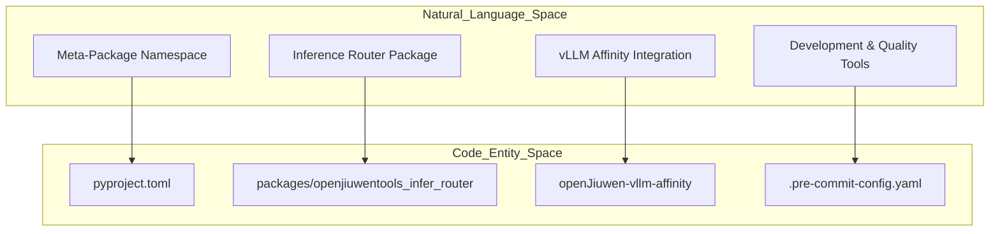
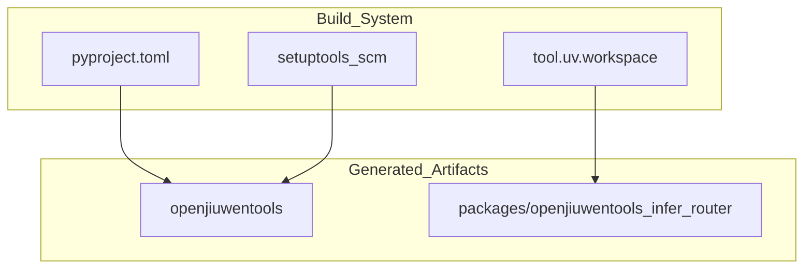

<!-- source: DeepWiki mcp.deepwiki.com · repo openJiuwen-ai/agent-tools · page 1 Overview · fetched 2026-11-02 -->

# Overview

Relevant source files

The following files were used as context for generating this wiki page:

- [.gitignore](.gitignore)
- [.markdownlint.json](.markdownlint.json)
- [.pre-commit-config.yaml](.pre-commit-config.yaml)
- [.typos.toml](.typos.toml)
- [LICENSE](LICENSE)
- [README.md](README.md)
- [README_zh.md](README_zh.md)
- [docs/openjiuwen_package_design.md](docs/openjiuwen_package_design.md)
- [packages/infer_router/docs/worker_config.yaml.example](packages/infer_router/docs/worker_config.yaml.example)
- [pyproject.toml](pyproject.toml)
- [requirements.txt](requirements.txt)

## Purpose and Scope

The `agent-tools` repository provides a foundational software framework and tooling ecosystem for building, orchestrating, and scaling AI agent applications [README.md:1-3](). The monorepo integrates core Python components, a KV-cache-aware inference router, a vLLM affinity optimization plugin, diagnostics dev tooling, and community challenge implementations [README.md:5-13](). 

This page serves as a high-level overview of the monorepo architecture and packaging model. Detailed specifications are maintained in the child sections:
- For repository structure, uv workspaces, and wheel packaging, see [Repository Layout & Packaging](#1.1).
- For environment setup, editable installs, and developer workflows, see [Getting Started & Development Workflow](#1.2).

### Monorepo Architecture Mapping

*Figure 1: Mapping natural language functional components to repository code entities.*

Sources: [README.md:1-13](), [pyproject.toml:1-62](), [.pre-commit-config.yaml:1-42]()

---

## 1.1 Repository Layout & Packaging

The repository is structured as a uv-managed workspace (`[tool.uv.workspace]`) housing modular sub-packages under the `packages/` directory [README.md:9-11](), [pyproject.toml:56-57](). Each sub-package builds into an independent wheel distribution, such as `openjiuwentools-infer-router` [README.md:17-23](). 

The root `pyproject.toml` defines the `openjiuwentools` meta-package, aggregating dependencies through optional extras like `[infer-router]` and `[top]` [pyproject.toml:5-36](). Version management is unified across packages using `setuptools_scm` integrated with git metadata [pyproject.toml:2-53]().

*Figure 2: Package build dependencies and wheel generation pathways.*

For comprehensive details on directory organization, dependency resolution, and packaging internals, see [Repository Layout & Packaging](#1.1).

Sources: [README.md:9-23](), [pyproject.toml:1-62](), [docs/openjiuwen_package_design.md:1-139]()

---

## 1.2 Getting Started & Development Workflow

Development across the monorepo relies on a unified virtual environment setup (`.venv`) and source installations using `uv` or `pip` [README.md:84-99](). Editable installs link the packages directly into the active Python environment (`pip install -e ".[top]"` or `uv sync --extra top`) [README.md:47-58]().

Code hygiene and formatting are strictly regulated via `pre-commit` hooks executing `ruff`, `codespell`, `typos`, and `markdownlint` [.pre-commit-config.yaml:15-42](). Unit tests are executed via `pytest` under the repository testing configuration [pyproject.toml:63-72]().

For detailed instructions on environment setup, pre-commit installation, and testing workflows, see [Getting Started & Development Workflow](#1.2).

Sources: [README.md:47-170](), [pyproject.toml:63-72](), [.pre-commit-config.yaml:1-42]()

---

