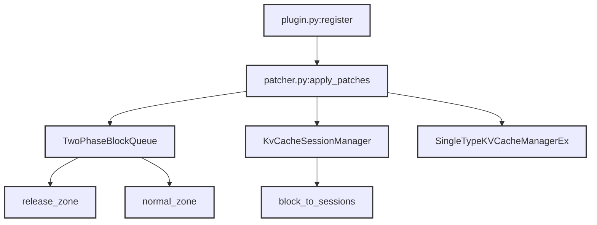

<!-- source: DeepWiki mcp.deepwiki.com · repo openJiuwen-ai/agent-tools · page 2 openJiuwen vLLM Affinity Plugin · fetched 2026-11-02 -->

# openJiuwen vLLM Affinity Plugin

Relevant source files

The following files were used as context for generating this wiki page:

- [packages/openJiuwen-vllm-affinity/README.md](packages/openJiuwen-vllm-affinity/README.md)
- [packages/openJiuwen-vllm-affinity/v0.13.0/jiuwen_vllm_affinity/kv_cache_plugin/plugin.py](packages/openJiuwen-vllm-affinity/v0.13.0/jiuwen_vllm_affinity/kv_cache_plugin/plugin.py)
- [packages/openJiuwen-vllm-affinity/v0.17.0/jiuwen_vllm_affinity/kv_cache_plugin/plugin.py](packages/openJiuwen-vllm-affinity/v0.17.0/jiuwen_vllm_affinity/kv_cache_plugin/plugin.py)
- [packages/openJiuwen-vllm-affinity/v0.18.0/pyproject.toml](packages/openJiuwen-vllm-affinity/v0.18.0/pyproject.toml)

## Purpose and Scope
The `openJiuwen-vllm-affinity` plugin enhances vLLM inference performance and prefix cache management in multi-turn conversation scenarios [packages/openJiuwen-vllm-affinity/README.md:1-3](). It addresses key challenges such as context compression, redundant tool-call result unloading, and TTFT (Time to First Token) degradation caused by default LRU eviction policies [packages/openJiuwen-vllm-affinity/README.md:5-11]().

This is a parent page providing a high-level architectural overview. For detailed technical specifications, refer to the child pages:
- Plugin Registration & Patching: See [Plugin Registration & Patching](#2.1)
- Two-Phase KV Cache Core: See [Two-Phase KV Cache Core](#2.2)
- OpenAI-Compatible API Extensions: See [OpenAI-Compatible API Extensions](#2.3)
- Plugin Test Suites & Version Branches: See [Plugin Test Suites & Version Branches](#2.4)

---

## 2.1 Plugin Registration & Patching
The plugin integrates into vLLM via setuptools entry points defined in `pyproject.toml` [packages/openJiuwen-vllm-affinity/v0.18.0/pyproject.toml:17-19](). The entry point invokes `register()` in `plugin.py`, which immediately triggers `apply_patches()` from `patcher.py` [packages/openJiuwen-vllm-affinity/v0.17.0/jiuwen_vllm_affinity/kv_cache_plugin/plugin.py:5-7](), [packages/openJiuwen-vllm-affinity/v0.13.0/jiuwen_vllm_affinity/kv_cache_plugin/plugin.py:5-7](). 

This phase handles monkey-patching of core vLLM classes (such as schedulers, block managers, and API servers) and initializes debug logging controlled by `JIUWEN_KV_DEBUG` [packages/openJiuwen-vllm-affinity/README.md:86-95]().

For deep technical details, see [Plugin Registration & Patching](#2.1).

---

## 2.2 Two-Phase KV Cache Core
The core engine introduces a dual-zone block pool (`release` and `normal` zones) alongside a `free` segment, prioritizing allocations as `free > release > normal` [packages/openJiuwen-vllm-affinity/README.md:14-18](). It uses `KvCacheSessionManager` to bind blocks to client sessions via `cache_salt` and `cache_sharing` parameters, collecting orphan tails when context shrinks [packages/openJiuwen-vllm-affinity/README.md:20-22]().

*Figure 1: KV Cache Core Entity Association Flow*

For detailed sub-topics, see:
- TwoPhaseBlockQueue & Block Pool: See [TwoPhaseBlockQueue & Block Pool](#2.2.1)
- Session Binding & Orphan Tail Collection: See [Session Binding & Orphan Tail Collection](#2.2.2)
- Scheduler, Engine & Coordinator Patches: See [Scheduler, Engine & Coordinator Patches](#2.2.3)

---

## 2.3 OpenAI-Compatible API Extensions
To support active cache management, the plugin patches vLLM's chat serving endpoints (`serving_chat`, `api_server`, `protocol`) [packages/openJiuwen-vllm-affinity/README.md:32-57](). It introduces `cache_salt` and `cache_sharing` fields to `POST /v1/chat/completions` and adds a dedicated endpoint `POST /release_kv_cache` which allows agents to explicitly release blocks corresponding to compressed message indices and tool outputs [packages/openJiuwen-vllm-affinity/README.md:43-65]().

For detailed implementation and protocol semantics, see [OpenAI-Compatible API Extensions](#2.3).

---

## 2.4 Plugin Test Suites & Version Branches
Because vLLM evolves rapidly, the monorepo maintains parallel directory trees for different vLLM target versions (`v0.13`, `v0.17`, `v0.18`, `v0.21`) [packages/openJiuwen-vllm-affinity/v0.18.0/pyproject.toml:15](). Dedicated unit and integration test suites cover queue priority, reclaimed block bindings, session managers, and multi-version compatibility.

For testing layouts and version management strategies, see [Plugin Test Suites & Version Branches](#2.4).

---

Sources:
- `packages/openJiuwen-vllm-affinity/v0.17.0/jiuwen_vllm_affinity/kv_cache_plugin/plugin.py:1-8`
- `packages/openJiuwen-vllm-affinity/v0.13.0/jiuwen_vllm_affinity/kv_cache_plugin/plugin.py:1-8`
- `packages/openJiuwen-vllm-affinity/v0.18.0/pyproject.toml:1-22`
- `packages/openJiuwen-vllm-affinity/README.md:1-96`

---

