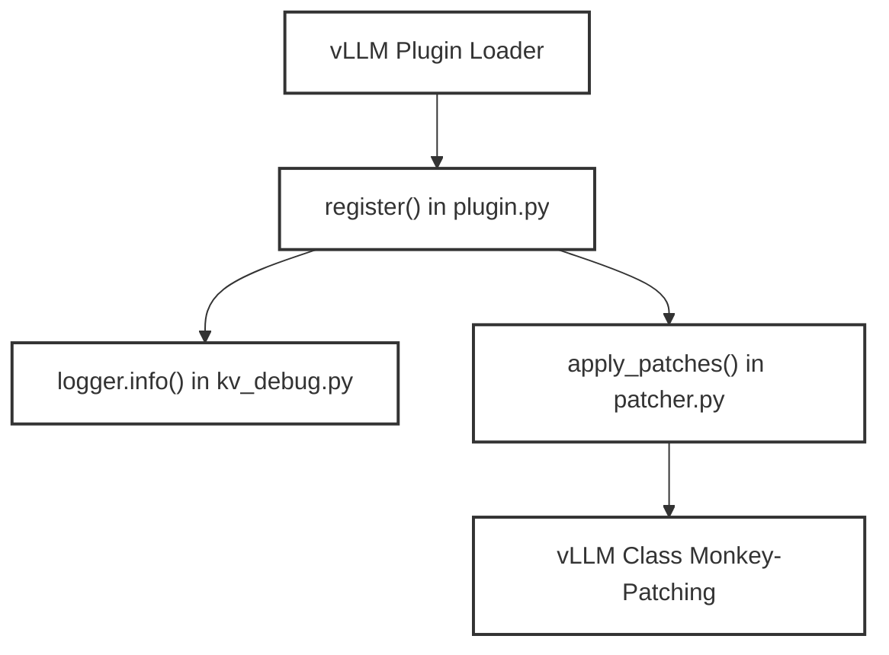
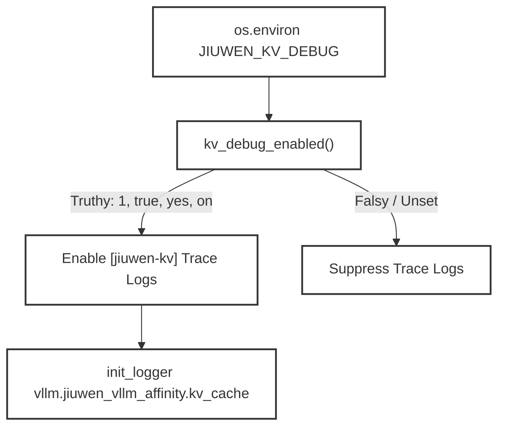

<!-- source: DeepWiki mcp.deepwiki.com · repo openJiuwen-ai/agent-tools · page 2.1 Plugin Registration & Patching · fetched 2026-11-02 -->

# Plugin Registration & Patching

Relevant source files

The following files were used as context for generating this wiki page:

- [packages/openJiuwen-vllm-affinity/README.md](packages/openJiuwen-vllm-affinity/README.md)
- [packages/openJiuwen-vllm-affinity/v0.13.0/jiuwen_vllm_affinity/kv_cache_plugin/kv_debug.py](packages/openJiuwen-vllm-affinity/v0.13.0/jiuwen_vllm_affinity/kv_cache_plugin/kv_debug.py)
- [packages/openJiuwen-vllm-affinity/v0.13.0/jiuwen_vllm_affinity/kv_cache_plugin/plugin.py](packages/openJiuwen-vllm-affinity/v0.13.0/jiuwen_vllm_affinity/kv_cache_plugin/plugin.py)
- [packages/openJiuwen-vllm-affinity/v0.13.0/jiuwen_vllm_affinity/kv_cache_plugin/tests/v1/core/test_reclaimed_block_binding.py](packages/openJiuwen-vllm-affinity/v0.13.0/jiuwen_vllm_affinity/kv_cache_plugin/tests/v1/core/test_reclaimed_block_binding.py)
- [packages/openJiuwen-vllm-affinity/v0.13.0/jiuwen_vllm_affinity/kv_cache_plugin/tests/v1/core/test_request_session_binding.py](packages/openJiuwen-vllm-affinity/v0.13.0/jiuwen_vllm_affinity/kv_cache_plugin/tests/v1/core/test_request_session_binding.py)
- [packages/openJiuwen-vllm-affinity/v0.17.0/jiuwen_vllm_affinity/kv_cache_plugin/kv_debug.py](packages/openJiuwen-vllm-affinity/v0.17.0/jiuwen_vllm_affinity/kv_cache_plugin/kv_debug.py)
- [packages/openJiuwen-vllm-affinity/v0.17.0/jiuwen_vllm_affinity/kv_cache_plugin/plugin.py](packages/openJiuwen-vllm-affinity/v0.17.0/jiuwen_vllm_affinity/kv_cache_plugin/plugin.py)
- [packages/openJiuwen-vllm-affinity/v0.21.0/jiuwen_vllm_affinity/kv_cache_plugin/kv_debug.py](packages/openJiuwen-vllm-affinity/v0.21.0/jiuwen_vllm_affinity/kv_cache_plugin/kv_debug.py)

This page details the initialization, plugin registration, monkey-patching architecture, and debugging telemetry for the `openJiuwen-vllm-affinity` KV cache affinity plugin. It covers how `register()` sets up the extension, how `patcher.py` injects behavior into vLLM classes, and how the `JIUWEN_KV_DEBUG` logging system traces cache operations across execution phases.

Sources: [packages/openJiuwen-vllm-affinity/README.md:1-4](), [packages/openJiuwen-vllm-affinity/v0.17.0/jiuwen_vllm_affinity/kv_cache_plugin/plugin.py:1-7]()

---

## 1. Registration Entrypoints & Initialization

The entrypoint for integrating the openJiuwen affinity extensions into vLLM is managed via the `register()` function defined in `plugin.py`. When vLLM loads registered affinity plugins, it invokes `register()`, which logs the initialization step and subsequently triggers class-level monkey-patching through `apply_patches()` [packages/openJiuwen-vllm-affinity/v0.17.0/jiuwen_vllm_affinity/kv_cache_plugin/plugin.py:1-7]().

*Figure 1: Initialization and registration control flow bridging the vLLM plugin loader to `register()` and `apply_patches()`.*

Sources: [packages/openJiuwen-vllm-affinity/v0.17.0/jiuwen_vllm_affinity/kv_cache_plugin/plugin.py:1-7]()

---

## 2. Monkey-Patching Architecture (`patcher.py`)

The `patcher.py` module is responsible for runtime modification of vLLM's core components. Because vLLM’s internal scheduling, memory management, and API servers are tightly encapsulated, the affinity plugin relies on non-invasive monkey-patching to intercept core engine calls without requiring a fork of the upstream vLLM repository.

Key responsibilities of `patcher.py`:
- Locating upstream vLLM classes (such as schedulers, KV cache managers, and OpenAI-compatible server endpoints).
- Replacing or wrapping methods to inject dual-zone cache queue logic, session binding keys (`cache_salt`), and explicit release endpoints (`POST /release_kv_cache`).

Sources: [packages/openJiuwen-vllm-affinity/README.md:14-57]()

---

## 3. KV Debug Logging & `JIUWEN_KV_DEBUG` Phases

To monitor internal block allocations, cache hits, session unbinding, and block eviction without parsing raw vLLM output, the plugin provides a specialized logging facility in `kv_debug.py` [packages/openJiuwen-vllm-affinity/v0.17.0/jiuwen_vllm_affinity/kv_cache_plugin/kv_debug.py:1-20]().

### Logger Configuration & Environment Flags

The logger is initialized under the `vllm.jiuwen_vllm_affinity.kv_cache` namespace to ensure that vLLM's standard logging configuration (including handlers and `VLLM_LOGGING_LEVEL`) correctly captures affinity telemetry [packages/openJiuwen-vllm-affinity/v0.17.0/jiuwen_vllm_affinity/kv_cache_plugin/kv_debug.py:3-9](). 

The environment variable `JIUWEN_KV_DEBUG` controls whether trace logging is active [packages/openJiuwen-vllm-affinity/v0.17.0/jiuwen_vllm_affinity/kv_cache_plugin/kv_debug.py:10-16](). Recognized truthy values are `1`, `true`, `yes`, and `on` (case-insensitive) [packages/openJiuwen-vllm-affinity/v0.17.0/jiuwen_vllm_affinity/kv_cache_plugin/kv_debug.py:11]().

*Figure 2: Environment evaluation flow for `kv_debug_enabled()` in `kv_debug.py`.*

Sources: [packages/openJiuwen-vllm-affinity/v0.17.0/jiuwen_vllm_affinity/kv_cache_plugin/kv_debug.py:1-20]()

### Tracing Phases

When `JIUWEN_KV_DEBUG` is enabled, the plugin emits structured logs across four primary execution phases:

| Log Phase | Code / System Event | Description |
|---|---|---|
| `1-allocate` | `get_new_blocks` | Logs all newly allocated blocks along with their associated `session` (`cache_salt`) identifier. |
| `2-prefix_hit` | Prefix Cache Matching | Logs prefix cache hit reuse, recording hit `block_ids` and session ownership samples for the first 3 blocks (`owners_before_bind`). |
| `3-release` | Session Unbinding / Release | Logs session unbinding outcomes: `unbound` (number of blocks unbound), `freed` (blocks eligible for immediate aging), and `shared_remain` (blocks still occupied by other shared sessions). |
| `4-evict` | Block Eviction & Reuse | Logs block recycling events when blocks are popped from the release or normal queue segments. |

Sources: [packages/openJiuwen-vllm-affinity/README.md:86-95]()

---

