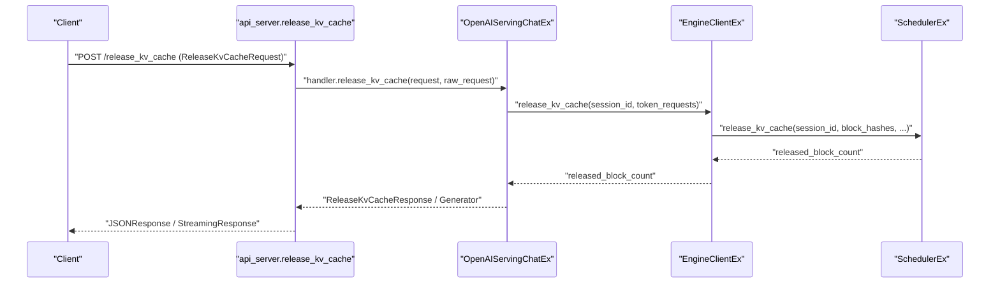
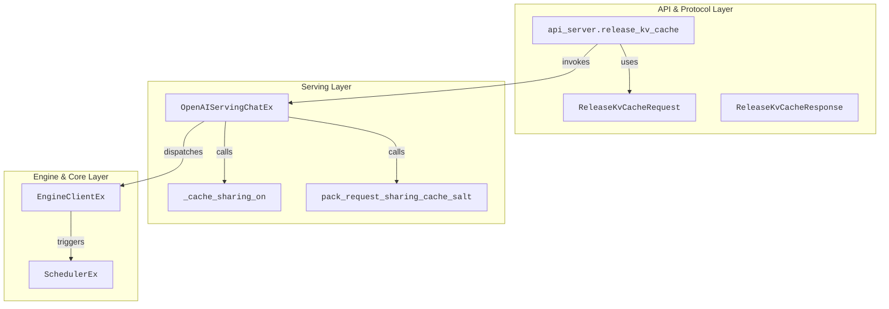

<!-- source: DeepWiki mcp.deepwiki.com · repo openJiuwen-ai/agent-tools · page 2.3 OpenAI-Compatible API Extensions · fetched 2026-11-02 -->

# OpenAI-Compatible API Extensions

<details>
<summary>Relevant source files</summary>

The following files were used as context for generating this wiki page:

- [packages/openJiuwen-vllm-affinity/v0.13.0/.gitignore](packages/openJiuwen-vllm-affinity/v0.13.0/.gitignore)
- [packages/openJiuwen-vllm-affinity/v0.13.0/jiuwen_vllm_affinity/kv_cache_plugin/__init__.py](packages/openJiuwen-vllm-affinity/v0.13.0/jiuwen_vllm_affinity/kv_cache_plugin/__init__.py)
- [packages/openJiuwen-vllm-affinity/v0.13.0/jiuwen_vllm_affinity/kv_cache_plugin/engine/protocol.py](packages/openJiuwen-vllm-affinity/v0.13.0/jiuwen_vllm_affinity/kv_cache_plugin/engine/protocol.py)
- [packages/openJiuwen-vllm-affinity/v0.13.0/jiuwen_vllm_affinity/kv_cache_plugin/entrypoints/openai/api_server.py](packages/openJiuwen-vllm-affinity/v0.13.0/jiuwen_vllm_affinity/kv_cache_plugin/entrypoints/openai/api_server.py)
- [packages/openJiuwen-vllm-affinity/v0.13.0/jiuwen_vllm_affinity/kv_cache_plugin/entrypoints/openai/protocol.py](packages/openJiuwen-vllm-affinity/v0.13.0/jiuwen_vllm_affinity/kv_cache_plugin/entrypoints/openai/protocol.py)
- [packages/openJiuwen-vllm-affinity/v0.13.0/jiuwen_vllm_affinity/kv_cache_plugin/entrypoints/openai/serving_chat.py](packages/openJiuwen-vllm-affinity/v0.13.0/jiuwen_vllm_affinity/kv_cache_plugin/entrypoints/openai/serving_chat.py)
- [packages/openJiuwen-vllm-affinity/v0.13.0/jiuwen_vllm_affinity/kv_cache_plugin/patcher.py](packages/openJiuwen-vllm-affinity/v0.13.0/jiuwen_vllm_affinity/kv_cache_plugin/patcher.py)
- [packages/openJiuwen-vllm-affinity/v0.13.0/jiuwen_vllm_affinity/kv_cache_plugin/tests/v1/core/test_kv_cache_session_manager.py](packages/openJiuwen-vllm-affinity/v0.13.0/jiuwen_vllm_affinity/kv_cache_plugin/tests/v1/core/test_kv_cache_session_manager.py)
- [packages/openJiuwen-vllm-affinity/v0.13.0/jiuwen_vllm_affinity/kv_cache_plugin/v1/core/kv_cache_coordinator.py](packages/openJiuwen-vllm-affinity/v0.13.0/jiuwen_vllm_affinity/kv_cache_plugin/v1/core/kv_cache_coordinator.py)
- [packages/openJiuwen-vllm-affinity/v0.13.0/jiuwen_vllm_affinity/kv_cache_plugin/v1/core/kv_cache_session_manager.py](packages/openJiuwen-vllm-affinity/v0.13.0/jiuwen_vllm_affinity/kv_cache_plugin/v1/core/kv_cache_session_manager.py)
- [packages/openJiuwen-vllm-affinity/v0.13.0/jiuwen_vllm_affinity/kv_cache_plugin/v1/core/sched/scheduler.py](packages/openJiuwen-vllm-affinity/v0.13.0/jiuwen_vllm_affinity/kv_cache_plugin/v1/core/sched/scheduler.py)
- [packages/openJiuwen-vllm-affinity/v0.13.0/jiuwen_vllm_affinity/kv_cache_plugin/v1/engine/core.py](packages/openJiuwen-vllm-affinity/v0.13.0/jiuwen_vllm_affinity/kv_cache_plugin/v1/engine/core.py)
- [packages/openJiuwen-vllm-affinity/v0.17.0/jiuwen_vllm_affinity/kv_cache_plugin/entrypoints/openai/serving_chat.py](packages/openJiuwen-vllm-affinity/v0.17.0/jiuwen_vllm_affinity/kv_cache_plugin/entrypoints/openai/serving_chat.py)
- [packages/openJiuwen-vllm-affinity/v0.18.0/.gitignore](packages/openJiuwen-vllm-affinity/v0.18.0/.gitignore)
- [packages/openJiuwen-vllm-affinity/v0.18.0/jiuwen_vllm_affinity/kv_cache_plugin/__init__.py](packages/openJiuwen-vllm-affinity/v0.18.0/jiuwen_vllm_affinity/kv_cache_plugin/__init__.py)
- [packages/openJiuwen-vllm-affinity/v0.18.0/jiuwen_vllm_affinity/kv_cache_plugin/engine/protocol.py](packages/openJiuwen-vllm-affinity/v0.18.0/jiuwen_vllm_affinity/kv_cache_plugin/engine/protocol.py)
- [packages/openJiuwen-vllm-affinity/v0.18.0/jiuwen_vllm_affinity/kv_cache_plugin/entrypoints/openai/api_server.py](packages/openJiuwen-vllm-affinity/v0.18.0/jiuwen_vllm_affinity/kv_cache_plugin/entrypoints/openai/api_server.py)
- [packages/openJiuwen-vllm-affinity/v0.21.0/jiuwen_vllm_affinity/kv_cache_plugin/entrypoints/openai/protocol.py](packages/openJiuwen-vllm-affinity/v0.21.0/jiuwen_vllm_affinity/kv_cache_plugin/entrypoints/openai/protocol.py)

</details>


## Purpose and Scope
This page details the OpenAI-compatible API extensions implemented within the openJiuwen vLLM affinity plugin. It covers protocol schema patches for cache control (`cache_salt`, `cache_sharing`), serving chat request modifications (`OpenAIServingChatEx`), and the custom HTTP semantics for the `POST /release_kv_cache` endpoint used in fine-grained KV cache lifecycle management.

---

## 1. Protocol Enhancements & Schema Patches

The plugin patches vLLM's OpenAI protocol definitions to accept extended arguments required for prefix cache sharing and explicit cache release operations. 

`ReleaseKvCacheRequest` inherits from `ChatCompletionRequest` and introduces fields for tracking token release offsets and cache configuration:
- `messages_released_index`: Integer offset indicating the message boundary up to which KV cache can be released [packages/openJiuwen-vllm-affinity/v0.21.0/jiuwen_vllm_affinity/kv_cache_plugin/entrypoints/openai/protocol.py:25-35]().
- `tools_released_index`: Optional integer offset for tool definition blocks [packages/openJiuwen-vllm-affinity/v0.21.0/jiuwen_vllm_affinity/kv_cache_plugin/entrypoints/openai/protocol.py:25-35]().
- `cache_sharing`: Boolean flag enabling or disabling prefix cache sharing across requests [packages/openJiuwen-vllm-affinity/v0.21.0/jiuwen_vllm_affinity/kv_cache_plugin/entrypoints/openai/protocol.py:25-35]().
- `cache_salt`: String value acting as a salt for cache hashing when sharing is active [packages/openJiuwen-vllm-affinity/v0.21.0/jiuwen_vllm_affinity/kv_cache_plugin/entrypoints/openai/protocol.py:20-24]().

To prevent Pydantic validation warnings regarding unexpected fields on model inheritance, `ReleaseKvCacheRequest` shadows `field_names` [packages/openJiuwen-vllm-affinity/v0.21.0/jiuwen_vllm_affinity/kv_cache_plugin/entrypoints/openai/protocol.py:28-31](). `ReleaseKvCacheResponse` provides standard serialization for the resulting `cache_salt` and `block_released` count [packages/openJiuwen-vllm-affinity/v0.21.0/jiuwen_vllm_affinity/kv_cache_plugin/entrypoints/openai/protocol.py:20-24]().

Sources:
- `packages/openJiuwen-vllm-affinity/v0.21.0/jiuwen_vllm_affinity/kv_cache_plugin/entrypoints/openai/protocol.py:1-36`()

---

## 2. Serving Chat Integration & Salt Packing

The `OpenAIServingChatEx` class overrides vLLM's standard chat serving logic to inspect and propagate cache control parameters [packages/openJiuwen-vllm-affinity/v0.17.0/jiuwen_vllm_affinity/kv_cache_plugin/entrypoints/openai/serving_chat.py:41-46]().

### Cache Sharing Resolution
The helper function `_cache_sharing_on(request)` evaluates whether cache sharing is enabled by checking explicit request attributes or falling back to `model_extra` dictionaries [packages/openJiuwen-vllm-affinity/v0.17.0/jiuwen_vllm_affinity/kv_cache_plugin/entrypoints/openai/serving_chat.py:34-39](). When active, `sharing_cache_salt` is retrieved from `request.cache_salt` [packages/openJiuwen-vllm-affinity/v0.17.0/jiuwen_vllm_affinity/kv_cache_plugin/entrypoints/openai/serving_chat.py:123-125]().

### Request ID Salt Packing
If a non-null `sharing_cache_salt` is present, `pack_request_sharing_cache_salt` encodes the base request ID and the salt into a JSON structure before dispatching generation tasks to the underlying engine client [packages/openJiuwen-vllm-affinity/v0.17.0/jiuwen_vllm_affinity/kv_cache_plugin/entrypoints/openai/serving_chat.py:126-129]().

Sources:
- `packages/openJiuwen-vllm-affinity/v0.17.0/jiuwen_vllm_affinity/kv_cache_plugin/entrypoints/openai/serving_chat.py:1-176`()

---

## 3. `POST /release_kv_cache` Endpoint Semantics

The API server patches introduce a dedicated FastAPI route at `/release_kv_cache` to trigger explicit block reclamation [packages/openJiuwen-vllm-affinity/v0.18.0/jiuwen_vllm_affinity/kv_cache_plugin/entrypoints/openai/api_server.py:16-26]().

```
+-----------------------------------------------------------------+
|                    FastAPI POST /release_kv_cache               |
|            packages/openJiuwen-vllm-affinity/v0.18.0/...        |
+-----------------------------------------------------------------+
                                |
                                v
+-----------------------------------------------------------------+
|                    @with_cancellation                           |
|                    @load_aware_call                             |
+-----------------------------------------------------------------+
                                |
                                v
+-----------------------------------------------------------------+
|                    release_kv_cache()                           |
|      Resolves handler via chat(raw_request)                     |
+-----------------------------------------------------------------+
                                |
            +-------------------+-------------------+
            |                                       |
            v                                       v
+-----------------------+               +-----------------------+
| ErrorResponse / JSON  |               | StreamingResponse     |
| (HTTPStatus.OK/ERR)   |               | (text/event-stream)   |
+-----------------------+               +-----------------------+
```

The `release_kv_cache` endpoint accepts a `ReleaseKvCacheRequest` payload, validates JSON structure, resolves the appropriate chat handler from the application state, and invokes `handler.release_kv_cache(request, raw_request)` [packages/openJiuwen-vllm-affinity/v0.18.0/jiuwen_vllm_affinity/kv_cache_plugin/entrypoints/openai/api_server.py:27-52](). It handles error responses, structured `ReleaseKvCacheResponse` JSON payloads, and streaming event generators [packages/openJiuwen-vllm-affinity/v0.18.0/jiuwen_vllm_affinity/kv_cache_plugin/entrypoints/openai/api_server.py:36-52]().

Sources:
- `packages/openJiuwen-vllm-affinity/v0.18.0/jiuwen_vllm_affinity/kv_cache_plugin/entrypoints/openai/api_server.py:1-53`()

---

## 4. Data Flow & Execution Sequence

The following sequence diagram illustrates the flow from an incoming API request with cache extensions down to the engine processing layer.



Sources:
- `packages/openJiuwen-vllm-affinity/v0.18.0/jiuwen_vllm_affinity/kv_cache_plugin/entrypoints/openai/api_server.py:29-53`()
- `packages/openJiuwen-vllm-affinity/v0.17.0/jiuwen_vllm_affinity/kv_cache_plugin/entrypoints/openai/serving_chat.py:41-170`()
- `packages/openJiuwen-vllm-affinity/v0.13.0/jiuwen_vllm_affinity/kv_cache_plugin/v1/core/sched/scheduler.py:5-20`()

---

## 5. Component Architecture & Code Mapping

The component relationship diagram maps the natural language concepts to their respective code definitions within the codebase.



Sources:
- `packages/openJiuwen-vllm-affinity/v0.21.0/jiuwen_vllm_affinity/kv_cache_plugin/entrypoints/openai/protocol.py:20-36`()
- `packages/openJiuwen-vllm-affinity/v0.17.0/jiuwen_vllm_affinity/kv_cache_plugin/entrypoints/openai/serving_chat.py:34-130`()
- `packages/openJiuwen-vllm-affinity/v0.18.0/jiuwen_vllm_affinity/kv_cache_plugin/entrypoints/openai/api_server.py:29-53`()
- `packages/openJiuwen-vllm-affinity/v0.13.0/jiuwen_vllm_affinity/kv_cache_plugin/v1/core/sched/scheduler.py:5-20`()

---

