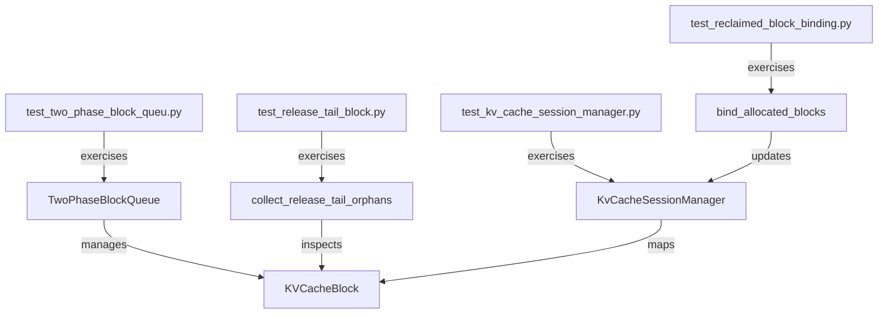
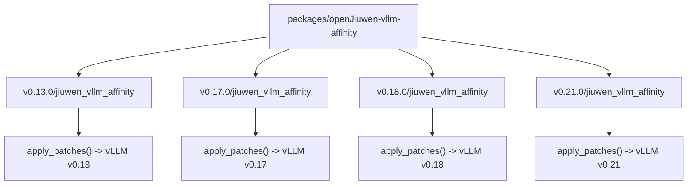

<!-- source: DeepWiki mcp.deepwiki.com · repo openJiuwen-ai/agent-tools · page 2.4 Plugin Test Suites & Version Branches · fetched 2026-11-02 -->

# Plugin Test Suites & Version Branches

Relevant source files

The following files were used as context for generating this wiki page:

- [packages/openJiuwen-vllm-affinity/v0.13.0/jiuwen_vllm_affinity/kv_cache_plugin/tests/v1/core/test_release_tail_block.py](packages/openJiuwen-vllm-affinity/v0.13.0/jiuwen_vllm_affinity/kv_cache_plugin/tests/v1/core/test_release_tail_block.py)
- [packages/openJiuwen-vllm-affinity/v0.13.0/jiuwen_vllm_affinity/kv_cache_plugin/tests/v1/core/test_two_phase_block_queu.py](packages/openJiuwen-vllm-affinity/v0.13.0/jiuwen_vllm_affinity/kv_cache_plugin/tests/v1/core/test_two_phase_block_queu.py)
- [packages/openJiuwen-vllm-affinity/v0.17.0/jiuwen_vllm_affinity/kv_cache_plugin/tests/v1/core/test_kv_cache_session_manager.py](packages/openJiuwen-vllm-affinity/v0.17.0/jiuwen_vllm_affinity/kv_cache_plugin/tests/v1/core/test_kv_cache_session_manager.py)
- [packages/openJiuwen-vllm-affinity/v0.17.0/jiuwen_vllm_affinity/kv_cache_plugin/tests/v1/core/test_release_tail_block.py](packages/openJiuwen-vllm-affinity/v0.17.0/jiuwen_vllm_affinity/kv_cache_plugin/tests/v1/core/test_release_tail_block.py)
- [packages/openJiuwen-vllm-affinity/v0.17.0/jiuwen_vllm_affinity/kv_cache_plugin/tests/v1/core/test_two_phase_block_queu.py](packages/openJiuwen-vllm-affinity/v0.17.0/jiuwen_vllm_affinity/kv_cache_plugin/tests/v1/core/test_two_phase_block_queu.py)
- [packages/openJiuwen-vllm-affinity/v0.18.0/jiuwen_vllm_affinity/kv_cache_plugin/entrypoints/openai/serving_chat.py](packages/openJiuwen-vllm-affinity/v0.18.0/jiuwen_vllm_affinity/kv_cache_plugin/entrypoints/openai/serving_chat.py)
- [packages/openJiuwen-vllm-affinity/v0.18.0/jiuwen_vllm_affinity/kv_cache_plugin/kv_debug.py](packages/openJiuwen-vllm-affinity/v0.18.0/jiuwen_vllm_affinity/kv_cache_plugin/kv_debug.py)
- [packages/openJiuwen-vllm-affinity/v0.18.0/jiuwen_vllm_affinity/kv_cache_plugin/patcher.py](packages/openJiuwen-vllm-affinity/v0.18.0/jiuwen_vllm_affinity/kv_cache_plugin/patcher.py)
- [packages/openJiuwen-vllm-affinity/v0.18.0/jiuwen_vllm_affinity/kv_cache_plugin/plugin.py](packages/openJiuwen-vllm-affinity/v0.18.0/jiuwen_vllm_affinity/kv_cache_plugin/plugin.py)
- [packages/openJiuwen-vllm-affinity/v0.18.0/jiuwen_vllm_affinity/kv_cache_plugin/tests/v1/core/test_kv_cache_session_manager.py](packages/openJiuwen-vllm-affinity/v0.18.0/jiuwen_vllm_affinity/kv_cache_plugin/tests/v1/core/test_kv_cache_session_manager.py)
- [packages/openJiuwen-vllm-affinity/v0.18.0/jiuwen_vllm_affinity/kv_cache_plugin/tests/v1/core/test_reclaimed_block_binding.py](packages/openJiuwen-vllm-affinity/v0.18.0/jiuwen_vllm_affinity/kv_cache_plugin/tests/v1/core/test_reclaimed_block_binding.py)
- [packages/openJiuwen-vllm-affinity/v0.21.0/jiuwen_vllm_affinity/kv_cache_plugin/__init__.py](packages/openJiuwen-vllm-affinity/v0.21.0/jiuwen_vllm_affinity/kv_cache_plugin/__init__.py)

## Purpose & Scope
This page details the test verification suites for the openJiuwen vLLM affinity plugin and explains the architectural strategy used to maintain parallel code trees for multiple upstream vLLM versions (`v0.13`, `v0.17`, `v0.18`, and `v0.21`). It covers queue priority assertions, release tail orphan collection, session mapping behavior, and reclaimed block binding validation.

Sources: 
- `packages/openJiuwen-vllm-affinity/v0.17.0/jiuwen_vllm_affinity/kv_cache_plugin/tests/v1/core/test_two_phase_block_queu.py:1-162`
- `packages/openJiuwen-vllm-affinity/v0.18.0/jiuwen_vllm_affinity/kv_cache_plugin/tests/v1/core/test_reclaimed_block_binding.py:1-74`

---

## 1. Test Suite Architecture & Core Test Modules

The test suite for the vLLM affinity plugin is structured around pytest under the `kv_cache_plugin/tests/v1/core/` directory. It verifies core cache mechanisms without requiring a full GPU runtime by mocking or directly instantiating vLLM v1 primitives such as `KVCacheBlock` [packages/openJiuwen-vllm-affinity/v0.17.0/jiuwen_vllm_affinity/kv_cache_plugin/tests/v1/core/test_two_phase_block_queu.py:1-10].

### 1.1 Queue Priority & Allocation Ordering (`TwoPhaseBlockQueue`)
The two-phase block queue manages three tiers of blocks: **free** (never allocated), **release** (reclaimed via `aging_block`), and **normal stale** (FIFO recycling). The test suite strictly validates allocation preferences:
- `test_free_preferred_over_release()`: Ensures never-allocated blocks are consumed before release-zone blocks [packages/openJiuwen-vllm-affinity/v0.17.0/jiuwen_vllm_affinity/kv_cache_plugin/tests/v1/core/test_two_phase_block_queu.py:37-51].
- `test_release_preferred_over_normal()`: Verifies that released blocks are reused before plain normal-stale blocks [packages/openJiuwen-vllm-affinity/v0.17.0/jiuwen_vllm_affinity/kv_cache_plugin/tests/v1/core/test_two_phase_block_queu.py:53-71].
- `test_reclaimed_flag_free_vs_reused()`: Asserts that fresh pops do not set `jiuwen_reclaimed`, whereas reused blocks correctly set the flag for eviction logging [packages/openJiuwen-vllm-affinity/v0.17.0/jiuwen_vllm_affinity/kv_cache_plugin/tests/v1/core/test_two_phase_block_queu.py:108-130].

Sources:
- `packages/openJiuwen-vllm-affinity/v0.17.0/jiuwen_vllm_affinity/kv_cache_plugin/tests/v1/core/test_two_phase_block_queu.py:37-130`

### 1.2 Session Manager & Release Tail Collection
Session state and orphan blocks are tested via `test_release_tail_block.py` and `test_kv_cache_session_manager.py`. Key test cases include:
- `test_expected_release_block_count()`: Validates block count calculations relative to token offsets and block sizes [packages/openJiuwen-vllm-affinity/v0.17.0/jiuwen_vllm_affinity/kv_cache_plugin/tests/v1/core/test_release_tail_block.py:15-20].
- `test_collect_consecutive_session_tail()`: Ensures consecutive session tails are correctly identified and orphaned blocks are purged [packages/openJiuwen-vllm-affinity/v0.17.0/jiuwen_vllm_affinity/kv_cache_plugin/tests/v1/core/test_release_tail_block.py:33-57].
- `test_collect_orphan_blocks_release_merges_tail()`: Confirms that release tails merge correctly with resolved block sets during session teardown [packages/openJiuwen-vllm-affinity/v0.17.0/jiuwen_vllm_affinity/kv_cache_plugin/tests/v1/core/test_release_tail_block.py:93-114].

Sources:
- `packages/openJiuwen-vllm-affinity/v0.17.0/jiuwen_vllm_affinity/kv_cache_plugin/tests/v1/core/test_release_tail_block.py:15-148`
- `packages/openJiuwen-vllm-affinity/v0.17.0/jiuwen_vllm_affinity/kv_cache_plugin/tests/v1/core/test_kv_cache_session_manager.py:6-64`

### 1.3 Reclaimed Block Binding Validation
Reclaimed block bindings are verified in `test_reclaimed_block_binding.py`, ensuring that stale mappings are cleared when blocks are reclaimed and reassigned to new owners.
- `test_reclaimed_blocks_reset_stale_bindings()`: Asserts that when a block marked as reclaimed via `jiuwen_mark_reclaimed_for_test()` is bound via `bind_allocated_blocks()`, old session bindings are replaced by the new owner [packages/openJiuwen-vllm-affinity/v0.18.0/jiuwen_vllm_affinity/kv_cache_plugin/tests/v1/core/test_reclaimed_block_binding.py:15-32].
- `test_fresh_blocks_use_add_semantics()`: Validates that fresh blocks preserve cumulative append/sharing semantics [packages/openJiuwen-vllm-affinity/v0.18.0/jiuwen_vllm_affinity/kv_cache_plugin/tests/v1/core/test_reclaimed_block_binding.py:34-42].

Sources:
- `packages/openJiuwen-vllm-affinity/v0.18.0/jiuwen_vllm_affinity/kv_cache_plugin/tests/v1/core/test_reclaimed_block_binding.py:15-74`

*Figure 1: Mapping from test suites to core code entities.*

Sources:
- `packages/openJiuwen-vllm-affinity/v0.17.0/jiuwen_vllm_affinity/kv_cache_plugin/tests/v1/core/test_two_phase_block_queu.py:1-162`
- `packages/openJiuwen-vllm-affinity/v0.17.0/jiuwen_vllm_affinity/kv_cache_plugin/tests/v1/core/test_release_tail_block.py:1-148`
- `packages/openJiuwen-vllm-affinity/v0.18.0/jiuwen_vllm_affinity/kv_cache_plugin/tests/v1/core/test_reclaimed_block_binding.py:1-74`

---

## 2. Parallel Version Tree Maintenance

Because upstream vLLM internal APIs (`vllm.v1.core.*`, engine protocol, serving layers) evolve across minor and patch releases, the openJiuwen monorepo maintains independent directory trees under `packages/openJiuwen-vllm-affinity/`.

### 2.1 Version Directory Layout
Each supported vLLM target version contains a self-contained package implementation:
- `v0.13.0/` — Targets vLLM v0.13.x internal block structures and scheduler hooks.
- `v0.17.0/` — Targets vLLM v0.17.x scheduler and block pool APIs.
- `v0.18.0/` — Targets vLLM v0.18.x engine core and OpenAI serving layers.
- `v0.21.0/` — Targets vLLM v0.21.x latest v1 architectures.

Despite internal vLLM signature differences, all version trees share the same logical architecture: entrypoint registration (`plugin.py` / `apply_patches()`), dual-zone block queues, session managers, and coordinator logic.

Sources:
- `packages/openJiuwen-vllm-affinity/v0.18.0/jiuwen_vllm_affinity/kv_cache_plugin/plugin.py:1-8`
- `packages/openJiuwen-vllm-affinity/v0.18.0/jiuwen_vllm_affinity/kv_cache_plugin/patcher.py:41-56`

*Figure 2: Parallel version tree organization and patch target binding.*

Sources:
- `packages/openJiuwen-vllm-affinity/v0.18.0/jiuwen_vllm_affinity/kv_cache_plugin/patcher.py:41-56`
- `packages/openJiuwen-vllm-affinity/v0.18.0/jiuwen_vllm_affinity/kv_cache_plugin/plugin.py:1-8`

---

