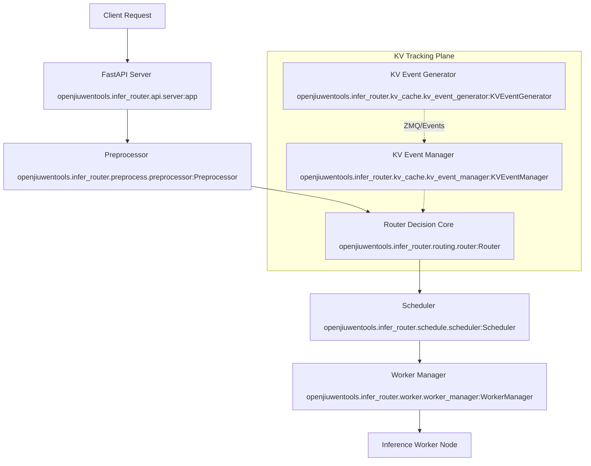

<!-- source: DeepWiki mcp.deepwiki.com · repo openJiuwen-ai/agent-tools · page 3 Inference Router (openjiuwentools-infer-router) · fetched 2026-11-02 -->

# Inference Router (openjiuwentools-infer-router)

Relevant source files

The following files were used as context for generating this wiki page:

- [packages/infer_router/README.md](packages/infer_router/README.md)
- [packages/infer_router/docs/api.md](packages/infer_router/docs/api.md)
- [packages/infer_router/docs/deployment.md](packages/infer_router/docs/deployment.md)
- [packages/infer_router/docs/development.md](packages/infer_router/docs/development.md)
- [packages/infer_router/docs/jiuwen_agent_hints_design.md](packages/infer_router/docs/jiuwen_agent_hints_design.md)
- [packages/infer_router/docs/worker_discovery.md](packages/infer_router/docs/worker_discovery.md)
- [packages/infer_router/docs/workers.json.example](packages/infer_router/docs/workers.json.example)
- [packages/infer_router/docs/workers.yaml.example](packages/infer_router/docs/workers.yaml.example)
- [packages/infer_router/pyproject.toml](packages/infer_router/pyproject.toml)
- [packages/infer_router/src/openjiuwentools/infer_router/__init__.py](packages/infer_router/src/openjiuwentools/infer_router/__init__.py)
- [packages/infer_router/src/openjiuwentools/infer_router/api/__init__.py](packages/infer_router/src/openjiuwentools/infer_router/api/__init__.py)
- [packages/infer_router/src/openjiuwentools/infer_router/api/server.py](packages/infer_router/src/openjiuwentools/infer_router/api/server.py)
- [packages/infer_router/src/openjiuwentools/infer_router/config/config.py](packages/infer_router/src/openjiuwentools/infer_router/config/config.py)

The `openjiuwentools-infer-router` package provides a KV-cache-aware LLM inference routing system designed to manage and optimize workloads across multiple vLLM and SGLang backend instances [packages/infer_router/pyproject.toml:6-8](), [packages/infer_router/src/openjiuwentools/infer_router/__init__.py:4-5](). It coordinates request dispatching, tracks global KV cache states, supports priority scheduling, and integrates custom agent hints via a non-invasive sidecar architecture.

Sources: `packages/infer_router/pyproject.toml:1-60`, `packages/infer_router/src/openjiuwentools/infer_router/__init__.py:1-40`

---

## Architecture Overview

The following diagram illustrates how natural language routing components map to core code entities within `openjiuwentools-infer-router`.

*Figure 1: Architectural mapping of the inference router pipeline to source code symbols.*

Sources: `packages/infer_router/src/openjiuwentools/infer_router/api/server.py:44-54`, `packages/infer_router/src/openjiuwentools/infer_router/__init__.py:19-32`

---

## 3.1. API Server & Configuration

The API server layer is implemented with FastAPI (`packages/infer_router/src/openjiuwentools/infer_router/api/server.py`) and exposes standard OpenAI-compatible endpoints alongside custom extensions like `jiuwenext.agent_hints` and `jiuwenext.cache_control`. Configuration is managed via Pydantic Settings (`packages/infer_router/src/openjiuwentools/infer_router/config/config.py`), supporting loading from environment variables, YAML files, and static worker definitions (`workers.json` / `workers.yaml`).

For deep technical details on FastAPI endpoints, request schemas, authentication middlewares, and configuration schemas, see [API Server & Configuration](#3.1).

Sources: `packages/infer_router/src/openjiuwentools/infer_router/api/server.py:1-75`, `packages/infer_router/src/openjiuwentools/infer_router/config/config.py:53-127`, `packages/infer_router/docs/workers.json.example:1-28`, `packages/infer_router/docs/workers.yaml.example:1-28`

---

## 3.2. Routing & Scheduling

The routing and scheduling engine (`packages/infer_router/src/openjiuwentools/infer_router/routing/router.py` and `packages/infer_router/src/openjiuwentools/infer_router/schedule/scheduler.py`) determines optimal worker assignments based on KV cache overlap, load balancing algorithms, and request priority queues. It integrates tokenization and preprocessing stages to evaluate prefix affinities before dispatching requests.

*Figure 2: Routing and scheduling decision flow across `Router` and `Scheduler` classes.*

For details on `router.py` decision logic, load-balancing weights, and scheduling strategies (FCFS, LCFS, WSPT), see [Routing & Scheduling](#3.2).

Sources: `packages/infer_router/src/openjiuwentools/infer_router/routing/router.py`, `packages/infer_router/src/openjiuwentools/infer_router/schedule/scheduler.py`, `packages/infer_router/src/openjiuwentools/infer_router/preprocess/preprocessor.py`

---

## 3.3. KV Cache Tracking

KV Cache tracking maintains a synchronized global view of cache blocks across distributed inference workers. Utilizing ZeroMQ (ZMQ) message passing, `KVEventGenerator` and `KVEventManager` track storage, removal, and invalidation of cache blocks, calculating token overlaps to maximize prompt reuse.

For details on event streams, overlap calculation, and `worker_token_manager`, see [KV Cache Tracking](#3.3).

Sources: `packages/infer_router/src/openjiuwentools/infer_router/kv_cache/kv_event_generator.py`, `packages/infer_router/src/openjiuwentools/infer_router/kv_cache/kv_event_manager.py`, `packages/infer_router/src/openjiuwentools/infer_router/kv_cache/worker_token_manager.py`

---

## 3.4. Workers, Discovery & Fault Tolerance

Worker management and discovery (`WorkerManager` and `WorkloadManager`) handle dynamic node discovery via static configuration files or distributed coordination backends like etcd. They continuously monitor worker health, manage registration TTLs, execute circuit breaking, and enforce retry policies to ensure high availability.

For details on worker registration, etcd watch loops, health-check timeouts, and fault tolerance mechanisms, see [Workers, Discovery & Fault Tolerance](#3.4).

Sources: `packages/infer_router/src/openjiuwentools/infer_router/worker/worker_manager.py`, `packages/infer_router/src/openjiuwentools/infer_router/worker/workload_manager.py`, `packages/infer_router/src/openjiuwentools/infer_router/fault_tolerance/fault_tolerance.py`

---

## 3.5. Monitoring & Test Strategy

Observability is maintained through Prometheus metrics (`packages/infer_router/src/openjiuwentools/infer_router/monitoring/metrics.py`) and performance statistics tracking request latencies and prefill durations (`packages/infer_router/src/openjiuwentools/infer_router/monitoring/performance_stats.py`). The test suite covers unit tests for routing policies, integration tests for prefill overlap, and end-to-end server simulations.

For details on metric definitions, performance timers, and test layout structures, see [Monitoring & Test Strategy](#3.5).

Sources: `packages/infer_router/src/openjiuwentools/infer_router/monitoring/metrics.py`, `packages/infer_router/src/openjiuwentools/infer_router/monitoring/performance_stats.py`, `packages/infer_router/pyproject.toml:43-48`

---

