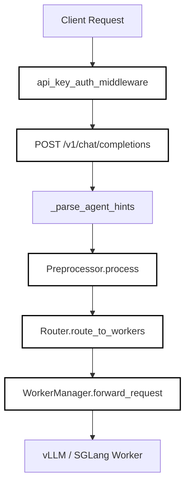
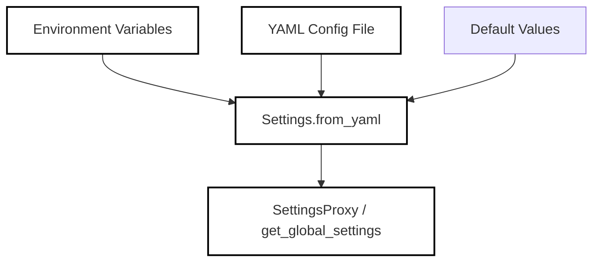

<!-- source: DeepWiki mcp.deepwiki.com · repo openJiuwen-ai/agent-tools · page 3.1 API Server & Configuration · fetched 2026-11-02 -->

# API Server & Configuration

<details>
<summary>Relevant source files</summary>

The following files were used as context for generating this wiki page:

- [packages/infer_router/README.md](packages/infer_router/README.md)
- [packages/infer_router/docs/api.md](packages/infer_router/docs/api.md)
- [packages/infer_router/docs/deployment.md](packages/infer_router/docs/deployment.md)
- [packages/infer_router/docs/development.md](packages/infer_router/docs/development.md)
- [packages/infer_router/docs/jiuwen_agent_hints_design.md](packages/infer_router/docs/jiuwen_agent_hints_design.md)
- [packages/infer_router/docs/worker_discovery.md](packages/infer_router/docs/worker_discovery.md)
- [packages/infer_router/docs/workers.json.example](packages/infer_router/docs/workers.json.example)
- [packages/infer_router/docs/workers.yaml.example](packages/infer_router/docs/workers.yaml.example)
- [packages/infer_router/pyproject.toml](packages/infer_router/pyproject.toml)
- [packages/infer_router/src/openjiuwentools/infer_router/__init__.py](packages/infer_router/src/openjiuwentools/infer_router/__init__.py)
- [packages/infer_router/src/openjiuwentools/infer_router/api/__init__.py](packages/infer_router/src/openjiuwentools/infer_router/api/__init__.py)
- [packages/infer_router/src/openjiuwentools/infer_router/api/server.py](packages/infer_router/src/openjiuwentools/infer_router/api/server.py)
- [packages/infer_router/src/openjiuwentools/infer_router/config/config.py](packages/infer_router/src/openjiuwentools/infer_router/config/config.py)
- [packages/infer_router/src/openjiuwentools/infer_router/schemas/agent_hints.py](packages/infer_router/src/openjiuwentools/infer_router/schemas/agent_hints.py)
- [packages/infer_router/tests/unit/test_auth.py](packages/infer_router/tests/unit/test_auth.py)

</details>


## Purpose and Scope

This wiki page documents the API Server and Configuration architecture of the `openjiuwentools-infer-router` package [packages/infer_router/pyproject.toml:5-8](). It covers the FastAPI application entry points, configuration schema management via `config.py`, worker discovery schemas (`workers.json`/`workers.yaml`), security and API key authentication, and the Pydantic data models powering `agent_hints` and OpenAI-compatible completions.

---

## FastAPI Server & Endpoints

The FastAPI server acts as the primary HTTP gateway for the KV-cache-aware inference routing system. It initializes core singletons including the `Preprocessor`, `Router`, `WorkerManager`, `Scheduler`, and `KVEventManager` [packages/infer_router/src/openjiuwentools/infer_router/api/server.py:43-54]().

### Request Lifecycle & Processing Flow



*Sources: [packages/infer_router/src/openjiuwentools/infer_router/api/server.py:1-110](), [packages/infer_router/tests/unit/test_auth.py:80-107]()*

---

## Configuration Schema (`config.py`)

The configuration subsystem is implemented using Pydantic's `BaseSettings` in `config.py` [packages/infer_router/src/openjiuwentools/infer_router/config/config.py:53-131](). It aggregates configuration parameters across environment variables, YAML files, and programmatic defaults.

### Key Configuration Parameters

| Setting Field | Type | Default | Description |
| :--- | :--- | :--- | :--- |
| `host` | `str` | `"0.0.0.0"` | Bind address for the Uvicorn server |
| `port` | `int` | `8000` | Port for the FastAPI server |
| `worker_discovery_type` | `str` | `"config"` | Mechanism for discovering workers (`config` or `etcd`) |
| `worker_config_path` | `str` | `"workers.json"` | Path to static worker definition file |
| `default_scheduling_strategy` | `str` | `"FCFS"` | Request scheduling algorithm (`FCFS`, `LCFS`, `WSPT`) |
| `kv_cache_max_blocks` | `int` | `1000` | Maximum tracked KV cache blocks |
| `enable_auth` | `bool` | `False` | Toggles API key authentication middleware |

### Configuration Resolution Flow



*Sources: [packages/infer_router/src/openjiuwentools/infer_router/config/config.py:53-216]()*

---

## Worker Configuration & Discovery

Workers can be statically declared via JSON or YAML configuration files (`workers.json` / `workers.yaml`) when `worker_discovery_type` is set to `config` [packages/infer_router/docs/deployment.md:103-151]().

### Worker Schema (`workers.json` Example)

```json
{
  "workers": [
    {
      "worker_id": "worker-1",
      "model": "llama-3-70b",
      "url": "http://localhost:8001/v1",
      "available_memory": 1000000,
      "current_load": 10,
      "cached_prefixes": ["prefix-1", "prefix-2"]
    }
  ]
}
```

*Sources: [packages/infer_router/docs/workers.json.example:1-10](), [packages/infer_router/src/openjiuwentools/infer_router/schemas/agent_hints.py:88-111]()*

---

## Authentication & Security

Authentication is controlled via `enable_auth` and `api_key` settings [packages/infer_router/src/openjiuwentools/infer_router/config/config.py:97-100](). When enabled, incoming requests are intercepted by `api_key_auth_middleware`, validating the `Authorization: Bearer <token>` header against the configured key [packages/infer_router/tests/unit/test_auth.py:80-136]().

*Sources: [packages/infer_router/src/openjiuwentools/infer_router/api/auth.py](), [packages/infer_router/tests/unit/test_auth.py:80-136]()*

---

## Agent Hints & Request Schemas

The router exposes extended OpenAI-compatible API schemas through `agent_hints.py` [packages/infer_router/src/openjiuwentools/infer_router/schemas/agent_hints.py:1-65]() to support workload-aware scheduling, prefix matching, and cache controls.

### Data Model Structure

* **`CacheControl`**: Defines caching retention policies (`ephemeral`, `persistent`) and time-to-live (`ttl`) [packages/infer_router/src/openjiuwentools/infer_router/schemas/agent_hints.py:7-12]().
* **`AgentHints`**: Contains routing metadata such as `priority`, `estimated_output_tokens` (`osl`), `next_turn_prefill`, and `prefix_id` [packages/infer_router/src/openjiuwentools/infer_router/schemas/agent_hints.py:14-25]().
* **`JWExt`**: Wraps `agent_hints` and `cache_control` under the `jiuwenext` root extension field [packages/infer_router/src/openjiuwentools/infer_router/schemas/agent_hints.py:27-32]().
* **`ChatCompletionRequest` / `CompletionRequest`**: Standard OpenAI completion models extended with optional `jiuwenext` payloads [packages/infer_router/src/openjiuwentools/infer_router/schemas/agent_hints.py:34-64]().

*Sources: [packages/infer_router/src/openjiuwentools/infer_router/schemas/agent_hints.py:1-65]()*

---

