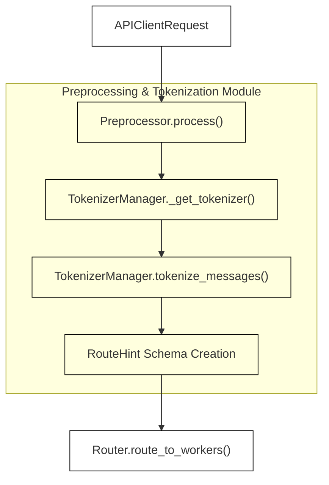
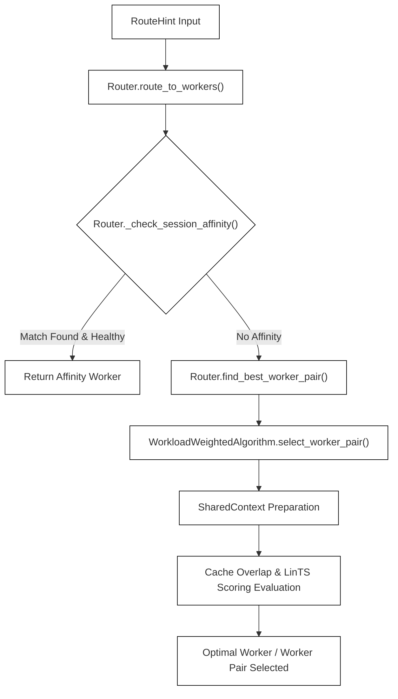

<!-- source: DeepWiki mcp.deepwiki.com · repo openJiuwen-ai/agent-tools · page 3.2 Routing & Scheduling · fetched 2026-11-02 -->

# Routing & Scheduling

Relevant source files

The following files were used as context for generating this wiki page:

- [packages/infer_router/src/openjiuwentools/infer_router/preprocess/preprocessor.py](packages/infer_router/src/openjiuwentools/infer_router/preprocess/preprocessor.py)
- [packages/infer_router/src/openjiuwentools/infer_router/preprocess/tokenizer.py](packages/infer_router/src/openjiuwentools/infer_router/preprocess/tokenizer.py)
- [packages/infer_router/src/openjiuwentools/infer_router/routing/load_balance.py](packages/infer_router/src/openjiuwentools/infer_router/routing/load_balance.py)
- [packages/infer_router/src/openjiuwentools/infer_router/routing/router.py](packages/infer_router/src/openjiuwentools/infer_router/routing/router.py)
- [packages/infer_router/src/openjiuwentools/infer_router/schedule/scheduler.py](packages/infer_router/src/openjiuwentools/infer_router/schedule/scheduler.py)
- [packages/infer_router/tests/unit/test_cache_affinity_routing.py](packages/infer_router/tests/unit/test_cache_affinity_routing.py)

## Purpose and Scope
This section details the routing, scheduling, preprocessing, and load-balancing subsystems of the `openjiuwentools-infer-router` package. These modules work in concert to ingest client requests, normalize metadata and prompt tokens, evaluate KV-cache overlap, schedule request queues using weighted priority formulas, and route workloads to the optimal inference worker nodes or prefill-decode worker pairs.

---

## 1. Preprocessing & Tokenization Stage

The preprocessing stage translates incoming OpenAI-compatible API requests (`ChatCompletionRequest` or `CompletionRequest`) alongside optional agent control hints (`AgentHints`) into a standardized internal routing structure (`RouteHint`). 

The `Preprocessor` class (`[packages/infer_router/src/openjiuwentools/infer_router/preprocess/preprocessor.py:13-118]()`) extracts or sets default parameters such as priority levels, estimated output tokens, latency expectations (`iat`), and prefix IDs. It relies on the `TokenizerManager` (`[packages/infer_router/src/openjiuwentools/infer_router/preprocess/tokenizer.py:13-181]().tokenizer.py`) to convert messages or raw prompts into concrete token ID sequences using HuggingFace `AutoTokenizer` instances or built-in fallback routines.

### Diagram: Preprocessing & Tokenization Bridge (Natural Language Space to Code Entity Space)

*Sources: [packages/infer_router/src/openjiuwentools/infer_router/preprocess/preprocessor.py:13-118](), [packages/infer_router/src/openjiuwentools/infer_router/preprocess/tokenizer.py:13-181]()*

---

## 2. Router Decision Flow

The `Router` class (`[packages/infer_router/src/openjiuwentools/infer_router/routing/router.py:16-199]()`) serves as the central orchestration point for determining where a given `RouteHint` should be executed. It maintains references to a `KVCacheManager` and `WorkerManager`, managing algorithm switching between round-robin and workload-weighted strategies.

### Core Routing Methods
* `Router._check_session_affinity()` (`[packages/infer_router/src/openjiuwentools/infer_router/routing/router.py:40-59]()`): Validates whether a provided `session_id` maps to an active, healthy worker via the cache manager.
* `Router.find_best_worker_pair()` (`[packages/infer_router/src/openjiuwentools/infer_router/routing/router.py:60-117]()`): Scans healthy non-combined groups, collecting paired prefill and decode workers for execution.
* `Router.find_best_combined_worker()` (`[packages/infer_router/src/openjiuwentools/infer_router/routing/router.py:118-150]()`): Identifies available combined worker nodes within healthy model groups.
* `Router.route_to_workers()` (`[packages/infer_router/src/openjiuwentools/infer_router/routing/router.py:151-199]()`): Executes the end-to-end selection flow, updating session affinity and recording request routing metrics.

*Sources: [packages/infer_router/src/openjiuwentools/infer_router/routing/router.py:16-199]()*

---

## 3. Load Balancing Strategies & Cache-Affinity Routing

The package defines load balancing behaviors through the `LoadBalancingAlgorithm` abstract base class and concrete implementations (`[packages/infer_router/src/openjiuwentools/infer_router/routing/load_balance.py:64-191]()`):

1. **`RoundRobinAlgorithm`**: Performs round-robin selection across available groups, tracking separate prefill and decode indices (`[packages/infer_router/src/openjiuwentools/infer_router/routing/load_balance.py:90-139]()`).
2. **`WorkloadWeightedAlgorithm`**: Implements an advanced scoring model combining Contextual Thompson Sampling (LinTS), worker load penalties, and **KV-cache affinity weights** (`[packages/infer_router/src/openjiuwentools/infer_router/routing/load_balance.py:141-191]()`).

### Cache-Affinity Routing Precedence
As tested in `[packages/infer_router/tests/unit/test_cache_affinity_routing.py:1-65]()`, cache overlap takes precedence during worker selection. Even if a worker carries significantly higher load (e.g., `load=90.0` vs `0.0`), a worker holding the matching prefix wins selection if its overlap score clears threshold requirements, preventing cache-cold starvation caused by dominance of the LinTS term.

### Diagram: Routing & Load Balancing Decision Flow (Natural Language Space to Code Entity Space)

*Sources: [packages/infer_router/src/openjiuwentools/infer_router/routing/load_balance.py:64-191](), [packages/infer_router/src/openjiuwentools/infer_router/routing/router.py:16-199](), [packages/infer_router/tests/unit/test_cache_affinity_routing.py:1-65]()*

---

## 4. Scheduling & Priority Management

The `Scheduler` class (`[packages/infer_router/src/openjiuwentools/infer_router/schedule/scheduler.py:76-236]()`) manages global request queues using configurable prioritization strategies.

### Scheduled Requests & Token Calculations
Incoming routing hints are wrapped into `ScheduledRequest` instances (`[packages/infer_router/src/openjiuwentools/infer_router/schedule/scheduler.py:12-35]()`). The property `ScheduledRequest.tokens_to_process` calculates active compute cost by subtracting KV-cache hit tokens from total input tokens:
$$\text{tokens\_to\_process} = \max\left(0, |\text{token\_ids}| - \max(\text{overlap\_scores})\right)$$

### Scheduling Strategies
* **`FCFSStrategy`**: First-Come-First-Served based on `arrival_time` (`[packages/infer_router/src/openjiuwentools/infer_router/schedule/scheduler.py:46-51]()`).
* **`LCFSStrategy`**: Last-Come-First-Served (`[packages/infer_router/src/openjiuwentools/infer_router/schedule/scheduler.py:53-58]()`).
* **`WSPTStrategy`**: Weighted Shortest Processing Time, evaluating requests via the formula $\text{eval} = \frac{1 + \text{priority}}{\text{tokens\_to\_process}}$ (`[packages/infer_router/src/openjiuwentools/infer_router/schedule/scheduler.py:60-74]()`).

*Sources: [packages/infer_router/src/openjiuwentools/infer_router/schedule/scheduler.py:1-236]()*

---

