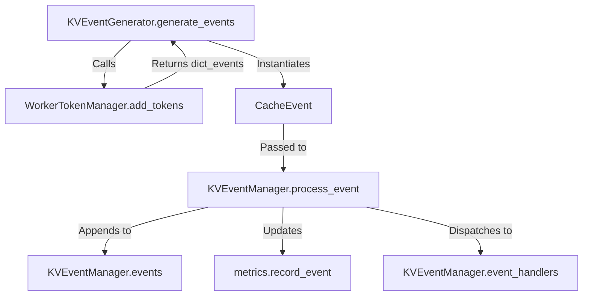
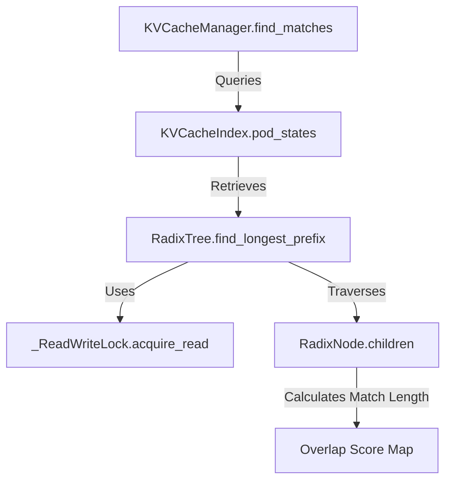

<!-- source: DeepWiki mcp.deepwiki.com · repo openJiuwen-ai/agent-tools · page 3.3 KV Cache Tracking · fetched 2026-11-02 -->

# KV Cache Tracking

Relevant source files

The following files were used as context for generating this wiki page:

- [packages/infer_router/src/openjiuwentools/infer_router/discovery/etcd_discovery.py](packages/infer_router/src/openjiuwentools/infer_router/discovery/etcd_discovery.py)
- [packages/infer_router/src/openjiuwentools/infer_router/fault_tolerance/__init__.py](packages/infer_router/src/openjiuwentools/infer_router/fault_tolerance/__init__.py)
- [packages/infer_router/src/openjiuwentools/infer_router/fault_tolerance/fault_tolerance.py](packages/infer_router/src/openjiuwentools/infer_router/fault_tolerance/fault_tolerance.py)
- [packages/infer_router/src/openjiuwentools/infer_router/kv_cache/__init__.py](packages/infer_router/src/openjiuwentools/infer_router/kv_cache/__init__.py)
- [packages/infer_router/src/openjiuwentools/infer_router/kv_cache/kv_cache.py](packages/infer_router/src/openjiuwentools/infer_router/kv_cache/kv_cache.py)
- [packages/infer_router/src/openjiuwentools/infer_router/kv_cache/kv_event_generator.py](packages/infer_router/src/openjiuwentools/infer_router/kv_cache/kv_event_generator.py)
- [packages/infer_router/src/openjiuwentools/infer_router/kv_cache/kv_event_manager.py](packages/infer_router/src/openjiuwentools/infer_router/kv_cache/kv_event_manager.py)
- [packages/infer_router/src/openjiuwentools/infer_router/kv_cache/worker_token_manager.py](packages/infer_router/src/openjiuwentools/infer_router/kv_cache/worker_token_manager.py)
- [packages/infer_router/tests/unit/test_kv_cache_overlap.py](packages/infer_router/tests/unit/test_kv_cache_overlap.py)

## Purpose and Scope
This page documents the KV Cache Tracking subsystem within the inference router (`openjiuwentools-infer-router`). The subsystem is responsible for tracking token sequences across distributed worker nodes, generating cache lifecycle events (`store`, `evict`, `Cleared`), managing worker token buffers, and computing prefix overlap scores using a thread-safe Radix Tree implementation to optimize request routing affinity.

---

## 3.3.1 Event Generation and Management Pipeline

The tracking pipeline coordinates between token inputs, event generation, and event dispatching. When tokens are processed for a given worker, `KVEventGenerator` delegates token tracking to `WorkerTokenManager` and constructs structured `CacheEvent` objects. These events are subsequently consumed by `KVEventManager`, which manages an in-memory event buffer, updates metrics via `metrics`, and invokes registered event handlers.

*Figure 1: Event generation and dispatch pipeline mapping natural language concepts to concrete classes (`KVEventGenerator`, `WorkerTokenManager`, `CacheEvent`, `KVEventManager`).*

- `KVEventGenerator` (`[packages/infer_router/src/openjiuwentools/infer_router/kv_cache/kv_event_generator.py:7-122]()`) controls event generation based on the `enable_radix_tree` flag.
- `KVEventManager` (`[packages/infer_router/src/openjiuwentools/infer_router/kv_cache/kv_event_manager.py:13-117]()`) maintains buffer limits (`settings.kv_event_buffer_size`), tracks cumulative event statistics, and handles callback execution.
- `CacheEvent` (`[packages/infer_router/src/openjiuwentools/infer_router/kv_cache/event.py:1-1]()`) encapsulates event metadata including `event_type`, `token_ids`, `block_hashes`, and `engine_specific` context.

Sources:
- `packages/infer_router/src/openjiuwentools/infer_router/kv_cache/kv_event_generator.py:7-122`
- `packages/infer_router/src/openjiuwentools/infer_router/kv_cache/kv_event_manager.py:13-118`
- `packages/infer_router/src/openjiuwentools/infer_router/kv_cache/event.py:1-1`

---

## 3.3.2 Worker Token Management

`WorkerTokenManager` maintains the state of tokens currently resident in worker caches. Each worker is mapped to a timestamped sequence of tokens.

- **Token Storage**: Tokens are appended via `add_tokens(worker_id, token_ids)` (`[packages/infer_router/src/openjiuwentools/infer_router/kv_cache/worker_token_manager.py:20-78]()`).
- **Capacity Enforcement**: If the total token count for a worker exceeds `settings.worker_token_capacity`, older tokens are evicted from the front of the queue, generating an `evict` event alongside the incoming `store` event (`[packages/infer_router/src/openjiuwentools/infer_router/kv_cache/worker_token_manager.py:44-73]`).
- **Clearing State**: `clear_worker_tokens(worker_id)` (`[packages/infer_router/src/openjiuwentools/infer_router/kv_cache/worker_token_manager.py:80-105]()`) purges worker tokens and emits a `"Cleared"` event type.

Sources:
- `packages/infer_router/src/openjiuwentools/infer_router/kv_cache/worker_token_manager.py:8-195`

---

## 3.3.3 KV Cache Overlap Computation

To determine which worker node possesses the best cache affinity for a new incoming prompt, `KVCacheManager` (`[packages/infer_router/src/openjiuwentools/infer_router/kv_cache/kv_cache.py:2-1214]()`) utilizes a global index (`KVCacheIndex`) and per-worker `RadixTree` instances.

*Figure 2: Overlap computation flow mapping high-level query operations to internal code symbols (`KVCacheManager`, `KVCacheIndex`, `RadixTree`, `_ReadWriteLock`, `RadixNode`).*

- **Thread-Safe Radix Tree**: `RadixTree` (`[packages/infer_router/src/openjiuwentools/infer_router/kv_cache/kv_cache.py:111-204]()`) implements a custom read-write lock (`_ReadWriteLock`, `[packages/infer_router/src/openjiuwentools/infer_router/kv_cache/kv_cache.py:78-108]()`) to allow concurrent prefix reads (`find_longest_prefix`, `[packages/infer_router/src/openjiuwentools/infer_router/kv_cache/kv_cache.py:165-192]()`) while serializing tree mutations (`insert`, `[packages/infer_router/src/openjiuwentools/infer_router/kv_cache/kv_cache.py:120-163]()`).
- **Token Path Reconstruction**: `RadixNode.get_token_ids()` (`[packages/infer_router/src/openjiuwentools/infer_router/kv_cache/kv_cache.py:51-59]()`) backtracks through parent pointers to reconstruct token sequences.

Sources:
- `packages/infer_router/src/openjiuwentools/infer_router/kv_cache/kv_cache.py:78-204`

---

## 3.3.4 Integration and Test Verification

The tracking mechanisms are validated via unit test suites that verify zero-initial-overlap states, block storage and retrieval correctness, repeated request overlap behavior, and event generator synchronization.

- `test_initial_overlap_is_zero`: Ensures workers start with zero cache overlap (`[packages/infer_router/tests/unit/test_kv_cache_overlap.py:22-43]()`).
- `test_store_and_retrieve_block`: Confirms that storing a block hash and token sequence correctly registers positive overlap scores (`[packages/infer_router/tests/unit/test_kv_cache_overlap.py:45-74]()`).
- `test_event_generator_stores_blocks`: Validates `KVEventGenerator` integration with `KVCacheManager` (`[packages/infer_router/tests/unit/test_kv_cache_overlap.py:106-133]()`).

Sources:
- `packages/infer_router/tests/unit/test_kv_cache_overlap.py:1-207`

---

