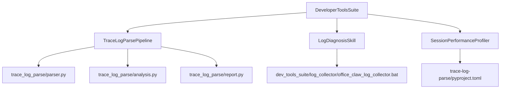
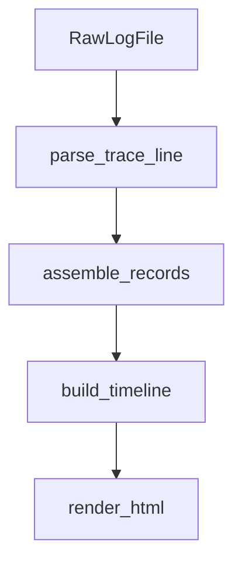

<!-- source: DeepWiki mcp.deepwiki.com · repo openJiuwen-ai/agent-tools · page 4 Developer Tools Suite · fetched 2026-11-02 -->

# Developer Tools Suite

Relevant source files

The following files were used as context for generating this wiki page:

- [dev_tools_suite/log_collector/office_claw_log_collector.bat](dev_tools_suite/log_collector/office_claw_log_collector.bat)
- [dev_tools_suite/log_parse/.gitignore](dev_tools_suite/log_parse/.gitignore)
- [dev_tools_suite/log_parse/README.md](dev_tools_suite/log_parse/README.md)
- [dev_tools_suite/log_parse/pyproject.toml](dev_tools_suite/log_parse/pyproject.toml)
- [dev_tools_suite/log_parse/src/trace_log_parse/analysis.py](dev_tools_suite/log_parse/src/trace_log_parse/analysis.py)
- [dev_tools_suite/log_parse/src/trace_log_parse/parser.py](dev_tools_suite/log_parse/src/trace_log_parse/parser.py)
- [dev_tools_suite/log_parse/src/trace_log_parse/report.py](dev_tools_suite/log_parse/src/trace_log_parse/report.py)

The Developer Tools Suite (`dev_tools_suite`) provides comprehensive diagnostic, parsing, log collection, and performance monitoring capabilities for the `agent-tools` monorepo and JiuWenClaw/OfficeClaw runtime environments. It serves developers and system administrators by transforming low-level trace logs into structured timelines, HTML reports, and actionable performance metrics.

For details on individual sub-topics, refer to the child pages:
- [Trace Log Parse Pipeline](#4.1)
- [RelayClaw/JiuWenClaw Log Diagnosis Skill](#4.2)
- [officeAce Session Performance (ocperf)](#4.3)

Sources: `dev_tools_suite/log_parse/src/trace_log_parse/parser.py:1-12`, `dev_tools_suite/log_parse/src/trace_log_parse/analysis.py:1-15`, `dev_tools_suite/log_collector/office_claw_log_collector.bat:1-10`, `dev_tools_suite/log_parse/pyproject.toml:1-10`

---

## 4.1 Trace Log Parse Pipeline

The trace log parse pipeline ingests raw debug output containing `[LLM_IO_TRACE]` entries, parses header metadata, merges multi-part message bodies, constructs chronological timelines (LLM rounds and tool gaps), and renders self-contained HTML performance reports. 

The core modules handle log parsing (`parse_trace_line`, `assemble_records`), session timeline analysis (`build_timeline`), and HTML report generation (`render_html`).

Sources: `dev_tools_suite/log_parse/src/trace_log_parse/parser.py:91-176`, `dev_tools_suite/log_parse/src/trace_log_parse/analysis.py:159-170`, `dev_tools_suite/log_parse/src/trace_log_parse/report.py:139-144`

For detailed information on the parser, analysis engine, token tracking, and CLI usage, see [Trace Log Parse Pipeline](#4.1).

Sources: `dev_tools_suite/log_parse/README.md:1-46`, `dev_tools_suite/log_parse/pyproject.toml:1-13`

---

## 4.2 RelayClaw/JiuWenClaw Log Diagnosis Skill

The log diagnosis component standardizes troubleshooting workflows for OfficeClaw and JiuWenClaw deployments. It utilizes automated collection batch scripts (`office_claw_log_collector.bat`) to bundle runtime logs, install logs, audit logs, and agent session artifacts based on custom time windows.

For details on the boundary-first diagnosis methodology, log maps, fingerprints, and correlation ID tracking, see [RelayClaw/JiuWenClaw Log Diagnosis Skill](#4.2).

Sources: `dev_tools_suite/log_collector/office_claw_log_collector.bat:1-50`

---

## 4.3 officeAce Session Performance (ocperf)

The `ocperf` module focuses on session performance profiling, full parsing, fusion parsing, loader utilities, trace parsing, timeline reconstruction, and statistical analysis for complex agent workflows.

For instructions on utilizing `SKILL.md`, configuration parameters, and performance breakdown tools, see [officeAce Session Performance (ocperf)](#4.3).

Sources: `dev_tools_suite/log_parse/pyproject.toml:1-20`

---

