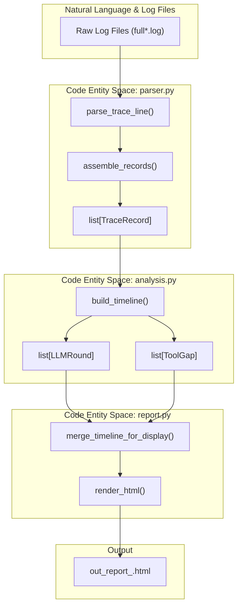
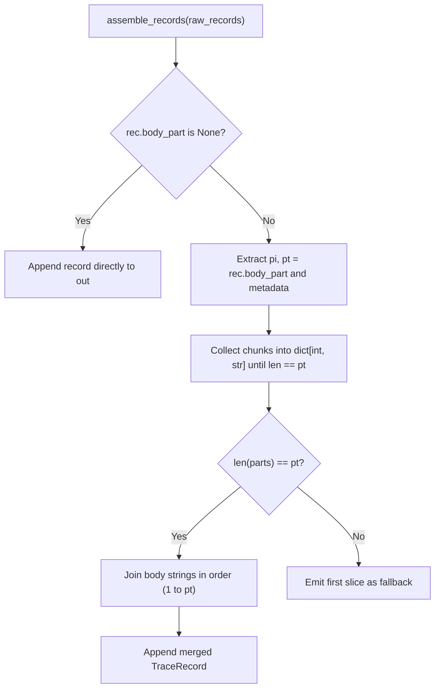

<!-- source: DeepWiki mcp.deepwiki.com · repo openJiuwen-ai/agent-tools · page 4.1 Trace Log Parse Pipeline · fetched 2026-11-02 -->

# Trace Log Parse Pipeline

<details>
<summary>Relevant source files</summary>

The following files were used as context for generating this wiki page:

- [dev_tools_suite/log_collector/office_claw_log_collector.bat](dev_tools_suite/log_collector/office_claw_log_collector.bat)
- [dev_tools_suite/log_parse/.gitignore](dev_tools_suite/log_parse/.gitignore)
- [dev_tools_suite/log_parse/README.md](dev_tools_suite/log_parse/README.md)
- [dev_tools_suite/log_parse/pyproject.toml](dev_tools_suite/log_parse/pyproject.toml)
- [dev_tools_suite/log_parse/src/trace_log_parse/__init__.py](dev_tools_suite/log_parse/src/trace_log_parse/__init__.py)
- [dev_tools_suite/log_parse/src/trace_log_parse/__main__.py](dev_tools_suite/log_parse/src/trace_log_parse/__main__.py)
- [dev_tools_suite/log_parse/src/trace_log_parse/analysis.py](dev_tools_suite/log_parse/src/trace_log_parse/analysis.py)
- [dev_tools_suite/log_parse/src/trace_log_parse/parser.py](dev_tools_suite/log_parse/src/trace_log_parse/parser.py)
- [dev_tools_suite/log_parse/src/trace_log_parse/report.py](dev_tools_suite/log_parse/src/trace_log_parse/report.py)
- [dev_tools_suite/skills/relayclaw-jiuwen-log-diagnosis/cases/log_case_repo.md](dev_tools_suite/skills/relayclaw-jiuwen-log-diagnosis/cases/log_case_repo.md)

</details>


## Purpose and Scope
This page details the **Trace Log Parse Pipeline** (`trace-log-parse`), a developer tool located in `dev_tools_suite/log_parse/` designed to ingest, parse, analyze, and render structured HTML reports from `[LLM_IO_TRACE]` debug logs generated by `jiuwenclaw`. The pipeline bridges raw textual log streams into structured chronological execution timelines consisting of `LLMRound` objects, `ToolGap` intervals, subagent hierarchies, token consumption statistics, and step-based visual performance breakdowns.

---

## 1. Pipeline Architecture & Data Flow

The pipeline executes in three distinct stages: **Parsing & Assembly** (`parser.py`), **Timeline Analysis & Pairing** (`analysis.py`), and **HTML Report Rendering** (`report.py`), orchestrated by the CLI entrypoint (`__main__.py`).


*Sources: `dev_tools_suite/log_parse/src/trace_log_parse/parser.py:91-176()`, `dev_tools_suite/log_parse/src/trace_log_parse/analysis.py:159-202()`, `dev_tools_suite/log_parse/src/trace_log_parse/report.py:139-170()`, `dev_tools_suite/log_parse/src/trace_log_parse/__main__.py:21-49()`*

---

## 2. Raw Log Parsing & Chunk Assembly

The parser inspects raw log files line-by-line, filtering for lines containing `[LLM_IO_TRACE]`. It extracts timestamps, event types, session IDs, request IDs, iteration numbers, model names, and optional metadata fields using compiled regular expressions.

### Key Data Structures and Regex Patterns
- `_TS_RE`: Matches the log line timestamp prefix (`YYYY-MM-DD HH:MM:SS.mmm`).
- `_HDR_RE`: Captures trace headers including `event`, `event_id`, `session_id`, `request_id`, `iteration`, `model_name`, `agent`, `tool_name`, and `tool_call_id`.
- `TraceRecord`: Dataclass holding normalized attributes for a single trace event or multipart chunk.

```python
@dataclass
class TraceRecord:
    ts: datetime
    event: str
    session_id: str
    request_id: str
    iteration: str
    model_name: str
    event_id: str | None = None
    agent: str | None = None
    tool_name: str | None = None
    tool_call_id: str | None = None
    body: str = ""
    reasoning_seq: int | None = None
    body_part: tuple[int, int] | None = None
    raw_line_no: int = 0
```
*Sources: `dev_tools_suite/log_parse/src/trace_log_parse/parser.py:12-68()`*

### Multipart Chunk Assembly (`assemble_records`)
Because large LLM request/response bodies or reasoning payloads can exceed single-line logging limits, logs emit chunks marked with `body_part=i/total`. The `assemble_records()` function buffers and merges these consecutive segments sharing identical metadata keys into a single unified `TraceRecord`.


*Sources: `dev_tools_suite/log_parse/src/trace_log_parse/parser.py:124-191()`*

*Sources for Section 2: `dev_tools_suite/log_parse/src/trace_log_parse/parser.py:1-191()`*

---

## 3. Timeline Reconstruction & Gap Analysis

Once records are assembled, `build_timeline()` in `analysis.py` groups requests and outputs into `LLMRound` instances and computes intervening `ToolGap` periods.

### Pairing Strategy and Concurrency Safety
To support concurrent calls within the same `(session_id, request_id)` pair, the pipeline prioritizes `event_id` when available:
- **New Logs (`event_id` present)**: `request` and matching `output` (plus intermediate `reasoning_delta` records) share an `event_id`, enabling strict 1:1 pairing.
- **Legacy Logs (`event_id` absent)**: Falls back to pairing via `(session_id, request_id)`.
- **FIFO Output Queues**: Tool gaps (`output` to `next_request`) are managed via FIFO queues per `(session_id, request_id)` to prevent race conditions during parallel outputs.

```python
@dataclass
class LLMRound:
    kind: Literal["stream", "invoke"]
    session_id: str
    request_id: str
    iteration: str
    model_name: str
    request_ts: datetime
    output_ts: datetime
    duration_sec: float
    input_tokens: int | None = None
    output_tokens: int | None = None
    total_tokens: int | None = None
    tools: list[dict[str, Any]] = field(default_factory=list)
    reasoning_chars: int = 0
    reasoning_batches: int = 0
    reasoning_full: str = ""
    assistant_preview: str = ""
    is_child_session: bool = False
    child_label: str = ""
    child_path: SessionPath = ()
    is_post_final: bool = False
```
*Sources: `dev_tools_suite/log_parse/src/trace_log_parse/analysis.py:21-45()`*

### Subagent and Fork Parsing
The function `_session_path()` parses session ID suffixes to reconstruct hierarchical agent nesting (such as subagents and fork agents) for tree-based timeline visualization.
- Markers: `_subagent_` and `_fork_agent_`
- Path tuple: `SessionPath = tuple[tuple[str, str, str], ...]` (`(session_id, label, kind)`)

*Sources for Section 3: `dev_tools_suite/log_parse/src/trace_log_parse/analysis.py:1-202()`*

---

## 4. HTML Report Rendering & Timeline Merging

`report.py` transforms parsed `LLMRound` and `ToolGap` lists into an interactive, self-contained HTML performance document.

### Timeline Merging & Step Boundary Rules
The function `merge_timeline_for_display()` sorts rounds by `output_ts` (primary), `request_ts`, and `session_id` to prevent parallel subagent timing inversion. Steps are delimited by tool completion markers:
- **Classic Markers**: `skill_step_complete` or `skill_step_complete_batch`
- **Unified Tool Format**: `skill_step` (or legacy spelling `shill_step`) with `action="complete"` or `action="complete_batch"`
- **Unclosed Tail**: Any remaining segment without a closing step marker is labeled as `收尾阶段` (Wrapping/Finalize Stage).

| Step Marker Type | Tool Name(s) | Action / Arguments | Rendered Label |
| :--- | :--- | :--- | :--- |
| **Legacy Complete** | `skill_step_complete` | `idx`, `result` | `完成步骤 {idx}：{result}` |
| **Legacy Batch** | `skill_step_complete_batch` | batch JSON | `批量完成步骤：{json}` |
| **Unified Complete** | `skill_step`, `shill_step` | `action="complete"` | `完成步骤 {idx}：{result}` |
| **Unified Batch** | `skill_step`, `shill_step` | `action="complete_batch"` | `批量完成步骤：{json}` |

*Sources: `dev_tools_suite/log_parse/src/trace_log_parse/report.py:59-78()`, `dev_tools_suite/log_parse/src/trace_log_parse/report.py:80-136()`*

*Sources for Section 4: `dev_tools_suite/log_parse/src/trace_log_parse/report.py:1-180()`*

---

## 5. CLI Usage & Packaging

The CLI entrypoint is defined in `pyproject.toml` and implemented in `__main__.py`. It supports single log files or directory scanning for `full*.log` files.

### Package Configuration (`pyproject.toml`)
```toml
[project]
name = "trace-log-parse"
version = "0.1.0"
description = "Parse jiuwenclaw [LLM_IO_TRACE] debug logs into a performance HTML report"
requires-python = ">=3.11"
dependencies = []

[project.scripts]
trace-llm-report = "trace_log_parse.__main__:main"
```
*Sources: `dev_tools_suite/log_parse/pyproject.toml:1-10()`*

### Command-Line Usage
```powershell
# Parse a single log file with auto-detected root session
uv run python -m trace_log_parse test_data\full.log

# Parse a log directory for all files matching full*.log with an explicit session
uv run python -m trace_log_parse D:\path\to\logs -s officeclaw_a10ac72ea3bcdcfe2741700d -o report.html

# Using the installed script entrypoint
uv run trace-llm-report D:\path\to\logs -s officeclaw_xxx
```
*Sources: `dev_tools_suite/log_parse/README.md:16-35()`*

### File Resolution & Default Session Selection (`__main__.py`)
- `resolve_log_files()`: Validates input paths, accepting single `.log` files or directories containing `full*.log` files.
- `pick_default_session()`: Automatically selects the most frequent non-child session ID (excluding `_subagent_` or `_fork_` prefixes) if `--session` is omitted.

*Sources for Section 5: `dev_tools_suite/log_parse/src/trace_log_parse/__main__.py:21-116()`*

---

