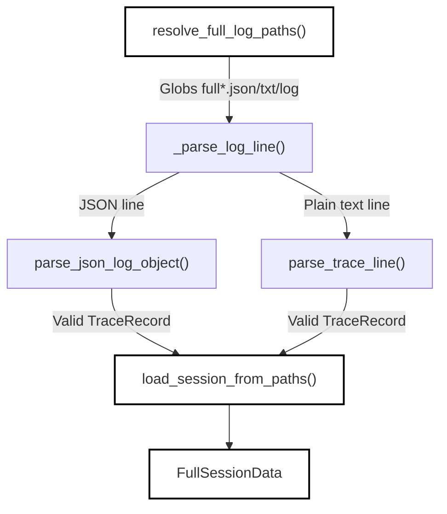
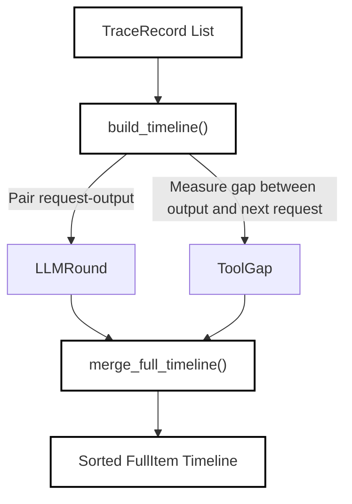

<!-- source: DeepWiki mcp.deepwiki.com · repo openJiuwen-ai/agent-tools · page 4.3 officeAce Session Performance (ocperf) · fetched 2026-11-02 -->

# officeAce Session Performance (ocperf)

<details>
<summary>Relevant source files</summary>

The following files were used as context for generating this wiki page:

- [dev_tools_suite/skills/officeAce-session-perf/.gitignore](dev_tools_suite/skills/officeAce-session-perf/.gitignore)
- [dev_tools_suite/skills/officeAce-session-perf/SKILL.md](dev_tools_suite/skills/officeAce-session-perf/SKILL.md)
- [dev_tools_suite/skills/officeAce-session-perf/config/config.example.ps1](dev_tools_suite/skills/officeAce-session-perf/config/config.example.ps1)
- [dev_tools_suite/skills/officeAce-session-perf/ocperf/src/full_parse/__init__.py](dev_tools_suite/skills/officeAce-session-perf/ocperf/src/full_parse/__init__.py)
- [dev_tools_suite/skills/officeAce-session-perf/ocperf/src/full_parse/loader.py](dev_tools_suite/skills/officeAce-session-perf/ocperf/src/full_parse/loader.py)
- [dev_tools_suite/skills/officeAce-session-perf/ocperf/src/full_parse/stats.py](dev_tools_suite/skills/officeAce-session-perf/ocperf/src/full_parse/stats.py)
- [dev_tools_suite/skills/officeAce-session-perf/ocperf/src/full_parse/timeline.py](dev_tools_suite/skills/officeAce-session-perf/ocperf/src/full_parse/timeline.py)
- [dev_tools_suite/skills/officeAce-session-perf/ocperf/src/full_parse/trace_analysis.py](dev_tools_suite/skills/officeAce-session-perf/ocperf/src/full_parse/trace_analysis.py)
- [dev_tools_suite/skills/officeAce-session-perf/ocperf/src/full_parse/trace_parser.py](dev_tools_suite/skills/officeAce-session-perf/ocperf/src/full_parse/trace_parser.py)
- [dev_tools_suite/skills/officeAce-session-perf/ocperf/src/fusion_parse/__init__.py](dev_tools_suite/skills/officeAce-session-perf/ocperf/src/fusion_parse/__init__.py)

</details>


This page provides full technical documentation for the `ocperf` module within the `dev_tools_suite/skills/officeAce-session-perf/` directory. `ocperf` is a self-contained diagnostic and performance analytics engine designed to process `[LLM_IO_TRACE]` log files (`full_parse`) and reconcile them with execution histories (`fusion_parse`) to generate detailed metrics, timelines, and HTML diagnostic reports for OfficeClaw agent sessions.

---

## 1. Architecture & Module Layout

The `ocperf` package is split into several core modules that handle everything from low-level log file discovery and line parsing to higher-level trace analysis, timeline assembly, statistical aggregation, and fusion reporting.

```
dev_tools_suite/skills/officeAce-session-perf/ocperf/src/
├── full_parse/
│   ├── __init__.py          # Exports load_session_from_paths, render_full_html, write_full_report
│   ├── loader.py            # Resolves and loads multi-file full logs & history.json
│   ├── trace_parser.py      # Parses raw log lines, chunks, and timestamps into TraceRecord
│   ├── trace_analysis.py    # Builds LLMRound and ToolGap timelines
│   ├── timeline.py          # Merges LLM rounds and tool execution windows
│   └── stats.py             # Aggregates session wall times, token counts, and round stats
└── fusion_parse/
    ├── __init__.py          # Exports build_fusion_session, discover_session_logs, render_fusion_html
    ├── discovery.py         # Discovers paired session log bundles
    ├── reconcile.py         # Fuses history.json and full.json streams
    └── fusion_report.py     # Renders reconciled latency reports
```

Sources: `dev_tools_suite/skills/officeAce-session-perf/ocperf/src/full_parse/__init__.py`, `dev_tools_suite/skills/officeAce-session-perf/ocperf/src/fusion_parse/__init__.py`

---

## 2. Full Parse Pipeline (`full_parse`)

The `full_parse` module ingests raw `[LLM_IO_TRACE]` logs across one or more files, cleans and parses them, pairs requests to responses, and computes aggregate statistics.

### 2.1 Loader & Log Resolution (`loader.py`)

The loader subsystem discovers and reads log files matching patterns such as `full*.json`, `full*.txt`, and `full*.log`. It also locates co-located `history.json` files [dev_tools_suite/skills/officeAce-session-perf/ocperf/src/full_parse/loader.py:39-110].


Sources: `dev_tools_suite/skills/officeAce-session-perf/ocperf/src/full_parse/loader.py:39-216`

### 2.2 Trace Parser (`trace_parser.py`)

Raw lines containing `[LLM_IO_TRACE]` are extracted via regular expressions (`_HDR_RE`, `_TS_RE`) [dev_tools_suite/skills/officeAce-session-perf/ocperf/src/full_parse/trace_parser.py:12-25]. Multipart messages (`body_part=i/total`) are assembled into unified `TraceRecord` structures via `assemble_records()` [dev_tools_suite/skills/officeAce-session-perf/ocperf/src/full_parse/trace_parser.py:147-213].

- **`TraceRecord`**: Dataclass capturing `ts`, `event`, `session_id`, `request_id`, `iteration`, `model_name`, `body`, and part indices [dev_tools_suite/skills/officeAce-session-perf/ocperf/src/full_parse/trace_parser.py:41-55].
- **`assemble_records()`**: Merges chunked log entries while maintaining file and line order.

Sources: `dev_tools_suite/skills/officeAce-session-perf/ocperf/src/full_parse/trace_parser.py:1-213`

### 2.3 Trace Analysis & Timeline (`trace_analysis.py` & `timeline.py`)

`build_timeline()` pairs `stream_request`/`invoke_request` with their respective outputs, computes reasoning character counts and batch metrics, and emits `LLMRound` and `ToolGap` objects [dev_tools_suite/skills/officeAce-session-perf/ocperf/src/full_parse/trace_analysis.py:83-160].


Sources: `dev_tools_suite/skills/officeAce-session-perf/ocperf/src/full_parse/trace_analysis.py:83-160`, `dev_tools_suite/skills/officeAce-session-perf/ocperf/src/full_parse/timeline.py:13-24`

### 2.4 Statistics Aggregation (`stats.py`)

`aggregate_full_stats()` computes summary metrics across the parsed session timeline, including total task duration, LLM wall time, tool window wall time, subagent/spawn metrics, and token usage sums [dev_tools_suite/skills/officeAce-session-perf/ocperf/src/full_parse/stats.py:11-48].

Sources: `dev_tools_suite/skills/officeAce-session-perf/ocperf/src/full_parse/stats.py:1-48`

---

## 3. Fusion Parse Pipeline (`fusion_parse`)

The `fusion_parse` module correlates tool execution records from `history.json` with model invocation rounds from `full.json` to generate reconciled latency reports and unified timeline data structures [dev_tools_suite/skills/officeAce-session-perf/ocperf/src/fusion_parse/__init__.py:1-12].

- **`discover_session_logs()`**: Discovers paired session log bundles across directories [dev_tools_suite/skills/officeAce-session-perf/ocperf/src/fusion_parse/discovery.py:3-9].
- **`build_fusion_session()`**: Reconciles execution history with full LLM trace logs [dev_tools_suite/skills/officeAce-session-perf/ocperf/src/fusion_parse/reconcile.py:5-5].
- **`render_fusion_html()` / `write_fusion_report()`**: Emits interactive HTML reports comparing model and tool timelines [dev_tools_suite/skills/officeAce-session-perf/ocperf/src/fusion_parse/fusion_report.py:4-4].

Sources: `dev_tools_suite/skills/officeAce-session-perf/ocperf/src/fusion_parse/__init__.py:1-12`

---

## 4. SKILL.md & Configuration Usage

The `officeAce-session-perf` skill operates as a self-contained automation unit controlled via PowerShell scripts and local configuration files [dev_tools_suite/skills/officeAce-session-perf/SKILL.md:11-19].

### 4.1 Configuration Setup

Copy the example configuration template to `config.local.ps1` and specify the paths to the session histories and log roots [dev_tools_suite/skills/officeAce-session-perf/SKILL.md:13-19]:

```powershell
Copy-Item config\config.example.ps1 config\config.local.ps1
# Edit SessionsRoot and LogsRoot in config\config.local.ps1
.\scripts\setup_env.ps1
```

Config schema template (`config/config.example.ps1`) [dev_tools_suite/skills/officeAce-session-perf/config/config.example.ps1:4-9]:

```powershell
$Script:OfficeClawSkillConfig = @{
    SessionsRoot = "C:\Users\user\.office-claw\.jiuwenclaw\service_default\agent_default\agent\sessions"
    LogsRoot     = "C:\Users\user\.office-claw\.jiuwenclaw\service_default\.logs"
}
```

Sources: `dev_tools_suite/skills/officeAce-session-perf/SKILL.md:1-19`, `dev_tools_suite/skills/officeAce-session-perf/config/config.example.ps1:1-9`

### 4.2 Execution & Deliverables

Run the analysis script providing a target `SessionId` [dev_tools_suite/skills/officeAce-session-perf/SKILL.md:21-27]:

```powershell
.\run.ps1 -SessionId <session_id>
# With optional fusion reconciliation:
.\run.ps1 -SessionId <session_id> -Fusion
```

#### Generated Deliverables

| Deliverable File | Description |
|------------------|-------------|
| `out_history_*.html` | Tool wall-clock times, Todo items, and extended analysis |
| `out_full_*.html` | `[LLM_IO_TRACE]` round analysis |
| `out_unified_*.html` | Single unified timeline overview |
| `out_llm_latency_*.html` | TTFT and generation latency metrics |
| `execution_flowchart_*` | Mermaid/HTML execution flowchart |
| `skill_bundle_*.json` | Structured JSON summary for agent diagnostics |
| `analysis_report.md` | Markdown report skeleton |

Sources: `dev_tools_suite/skills/officeAce-session-perf/SKILL.md:31-41`

---

