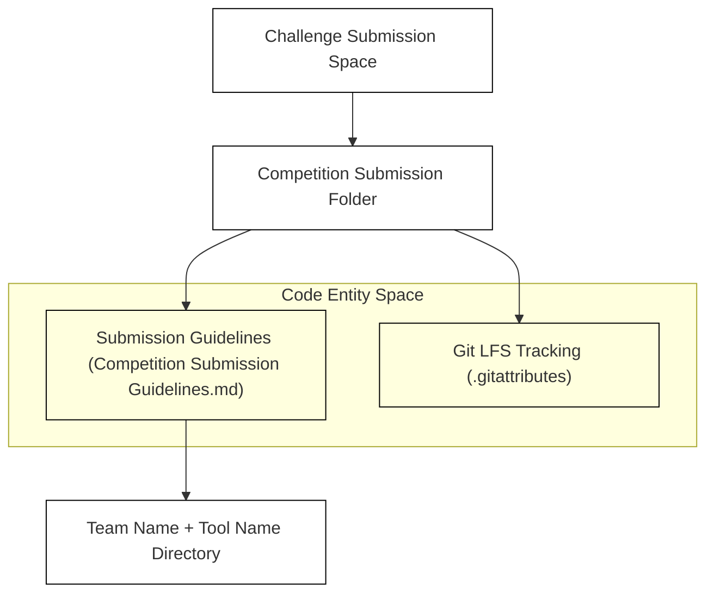
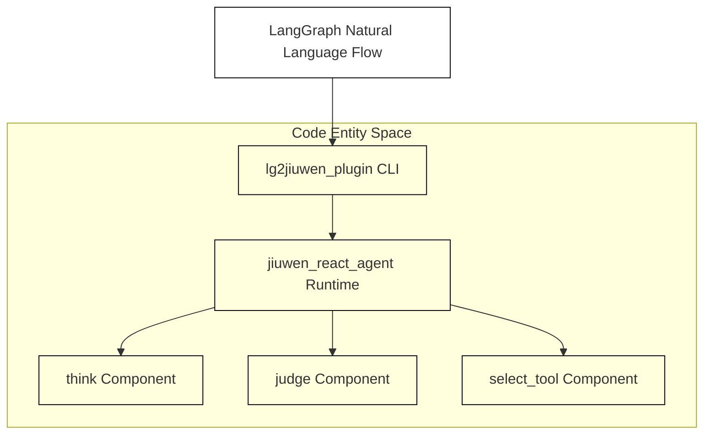
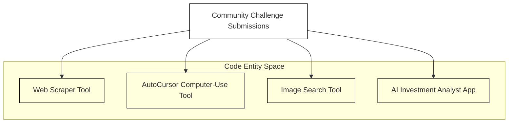

<!-- source: DeepWiki mcp.deepwiki.com · repo openJiuwen-ai/agent-tools · page 5 Agent Innovation Challenge Submissions · fetched 2026-11-02 -->

# Agent Innovation Challenge Submissions

Relevant source files

The following files were used as context for generating this wiki page:

- [Agent Innovation Challenge/.gitattributes](Agent Innovation Challenge/.gitattributes)
- [Agent Innovation Challenge/Competition Submission Guidelines.md](Agent Innovation Challenge/Competition Submission Guidelines.md)

## Purpose and Scope

This page provides a high-level overview of the **Agent Innovation Challenge** community submissions directory within the `agent-tools` repository. The challenge encourages community developers to contribute custom tools, conversion utilities, and agent applications integrated with the OpenJiuwen framework. 

As a parent page, this document outlines the structure of submission guidelines, reference implementations, framework converters, and team projects. For in-depth technical details, implementation logic, and specific usage instructions, please refer to the child pages:
- [Submission Guidelines & Reference Example](#5.1)
- [LangGraph-to-JiuWen Conversion Tool](#5.2)
- [Other Team Tools (Web Scraper, AutoCursor, Image Search, AI Investment)](#5.3)

---

## 5.1 Submission Guidelines & Reference Example

The submission framework defines standard conventions for community contributions, ensuring uniformity across agent scenarios, technical documentation, runnable code, and OpenJiuwen Studio UI integrations [Agent Innovation Challenge/Competition Submission Guidelines.md:1-10](). Submissions are organized under the `[Competition Submission]` folder using a standardized naming convention: `Team Name + Tool Name` [Agent Innovation Challenge/Competition Submission Guidelines.md:11-13](). 

Additionally, binary assets such as demonstration videos are managed via Git LFS attributes defined in repository configurations [Agent Innovation Challenge/.gitattributes:1-2](). 

For full details on competition constraints, directory structures, and the official weather-query reference tool, see [Submission Guidelines & Reference Example](#5.1).

*Figure 5.1: Mapping of challenge submission guidelines and folder conventions to repository configuration files.*

Sources: `Agent Innovation Challenge/Competition Submission Guidelines.md:1-13`, `Agent Innovation Challenge/.gitattributes:1-2`

---

## 5.2 LangGraph-to-JiuWen Conversion Tool

To facilitate ecosystem interoperability, community challenge entries include translation utilities that bridge external agent frameworks into the OpenJiuwen paradigm. The `lg2jiuwen_plugin` package provides command-line utilities and core translation logic to convert LangGraph definitions into native OpenJiuwen ReAct agent structures.

The reference conversion package demonstrates how to map complex reasoning loops—specifically `think`, `judge`, and `select_tool` components—into OpenJiuwen-compatible execution graphs. For comprehensive architectural breakdowns, CLI commands, and internal conversion workflows, see [LangGraph-to-JiuWen Conversion Tool](#5.2).

*Figure 5.2: Bridging external agent graphs to native execution routines via `lg2jiuwen_plugin` and `jiuwen_react_agent`.*

Sources: `Agent Innovation Challenge/Competition Submission Guidelines.md:1-10`

---

## 5.3 Other Team Tools (Web Scraper, AutoCursor, Image Search, AI Investment)

Beyond framework migration tools, the challenge directory hosts diverse domain-specific agent applications built by community teams. These include FastAPI-powered web scraping tools, computer-use automation utilities (`AutoCursor`), multi-modal image search agents, and quantitative AI investment analysis applications.

These projects showcase the versatility of the OpenJiuwen ecosystem across different operational domains. For detailed summaries of each project's architecture, API definitions, and integration workflows, see [Other Team Tools (Web Scraper, AutoCursor, Image Search, AI Investment)](#5.3).

*Figure 5.3: Taxonomy of community team projects within the agent innovation challenge.*

Sources: `Agent Innovation Challenge/Competition Submission Guidelines.md:1-13`

---

