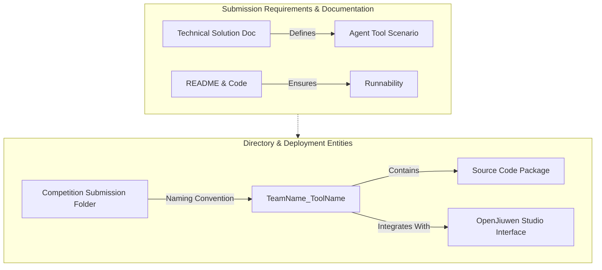
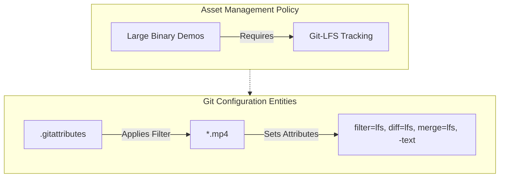
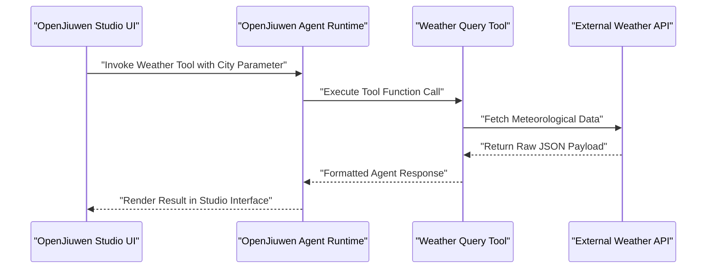

<!-- source: DeepWiki mcp.deepwiki.com · repo openJiuwen-ai/agent-tools · page 5.1 Submission Guidelines & Reference Example · fetched 2026-11-02 -->

# Submission Guidelines & Reference Example

<details>
<summary>Relevant source files</summary>

The following files were used as context for generating this wiki page:

- [Agent Innovation Challenge/.gitattributes](Agent Innovation Challenge/.gitattributes)
- [Agent Innovation Challenge/Competition Submission Guidelines.md](Agent Innovation Challenge/Competition Submission Guidelines.md)

</details>


## Purpose and Scope

This page defines the official competition submission requirements, directory conventions, and repository tracking configurations for the Agent Innovation Challenge within the `agent-tools` monorepo. It details the required submission package structure, integration expectations with OpenJiuwen Studio, and binary asset management via Git-LFS.

Sources: `Agent Innovation Challenge/Competition Submission Guidelines.md:1-13`, `Agent Innovation Challenge/.gitattributes:1-2`

---

## 1. Competition Submission Requirements & Directory Conventions

Submissions for the Agent Innovation Challenge must follow strict structural guidelines to ensure automated validation, manual peer review, and seamless integration into the OpenJiuwen ecosystem. Each entry must reside within the designated submission directory using the naming convention `Team Name + Tool Name`.

### Mandatory Submission Artifacts

Every competition entry must include three core components:
1. **Technical Documentation & Scenario Introduction**: A comprehensive guide detailing the Agent Tool scenario, architectural design choices, and technical solutions (supported in both English and Chinese) [Agent Innovation Challenge/Competition Submission Guidelines.md:1-5]().
2. **Agent Tool Source Code**: Complete, runnable source code accompanied by a standard `README` file detailing setup, dependencies, and execution instructions [Agent Innovation Challenge/Competition Submission Guidelines.md:6-7]().
3. **Pre-Deployed Tool Demo**: A fully functional demo where the tool is pre-deployed and integrated into **OpenJiuwen Studio**, showcasing tool invocation and execution through the official Studio interface [Agent Innovation Challenge/Competition Submission Guidelines.md:8-10]().



Sources: `Agent Innovation Challenge/Competition Submission Guidelines.md:1-13`

---

## 2. Git-LFS Attributes & Large File Handling

To prevent repository bloat caused by large binary assets such as demonstration videos, evaluation datasets, and model checkpoints, the competition workspace utilizes Git Large File Storage (`git-lfs`).

### Attribute Configurations

The `.gitattributes` file explicitly tracks video recordings and binary artifacts by overriding default Git text conversion behaviors:

```text
*.mp4 filter=lfs diff=lfs merge=lfs -text
```

* **`filter=lfs`**: Routes file serialization through the Git-LFS pointer replacement filter.
* **`diff=lfs`**: Replaces binary diff computations with lightweight size or pointer checks.
* **`merge=lfs`**: Disables standard line-based three-way merges for binary assets.
* **`-text`**: Prevents CRLF/LF line-ending normalization on video files (`.mp4`), preserving binary integrity.



Sources: `Agent Innovation Challenge/.gitattributes:1-2`

---

## 3. Weather-Query Reference Example & Integration

The reference example (such as the standard weather-query tool implementation) serves as the baseline architectural template for all competition submissions. It demonstrates how external API-bound tools interface with the OpenJiuwen agent runtime and Studio UI.

### Execution & Studio Integration Data Flow



Sources: `Agent Innovation Challenge/Competition Submission Guidelines.md:1-13`

---

