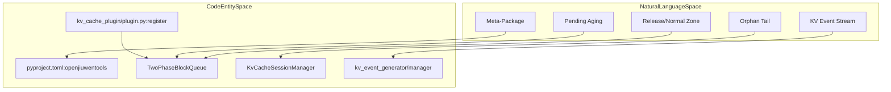
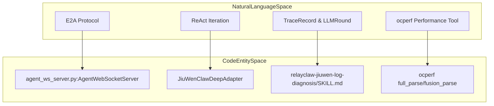

<!-- source: DeepWiki mcp.deepwiki.com · repo openJiuwen-ai/agent-tools · page 7 Glossary · fetched 2026-11-02 -->

# Glossary

Relevant source files

The following files were used as context for generating this wiki page:

- [.gitignore](.gitignore)
- [.markdownlint.json](.markdownlint.json)
- [.pre-commit-config.yaml](.pre-commit-config.yaml)
- [.typos.toml](.typos.toml)
- [README.md](README.md)
- [README_zh.md](README_zh.md)
- [dev_tools_suite/skills/relayclaw-jiuwen-log-diagnosis/SKILL.md](dev_tools_suite/skills/relayclaw-jiuwen-log-diagnosis/SKILL.md)
- [dev_tools_suite/skills/relayclaw-jiuwen-log-diagnosis/references/architecture.md](dev_tools_suite/skills/relayclaw-jiuwen-log-diagnosis/references/architecture.md)
- [dev_tools_suite/skills/relayclaw-jiuwen-log-diagnosis/references/fingerprints.md](dev_tools_suite/skills/relayclaw-jiuwen-log-diagnosis/references/fingerprints.md)
- [dev_tools_suite/skills/relayclaw-jiuwen-log-diagnosis/references/key-log-map.md](dev_tools_suite/skills/relayclaw-jiuwen-log-diagnosis/references/key-log-map.md)
- [docs/openjiuwen_package_design.md](docs/openjiuwen_package_design.md)
- [packages/infer_router/docs/worker_config.yaml.example](packages/infer_router/docs/worker_config.yaml.example)
- [packages/infer_router/pyproject.toml](packages/infer_router/pyproject.toml)
- [packages/infer_router/src/openjiuwentools/infer_router/__init__.py](packages/infer_router/src/openjiuwentools/infer_router/__init__.py)
- [packages/infer_router/src/openjiuwentools/infer_router/api/server.py](packages/infer_router/src/openjiuwentools/infer_router/api/server.py)
- [packages/infer_router/src/openjiuwentools/infer_router/config/config.py](packages/infer_router/src/openjiuwentools/infer_router/config/config.py)
- [packages/openJiuwen-vllm-affinity/README.md](packages/openJiuwen-vllm-affinity/README.md)
- [packages/openJiuwen-vllm-affinity/v0.13.0/jiuwen_vllm_affinity/kv_cache_plugin/plugin.py](packages/openJiuwen-vllm-affinity/v0.13.0/jiuwen_vllm_affinity/kv_cache_plugin/plugin.py)
- [packages/openJiuwen-vllm-affinity/v0.17.0/jiuwen_vllm_affinity/kv_cache_plugin/plugin.py](packages/openJiuwen-vllm-affinity/v0.17.0/jiuwen_vllm_affinity/kv_cache_plugin/plugin.py)
- [pyproject.toml](pyproject.toml)
- [requirements.txt](requirements.txt)

## Purpose and Scope

This page provides precise technical definitions for repository-specific terminology, architectural abstractions, data structures, and protocol concepts used across the `agent-tools` monorepo. Each term is mapped to its core implementation files, symbols, and role within the `openjiuwentools` meta-package, vLLM affinity plugin, inference router, and developer tools suite.

---

## Terminology Reference

### Meta-Package & Packaging
* **`meta-package`**: The root Python package (`openjiuwentools`) defined in `pyproject.toml` that aggregates minimal core functionalities and provides optional dependency extras (such as `[infer-router]` and `[top]`) to install sub-packages as wheels [pyproject.toml:5-36]().
* **`wheel build`**: The independent packaging mechanism where each sub-package under `packages/` compiles into an isolated distribution artifact [README.md:17-23]().

### vLLM Affinity & KV Cache Management
* **`cache_salt`**: A client-supplied string identifier passed in chat and cache-release API requests (`/v1/chat/completions` and `/release_kv_cache`) used to enforce session-level cache isolation or enable cache sharing [packages/openJiuwen-vllm-affinity/README.md:30-50]().
* **`cache_sharing`**: A boolean flag governing whether multiple client sessions mapped to different `cache_salt` values are permitted to share underlying KV cache blocks [packages/openJiuwen-vllm-affinity/README.md:30]().
* **`release/normal zone`**: A logical subdivision of the free KV block queue. The **release zone** prioritizes actively released blocks for fast recycling to improve Time-To-First-Token (TTFT), while the **normal zone** handles standard returned blocks with lower priority [packages/openJiuwen-vllm-affinity/README.md:16]().
* **`jiuwen_reclaimed`**: A flag and internal state designating blocks that have been explicitly targeted for proactive reclamation and accelerated aging due to context pruning or tool-output unloading [packages/openJiuwen-vllm-affinity/README.md:16-21]().
* **`pending_aging`**: The intermediate status of a KV cache block that is marked for release but held by ongoing requests (`ref_cnt > 0`), deferring its transfer into the release zone until active references drop [packages/openJiuwen-vllm-affinity/README.md:84]().
* **`orphan tail`**: Partial KV cache tail blocks located beyond prefix hash coverage (e.g., blocks following full match boundaries) that are collected and bound via session tracking during release operations [packages/openJiuwen-vllm-affinity/README.md:22]().

Sources: [pyproject.toml:5-36](), [README.md:17-23](), [packages/openJiuwen-vllm-affinity/README.md:16-84]()

### Inference Router & Workers
* **`KV event`**: Real-time telemetry and synchronization events generated via ZMQ by `kv_event_generator` and managed by `kv_event_manager` to compute cache overlap across inference workers.
* **`worker_mode`**: A configuration attribute specified in worker deployment manifests (e.g., `worker_config.yaml`) defining operational constraints and routing behaviors [packages/infer_router/docs/worker_config.yaml.example]().
* **`cache-affinity routing`**: A scheduling strategy in `router.py` that evaluates KV cache overlap metrics to route incoming LLM requests to worker instances possessing the highest context locality.

Sources: [packages/infer_router/docs/worker_config.yaml.example](), [packages/infer_router/src/openjiuwentools/infer_router/api/server.py]()

### Agent Protocols & Execution
* **`E2A` (Envelope-to-Agent / Extension-to-Agent)**: The protocol and message wrapper layer utilized for serializing, transmitting, and parsing WebSocket payloads between RelayClaw API services and `jiuwenclaw` [dev_tools_suite/skills/relayclaw-jiuwen-log-diagnosis/references/architecture.md:22-29]().
* **`ReAct iteration`**: A discrete execution cycle within the `openjiuwen` Reason-Act loop where the agent processes context, invokes LLM inference (`[LLM] >>> request`), and executes tools (`Executing tool:`) [dev_tools_suite/skills/relayclaw-jiuwen-log-diagnosis/references/architecture.md:129-183]().
* **`TraceRecord`**: A structured log record parsed from `[LLM_IO_TRACE]` output events capturing model inputs, prompts, tool definitions, and hyperparameters [dev_tools_suite/skills/relayclaw-jiuwen-log-diagnosis/SKILL.md:3]().
* **`LLMRound`**: An analytical abstraction representing a single complete LLM request-response cycle within the developer trace parsing pipeline.
* **`ocperf` (OfficeAce Session Performance)**: A performance diagnostic suite consisting of `full_parse` and `fusion_parse` modules designed to ingest raw execution traces, construct timelines, and compute session statistics [SKILL.md]().

Sources: [dev_tools_suite/skills/relayclaw-jiuwen-log-diagnosis/SKILL.md:3-3], [dev_tools_suite/skills/relayclaw-jiuwen-log-diagnosis/references/architecture.md:22-183]()

---

## Concept-to-Code Mapping: KV Cache & Inference Routing

The following diagram bridges natural language storage and caching concepts to their concrete code entities within the vLLM affinity plugin and inference router modules.

Sources: [pyproject.toml:5-36](), [packages/openJiuwen-vllm-affinity/v0.17.0/jiuwen_vllm_affinity/kv_cache_plugin/plugin.py:5-7](), [packages/openJiuwen-vllm-affinity/README.md:16-84]()

---

## Concept-to-Code Mapping: Agent Diagnosis & Trace Pipeline

The following diagram maps high-level diagnostic concepts and protocols to their corresponding diagnostic skills, parsers, and trace components.

Sources: [dev_tools_suite/skills/relayclaw-jiuwen-log-diagnosis/SKILL.md:3-35](), [dev_tools_suite/skills/relayclaw-jiuwen-log-diagnosis/references/architecture.md:22-183]()