# Page: Overview

# Overview

<details>
<summary>Relevant source files</summary>

The following files were used as context for generating this wiki page:

- [.gitignore](.gitignore)
- [.markdownlint.json](.markdownlint.json)
- [.pre-commit-config.yaml](.pre-commit-config.yaml)
- [.typos.toml](.typos.toml)
- [LICENSE](LICENSE)
- [README.md](README.md)
- [README_zh.md](README_zh.md)
- [docs/openjiuwen_package_design.md](docs/openjiuwen_package_design.md)
- [packages/infer_router/docs/worker_config.yaml.example](packages/infer_router/docs/worker_config.yaml.example)
- [pyproject.toml](pyproject.toml)
- [requirements.txt](requirements.txt)

</details>


## Purpose and Scope

The `agent-tools` repository provides a foundational software framework and tooling ecosystem for building, orchestrating, and scaling AI agent applications [README.md:1-3](). The monorepo integrates core Python components, a KV-cache-aware inference router, a vLLM affinity optimization plugin, diagnostics dev tooling, and community challenge implementations [README.md:5-13](). 

This page serves as a high-level overview of the monorepo architecture and packaging model. Detailed specifications are maintained in the child sections:
- For repository structure, uv workspaces, and wheel packaging, see [Repository Layout & Packaging](#1.1).
- For environment setup, editable installs, and developer workflows, see [Getting Started & Development Workflow](#1.2).

### Monorepo Architecture Mapping

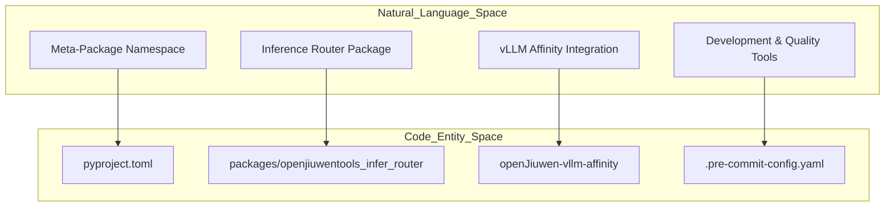
*Figure 1: Mapping natural language functional components to repository code entities.*

Sources: [README.md:1-13](), [pyproject.toml:1-62](), [.pre-commit-config.yaml:1-42]()

---

## 1.1 Repository Layout & Packaging

The repository is structured as a uv-managed workspace (`[tool.uv.workspace]`) housing modular sub-packages under the `packages/` directory [README.md:9-11](), [pyproject.toml:56-57](). Each sub-package builds into an independent wheel distribution, such as `openjiuwentools-infer-router` [README.md:17-23](). 

The root `pyproject.toml` defines the `openjiuwentools` meta-package, aggregating dependencies through optional extras like `[infer-router]` and `[top]` [pyproject.toml:5-36](). Version management is unified across packages using `setuptools_scm` integrated with git metadata [pyproject.toml:2-53]().

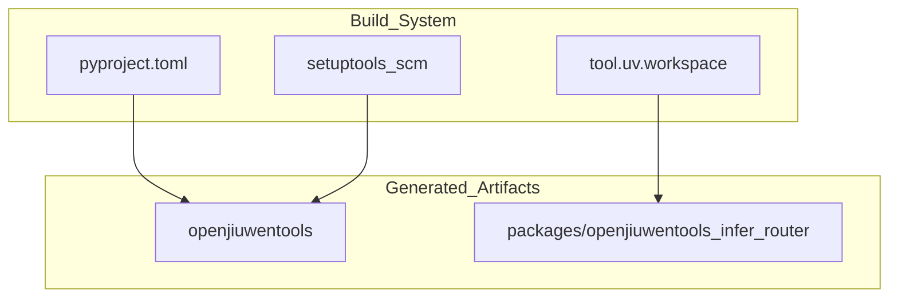
*Figure 2: Package build dependencies and wheel generation pathways.*

For comprehensive details on directory organization, dependency resolution, and packaging internals, see [Repository Layout & Packaging](#1.1).

Sources: [README.md:9-23](), [pyproject.toml:1-62](), [docs/openjiuwen_package_design.md:1-139]()

---

## 1.2 Getting Started & Development Workflow

Development across the monorepo relies on a unified virtual environment setup (`.venv`) and source installations using `uv` or `pip` [README.md:84-99](). Editable installs link the packages directly into the active Python environment (`pip install -e ".[top]"` or `uv sync --extra top`) [README.md:47-58]().

Code hygiene and formatting are strictly regulated via `pre-commit` hooks executing `ruff`, `codespell`, `typos`, and `markdownlint` [.pre-commit-config.yaml:15-42](). Unit tests are executed via `pytest` under the repository testing configuration [pyproject.toml:63-72]().

For detailed instructions on environment setup, pre-commit installation, and testing workflows, see [Getting Started & Development Workflow](#1.2).

Sources: [README.md:47-170](), [pyproject.toml:63-72](), [.pre-commit-config.yaml:1-42]()

---

# Page: Repository Layout & Packaging

# Repository Layout & Packaging

<details>
<summary>Relevant source files</summary>

The following files were used as context for generating this wiki page:

- [.gitignore](.gitignore)
- [.markdownlint.json](.markdownlint.json)
- [.pre-commit-config.yaml](.pre-commit-config.yaml)
- [.typos.toml](.typos.toml)
- [README.md](README.md)
- [README_zh.md](README_zh.md)
- [docs/openjiuwen_package_design.md](docs/openjiuwen_package_design.md)
- [packages/infer_router/docs/worker_config.yaml.example](packages/infer_router/docs/worker_config.yaml.example)
- [packages/infer_router/pyproject.toml](packages/infer_router/pyproject.toml)
- [packages/infer_router/src/openjiuwentools/infer_router/__init__.py](packages/infer_router/src/openjiuwentools/infer_router/__init__.py)
- [packages/infer_router/src/openjiuwentools/infer_router/api/server.py](packages/infer_router/src/openjiuwentools/infer_router/api/server.py)
- [packages/infer_router/src/openjiuwentools/infer_router/config/config.py](packages/infer_router/src/openjiuwentools/infer_router/config/config.py)
- [pyproject.toml](pyproject.toml)
- [requirements.txt](requirements.txt)

</details>


## Purpose and Scope

This document details the repository layout, packaging architecture, dependency management, and versioning strategy for the `agent-tools` monorepo. The repository adopts a modular architecture where foundational logic and specialized tooling (such as the inference router and vLLM affinity integrations) are split into individual sub-packages under `packages/` [README.md:9-14](). These sub-packages are unified under a root meta-package (`openjiuwentools`) [docs/openjiuwen_package_design.md:14-16]() that uses `uv` for workspace coordination and `setuptools_scm` for automated git-based versioning.

---

## 1. Monorepo Directory Structure

The repository is organized into a top-level structure separating installable core packages, auxiliary projects, and challenge codebases [README.md:5-14]():

| Directory | Description |
|-----------|-------------|
| `packages/` | Python package directory housing all installable sub-packages [README.md:9-9]() |
| `packages/openjiuwentools_core/` | Core package providing foundational agent tools and registries [README.md:10-10]() |
| `packages/infer_router/` | Source directory for the `openjiuwentools-infer-router` package [pyproject.toml:47-47]() |
| `openJiuwen-vllm-affinity/` | Integration project implementing KV-cache affinity scheduling with vLLM [README.md:12-12]() |
| `Agent Innovation Challenge/` | Code and community submissions related to the Agent Innovation Challenge [README.md:13-13]() |

Sources: [README.md:5-14](), [pyproject.toml:42-48](), [docs/openjiuwen_package_design.md:1-13]()

---

## 2. Meta-Package & Optional Dependencies

The repository root houses a master `pyproject.toml` file defining the `openjiuwentools` meta-package [pyproject.toml:5-6]() [docs/openjiuwen_package_design.md:14-16](). The meta-package itself does not contain runtime execution code; instead, it aggregates sub-packages using dynamic dependencies and optional feature extras [docs/openjiuwen_package_design.md:14-16]().

Optional dependencies defined in [pyproject.toml:25-35]() include:
* `infer-router`: Pulls in `openjiuwentools-infer-router` [pyproject.toml:26-26]().
* `dev`: Installs development tools like `pytest`, `pytest-asyncio`, `ruff`, and `pre-commit` [pyproject.toml:27-32]().
* `top`: Aggregates all primary sub-packages (e.g., `openjiuwentools-infer-router`) for a complete installation [pyproject.toml:33-35]().

```toml
[project.optional-dependencies]
infer-router = ["openjiuwentools-infer-router"]
dev = [
    "pytest>=7.0",
    "pytest-asyncio>=0.21",
    "ruff>=0.1.0",
    "pre-commit>=3.0",
]
top = [
    "openjiuwentools-infer-router",
]
```

Sources: [pyproject.toml:25-35](), [docs/openjiuwen_package_design.md:14-32]()

---

## 3. `uv` Workspace & Dependency Resolution

To manage multi-package dependencies efficiently across the monorepo, the project uses `uv` workspaces [README.md:53-54]() [pyproject.toml:56-61](). 

In [pyproject.toml:56-61](), the workspace members and local source mappings are explicitly declared:

```toml
# 声明工作区成员
[tool.uv.workspace]
members = ["packages/*"]

# 声明依赖来源为工作区
[tool.uv.sources]
openjiuwentools-infer-router = { workspace = true }
```

This configuration ensures that running `uv sync --extra top` resolves local sub-packages from the `packages/` directory as editable dependencies rather than pulling them from a remote registry [README.md:53-54]().

Sources: [README.md:53-54](), [pyproject.toml:56-61]()

---

## 4. Versioning via `setuptools_scm`

All sub-packages and the root meta-package share a synchronized version number derived dynamically from Git tags using `setuptools_scm` [pyproject.toml:1-3](), [pyproject.toml:51-54](), [docs/openjiuwen_package_design.md:133-139]().

The build system requirements and git-describe parameters are configured in the root [pyproject.toml:1-3](), [pyproject.toml:51-54]():

```toml
[build-system]
requires = ["setuptools>=61.0", "setuptools-scm>=8.0", "wheel"]
build-backend = "setuptools.build_meta"

[tool.setuptools_scm]
git_describe_command = "git describe --long --first-parent"
fallback_version = "0.0.1"
```

Sub-packages (such as `packages/infer_router/pyproject.toml`) reference the repository root to inherit tag resolution [packages/infer_router/pyproject.toml:72-73]() [docs/openjiuwen_package_design.md:135-139]():

```toml
[tool.setuptools_scm]
root = "../.."
```

Sources: [pyproject.toml:1-4](), [pyproject.toml:51-54](), [packages/infer_router/pyproject.toml:72-73](), [docs/openjiuwen_package_design.md:133-139]()

---

## 5. Build Architecture & Packaging Flow

Each sub-folder under `packages/` compiles into an isolated wheel distribution (e.g., `openjiuwentools-infer-router-{version}-py3-none-any.whl`) [README.md:17-23]() [docs/openjiuwen_package_design.md:3-13](). Upon installation, components map into the unified `openjiuwentools` namespace [docs/openjiuwen_package_design.md:83-105]().

### Monorepo Build and Packaging Architecture

```mermaid
graph TD
    RootPyProject["pyproject.toml (openjiuwentools)"] -->|Defines Meta-Package| MetaPkg["openjiuwentools (Meta-Package)"]
    RootPyProject -->|Declares Workspace| UvWorkspace["tool.uv.workspace (packages/*)"]
    
    SubRouterPy["packages/infer_router/pyproject.toml"] -->|Builds Wheel| RouterWheel["openjiuwentools-infer-router.whl"]
    SubRouterSrc["packages/infer_router/src/openjiuwentools/infer_router/__init__.py"] -->|Contributes Namespace| NamespacePkg["openjiuwentools Namespace"]
    
    UvWorkspace -->|Resolves Local Source| SubRouterPy
    MetaPkg -->|Optional Extra [infer-router]| RouterWheel
    
    subgraph "Build Process"
        SubRouterPy -->|setuptools_scm root=../..| SCM["Git Tags via setuptools_scm"]
    end

    Sources: [pyproject.toml:1-61](), [packages/infer_router/pyproject.toml:1-73](), [packages/infer_router/src/openjiuwentools/infer_router/__init__.py:1-40](), [docs/openjiuwen_package_design.md:1-139]()
```

### Installation and Namespace Resolution Flow

```mermaid
sequenceDiagram
    participant User as User / CLI
    participant UV as uv sync / pip install
    participant Meta as openjiuwentools (Meta)
    participant Router as openjiuwentools-infer-router
    participant SitePackages as site-packages/openjiuwentools/

    User->>UV: pip install "openjiuwentools[top]"
    UV->>Meta: Resolve meta-package & extras
    Meta->>Router: Pull dependency [infer-router]
    Router->>SitePackages: Merge package into openjiuwentools namespace
    Meta->>SitePackages: Install meta-package dist-info metadata
    UV-->>User: Installation Complete (Editable or Wheel)

    Sources: [README.md:26-58](), [packages/infer_router/pyproject.toml:24-36](), [docs/openjiuwen_package_design.md:44-105]()
```

---

# Page: Getting Started & Development Workflow

# Getting Started & Development Workflow

<details>
<summary>Relevant source files</summary>

The following files were used as context for generating this wiki page:

- [.gitignore](.gitignore)
- [.markdownlint.json](.markdownlint.json)
- [.pre-commit-config.yaml](.pre-commit-config.yaml)
- [.typos.toml](.typos.toml)
- [README.md](README.md)
- [README_zh.md](README_zh.md)
- [docs/openjiuwen_package_design.md](docs/openjiuwen_package_design.md)
- [packages/infer_router/README.md](packages/infer_router/README.md)
- [packages/infer_router/docs/api.md](packages/infer_router/docs/api.md)
- [packages/infer_router/docs/deployment.md](packages/infer_router/docs/deployment.md)
- [packages/infer_router/docs/development.md](packages/infer_router/docs/development.md)
- [packages/infer_router/docs/jiuwen_agent_hints_design.md](packages/infer_router/docs/jiuwen_agent_hints_design.md)
- [packages/infer_router/docs/worker_config.yaml.example](packages/infer_router/docs/worker_config.yaml.example)
- [packages/infer_router/docs/worker_discovery.md](packages/infer_router/docs/worker_discovery.md)
- [packages/infer_router/docs/workers.json.example](packages/infer_router/docs/workers.json.example)
- [packages/infer_router/docs/workers.yaml.example](packages/infer_router/docs/workers.yaml.example)
- [packages/infer_router/src/openjiuwentools/infer_router/api/__init__.py](packages/infer_router/src/openjiuwentools/infer_router/api/__init__.py)
- [pyproject.toml](pyproject.toml)
- [requirements.txt](requirements.txt)

</details>


This page details the setup, package management, developer workflow, code quality enforcement, and testing conventions for the `agent-tools` monorepo. It covers virtual environment configuration via `uv`, editable workspace installs, setuptools-scm versioning, pre-commit validation pipelines (`ruff`, `codespell`, `typos`, `markdownlint`), `pytest` conventions, and git branch management strategies.

Sources: `README.md:1-201]`, `pyproject.toml:1-88`, `docs/openjiuwen_package_design.md:1-140`, `packages/infer_router/docs/development.md:1-263`

---

## 1. Virtual Environment & Workspace Setup with `uv`

The monorepo uses `uv` for fast dependency resolution and virtual environment management, alongside traditional `pip` workflows [README.md:53-58](). The repository root contains a `pyproject.toml` that defines a uv workspace spanning all modules under `packages/*` [pyproject.toml:56-61]().

### Setup Steps

1. **Clone the Repository**:
   ```bash
   git clone https://github.com/openJiuwen-ai/agent-tools.git
   cd agent-tools
   ```[README.md:50-51]()

2. **Create and Activate Virtual Environment**:
   ```bash
   python3 -m venv .venv
   source .venv/bin/activate  # Linux/Mac
   # or .venv\Scripts\activate  # Windows
   ```[README.md:90-93]()

3. **Install Dependencies (Workspace Sync)**:
   ```bash
   # Using uv (recommended)
   uv sync --extra top

   # Or using pip in editable mode
   pip install -e ".[top]"
   ```[README.md:54-57]()

```mermaid
graph TD
    Root["agent-tools Root pyproject.toml"] --> Workspace["[tool.uv.workspace] members=packages/*"]
    Workspace --> CorePkg["packages/openjiuwentools_core"]
    Workspace --> RouterPkg["packages/infer_router"]
    Root --> MetaPkg["openjiuwentools Meta-Package"]
    MetaPkg --> ExtraTop["[project.optional-dependencies] top = [openjiuwentools-infer-router]"]
    
    Sources: pyproject.toml:1-88
```

Sources: `README.md:50-57`, `pyproject.toml:56-62`, `docs/openjiuwen_package_design.md:69-80`

---

## 2. Monorepo Packaging & Meta-Package Architecture

The repository adopts a modular package management mechanism where sub-packages under `packages/` are built into independent wheel distributions, unified under the `openjiuwentools` namespace via a root meta-package [README.md:15-23](), [docs/openjiuwen_package_design.md:1-14]().

### Package Mapping Table

| Source Directory | Wheel Package Name | Namespace Integration |
| :--- | :--- | :--- |
| `packages/openjiuwentools_core` | `openjiuwentools-core-{version}-py3-none-any.whl` | `openjiuwentools` root package |
| `packages/infer_router` | `openjiuwentools-infer-router-{version}-py3-none-any.whl` | `openjiuwentools.router` |

### Version Management

Versioning is dynamically handled by `setuptools_scm` using Git tags (`git describe --long --first-parent`), falling back to `0.0.1` if tags are absent [pyproject.toml:51-54](), [docs/openjiuwen_package_design.md:131-139]().

```mermaid
graph LR
    GitRepo["Git Repository Tags"] -->|setuptools_scm| DynamicVersion["Dynamic Version String"]
    DynamicVersion --> CoreWheel["openjiuwentools-core.whl"]
    DynamicVersion --> RouterWheel["openjiuwentools-infer-router.whl"]
    CoreWheel --> MetaPackage["openjiuwentools Meta-Package"]
    RouterWheel --> MetaPackage
    
    Sources: pyproject.toml:1-55, docs/openjiuwen_package_design.md:1-140
```

Sources: `README.md:15-46`, `pyproject.toml:1-55`, `docs/openjiuwen_package_design.md:1-140`

---

## 3. Pre-commit Hooks & Quality Assurance

Code quality and style compliance are strictly enforced via `pre-commit` hooks configured in `.pre-commit-config.yaml` [README.md:101-141](). The tools run locally on commit and via CI on manual triggers [.pre-commit-config.yaml:6-13]().

### Configured Linters and Checkers

- **`ruff`**: High-performance Python linter and formatter (`ruff-pre-commit`, rev `v0.14.0`) [.pre-commit-config.yaml:15-21](). Configured with line length 120 and selective rule groups (`E`, `F`, `W`, `I`, `A`, `B`, `C`, `D`, `N`, `Q`, `S`) [pyproject.toml:74-88]().
- **`codespell`**: Source code spell checker (`codespell-project/codespell`, rev `v2.4.1`) [.pre-commit-config.yaml:22-27]().
- **`typos`**: Source code typo checker (`crate-ci/typos`, rev `v1.32.0`) with configuration in `.typos.toml` [.pre-commit-config.yaml:28-36](), [.typos.toml:1-15]().
- **`markdownlint`**: Markdown style checker (`igorshubovych/markdownlint-cli`, rev `v0.45.0`) with rules defined in `.markdownlint.json` [.pre-commit-config.yaml:38-42](), [.markdownlint.json:1-8]().
- **`pre-commit-hooks`**: Standard git hooks for trailing whitespace, end-of-file fixing, YAML checking, and large file detection [.pre-commit-config.yaml:43-49]().

### Manual Execution

```bash
# Run against all files across the repository
pre-commit run --all-files

# Run ruff check and formatting manually
ruff check .
ruff format .
```[README.md:132-140](), [packages/infer_router/docs/development.md:96-103]()

```mermaid
graph TD
    WorkingTree["Working Directory Changes"] --> PreCommit["pre-commit Run"]
    PreCommit --> Ruff["ruff lint & ruff-format"]
    PreCommit --> Codespell["codespell checks"]
    PreCommit --> Typos["typos validation"]
    PreCommit --> Markdownlint["markdownlint verification"]
    PreCommit --> GitHooks["trailing-whitespace & end-of-file-fixer"]
    Ruff --> PassFail{All Checks Pass?}
    Codespell --> PassFail
    Typos --> PassFail
    Markdownlint --> PassFail
    GitHooks --> PassFail
    PassFail -->|Yes| CommitAllowed["Git Commit Succeeded"]
    PassFail -->|No| CommitRejected["Commit Blocked with Fixes"]
    
    Sources: .pre-commit-config.yaml:1-50, README.md:123-140
```

Sources: `.pre-commit-config.yaml:1-50`, `.typos.toml:1-16`, `.markdownlint.json:1-8`, `README.md:101-141`

---

## 4. Pytest Testing Conventions

Unit, integration, and end-to-end tests are executed using `pytest` with configuration defined in `pyproject.toml` under `[tool.pytest.ini_options]` [pyproject.toml:63-72](), [packages/infer_router/docs/development.md:116-136]().

### Test Configuration Parameters

- **Test Paths**: `testpaths = ["tests"]` [pyproject.toml:64]()
- **File Naming**: `python_files = ["test_*.py"]` [pyproject.toml:65]()
- **Class Naming**: `python_classes = ["Test*"]` [pyproject.toml:66]()
- **Function Naming**: `python_functions = ["test_*"]` [pyproject.toml:67]()
- **AsyncIO Mode**: `asyncio_mode = "auto"` [pyproject.toml:68]()
- **Additional Arguments**: `addopts = "-v --tb=short"` [pyproject.toml:69]()
- **Warning Filters**: Suppresses `DeprecationWarning` [pyproject.toml:70-72]()

### Running Test Suites

```bash
# Run all unit and integration tests
pytest

# Run specific test directories
pytest tests/unit/
pytest tests/integration/
pytest tests/e2e/
```[packages/infer_router/docs/development.md:122-136]()

Sources: `pyproject.toml:63-72`, `packages/infer_router/docs/development.md:116-136`

---

## 5. Branch Strategy & Development Workflow

The project follows a structured branch management and pull request lifecycle [README.md:156-161](), [packages/infer_router/docs/development.md:73-115]().

### Branch Conventions

- **`main`**: Stable branch representing production-ready code [README.md:158]()
- **`feature/<feature-name>`**: Feature development branches [README.md:159]()
- **`fix/<bug-name>`**: Bug fix branches [README.md:160]()

### Contribution Workflow

1. Create a feature branch from `main`:
   ```bash
   git checkout -b feature/your-feature-name
   ```[packages/infer_router/docs/development.md:77-79]()
2. Implement changes following PEP 8 guidelines and type annotations [README.md:144-148](), [packages/infer_router/docs/development.md:83-88]().
3. Run `pytest` and pre-commit checks locally to guarantee compliance [README.md:152-170](), [packages/infer_router/docs/development.md:90-103]().
4. Commit changes with descriptive messages and push to the remote repository for Pull Request review [README.md:150-154](), [packages/infer_router/docs/development.md:105-114]().

Sources: `README.md:142-177`, `packages/infer_router/docs/development.md:73-115`

---

# Page: openJiuwen vLLM Affinity Plugin

# openJiuwen vLLM Affinity Plugin

<details>
<summary>Relevant source files</summary>

The following files were used as context for generating this wiki page:

- [packages/openJiuwen-vllm-affinity/README.md](packages/openJiuwen-vllm-affinity/README.md)
- [packages/openJiuwen-vllm-affinity/v0.13.0/jiuwen_vllm_affinity/kv_cache_plugin/plugin.py](packages/openJiuwen-vllm-affinity/v0.13.0/jiuwen_vllm_affinity/kv_cache_plugin/plugin.py)
- [packages/openJiuwen-vllm-affinity/v0.17.0/jiuwen_vllm_affinity/kv_cache_plugin/plugin.py](packages/openJiuwen-vllm-affinity/v0.17.0/jiuwen_vllm_affinity/kv_cache_plugin/plugin.py)
- [packages/openJiuwen-vllm-affinity/v0.18.0/pyproject.toml](packages/openJiuwen-vllm-affinity/v0.18.0/pyproject.toml)

</details>


## Purpose and Scope
The `openJiuwen-vllm-affinity` plugin enhances vLLM inference performance and prefix cache management in multi-turn conversation scenarios [packages/openJiuwen-vllm-affinity/README.md:1-3](). It addresses key challenges such as context compression, redundant tool-call result unloading, and TTFT (Time to First Token) degradation caused by default LRU eviction policies [packages/openJiuwen-vllm-affinity/README.md:5-11]().

This is a parent page providing a high-level architectural overview. For detailed technical specifications, refer to the child pages:
- Plugin Registration & Patching: See [Plugin Registration & Patching](#2.1)
- Two-Phase KV Cache Core: See [Two-Phase KV Cache Core](#2.2)
- OpenAI-Compatible API Extensions: See [OpenAI-Compatible API Extensions](#2.3)
- Plugin Test Suites & Version Branches: See [Plugin Test Suites & Version Branches](#2.4)

---

## 2.1 Plugin Registration & Patching
The plugin integrates into vLLM via setuptools entry points defined in `pyproject.toml` [packages/openJiuwen-vllm-affinity/v0.18.0/pyproject.toml:17-19](). The entry point invokes `register()` in `plugin.py`, which immediately triggers `apply_patches()` from `patcher.py` [packages/openJiuwen-vllm-affinity/v0.17.0/jiuwen_vllm_affinity/kv_cache_plugin/plugin.py:5-7](), [packages/openJiuwen-vllm-affinity/v0.13.0/jiuwen_vllm_affinity/kv_cache_plugin/plugin.py:5-7](). 

This phase handles monkey-patching of core vLLM classes (such as schedulers, block managers, and API servers) and initializes debug logging controlled by `JIUWEN_KV_DEBUG` [packages/openJiuwen-vllm-affinity/README.md:86-95]().

For deep technical details, see [Plugin Registration & Patching](#2.1).

---

## 2.2 Two-Phase KV Cache Core
The core engine introduces a dual-zone block pool (`release` and `normal` zones) alongside a `free` segment, prioritizing allocations as `free > release > normal` [packages/openJiuwen-vllm-affinity/README.md:14-18](). It uses `KvCacheSessionManager` to bind blocks to client sessions via `cache_salt` and `cache_sharing` parameters, collecting orphan tails when context shrinks [packages/openJiuwen-vllm-affinity/README.md:20-22]().

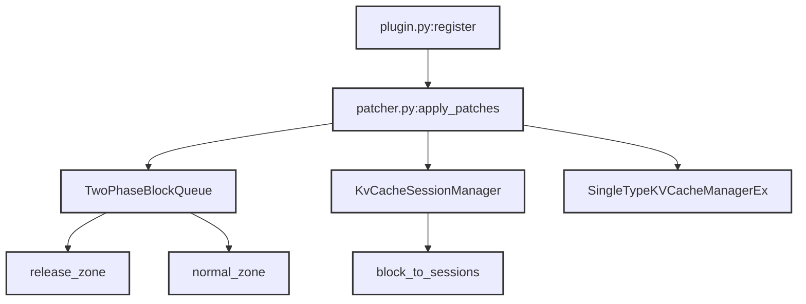
*Figure 1: KV Cache Core Entity Association Flow*

For detailed sub-topics, see:
- TwoPhaseBlockQueue & Block Pool: See [TwoPhaseBlockQueue & Block Pool](#2.2.1)
- Session Binding & Orphan Tail Collection: See [Session Binding & Orphan Tail Collection](#2.2.2)
- Scheduler, Engine & Coordinator Patches: See [Scheduler, Engine & Coordinator Patches](#2.2.3)

---

## 2.3 OpenAI-Compatible API Extensions
To support active cache management, the plugin patches vLLM's chat serving endpoints (`serving_chat`, `api_server`, `protocol`) [packages/openJiuwen-vllm-affinity/README.md:32-57](). It introduces `cache_salt` and `cache_sharing` fields to `POST /v1/chat/completions` and adds a dedicated endpoint `POST /release_kv_cache` which allows agents to explicitly release blocks corresponding to compressed message indices and tool outputs [packages/openJiuwen-vllm-affinity/README.md:43-65]().

For detailed implementation and protocol semantics, see [OpenAI-Compatible API Extensions](#2.3).

---

## 2.4 Plugin Test Suites & Version Branches
Because vLLM evolves rapidly, the monorepo maintains parallel directory trees for different vLLM target versions (`v0.13`, `v0.17`, `v0.18`, `v0.21`) [packages/openJiuwen-vllm-affinity/v0.18.0/pyproject.toml:15](). Dedicated unit and integration test suites cover queue priority, reclaimed block bindings, session managers, and multi-version compatibility.

For testing layouts and version management strategies, see [Plugin Test Suites & Version Branches](#2.4).

---

Sources:
- `packages/openJiuwen-vllm-affinity/v0.17.0/jiuwen_vllm_affinity/kv_cache_plugin/plugin.py:1-8`
- `packages/openJiuwen-vllm-affinity/v0.13.0/jiuwen_vllm_affinity/kv_cache_plugin/plugin.py:1-8`
- `packages/openJiuwen-vllm-affinity/v0.18.0/pyproject.toml:1-22`
- `packages/openJiuwen-vllm-affinity/README.md:1-96`

---

# Page: Plugin Registration & Patching

# Plugin Registration & Patching

<details>
<summary>Relevant source files</summary>

The following files were used as context for generating this wiki page:

- [packages/openJiuwen-vllm-affinity/README.md](packages/openJiuwen-vllm-affinity/README.md)
- [packages/openJiuwen-vllm-affinity/v0.13.0/jiuwen_vllm_affinity/kv_cache_plugin/kv_debug.py](packages/openJiuwen-vllm-affinity/v0.13.0/jiuwen_vllm_affinity/kv_cache_plugin/kv_debug.py)
- [packages/openJiuwen-vllm-affinity/v0.13.0/jiuwen_vllm_affinity/kv_cache_plugin/plugin.py](packages/openJiuwen-vllm-affinity/v0.13.0/jiuwen_vllm_affinity/kv_cache_plugin/plugin.py)
- [packages/openJiuwen-vllm-affinity/v0.13.0/jiuwen_vllm_affinity/kv_cache_plugin/tests/v1/core/test_reclaimed_block_binding.py](packages/openJiuwen-vllm-affinity/v0.13.0/jiuwen_vllm_affinity/kv_cache_plugin/tests/v1/core/test_reclaimed_block_binding.py)
- [packages/openJiuwen-vllm-affinity/v0.13.0/jiuwen_vllm_affinity/kv_cache_plugin/tests/v1/core/test_request_session_binding.py](packages/openJiuwen-vllm-affinity/v0.13.0/jiuwen_vllm_affinity/kv_cache_plugin/tests/v1/core/test_request_session_binding.py)
- [packages/openJiuwen-vllm-affinity/v0.17.0/jiuwen_vllm_affinity/kv_cache_plugin/kv_debug.py](packages/openJiuwen-vllm-affinity/v0.17.0/jiuwen_vllm_affinity/kv_cache_plugin/kv_debug.py)
- [packages/openJiuwen-vllm-affinity/v0.17.0/jiuwen_vllm_affinity/kv_cache_plugin/plugin.py](packages/openJiuwen-vllm-affinity/v0.17.0/jiuwen_vllm_affinity/kv_cache_plugin/plugin.py)
- [packages/openJiuwen-vllm-affinity/v0.21.0/jiuwen_vllm_affinity/kv_cache_plugin/kv_debug.py](packages/openJiuwen-vllm-affinity/v0.21.0/jiuwen_vllm_affinity/kv_cache_plugin/kv_debug.py)

</details>


This page details the initialization, plugin registration, monkey-patching architecture, and debugging telemetry for the `openJiuwen-vllm-affinity` KV cache affinity plugin. It covers how `register()` sets up the extension, how `patcher.py` injects behavior into vLLM classes, and how the `JIUWEN_KV_DEBUG` logging system traces cache operations across execution phases.

Sources: [packages/openJiuwen-vllm-affinity/README.md:1-4](), [packages/openJiuwen-vllm-affinity/v0.17.0/jiuwen_vllm_affinity/kv_cache_plugin/plugin.py:1-7]()

---

## 1. Registration Entrypoints & Initialization

The entrypoint for integrating the openJiuwen affinity extensions into vLLM is managed via the `register()` function defined in `plugin.py`. When vLLM loads registered affinity plugins, it invokes `register()`, which logs the initialization step and subsequently triggers class-level monkey-patching through `apply_patches()` [packages/openJiuwen-vllm-affinity/v0.17.0/jiuwen_vllm_affinity/kv_cache_plugin/plugin.py:1-7]().

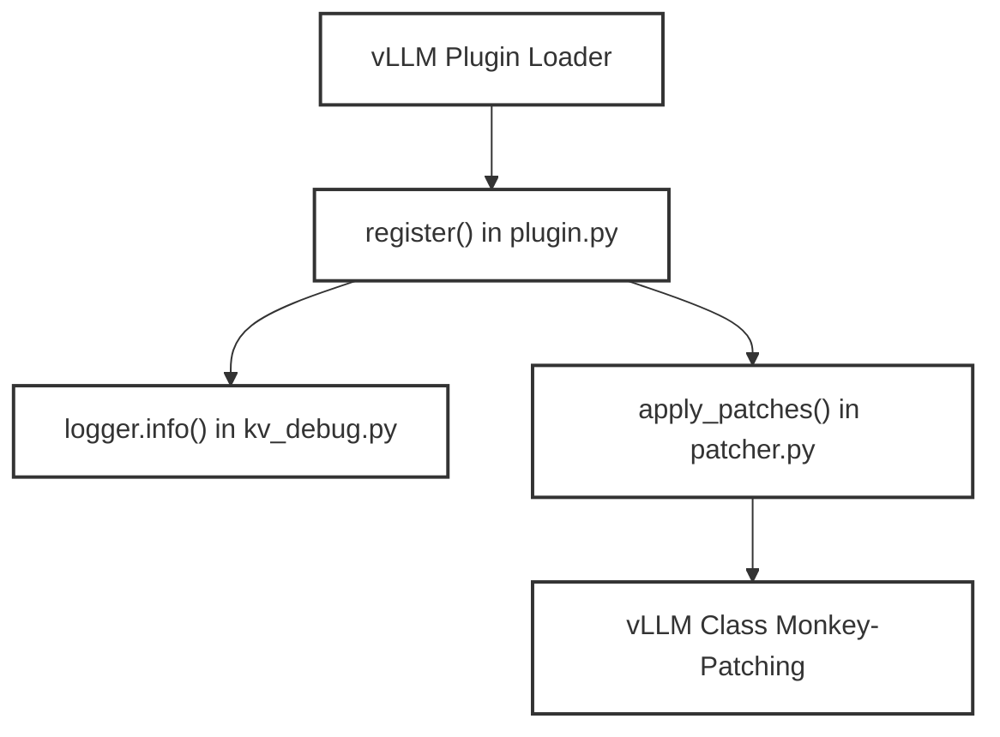
*Figure 1: Initialization and registration control flow bridging the vLLM plugin loader to `register()` and `apply_patches()`.*

Sources: [packages/openJiuwen-vllm-affinity/v0.17.0/jiuwen_vllm_affinity/kv_cache_plugin/plugin.py:1-7]()

---

## 2. Monkey-Patching Architecture (`patcher.py`)

The `patcher.py` module is responsible for runtime modification of vLLM's core components. Because vLLM’s internal scheduling, memory management, and API servers are tightly encapsulated, the affinity plugin relies on non-invasive monkey-patching to intercept core engine calls without requiring a fork of the upstream vLLM repository.

Key responsibilities of `patcher.py`:
- Locating upstream vLLM classes (such as schedulers, KV cache managers, and OpenAI-compatible server endpoints).
- Replacing or wrapping methods to inject dual-zone cache queue logic, session binding keys (`cache_salt`), and explicit release endpoints (`POST /release_kv_cache`).

Sources: [packages/openJiuwen-vllm-affinity/README.md:14-57]()

---

## 3. KV Debug Logging & `JIUWEN_KV_DEBUG` Phases

To monitor internal block allocations, cache hits, session unbinding, and block eviction without parsing raw vLLM output, the plugin provides a specialized logging facility in `kv_debug.py` [packages/openJiuwen-vllm-affinity/v0.17.0/jiuwen_vllm_affinity/kv_cache_plugin/kv_debug.py:1-20]().

### Logger Configuration & Environment Flags

The logger is initialized under the `vllm.jiuwen_vllm_affinity.kv_cache` namespace to ensure that vLLM's standard logging configuration (including handlers and `VLLM_LOGGING_LEVEL`) correctly captures affinity telemetry [packages/openJiuwen-vllm-affinity/v0.17.0/jiuwen_vllm_affinity/kv_cache_plugin/kv_debug.py:3-9](). 

The environment variable `JIUWEN_KV_DEBUG` controls whether trace logging is active [packages/openJiuwen-vllm-affinity/v0.17.0/jiuwen_vllm_affinity/kv_cache_plugin/kv_debug.py:10-16](). Recognized truthy values are `1`, `true`, `yes`, and `on` (case-insensitive) [packages/openJiuwen-vllm-affinity/v0.17.0/jiuwen_vllm_affinity/kv_cache_plugin/kv_debug.py:11]().

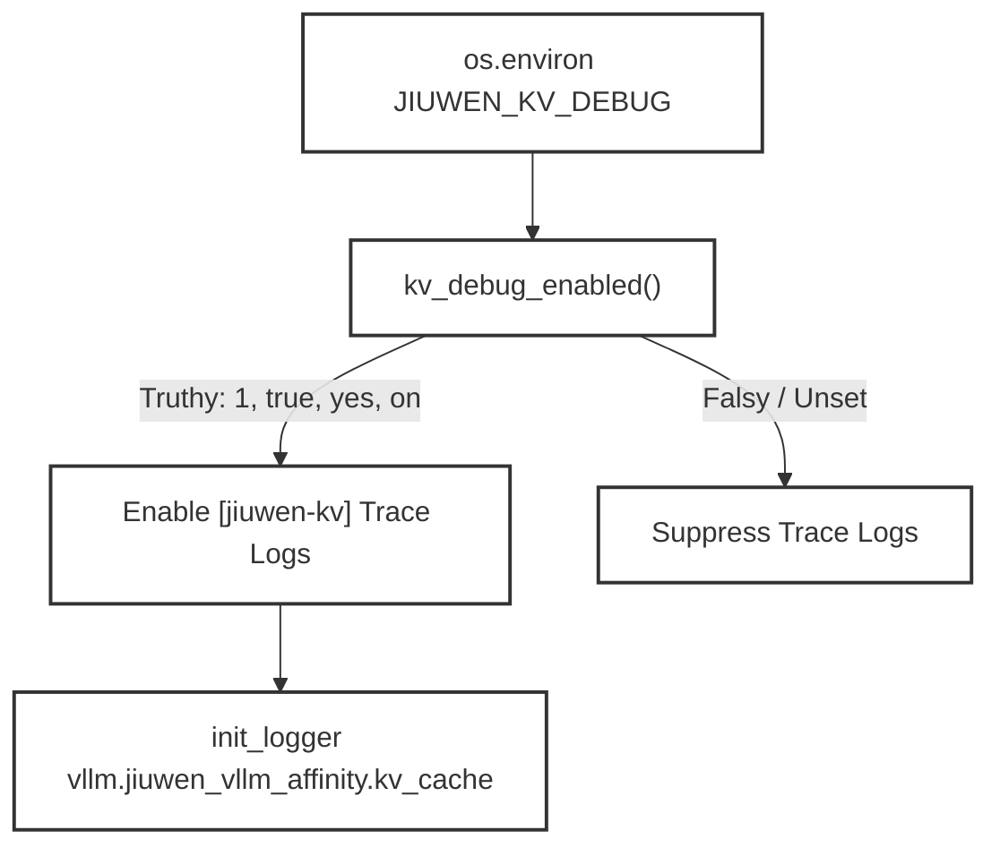
*Figure 2: Environment evaluation flow for `kv_debug_enabled()` in `kv_debug.py`.*

Sources: [packages/openJiuwen-vllm-affinity/v0.17.0/jiuwen_vllm_affinity/kv_cache_plugin/kv_debug.py:1-20]()

### Tracing Phases

When `JIUWEN_KV_DEBUG` is enabled, the plugin emits structured logs across four primary execution phases:

| Log Phase | Code / System Event | Description |
|---|---|---|
| `1-allocate` | `get_new_blocks` | Logs all newly allocated blocks along with their associated `session` (`cache_salt`) identifier. |
| `2-prefix_hit` | Prefix Cache Matching | Logs prefix cache hit reuse, recording hit `block_ids` and session ownership samples for the first 3 blocks (`owners_before_bind`). |
| `3-release` | Session Unbinding / Release | Logs session unbinding outcomes: `unbound` (number of blocks unbound), `freed` (blocks eligible for immediate aging), and `shared_remain` (blocks still occupied by other shared sessions). |
| `4-evict` | Block Eviction & Reuse | Logs block recycling events when blocks are popped from the release or normal queue segments. |

Sources: [packages/openJiuwen-vllm-affinity/README.md:86-95]()

---

# Page: Two-Phase KV Cache Core

# TwoPhaseBlockCache Core

<details>
<summary>Relevant source files</summary>

The following files were used as context for generating this wiki page:

- [packages/openJiuwen-vllm-affinity/v0.13.0/jiuwen_vllm_affinity/kv_cache_plugin/v1/core/block_pool.py](packages/openJiuwen-vllm-affinity/v0.13.0/jiuwen_vllm_affinity/kv_cache_plugin/v1/core/block_pool.py)
- [packages/openJiuwen-vllm-affinity/v0.13.0/jiuwen_vllm_affinity/kv_cache_plugin/v1/core/kv_cache_manager.py](packages/openJiuwen-vllm-affinity/v0.13.0/jiuwen_vllm_affinity/kv_cache_plugin/v1/core/kv_cache_manager.py)
- [packages/openJiuwen-vllm-affinity/v0.13.0/jiuwen_vllm_affinity/kv_cache_plugin/v1/core/single_type_kv_cache_manager.py](packages/openJiuwen-vllm-affinity/v0.13.0/jiuwen_vllm_affinity/kv_cache_plugin/v1/core/single_type_kv_cache_manager.py)
- [packages/openJiuwen-vllm-affinity/v0.13.0/jiuwen_vllm_affinity/kv_cache_plugin/v1/core/two_phase_block_queue.py](packages/openJiuwen-vllm-affinity/v0.13.0/jiuwen_vllm_affinity/kv_cache_plugin/v1/core/two_phase_block_queue.py)
- [packages/openJiuwen-vllm-affinity/v0.17.0/jiuwen_vllm_affinity/kv_cache_plugin/v1/core/block_pool.py](packages/openJiuwen-vllm-affinity/v0.17.0/jiuwen_vllm_affinity/kv_cache_plugin/v1/core/block_pool.py)
- [packages/openJiuwen-vllm-affinity/v0.17.0/jiuwen_vllm_affinity/kv_cache_plugin/v1/core/kv_cache_manager.py](packages/openJiuwen-vllm-affinity/v0.17.0/jiuwen_vllm_affinity/kv_cache_plugin/v1/core/kv_cache_manager.py)
- [packages/openJiuwen-vllm-affinity/v0.17.0/jiuwen_vllm_affinity/kv_cache_plugin/v1/core/single_type_kv_cache_manager.py](packages/openJiuwen-vllm-affinity/v0.17.0/jiuwen_vllm_affinity/kv_cache_plugin/v1/core/single_type_kv_cache_manager.py)
- [packages/openJiuwen-vllm-affinity/v0.17.0/jiuwen_vllm_affinity/kv_cache_plugin/v1/core/two_phase_block_queue.py](packages/openJiuwen-vllm-affinity/v0.17.0/jiuwen_vllm_affinity/kv_cache_plugin/v1/core/two_phase_block_queue.py)

</details>


## Purpose and Scope

The Two-Phase KV Cache Core implements a prefix dual-zone cache mechanism for vLLM within the `openJiuwen-vllm-affinity` plugin suite. It optimizes Time-to-First-Token (TTFT) and GPU memory reutilization by splitting the block pool into distinct allocation tiers, binding blocks to session contexts, and coordinating lifecycle hooks across the scheduler and engine layers. 

This is a parent overview page. Detailed technical implementations are delegated to the sub-sections below.

Sources:
- `packages/openJiuwen-vllm-affinity/v0.13.0/jiuwen_vllm_affinity/kv_cache_plugin/v1/core/two_phase_block_queue.py:9-50` [packages/openJiuwen-vllm-affinity/v0.13.0/jiuwen_vllm_affinity/kv_cache_plugin/v1/core/two_phase_block_queue.py:9-50]()
- `packages/openJiuwen-vllm-affinity/v0.13.0/jiuwen_vllm_affinity/kv_cache_plugin/v1/core/block_pool.py:61-70` [packages/openJiuwen-vllm-affinity/v0.13.0/jiuwen_vllm_affinity/kv_cache_plugin/v1/core/block_pool.py:61-70]()

---

## TwoPhaseBlockQueue & Block Pool

The `TwoPhaseBlockQueue` class replaces the standard vLLM free block queue with a doubly-linked structure managing free, release, and normal tiers [packages/openJiuwen-vllm-affinity/v0.13.0/jiuwen_vllm_affinity/kv_cache_plugin/v1/core/two_phase_block_queue.py:9-50](). Allocation priority naturally flows from `free > release > normal` through the queue head, while `BlockPoolEx` intercepts block freeing via `aging_block` and `mark_pending_aging` methods [packages/openJiuwen-vllm-affinity/v0.13.0/jiuwen_vllm_affinity/kv_cache_plugin/v1/core/block_pool.py:61-70]().

```mermaid
title "Block Queue Tiers to Code Entities"
graph TD
    subgraph NaturalLanguage["Natural Language Space"]
        FreeTier["Virgin Free Blocks"]
        ReleaseTier["Aged Release Zone"]
        NormalTier["Standard Free Zone"]
    end

    subgraph CodeSpace["Code Entity Space"]
        Head["TwoPhaseBlockQueue.fake_free_list_head"]
        Queue["TwoPhaseBlockQueue"]
        Tail["TwoPhaseBlockQueue.released_tail"]
        BlockPool["BlockPoolEx.aging_block"]
    end

    FreeTier --> Head
    ReleaseTier --> Tail
    NormalTier --> CodeSpace
    Queue --> BlockPool
```

For full details on queue physical layouts, allocation pointers, `jiuwen_allocated`/`jiuwen_reclaimed` flags, and aging states, see [TwoPhaseBlockQueue & Block Pool](#2.2.1).

Sources:
- `packages/openJiuwen-vllm-affinity/v0.13.0/jiuwen_vllm_affinity/kv_cache_plugin/v1/core/two_phase_block_queue.py:9-50` [packages/openJiuwen-vllm-affinity/v0.13.0/jiuwen_vllm_affinity/kv_cache_plugin/v1/core/two_phase_block_queue.py:9-50]()
- `packages/openJiuwen-vllm-affinity/v0.13.0/jiuwen_vllm_affinity/kv_cache_plugin/v1/core/block_pool.py:61-70` [packages/openJiuwen-vllm-affinity/v0.13.0/jiuwen_vllm_affinity/kv_cache_plugin/v1/core/block_pool.py:61-70]()

---

## Session Binding & Orphan Tail Collection

To support cross-request cache sharing and explicit cache release via `release_kv_cache`, the core tracks session ownership using `KvCacheSessionManager` and `SingleTypeKVCacheManagerEx` [packages/openJiuwen-vllm-affinity/v0.13.0/jiuwen_vllm_affinity/kv_cache_plugin/v1/core/kv_cache_manager.py:14-28](). Blocks are bound via `bind_allocated_blocks` [packages/openJiuwen-vllm-affinity/v0.13.0/jiuwen_vllm_affinity/kv_cache_plugin/v1/core/single_type_kv_cache_manager.py:179-209](), and orphaned tails are collected when prefix hash resolution leaves unmapped physical blocks.

```mermaid
title "Session Binding to Code Entities"
graph TD
    subgraph NaturalLanguage["Natural Language Space"]
        SessionManager["Session Cache Manager"]
        OrphanTail["Orphan Tail Collector"]
    end

    subgraph CodeSpace["Code Entity Space"]
        ManagerEx["SingleTypeKVCacheManagerEx"]
        SessionMgr["KvCacheSessionManager.block_to_sessions"]
        BindFunc["bind_allocated_blocks"]
        CollectFunc["collect_release_tail_orphans"]
    end

    SessionManager --> SessionMgr
    SessionManager --> BindFunc
    OrphanTail --> CollectFunc
    ManagerEx --> BindFunc
```

For full details on `cache_salt`, `sharing_cache_salt`, `block_to_sessions` tracking, and orphan collection strategies, see [Session Binding & Orphan Tail Collection](#2.2.2).

Sources:
- `packages/openJiuwen-vllm-affinity/v0.13.0/jiuwen_vllm_affinity/kv_cache_plugin/v1/core/kv_cache_manager.py:14-28` [packages/openJiuwen-vllm-affinity/v0.13.0/jiuwen_vllm_affinity/kv_cache_plugin/v1/core/kv_cache_manager.py:14-28]()
- `packages/openJiuwen-vllm-affinity/v0.13.0/jiuwen_vllm_affinity/kv_cache_plugin/v1/core/single_type_kv_cache_manager.py:179-209` [packages/openJiuwen-vllm-affinity/v0.13.0/jiuwen_vllm_affinity/kv_cache_plugin/v1/core/single_type_kv_cache_manager.py:179-209]()

---

## Scheduler, Engine & Coordinator Patches

The plugin integrates into vLLM's execution lifecycle by patching the v1 scheduler, engine core components (`core_client`, `async_llm`), and introducing the `kv_cache_coordinator` [packages/openJiuwen-vllm-affinity/v0.13.0/jiuwen_vllm_affinity/kv_cache_plugin/v1/core/kv_cache_manager.py:14-28](). These patches intercept slot allocation requests, manage skipped block reclamation, and handle asynchronous cache aging operations.

For full details on scheduler hooks, input processor integration, and engine core patches, see [Scheduler, Engine & Coordinator Patches](#2.2.3).

Sources:
- `packages/openJiuwen-vllm-affinity/v0.13.0/jiuwen_vllm_affinity/kv_cache_plugin/v1/core/kv_cache_manager.py:14-28` [packages/openJiuwen-vllm-affinity/v0.13.0/jiuwen_vllm_affinity/kv_cache_plugin/v1/core/kv_cache_manager.py:14-28]()

---

# Page: TwoPhaseBlockQueue & Block Pool

# TwoPhaseBlockQueue & Block Pool

<details>
<summary>Relevant source files</summary>

The following files were used as context for generating this wiki page:

- [packages/openJiuwen-vllm-affinity/v0.17.0/jiuwen_vllm_affinity/kv_cache_plugin/v1/core/block_pool.py](packages/openJiuwen-vllm-affinity/v0.17.0/jiuwen_vllm_affinity/kv_cache_plugin/v1/core/block_pool.py)
- [packages/openJiuwen-vllm-affinity/v0.17.0/jiuwen_vllm_affinity/kv_cache_plugin/v1/core/kv_cache_manager.py](packages/openJiuwen-vllm-affinity/v0.17.0/jiuwen_vllm_affinity/kv_cache_plugin/v1/core/kv_cache_manager.py)
- [packages/openJiuwen-vllm-affinity/v0.17.0/jiuwen_vllm_affinity/kv_cache_plugin/v1/core/single_type_kv_cache_manager.py](packages/openJiuwen-vllm-affinity/v0.17.0/jiuwen_vllm_affinity/kv_cache_plugin/v1/core/single_type_kv_cache_manager.py)
- [packages/openJiuwen-vllm-affinity/v0.17.0/jiuwen_vllm_affinity/kv_cache_plugin/v1/core/two_phase_block_queue.py](packages/openJiuwen-vllm-affinity/v0.17.0/jiuwen_vllm_affinity/kv_cache_plugin/v1/core/two_phase_block_queue.py)
- [packages/openJiuwen-vllm-affinity/v0.18.0/jiuwen_vllm_affinity/kv_cache_plugin/v1/core/block_pool.py](packages/openJiuwen-vllm-affinity/v0.18.0/jiuwen_vllm_affinity/kv_cache_plugin/v1/core/block_pool.py)
- [packages/openJiuwen-vllm-affinity/v0.18.0/jiuwen_vllm_affinity/kv_cache_plugin/v1/core/two_phase_block_queue.py](packages/openJiuwen-vllm-affinity/v0.18.0/jiuwen_vllm_affinity/kv_cache_plugin/v1/core/two_phase_block_queue.py)

</details>


## Purpose and Scope
This page details the implementation of the Two-Phase KV Cache core memory management layer within the openJiuwen vLLM affinity plugin (`packages/openJiuwen-vllm-affinity/`). Specifically, it covers `TwoPhaseBlockQueue` and `BlockPoolEx`, explaining how physical KV-cache blocks are organized into free, release, and normal tiers, how allocation priority is enforced, how the `released_tail` pointer manages reusable segments, how allocation flags (`jiuwen_allocated` and `jiuwen_reclaimed`) operate, and how the aging pipeline (`aging_block` and `pending_aging`) governs block recycling.

---

## 1. Three-Tier Queue Architecture & Allocation Priority

The `TwoPhaseBlockQueue` class replaces standard vLLM free block queues with a doubly-linked structure supporting three logical tiers: **Free**, **Release**, and **Normal** [packages/openJiuwen-vllm-affinity/v0.17.0/jiuwen_vllm_affinity/kv_cache_plugin/v1/core/two_phase_block_queue.py:9-15]().

### Physical Layout & Pointers
The physical queue layout from Least Recently Used (LRU) at the head to Most Recently Used (MRU) at the tail is structured as follows:

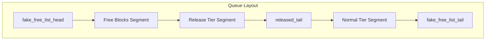
*Sources: `packages/openJiuwen-vllm-affinity/v0.17.0/jiuwen_vllm_affinity/kv_cache_plugin/v1/core/two_phase_block_queue.py:10-27`*

Three primary structural pointers define the queue state:
1. **`fake_free_list_head`**: The allocation head. Allocation operations (`popleft` / `popleft_n`) always extract blocks from this position [packages/openJiuwen-vllm-affinity/v0.17.0/jiuwen_vllm_affinity/kv_cache_plugin/v1/core/two_phase_block_queue.py:16-22](). Because the free and release segments physically precede the normal segment, popping from the head inherently guarantees the strict allocation priority: **`free > release > normal`**, without requiring any per-segment scanning overhead [packages/openJiuwen-vllm-affinity/v0.17.0/jiuwen_vllm_affinity/kv_cache_plugin/v1/core/two_phase_block_queue.py:16-22]().
2. **`released_tail`**: The MRU pointer of the *reusable* region (comprising both the free and release segments). It points to the last block immediately preceding the normal segment [packages/openJiuwen-vllm-affinity/v0.17.0/jiuwen_vllm_affinity/kv_cache_plugin/v1/core/two_phase_block_queue.py:22-25](). When blocks age, they are inserted directly after `released_tail`, causing this pointer to advance toward the tail [packages/openJiuwen-vllm-affinity/v0.17.0/jiuwen_vllm_affinity/kv_cache_plugin/v1/core/two_phase_block_queue.py:22-25]().
3. **`fake_free_list_tail`**: The tail anchor where normal (plain free) blocks are appended [packages/openJiuwen-vllm-affinity/v0.17.0/jiuwen_vllm_affinity/kv_cache_plugin/v1/core/two_phase_block_queue.py:25-27]().

---

## 2. Block Pool Lifecycle & Aging Mechanics

The `BlockPoolEx` class extends vLLM's base `BlockPool` to intercept block freeing, aging, and allocation routines [packages/openJiuwen-vllm-affinity/v0.17.0/jiuwen_vllm_affinity/kv_cache_plugin/v1/core/block_pool.py:61-71]().

### Aging and Pending Aging Flow
When blocks are released via API requests (`release_kv_cache`), they do not immediately re-enter the high-priority reusable pool. Instead, they undergo an aging transition mediated by `pending_aging_block_ids`:

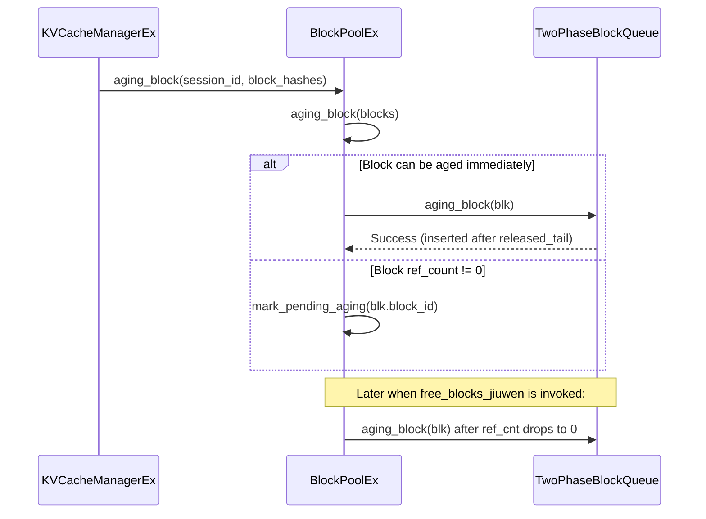
*Sources: `packages/openJiuwen-vllm-affinity/v0.17.0/jiuwen_vllm_affinity/kv_cache_plugin/v1/core/block_pool.py:21-71`, `packages/openJiuwen-vllm-affinity/v0.17.0/jiuwen_vllm_affinity/kv_cache_plugin/v1/core/kv_cache_manager.py:15-28`*

- **`mark_pending_aging`**: Adds block IDs to `self.pending_aging_block_ids` if a block is still referenced (`ref_cnt != 0`) when an aging request arrives [packages/openJiuwen-vllm-affinity/v0.17.0/jiuwen_vllm_affinity/kv_cache_plugin/v1/core/block_pool.py:21-24]().
- **`free_blocks_jiuwen`**: Intercepts standard block returns; when a block's reference count drops to zero and its ID is present in `pending_aging_block_ids`, it discards the pending flag and invokes `self.free_block_queue.aging_block(block)` [packages/openJiuwen-vllm-affinity/v0.17.0/jiuwen_vllm_affinity/kv_cache_plugin/v1/core/block_pool.py:26-36]().

---

## 3. Allocation State Flags

To distinguish between virgin blocks, reused release blocks, and normal blocks, `TwoPhaseBlockQueue` relies on two primary markers managed during `_take_head` and `remove` operations [packages/openJiuwen-vllm-affinity/v0.17.0/jiuwen_vllm_affinity/kv_cache_plugin/v1/core/two_phase_block_queue.py:40-50]():

1. **`jiuwen_allocated` (Persistent)**: Set to `True` once a block has ever been popped from the queue or removed via prefix-cache touches (`remove`). This flag is never cleared, distinguishing never-used free blocks (`False`) from previously allocated blocks (`True`) [packages/openJiuwen-vllm-affinity/v0.17.0/jiuwen_vllm_affinity/kv_cache_plugin/v1/core/two_phase_block_queue.py:42-45]().
2. **`jiuwen_reclaimed` (Transient)**: A transient flag set on each `popleft` operation equal to the pre-pop value of `jiuwen_allocated` [packages/openJiuwen-vllm-affinity/v0.17.0/jiuwen_vllm_affinity/kv_cache_plugin/v1/core/two_phase_block_queue.py:46-49](). It is consumed downstream by `bind_allocated_blocks` in `single_type_kv_cache_manager.py` to determine whether stale session bindings must be cleared via `reset_blocks` (for reused blocks) or appended via `add_blocks` (for fresh blocks) [packages/openJiuwen-vllm-affinity/v0.17.0/jiuwen_vllm_affinity/kv_cache_plugin/v1/core/single_type_kv_cache_manager.py:179-210](). It also triggers the `4-evict` debug log [packages/openJiuwen-vllm-affinity/v0.17.0/jiuwen_vllm_affinity/kv_cache_plugin/v1/core/block_pool.py:38-58]().

---

## 4. Code-Entity Mapping Diagram

The following diagram associates the natural language concepts of the Two-Phase Block Queue and Block Pool with their concrete implementation symbols and code entities across the codebase:

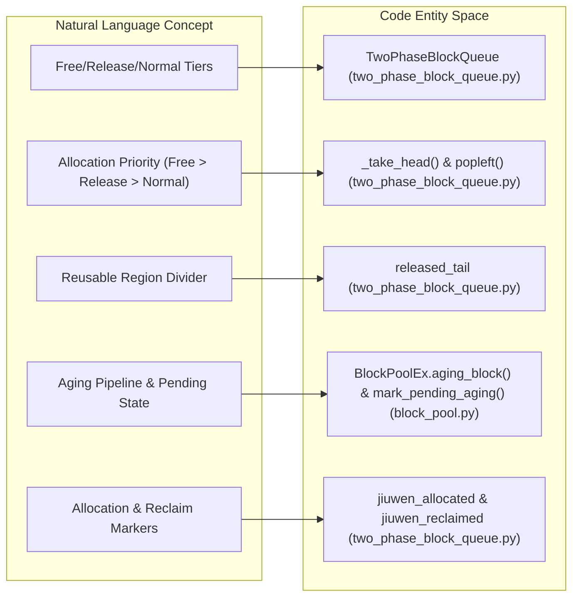
*Sources: `packages/openJiuwen-vllm-affinity/v0.17.0/jiuwen_vllm_affinity/kv_cache_plugin/v1/core/two_phase_block_queue.py:9-110`, `packages/openJiuwen-vllm-affinity/v0.17.0/jiuwen_vllm_affinity/kv_cache_plugin/v1/core/block_pool.py:21-71`*

---

# Page: Session Binding & Orphan Tail Collection

# Session Binding & Orphan Tail Collection

<details>
<summary>Relevant source files</summary>

The following files were used as context for generating this wiki page:

- [packages/openJiuwen-vllm-affinity/v0.13.0/jiuwen_vllm_affinity/kv_cache_plugin/v1/request.py](packages/openJiuwen-vllm-affinity/v0.13.0/jiuwen_vllm_affinity/kv_cache_plugin/v1/request.py)
- [packages/openJiuwen-vllm-affinity/v0.17.0/jiuwen_vllm_affinity/kv_cache_plugin/v1/core/kv_cache_session_manager.py](packages/openJiuwen-vllm-affinity/v0.17.0/jiuwen_vllm_affinity/kv_cache_plugin/v1/core/kv_cache_session_manager.py)
- [packages/openJiuwen-vllm-affinity/v0.17.0/jiuwen_vllm_affinity/kv_cache_plugin/v1/request.py](packages/openJiuwen-vllm-affinity/v0.17.0/jiuwen_vllm_affinity/kv_cache_plugin/v1/request.py)
- [packages/openJiuwen-vllm-affinity/v0.18.0/jiuwen_vllm_affinity/kv_cache_plugin/v1/core/single_type_kv_cache_manager.py](packages/openJiuwen-vllm-affinity/v0.18.0/jiuwen_vllm_affinity/kv_cache_plugin/v1/core/single_type_kv_cache_manager.py)

</details>


## Purpose and Scope
This document details the session binding, cache salt resolution, and orphan tail collection mechanisms implemented in the openJiuwen vLLM KV-cache affinity plugin. Within the two-phase KV cache architecture, physical blocks are bound to logical sessions via `KvCacheSessionManager`. This ensures correct prefix cache reuse, multi-tenant isolation, and reclaim-aware tracking when prompt truncations or token releases occur.

---

## 1. Session ID & Salt Resolution

Requests entering the vLLM engine carry parameters determining whether cache is isolated per client or shared across requests. The session binding identifier (`session_id`) is resolved through `request_get_session_binding_id()` in the request processing pipeline.

- **`sharing_cache_salt`**: Packed into the request identifier for multi-tenant cache sharing (`cache_sharing=true`). Unpacked using `unpack_sharing_cache_salt`.
- **`cache_salt`**: Configured explicitly on the request (`cache_sharing=false`) for client-level prefix isolation.

### Request Session Resolution
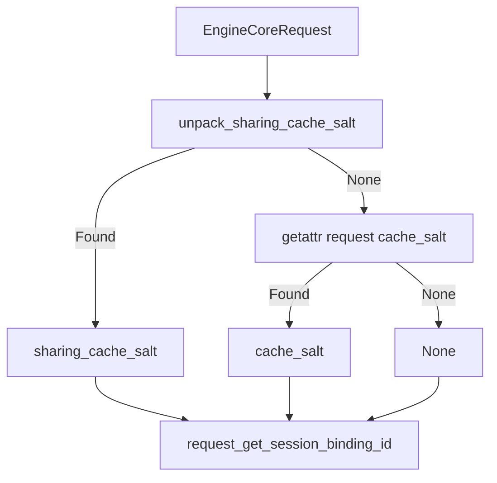
Sources: `packages/openJiuwen-vllm-affinity/v0.13.0/jiuwen_vllm_affinity/kv_cache_plugin/v1/request.py:17-64` [], `packages/openJiuwen-vllm-affinity/v0.17.0/jiuwen_vllm_affinity/kv_cache_plugin/v1/request.py:20-70` []

---

## 2. Session Manager & Block Mapping (`KvCacheSessionManager`)

The `KvCacheSessionManager` class maintains a mapping from physical block identifiers to active session lists (`block_to_sessions`). 

### Core Methods
- **`add_blocks(blocks, session_id)`**: Appends `session_id` to the session list of each valid physical block (`block_id >= 0`) using append semantics [packages/openJiuwen-vllm-affinity/v0.17.0/jiuwen_vllm_affinity/kv_cache_plugin/v1/core/kv_cache_session_manager.py:16-32]().
- **`reset_blocks(blocks, session_id)`**: Overwrites the session list for specified blocks, used primarily when blocks are reclaimed from the free tier [packages/openJiuwen-vllm-affinity/v0.17.0/jiuwen_vllm_affinity/kv_cache_plugin/v1/core/kv_cache_session_manager.py:33-46]().
- **`release_blocks(blocks, session_id)`**: Removes `session_id` from blocks and returns blocks whose session reference count drops to zero as `aging_blocks` [packages/openJiuwen-vllm-affinity/v0.17.0/jiuwen_vllm_affinity/kv_cache_plugin/v1/core/kv_cache_session_manager.py:47-63]().
- **`collect_orphan_blocks(session_id, pool_blocks, exclude_block_ids, only_idle)`**: Identifies session-bound blocks outside the hash-resolved set [packages/openJiuwen-vllm-affinity/v0.17.0/jiuwen_vllm_affinity/kv_cache_plugin/v1/core/kv_cache_session_manager.py:65-90]().

### KvCacheSessionManager Data Flow
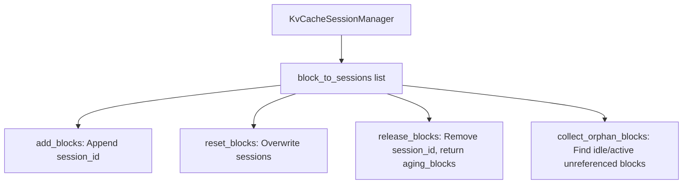
Sources: `packages/openJiuwen-vllm-affinity/v0.17.0/jiuwen_vllm_affinity/kv_cache_plugin/v1/core/kv_cache_session_manager.py:8-90` []

---

## 3. Allocation and Reclaimed Binding (`bind_allocated_blocks`)

When blocks are allocated to a request, `bind_allocated_blocks()` distinguishes between fresh allocations and blocks reclaimed from the free tier via the `jiuwen_reclaimed` flag.

- **Fresh Blocks**: Bound using append semantics via `session_manager.add_blocks()`.
- **Reclaimed Blocks**: Have their stale mappings cleared and reset using `session_manager.reset_blocks()` before recording the new owner session [packages/openJiuwen-vllm-affinity/v0.18.0/jiuwen_vllm_affinity/kv_cache_plugin/v1/core/single_type_kv_cache_manager.py:184-210]().

Sources: `packages/openJiuwen-vllm-affinity/v0.18.0/jiuwen_vllm_affinity/kv_cache_plugin/v1/core/single_type_kv_cache_manager.py:184-210` []

---

## 4. Release Tail & Orphan Collection (`collect_release_tail_orphans`)

When requests release tokens or shorten prompts, hash resolution might fail to capture all physical blocks associated with the session. `collect_release_tail_orphans()` and `collect_consecutive_session_tail()` locate and reclaim these orphaned tail blocks.

- **`expected_release_block_count`**: Computes expected block counts based on `release_token_index`, `num_tokens`, and `block_size` [packages/openJiuwen-vllm-affinity/v0.18.0/jiuwen_vllm_affinity/kv_cache_plugin/v1/core/single_type_kv_cache_manager.py:32-45]().
- **`collect_consecutive_session_tail`**: Gathers contiguous session-owned blocks immediately following the hash-resolved prefix [packages/openJiuwen-vllm-affinity/v0.18.0/jiuwen_vllm_affinity/kv_cache_plugin/v1/core/single_type_kv_cache_manager.py:76-101]().
- **Orphan Fallback**: If consecutive blocks are insufficient, `KvCacheSessionManager.collect_orphan_blocks()` retrieves remaining session-bound blocks, sorting and trimming them to match the expected deficit [packages/openJiuwen-vllm-affinity/v0.18.0/jiuwen_vllm_affinity/kv_cache_plugin/v1/core/single_type_kv_cache_manager.py:104-164]().

### Orphan Tail Collection Architecture
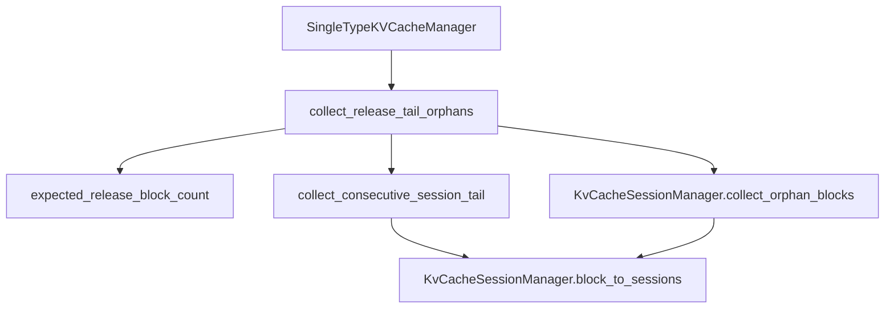
Sources: `packages/openJiuwen-vllm-affinity/v0.18.0/jiuwen_vllm_affinity/kv_cache_plugin/v1/core/single_type_kv_cache_manager.py:32-164` []

---

# Page: Scheduler, Engine & Coordinator Patches

# Scheduler, Engine & Coordinator Patches

<details>
<summary>Relevant source files</summary>

The following files were used as context for generating this wiki page:

- [packages/openJiuwen-vllm-affinity/v0.17.0/jiuwen_vllm_affinity/kv_cache_plugin/v1/core/kv_cache_coordinator.py](packages/openJiuwen-vllm-affinity/v0.17.0/jiuwen_vllm_affinity/kv_cache_plugin/v1/core/kv_cache_coordinator.py)
- [packages/openJiuwen-vllm-affinity/v0.17.0/jiuwen_vllm_affinity/kv_cache_plugin/v1/core/sched/scheduler.py](packages/openJiuwen-vllm-affinity/v0.17.0/jiuwen_vllm_affinity/kv_cache_plugin/v1/core/sched/scheduler.py)
- [packages/openJiuwen-vllm-affinity/v0.18.0/jiuwen_vllm_affinity/kv_cache_plugin/v1/core/input_processor.py](packages/openJiuwen-vllm-affinity/v0.18.0/jiuwen_vllm_affinity/kv_cache_plugin/v1/core/input_processor.py)
- [packages/openJiuwen-vllm-affinity/v0.18.0/jiuwen_vllm_affinity/kv_cache_plugin/v1/engine/core.py](packages/openJiuwen-vllm-affinity/v0.18.0/jiuwen_vllm_affinity/kv_cache_plugin/v1/engine/core.py)

</details>


## Purpose and Scope

This page details the monkey-patches and extensions applied to vLLM v1 core infrastructure components within the `openJiuwen-vllm-affinity` plugin. These integration points bridge vLLM's native scheduler, engine core, input processor, and KV cache coordinator with openJiuwen's two-phase cache management model. Specifically, they enable session-aware cache salt handling, explicit block release protocols, block aging, and session ID propagation across single-type cache managers.

Sources: 
- `packages/openJiuwen-vllm-affinity/v0.17.0/jiuwen_vllm_affinity/kv_cache_plugin/v1/core/kv_cache_coordinator.py:1-97`
- `packages/openJiuwen-vllm-affinity/v0.17.0/jiuwen_vllm_affinity/kv_cache_plugin/v1/core/sched/scheduler.py:1-24`
- `packages/openJiuwen-vllm-affinity/v0.18.0/jiuwen_vllm_affinity/kv_cache_plugin/v1/core/input_processor.py:1-17`
- `packages/openJiuwen-vllm-affinity/v0.18.0/jiuwen_vllm_affinity/kv_cache_plugin/v1/engine/core.py:1-65`

---

## 1. KVCacheCoordinator Extensions

The `KVCacheCoordinator` class manages block allocations across one or more cache managers. The openJiuwen plugin patches `KVCacheCoordinator` to inject session IDs during block allocation phases and provide block aging operations.

### Key Classes and Functions

- `KVCacheCoordinatorEx`: Extended coordinator class adding methods to manage sharing session IDs and trigger block aging across all underlying single-type managers [packages/openJiuwen-vllm-affinity/v0.17.0/jiuwen_vllm_affinity/kv_cache_plugin/v1/core/kv_cache_coordinator.py:55-82]().
  - `set_jiuwen_sharing_session_id(session_id)`: Sets the current sharing session identifier [packages/openJiuwen-vllm-affinity/v0.17.0/jiuwen_vllm_affinity/kv_cache_plugin/v1/core/kv_cache_coordinator.py:56-57]().
  - `get_jiuwen_sharing_session_id()`: Retrieves the active session ID [packages/openJiuwen-vllm-affinity/v0.17.0/jiuwen_vllm_affinity/kv_cache_plugin/v1/core/kv_cache_coordinator.py:59-60]().
  - `clear_jiuwen_sharing_session_id()`: Clears the session identifier [packages/openJiuwen-vllm-affinity/v0.17.0/jiuwen_vllm_affinity/kv_cache_plugin/v1/core/kv_cache_coordinator.py:62-63]().
  - `aging_block(session_id, block_hashes, release_token_index, num_tokens)`: Iterates through `single_type_managers` to execute block aging [packages/openJiuwen-vllm-affinity/v0.17.0/jiuwen_vllm_affinity/kv_cache_plugin/v1/core/kv_cache_coordinator.py:65-81]().
- `allocate_new_computed_blocks_jiuwen`: Wrapped allocation method that temporarily sets the sharing session ID on all single-type managers before delegating to `_orig_allocate_new_computed` [packages/openJiuwen-vllm-affinity/v0.17.0/jiuwen_vllm_affinity/kv_cache_plugin/v1/core/kv_cache_coordinator.py:17-36]().
- `allocate_new_blocks_jiuwen`: Wrapped standard block allocation method ensuring session scope is attached during allocation [packages/openJiuwen-vllm-affinity/v0.17.0/jiuwen_vllm_affinity/kv_cache_plugin/v1/core/kv_cache_coordinator.py:38-54]().
- `register_kv_cache_coordinator()`: Monkey-patches `KVCacheCoordinator` methods at runtime [packages/openJiuwen-vllm-affinity/v0.17.0/jiuwen_vllm_affinity/kv_cache_plugin/v1/core/kv_cache_coordinator.py:84-96]().

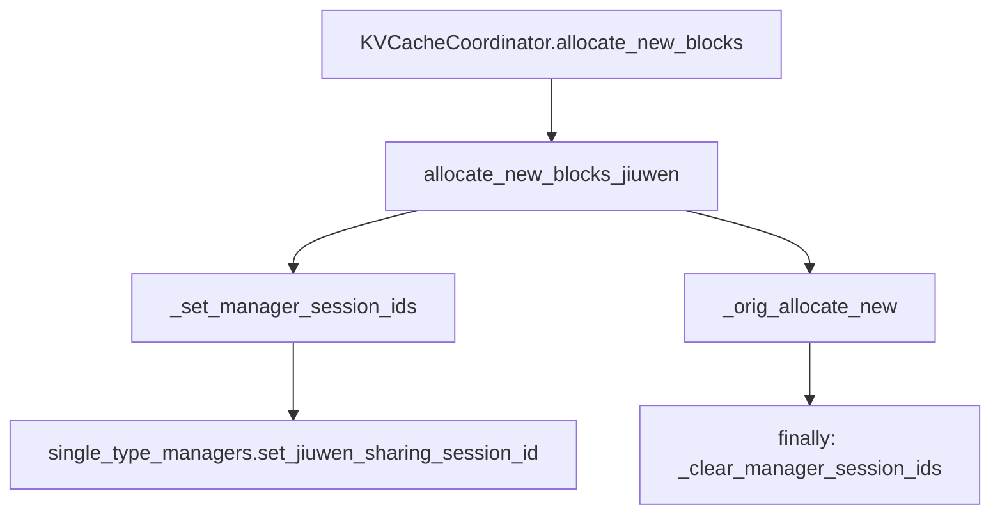
Sources: 
- `packages/openJiuwen-vllm-affinity/v0.17.0/jiuwen_vllm_affinity/kv_cache_plugin/v1/core/kv_cache_coordinator.py:1-97`

---

## 2. Scheduler & Engine Core Patches

The scheduler and engine core handle execution loop operations and RPC-driven cache release requests from external clients or routers.

### Scheduler Extensions (`SchedulerEx`)

`SchedulerEx` adds the `release_kv_cache` method to vLLM's `Scheduler`, delegating directly to the underlying `kv_cache_manager` [packages/openJiuwen-vllm-affinity/v0.17.0/jiuwen_vllm_affinity/kv_cache_plugin/v1/core/sched/scheduler.py:5-20]().

```python
class SchedulerEx(Scheduler):
    def release_kv_cache(
        self,
        session_id: str,
        block_hashes: list[BlockHash],
        *,
        release_token_index: int | None = None,
        num_tokens: int | None = None,
    ) -> int:
        return self.kv_cache_manager.release_kv_cache(
            session_id,
            block_hashes,
            release_token_index=release_token_index,
            num_tokens=num_tokens,
        )
```

Sources: 
- `packages/openJiuwen-vllm-affinity/v0.17.0/jiuwen_vllm_affinity/kv_cache_plugin/v1/core/sched/scheduler.py:1-24`

### Engine Core Extensions (`EngineCoreEx`)

`EngineCoreEx` implements explicit KV cache release handling via msgpack-encoded engine core requests [packages/openJiuwen-vllm-affinity/v0.18.0/jiuwen_vllm_affinity/kv_cache_plugin/v1/engine/core.py:13-31](). It also provides utility functions to pack and unpack sharing cache salts inside request IDs [packages/openJiuwen-vllm-affinity/v0.18.0/jiuwen_vllm_affinity/kv_cache_plugin/v1/engine/core.py:34-51]().

| Function / Method | Role |
| :--- | :--- |
| `EngineCoreEx.release_kv_cache` | Decodes engine core requests, computes block hash indices, and invokes `self.scheduler.release_kv_cache` [packages/openJiuwen-vllm-affinity/v0.18.0/jiuwen_vllm_affinity/kv_cache_plugin/v1/engine/core.py:13-31]() |
| `pack_request_sharing_cache_salt` | Serializes request ID and sharing cache salt into a JSON string [packages/openJiuwen-vllm-affinity/v0.18.0/jiuwen_vllm_affinity/kv_cache_plugin/v1/engine/core.py:34-43]() |
| `unpack_sharing_cache_salt` | Extracts the `sharing_cache_salt` field from encoded request strings [packages/openJiuwen-vllm-affinity/v0.18.0/jiuwen_vllm_affinity/kv_cache_plugin/v1/engine/core.py:45-51]() |

Sources: 
- `packages/openJiuwen-vllm-affinity/v0.18.0/jiuwen_vllm_affinity/kv_cache_plugin/v1/engine/core.py:1-65`

---

## 3. Input Processor Integration

The `InputProcessor` patch intercepts incoming request preparation steps to inspect and clean up sharing cache salts.

### Implementation Details

`process_inputs_jiuwen` wraps `InputProcessor.process_inputs` [packages/openJiuwen-vllm-affinity/v0.18.0/jiuwen_vllm_affinity/kv_cache_plugin/v1/core/input_processor.py:7-12](). If a request ID contains a valid packed sharing cache salt (determined via `unpack_sharing_cache_salt`), the processor neutralizes `req.cache_salt` to prevent collision with openJiuwen's custom dual-zone cache hashing logic [packages/openJiuwen-vllm-affinity/v0.18.0/jiuwen_vllm_affinity/kv_cache_plugin/v1/core/input_processor.py:10-11]().

Sources: 
- `packages/openJiuwen-vllm-affinity/v0.18.0/jiuwen_vllm_affinity/kv_cache_plugin/v1/core/input_processor.py:1-17`

---

## 4. Integration Data Flow Diagrams

### Diagram 1: Request Processing & Salt Unpacking Flow

The following diagram bridges Natural Language Space concepts to actual code entities during input processing and engine core handling.

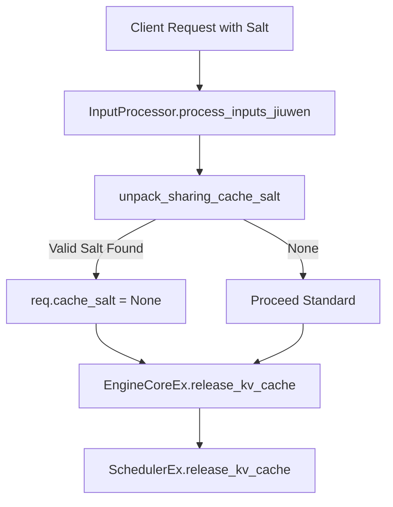
Sources: 
- `packages/openJiuwen-vllm-affinity/v0.18.0/jiuwen_vllm_affinity/kv_cache_plugin/v1/core/input_processor.py:1-17`
- `packages/openJiuwen-vllm-affinity/v0.18.0/jiuwen_vllm_affinity/kv_cache_plugin/v1/engine/core.py:13-31`
- `packages/openJiuwen-vllm-affinity/v0.17.0/jiuwen_vllm_affinity/kv_cache_plugin/v1/core/sched/scheduler.py:5-20`

### Diagram 2: Coordinator Session Binding & Block Allocation

```mermaid
graph TD
    CoordAlloc["KVCacheCoordinator.allocate_new_blocks"] --> WrapAlloc["allocate_new_blocks_jiuwen"]
    WrapAlloc --> GetSession["get_jiuwen_sharing_session_id"]
    GetSession --> SetManagers["_set_manager_session_ids"]
    SetManagers --> SingleMgr["SingleTypeKVCacheManagerEx.set_jiuwen_sharing_session_id"]
    SetManagers --> OrigAlloc["_orig_allocate_new"]
    OrigAlloc --> Cleanup["_clear_manager_session_ids"]
```
Sources: 
- `packages/openJiuwen-vllm-affinity/v0.17.0/jiuwen_vllm_affinity/kv_cache_plugin/v1/core/kv_cache_coordinator.py:1-97`

---

# Page: OpenAI-Compatible API Extensions

# OpenAI-Compatible API Extensions

<details>
<summary>Relevant source files</summary>

The following files were used as context for generating this wiki page:

- [packages/openJiuwen-vllm-affinity/v0.13.0/.gitignore](packages/openJiuwen-vllm-affinity/v0.13.0/.gitignore)
- [packages/openJiuwen-vllm-affinity/v0.13.0/jiuwen_vllm_affinity/kv_cache_plugin/__init__.py](packages/openJiuwen-vllm-affinity/v0.13.0/jiuwen_vllm_affinity/kv_cache_plugin/__init__.py)
- [packages/openJiuwen-vllm-affinity/v0.13.0/jiuwen_vllm_affinity/kv_cache_plugin/engine/protocol.py](packages/openJiuwen-vllm-affinity/v0.13.0/jiuwen_vllm_affinity/kv_cache_plugin/engine/protocol.py)
- [packages/openJiuwen-vllm-affinity/v0.13.0/jiuwen_vllm_affinity/kv_cache_plugin/entrypoints/openai/api_server.py](packages/openJiuwen-vllm-affinity/v0.13.0/jiuwen_vllm_affinity/kv_cache_plugin/entrypoints/openai/api_server.py)
- [packages/openJiuwen-vllm-affinity/v0.13.0/jiuwen_vllm_affinity/kv_cache_plugin/entrypoints/openai/protocol.py](packages/openJiuwen-vllm-affinity/v0.13.0/jiuwen_vllm_affinity/kv_cache_plugin/entrypoints/openai/protocol.py)
- [packages/openJiuwen-vllm-affinity/v0.13.0/jiuwen_vllm_affinity/kv_cache_plugin/entrypoints/openai/serving_chat.py](packages/openJiuwen-vllm-affinity/v0.13.0/jiuwen_vllm_affinity/kv_cache_plugin/entrypoints/openai/serving_chat.py)
- [packages/openJiuwen-vllm-affinity/v0.13.0/jiuwen_vllm_affinity/kv_cache_plugin/patcher.py](packages/openJiuwen-vllm-affinity/v0.13.0/jiuwen_vllm_affinity/kv_cache_plugin/patcher.py)
- [packages/openJiuwen-vllm-affinity/v0.13.0/jiuwen_vllm_affinity/kv_cache_plugin/tests/v1/core/test_kv_cache_session_manager.py](packages/openJiuwen-vllm-affinity/v0.13.0/jiuwen_vllm_affinity/kv_cache_plugin/tests/v1/core/test_kv_cache_session_manager.py)
- [packages/openJiuwen-vllm-affinity/v0.13.0/jiuwen_vllm_affinity/kv_cache_plugin/v1/core/kv_cache_coordinator.py](packages/openJiuwen-vllm-affinity/v0.13.0/jiuwen_vllm_affinity/kv_cache_plugin/v1/core/kv_cache_coordinator.py)
- [packages/openJiuwen-vllm-affinity/v0.13.0/jiuwen_vllm_affinity/kv_cache_plugin/v1/core/kv_cache_session_manager.py](packages/openJiuwen-vllm-affinity/v0.13.0/jiuwen_vllm_affinity/kv_cache_plugin/v1/core/kv_cache_session_manager.py)
- [packages/openJiuwen-vllm-affinity/v0.13.0/jiuwen_vllm_affinity/kv_cache_plugin/v1/core/sched/scheduler.py](packages/openJiuwen-vllm-affinity/v0.13.0/jiuwen_vllm_affinity/kv_cache_plugin/v1/core/sched/scheduler.py)
- [packages/openJiuwen-vllm-affinity/v0.13.0/jiuwen_vllm_affinity/kv_cache_plugin/v1/engine/core.py](packages/openJiuwen-vllm-affinity/v0.13.0/jiuwen_vllm_affinity/kv_cache_plugin/v1/engine/core.py)
- [packages/openJiuwen-vllm-affinity/v0.17.0/jiuwen_vllm_affinity/kv_cache_plugin/entrypoints/openai/serving_chat.py](packages/openJiuwen-vllm-affinity/v0.17.0/jiuwen_vllm_affinity/kv_cache_plugin/entrypoints/openai/serving_chat.py)
- [packages/openJiuwen-vllm-affinity/v0.18.0/.gitignore](packages/openJiuwen-vllm-affinity/v0.18.0/.gitignore)
- [packages/openJiuwen-vllm-affinity/v0.18.0/jiuwen_vllm_affinity/kv_cache_plugin/__init__.py](packages/openJiuwen-vllm-affinity/v0.18.0/jiuwen_vllm_affinity/kv_cache_plugin/__init__.py)
- [packages/openJiuwen-vllm-affinity/v0.18.0/jiuwen_vllm_affinity/kv_cache_plugin/engine/protocol.py](packages/openJiuwen-vllm-affinity/v0.18.0/jiuwen_vllm_affinity/kv_cache_plugin/engine/protocol.py)
- [packages/openJiuwen-vllm-affinity/v0.18.0/jiuwen_vllm_affinity/kv_cache_plugin/entrypoints/openai/api_server.py](packages/openJiuwen-vllm-affinity/v0.18.0/jiuwen_vllm_affinity/kv_cache_plugin/entrypoints/openai/api_server.py)
- [packages/openJiuwen-vllm-affinity/v0.21.0/jiuwen_vllm_affinity/kv_cache_plugin/entrypoints/openai/protocol.py](packages/openJiuwen-vllm-affinity/v0.21.0/jiuwen_vllm_affinity/kv_cache_plugin/entrypoints/openai/protocol.py)

</details>


## Purpose and Scope
This page details the OpenAI-compatible API extensions implemented within the openJiuwen vLLM affinity plugin. It covers protocol schema patches for cache control (`cache_salt`, `cache_sharing`), serving chat request modifications (`OpenAIServingChatEx`), and the custom HTTP semantics for the `POST /release_kv_cache` endpoint used in fine-grained KV cache lifecycle management.

---

## 1. Protocol Enhancements & Schema Patches

The plugin patches vLLM's OpenAI protocol definitions to accept extended arguments required for prefix cache sharing and explicit cache release operations. 

`ReleaseKvCacheRequest` inherits from `ChatCompletionRequest` and introduces fields for tracking token release offsets and cache configuration:
- `messages_released_index`: Integer offset indicating the message boundary up to which KV cache can be released [packages/openJiuwen-vllm-affinity/v0.21.0/jiuwen_vllm_affinity/kv_cache_plugin/entrypoints/openai/protocol.py:25-35]().
- `tools_released_index`: Optional integer offset for tool definition blocks [packages/openJiuwen-vllm-affinity/v0.21.0/jiuwen_vllm_affinity/kv_cache_plugin/entrypoints/openai/protocol.py:25-35]().
- `cache_sharing`: Boolean flag enabling or disabling prefix cache sharing across requests [packages/openJiuwen-vllm-affinity/v0.21.0/jiuwen_vllm_affinity/kv_cache_plugin/entrypoints/openai/protocol.py:25-35]().
- `cache_salt`: String value acting as a salt for cache hashing when sharing is active [packages/openJiuwen-vllm-affinity/v0.21.0/jiuwen_vllm_affinity/kv_cache_plugin/entrypoints/openai/protocol.py:20-24]().

To prevent Pydantic validation warnings regarding unexpected fields on model inheritance, `ReleaseKvCacheRequest` shadows `field_names` [packages/openJiuwen-vllm-affinity/v0.21.0/jiuwen_vllm_affinity/kv_cache_plugin/entrypoints/openai/protocol.py:28-31](). `ReleaseKvCacheResponse` provides standard serialization for the resulting `cache_salt` and `block_released` count [packages/openJiuwen-vllm-affinity/v0.21.0/jiuwen_vllm_affinity/kv_cache_plugin/entrypoints/openai/protocol.py:20-24]().

Sources:
- `packages/openJiuwen-vllm-affinity/v0.21.0/jiuwen_vllm_affinity/kv_cache_plugin/entrypoints/openai/protocol.py:1-36`()

---

## 2. Serving Chat Integration & Salt Packing

The `OpenAIServingChatEx` class overrides vLLM's standard chat serving logic to inspect and propagate cache control parameters [packages/openJiuwen-vllm-affinity/v0.17.0/jiuwen_vllm_affinity/kv_cache_plugin/entrypoints/openai/serving_chat.py:41-46]().

### Cache Sharing Resolution
The helper function `_cache_sharing_on(request)` evaluates whether cache sharing is enabled by checking explicit request attributes or falling back to `model_extra` dictionaries [packages/openJiuwen-vllm-affinity/v0.17.0/jiuwen_vllm_affinity/kv_cache_plugin/entrypoints/openai/serving_chat.py:34-39](). When active, `sharing_cache_salt` is retrieved from `request.cache_salt` [packages/openJiuwen-vllm-affinity/v0.17.0/jiuwen_vllm_affinity/kv_cache_plugin/entrypoints/openai/serving_chat.py:123-125]().

### Request ID Salt Packing
If a non-null `sharing_cache_salt` is present, `pack_request_sharing_cache_salt` encodes the base request ID and the salt into a JSON structure before dispatching generation tasks to the underlying engine client [packages/openJiuwen-vllm-affinity/v0.17.0/jiuwen_vllm_affinity/kv_cache_plugin/entrypoints/openai/serving_chat.py:126-129]().

Sources:
- `packages/openJiuwen-vllm-affinity/v0.17.0/jiuwen_vllm_affinity/kv_cache_plugin/entrypoints/openai/serving_chat.py:1-176`()

---

## 3. `POST /release_kv_cache` Endpoint Semantics

The API server patches introduce a dedicated FastAPI route at `/release_kv_cache` to trigger explicit block reclamation [packages/openJiuwen-vllm-affinity/v0.18.0/jiuwen_vllm_affinity/kv_cache_plugin/entrypoints/openai/api_server.py:16-26]().

```
+-----------------------------------------------------------------+
|                    FastAPI POST /release_kv_cache               |
|            packages/openJiuwen-vllm-affinity/v0.18.0/...        |
+-----------------------------------------------------------------+
                                |
                                v
+-----------------------------------------------------------------+
|                    @with_cancellation                           |
|                    @load_aware_call                             |
+-----------------------------------------------------------------+
                                |
                                v
+-----------------------------------------------------------------+
|                    release_kv_cache()                           |
|      Resolves handler via chat(raw_request)                     |
+-----------------------------------------------------------------+
                                |
            +-------------------+-------------------+
            |                                       |
            v                                       v
+-----------------------+               +-----------------------+
| ErrorResponse / JSON  |               | StreamingResponse     |
| (HTTPStatus.OK/ERR)   |               | (text/event-stream)   |
+-----------------------+               +-----------------------+
```

The `release_kv_cache` endpoint accepts a `ReleaseKvCacheRequest` payload, validates JSON structure, resolves the appropriate chat handler from the application state, and invokes `handler.release_kv_cache(request, raw_request)` [packages/openJiuwen-vllm-affinity/v0.18.0/jiuwen_vllm_affinity/kv_cache_plugin/entrypoints/openai/api_server.py:27-52](). It handles error responses, structured `ReleaseKvCacheResponse` JSON payloads, and streaming event generators [packages/openJiuwen-vllm-affinity/v0.18.0/jiuwen_vllm_affinity/kv_cache_plugin/entrypoints/openai/api_server.py:36-52]().

Sources:
- `packages/openJiuwen-vllm-affinity/v0.18.0/jiuwen_vllm_affinity/kv_cache_plugin/entrypoints/openai/api_server.py:1-53`()

---

## 4. Data Flow & Execution Sequence

The following sequence diagram illustrates the flow from an incoming API request with cache extensions down to the engine processing layer.

```mermaid
sequenceDiagram
    participant Client as "Client"
    participant ApiServer as "api_server.release_kv_cache"
    participant ServingChat as "OpenAIServingChatEx"
    participant EngineClient as "EngineClientEx"
    participant Scheduler as "SchedulerEx"

    Client->>ApiServer: "POST /release_kv_cache (ReleaseKvCacheRequest)"
    ApiServer->>ServingChat: "handler.release_kv_cache(request, raw_request)"
    ServingChat->>EngineClient: "release_kv_cache(session_id, token_requests)"
    EngineClient->>Scheduler: "release_kv_cache(session_id, block_hashes, ...)"
    Scheduler-->>EngineClient: "released_block_count"
    EngineClient-->>ServingChat: "released_block_count"
    ServingChat-->>ApiServer: "ReleaseKvCacheResponse / Generator"
    ApiServer-->>Client: "JSONResponse / StreamingResponse"
```

Sources:
- `packages/openJiuwen-vllm-affinity/v0.18.0/jiuwen_vllm_affinity/kv_cache_plugin/entrypoints/openai/api_server.py:29-53`()
- `packages/openJiuwen-vllm-affinity/v0.17.0/jiuwen_vllm_affinity/kv_cache_plugin/entrypoints/openai/serving_chat.py:41-170`()
- `packages/openJiuwen-vllm-affinity/v0.13.0/jiuwen_vllm_affinity/kv_cache_plugin/v1/core/sched/scheduler.py:5-20`()

---

## 5. Component Architecture & Code Mapping

The component relationship diagram maps the natural language concepts to their respective code definitions within the codebase.

```mermaid
graph TD
    subgraph "API & Protocol Layer"
        PR[ReleaseKvCacheRequest]:::code
        RESP[ReleaseKvCacheResponse]:::code
        API[api_server.release_kv_cache]:::code
    end

    subgraph "Serving Layer"
        SC[OpenAIServingChatEx]:::code
        CS[_cache_sharing_on]:::code
        PK[pack_request_sharing_cache_salt]:::code
    end

    subgraph "Engine & Core Layer"
        EC[EngineClientEx]:::code
        SCH[SchedulerEx]:::code
    end

    API -->|uses| PR
    API -->|invokes| SC
    SC -->|calls| CS
    SC -->|calls| PK
    SC -->|dispatches| EC
    EC -->|triggers| SCH

    classDef code font-family:monospace;
```

Sources:
- `packages/openJiuwen-vllm-affinity/v0.21.0/jiuwen_vllm_affinity/kv_cache_plugin/entrypoints/openai/protocol.py:20-36`()
- `packages/openJiuwen-vllm-affinity/v0.17.0/jiuwen_vllm_affinity/kv_cache_plugin/entrypoints/openai/serving_chat.py:34-130`()
- `packages/openJiuwen-vllm-affinity/v0.18.0/jiuwen_vllm_affinity/kv_cache_plugin/entrypoints/openai/api_server.py:29-53`()
- `packages/openJiuwen-vllm-affinity/v0.13.0/jiuwen_vllm_affinity/kv_cache_plugin/v1/core/sched/scheduler.py:5-20`()

---

# Page: Plugin Test Suites & Version Branches

# Plugin Test Suites & Version Branches

<details>
<summary>Relevant source files</summary>

The following files were used as context for generating this wiki page:

- [packages/openJiuwen-vllm-affinity/v0.13.0/jiuwen_vllm_affinity/kv_cache_plugin/tests/v1/core/test_release_tail_block.py](packages/openJiuwen-vllm-affinity/v0.13.0/jiuwen_vllm_affinity/kv_cache_plugin/tests/v1/core/test_release_tail_block.py)
- [packages/openJiuwen-vllm-affinity/v0.13.0/jiuwen_vllm_affinity/kv_cache_plugin/tests/v1/core/test_two_phase_block_queu.py](packages/openJiuwen-vllm-affinity/v0.13.0/jiuwen_vllm_affinity/kv_cache_plugin/tests/v1/core/test_two_phase_block_queu.py)
- [packages/openJiuwen-vllm-affinity/v0.17.0/jiuwen_vllm_affinity/kv_cache_plugin/tests/v1/core/test_kv_cache_session_manager.py](packages/openJiuwen-vllm-affinity/v0.17.0/jiuwen_vllm_affinity/kv_cache_plugin/tests/v1/core/test_kv_cache_session_manager.py)
- [packages/openJiuwen-vllm-affinity/v0.17.0/jiuwen_vllm_affinity/kv_cache_plugin/tests/v1/core/test_release_tail_block.py](packages/openJiuwen-vllm-affinity/v0.17.0/jiuwen_vllm_affinity/kv_cache_plugin/tests/v1/core/test_release_tail_block.py)
- [packages/openJiuwen-vllm-affinity/v0.17.0/jiuwen_vllm_affinity/kv_cache_plugin/tests/v1/core/test_two_phase_block_queu.py](packages/openJiuwen-vllm-affinity/v0.17.0/jiuwen_vllm_affinity/kv_cache_plugin/tests/v1/core/test_two_phase_block_queu.py)
- [packages/openJiuwen-vllm-affinity/v0.18.0/jiuwen_vllm_affinity/kv_cache_plugin/entrypoints/openai/serving_chat.py](packages/openJiuwen-vllm-affinity/v0.18.0/jiuwen_vllm_affinity/kv_cache_plugin/entrypoints/openai/serving_chat.py)
- [packages/openJiuwen-vllm-affinity/v0.18.0/jiuwen_vllm_affinity/kv_cache_plugin/kv_debug.py](packages/openJiuwen-vllm-affinity/v0.18.0/jiuwen_vllm_affinity/kv_cache_plugin/kv_debug.py)
- [packages/openJiuwen-vllm-affinity/v0.18.0/jiuwen_vllm_affinity/kv_cache_plugin/patcher.py](packages/openJiuwen-vllm-affinity/v0.18.0/jiuwen_vllm_affinity/kv_cache_plugin/patcher.py)
- [packages/openJiuwen-vllm-affinity/v0.18.0/jiuwen_vllm_affinity/kv_cache_plugin/plugin.py](packages/openJiuwen-vllm-affinity/v0.18.0/jiuwen_vllm_affinity/kv_cache_plugin/plugin.py)
- [packages/openJiuwen-vllm-affinity/v0.18.0/jiuwen_vllm_affinity/kv_cache_plugin/tests/v1/core/test_kv_cache_session_manager.py](packages/openJiuwen-vllm-affinity/v0.18.0/jiuwen_vllm_affinity/kv_cache_plugin/tests/v1/core/test_kv_cache_session_manager.py)
- [packages/openJiuwen-vllm-affinity/v0.18.0/jiuwen_vllm_affinity/kv_cache_plugin/tests/v1/core/test_reclaimed_block_binding.py](packages/openJiuwen-vllm-affinity/v0.18.0/jiuwen_vllm_affinity/kv_cache_plugin/tests/v1/core/test_reclaimed_block_binding.py)
- [packages/openJiuwen-vllm-affinity/v0.21.0/jiuwen_vllm_affinity/kv_cache_plugin/__init__.py](packages/openJiuwen-vllm-affinity/v0.21.0/jiuwen_vllm_affinity/kv_cache_plugin/__init__.py)

</details>


## Purpose & Scope
This page details the test verification suites for the openJiuwen vLLM affinity plugin and explains the architectural strategy used to maintain parallel code trees for multiple upstream vLLM versions (`v0.13`, `v0.17`, `v0.18`, and `v0.21`). It covers queue priority assertions, release tail orphan collection, session mapping behavior, and reclaimed block binding validation.

Sources: 
- `packages/openJiuwen-vllm-affinity/v0.17.0/jiuwen_vllm_affinity/kv_cache_plugin/tests/v1/core/test_two_phase_block_queu.py:1-162`
- `packages/openJiuwen-vllm-affinity/v0.18.0/jiuwen_vllm_affinity/kv_cache_plugin/tests/v1/core/test_reclaimed_block_binding.py:1-74`

---

## 1. Test Suite Architecture & Core Test Modules

The test suite for the vLLM affinity plugin is structured around pytest under the `kv_cache_plugin/tests/v1/core/` directory. It verifies core cache mechanisms without requiring a full GPU runtime by mocking or directly instantiating vLLM v1 primitives such as `KVCacheBlock` [packages/openJiuwen-vllm-affinity/v0.17.0/jiuwen_vllm_affinity/kv_cache_plugin/tests/v1/core/test_two_phase_block_queu.py:1-10].

### 1.1 Queue Priority & Allocation Ordering (`TwoPhaseBlockQueue`)
The two-phase block queue manages three tiers of blocks: **free** (never allocated), **release** (reclaimed via `aging_block`), and **normal stale** (FIFO recycling). The test suite strictly validates allocation preferences:
- `test_free_preferred_over_release()`: Ensures never-allocated blocks are consumed before release-zone blocks [packages/openJiuwen-vllm-affinity/v0.17.0/jiuwen_vllm_affinity/kv_cache_plugin/tests/v1/core/test_two_phase_block_queu.py:37-51].
- `test_release_preferred_over_normal()`: Verifies that released blocks are reused before plain normal-stale blocks [packages/openJiuwen-vllm-affinity/v0.17.0/jiuwen_vllm_affinity/kv_cache_plugin/tests/v1/core/test_two_phase_block_queu.py:53-71].
- `test_reclaimed_flag_free_vs_reused()`: Asserts that fresh pops do not set `jiuwen_reclaimed`, whereas reused blocks correctly set the flag for eviction logging [packages/openJiuwen-vllm-affinity/v0.17.0/jiuwen_vllm_affinity/kv_cache_plugin/tests/v1/core/test_two_phase_block_queu.py:108-130].

Sources:
- `packages/openJiuwen-vllm-affinity/v0.17.0/jiuwen_vllm_affinity/kv_cache_plugin/tests/v1/core/test_two_phase_block_queu.py:37-130`

### 1.2 Session Manager & Release Tail Collection
Session state and orphan blocks are tested via `test_release_tail_block.py` and `test_kv_cache_session_manager.py`. Key test cases include:
- `test_expected_release_block_count()`: Validates block count calculations relative to token offsets and block sizes [packages/openJiuwen-vllm-affinity/v0.17.0/jiuwen_vllm_affinity/kv_cache_plugin/tests/v1/core/test_release_tail_block.py:15-20].
- `test_collect_consecutive_session_tail()`: Ensures consecutive session tails are correctly identified and orphaned blocks are purged [packages/openJiuwen-vllm-affinity/v0.17.0/jiuwen_vllm_affinity/kv_cache_plugin/tests/v1/core/test_release_tail_block.py:33-57].
- `test_collect_orphan_blocks_release_merges_tail()`: Confirms that release tails merge correctly with resolved block sets during session teardown [packages/openJiuwen-vllm-affinity/v0.17.0/jiuwen_vllm_affinity/kv_cache_plugin/tests/v1/core/test_release_tail_block.py:93-114].

Sources:
- `packages/openJiuwen-vllm-affinity/v0.17.0/jiuwen_vllm_affinity/kv_cache_plugin/tests/v1/core/test_release_tail_block.py:15-148`
- `packages/openJiuwen-vllm-affinity/v0.17.0/jiuwen_vllm_affinity/kv_cache_plugin/tests/v1/core/test_kv_cache_session_manager.py:6-64`

### 1.3 Reclaimed Block Binding Validation
Reclaimed block bindings are verified in `test_reclaimed_block_binding.py`, ensuring that stale mappings are cleared when blocks are reclaimed and reassigned to new owners.
- `test_reclaimed_blocks_reset_stale_bindings()`: Asserts that when a block marked as reclaimed via `jiuwen_mark_reclaimed_for_test()` is bound via `bind_allocated_blocks()`, old session bindings are replaced by the new owner [packages/openJiuwen-vllm-affinity/v0.18.0/jiuwen_vllm_affinity/kv_cache_plugin/tests/v1/core/test_reclaimed_block_binding.py:15-32].
- `test_fresh_blocks_use_add_semantics()`: Validates that fresh blocks preserve cumulative append/sharing semantics [packages/openJiuwen-vllm-affinity/v0.18.0/jiuwen_vllm_affinity/kv_cache_plugin/tests/v1/core/test_reclaimed_block_binding.py:34-42].

Sources:
- `packages/openJiuwen-vllm-affinity/v0.18.0/jiuwen_vllm_affinity/kv_cache_plugin/tests/v1/core/test_reclaimed_block_binding.py:15-74`

```mermaid
graph TD
    TestQueue["test_two_phase_block_queu.py"] -->|"exercises"| Queue["TwoPhaseBlockQueue"]
    TestTail["test_release_tail_block.py"] -->|"exercises"| TailFn["collect_release_tail_orphans"]
    TestMgr["test_kv_cache_session_manager.py"] -->|"exercises"| SessMgr["KvCacheSessionManager"]
    TestBind["test_reclaimed_block_binding.py"] -->|"exercises"| BindFn["bind_allocated_blocks"]

    Queue -->|"manages"| Block["KVCacheBlock"]
    TailFn -->|"inspects"| Block
    SessMgr -->|"maps"| Block
    BindFn -->|"updates"| SessMgr
```
*Figure 1: Mapping from test suites to core code entities.*

Sources:
- `packages/openJiuwen-vllm-affinity/v0.17.0/jiuwen_vllm_affinity/kv_cache_plugin/tests/v1/core/test_two_phase_block_queu.py:1-162`
- `packages/openJiuwen-vllm-affinity/v0.17.0/jiuwen_vllm_affinity/kv_cache_plugin/tests/v1/core/test_release_tail_block.py:1-148`
- `packages/openJiuwen-vllm-affinity/v0.18.0/jiuwen_vllm_affinity/kv_cache_plugin/tests/v1/core/test_reclaimed_block_binding.py:1-74`

---

## 2. Parallel Version Tree Maintenance

Because upstream vLLM internal APIs (`vllm.v1.core.*`, engine protocol, serving layers) evolve across minor and patch releases, the openJiuwen monorepo maintains independent directory trees under `packages/openJiuwen-vllm-affinity/`.

### 2.1 Version Directory Layout
Each supported vLLM target version contains a self-contained package implementation:
- `v0.13.0/` — Targets vLLM v0.13.x internal block structures and scheduler hooks.
- `v0.17.0/` — Targets vLLM v0.17.x scheduler and block pool APIs.
- `v0.18.0/` — Targets vLLM v0.18.x engine core and OpenAI serving layers.
- `v0.21.0/` — Targets vLLM v0.21.x latest v1 architectures.

Despite internal vLLM signature differences, all version trees share the same logical architecture: entrypoint registration (`plugin.py` / `apply_patches()`), dual-zone block queues, session managers, and coordinator logic.

Sources:
- `packages/openJiuwen-vllm-affinity/v0.18.0/jiuwen_vllm_affinity/kv_cache_plugin/plugin.py:1-8`
- `packages/openJiuwen-vllm-affinity/v0.18.0/jiuwen_vllm_affinity/kv_cache_plugin/patcher.py:41-56`

```mermaid
graph TD
    Root["packages/openJiuwen-vllm-affinity"] --> V13["v0.13.0/jiuwen_vllm_affinity"]
    Root --> V17["v0.17.0/jiuwen_vllm_affinity"]
    Root --> V18["v0.18.0/jiuwen_vllm_affinity"]
    Root --> V21["v0.21.0/jiuwen_vllm_affinity"]

    V13 --> P13["apply_patches() -> vLLM v0.13"]
    V17 --> P17["apply_patches() -> vLLM v0.17"]
    V18 --> P18["apply_patches() -> vLLM v0.18"]
    V21 --> P21["apply_patches() -> vLLM v0.21"]
```
*Figure 2: Parallel version tree organization and patch target binding.*

Sources:
- `packages/openJiuwen-vllm-affinity/v0.18.0/jiuwen_vllm_affinity/kv_cache_plugin/patcher.py:41-56`
- `packages/openJiuwen-vllm-affinity/v0.18.0/jiuwen_vllm_affinity/kv_cache_plugin/plugin.py:1-8`

---

# Page: Inference Router (openjiuwentools-infer-router)

# Inference Router (openjiuwentools-infer-router)

<details>
<summary>Relevant source files</summary>

The following files were used as context for generating this wiki page:

- [packages/infer_router/README.md](packages/infer_router/README.md)
- [packages/infer_router/docs/api.md](packages/infer_router/docs/api.md)
- [packages/infer_router/docs/deployment.md](packages/infer_router/docs/deployment.md)
- [packages/infer_router/docs/development.md](packages/infer_router/docs/development.md)
- [packages/infer_router/docs/jiuwen_agent_hints_design.md](packages/infer_router/docs/jiuwen_agent_hints_design.md)
- [packages/infer_router/docs/worker_discovery.md](packages/infer_router/docs/worker_discovery.md)
- [packages/infer_router/docs/workers.json.example](packages/infer_router/docs/workers.json.example)
- [packages/infer_router/docs/workers.yaml.example](packages/infer_router/docs/workers.yaml.example)
- [packages/infer_router/pyproject.toml](packages/infer_router/pyproject.toml)
- [packages/infer_router/src/openjiuwentools/infer_router/__init__.py](packages/infer_router/src/openjiuwentools/infer_router/__init__.py)
- [packages/infer_router/src/openjiuwentools/infer_router/api/__init__.py](packages/infer_router/src/openjiuwentools/infer_router/api/__init__.py)
- [packages/infer_router/src/openjiuwentools/infer_router/api/server.py](packages/infer_router/src/openjiuwentools/infer_router/api/server.py)
- [packages/infer_router/src/openjiuwentools/infer_router/config/config.py](packages/infer_router/src/openjiuwentools/infer_router/config/config.py)

</details>


The `openjiuwentools-infer-router` package provides a KV-cache-aware LLM inference routing system designed to manage and optimize workloads across multiple vLLM and SGLang backend instances [packages/infer_router/pyproject.toml:6-8](), [packages/infer_router/src/openjiuwentools/infer_router/__init__.py:4-5](). It coordinates request dispatching, tracks global KV cache states, supports priority scheduling, and integrates custom agent hints via a non-invasive sidecar architecture.

Sources: `packages/infer_router/pyproject.toml:1-60`, `packages/infer_router/src/openjiuwentools/infer_router/__init__.py:1-40`

---

## Architecture Overview

The following diagram illustrates how natural language routing components map to core code entities within `openjiuwentools-infer-router`.

```mermaid
graph TD
    Client["Client Request"] --> API["FastAPI Server <br/> openjiuwentools.infer_router.api.server:app"]
    API --> Prep["Preprocessor <br/> openjiuwentools.infer_router.preprocess.preprocessor:Preprocessor"]
    Prep --> Router["Router Decision Core <br/> openjiuwentools.infer_router.routing.router:Router"]
    Router --> Sched["Scheduler <br/> openjiuwentools.infer_router.schedule.scheduler:Scheduler"]
    Sched --> Wmgr["Worker Manager <br/> openjiuwentools.infer_router.worker.worker_manager:WorkerManager"]
    Wmgr --> Worker["Inference Worker Node"]

    subgraph "KV Tracking Plane"
        KVGen["KV Event Generator <br/> openjiuwentools.infer_router.kv_cache.kv_event_generator:KVEventGenerator"]
        KVMgr["KV Event Manager <br/> openjiuwentools.infer_router.kv_cache.kv_event_manager:KVEventManager"]
        KVGen -.->|ZMQ/Events| KVMgr
        KVMgr -.-> Router
    end
```
*Figure 1: Architectural mapping of the inference router pipeline to source code symbols.*

Sources: `packages/infer_router/src/openjiuwentools/infer_router/api/server.py:44-54`, `packages/infer_router/src/openjiuwentools/infer_router/__init__.py:19-32`

---

## 3.1. API Server & Configuration

The API server layer is implemented with FastAPI (`packages/infer_router/src/openjiuwentools/infer_router/api/server.py`) and exposes standard OpenAI-compatible endpoints alongside custom extensions like `jiuwenext.agent_hints` and `jiuwenext.cache_control`. Configuration is managed via Pydantic Settings (`packages/infer_router/src/openjiuwentools/infer_router/config/config.py`), supporting loading from environment variables, YAML files, and static worker definitions (`workers.json` / `workers.yaml`).

For deep technical details on FastAPI endpoints, request schemas, authentication middlewares, and configuration schemas, see [API Server & Configuration](#3.1).

Sources: `packages/infer_router/src/openjiuwentools/infer_router/api/server.py:1-75`, `packages/infer_router/src/openjiuwentools/infer_router/config/config.py:53-127`, `packages/infer_router/docs/workers.json.example:1-28`, `packages/infer_router/docs/workers.yaml.example:1-28`

---

## 3.2. Routing & Scheduling

The routing and scheduling engine (`packages/infer_router/src/openjiuwentools/infer_router/routing/router.py` and `packages/infer_router/src/openjiuwentools/infer_router/schedule/scheduler.py`) determines optimal worker assignments based on KV cache overlap, load balancing algorithms, and request priority queues. It integrates tokenization and preprocessing stages to evaluate prefix affinities before dispatching requests.

```mermaid
graph LR
    Req["Incoming Prompt"] --> Tokenizer["Preprocessor Tokenization"]
    Tokenizer --> Overlap["Compute KV Overlap <br/> Router.select_worker"]
    Overlap --> SchedQueue["Scheduler Queue <br/> Scheduler.select_next"]
    SchedQueue --> Dispatch["Forward to Worker"]
```
*Figure 2: Routing and scheduling decision flow across `Router` and `Scheduler` classes.*

For details on `router.py` decision logic, load-balancing weights, and scheduling strategies (FCFS, LCFS, WSPT), see [Routing & Scheduling](#3.2).

Sources: `packages/infer_router/src/openjiuwentools/infer_router/routing/router.py`, `packages/infer_router/src/openjiuwentools/infer_router/schedule/scheduler.py`, `packages/infer_router/src/openjiuwentools/infer_router/preprocess/preprocessor.py`

---

## 3.3. KV Cache Tracking

KV Cache tracking maintains a synchronized global view of cache blocks across distributed inference workers. Utilizing ZeroMQ (ZMQ) message passing, `KVEventGenerator` and `KVEventManager` track storage, removal, and invalidation of cache blocks, calculating token overlaps to maximize prompt reuse.

For details on event streams, overlap calculation, and `worker_token_manager`, see [KV Cache Tracking](#3.3).

Sources: `packages/infer_router/src/openjiuwentools/infer_router/kv_cache/kv_event_generator.py`, `packages/infer_router/src/openjiuwentools/infer_router/kv_cache/kv_event_manager.py`, `packages/infer_router/src/openjiuwentools/infer_router/kv_cache/worker_token_manager.py`

---

## 3.4. Workers, Discovery & Fault Tolerance

Worker management and discovery (`WorkerManager` and `WorkloadManager`) handle dynamic node discovery via static configuration files or distributed coordination backends like etcd. They continuously monitor worker health, manage registration TTLs, execute circuit breaking, and enforce retry policies to ensure high availability.

For details on worker registration, etcd watch loops, health-check timeouts, and fault tolerance mechanisms, see [Workers, Discovery & Fault Tolerance](#3.4).

Sources: `packages/infer_router/src/openjiuwentools/infer_router/worker/worker_manager.py`, `packages/infer_router/src/openjiuwentools/infer_router/worker/workload_manager.py`, `packages/infer_router/src/openjiuwentools/infer_router/fault_tolerance/fault_tolerance.py`

---

## 3.5. Monitoring & Test Strategy

Observability is maintained through Prometheus metrics (`packages/infer_router/src/openjiuwentools/infer_router/monitoring/metrics.py`) and performance statistics tracking request latencies and prefill durations (`packages/infer_router/src/openjiuwentools/infer_router/monitoring/performance_stats.py`). The test suite covers unit tests for routing policies, integration tests for prefill overlap, and end-to-end server simulations.

For details on metric definitions, performance timers, and test layout structures, see [Monitoring & Test Strategy](#3.5).

Sources: `packages/infer_router/src/openjiuwentools/infer_router/monitoring/metrics.py`, `packages/infer_router/src/openjiuwentools/infer_router/monitoring/performance_stats.py`, `packages/infer_router/pyproject.toml:43-48`

---

# Page: API Server & Configuration

# API Server & Configuration

<details>
<summary>Relevant source files</summary>

The following files were used as context for generating this wiki page:

- [packages/infer_router/README.md](packages/infer_router/README.md)
- [packages/infer_router/docs/api.md](packages/infer_router/docs/api.md)
- [packages/infer_router/docs/deployment.md](packages/infer_router/docs/deployment.md)
- [packages/infer_router/docs/development.md](packages/infer_router/docs/development.md)
- [packages/infer_router/docs/jiuwen_agent_hints_design.md](packages/infer_router/docs/jiuwen_agent_hints_design.md)
- [packages/infer_router/docs/worker_discovery.md](packages/infer_router/docs/worker_discovery.md)
- [packages/infer_router/docs/workers.json.example](packages/infer_router/docs/workers.json.example)
- [packages/infer_router/docs/workers.yaml.example](packages/infer_router/docs/workers.yaml.example)
- [packages/infer_router/pyproject.toml](packages/infer_router/pyproject.toml)
- [packages/infer_router/src/openjiuwentools/infer_router/__init__.py](packages/infer_router/src/openjiuwentools/infer_router/__init__.py)
- [packages/infer_router/src/openjiuwentools/infer_router/api/__init__.py](packages/infer_router/src/openjiuwentools/infer_router/api/__init__.py)
- [packages/infer_router/src/openjiuwentools/infer_router/api/server.py](packages/infer_router/src/openjiuwentools/infer_router/api/server.py)
- [packages/infer_router/src/openjiuwentools/infer_router/config/config.py](packages/infer_router/src/openjiuwentools/infer_router/config/config.py)
- [packages/infer_router/src/openjiuwentools/infer_router/schemas/agent_hints.py](packages/infer_router/src/openjiuwentools/infer_router/schemas/agent_hints.py)
- [packages/infer_router/tests/unit/test_auth.py](packages/infer_router/tests/unit/test_auth.py)

</details>


## Purpose and Scope

This wiki page documents the API Server and Configuration architecture of the `openjiuwentools-infer-router` package [packages/infer_router/pyproject.toml:5-8](). It covers the FastAPI application entry points, configuration schema management via `config.py`, worker discovery schemas (`workers.json`/`workers.yaml`), security and API key authentication, and the Pydantic data models powering `agent_hints` and OpenAI-compatible completions.

---

## FastAPI Server & Endpoints

The FastAPI server acts as the primary HTTP gateway for the KV-cache-aware inference routing system. It initializes core singletons including the `Preprocessor`, `Router`, `WorkerManager`, `Scheduler`, and `KVEventManager` [packages/infer_router/src/openjiuwentools/infer_router/api/server.py:43-54]().

### Request Lifecycle & Processing Flow

```mermaid
graph TD
    A["Client Request"] --> B["api_key_auth_middleware"]
    B --> C["POST /v1/chat/completions"]
    C --> D["_parse_agent_hints"]
    D --> E["Preprocessor.process"]
    E --> F["Router.route_to_workers"]
    F --> G["WorkerManager.forward_request"]
    G --> H["vLLM / SGLang Worker"]
    
    style B fill:none,stroke:#000,stroke-width:2px
    style C fill:none,stroke:#000,stroke-width:2px
    style E fill:none,stroke:#000,stroke-width:2px
    style F fill:none,stroke:#000,stroke-width:2px
    style G fill:none,stroke:#000,stroke-width:2px
```

*Sources: [packages/infer_router/src/openjiuwentools/infer_router/api/server.py:1-110](), [packages/infer_router/tests/unit/test_auth.py:80-107]()*

---

## Configuration Schema (`config.py`)

The configuration subsystem is implemented using Pydantic's `BaseSettings` in `config.py` [packages/infer_router/src/openjiuwentools/infer_router/config/config.py:53-131](). It aggregates configuration parameters across environment variables, YAML files, and programmatic defaults.

### Key Configuration Parameters

| Setting Field | Type | Default | Description |
| :--- | :--- | :--- | :--- |
| `host` | `str` | `"0.0.0.0"` | Bind address for the Uvicorn server |
| `port` | `int` | `8000` | Port for the FastAPI server |
| `worker_discovery_type` | `str` | `"config"` | Mechanism for discovering workers (`config` or `etcd`) |
| `worker_config_path` | `str` | `"workers.json"` | Path to static worker definition file |
| `default_scheduling_strategy` | `str` | `"FCFS"` | Request scheduling algorithm (`FCFS`, `LCFS`, `WSPT`) |
| `kv_cache_max_blocks` | `int` | `1000` | Maximum tracked KV cache blocks |
| `enable_auth` | `bool` | `False` | Toggles API key authentication middleware |

### Configuration Resolution Flow

```mermaid
graph TD
    A["Environment Variables"] --> D["Settings.from_yaml"]
    B["YAML Config File"] --> D
    C["Default Values"] --> D
    D --> E["SettingsProxy / get_global_settings"]
    
    style A fill:none,stroke:#000,stroke-width:2px
    style B fill:none,stroke:#000,stroke-width:2px
    style D fill:none,stroke:#000,stroke-width:2px
    style E fill:none,stroke:#000,stroke-width:2px
```

*Sources: [packages/infer_router/src/openjiuwentools/infer_router/config/config.py:53-216]()*

---

## Worker Configuration & Discovery

Workers can be statically declared via JSON or YAML configuration files (`workers.json` / `workers.yaml`) when `worker_discovery_type` is set to `config` [packages/infer_router/docs/deployment.md:103-151]().

### Worker Schema (`workers.json` Example)

```json
{
  "workers": [
    {
      "worker_id": "worker-1",
      "model": "llama-3-70b",
      "url": "http://localhost:8001/v1",
      "available_memory": 1000000,
      "current_load": 10,
      "cached_prefixes": ["prefix-1", "prefix-2"]
    }
  ]
}
```

*Sources: [packages/infer_router/docs/workers.json.example:1-10](), [packages/infer_router/src/openjiuwentools/infer_router/schemas/agent_hints.py:88-111]()*

---

## Authentication & Security

Authentication is controlled via `enable_auth` and `api_key` settings [packages/infer_router/src/openjiuwentools/infer_router/config/config.py:97-100](). When enabled, incoming requests are intercepted by `api_key_auth_middleware`, validating the `Authorization: Bearer <token>` header against the configured key [packages/infer_router/tests/unit/test_auth.py:80-136]().

*Sources: [packages/infer_router/src/openjiuwentools/infer_router/api/auth.py](), [packages/infer_router/tests/unit/test_auth.py:80-136]()*

---

## Agent Hints & Request Schemas

The router exposes extended OpenAI-compatible API schemas through `agent_hints.py` [packages/infer_router/src/openjiuwentools/infer_router/schemas/agent_hints.py:1-65]() to support workload-aware scheduling, prefix matching, and cache controls.

### Data Model Structure

* **`CacheControl`**: Defines caching retention policies (`ephemeral`, `persistent`) and time-to-live (`ttl`) [packages/infer_router/src/openjiuwentools/infer_router/schemas/agent_hints.py:7-12]().
* **`AgentHints`**: Contains routing metadata such as `priority`, `estimated_output_tokens` (`osl`), `next_turn_prefill`, and `prefix_id` [packages/infer_router/src/openjiuwentools/infer_router/schemas/agent_hints.py:14-25]().
* **`JWExt`**: Wraps `agent_hints` and `cache_control` under the `jiuwenext` root extension field [packages/infer_router/src/openjiuwentools/infer_router/schemas/agent_hints.py:27-32]().
* **`ChatCompletionRequest` / `CompletionRequest`**: Standard OpenAI completion models extended with optional `jiuwenext` payloads [packages/infer_router/src/openjiuwentools/infer_router/schemas/agent_hints.py:34-64]().

*Sources: [packages/infer_router/src/openjiuwentools/infer_router/schemas/agent_hints.py:1-65]()*

---

# Page: Routing & Scheduling

# Routing & Scheduling

<details>
<summary>Relevant source files</summary>

The following files were used as context for generating this wiki page:

- [packages/infer_router/src/openjiuwentools/infer_router/preprocess/preprocessor.py](packages/infer_router/src/openjiuwentools/infer_router/preprocess/preprocessor.py)
- [packages/infer_router/src/openjiuwentools/infer_router/preprocess/tokenizer.py](packages/infer_router/src/openjiuwentools/infer_router/preprocess/tokenizer.py)
- [packages/infer_router/src/openjiuwentools/infer_router/routing/load_balance.py](packages/infer_router/src/openjiuwentools/infer_router/routing/load_balance.py)
- [packages/infer_router/src/openjiuwentools/infer_router/routing/router.py](packages/infer_router/src/openjiuwentools/infer_router/routing/router.py)
- [packages/infer_router/src/openjiuwentools/infer_router/schedule/scheduler.py](packages/infer_router/src/openjiuwentools/infer_router/schedule/scheduler.py)
- [packages/infer_router/tests/unit/test_cache_affinity_routing.py](packages/infer_router/tests/unit/test_cache_affinity_routing.py)

</details>


## Purpose and Scope
This section details the routing, scheduling, preprocessing, and load-balancing subsystems of the `openjiuwentools-infer-router` package. These modules work in concert to ingest client requests, normalize metadata and prompt tokens, evaluate KV-cache overlap, schedule request queues using weighted priority formulas, and route workloads to the optimal inference worker nodes or prefill-decode worker pairs.

---

## 1. Preprocessing & Tokenization Stage

The preprocessing stage translates incoming OpenAI-compatible API requests (`ChatCompletionRequest` or `CompletionRequest`) alongside optional agent control hints (`AgentHints`) into a standardized internal routing structure (`RouteHint`). 

The `Preprocessor` class (`[packages/infer_router/src/openjiuwentools/infer_router/preprocess/preprocessor.py:13-118]()`) extracts or sets default parameters such as priority levels, estimated output tokens, latency expectations (`iat`), and prefix IDs. It relies on the `TokenizerManager` (`[packages/infer_router/src/openjiuwentools/infer_router/preprocess/tokenizer.py:13-181]().tokenizer.py`) to convert messages or raw prompts into concrete token ID sequences using HuggingFace `AutoTokenizer` instances or built-in fallback routines.

### Diagram: Preprocessing & Tokenization Bridge (Natural Language Space to Code Entity Space)
```mermaid
graph TD
    A["APIClientRequest"] --> B["Preprocessor.process()"]
    subgraph "Preprocessing & Tokenization Module"
        B --> C["TokenizerManager._get_tokenizer()"]
        C --> D["TokenizerManager.tokenize_messages()"]
        D --> E["RouteHint Schema Creation"]
    end
    E --> F["Router.route_to_workers()"]

    classDef default fill:none,stroke:#000,stroke-width:1px;
```
*Sources: [packages/infer_router/src/openjiuwentools/infer_router/preprocess/preprocessor.py:13-118](), [packages/infer_router/src/openjiuwentools/infer_router/preprocess/tokenizer.py:13-181]()*

---

## 2. Router Decision Flow

The `Router` class (`[packages/infer_router/src/openjiuwentools/infer_router/routing/router.py:16-199]()`) serves as the central orchestration point for determining where a given `RouteHint` should be executed. It maintains references to a `KVCacheManager` and `WorkerManager`, managing algorithm switching between round-robin and workload-weighted strategies.

### Core Routing Methods
* `Router._check_session_affinity()` (`[packages/infer_router/src/openjiuwentools/infer_router/routing/router.py:40-59]()`): Validates whether a provided `session_id` maps to an active, healthy worker via the cache manager.
* `Router.find_best_worker_pair()` (`[packages/infer_router/src/openjiuwentools/infer_router/routing/router.py:60-117]()`): Scans healthy non-combined groups, collecting paired prefill and decode workers for execution.
* `Router.find_best_combined_worker()` (`[packages/infer_router/src/openjiuwentools/infer_router/routing/router.py:118-150]()`): Identifies available combined worker nodes within healthy model groups.
* `Router.route_to_workers()` (`[packages/infer_router/src/openjiuwentools/infer_router/routing/router.py:151-199]()`): Executes the end-to-end selection flow, updating session affinity and recording request routing metrics.

*Sources: [packages/infer_router/src/openjiuwentools/infer_router/routing/router.py:16-199]()*

---

## 3. Load Balancing Strategies & Cache-Affinity Routing

The package defines load balancing behaviors through the `LoadBalancingAlgorithm` abstract base class and concrete implementations (`[packages/infer_router/src/openjiuwentools/infer_router/routing/load_balance.py:64-191]()`):

1. **`RoundRobinAlgorithm`**: Performs round-robin selection across available groups, tracking separate prefill and decode indices (`[packages/infer_router/src/openjiuwentools/infer_router/routing/load_balance.py:90-139]()`).
2. **`WorkloadWeightedAlgorithm`**: Implements an advanced scoring model combining Contextual Thompson Sampling (LinTS), worker load penalties, and **KV-cache affinity weights** (`[packages/infer_router/src/openjiuwentools/infer_router/routing/load_balance.py:141-191]()`).

### Cache-Affinity Routing Precedence
As tested in `[packages/infer_router/tests/unit/test_cache_affinity_routing.py:1-65]()`, cache overlap takes precedence during worker selection. Even if a worker carries significantly higher load (e.g., `load=90.0` vs `0.0`), a worker holding the matching prefix wins selection if its overlap score clears threshold requirements, preventing cache-cold starvation caused by dominance of the LinTS term.

### Diagram: Routing & Load Balancing Decision Flow (Natural Language Space to Code Entity Space)
```mermaid
graph TD
    A["RouteHint Input"] --> B["Router.route_to_workers()"]
    B --> C{"Router._check_session_affinity()"}
    C -- "Match Found & Healthy" --> D["Return Affinity Worker"]
    C -- "No Affinity" --> E["Router.find_best_worker_pair()"]
    E --> F["WorkloadWeightedAlgorithm.select_worker_pair()"]
    F --> G["SharedContext Preparation"]
    G --> H["Cache Overlap & LinTS Scoring Evaluation"]
    H --> I["Optimal Worker / Worker Pair Selected"]

    classDef default fill:none,stroke:#000,stroke-width:1px;
```
*Sources: [packages/infer_router/src/openjiuwentools/infer_router/routing/load_balance.py:64-191](), [packages/infer_router/src/openjiuwentools/infer_router/routing/router.py:16-199](), [packages/infer_router/tests/unit/test_cache_affinity_routing.py:1-65]()*

---

## 4. Scheduling & Priority Management

The `Scheduler` class (`[packages/infer_router/src/openjiuwentools/infer_router/schedule/scheduler.py:76-236]()`) manages global request queues using configurable prioritization strategies.

### Scheduled Requests & Token Calculations
Incoming routing hints are wrapped into `ScheduledRequest` instances (`[packages/infer_router/src/openjiuwentools/infer_router/schedule/scheduler.py:12-35]()`). The property `ScheduledRequest.tokens_to_process` calculates active compute cost by subtracting KV-cache hit tokens from total input tokens:
$$\text{tokens\_to\_process} = \max\left(0, |\text{token\_ids}| - \max(\text{overlap\_scores})\right)$$

### Scheduling Strategies
* **`FCFSStrategy`**: First-Come-First-Served based on `arrival_time` (`[packages/infer_router/src/openjiuwentools/infer_router/schedule/scheduler.py:46-51]()`).
* **`LCFSStrategy`**: Last-Come-First-Served (`[packages/infer_router/src/openjiuwentools/infer_router/schedule/scheduler.py:53-58]()`).
* **`WSPTStrategy`**: Weighted Shortest Processing Time, evaluating requests via the formula $\text{eval} = \frac{1 + \text{priority}}{\text{tokens\_to\_process}}$ (`[packages/infer_router/src/openjiuwentools/infer_router/schedule/scheduler.py:60-74]()`).

*Sources: [packages/infer_router/src/openjiuwentools/infer_router/schedule/scheduler.py:1-236]()*

---

# Page: KV Cache Tracking

# KV Cache Tracking

<details>
<summary>Relevant source files</summary>

The following files were used as context for generating this wiki page:

- [packages/infer_router/src/openjiuwentools/infer_router/discovery/etcd_discovery.py](packages/infer_router/src/openjiuwentools/infer_router/discovery/etcd_discovery.py)
- [packages/infer_router/src/openjiuwentools/infer_router/fault_tolerance/__init__.py](packages/infer_router/src/openjiuwentools/infer_router/fault_tolerance/__init__.py)
- [packages/infer_router/src/openjiuwentools/infer_router/fault_tolerance/fault_tolerance.py](packages/infer_router/src/openjiuwentools/infer_router/fault_tolerance/fault_tolerance.py)
- [packages/infer_router/src/openjiuwentools/infer_router/kv_cache/__init__.py](packages/infer_router/src/openjiuwentools/infer_router/kv_cache/__init__.py)
- [packages/infer_router/src/openjiuwentools/infer_router/kv_cache/kv_cache.py](packages/infer_router/src/openjiuwentools/infer_router/kv_cache/kv_cache.py)
- [packages/infer_router/src/openjiuwentools/infer_router/kv_cache/kv_event_generator.py](packages/infer_router/src/openjiuwentools/infer_router/kv_cache/kv_event_generator.py)
- [packages/infer_router/src/openjiuwentools/infer_router/kv_cache/kv_event_manager.py](packages/infer_router/src/openjiuwentools/infer_router/kv_cache/kv_event_manager.py)
- [packages/infer_router/src/openjiuwentools/infer_router/kv_cache/worker_token_manager.py](packages/infer_router/src/openjiuwentools/infer_router/kv_cache/worker_token_manager.py)
- [packages/infer_router/tests/unit/test_kv_cache_overlap.py](packages/infer_router/tests/unit/test_kv_cache_overlap.py)

</details>


## Purpose and Scope
This page documents the KV Cache Tracking subsystem within the inference router (`openjiuwentools-infer-router`). The subsystem is responsible for tracking token sequences across distributed worker nodes, generating cache lifecycle events (`store`, `evict`, `Cleared`), managing worker token buffers, and computing prefix overlap scores using a thread-safe Radix Tree implementation to optimize request routing affinity.

---

## 3.3.1 Event Generation and Management Pipeline

The tracking pipeline coordinates between token inputs, event generation, and event dispatching. When tokens are processed for a given worker, `KVEventGenerator` delegates token tracking to `WorkerTokenManager` and constructs structured `CacheEvent` objects. These events are subsequently consumed by `KVEventManager`, which manages an in-memory event buffer, updates metrics via `metrics`, and invokes registered event handlers.

```mermaid
graph TD
    A["KVEventGenerator.generate_events"] -->|Calls| B["WorkerTokenManager.add_tokens"]
    B -->|Returns dict_events| A
    A -->|Instantiates| C["CacheEvent"]
    C -->|Passed to| D["KVEventManager.process_event"]
    D -->|Appends to| E["KVEventManager.events"]
    D -->|Updates| F["metrics.record_event"]
    D -->|Dispatches to| G["KVEventManager.event_handlers"]
```
*Figure 1: Event generation and dispatch pipeline mapping natural language concepts to concrete classes (`KVEventGenerator`, `WorkerTokenManager`, `CacheEvent`, `KVEventManager`).*

- `KVEventGenerator` (`[packages/infer_router/src/openjiuwentools/infer_router/kv_cache/kv_event_generator.py:7-122]()`) controls event generation based on the `enable_radix_tree` flag.
- `KVEventManager` (`[packages/infer_router/src/openjiuwentools/infer_router/kv_cache/kv_event_manager.py:13-117]()`) maintains buffer limits (`settings.kv_event_buffer_size`), tracks cumulative event statistics, and handles callback execution.
- `CacheEvent` (`[packages/infer_router/src/openjiuwentools/infer_router/kv_cache/event.py:1-1]()`) encapsulates event metadata including `event_type`, `token_ids`, `block_hashes`, and `engine_specific` context.

Sources:
- `packages/infer_router/src/openjiuwentools/infer_router/kv_cache/kv_event_generator.py:7-122`
- `packages/infer_router/src/openjiuwentools/infer_router/kv_cache/kv_event_manager.py:13-118`
- `packages/infer_router/src/openjiuwentools/infer_router/kv_cache/event.py:1-1`

---

## 3.3.2 Worker Token Management

`WorkerTokenManager` maintains the state of tokens currently resident in worker caches. Each worker is mapped to a timestamped sequence of tokens.

- **Token Storage**: Tokens are appended via `add_tokens(worker_id, token_ids)` (`[packages/infer_router/src/openjiuwentools/infer_router/kv_cache/worker_token_manager.py:20-78]()`).
- **Capacity Enforcement**: If the total token count for a worker exceeds `settings.worker_token_capacity`, older tokens are evicted from the front of the queue, generating an `evict` event alongside the incoming `store` event (`[packages/infer_router/src/openjiuwentools/infer_router/kv_cache/worker_token_manager.py:44-73]`).
- **Clearing State**: `clear_worker_tokens(worker_id)` (`[packages/infer_router/src/openjiuwentools/infer_router/kv_cache/worker_token_manager.py:80-105]()`) purges worker tokens and emits a `"Cleared"` event type.

Sources:
- `packages/infer_router/src/openjiuwentools/infer_router/kv_cache/worker_token_manager.py:8-195`

---

## 3.3.3 KV Cache Overlap Computation

To determine which worker node possesses the best cache affinity for a new incoming prompt, `KVCacheManager` (`[packages/infer_router/src/openjiuwentools/infer_router/kv_cache/kv_cache.py:2-1214]()`) utilizes a global index (`KVCacheIndex`) and per-worker `RadixTree` instances.

```mermaid
graph TD
    A["KVCacheManager.find_matches"] -->|Queries| B["KVCacheIndex.pod_states"]
    B -->|Retrieves| C["RadixTree.find_longest_prefix"]
    C -->|Uses| D["_ReadWriteLock.acquire_read"]
    C -->|Traverses| E["RadixNode.children"]
    E -->|Calculates Match Length| F["Overlap Score Map"]
```
*Figure 2: Overlap computation flow mapping high-level query operations to internal code symbols (`KVCacheManager`, `KVCacheIndex`, `RadixTree`, `_ReadWriteLock`, `RadixNode`).*

- **Thread-Safe Radix Tree**: `RadixTree` (`[packages/infer_router/src/openjiuwentools/infer_router/kv_cache/kv_cache.py:111-204]()`) implements a custom read-write lock (`_ReadWriteLock`, `[packages/infer_router/src/openjiuwentools/infer_router/kv_cache/kv_cache.py:78-108]()`) to allow concurrent prefix reads (`find_longest_prefix`, `[packages/infer_router/src/openjiuwentools/infer_router/kv_cache/kv_cache.py:165-192]()`) while serializing tree mutations (`insert`, `[packages/infer_router/src/openjiuwentools/infer_router/kv_cache/kv_cache.py:120-163]()`).
- **Token Path Reconstruction**: `RadixNode.get_token_ids()` (`[packages/infer_router/src/openjiuwentools/infer_router/kv_cache/kv_cache.py:51-59]()`) backtracks through parent pointers to reconstruct token sequences.

Sources:
- `packages/infer_router/src/openjiuwentools/infer_router/kv_cache/kv_cache.py:78-204`

---

## 3.3.4 Integration and Test Verification

The tracking mechanisms are validated via unit test suites that verify zero-initial-overlap states, block storage and retrieval correctness, repeated request overlap behavior, and event generator synchronization.

- `test_initial_overlap_is_zero`: Ensures workers start with zero cache overlap (`[packages/infer_router/tests/unit/test_kv_cache_overlap.py:22-43]()`).
- `test_store_and_retrieve_block`: Confirms that storing a block hash and token sequence correctly registers positive overlap scores (`[packages/infer_router/tests/unit/test_kv_cache_overlap.py:45-74]()`).
- `test_event_generator_stores_blocks`: Validates `KVEventGenerator` integration with `KVCacheManager` (`[packages/infer_router/tests/unit/test_kv_cache_overlap.py:106-133]()`).

Sources:
- `packages/infer_router/tests/unit/test_kv_cache_overlap.py:1-207`

---

# Page: Workers, Discovery & Fault Tolerance

# Workers, Discovery & Fault Tolerance

<details>
<summary>Relevant source files</summary>

The following files were used as context for generating this wiki page:

- [packages/infer_router/src/openjiuwentools/infer_router/discovery/config_discovery.py](packages/infer_router/src/openjiuwentools/infer_router/discovery/config_discovery.py)
- [packages/infer_router/src/openjiuwentools/infer_router/discovery/etcd_discovery.py](packages/infer_router/src/openjiuwentools/infer_router/discovery/etcd_discovery.py)
- [packages/infer_router/src/openjiuwentools/infer_router/fault_tolerance/__init__.py](packages/infer_router/src/openjiuwentools/infer_router/fault_tolerance/__init__.py)
- [packages/infer_router/src/openjiuwentools/infer_router/fault_tolerance/fault_tolerance.py](packages/infer_router/src/openjiuwentools/infer_router/fault_tolerance/fault_tolerance.py)
- [packages/infer_router/src/openjiuwentools/infer_router/kv_cache/__init__.py](packages/infer_router/src/openjiuwentools/infer_router/kv_cache/__init__.py)
- [packages/infer_router/src/openjiuwentools/infer_router/kv_cache/kv_cache.py](packages/infer_router/src/openjiuwentools/infer_router/kv_cache/kv_cache.py)
- [packages/infer_router/src/openjiuwentools/infer_router/kv_cache/kv_event_generator.py](packages/infer_router/src/openjiuwentools/infer_router/kv_cache/kv_event_generator.py)
- [packages/infer_router/src/openjiuwentools/infer_router/worker/worker_manager.py](packages/infer_router/src/openjiuwentools/infer_router/worker/worker_manager.py)
- [packages/infer_router/src/openjiuwentools/infer_router/worker/workload_manager.py](packages/infer_router/src/openjiuwentools/infer_router/worker/workload_manager.py)

</details>


This section details the worker management architecture, dynamic discovery mechanisms (file-based and etcd), real-time workload tracking via cache events, and fault tolerance primitives (retry logic and circuit breakers) within the inference router (`openjiuwentools-infer-router`).

---

## 1. Worker Management & Workload Tracking

The worker subsystem comprises two primary managers: `WorkerManager`, which coordinates worker nodes, health statuses, and routing groups [packages/infer_router/src/openjiuwentools/infer_router/worker/worker_manager.py:33-48](), and `WorkloadManager`, which tracks real-time execution states like pending tokens and prompt/completion throughput [packages/infer_router/src/openjiuwentools/infer_router/worker/workload_manager.py:24-39]().

### `WorkerManager` Implementation

`WorkerManager` maintains internal dictionaries of active `WorkerInfo` definitions and `WorkerStatus` checks [packages/infer_router/src/openjiuwentools/infer_router/worker/worker_manager.py:37-38](). It binds to the event manager to update worker load metrics dynamically whenever cache events occur [packages/infer_router/src/openjiuwentools/infer_router/worker/worker_manager.py:62-103]().

```python
# Conceptual load update flow triggered by CacheEvent
def _on_prefill_start_event(self, event: CacheEvent) -> None:
    if not self._workload_manager:
        return
    self._workload_manager.process_cache_event(event)
    self._update_worker_load(event.worker_id)
```
*(See `packages/infer_router/src/openjiuwentools/infer_router/worker/worker_manager.py:76-81`)*

### `WorkloadManager` and `WorkerWorkload`

`WorkloadManager` tracks granular execution states per worker using `WorkerWorkload` objects [packages/infer_router/src/openjiuwentools/infer_router/worker/workload_manager.py:10-22](). It handles four event types (`prefill_start`, `prefill_end`, `decode_start`, `decode_end`) to update `pending_tokens` and `pending_osl` [packages/infer_router/src/openjiuwentools/infer_router/worker/workload_manager.py:57-112]():

- **Prefill Start**: Increments `pending_tokens` by `effective_token_count` [packages/infer_router/src/openjiuwentools/infer_router/worker/workload_manager.py:68-74]().
- **Prefill End**: Decrements `pending_tokens` and updates throughput metrics [packages/infer_router/src/openjiuwentools/infer_router/worker/workload_manager.py:75-84]().
- **Decode Start**: Increments `pending_tokens` and output sequence length (`osl`) [packages/infer_router/src/openjiuwentools/infer_router/worker/workload_manager.py:85-94]().
- **Decode End**: Decrements `pending_tokens` and `pending_osl` [packages/infer_router/src/openjiuwentools/infer_router/worker/workload_manager.py:95-109]().

Load percentages are computed based on worker types (`PREFILL`, `DECODE`, or `COMBINED`) against token capacities [packages/infer_router/src/openjiuwentools/infer_router/worker/workload_manager.py:119-157]().

```mermaid
graph TD
    sub5[""CacheEvent""] -->|"process_cache_event"| wm[""WorkloadManager (workload_manager.py)""]
    wm -->|"updates"| ww[""WorkerWorkload (workload_manager.py)""]
    ww -->|"calculates load"| calc[""calculate_load()""]
    calc -->|"stores thread-safe"| als[""AtomicLoadStore (atomic_load_store.py)""]
    als -->|"updates status"| wman[""WorkerManager (worker_manager.py)""]
```
*Figure 1: Workload Management & Event Flow (Natural Language to Code Space)*

Sources:
- `packages/infer_router/src/openjiuwentools/infer_router/worker/worker_manager.py:33-125`
- `packages/infer_router/src/openjiuwentools/infer_router/worker/workload_manager.py:10-157`

---

## 2. Worker Discovery Mechanisms

Worker nodes are dynamically discovered and synchronized using pluggable discovery backends defined under `openjiuwentools.infer_router.discovery`.

### Configuration-Based Discovery (`ConfigDiscovery`)

`ConfigDiscovery` reads static worker definitions from JSON or YAML files (defaulting to `workers.json`) [packages/infer_router/src/openjiuwentools/infer_router/discovery/config_discovery.py:15-24](). It loads file contents, parses worker attributes (such as `worker_id`, `model`, `url`, `worker_type`, and `total_tokens`), and returns a validated list of `WorkerInfo` instances [packages/infer_router/src/openjiuwentools/infer_router/discovery/config_discovery.py:57-112]().

### etcd-Based Discovery (`EtcdDiscovery`)

`EtcdDiscovery` queries an etcd key-value store over HTTP to discover workers dynamically [packages/infer_router/src/openjiuwentools/infer_router/discovery/etcd_discovery.py:15-49](). 

- **Client Initialization**: Constructs an `httpx.AsyncClient` pointing to etcd endpoints with optional HTTP authentication [packages/infer_router/src/openjiuwentools/infer_router/discovery/etcd_discovery.py:50-69]().
- **Recursive Retrieval**: Issues a recursive GET request to `/v2/keys/{etcd_prefix}?recursive=true` [packages/infer_router/src/openjiuwentools/infer_router/discovery/etcd_discovery.py:81-86]().
- **Parsing Node Values**: Iterates through discovered key nodes, deserializes JSON worker payloads, and maps them to `WorkerInfo` schemas [packages/infer_router/src/openjiuwentools/infer_router/discovery/etcd_discovery.py:89-135]().

```mermaid
graph TD
    ed[""EtcdDiscovery (etcd_discovery.py)""] -->|"_get_client()"| hc[""httpx.AsyncClient""]
    hc -->|"GET /v2/keys/jiuwen/workers?recursive=true"| etcd[""Etcd Server""]
    etcd -->|"JSON Response"| parse[""discover()""]
    parse -->|"instantiates"| wi[""WorkerInfo (agent_hints.py)""]
    
    cd[""ConfigDiscovery (config_discovery.py)""] -->|"_load_config()"| file[""workers.json / YAML""]
    file -->|"parses"| cdParse[""discover()""]
    cdParse -->|"instantiates"| wi
```
*Figure 2: Discovery Subsystems Architecture*

Sources:
- `packages/infer_router/src/openjiuwentools/infer_router/discovery/config_discovery.py:12-131`
- `packages/infer_router/src/openjiuwentools/infer_router/discovery/etcd_discovery.py:15-171`

---

## 3. Fault Tolerance & Health Checks

To handle transient failures when routing requests to worker nodes, the router provides decorators and utility classes in `fault_tolerance.py`.

### Retry Decorators (`retry_async`, `retry_sync`, and `retry`)

The fault tolerance module implements robust retry mechanisms featuring exponential backoff and randomized jitter [packages/infer_router/src/openjiuwentools/infer_router/fault_tolerance/fault_tolerance.py:32-182]().

- **`retry_async`**: Executes an asynchronous callable within a `max_attempts` loop [packages/infer_router/src/openjiuwentools/infer_router/fault_tolerance/fault_tolerance.py:32-106](). On encountering `retry_exceptions`, it computes backoff delays:
  $$\text{wait\_time} = \text{delay} \times 2^{\text{attempts} - 1} + \text{jitter}$$
- **`retry_sync`**: Synchronous equivalent utilizing `time.sleep()` [packages/infer_router/src/openjiuwentools/infer_router/fault_tolerance/fault_tolerance.py:108-182]().
- **`retry`**: General-purpose decorator wrapping functions with a `RetryConfig` and optional `CircuitBreaker` [packages/infer_router/src/openjiuwentools/infer_router/fault_tolerance/fault_tolerance.py:195-231]().

### Circuit Breaker Integration

Both `retry_async` and `retry_sync` accept an optional `CircuitBreaker` instance [packages/infer_router/src/openjiuwentools/infer_router/fault_tolerance/fault_tolerance.py:40-116](). Before executing calls, state is verified via `circuit_breaker.check_state()`, and successes or failures are reported back to trip or reset the breaker [packages/infer_router/src/openjiuwentools/infer_router/fault_tolerance/fault_tolerance.py:65-90]().

Sources:
- `packages/infer_router/src/openjiuwentools/infer_router/fault_tolerance/fault_tolerance.py:1-231`

---

# Page: Monitoring & Test Strategy

# Monitoring & Test Strategy

<details>
<summary>Relevant source files</summary>

The following files were used as context for generating this wiki page:

- [packages/infer_router/src/openjiuwentools/infer_router/monitoring/metrics.py](packages/infer_router/src/openjiuwentools/infer_router/monitoring/metrics.py)
- [packages/infer_router/src/openjiuwentools/infer_router/monitoring/performance_stats.py](packages/infer_router/src/openjiuwentools/infer_router/monitoring/performance_stats.py)
- [packages/infer_router/tests/integration/test_integration.py](packages/infer_router/tests/integration/test_integration.py)
- [packages/infer_router/tests/unit/test_cts_routing_scenarios.py](packages/infer_router/tests/unit/test_cts_routing_scenarios.py)
- [packages/infer_router/tests/unit/test_router.py](packages/infer_router/tests/unit/test_router.py)
- [packages/infer_router/tests/unit/test_worker_manager.py](packages/infer_router/tests/unit/test_worker_manager.py)

</details>


## Purpose and Scope
This page details the monitoring, performance statistics, and testing architecture for the `openjiuwentools-infer-router` package. It covers Prometheus-based telemetry collection via `Metrics` [packages/infer_router/src/openjiuwentools/infer_router/monitoring/metrics.py:7-173](), sliding-window latency percentiles via `PerformanceStats` [packages/infer_router/src/openjiuwentools/infer_router/monitoring/performance_stats.py:44-197](), and the unit/integration test layout validating cache-aware routing [packages/infer_router/tests/unit/test_router.py:1-211](), CTS workload distribution [packages/infer_router/tests/unit/test_cts_routing_scenarios.py:1-209](), worker lifecycle discovery [packages/infer_router/tests/unit/test_worker_manager.py:1-197](), and FastAPI server behaviors [packages/infer_router/tests/integration/test_integration.py:1-191]().

---

## 1. Monitoring Infrastructure

The inference router incorporates two primary telemetry layers: real-time metric counters/gauges exposed via Prometheus, and sliding-window runtime performance percentile tracking for End-to-End (E2E), dispatch, prefill, and decode durations.

### Prometheus Metrics (`metrics.py`)
The `Metrics` class [packages/infer_router/src/openjiuwentools/infer_router/monitoring/metrics.py:7-93]() handles metric definitions and increments using the `prometheus_client` library. It tracks:
* **Request Lifecycle:** `router_requests_total` and `router_request_duration_seconds` [packages/infer_router/src/openjiuwentools/infer_router/monitoring/metrics.py:12-22]().
* **Routing & Scheduling:** `router_routed_requests_total`, `router_scheduled_requests_total`, and `router_queue_size` [packages/infer_router/src/openjiuwentools/infer_router/monitoring/metrics.py:25-39]().
* **KV Cache States:** `router_cache_hits_total`, `router_cache_misses_total`, `router_cache_blocks_total`, `router_cache_aging_blocks_total`, and `router_cache_fresh_blocks_total` [packages/infer_router/src/openjiuwentools/infer_router/monitoring/metrics.py:41-55]().
* **Worker Health & Responses:** `router_workers_total`, `router_healthy_workers_total`, and `router_worker_response_time_seconds` [packages/infer_router/src/openjiuwentools/infer_router/monitoring/metrics.py:58-66]().
* **Agent Hints:** `router_requests_with_agent_hints_total`, `router_request_priority_distribution`, and `router_estimated_output_tokens_distribution` [packages/infer_router/src/openjiuwentools/infer_router/monitoring/metrics.py:69-79]().

The metrics HTTP server is initialized conditionally via `Metrics.start_metrics_server()` [packages/infer_router/src/openjiuwentools/infer_router/monitoring/metrics.py:95-106]() based on `settings.enable_metrics` and `settings.metrics_port` [packages/infer_router/src/openjiuwentools/infer_router/monitoring/metrics.py:98-101]().

### Performance Statistics (`performance_stats.py`)
The `PerformanceStats` engine [packages/infer_router/src/openjiuwentools/infer_router/monitoring/performance_stats.py:44-197]() maintains a sliding `deque` of `RequestStats` [packages/infer_router/src/openjiuwentools/infer_router/monitoring/performance_stats.py:27-42]() over a configurable `window_seconds` (default: 60) [packages/infer_router/src/openjiuwentools/infer_router/monitoring/performance_stats.py:47]().
* Background tasks (`_cleanup_loop` [packages/infer_router/src/openjiuwentools/infer_router/monitoring/performance_stats.py:64-74]() and `_print_stats_loop` [packages/infer_router/src/openjiuwentools/infer_router/monitoring/performance_stats.py:75-85]()) periodically prune records older than the cutoff window and log P50, P70, P90, P95, P99, and P100 (Max) percentiles for E2E, router dispatch, prefill, and decode durations [packages/infer_router/src/openjiuwentools/infer_router/monitoring/performance_stats.py:121-197]().

```mermaid
graph TD
    subgraph "Code Entity Space"
        Req[RequestTimings] --> PS[PerformanceStats.record_request]
        PS --> DQ["deque[RequestStats]"]
        DQ --> CL[PerformanceStats._cleanup_old_requests]
        DQ --> PCT[PerformanceStats._calculate_percentiles]
        PCT --> LOG[Loguru Logger Output]
        
        M[Metrics] --> PROM[prometheus_client Counter/Gauge/Histogram]
        PROM --> HTTP[Metrics.start_metrics_server]
    end

    Sources: [packages/infer_router/src/openjiuwentools/infer_router/monitoring/metrics.py:7-173](), [packages/infer_router/src/openjiuwentools/infer_router/monitoring/performance_stats.py:9-197]()
```

Sources: [packages/infer_router/src/openjiuwentools/infer_router/monitoring/metrics.py:7-173](), [packages/infer_router/src/openjiuwentools/infer_router/monitoring/performance_stats.py:9-197]()

---

## 2. Unit and Integration Test Layout

The test suite is structured into unit tests targeting routing algorithms and worker management, and integration tests validating FastAPI routing loops and discovery layers.

### Test Suite Structure

| Test File | Target Module / Component | Key Verification Focus |
| :--- | :--- | :--- |
| `test_cts_routing_scenarios.py` [packages/infer_router/tests/unit/test_cts_routing_scenarios.py:1-209]() | `WorkloadWeightedAlgorithm` [packages/infer_router/tests/unit/test_cts_routing_scenarios.py:9-24]() | Worker pair selection under multi-group 1P2D configurations, sequential prefill-decode routing, and token overlap score weighting. |
| `test_router.py` [packages/infer_router/tests/unit/test_router.py:1-211]() | `Router` [packages/infer_router/tests/unit/test_router.py:8](), `KVCacheManager` [packages/infer_router/tests/unit/test_router.py:7]() | Single worker, combined worker, and prefill/decode pair resolution alongside metric emission hooks [packages/infer_router/tests/unit/test_router.py:179-211](). |
| `test_worker_manager.py` [packages/infer_router/tests/unit/test_worker_manager.py:1-197]() | `WorkerManager` [packages/infer_router/tests/unit/test_worker_manager.py:10](), `WorkerStatus` [packages/infer_router/tests/unit/test_worker_manager.py:10]() | Async start/stop lifecycles [packages/infer_router/tests/unit/test_worker_manager.py:43-60](), dynamic discovery [packages/infer_router/tests/unit/test_worker_manager.py:63-80](), worker pruning [packages/infer_router/tests/unit/test_worker_manager.py:82-105](), and health checks [packages/infer_router/tests/unit/test_worker_manager.py:108-127](). |
| `test_integration.py` [packages/infer_router/tests/integration/test_integration.py:1-191]() | FastAPI App (`server.py`) [packages/infer_router/tests/integration/test_integration.py:10]() | End-to-end `/health`, `/metrics`, and `/v1/chat/completions` requests with/without authentication and `agent_hints` [packages/infer_router/tests/integration/test_integration.py:38-154](). |

Sources: [packages/infer_router/tests/integration/test_integration.py:1-191](), [packages/infer_router/tests/unit/test_cts_routing_scenarios.py:1-209](), [packages/infer_router/tests/unit/test_router.py:1-211](), [packages/infer_router/tests/unit/test_worker_manager.py:1-197]()

### Routing Scenarios and Prefill Overlap Testing
`TestCTSWorkerPairSelection` [packages/infer_router/tests/unit/test_cts_routing_scenarios.py:152-209]() exercises complex routing scenarios by generating 10 requests (`q1` to `q10`) with sliding token overlap ratios (from 90% down to 10%) [packages/infer_router/tests/unit/test_cts_routing_scenarios.py:114-149](). It verifies that:
1. Prefill and decode workers are selected according to KV cache match scores and load balancing weights.
2. Sequential dispatch updates worker loads dynamically for subsequent rounds [packages/infer_router/tests/unit/test_cts_routing_scenarios.py:156-209]().

```mermaid
graph TD
    subgraph "Code Entity Space"
        TC[TestClient] --> API["/v1/chat/completions"]
        API --> R[Router.route_to_workers]
        R --> WWA[WorkloadWeightedAlgorithm.select_worker_pair]
        WWA --> KVM[KVCacheManager.find_matches]
        R --> MET[metrics.record_routed_request]
        
        WM[WorkerManager] --> HC[check_all_workers_health]
        WM --> DISC[ConfigDiscovery.discover]
    end

    Sources: [packages/infer_router/tests/integration/test_integration.py:1-191](), [packages/infer_router/tests/unit/test_router.py:1-211](), [packages/infer_router/tests/unit/test_worker_manager.py:1-197]()
```

Sources: [packages/infer_router/tests/integration/test_integration.py:1-191](), [packages/infer_router/tests/unit/test_cts_routing_scenarios.py:1-209](), [packages/infer_router/tests/unit/test_router.py:1-211](), [packages/infer_router/tests/unit/test_worker_manager.py:1-197]()

---

# Page: Developer Tools Suite

# Developer Tools Suite

<details>
<summary>Relevant source files</summary>

The following files were used as context for generating this wiki page:

- [dev_tools_suite/log_collector/office_claw_log_collector.bat](dev_tools_suite/log_collector/office_claw_log_collector.bat)
- [dev_tools_suite/log_parse/.gitignore](dev_tools_suite/log_parse/.gitignore)
- [dev_tools_suite/log_parse/README.md](dev_tools_suite/log_parse/README.md)
- [dev_tools_suite/log_parse/pyproject.toml](dev_tools_suite/log_parse/pyproject.toml)
- [dev_tools_suite/log_parse/src/trace_log_parse/analysis.py](dev_tools_suite/log_parse/src/trace_log_parse/analysis.py)
- [dev_tools_suite/log_parse/src/trace_log_parse/parser.py](dev_tools_suite/log_parse/src/trace_log_parse/parser.py)
- [dev_tools_suite/log_parse/src/trace_log_parse/report.py](dev_tools_suite/log_parse/src/trace_log_parse/report.py)

</details>


The Developer Tools Suite (`dev_tools_suite`) provides comprehensive diagnostic, parsing, log collection, and performance monitoring capabilities for the `agent-tools` monorepo and JiuWenClaw/OfficeClaw runtime environments. It serves developers and system administrators by transforming low-level trace logs into structured timelines, HTML reports, and actionable performance metrics.

For details on individual sub-topics, refer to the child pages:
- [Trace Log Parse Pipeline](#4.1)
- [RelayClaw/JiuWenClaw Log Diagnosis Skill](#4.2)
- [officeAce Session Performance (ocperf)](#4.3)

```mermaid
graph TD
    A["DeveloperToolsSuite"] --> B["TraceLogParsePipeline"]
    A --> C["LogDiagnosisSkill"]
    A --> D["SessionPerformanceProfiler"]
    B --> E["trace_log_parse/parser.py"]
    B --> F["trace_log_parse/analysis.py"]
    B --> G["trace_log_parse/report.py"]
    C --> H["dev_tools_suite/log_collector/office_claw_log_collector.bat"]
    D --> I["trace-log-parse/pyproject.toml"]
```
Sources: `dev_tools_suite/log_parse/src/trace_log_parse/parser.py:1-12`, `dev_tools_suite/log_parse/src/trace_log_parse/analysis.py:1-15`, `dev_tools_suite/log_collector/office_claw_log_collector.bat:1-10`, `dev_tools_suite/log_parse/pyproject.toml:1-10`

---

## 4.1 Trace Log Parse Pipeline

The trace log parse pipeline ingests raw debug output containing `[LLM_IO_TRACE]` entries, parses header metadata, merges multi-part message bodies, constructs chronological timelines (LLM rounds and tool gaps), and renders self-contained HTML performance reports. 

The core modules handle log parsing (`parse_trace_line`, `assemble_records`), session timeline analysis (`build_timeline`), and HTML report generation (`render_html`).

```mermaid
graph TD
    A["RawLogFile"] --> B["parse_trace_line"]
    B --> C["assemble_records"]
    C --> D["build_timeline"]
    D --> E["render_html"]
```
Sources: `dev_tools_suite/log_parse/src/trace_log_parse/parser.py:91-176`, `dev_tools_suite/log_parse/src/trace_log_parse/analysis.py:159-170`, `dev_tools_suite/log_parse/src/trace_log_parse/report.py:139-144`

For detailed information on the parser, analysis engine, token tracking, and CLI usage, see [Trace Log Parse Pipeline](#4.1).

Sources: `dev_tools_suite/log_parse/README.md:1-46`, `dev_tools_suite/log_parse/pyproject.toml:1-13`

---

## 4.2 RelayClaw/JiuWenClaw Log Diagnosis Skill

The log diagnosis component standardizes troubleshooting workflows for OfficeClaw and JiuWenClaw deployments. It utilizes automated collection batch scripts (`office_claw_log_collector.bat`) to bundle runtime logs, install logs, audit logs, and agent session artifacts based on custom time windows.

For details on the boundary-first diagnosis methodology, log maps, fingerprints, and correlation ID tracking, see [RelayClaw/JiuWenClaw Log Diagnosis Skill](#4.2).

Sources: `dev_tools_suite/log_collector/office_claw_log_collector.bat:1-50`

---

## 4.3 officeAce Session Performance (ocperf)

The `ocperf` module focuses on session performance profiling, full parsing, fusion parsing, loader utilities, trace parsing, timeline reconstruction, and statistical analysis for complex agent workflows.

For instructions on utilizing `SKILL.md`, configuration parameters, and performance breakdown tools, see [officeAce Session Performance (ocperf)](#4.3).

Sources: `dev_tools_suite/log_parse/pyproject.toml:1-20`

---

# Page: Trace Log Parse Pipeline

# Trace Log Parse Pipeline

<details>
<summary>Relevant source files</summary>

The following files were used as context for generating this wiki page:

- [dev_tools_suite/log_collector/office_claw_log_collector.bat](dev_tools_suite/log_collector/office_claw_log_collector.bat)
- [dev_tools_suite/log_parse/.gitignore](dev_tools_suite/log_parse/.gitignore)
- [dev_tools_suite/log_parse/README.md](dev_tools_suite/log_parse/README.md)
- [dev_tools_suite/log_parse/pyproject.toml](dev_tools_suite/log_parse/pyproject.toml)
- [dev_tools_suite/log_parse/src/trace_log_parse/__init__.py](dev_tools_suite/log_parse/src/trace_log_parse/__init__.py)
- [dev_tools_suite/log_parse/src/trace_log_parse/__main__.py](dev_tools_suite/log_parse/src/trace_log_parse/__main__.py)
- [dev_tools_suite/log_parse/src/trace_log_parse/analysis.py](dev_tools_suite/log_parse/src/trace_log_parse/analysis.py)
- [dev_tools_suite/log_parse/src/trace_log_parse/parser.py](dev_tools_suite/log_parse/src/trace_log_parse/parser.py)
- [dev_tools_suite/log_parse/src/trace_log_parse/report.py](dev_tools_suite/log_parse/src/trace_log_parse/report.py)
- [dev_tools_suite/skills/relayclaw-jiuwen-log-diagnosis/cases/log_case_repo.md](dev_tools_suite/skills/relayclaw-jiuwen-log-diagnosis/cases/log_case_repo.md)

</details>


## Purpose and Scope
This page details the **Trace Log Parse Pipeline** (`trace-log-parse`), a developer tool located in `dev_tools_suite/log_parse/` designed to ingest, parse, analyze, and render structured HTML reports from `[LLM_IO_TRACE]` debug logs generated by `jiuwenclaw`. The pipeline bridges raw textual log streams into structured chronological execution timelines consisting of `LLMRound` objects, `ToolGap` intervals, subagent hierarchies, token consumption statistics, and step-based visual performance breakdowns.

---

## 1. Pipeline Architecture & Data Flow

The pipeline executes in three distinct stages: **Parsing & Assembly** (`parser.py`), **Timeline Analysis & Pairing** (`analysis.py`), and **HTML Report Rendering** (`report.py`), orchestrated by the CLI entrypoint (`__main__.py`).

```mermaid
graph TD
    subgraph "Natural Language & Log Files"
        RawLogs["Raw Log Files (full*.log)"]
    end

    subgraph "Code Entity Space: parser.py"
        ParseLine["parse_trace_line()"] --> Assemble["assemble_records()"]
        Assemble --> Recs["list[TraceRecord]"]
    end

    subgraph "Code Entity Space: analysis.py"
        Recs --> Timeline["build_timeline()"]
        Timeline --> Rounds["list[LLMRound]"]
        Timeline --> Gaps["list[ToolGap]"]
    end

    subgraph "Code Entity Space: report.py"
        Rounds --> Merge["merge_timeline_for_display()"]
        Gaps --> Merge
        Merge --> Render["render_html()"]
    end

    subgraph "Output"
        Render --> HTML["out_report_<session>.html"]
    end

    RawLogs --> ParseLine
```
*Sources: `dev_tools_suite/log_parse/src/trace_log_parse/parser.py:91-176()`, `dev_tools_suite/log_parse/src/trace_log_parse/analysis.py:159-202()`, `dev_tools_suite/log_parse/src/trace_log_parse/report.py:139-170()`, `dev_tools_suite/log_parse/src/trace_log_parse/__main__.py:21-49()`*

---

## 2. Raw Log Parsing & Chunk Assembly

The parser inspects raw log files line-by-line, filtering for lines containing `[LLM_IO_TRACE]`. It extracts timestamps, event types, session IDs, request IDs, iteration numbers, model names, and optional metadata fields using compiled regular expressions.

### Key Data Structures and Regex Patterns
- `_TS_RE`: Matches the log line timestamp prefix (`YYYY-MM-DD HH:MM:SS.mmm`).
- `_HDR_RE`: Captures trace headers including `event`, `event_id`, `session_id`, `request_id`, `iteration`, `model_name`, `agent`, `tool_name`, and `tool_call_id`.
- `TraceRecord`: Dataclass holding normalized attributes for a single trace event or multipart chunk.

```python
@dataclass
class TraceRecord:
    ts: datetime
    event: str
    session_id: str
    request_id: str
    iteration: str
    model_name: str
    event_id: str | None = None
    agent: str | None = None
    tool_name: str | None = None
    tool_call_id: str | None = None
    body: str = ""
    reasoning_seq: int | None = None
    body_part: tuple[int, int] | None = None
    raw_line_no: int = 0
```
*Sources: `dev_tools_suite/log_parse/src/trace_log_parse/parser.py:12-68()`*

### Multipart Chunk Assembly (`assemble_records`)
Because large LLM request/response bodies or reasoning payloads can exceed single-line logging limits, logs emit chunks marked with `body_part=i/total`. The `assemble_records()` function buffers and merges these consecutive segments sharing identical metadata keys into a single unified `TraceRecord`.

```mermaid
graph TD
    Start["assemble_records(raw_records)"] --> Check{"rec.body_part is None?"}
    Check -- Yes --> AppendDirect["Append record directly to out"]
    Check -- No --> ParsePart["Extract pi, pt = rec.body_part and metadata"]
    ParsePart --> Collect["Collect chunks into dict[int, str] until len == pt"]
    Collect --> Complete{"len(parts) == pt?"}
    Complete -- Yes --> Merge["Join body strings in order (1 to pt)"]
    Merge --> AppendMerged["Append merged TraceRecord"]
    Complete -- No --> Fallback["Emit first slice as fallback"]
```
*Sources: `dev_tools_suite/log_parse/src/trace_log_parse/parser.py:124-191()`*

*Sources for Section 2: `dev_tools_suite/log_parse/src/trace_log_parse/parser.py:1-191()`*

---

## 3. Timeline Reconstruction & Gap Analysis

Once records are assembled, `build_timeline()` in `analysis.py` groups requests and outputs into `LLMRound` instances and computes intervening `ToolGap` periods.

### Pairing Strategy and Concurrency Safety
To support concurrent calls within the same `(session_id, request_id)` pair, the pipeline prioritizes `event_id` when available:
- **New Logs (`event_id` present)**: `request` and matching `output` (plus intermediate `reasoning_delta` records) share an `event_id`, enabling strict 1:1 pairing.
- **Legacy Logs (`event_id` absent)**: Falls back to pairing via `(session_id, request_id)`.
- **FIFO Output Queues**: Tool gaps (`output` to `next_request`) are managed via FIFO queues per `(session_id, request_id)` to prevent race conditions during parallel outputs.

```python
@dataclass
class LLMRound:
    kind: Literal["stream", "invoke"]
    session_id: str
    request_id: str
    iteration: str
    model_name: str
    request_ts: datetime
    output_ts: datetime
    duration_sec: float
    input_tokens: int | None = None
    output_tokens: int | None = None
    total_tokens: int | None = None
    tools: list[dict[str, Any]] = field(default_factory=list)
    reasoning_chars: int = 0
    reasoning_batches: int = 0
    reasoning_full: str = ""
    assistant_preview: str = ""
    is_child_session: bool = False
    child_label: str = ""
    child_path: SessionPath = ()
    is_post_final: bool = False
```
*Sources: `dev_tools_suite/log_parse/src/trace_log_parse/analysis.py:21-45()`*

### Subagent and Fork Parsing
The function `_session_path()` parses session ID suffixes to reconstruct hierarchical agent nesting (such as subagents and fork agents) for tree-based timeline visualization.
- Markers: `_subagent_` and `_fork_agent_`
- Path tuple: `SessionPath = tuple[tuple[str, str, str], ...]` (`(session_id, label, kind)`)

*Sources for Section 3: `dev_tools_suite/log_parse/src/trace_log_parse/analysis.py:1-202()`*

---

## 4. HTML Report Rendering & Timeline Merging

`report.py` transforms parsed `LLMRound` and `ToolGap` lists into an interactive, self-contained HTML performance document.

### Timeline Merging & Step Boundary Rules
The function `merge_timeline_for_display()` sorts rounds by `output_ts` (primary), `request_ts`, and `session_id` to prevent parallel subagent timing inversion. Steps are delimited by tool completion markers:
- **Classic Markers**: `skill_step_complete` or `skill_step_complete_batch`
- **Unified Tool Format**: `skill_step` (or legacy spelling `shill_step`) with `action="complete"` or `action="complete_batch"`
- **Unclosed Tail**: Any remaining segment without a closing step marker is labeled as `收尾阶段` (Wrapping/Finalize Stage).

| Step Marker Type | Tool Name(s) | Action / Arguments | Rendered Label |
| :--- | :--- | :--- | :--- |
| **Legacy Complete** | `skill_step_complete` | `idx`, `result` | `完成步骤 {idx}：{result}` |
| **Legacy Batch** | `skill_step_complete_batch` | batch JSON | `批量完成步骤：{json}` |
| **Unified Complete** | `skill_step`, `shill_step` | `action="complete"` | `完成步骤 {idx}：{result}` |
| **Unified Batch** | `skill_step`, `shill_step` | `action="complete_batch"` | `批量完成步骤：{json}` |

*Sources: `dev_tools_suite/log_parse/src/trace_log_parse/report.py:59-78()`, `dev_tools_suite/log_parse/src/trace_log_parse/report.py:80-136()`*

*Sources for Section 4: `dev_tools_suite/log_parse/src/trace_log_parse/report.py:1-180()`*

---

## 5. CLI Usage & Packaging

The CLI entrypoint is defined in `pyproject.toml` and implemented in `__main__.py`. It supports single log files or directory scanning for `full*.log` files.

### Package Configuration (`pyproject.toml`)
```toml
[project]
name = "trace-log-parse"
version = "0.1.0"
description = "Parse jiuwenclaw [LLM_IO_TRACE] debug logs into a performance HTML report"
requires-python = ">=3.11"
dependencies = []

[project.scripts]
trace-llm-report = "trace_log_parse.__main__:main"
```
*Sources: `dev_tools_suite/log_parse/pyproject.toml:1-10()`*

### Command-Line Usage
```powershell
# Parse a single log file with auto-detected root session
uv run python -m trace_log_parse test_data\full.log

# Parse a log directory for all files matching full*.log with an explicit session
uv run python -m trace_log_parse D:\path\to\logs -s officeclaw_a10ac72ea3bcdcfe2741700d -o report.html

# Using the installed script entrypoint
uv run trace-llm-report D:\path\to\logs -s officeclaw_xxx
```
*Sources: `dev_tools_suite/log_parse/README.md:16-35()`*

### File Resolution & Default Session Selection (`__main__.py`)
- `resolve_log_files()`: Validates input paths, accepting single `.log` files or directories containing `full*.log` files.
- `pick_default_session()`: Automatically selects the most frequent non-child session ID (excluding `_subagent_` or `_fork_` prefixes) if `--session` is omitted.

*Sources for Section 5: `dev_tools_suite/log_parse/src/trace_log_parse/__main__.py:21-116()`*

---

# Page: RelayClaw/JiuWenClaw Log Diagnosis Skill

# RelayClaw/JiuWenClaw Log Diagnosis Skill

<details>
<summary>Relevant source files</summary>

The following files were used as context for generating this wiki page:

- [dev_tools_suite/log_parse/src/trace_log_parse/__init__.py](dev_tools_suite/log_parse/src/trace_log_parse/__init__.py)
- [dev_tools_suite/log_parse/src/trace_log_parse/__main__.py](dev_tools_suite/log_parse/src/trace_log_parse/__main__.py)
- [dev_tools_suite/skills/relayclaw-jiuwen-log-diagnosis/SKILL.md](dev_tools_suite/skills/relayclaw-jiuwen-log-diagnosis/SKILL.md)
- [dev_tools_suite/skills/relayclaw-jiuwen-log-diagnosis/cases/log_case_repo.md](dev_tools_suite/skills/relayclaw-jiuwen-log-diagnosis/cases/log_case_repo.md)
- [dev_tools_suite/skills/relayclaw-jiuwen-log-diagnosis/references/architecture.md](dev_tools_suite/skills/relayclaw-jiuwen-log-diagnosis/references/architecture.md)
- [dev_tools_suite/skills/relayclaw-jiuwen-log-diagnosis/references/fingerprints.md](dev_tools_suite/skills/relayclaw-jiuwen-log-diagnosis/references/fingerprints.md)
- [dev_tools_suite/skills/relayclaw-jiuwen-log-diagnosis/references/key-log-map.md](dev_tools_suite/skills/relayclaw-jiuwen-log-diagnosis/references/key-log-map.md)

</details>


The **RelayClaw/JiuWenClaw Log Diagnosis Skill** is a structured diagnostic harness designed to isolate failures across the OfficeClaw, RelayClaw, and JiuWenClaw runtime stacks [dev_tools_suite/skills/relayclaw-jiuwen-log-diagnosis/SKILL.md:1-4](). Its primary responsibility is **boundary definition**—determining definitively whether a reported failure originates within the upper API/orchestration layer (RelayClaw/OfficeClaw), the underlying inference and agent service layer (JiuWenClaw / OpenJiuwen), or external environmental dependencies [dev_tools_suite/skills/relayclaw-jiuwen-log-diagnosis/SKILL.md:6-15]().

Sources: [dev_tools_suite/skills/relayclaw-jiuwen-log-diagnosis/SKILL.md:1-18]()

---

## 1. Boundary-First Diagnosis Methodology & Harness Structure

The diagnosis methodology rejects premature root-cause assumptions triggered by generic front-end messages such as `"这次处理没有顺利完成"` or `"模型调用异常"` [dev_tools_suite/skills/relayclaw-jiuwen-log-diagnosis/SKILL.md:3-8](). Instead, it enforces a strict boundary-first verification flow:

1. **Recal Call Candidates**: Lightly search historical case repositories to identify candidate patterns without enforcing premature conclusions [dev_tools_suite/skills/relayclaw-jiuwen-log-diagnosis/SKILL.md:46-49]().
2. **Validate Request Chains**: Trace identifiers across the execution pipeline from the front-end connector down to the E2A WebSocket transport and LLM engine [dev_tools_suite/skills/relayclaw-jiuwen-log-diagnosis/SKILL.md:66-78]().
3. **Assess Evidence Strength**: Categorize findings into `confirmed`, `probable`, or `insufficient` based on cross-layer log correlation [dev_tools_suite/skills/relayclaw-jiuwen-log-diagnosis/SKILL.md:80-85]().

The harness repository is organized into distinct functional references and scripts:
```text
relayclaw-jiuwen-log-diagnosis/
├── SKILL.md
├── references/
│   ├── architecture.md          # Architectural boundaries and execution layers
│   ├── key-log-map.md           # Log string, field, meaning, and anti-misjudgment map
│   ├── fingerprints.md          # High-frequency log fingerprints & anti-misjudgment rules
│   └── ...
├── cases/
│   └── log_case_repo.md         # Single-file historical case repository
└── scripts/
    └── ...
```
[dev_tools_suite/skills/relayclaw-jiuwen-log-diagnosis/SKILL.md:23-44]()

Sources: [dev_tools_suite/skills/relayclaw-jiuwen-log-diagnosis/SKILL.md:20-85]()

---

## 2. Architecture Reference & Execution Chain

The system bridges natural language user requests and asynchronous frontend events to precise code entities in the execution stack. 

### Diagram: Execution Chain & Code-Entity Mapping

```mermaid
graph TD
    UserReq[""Natural Language / Front-End Request""] --> API[packages/api/src/domains/agents/services/agents/invocation/invoke-single-agent.ts]
    API -->|""Created invocation""| Sidecar[packages/api/src/domains/agents/services/agents/providers/RelayClawAgentService.ts]
    Sidecar -->|""jiuwen request sent""| WS[vendor/jiuwenclaw/jiuwenclaw/agentserver/agent_ws_server.py]
    WS -->|""[AgentWebSocketServer] Inbound raw payload""| E2A[vendor/jiuwenclaw/jiuwenclaw/agentserver/e2a_protocol.py]
    E2A -->|""[E2A][in] / AgentRequest""| Adapter[vendor/jiuwenclaw/jiuwenclaw/adapters/jiuwen_claw_deep_adapter.py]
    Adapter -->|""ReAct iteration / LLM call""| LLM[vendor/jiuwenclaw/vendor/openjiuwen/llm]

    style API fill:#ffffff,stroke:#000000,stroke-width:1px
    style Sidecar fill:#ffffff,stroke:#000000,stroke-width:1px
    style WS fill:#ffffff,stroke:#000000,stroke-width:1px
    style E2A fill:#ffffff,stroke:#000000,stroke-width:1px
    style Adapter fill:#ffffff,stroke:#000000,stroke-width:1px
    style LLM fill:#ffffff,stroke:#000000,stroke-width:1px
```
Sources: [dev_tools_suite/skills/relayclaw-jiuwen-log-diagnosis/references/architecture.md:16-33](), [dev_tools_suite/skills/relayclaw-jiuwen-log-diagnosis/references/key-log-map.md:20-27]()

---

## 3. Key Log Map & Code Symbol Mapping

To navigate log bundles efficiently, the diagnosis skill relies on a log-to-code mapping matrix that pairs raw log patterns with exact file paths, critical fields, and anti-misjudgment warnings.

| Log Pattern | Code Entity Location | Key Fields | Core Meaning | Anti-Misjudgment Warning |
|---|---|---|---|---|
| `Created invocation` | `packages/api/src/domains/agents/services/agents/invocation/invoke-single-agent.ts` [dev_tools_suite/skills/relayclaw-jiuwen-log-diagnosis/references/key-log-map.md:22-22]() | `invocationId`, `agentId`, `threadId`, `userId` [dev_tools_suite/skills/relayclaw-jiuwen-log-diagnosis/references/key-log-map.md:22-22]() | Upper API invocation successfully created. | Does not prove the request was dispatched to JiuWenClaw; look for `jiuwen request sent` [dev_tools_suite/skills/relayclaw-jiuwen-log-diagnosis/references/key-log-map.md:22-22](). |
| `jiuwen request sent` | `packages/api/src/domains/agents/services/agents/providers/RelayClawAgentService.ts` [dev_tools_suite/skills/relayclaw-jiuwen-log-diagnosis/references/key-log-map.md:41-41]() | `requestId`, `agentId`, `sessionId`, `promptLen` [dev_tools_suite/skills/relayclaw-jiuwen-log-diagnosis/references/key-log-map.md:41-41]() | RelayClaw has constructed the payload and invoked WebSocket `send()`. | Only indicates transmission completion from upper layer; check JiuWenClaw for `Inbound raw payload` [dev_tools_suite/skills/relayclaw-jiuwen-log-diagnosis/references/key-log-map.md:41-41](). |
| `jiuwen frame for unknown/expired request` | `packages/api/src/domains/agents/services/agents/providers/relayclaw-connection.ts` [dev_tools_suite/skills/relayclaw-jiuwen-log-diagnosis/references/key-log-map.md:44-44]() | `requestId`, `eventType` [dev_tools_suite/skills/relayclaw-jiuwen-log-diagnosis/references/key-log-map.md:44-44]() | Received frame lacks an active request queue (timed out, aborted, or late delivery). | If JiuWenClaw completed successfully but the UI failed, verify whether the request queue was purged by hard timeouts [dev_tools_suite/skills/relayclaw-jiuwen-log-diagnosis/references/key-log-map.md:44-44](). |
| `[AgentWebSocketServer] Inbound raw payload` | `vendor/jiuwenclaw/jiuwenclaw/agentserver/agent_ws_server.py` [dev_tools_suite/skills/relayclaw-jiuwen-log-diagnosis/references/key-log-map.md:89-90]() | `request_id`, `channel_id`, `session_id`, `is_stream` [dev_tools_suite/skills/relayclaw-jiuwen-log-diagnosis/references/key-log-map.md:179-190](). | JiuWenClaw has received the raw WebSocket payload. | `params.query=******` represents masking, not an empty query string [dev_tools_suite/skills/relayclaw-jiuwen-log-diagnosis/references/fingerprints.md:211-212](). |
| `LLM invoke 失败` | JiuWenClaw LLM invoke client wrapper [dev_tools_suite/skills/relayclaw-jiuwen-log-diagnosis/references/fingerprints.md:216-226]() | `model_name`, `error`, `retry_count` | Connection error when calling the OpenAI-compatible model gateway. | Verify network proxies, API keys, endpoints, and retry attempts [dev_tools_suite/skills/relayclaw-jiuwen-log-diagnosis/references/fingerprints.md:239-242](). |

Sources: [dev_tools_suite/skills/relayclaw-jiuwen-log-diagnosis/references/key-log-map.md:18-90](), [dev_tools_suite/skills/relayclaw-jiuwen-log-diagnosis/references/fingerprints.md:169-243]()

---

## 4. High-Frequency Log Fingerprints & Anti-Misjudgment Rules

Recognizing specific log signatures prevents misclassifying upper-layer configuration issues as model failures.

### Huawei MaaS Session Not Found
* **Boundary**: Upper RelayClaw / OfficeClaw API [dev_tools_suite/skills/relayclaw-jiuwen-log-diagnosis/references/fingerprints.md:11-11]().
* **Signatures**: `Created invocation`, `Huawei MaaS session not found`, `invokeSingleCat crashed before fallback error emission` [dev_tools_suite/skills/relayclaw-jiuwen-log-diagnosis/references/fingerprints.md:16-19]().
* **Root Cause**: Missing ModelArts/MaaS session credentials typically following system sleep, overnight idling, or token expiration. The request fails before reaching JiuWenClaw [dev_tools_suite/skills/relayclaw-jiuwen-log-diagnosis/references/fingerprints.md:21-25]().

### Sidecar / Process Lifecycle AbortError
* **Boundary**: RelayClaw sidecar and runtime process manager [dev_tools_suite/skills/relayclaw-jiuwen-log-diagnosis/references/fingerprints.md:58-60]().
* **Signatures**: `sidecar stop`, `willKill`, `runtime_signature_changed`, `process exit`, `AbortError` [dev_tools_suite/skills/relayclaw-jiuwen-log-diagnosis/references/fingerprints.md:64-74]().
* **Root Cause**: Process termination, signature changes, or guardian restarts abort active invocations. `AbortError` is a symptom, not the root cause; analysts must examine process lifecycle events within a 30-second window of the failure [dev_tools_suite/skills/relayclaw-jiuwen-log-diagnosis/references/fingerprints.md:80-83]().

Sources: [dev_tools_suite/skills/relayclaw-jiuwen-log-diagnosis/references/fingerprints.md:7-90]()

---

## 5. Correlation IDs & Time Alignment Mechanics

Cross-layer log analysis requires unifying timestamps and linking records across decoupled execution spaces using specific correlation identifiers [dev_tools_suite/skills/relayclaw-jiuwen-log-diagnosis/SKILL.md:139-156]().

* **Time Zones**: API logs (`api*.log`) record timestamps in UTC ISO format (e.g., `2026-05-08T02:05:32.044Z`), whereas backend logs (`full.log`) typically use local time (e.g., `2026-05-08 10:05:42.929`) [dev_tools_suite/skills/relayclaw-jiuwen-log-diagnosis/SKILL.md:141-143]().
* **Key Correlation IDs**:
  * `invocationId`: Tracks upper-layer API calls, fallbacks, and invocation completion [dev_tools_suite/skills/relayclaw-jiuwen-log-diagnosis/SKILL.md:147-149]().
  * `requestId` / `request_id`: Bridges RelayClaw outbound requests with JiuWenClaw inbound payloads, E2A handlers, and LLM traces [dev_tools_suite/skills/relayclaw-jiuwen-log-diagnosis/SKILL.md:150-151]().
  * `sessionId` / `session_id`: Links chat sessions, history storage, and session memory updates [dev_tools_suite/skills/relayclaw-jiuwen-log-diagnosis/SKILL.md:152-153]().
  * `sidecarPid`: Correlates process spawn, keepalive, and exit signals [dev_tools_suite/skills/relayclaw-jiuwen-log-diagnosis/SKILL.md:155-156]().

Sources: [dev_tools_suite/skills/relayclaw-jiuwen-log-diagnosis/SKILL.md:139-158]()

---

## 6. Historical Case Repository & Diagnostic Analysis Pipeline

The case repository (`cases/log_case_repo.md`) documents recurring failure modes, symptoms, log characteristics, and boundaries [dev_tools_suite/skills/relayclaw-jiuwen-log-diagnosis/cases/log_case_repo.md:1-17](). Furthermore, trace log parsing pipelines (`trace_log_parse`) process `[LLM_IO_TRACE]` log bundles into structured HTML timelines [dev_tools_suite/log_parse/src/trace_log_parse/__main__.py:1-67]().

### Diagram: Trace Log Parsing Pipeline & Code Entity Interaction

```mermaid
graph TD
    LogFile[""Log File / Directory (full*.log)""] --> Resolve[trace_log_parse.resolve_log_files]
    Resolve --> Parse[trace_log_parse.parse_log_file]
    Parse --> Assemble[trace_log_parse.parser.assemble_records]
    Assemble --> Filter[trace_log_parse.parser.filter_sessions]
    Filter --> Timeline[trace_log_parse.analysis.build_timeline]
    Timeline --> Report[trace_log_parse.report.render_html]
    Report --> Output[""HTML Performance Report (out_report_<session>.html)""]

    style LogFile fill:#ffffff,stroke:#000000,stroke-width:1px
    style Resolve fill:#ffffff,stroke:#000000,stroke-width:1px
    style Parse fill:#ffffff,stroke:#000000,stroke-width:1px
    style Assemble fill:#ffffff,stroke:#000000,stroke-width:1px
    style Filter fill:#ffffff,stroke:#000000,stroke-width:1px
    style Timeline fill:#ffffff,stroke:#000000,stroke-width:1px
    style Report fill:#ffffff,stroke:#000000,stroke-width:1px
    style Output fill:#ffffff,stroke:#000000,stroke-width:1px
```
Sources: [dev_tools_suite/log_parse/src/trace_log_parse/__main__.py:21-112](), [dev_tools_suite/skills/relayclaw-jiuwen-log-diagnosis/cases/log_case_repo.md:1-96]()

---

# Page: officeAce Session Performance (ocperf)

# officeAce Session Performance (ocperf)

<details>
<summary>Relevant source files</summary>

The following files were used as context for generating this wiki page:

- [dev_tools_suite/skills/officeAce-session-perf/.gitignore](dev_tools_suite/skills/officeAce-session-perf/.gitignore)
- [dev_tools_suite/skills/officeAce-session-perf/SKILL.md](dev_tools_suite/skills/officeAce-session-perf/SKILL.md)
- [dev_tools_suite/skills/officeAce-session-perf/config/config.example.ps1](dev_tools_suite/skills/officeAce-session-perf/config/config.example.ps1)
- [dev_tools_suite/skills/officeAce-session-perf/ocperf/src/full_parse/__init__.py](dev_tools_suite/skills/officeAce-session-perf/ocperf/src/full_parse/__init__.py)
- [dev_tools_suite/skills/officeAce-session-perf/ocperf/src/full_parse/loader.py](dev_tools_suite/skills/officeAce-session-perf/ocperf/src/full_parse/loader.py)
- [dev_tools_suite/skills/officeAce-session-perf/ocperf/src/full_parse/stats.py](dev_tools_suite/skills/officeAce-session-perf/ocperf/src/full_parse/stats.py)
- [dev_tools_suite/skills/officeAce-session-perf/ocperf/src/full_parse/timeline.py](dev_tools_suite/skills/officeAce-session-perf/ocperf/src/full_parse/timeline.py)
- [dev_tools_suite/skills/officeAce-session-perf/ocperf/src/full_parse/trace_analysis.py](dev_tools_suite/skills/officeAce-session-perf/ocperf/src/full_parse/trace_analysis.py)
- [dev_tools_suite/skills/officeAce-session-perf/ocperf/src/full_parse/trace_parser.py](dev_tools_suite/skills/officeAce-session-perf/ocperf/src/full_parse/trace_parser.py)
- [dev_tools_suite/skills/officeAce-session-perf/ocperf/src/fusion_parse/__init__.py](dev_tools_suite/skills/officeAce-session-perf/ocperf/src/fusion_parse/__init__.py)

</details>


This page provides full technical documentation for the `ocperf` module within the `dev_tools_suite/skills/officeAce-session-perf/` directory. `ocperf` is a self-contained diagnostic and performance analytics engine designed to process `[LLM_IO_TRACE]` log files (`full_parse`) and reconcile them with execution histories (`fusion_parse`) to generate detailed metrics, timelines, and HTML diagnostic reports for OfficeClaw agent sessions.

---

## 1. Architecture & Module Layout

The `ocperf` package is split into several core modules that handle everything from low-level log file discovery and line parsing to higher-level trace analysis, timeline assembly, statistical aggregation, and fusion reporting.

```
dev_tools_suite/skills/officeAce-session-perf/ocperf/src/
├── full_parse/
│   ├── __init__.py          # Exports load_session_from_paths, render_full_html, write_full_report
│   ├── loader.py            # Resolves and loads multi-file full logs & history.json
│   ├── trace_parser.py      # Parses raw log lines, chunks, and timestamps into TraceRecord
│   ├── trace_analysis.py    # Builds LLMRound and ToolGap timelines
│   ├── timeline.py          # Merges LLM rounds and tool execution windows
│   └── stats.py             # Aggregates session wall times, token counts, and round stats
└── fusion_parse/
    ├── __init__.py          # Exports build_fusion_session, discover_session_logs, render_fusion_html
    ├── discovery.py         # Discovers paired session log bundles
    ├── reconcile.py         # Fuses history.json and full.json streams
    └── fusion_report.py     # Renders reconciled latency reports
```

Sources: `dev_tools_suite/skills/officeAce-session-perf/ocperf/src/full_parse/__init__.py`, `dev_tools_suite/skills/officeAce-session-perf/ocperf/src/fusion_parse/__init__.py`

---

## 2. Full Parse Pipeline (`full_parse`)

The `full_parse` module ingests raw `[LLM_IO_TRACE]` logs across one or more files, cleans and parses them, pairs requests to responses, and computes aggregate statistics.

### 2.1 Loader & Log Resolution (`loader.py`)

The loader subsystem discovers and reads log files matching patterns such as `full*.json`, `full*.txt`, and `full*.log`. It also locates co-located `history.json` files [dev_tools_suite/skills/officeAce-session-perf/ocperf/src/full_parse/loader.py:39-110].

```mermaid
graph TD
    A["resolve_full_log_paths()"] -->|Globs full*.json/txt/log| B["_parse_log_line()"]
    B -->|JSON line| C["parse_json_log_object()"]
    B -->|Plain text line| D["parse_trace_line()"]
    C & D -->|Valid TraceRecord| E["load_session_from_paths()"]
    E --> F["FullSessionData"]
    
    style A fill:none,stroke:#000,stroke-width:2px
    style E fill:none,stroke:#000,stroke-width:2px
    style F fill:none,stroke:#000,stroke-width:2px
```
Sources: `dev_tools_suite/skills/officeAce-session-perf/ocperf/src/full_parse/loader.py:39-216`

### 2.2 Trace Parser (`trace_parser.py`)

Raw lines containing `[LLM_IO_TRACE]` are extracted via regular expressions (`_HDR_RE`, `_TS_RE`) [dev_tools_suite/skills/officeAce-session-perf/ocperf/src/full_parse/trace_parser.py:12-25]. Multipart messages (`body_part=i/total`) are assembled into unified `TraceRecord` structures via `assemble_records()` [dev_tools_suite/skills/officeAce-session-perf/ocperf/src/full_parse/trace_parser.py:147-213].

- **`TraceRecord`**: Dataclass capturing `ts`, `event`, `session_id`, `request_id`, `iteration`, `model_name`, `body`, and part indices [dev_tools_suite/skills/officeAce-session-perf/ocperf/src/full_parse/trace_parser.py:41-55].
- **`assemble_records()`**: Merges chunked log entries while maintaining file and line order.

Sources: `dev_tools_suite/skills/officeAce-session-perf/ocperf/src/full_parse/trace_parser.py:1-213`

### 2.3 Trace Analysis & Timeline (`trace_analysis.py` & `timeline.py`)

`build_timeline()` pairs `stream_request`/`invoke_request` with their respective outputs, computes reasoning character counts and batch metrics, and emits `LLMRound` and `ToolGap` objects [dev_tools_suite/skills/officeAce-session-perf/ocperf/src/full_parse/trace_analysis.py:83-160].

```mermaid
graph TD
    TR["TraceRecord List"] --> BT["build_timeline()"]
    BT -->|Pair request-output| R["LLMRound"]
    BT -->|Measure gap between output and next request| G["ToolGap"]
    R & G --> MFT["merge_full_timeline()"]
    MFT --> FS["Sorted FullItem Timeline"]

    style TR fill:none,stroke:#000,stroke-width:2px
    style BT fill:none,stroke:#000,stroke-width:2px
    style MFT fill:none,stroke:#000,stroke-width:2px
    style FS fill:none,stroke:#000,stroke-width:2px
```
Sources: `dev_tools_suite/skills/officeAce-session-perf/ocperf/src/full_parse/trace_analysis.py:83-160`, `dev_tools_suite/skills/officeAce-session-perf/ocperf/src/full_parse/timeline.py:13-24`

### 2.4 Statistics Aggregation (`stats.py`)

`aggregate_full_stats()` computes summary metrics across the parsed session timeline, including total task duration, LLM wall time, tool window wall time, subagent/spawn metrics, and token usage sums [dev_tools_suite/skills/officeAce-session-perf/ocperf/src/full_parse/stats.py:11-48].

Sources: `dev_tools_suite/skills/officeAce-session-perf/ocperf/src/full_parse/stats.py:1-48`

---

## 3. Fusion Parse Pipeline (`fusion_parse`)

The `fusion_parse` module correlates tool execution records from `history.json` with model invocation rounds from `full.json` to generate reconciled latency reports and unified timeline data structures [dev_tools_suite/skills/officeAce-session-perf/ocperf/src/fusion_parse/__init__.py:1-12].

- **`discover_session_logs()`**: Discovers paired session log bundles across directories [dev_tools_suite/skills/officeAce-session-perf/ocperf/src/fusion_parse/discovery.py:3-9].
- **`build_fusion_session()`**: Reconciles execution history with full LLM trace logs [dev_tools_suite/skills/officeAce-session-perf/ocperf/src/fusion_parse/reconcile.py:5-5].
- **`render_fusion_html()` / `write_fusion_report()`**: Emits interactive HTML reports comparing model and tool timelines [dev_tools_suite/skills/officeAce-session-perf/ocperf/src/fusion_parse/fusion_report.py:4-4].

Sources: `dev_tools_suite/skills/officeAce-session-perf/ocperf/src/fusion_parse/__init__.py:1-12`

---

## 4. SKILL.md & Configuration Usage

The `officeAce-session-perf` skill operates as a self-contained automation unit controlled via PowerShell scripts and local configuration files [dev_tools_suite/skills/officeAce-session-perf/SKILL.md:11-19].

### 4.1 Configuration Setup

Copy the example configuration template to `config.local.ps1` and specify the paths to the session histories and log roots [dev_tools_suite/skills/officeAce-session-perf/SKILL.md:13-19]:

```powershell
Copy-Item config\config.example.ps1 config\config.local.ps1
# Edit SessionsRoot and LogsRoot in config\config.local.ps1
.\scripts\setup_env.ps1
```

Config schema template (`config/config.example.ps1`) [dev_tools_suite/skills/officeAce-session-perf/config/config.example.ps1:4-9]:

```powershell
$Script:OfficeClawSkillConfig = @{
    SessionsRoot = "C:\Users\user\.office-claw\.jiuwenclaw\service_default\agent_default\agent\sessions"
    LogsRoot     = "C:\Users\user\.office-claw\.jiuwenclaw\service_default\.logs"
}
```

Sources: `dev_tools_suite/skills/officeAce-session-perf/SKILL.md:1-19`, `dev_tools_suite/skills/officeAce-session-perf/config/config.example.ps1:1-9`

### 4.2 Execution & Deliverables

Run the analysis script providing a target `SessionId` [dev_tools_suite/skills/officeAce-session-perf/SKILL.md:21-27]:

```powershell
.\run.ps1 -SessionId <session_id>
# With optional fusion reconciliation:
.\run.ps1 -SessionId <session_id> -Fusion
```

#### Generated Deliverables

| Deliverable File | Description |
|------------------|-------------|
| `out_history_*.html` | Tool wall-clock times, Todo items, and extended analysis |
| `out_full_*.html` | `[LLM_IO_TRACE]` round analysis |
| `out_unified_*.html` | Single unified timeline overview |
| `out_llm_latency_*.html` | TTFT and generation latency metrics |
| `execution_flowchart_*` | Mermaid/HTML execution flowchart |
| `skill_bundle_*.json` | Structured JSON summary for agent diagnostics |
| `analysis_report.md` | Markdown report skeleton |

Sources: `dev_tools_suite/skills/officeAce-session-perf/SKILL.md:31-41`

---

# Page: Agent Innovation Challenge Submissions

# Agent Innovation Challenge Submissions

<details>
<summary>Relevant source files</summary>

The following files were used as context for generating this wiki page:

- [Agent Innovation Challenge/.gitattributes](Agent Innovation Challenge/.gitattributes)
- [Agent Innovation Challenge/Competition Submission Guidelines.md](Agent Innovation Challenge/Competition Submission Guidelines.md)

</details>


## Purpose and Scope

This page provides a high-level overview of the **Agent Innovation Challenge** community submissions directory within the `agent-tools` repository. The challenge encourages community developers to contribute custom tools, conversion utilities, and agent applications integrated with the OpenJiuwen framework. 

As a parent page, this document outlines the structure of submission guidelines, reference implementations, framework converters, and team projects. For in-depth technical details, implementation logic, and specific usage instructions, please refer to the child pages:
- [Submission Guidelines & Reference Example](#5.1)
- [LangGraph-to-JiuWen Conversion Tool](#5.2)
- [Other Team Tools (Web Scraper, AutoCursor, Image Search, AI Investment)](#5.3)

---

## 5.1 Submission Guidelines & Reference Example

The submission framework defines standard conventions for community contributions, ensuring uniformity across agent scenarios, technical documentation, runnable code, and OpenJiuwen Studio UI integrations [Agent Innovation Challenge/Competition Submission Guidelines.md:1-10](). Submissions are organized under the `[Competition Submission]` folder using a standardized naming convention: `Team Name + Tool Name` [Agent Innovation Challenge/Competition Submission Guidelines.md:11-13](). 

Additionally, binary assets such as demonstration videos are managed via Git LFS attributes defined in repository configurations [Agent Innovation Challenge/.gitattributes:1-2](). 

For full details on competition constraints, directory structures, and the official weather-query reference tool, see [Submission Guidelines & Reference Example](#5.1).

```mermaid
graph TD
    A["Challenge Submission Space"] --> B["Competition Submission Folder"]
    B --> C["Submission Guidelines (Competition Submission Guidelines.md)"]
    B --> D["Git LFS Tracking (.gitattributes)"]
    C --> E["Team Name + Tool Name Directory"]

    subgraph "Code Entity Space"
    C
    D
    end

    style A fill:none,stroke:#000,stroke-width:1px
    style B fill:none,stroke:#000,stroke-width:1px
    style C fill:none,stroke:#000,stroke-width:1px
    style D fill:none,stroke:#000,stroke-width:1px
    style E fill:none,stroke:#000,stroke-width:1px
```
*Figure 5.1: Mapping of challenge submission guidelines and folder conventions to repository configuration files.*

Sources: `Agent Innovation Challenge/Competition Submission Guidelines.md:1-13`, `Agent Innovation Challenge/.gitattributes:1-2`

---

## 5.2 LangGraph-to-JiuWen Conversion Tool

To facilitate ecosystem interoperability, community challenge entries include translation utilities that bridge external agent frameworks into the OpenJiuwen paradigm. The `lg2jiuwen_plugin` package provides command-line utilities and core translation logic to convert LangGraph definitions into native OpenJiuwen ReAct agent structures.

The reference conversion package demonstrates how to map complex reasoning loops—specifically `think`, `judge`, and `select_tool` components—into OpenJiuwen-compatible execution graphs. For comprehensive architectural breakdowns, CLI commands, and internal conversion workflows, see [LangGraph-to-JiuWen Conversion Tool](#5.2).

```mermaid
graph TD
    A["LangGraph Natural Language Flow"] --> B["lg2jiuwen_plugin CLI"]
    B --> C["jiuwen_react_agent Runtime"]
    C --> D["think Component"]
    C --> E["judge Component"]
    C --> F["select_tool Component"]

    subgraph "Code Entity Space"
    B
    C
    D
    E
    F
    end

    style A fill:none,stroke:#000,stroke-width:1px
    style B fill:none,stroke:#000,stroke-width:1px
    style C fill:none,stroke:#000,stroke-width:1px
    style D fill:none,stroke:#000,stroke-width:1px
    style E fill:none,stroke:#000,stroke-width:1px
    style F fill:none,stroke:#000,stroke-width:1px
```
*Figure 5.2: Bridging external agent graphs to native execution routines via `lg2jiuwen_plugin` and `jiuwen_react_agent`.*

Sources: `Agent Innovation Challenge/Competition Submission Guidelines.md:1-10`

---

## 5.3 Other Team Tools (Web Scraper, AutoCursor, Image Search, AI Investment)

Beyond framework migration tools, the challenge directory hosts diverse domain-specific agent applications built by community teams. These include FastAPI-powered web scraping tools, computer-use automation utilities (`AutoCursor`), multi-modal image search agents, and quantitative AI investment analysis applications.

These projects showcase the versatility of the OpenJiuwen ecosystem across different operational domains. For detailed summaries of each project's architecture, API definitions, and integration workflows, see [Other Team Tools (Web Scraper, AutoCursor, Image Search, AI Investment)](#5.3).

```mermaid
graph TD
    A["Community Challenge Submissions"] --> B["Web Scraper Tool"]
    A --> C["AutoCursor Computer-Use Tool"]
    A --> D["Image Search Tool"]
    A --> E["AI Investment Analyst App"]

    subgraph "Code Entity Space"
    B
    C
    D
    E
    end

    style A fill:none,stroke:#000,stroke-width:1px
    style B fill:none,stroke:#000,stroke-width:1px
    style C fill:none,stroke:#000,stroke-width:1px
    style D fill:none,stroke:#000,stroke-width:1px
    style E fill:none,stroke:#000,stroke-width:1px
```
*Figure 5.3: Taxonomy of community team projects within the agent innovation challenge.*

Sources: `Agent Innovation Challenge/Competition Submission Guidelines.md:1-13`

---

# Page: Submission Guidelines & Reference Example

# Submission Guidelines & Reference Example

<details>
<summary>Relevant source files</summary>

The following files were used as context for generating this wiki page:

- [Agent Innovation Challenge/.gitattributes](Agent Innovation Challenge/.gitattributes)
- [Agent Innovation Challenge/Competition Submission Guidelines.md](Agent Innovation Challenge/Competition Submission Guidelines.md)

</details>


## Purpose and Scope

This page defines the official competition submission requirements, directory conventions, and repository tracking configurations for the Agent Innovation Challenge within the `agent-tools` monorepo. It details the required submission package structure, integration expectations with OpenJiuwen Studio, and binary asset management via Git-LFS.

Sources: `Agent Innovation Challenge/Competition Submission Guidelines.md:1-13`, `Agent Innovation Challenge/.gitattributes:1-2`

---

## 1. Competition Submission Requirements & Directory Conventions

Submissions for the Agent Innovation Challenge must follow strict structural guidelines to ensure automated validation, manual peer review, and seamless integration into the OpenJiuwen ecosystem. Each entry must reside within the designated submission directory using the naming convention `Team Name + Tool Name`.

### Mandatory Submission Artifacts

Every competition entry must include three core components:
1. **Technical Documentation & Scenario Introduction**: A comprehensive guide detailing the Agent Tool scenario, architectural design choices, and technical solutions (supported in both English and Chinese) [Agent Innovation Challenge/Competition Submission Guidelines.md:1-5]().
2. **Agent Tool Source Code**: Complete, runnable source code accompanied by a standard `README` file detailing setup, dependencies, and execution instructions [Agent Innovation Challenge/Competition Submission Guidelines.md:6-7]().
3. **Pre-Deployed Tool Demo**: A fully functional demo where the tool is pre-deployed and integrated into **OpenJiuwen Studio**, showcasing tool invocation and execution through the official Studio interface [Agent Innovation Challenge/Competition Submission Guidelines.md:8-10]().

```mermaid
graph TD
    subgraph NaturalLanguageSpace["Submission Requirements & Documentation"]
        A["Technical Solution Doc"] -->|Defines| B["Agent Tool Scenario"]
        C["README & Code"] -->|Ensures| D["Runnability"]
    end

    subgraph CodeEntitySpace["Directory & Deployment Entities"]
        E["Competition Submission Folder"] -->|Naming Convention| F["TeamName_ToolName"]
        F -->|Contains| G["Source Code Package"]
        F -->|Integrates With| H["OpenJiuwen Studio Interface"]
    end

    NaturalLanguageSpace -.-> CodeEntitySpace
```

Sources: `Agent Innovation Challenge/Competition Submission Guidelines.md:1-13`

---

## 2. Git-LFS Attributes & Large File Handling

To prevent repository bloat caused by large binary assets such as demonstration videos, evaluation datasets, and model checkpoints, the competition workspace utilizes Git Large File Storage (`git-lfs`).

### Attribute Configurations

The `.gitattributes` file explicitly tracks video recordings and binary artifacts by overriding default Git text conversion behaviors:

```text
*.mp4 filter=lfs diff=lfs merge=lfs -text
```

* **`filter=lfs`**: Routes file serialization through the Git-LFS pointer replacement filter.
* **`diff=lfs`**: Replaces binary diff computations with lightweight size or pointer checks.
* **`merge=lfs`**: Disables standard line-based three-way merges for binary assets.
* **`-text`**: Prevents CRLF/LF line-ending normalization on video files (`.mp4`), preserving binary integrity.

```mermaid
graph TD
    subgraph NaturalLanguageSpace["Asset Management Policy"]
        A["Large Binary Demos"] -->|Requires| B["Git-LFS Tracking"]
    end

    subgraph CodeEntitySpace["Git Configuration Entities"]
        C[".gitattributes"] -->|Applies Filter| D["*.mp4"]
        D -->|Sets Attributes| E["filter=lfs, diff=lfs, merge=lfs, -text"]
    end

    NaturalLanguageSpace -.-> CodeEntitySpace
```

Sources: `Agent Innovation Challenge/.gitattributes:1-2`

---

## 3. Weather-Query Reference Example & Integration

The reference example (such as the standard weather-query tool implementation) serves as the baseline architectural template for all competition submissions. It demonstrates how external API-bound tools interface with the OpenJiuwen agent runtime and Studio UI.

### Execution & Studio Integration Data Flow

```mermaid
sequenceDiagram
    participant User as "OpenJiuwen Studio UI"
    participant Runtime as "OpenJiuwen Agent Runtime"
    participant Tool as "Weather Query Tool"
    participant API as "External Weather API"

    User->>Runtime: "Invoke Weather Tool with City Parameter"
    Runtime->>Tool: "Execute Tool Function Call"
    Tool->>API: "Fetch Meteorological Data"
    API-->>Tool: "Return Raw JSON Payload"
    Tool-->>Runtime: "Formatted Agent Response"
    Runtime-->>User: "Render Result in Studio Interface"
```

Sources: `Agent Innovation Challenge/Competition Submission Guidelines.md:1-13`

---

# Page: Community Reward Tool

# Community Reward Tool

<details>
<summary>Relevant source files</summary>

The following files were used as context for generating this wiki page:

- [reward_tool/index.html](reward_tool/index.html)
- [reward_tool/run-tests.js](reward_tool/run-tests.js)
- [reward_tool/test-runner.bat](reward_tool/test-runner.bat)
- [reward_tool/test.html](reward_tool/test.html)

</details>


The **Community Reward Tool** (`reward_tool/`) is a standalone, browser-based lucky draw application designed for openJiuwen community events and university outreach programs (`[reward_tool/index.html:1-6]()`). It includes a rich, animated UI for managing participant pools, multi-tier prizes, color-coded groupings, and an automated headless testing pipeline using Node.js (`[reward_tool/run-tests.js:1-5]()`).

---

## 1. Browser Application Architecture (`index.html`)

The core application resides in `reward_tool/index.html` [reward_tool/index.html:1-10](). It relies on client-side vanilla JavaScript and CSS animations, utilizing `html2canvas` [reward_tool/index.html:7-7]() for exporting lucky draw results as snapshot images. 

Key functional blocks within the browser UI include:
- **Configuration Section**: Activity naming, minimum/maximum number ranges, and excluded number parsing (`[reward_tool/index.html:77-82]()`).
- **Prize & Color Management**: Dynamic addition and removal of prize tiers (`addPrize`, `removePrize`) and color-coded group ranges (`addColor`, `removeColor`) (`[reward_tool/run-tests.js:17-32]()`).
- **Drawing Loop & Progress Control**: Controls for drawing numbers (`startDraw`, `startDrawWithProgressControl`) with abort support (`resetAllWithAbort`) (`[reward_tool/run-tests.js:26-30]()`).
- **Result Snapshot & Sorting**: Winner rendering (`renderWinnerList`), color-based sorting (`sortWinnersByColor`), and canvas snapshot capture (`captureSnapshot`) (`[reward_tool/run-tests.js:20-25]()`).

```mermaid
graph TD
    UI[""Browser UI index.html""] --> Config[""Config Section minNumber/maxNumber""]
    UI --> Prize[""Prize Manager addPrize/removePrize""]
    UI --> Draw[""Draw Engine startDraw""]
    Draw --> Stats[""Statistics updateStats""]
    Draw --> Render[""Winner Renderer renderWinnerList""]
    Render --> Export[""Snapshot Exporter captureSnapshot""]

    sub: "Code Entity Space"
    Config -.->|parsed by| Parse[""parseExcludeNumbers""]
    Draw -.->|tracked by| Cov[""coverage.functions""]
    Render -.->|ordered by| Sort[""sortWinnersByColor""]
```
*Sources: `[reward_tool/index.html:1-233]()`, `[reward_tool/run-tests.js:16-34]()`*

---

## 2. Custom Test Framework & Headless Runner (`run-tests.js` & `test.html`)

To ensure reliability across community events, the reward tool features a comprehensive unit testing suite (`[reward_tool/test.html:1-10]()`) coupled with a custom Node.js headless test runner (`[reward_tool/run-tests.js:1-10]()`). 

### Test Framework Implementation
The test harness is implemented via the `TestFramework` class (`[reward_tool/run-tests.js:37-100]()`), which exposes assertion helpers and test registration methods:
- `test(suite, name, description, fn)`: Registers individual test cases.
- `assertEqual(actual, expected, msg)`: Verifies strict equality.
- `assertTrue(condition, msg)` / `assertFalse(condition, msg)`: Validates boolean expectations.
- `markCalled(funcName)`: Tracks function execution against the defined coverage list (`[reward_tool/run-tests.js:16-34]()`).

### Mock DOM Environment
Because the application is built for browsers, `run-tests.js` constructs a complete virtual DOM mock via `createMockDOM()` (`[reward_tool/run-tests.js:104-212]()`). This mock simulates input fields (`activityName`, `minNumber`, `maxNumber`), result containers, and DOM query methods (`getElementById`, `querySelector`, `createElement`) so that browser-targeted scripts can execute headlessly in Node.js.

```mermaid
graph TD
    Runner[""Node Runner run-tests.js""] --> Mock[""Virtual DOM createMockDOM""]
    Runner --> Framework[""TestFramework Class""]
    Framework --> Assert[""Assertions: assertEqual/assertTrue""]
    Framework --> Coverage[""Function Coverage Tracker coverage.functions""]
    Mock --> Elements[""Mock Elements: activityName/minNumber/maxNumber""]
    Framework --> TestCases[""Registered Test Suites""]

    sub: "Code Entity Space"
    Framework -.->|executes| Run[""runAll""]
    Mock -.->|supplies| DOM[""getElementById/querySelector""]
    Coverage -.->|records| Track[""markCalled""]
```
*Sources: `[reward_tool/run-tests.js:36-212]()`, `[reward_tool/test.html:1-10]()`*

---

## 3. Headless Execution & Automation (`test-runner.bat`)

For local development and continuous integration checks on Windows environments, a batch script wraps the Node.js runner (`[reward_tool/test-runner.bat:1-3]()`). 

Execution flow:
1. User or CI triggers `test-runner.bat`.
2. The batch script invokes Node.js on `run-tests.js` (`[reward_tool/test-runner.bat:2-2]`).
3. `run-tests.js` initializes the mock DOM, loads test suites, executes assertions, tracks function coverage across core routines (e.g., `addPrize`, `startDraw`, `parseExcludeNumbers`), and outputs pass/fail metrics to the console.

```mermaid
graph LR
    Bat[""test-runner.bat""] -->|calls| Node[""Node.js Runtime""]
    Node --> Script[""run-tests.js""]
    Script --> Init[""createMockDOM()""]
    Script --> Exec[""TestFramework.runAll()""]
    Exec --> Report[""Console Results & Coverage Report""]
```
*Sources: `[reward_tool/test-runner.bat:1-4]`, `[reward_tool/run-tests.js:68-98]()`*

---

# Page: Glossary

# Glossary

<details>
<summary>Relevant source files</summary>

The following files were used as context for generating this wiki page:

- [.gitignore](.gitignore)
- [.markdownlint.json](.markdownlint.json)
- [.pre-commit-config.yaml](.pre-commit-config.yaml)
- [.typos.toml](.typos.toml)
- [README.md](README.md)
- [README_zh.md](README_zh.md)
- [dev_tools_suite/skills/relayclaw-jiuwen-log-diagnosis/SKILL.md](dev_tools_suite/skills/relayclaw-jiuwen-log-diagnosis/SKILL.md)
- [dev_tools_suite/skills/relayclaw-jiuwen-log-diagnosis/references/architecture.md](dev_tools_suite/skills/relayclaw-jiuwen-log-diagnosis/references/architecture.md)
- [dev_tools_suite/skills/relayclaw-jiuwen-log-diagnosis/references/fingerprints.md](dev_tools_suite/skills/relayclaw-jiuwen-log-diagnosis/references/fingerprints.md)
- [dev_tools_suite/skills/relayclaw-jiuwen-log-diagnosis/references/key-log-map.md](dev_tools_suite/skills/relayclaw-jiuwen-log-diagnosis/references/key-log-map.md)
- [docs/openjiuwen_package_design.md](docs/openjiuwen_package_design.md)
- [packages/infer_router/docs/worker_config.yaml.example](packages/infer_router/docs/worker_config.yaml.example)
- [packages/infer_router/pyproject.toml](packages/infer_router/pyproject.toml)
- [packages/infer_router/src/openjiuwentools/infer_router/__init__.py](packages/infer_router/src/openjiuwentools/infer_router/__init__.py)
- [packages/infer_router/src/openjiuwentools/infer_router/api/server.py](packages/infer_router/src/openjiuwentools/infer_router/api/server.py)
- [packages/infer_router/src/openjiuwentools/infer_router/config/config.py](packages/infer_router/src/openjiuwentools/infer_router/config/config.py)
- [packages/openJiuwen-vllm-affinity/README.md](packages/openJiuwen-vllm-affinity/README.md)
- [packages/openJiuwen-vllm-affinity/v0.13.0/jiuwen_vllm_affinity/kv_cache_plugin/plugin.py](packages/openJiuwen-vllm-affinity/v0.13.0/jiuwen_vllm_affinity/kv_cache_plugin/plugin.py)
- [packages/openJiuwen-vllm-affinity/v0.17.0/jiuwen_vllm_affinity/kv_cache_plugin/plugin.py](packages/openJiuwen-vllm-affinity/v0.17.0/jiuwen_vllm_affinity/kv_cache_plugin/plugin.py)
- [pyproject.toml](pyproject.toml)
- [requirements.txt](requirements.txt)

</details>


## Purpose and Scope

This page provides precise technical definitions for repository-specific terminology, architectural abstractions, data structures, and protocol concepts used across the `agent-tools` monorepo. Each term is mapped to its core implementation files, symbols, and role within the `openjiuwentools` meta-package, vLLM affinity plugin, inference router, and developer tools suite.

---

## Terminology Reference

### Meta-Package & Packaging
* **`meta-package`**: The root Python package (`openjiuwentools`) defined in `pyproject.toml` that aggregates minimal core functionalities and provides optional dependency extras (such as `[infer-router]` and `[top]`) to install sub-packages as wheels [pyproject.toml:5-36]().
* **`wheel build`**: The independent packaging mechanism where each sub-package under `packages/` compiles into an isolated distribution artifact [README.md:17-23]().

### vLLM Affinity & KV Cache Management
* **`cache_salt`**: A client-supplied string identifier passed in chat and cache-release API requests (`/v1/chat/completions` and `/release_kv_cache`) used to enforce session-level cache isolation or enable cache sharing [packages/openJiuwen-vllm-affinity/README.md:30-50]().
* **`cache_sharing`**: A boolean flag governing whether multiple client sessions mapped to different `cache_salt` values are permitted to share underlying KV cache blocks [packages/openJiuwen-vllm-affinity/README.md:30]().
* **`release/normal zone`**: A logical subdivision of the free KV block queue. The **release zone** prioritizes actively released blocks for fast recycling to improve Time-To-First-Token (TTFT), while the **normal zone** handles standard returned blocks with lower priority [packages/openJiuwen-vllm-affinity/README.md:16]().
* **`jiuwen_reclaimed`**: A flag and internal state designating blocks that have been explicitly targeted for proactive reclamation and accelerated aging due to context pruning or tool-output unloading [packages/openJiuwen-vllm-affinity/README.md:16-21]().
* **`pending_aging`**: The intermediate status of a KV cache block that is marked for release but held by ongoing requests (`ref_cnt > 0`), deferring its transfer into the release zone until active references drop [packages/openJiuwen-vllm-affinity/README.md:84]().
* **`orphan tail`**: Partial KV cache tail blocks located beyond prefix hash coverage (e.g., blocks following full match boundaries) that are collected and bound via session tracking during release operations [packages/openJiuwen-vllm-affinity/README.md:22]().

Sources: [pyproject.toml:5-36](), [README.md:17-23](), [packages/openJiuwen-vllm-affinity/README.md:16-84]()

### Inference Router & Workers
* **`KV event`**: Real-time telemetry and synchronization events generated via ZMQ by `kv_event_generator` and managed by `kv_event_manager` to compute cache overlap across inference workers.
* **`worker_mode`**: A configuration attribute specified in worker deployment manifests (e.g., `worker_config.yaml`) defining operational constraints and routing behaviors [packages/infer_router/docs/worker_config.yaml.example]().
* **`cache-affinity routing`**: A scheduling strategy in `router.py` that evaluates KV cache overlap metrics to route incoming LLM requests to worker instances possessing the highest context locality.

Sources: [packages/infer_router/docs/worker_config.yaml.example](), [packages/infer_router/src/openjiuwentools/infer_router/api/server.py]()

### Agent Protocols & Execution
* **`E2A` (Envelope-to-Agent / Extension-to-Agent)**: The protocol and message wrapper layer utilized for serializing, transmitting, and parsing WebSocket payloads between RelayClaw API services and `jiuwenclaw` [dev_tools_suite/skills/relayclaw-jiuwen-log-diagnosis/references/architecture.md:22-29]().
* **`ReAct iteration`**: A discrete execution cycle within the `openjiuwen` Reason-Act loop where the agent processes context, invokes LLM inference (`[LLM] >>> request`), and executes tools (`Executing tool:`) [dev_tools_suite/skills/relayclaw-jiuwen-log-diagnosis/references/architecture.md:129-183]().
* **`TraceRecord`**: A structured log record parsed from `[LLM_IO_TRACE]` output events capturing model inputs, prompts, tool definitions, and hyperparameters [dev_tools_suite/skills/relayclaw-jiuwen-log-diagnosis/SKILL.md:3]().
* **`LLMRound`**: An analytical abstraction representing a single complete LLM request-response cycle within the developer trace parsing pipeline.
* **`ocperf` (OfficeAce Session Performance)**: A performance diagnostic suite consisting of `full_parse` and `fusion_parse` modules designed to ingest raw execution traces, construct timelines, and compute session statistics [SKILL.md]().

Sources: [dev_tools_suite/skills/relayclaw-jiuwen-log-diagnosis/SKILL.md:3-3], [dev_tools_suite/skills/relayclaw-jiuwen-log-diagnosis/references/architecture.md:22-183]()

---

## Concept-to-Code Mapping: KV Cache & Inference Routing

The following diagram bridges natural language storage and caching concepts to their concrete code entities within the vLLM affinity plugin and inference router modules.

```mermaid
graph TD
    subgraph "NaturalLanguageSpace"
        NL_Meta["Meta-Package"]
        NL_ReleaseZone["Release/Normal Zone"]
        NL_Pending["Pending Aging"]
        NL_Orphan["Orphan Tail"]
        NL_KVEvent["KV Event Stream"]
    end

    subgraph "CodeEntitySpace"
        CE_PyProject["pyproject.toml:openjiuwentools"]
        CE_Plugin["kv_cache_plugin/plugin.py:register"]
        CE_Queue["TwoPhaseBlockQueue"]
        CE_Manager["KvCacheSessionManager"]
        CE_ZMQ["kv_event_generator/manager"]
    end

    NL_Meta --> CE_PyProject
    NL_ReleaseZone --> CE_Queue
    NL_Pending --> CE_Queue
    NL_Orphan --> CE_Manager
    CE_Plugin --> CE_Queue
    NL_KVEvent --> CE_ZMQ
```

Sources: [pyproject.toml:5-36](), [packages/openJiuwen-vllm-affinity/v0.17.0/jiuwen_vllm_affinity/kv_cache_plugin/plugin.py:5-7](), [packages/openJiuwen-vllm-affinity/README.md:16-84]()

---

## Concept-to-Code Mapping: Agent Diagnosis & Trace Pipeline

The following diagram maps high-level diagnostic concepts and protocols to their corresponding diagnostic skills, parsers, and trace components.

```mermaid
graph TD
    subgraph "NaturalLanguageSpace"
        NL_E2A["E2A Protocol"]
        NL_ReAct["ReAct Iteration"]
        NL_Trace["TraceRecord & LLMRound"]
        NL_Ocperf["ocperf Performance Tool"]
    end

    subgraph "CodeEntitySpace"
        CE_WS["agent_ws_server.py:AgentWebSocketServer"]
        CE_Adapter["JiuWenClawDeepAdapter"]
        CE_Skill["relayclaw-jiuwen-log-diagnosis/SKILL.md"]
        CE_Parser["ocperf full_parse/fusion_parse"]
    end

    NL_E2A --> CE_WS
    NL_ReAct --> CE_Adapter
    NL_Trace --> CE_Skill
    NL_Ocperf --> CE_Parser
```

Sources: [dev_tools_suite/skills/relayclaw-jiuwen-log-diagnosis/SKILL.md:3-35](), [dev_tools_suite/skills/relayclaw-jiuwen-log-diagnosis/references/architecture.md:22-183]()