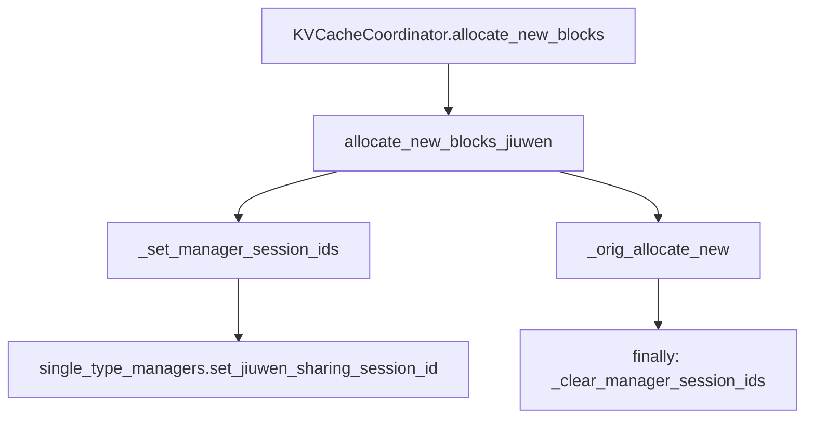
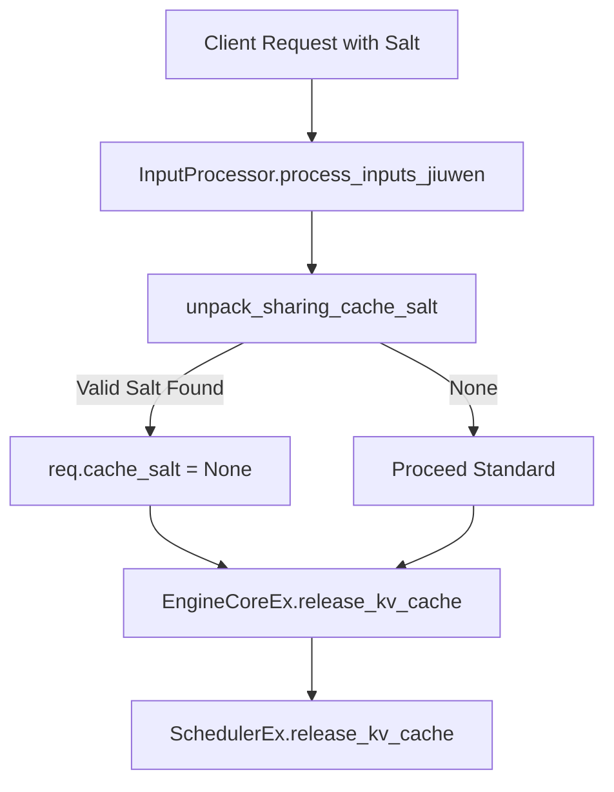
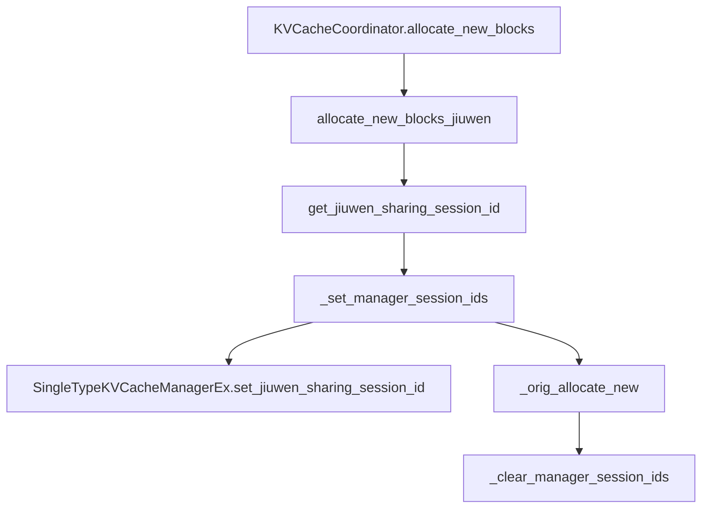

<!-- source: DeepWiki mcp.deepwiki.com · repo openJiuwen-ai/agent-tools · extra page Scheduler, Engine & Coordinator Patches · fetched 2026-11-02 -->

# Scheduler, Engine & Coordinator Patches

<details>
<summary>Relevant source files</summary>

The following files were used as context for generating this wiki page:

- [packages/openJiuwen-vllm-affinity/v0.17.0/jiuwen_vllm_affinity/kv_cache_plugin/v1/core/kv_cache_coordinator.py](packages/openJiuwen-vllm-affinity/v0.17.0/jiuwen_vllm_affinity/kv_cache_plugin/v1/core/kv_cache_coordinator.py)
- [packages/openJiuwen-vllm-affinity/v0.17.0/jiuwen_vllm_affinity/kv_cache_plugin/v1/core/sched/scheduler.py](packages/openJiuwen-vllm-affinity/v0.17.0/jiuwen_vllm_affinity/kv_cache_plugin/v1/core/sched/scheduler.py)
- [packages/openJiuwen-vllm-affinity/v0.18.0/jiuwen_vllm_affinity/kv_cache_plugin/v1/core/input_processor.py](packages/openJiuwen-vllm-affinity/v0.18.0/jiuwen_vllm_affinity/kv_cache_plugin/v1/core/input_processor.py)
- [packages/openJiuwen-vllm-affinity/v0.18.0/jiuwen_vllm_affinity/kv_cache_plugin/v1/engine/core.py](packages/openJiuwen-vllm-affinity/v0.18.0/jiuwen_vllm_affinity/kv_cache_plugin/v1/engine/core.py)

</details>


## Purpose and Scope

This page details the monkey-patches and extensions applied to vLLM v1 core infrastructure components within the `openJiuwen-vllm-affinity` plugin. These integration points bridge vLLM's native scheduler, engine core, input processor, and KV cache coordinator with openJiuwen's two-phase cache management model. Specifically, they enable session-aware cache salt handling, explicit block release protocols, block aging, and session ID propagation across single-type cache managers.

Sources: 
- `packages/openJiuwen-vllm-affinity/v0.17.0/jiuwen_vllm_affinity/kv_cache_plugin/v1/core/kv_cache_coordinator.py:1-97`
- `packages/openJiuwen-vllm-affinity/v0.17.0/jiuwen_vllm_affinity/kv_cache_plugin/v1/core/sched/scheduler.py:1-24`
- `packages/openJiuwen-vllm-affinity/v0.18.0/jiuwen_vllm_affinity/kv_cache_plugin/v1/core/input_processor.py:1-17`
- `packages/openJiuwen-vllm-affinity/v0.18.0/jiuwen_vllm_affinity/kv_cache_plugin/v1/engine/core.py:1-65`

---

## 1. KVCacheCoordinator Extensions

The `KVCacheCoordinator` class manages block allocations across one or more cache managers. The openJiuwen plugin patches `KVCacheCoordinator` to inject session IDs during block allocation phases and provide block aging operations.

### Key Classes and Functions

- `KVCacheCoordinatorEx`: Extended coordinator class adding methods to manage sharing session IDs and trigger block aging across all underlying single-type managers [packages/openJiuwen-vllm-affinity/v0.17.0/jiuwen_vllm_affinity/kv_cache_plugin/v1/core/kv_cache_coordinator.py:55-82]().
  - `set_jiuwen_sharing_session_id(session_id)`: Sets the current sharing session identifier [packages/openJiuwen-vllm-affinity/v0.17.0/jiuwen_vllm_affinity/kv_cache_plugin/v1/core/kv_cache_coordinator.py:56-57]().
  - `get_jiuwen_sharing_session_id()`: Retrieves the active session ID [packages/openJiuwen-vllm-affinity/v0.17.0/jiuwen_vllm_affinity/kv_cache_plugin/v1/core/kv_cache_coordinator.py:59-60]().
  - `clear_jiuwen_sharing_session_id()`: Clears the session identifier [packages/openJiuwen-vllm-affinity/v0.17.0/jiuwen_vllm_affinity/kv_cache_plugin/v1/core/kv_cache_coordinator.py:62-63]().
  - `aging_block(session_id, block_hashes, release_token_index, num_tokens)`: Iterates through `single_type_managers` to execute block aging [packages/openJiuwen-vllm-affinity/v0.17.0/jiuwen_vllm_affinity/kv_cache_plugin/v1/core/kv_cache_coordinator.py:65-81]().
- `allocate_new_computed_blocks_jiuwen`: Wrapped allocation method that temporarily sets the sharing session ID on all single-type managers before delegating to `_orig_allocate_new_computed` [packages/openJiuwen-vllm-affinity/v0.17.0/jiuwen_vllm_affinity/kv_cache_plugin/v1/core/kv_cache_coordinator.py:17-36]().
- `allocate_new_blocks_jiuwen`: Wrapped standard block allocation method ensuring session scope is attached during allocation [packages/openJiuwen-vllm-affinity/v0.17.0/jiuwen_vllm_affinity/kv_cache_plugin/v1/core/kv_cache_coordinator.py:38-54]().
- `register_kv_cache_coordinator()`: Monkey-patches `KVCacheCoordinator` methods at runtime [packages/openJiuwen-vllm-affinity/v0.17.0/jiuwen_vllm_affinity/kv_cache_plugin/v1/core/kv_cache_coordinator.py:84-96]().


Sources: 
- `packages/openJiuwen-vllm-affinity/v0.17.0/jiuwen_vllm_affinity/kv_cache_plugin/v1/core/kv_cache_coordinator.py:1-97`

---

## 2. Scheduler & Engine Core Patches

The scheduler and engine core handle execution loop operations and RPC-driven cache release requests from external clients or routers.

### Scheduler Extensions (`SchedulerEx`)

`SchedulerEx` adds the `release_kv_cache` method to vLLM's `Scheduler`, delegating directly to the underlying `kv_cache_manager` [packages/openJiuwen-vllm-affinity/v0.17.0/jiuwen_vllm_affinity/kv_cache_plugin/v1/core/sched/scheduler.py:5-20]().

```python
class SchedulerEx(Scheduler):
    def release_kv_cache(
        self,
        session_id: str,
        block_hashes: list[BlockHash],
        *,
        release_token_index: int | None = None,
        num_tokens: int | None = None,
    ) -> int:
        return self.kv_cache_manager.release_kv_cache(
            session_id,
            block_hashes,
            release_token_index=release_token_index,
            num_tokens=num_tokens,
        )
```

Sources: 
- `packages/openJiuwen-vllm-affinity/v0.17.0/jiuwen_vllm_affinity/kv_cache_plugin/v1/core/sched/scheduler.py:1-24`

### Engine Core Extensions (`EngineCoreEx`)

`EngineCoreEx` implements explicit KV cache release handling via msgpack-encoded engine core requests [packages/openJiuwen-vllm-affinity/v0.18.0/jiuwen_vllm_affinity/kv_cache_plugin/v1/engine/core.py:13-31](). It also provides utility functions to pack and unpack sharing cache salts inside request IDs [packages/openJiuwen-vllm-affinity/v0.18.0/jiuwen_vllm_affinity/kv_cache_plugin/v1/engine/core.py:34-51]().

| Function / Method | Role |
| :--- | :--- |
| `EngineCoreEx.release_kv_cache` | Decodes engine core requests, computes block hash indices, and invokes `self.scheduler.release_kv_cache` [packages/openJiuwen-vllm-affinity/v0.18.0/jiuwen_vllm_affinity/kv_cache_plugin/v1/engine/core.py:13-31]() |
| `pack_request_sharing_cache_salt` | Serializes request ID and sharing cache salt into a JSON string [packages/openJiuwen-vllm-affinity/v0.18.0/jiuwen_vllm_affinity/kv_cache_plugin/v1/engine/core.py:34-43]() |
| `unpack_sharing_cache_salt` | Extracts the `sharing_cache_salt` field from encoded request strings [packages/openJiuwen-vllm-affinity/v0.18.0/jiuwen_vllm_affinity/kv_cache_plugin/v1/engine/core.py:45-51]() |

Sources: 
- `packages/openJiuwen-vllm-affinity/v0.18.0/jiuwen_vllm_affinity/kv_cache_plugin/v1/engine/core.py:1-65`

---

## 3. Input Processor Integration

The `InputProcessor` patch intercepts incoming request preparation steps to inspect and clean up sharing cache salts.

### Implementation Details

`process_inputs_jiuwen` wraps `InputProcessor.process_inputs` [packages/openJiuwen-vllm-affinity/v0.18.0/jiuwen_vllm_affinity/kv_cache_plugin/v1/core/input_processor.py:7-12](). If a request ID contains a valid packed sharing cache salt (determined via `unpack_sharing_cache_salt`), the processor neutralizes `req.cache_salt` to prevent collision with openJiuwen's custom dual-zone cache hashing logic [packages/openJiuwen-vllm-affinity/v0.18.0/jiuwen_vllm_affinity/kv_cache_plugin/v1/core/input_processor.py:10-11]().

Sources: 
- `packages/openJiuwen-vllm-affinity/v0.18.0/jiuwen_vllm_affinity/kv_cache_plugin/v1/core/input_processor.py:1-17`

---

## 4. Integration Data Flow Diagrams

### Diagram 1: Request Processing & Salt Unpacking Flow

The following diagram bridges Natural Language Space concepts to actual code entities during input processing and engine core handling.


Sources: 
- `packages/openJiuwen-vllm-affinity/v0.18.0/jiuwen_vllm_affinity/kv_cache_plugin/v1/core/input_processor.py:1-17`
- `packages/openJiuwen-vllm-affinity/v0.18.0/jiuwen_vllm_affinity/kv_cache_plugin/v1/engine/core.py:13-31`
- `packages/openJiuwen-vllm-affinity/v0.17.0/jiuwen_vllm_affinity/kv_cache_plugin/v1/core/sched/scheduler.py:5-20`

### Diagram 2: Coordinator Session Binding & Block Allocation


Sources: 
- `packages/openJiuwen-vllm-affinity/v0.17.0/jiuwen_vllm_affinity/kv_cache_plugin/v1/core/kv_cache_coordinator.py:1-97`

---

