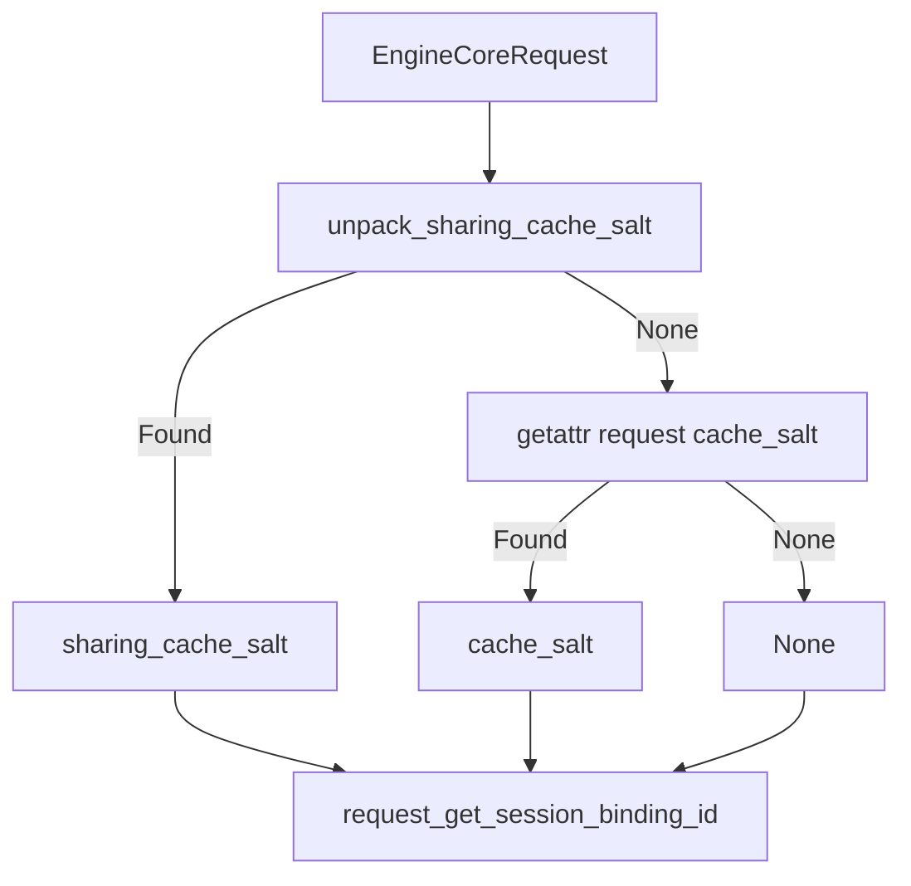
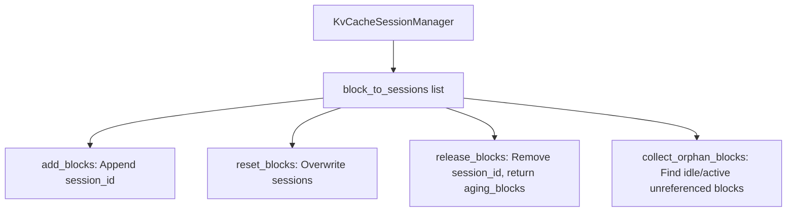
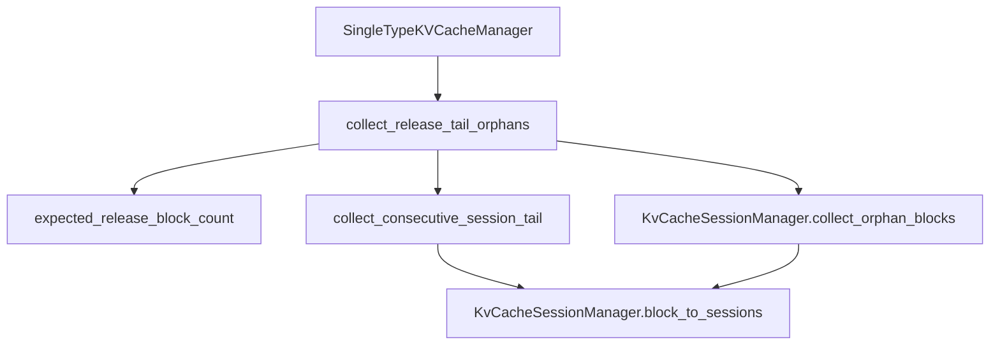

<!-- source: DeepWiki mcp.deepwiki.com · repo openJiuwen-ai/agent-tools · extra page Session Binding & Orphan Tail Collection · fetched 2026-11-02 -->

# Session Binding & Orphan Tail Collection

Relevant source files

The following files were used as context for generating this wiki page:

- [packages/openJiuwen-vllm-affinity/v0.13.0/jiuwen_vllm_affinity/kv_cache_plugin/v1/request.py](packages/openJiuwen-vllm-affinity/v0.13.0/jiuwen_vllm_affinity/kv_cache_plugin/v1/request.py)
- [packages/openJiuwen-vllm-affinity/v0.17.0/jiuwen_vllm_affinity/kv_cache_plugin/v1/core/kv_cache_session_manager.py](packages/openJiuwen-vllm-affinity/v0.17.0/jiuwen_vllm_affinity/kv_cache_plugin/v1/core/kv_cache_session_manager.py)
- [packages/openJiuwen-vllm-affinity/v0.17.0/jiuwen_vllm_affinity/kv_cache_plugin/v1/request.py](packages/openJiuwen-vllm-affinity/v0.17.0/jiuwen_vllm_affinity/kv_cache_plugin/v1/request.py)
- [packages/openJiuwen-vllm-affinity/v0.18.0/jiuwen_vllm_affinity/kv_cache_plugin/v1/core/single_type_kv_cache_manager.py](packages/openJiuwen-vllm-affinity/v0.18.0/jiuwen_vllm_affinity/kv_cache_plugin/v1/core/single_type_kv_cache_manager.py)

## Purpose and Scope
This document details the session binding, cache salt resolution, and orphan tail collection mechanisms implemented in the openJiuwen vLLM KV-cache affinity plugin. Within the two-phase KV cache architecture, physical blocks are bound to logical sessions via `KvCacheSessionManager`. This ensures correct prefix cache reuse, multi-tenant isolation, and reclaim-aware tracking when prompt truncations or token releases occur.

---

## 1. Session ID & Salt Resolution

Requests entering the vLLM engine carry parameters determining whether cache is isolated per client or shared across requests. The session binding identifier (`session_id`) is resolved through `request_get_session_binding_id()` in the request processing pipeline.

- **`sharing_cache_salt`**: Packed into the request identifier for multi-tenant cache sharing (`cache_sharing=true`). Unpacked using `unpack_sharing_cache_salt`.
- **`cache_salt`**: Configured explicitly on the request (`cache_sharing=false`) for client-level prefix isolation.

### Request Session Resolution

Sources: `packages/openJiuwen-vllm-affinity/v0.13.0/jiuwen_vllm_affinity/kv_cache_plugin/v1/request.py:17-64` [], `packages/openJiuwen-vllm-affinity/v0.17.0/jiuwen_vllm_affinity/kv_cache_plugin/v1/request.py:20-70` []

---

## 2. Session Manager & Block Mapping (`KvCacheSessionManager`)

The `KvCacheSessionManager` class maintains a mapping from physical block identifiers to active session lists (`block_to_sessions`). 

### Core Methods
- **`add_blocks(blocks, session_id)`**: Appends `session_id` to the session list of each valid physical block (`block_id >= 0`) using append semantics [packages/openJiuwen-vllm-affinity/v0.17.0/jiuwen_vllm_affinity/kv_cache_plugin/v1/core/kv_cache_session_manager.py:16-32]().
- **`reset_blocks(blocks, session_id)`**: Overwrites the session list for specified blocks, used primarily when blocks are reclaimed from the free tier [packages/openJiuwen-vllm-affinity/v0.17.0/jiuwen_vllm_affinity/kv_cache_plugin/v1/core/kv_cache_session_manager.py:33-46]().
- **`release_blocks(blocks, session_id)`**: Removes `session_id` from blocks and returns blocks whose session reference count drops to zero as `aging_blocks` [packages/openJiuwen-vllm-affinity/v0.17.0/jiuwen_vllm_affinity/kv_cache_plugin/v1/core/kv_cache_session_manager.py:47-63]().
- **`collect_orphan_blocks(session_id, pool_blocks, exclude_block_ids, only_idle)`**: Identifies session-bound blocks outside the hash-resolved set [packages/openJiuwen-vllm-affinity/v0.17.0/jiuwen_vllm_affinity/kv_cache_plugin/v1/core/kv_cache_session_manager.py:65-90]().

### KvCacheSessionManager Data Flow

Sources: `packages/openJiuwen-vllm-affinity/v0.17.0/jiuwen_vllm_affinity/kv_cache_plugin/v1/core/kv_cache_session_manager.py:8-90` []

---

## 3. Allocation and Reclaimed Binding (`bind_allocated_blocks`)

When blocks are allocated to a request, `bind_allocated_blocks()` distinguishes between fresh allocations and blocks reclaimed from the free tier via the `jiuwen_reclaimed` flag.

- **Fresh Blocks**: Bound using append semantics via `session_manager.add_blocks()`.
- **Reclaimed Blocks**: Have their stale mappings cleared and reset using `session_manager.reset_blocks()` before recording the new owner session [packages/openJiuwen-vllm-affinity/v0.18.0/jiuwen_vllm_affinity/kv_cache_plugin/v1/core/single_type_kv_cache_manager.py:184-210]().

Sources: `packages/openJiuwen-vllm-affinity/v0.18.0/jiuwen_vllm_affinity/kv_cache_plugin/v1/core/single_type_kv_cache_manager.py:184-210` []

---

## 4. Release Tail & Orphan Collection (`collect_release_tail_orphans`)

When requests release tokens or shorten prompts, hash resolution might fail to capture all physical blocks associated with the session. `collect_release_tail_orphans()` and `collect_consecutive_session_tail()` locate and reclaim these orphaned tail blocks.

- **`expected_release_block_count`**: Computes expected block counts based on `release_token_index`, `num_tokens`, and `block_size` [packages/openJiuwen-vllm-affinity/v0.18.0/jiuwen_vllm_affinity/kv_cache_plugin/v1/core/single_type_kv_cache_manager.py:32-45]().
- **`collect_consecutive_session_tail`**: Gathers contiguous session-owned blocks immediately following the hash-resolved prefix [packages/openJiuwen-vllm-affinity/v0.18.0/jiuwen_vllm_affinity/kv_cache_plugin/v1/core/single_type_kv_cache_manager.py:76-101]().
- **Orphan Fallback**: If consecutive blocks are insufficient, `KvCacheSessionManager.collect_orphan_blocks()` retrieves remaining session-bound blocks, sorting and trimming them to match the expected deficit [packages/openJiuwen-vllm-affinity/v0.18.0/jiuwen_vllm_affinity/kv_cache_plugin/v1/core/single_type_kv_cache_manager.py:104-164]().

### Orphan Tail Collection Architecture

Sources: `packages/openJiuwen-vllm-affinity/v0.18.0/jiuwen_vllm_affinity/kv_cache_plugin/v1/core/single_type_kv_cache_manager.py:32-164` []

---

