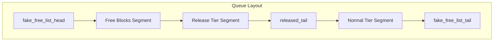
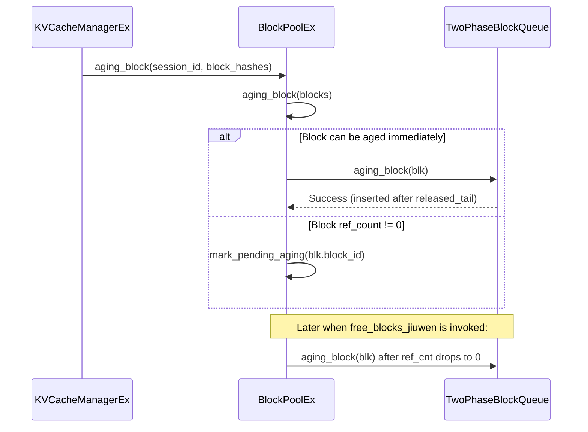
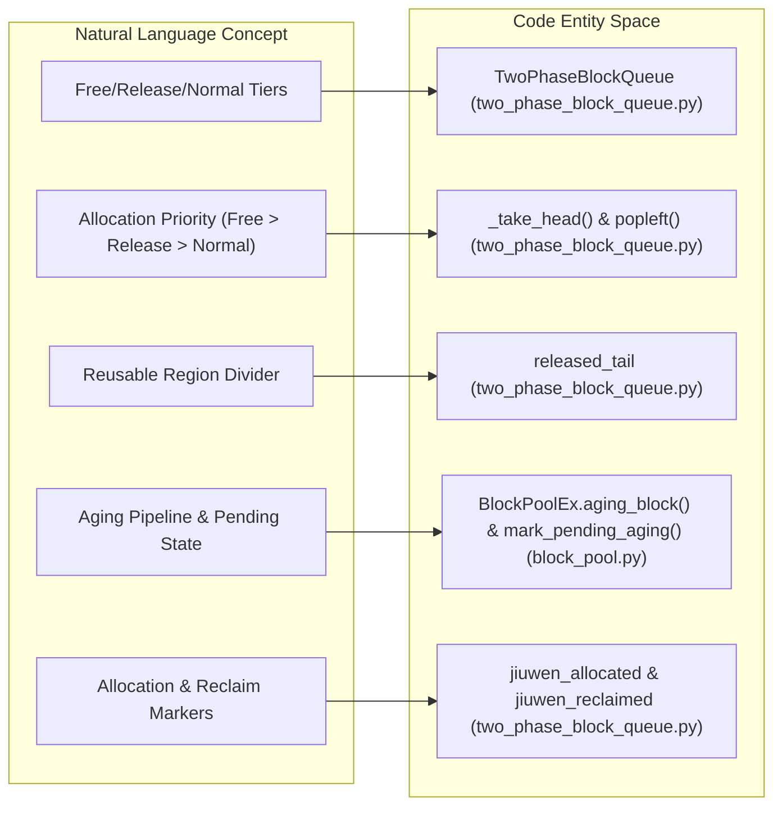

<!-- source: DeepWiki mcp.deepwiki.com · repo openJiuwen-ai/agent-tools · extra page TwoPhaseBlockQueue & Block Pool · fetched 2026-11-02 -->

# TwoPhaseBlockQueue & Block Pool

Relevant source files

The following files were used as context for generating this wiki page:

- [packages/openJiuwen-vllm-affinity/v0.17.0/jiuwen_vllm_affinity/kv_cache_plugin/v1/core/block_pool.py](packages/openJiuwen-vllm-affinity/v0.17.0/jiuwen_vllm_affinity/kv_cache_plugin/v1/core/block_pool.py)
- [packages/openJiuwen-vllm-affinity/v0.17.0/jiuwen_vllm_affinity/kv_cache_plugin/v1/core/kv_cache_manager.py](packages/openJiuwen-vllm-affinity/v0.17.0/jiuwen_vllm_affinity/kv_cache_plugin/v1/core/kv_cache_manager.py)
- [packages/openJiuwen-vllm-affinity/v0.17.0/jiuwen_vllm_affinity/kv_cache_plugin/v1/core/single_type_kv_cache_manager.py](packages/openJiuwen-vllm-affinity/v0.17.0/jiuwen_vllm_affinity/kv_cache_plugin/v1/core/single_type_kv_cache_manager.py)
- [packages/openJiuwen-vllm-affinity/v0.17.0/jiuwen_vllm_affinity/kv_cache_plugin/v1/core/two_phase_block_queue.py](packages/openJiuwen-vllm-affinity/v0.17.0/jiuwen_vllm_affinity/kv_cache_plugin/v1/core/two_phase_block_queue.py)
- [packages/openJiuwen-vllm-affinity/v0.18.0/jiuwen_vllm_affinity/kv_cache_plugin/v1/core/block_pool.py](packages/openJiuwen-vllm-affinity/v0.18.0/jiuwen_vllm_affinity/kv_cache_plugin/v1/core/block_pool.py)
- [packages/openJiuwen-vllm-affinity/v0.18.0/jiuwen_vllm_affinity/kv_cache_plugin/v1/core/two_phase_block_queue.py](packages/openJiuwen-vllm-affinity/v0.18.0/jiuwen_vllm_affinity/kv_cache_plugin/v1/core/two_phase_block_queue.py)

## Purpose and Scope
This page details the implementation of the Two-Phase KV Cache core memory management layer within the openJiuwen vLLM affinity plugin (`packages/openJiuwen-vllm-affinity/`). Specifically, it covers `TwoPhaseBlockQueue` and `BlockPoolEx`, explaining how physical KV-cache blocks are organized into free, release, and normal tiers, how allocation priority is enforced, how the `released_tail` pointer manages reusable segments, how allocation flags (`jiuwen_allocated` and `jiuwen_reclaimed`) operate, and how the aging pipeline (`aging_block` and `pending_aging`) governs block recycling.

---

## 1. Three-Tier Queue Architecture & Allocation Priority

The `TwoPhaseBlockQueue` class replaces standard vLLM free block queues with a doubly-linked structure supporting three logical tiers: **Free**, **Release**, and **Normal** [packages/openJiuwen-vllm-affinity/v0.17.0/jiuwen_vllm_affinity/kv_cache_plugin/v1/core/two_phase_block_queue.py:9-15]().

### Physical Layout & Pointers
The physical queue layout from Least Recently Used (LRU) at the head to Most Recently Used (MRU) at the tail is structured as follows:

*Sources: `packages/openJiuwen-vllm-affinity/v0.17.0/jiuwen_vllm_affinity/kv_cache_plugin/v1/core/two_phase_block_queue.py:10-27`*

Three primary structural pointers define the queue state:
1. **`fake_free_list_head`**: The allocation head. Allocation operations (`popleft` / `popleft_n`) always extract blocks from this position [packages/openJiuwen-vllm-affinity/v0.17.0/jiuwen_vllm_affinity/kv_cache_plugin/v1/core/two_phase_block_queue.py:16-22](). Because the free and release segments physically precede the normal segment, popping from the head inherently guarantees the strict allocation priority: **`free > release > normal`**, without requiring any per-segment scanning overhead [packages/openJiuwen-vllm-affinity/v0.17.0/jiuwen_vllm_affinity/kv_cache_plugin/v1/core/two_phase_block_queue.py:16-22]().
2. **`released_tail`**: The MRU pointer of the *reusable* region (comprising both the free and release segments). It points to the last block immediately preceding the normal segment [packages/openJiuwen-vllm-affinity/v0.17.0/jiuwen_vllm_affinity/kv_cache_plugin/v1/core/two_phase_block_queue.py:22-25](). When blocks age, they are inserted directly after `released_tail`, causing this pointer to advance toward the tail [packages/openJiuwen-vllm-affinity/v0.17.0/jiuwen_vllm_affinity/kv_cache_plugin/v1/core/two_phase_block_queue.py:22-25]().
3. **`fake_free_list_tail`**: The tail anchor where normal (plain free) blocks are appended [packages/openJiuwen-vllm-affinity/v0.17.0/jiuwen_vllm_affinity/kv_cache_plugin/v1/core/two_phase_block_queue.py:25-27]().

---

## 2. Block Pool Lifecycle & Aging Mechanics

The `BlockPoolEx` class extends vLLM's base `BlockPool` to intercept block freeing, aging, and allocation routines [packages/openJiuwen-vllm-affinity/v0.17.0/jiuwen_vllm_affinity/kv_cache_plugin/v1/core/block_pool.py:61-71]().

### Aging and Pending Aging Flow
When blocks are released via API requests (`release_kv_cache`), they do not immediately re-enter the high-priority reusable pool. Instead, they undergo an aging transition mediated by `pending_aging_block_ids`:

*Sources: `packages/openJiuwen-vllm-affinity/v0.17.0/jiuwen_vllm_affinity/kv_cache_plugin/v1/core/block_pool.py:21-71`, `packages/openJiuwen-vllm-affinity/v0.17.0/jiuwen_vllm_affinity/kv_cache_plugin/v1/core/kv_cache_manager.py:15-28`*

- **`mark_pending_aging`**: Adds block IDs to `self.pending_aging_block_ids` if a block is still referenced (`ref_cnt != 0`) when an aging request arrives [packages/openJiuwen-vllm-affinity/v0.17.0/jiuwen_vllm_affinity/kv_cache_plugin/v1/core/block_pool.py:21-24]().
- **`free_blocks_jiuwen`**: Intercepts standard block returns; when a block's reference count drops to zero and its ID is present in `pending_aging_block_ids`, it discards the pending flag and invokes `self.free_block_queue.aging_block(block)` [packages/openJiuwen-vllm-affinity/v0.17.0/jiuwen_vllm_affinity/kv_cache_plugin/v1/core/block_pool.py:26-36]().

---

## 3. Allocation State Flags

To distinguish between virgin blocks, reused release blocks, and normal blocks, `TwoPhaseBlockQueue` relies on two primary markers managed during `_take_head` and `remove` operations [packages/openJiuwen-vllm-affinity/v0.17.0/jiuwen_vllm_affinity/kv_cache_plugin/v1/core/two_phase_block_queue.py:40-50]():

1. **`jiuwen_allocated` (Persistent)**: Set to `True` once a block has ever been popped from the queue or removed via prefix-cache touches (`remove`). This flag is never cleared, distinguishing never-used free blocks (`False`) from previously allocated blocks (`True`) [packages/openJiuwen-vllm-affinity/v0.17.0/jiuwen_vllm_affinity/kv_cache_plugin/v1/core/two_phase_block_queue.py:42-45]().
2. **`jiuwen_reclaimed` (Transient)**: A transient flag set on each `popleft` operation equal to the pre-pop value of `jiuwen_allocated` [packages/openJiuwen-vllm-affinity/v0.17.0/jiuwen_vllm_affinity/kv_cache_plugin/v1/core/two_phase_block_queue.py:46-49](). It is consumed downstream by `bind_allocated_blocks` in `single_type_kv_cache_manager.py` to determine whether stale session bindings must be cleared via `reset_blocks` (for reused blocks) or appended via `add_blocks` (for fresh blocks) [packages/openJiuwen-vllm-affinity/v0.17.0/jiuwen_vllm_affinity/kv_cache_plugin/v1/core/single_type_kv_cache_manager.py:179-210](). It also triggers the `4-evict` debug log [packages/openJiuwen-vllm-affinity/v0.17.0/jiuwen_vllm_affinity/kv_cache_plugin/v1/core/block_pool.py:38-58]().

---

## 4. Code-Entity Mapping Diagram

The following diagram associates the natural language concepts of the Two-Phase Block Queue and Block Pool with their concrete implementation symbols and code entities across the codebase:

*Sources: `packages/openJiuwen-vllm-affinity/v0.17.0/jiuwen_vllm_affinity/kv_cache_plugin/v1/core/two_phase_block_queue.py:9-110`, `packages/openJiuwen-vllm-affinity/v0.17.0/jiuwen_vllm_affinity/kv_cache_plugin/v1/core/block_pool.py:21-71`*

---

