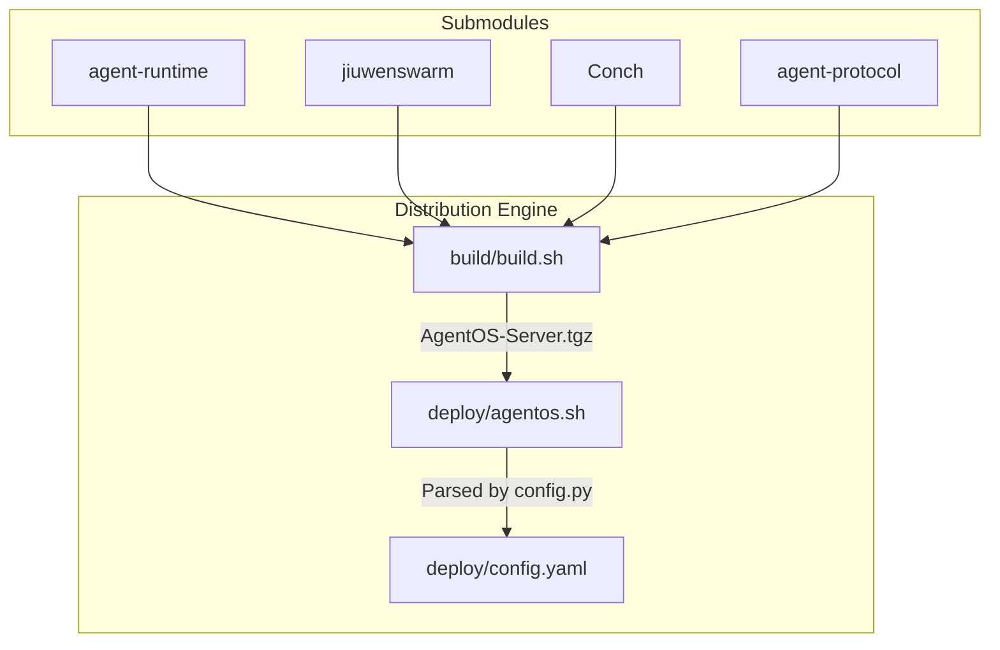
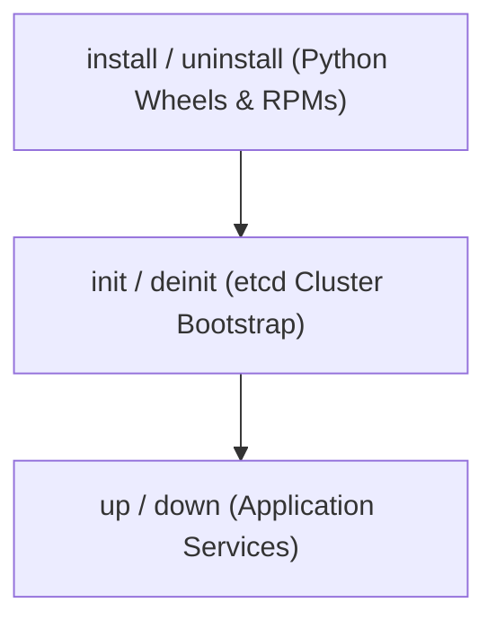

<!-- source: DeepWiki mcp.deepwiki.com · repo openJiuwen-ai/agentos-enterprise · page 1 Overview · fetched 2026-11-02 -->

# Overview

Relevant source files

The following files were used as context for generating this wiki page:

- [README.md](README.md)
- [README.zh.md](README.zh.md)
- [docs/en/explanation/architecture.md](docs/en/explanation/architecture.md)
- [docs/zh/explanation/architecture.md](docs/zh/explanation/architecture.md)

AgentOS Enterprise functions as a one-stop integration and delivery distribution repository for the openJiuwen agent infrastructure [README.md:1-5](). It aggregates four primary openJiuwen subsystems—the distributed agent runtime (`agent-runtime`), the work/coding agent gateway and frontend (`jiuwenswarm`), the sandbox engine (`Conch`), and the A2X protocol registry (`agent-protocol`)—using Git submodules [README.md:5-9](), [docs/en/explanation/architecture.md:7-14](). Rather than implementing core AI logic directly, AgentOS provides a unified build pipeline and a modular cluster deployment orchestrator [README.md:5-13]().

Sources: [README.md:5-11](), [docs/en/explanation/architecture.md:7-16]()

---

## High-Level Architecture & Lifecycle

AgentOS decouples its operations into three distinct architectural layers to separate software packaging, cluster initialization, and service execution [docs/en/explanation/architecture.md:46-54](). 

Sources: [docs/en/explanation/architecture.md:46-55]()

The deployment orchestrator `deploy/agentos.sh` manages these lifecycle states by executing pluggable hook functions defined within each component's module directory [docs/en/explanation/architecture.md:34-39](). Multi-node clusters are coordinated via `deploy/config.yaml`, which assigns roles such as etcd nodes, master nodes, and the network-layer ingress virtual IP [README.md:12](), [docs/en/explanation/architecture.md:56-62]().

Sources: [README.md:11-13](), [docs/en/explanation/architecture.md:34-62]()

---

## Child Pages

For detailed instructions and lower-level specifications, refer to the following child pages:

- [Quick Start (Single Node)](#1.1) — Walkthrough of first install/up on a single node using `examples/single-node-up.sh` and tutorial documentation.
- [Repository Layout and Submodules](#1.2) — Top-level directories, Git submodules (`jiuwenswarm`, `Conch`, `agent-protocol`, `agent-dx`, `openyuanrong`), and repository conventions.
- [Documentation Set and Contributing](#1.3) — Structure of the `docs/` directory, contribution workflows, and licensing notices.

Sources: [README.md:15-20](), [docs/en/explanation/architecture.md:7-14]()

---

