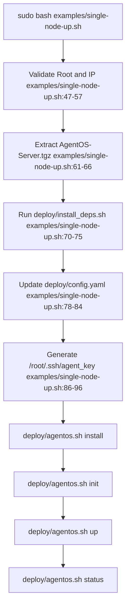
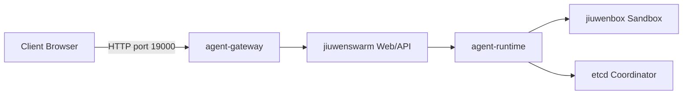

<!-- source: DeepWiki mcp.deepwiki.com · repo openJiuwen-ai/agentos-enterprise · page 1.1 Quick Start (Single Node) · fetched 2026-11-02 -->

# Quick Start (Single Node)

<details>
<summary>Relevant source files</summary>

The following files were used as context for generating this wiki page:

- [docs/en/tutorial/01-quick-start.md](docs/en/tutorial/01-quick-start.md)
- [docs/zh/tutorial/01-quick-start.md](docs/zh/tutorial/01-quick-start.md)
- [examples/README.zh.md](examples/README.zh.md)
- [examples/single-node-up.sh](examples/single-node-up.sh)

</details>


This page provides a technical walkthrough for setting up AgentOS Enterprise on a single Linux server. It covers prerequisites, automated single-node deployment via `examples/single-node-up.sh`, manual execution steps using `deploy/agentos.sh`, cluster configuration, verification, and teardown procedures.

Sources: `docs/en/tutorial/01-quick-start.md:1-4`, `examples/README.zh.md:1-8`

---

## Prerequisites and System Requirements

Before initiating deployment, verify that the host machine satisfies the following hardware, OS, and software constraints. Deployment must be executed with `root` privileges because it interacts with `systemd`, system logs, and administrative filesystem paths.

| Category | Requirement |
|----------|-------------|
| Server OS | openEuler 22.03 / 24.03-LTS (x86_64 / aarch64) or Ubuntu 22.04 / 24.04 with active internet access |
| Account | `root` user `[docs/en/tutorial/01-quick-start.md:10-18]()` |
| Python | Python 3.11 (`python3.11 --version`) `[docs/en/tutorial/01-quick-start.md:10-18]()` |
| Disk Space | Minimum 20 GB free space `[docs/en/tutorial/01-quick-start.md:10-18]()` |

Sources: `docs/en/tutorial/01-quick-start.md:10-18`

---

## Deployment Architecture and Data Flow

The following diagrams map natural language deployment concepts to the actual script execution flow and runtime components defined in the codebase.

### Automation and Script Execution Flow


Sources: `examples/single-node-up.sh:1-110`

### Runtime Component Topology


Sources: `docs/en/tutorial/01-quick-start.md:7-8`

---

## Step-by-Step Manual Deployment Guide

If you prefer not to use the automated wrapper script (`examples/single-node-up.sh`), you can execute the lifecycle commands manually.

### Step 1: Package Acquisition
Obtain the distribution archive via direct download or local build `[docs/en/tutorial/01-quick-start.md:21-30]`:
```bash
wget https://openjiuwen-ci.obs.cn-north-4.myhuaweicloud.com/agent-os/package/release/dist/20260715/x86_64/AgentOS-Server.tgz
```
Sources: `docs/en/tutorial/01-quick-start.md:21-30`

### Step 2: Unpack and Install System Dependencies
Extract the package and execute the dependency installation script `[docs/en/tutorial/01-quick-start.md:31-39]`:
```bash
tar -xzf AgentOS-Server.tgz && cd AgentOS-Server
bash deploy/install_deps.sh
```
`deploy/install_deps.sh` installs Python 3.11, network utilities, `fuse3`, `bwrap`, MooseFS RPM packages, and required Python libraries `[docs/en/tutorial/01-quick-start.md:38]`.
Sources: `docs/en/tutorial/01-quick-start.md:31-39`

### Step 3: Configure Cluster Topology
Edit `deploy/config.yaml` to specify the local node IP. **Do not use `127.0.0.1`**, as it binds services exclusively to the loopback interface `[docs/en/tutorial/01-quick-start.md:40-54]`:
```yaml
cluster:
  etcd_nodes:
    - "192.168.100.1"                  # Replace with local machine IP
  master_nodes:
    - "192.168.100.1"                  # Replace with local machine IP
  ingress_virtual_ip: "192.168.100.1"  # Replace with local machine IP
```
Sources: `docs/en/tutorial/01-quick-start.md:40-54`

### Step 4: Generate Agent SSH Key Pair
Generate the direct connection SSH key pair required by agents `[docs/en/tutorial/01-quick-start.md:55-64]`:
```bash
ssh-keygen -t ed25519 -N '' -f /root/.ssh/agent_key
mkdir -p /root/.ssh/agent_pub
cp /root/.ssh/agent_key.pub /root/.ssh/agent_pub/authorized_keys
chmod 644 /root/.ssh/agent_pub/authorized_keys && chmod 755 /root/.ssh/agent_pub
```
Sources: `docs/en/tutorial/01-quick-start.md:55-64`

### Step 5: Install, Initialize, and Start Components
Execute the orchestration script `deploy/agentos.sh` to manage component lifecycles `[docs/en/tutorial/01-quick-start.md:66-75]`:
```bash
bash deploy/agentos.sh install    # Installs Python wheels, persisting deploy state to ~/.agentos/
bash deploy/agentos.sh init       # Boots etcd (preserves existing key-value data)
bash deploy/agentos.sh up         # Starts application modules in dependency order
```
Sources: `docs/en/tutorial/01-quick-start.md:66-75`

### Step 6: Verify Deployment Status
Probe the health and runtime status of all managed services `[docs/en/tutorial/01-quick-start.md:76-83]`:
```bash
bash deploy/agentos.sh status
```
When all modules report a `running` status, access the `jiuwenswarm` web frontend via `http://<machine-IP>:19000` `[docs/en/tutorial/01-quick-start.md:82]`.
Sources: `docs/en/tutorial/01-quick-start.md:76-83`

---

## Automated Single-Node Deployment Script

For rapid prototyping, `examples/single-node-up.sh` automates the entire manual sequence into a single command `[examples/README.zh.md:5-8]`:

```bash
sudo bash examples/single-node-up.sh --package /path/to/AgentOS-Server.tgz
```

For multi-NIC environments, explicitly specify the reachable interface IP `[examples/single-node-up.sh:36-45]`:
```bash
sudo bash examples/single-node-up.sh --package /path/to/AgentOS-Server.tgz --ip 192.168.100.1
```
Sources: `examples/single-node-up.sh:1-110`, `examples/README.zh.md:1-26`

---

## Teardown and Cleanup Procedures

To stop services or completely remove AgentOS binaries from the node, use the corresponding `agentos.sh` subcommands `[docs/en/tutorial/01-quick-start.md:84-90]`:

```bash
bash deploy/agentos.sh down       # Stops application components while leaving etcd operational
bash deploy/agentos.sh deinit     # Stops etcd and preserves persistent data store
bash deploy/agentos.sh uninstall  # Removes installed Python wheel packages
```
Sources: `docs/en/tutorial/01-quick-start.md:84-90`

---

