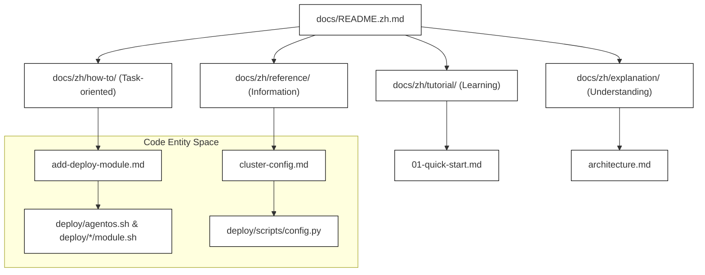
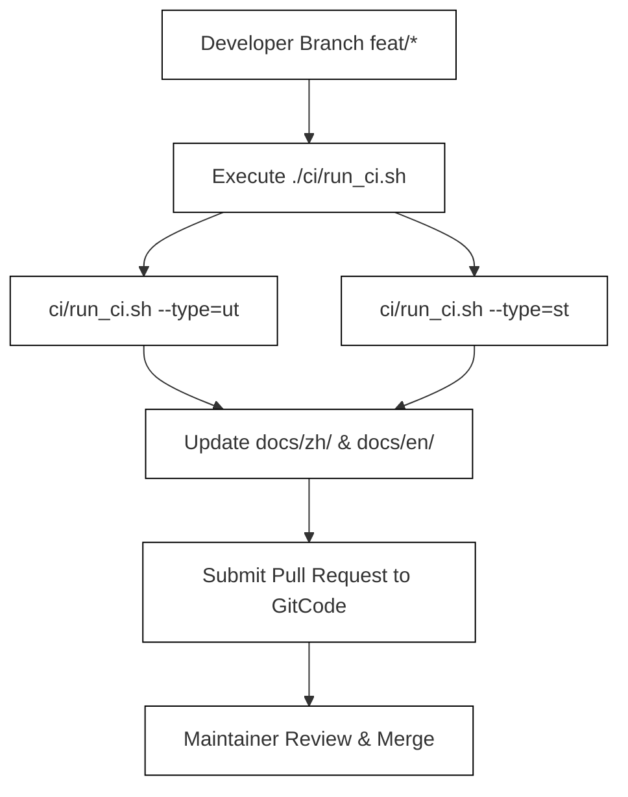

<!-- source: DeepWiki mcp.deepwiki.com · repo openJiuwen-ai/agentos-enterprise · page 1.3 Documentation Set and Contributing · fetched 2026-11-02 -->

# Documentation Set and Contributing

<details>
<summary>Relevant source files</summary>

The following files were used as context for generating this wiki page:

- [CONTRIBUTING.md](CONTRIBUTING.md)
- [LICENSE](LICENSE)
- [OPEN_SOURCE_SOFTWARE_NOTICE.md](OPEN_SOURCE_SOFTWARE_NOTICE.md)
- [deploy/check-ingress-master.sh](deploy/check-ingress-master.sh)
- [deploy/conch/module.sh](deploy/conch/module.sh)
- [docs/README.zh.md](docs/README.zh.md)
- [docs/en/how-to/add-deploy-module.md](docs/en/how-to/add-deploy-module.md)
- [docs/zh/how-to/add-deploy-module.md](docs/zh/how-to/add-deploy-module.md)

</details>


## Purpose and Scope

This page details the organization of the AgentOS Enterprise documentation set (`docs/`), the contribution workflow, code standards, and the licensing and open-source notices governing the repository. It targets developers and technical writers looking to understand how documentation is structured using the Diátaxis framework, how to contribute code and documentation updates, and how third-party software components are licensed.

Sources: [docs/README.zh.md:1-26](), [CONTRIBUTING.md:1-39](), [LICENSE:1-25]()

---

## Documentation Set Organization (`docs/`)

AgentOS Enterprise organizes its user and technical documentation using the **Diátaxis** framework, dividing content into four distinct categories based on user needs. The documentation maintains an authoritative Chinese source tree under `docs/zh/` and a structurally symmetric English translation tree under `docs/en/`. Top-level module docs also reside alongside their respective deployment scripts or submodules [docs/README.zh.md:1-8].

### The Four Diátaxis Quadrants

1. **Tutorial (`tutorial/`)**: Learning-oriented, step-by-step guides ("follow me through a task") designed with numeric prefixes to enforce a recommended reading sequence (e.g., single-node quick starts) [docs/README.zh.md:21-23].
2. **How-to Guides (`how-to/`)**: Task-oriented guides addressing specific operational goals ("how do I accomplish X?", such as building packages or deploying multi-node clusters) [docs/README.zh.md:21-24].
3. **Reference (`reference/`)**: Information-oriented, factual descriptions of commands, scripts, and configuration schemas designed for quick lookup [docs/README.zh.md:21-25].
4. **Explanation (`explanation/`)**: Understanding-oriented discussions clarifying design rationale, architecture choices, and background context [docs/README.zh.md:21-26].


*Diagram 1: Documentation Navigation mapped to codebase entities via Diátaxis categories.*

Sources: [docs/README.zh.md:1-26](), [docs/zh/how-to/add-deploy-module.md:1-84]()

---

## Contribution Workflow

Contributing changes to AgentOS Enterprise requires adherence to specific Git branching, self-testing, and coding conventions outlined in `CONTRIBUTING.md` [CONTRIBUTING.md:1-40].

### Step-by-Step Contribution Pipeline

1. **Fork and Branch**: Fork the main repository and create a feature or bugfix branch using descriptive `kebab-case` naming (e.g., `feat/my-feature` or `fix/my-bugfix`) [CONTRIBUTING.md:5-7].
2. **Development & Self-Test**: Implement changes following shell script standards (`#!/usr/bin/env bash` with `set -euo pipefail`) and verify using the CI test harness [CONTRIBUTING.md:12-29]:
   ```bash
   ./ci/run_ci.sh                 # Run all UT and ST tests
   ./ci/run_ci.sh --type=ut       # Run Unit Tests only
   ./ci/run_ci.sh --type=st       # Run System Tests only
   ```
3. **Documentation Sync**: Any feature modification or new deployment module requires updating the corresponding documentation (`docs/`, `README`, and script help texts) symmetrically across Chinese and English sets [CONTRIBUTING.md:30-34].
4. **Pull Request**: Submit a PR to the main repository detailing the background, scope of changes, and validation results [CONTRIBUTING.md:8-10].


*Diagram 2: Contribution lifecycle from local development to code review.*

Sources: [CONTRIBUTING.md:1-39](), [docs/README.zh.md:1-8]()

---

## Code Standards and Module Integration

When extending AgentOS Enterprise—especially within the `deploy/` subsystem—contributors must implement modular hooks that conform to the orchestrator's expectations [docs/zh/how-to/add-deploy-module.md:1-85]:

- **Module Layout**: Each component resides in `deploy/<module>/` containing a `module.sh` script implementing standard hooks: `<module>_up`, `<module>_down`, `<module>_install`, `<module>_uninstall`, and `<module>_status` [docs/zh/how-to/add-deploy-module.md:5-40].
- **Orchestrator Registration**: The module name must be appended to the `MODULES` array inside `deploy/agentos.sh` to participate in automated initialization and lifecycle scheduling [docs/zh/how-to/add-deploy-module.md:42-51].

Sources: [docs/zh/how-to/add-deploy-module.md:1-51](), [deploy/conch/module.sh:1-36]()

---

## Licensing and Open Source Notices

AgentOS Enterprise is licensed under the terms of the **Apache License, Version 2.0** [LICENSE:1-5]. Redistribution and modification must respect terms regarding copyright retention, license inclusion, and notice propagation [LICENSE:89-125].

### Third-Party Software and Submodules

The project integrates several submodules and deployment-time third-party dependencies governed by their respective licenses [OPEN_SOURCE_SOFTWARE_NOTICE.md:1-38]:

| Component Name | Provenance | License Type | Description |
|---|---|---|---|
| `yuanrong` | `https://gitcode.com/openeuler/yuanrong.git` | Apache-2.0 | Core open-source execution runtime |
| `jiuwenswarm` | `https://gitcode.com/openJiuwen/jiuwenswarm.git` | Apache-2.0 | Multi-agent swarm orchestration layer |
| `agent-protocol` | `https://gitcode.com/openJiuwen/agent-protocol.git` | Apache-2.0 | Inter-agent communication protocols |
| `Conch` | `https://gitcode.com/openeuler/Conch.git` | MulanPSL-2.0 | Virtualization and storage utility runtime |
| `MooseFS` | `https://repository.moosefs.com` | GPL-2.0 | Distributed cluster file system |

Sources: [LICENSE:1-125](), [OPEN_SOURCE_SOFTWARE_NOTICE.md:1-50]()

---

