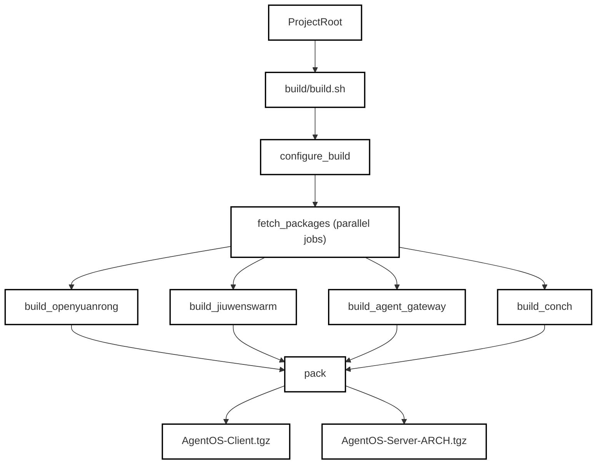

<!-- source: DeepWiki mcp.deepwiki.com · repo openJiuwen-ai/agentos-enterprise · page 2 Build System · fetched 2026-11-02 -->

# Build System

Relevant source files

The following files were used as context for generating this wiki page:

- [.gitmodules](.gitmodules)
- [build/README.zh.md](build/README.zh.md)
- [build/build.sh](build/build.sh)

The build system of AgentOS Enterprise is responsible for fetching, assembling, and packaging all necessary runtime components, SDKs, and deployment scripts into unified distribution tarballs: `AgentOS-Client.tgz` and `AgentOS-Server-ARCH.tgz` [build/build.sh:7-8](), [build/README.zh.md:160-171](). It orchestrates downloads from Huawei Cloud OBS and GitCode repositories, handles parallel fetching of Python wheels and RPMs, and packages the workspace for single-node and multi-node enterprise deployments [build/README.zh.md:7-14, 141-145]().

*Sources: [build/build.sh:1-594](), [build/README.zh.md:61-72]()*, [build/README.zh.md:160-179]()

---

## 2.1. build.sh: Modes, Downloads, Packaging

The primary build entrypoint is `build/build.sh`, which supports two execution modes: `daily` (fetching latest builds from OBS daily indices) and `release` (pulling pinned versions from GitCode and OBS release paths) [build/build.sh:56-58](), [build/README.zh.md:7-8](). It provides options for ABI tags, parallel download limits (`--download-jobs`), and specific component versions [build/README.zh.md:45-58]().

For a comprehensive deep dive into daily versus release modes, OBS/GitCode sources, parallel download logic (`wait -n`), component build functions (`build_openyuanrong`, `build_jiuwenswarm`, `build_agent_gateway`, `build_conch`), and the final packaging directory layout, see [build.sh: Modes, Downloads, Packaging](#2.1).

*Sources: [build/build.sh:1-185](), [build/README.zh.md:1-180]()*, [.gitmodules:1-16]()

---

## 2.2. build-v2.sh

The repository also includes next-generation build tooling via `build-v2.sh`, designed to streamline and modernize the artifact generation pipeline. While `build.sh` handles script-driven procedural tarball creation [build/README.zh.md:61-72](), `build-v2.sh` provides alternative iteration logic and modular packaging enhancements.

For details on how `build-v2.sh` differs from the legacy `build.sh` script, see [build-v2.sh](#2.2).

*Sources: [build/build.sh:1-594](), [build/README.zh.md:1-41]()*, [.gitmodules:1-16]()

---

## 2.3. Runtime Sandbox Container Image

Container image definitions are maintained under the `images/` directory to support isolated execution environments. Specifically, `images/Dockerfile` provisions the `ppt-pipeline-swarm` runtime environment, which includes system font packages, Node.js `html2pptx` dependencies, Playwright browser automation binaries, and specialized Python runtime packages.

For details on the container image configuration, dependency layering, and runtime sandbox preparation, see [Runtime Sandbox Container Image](#2.3).

*Sources: [build/build.sh:7-8](), [build/README.zh.md:160-171]()*, [.gitmodules:1-16]()

---

