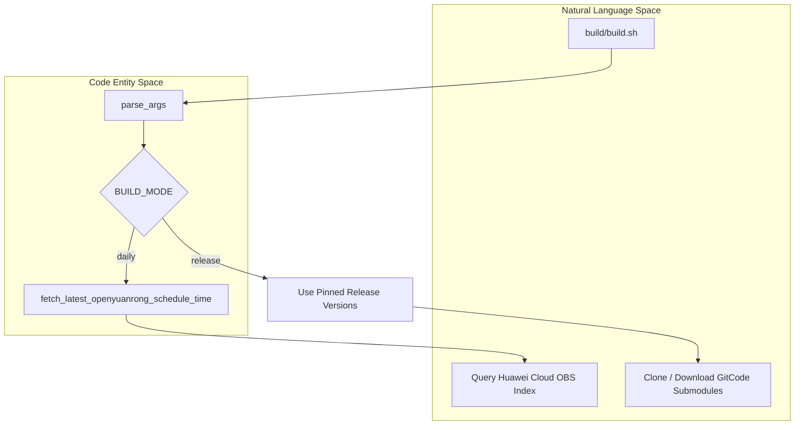
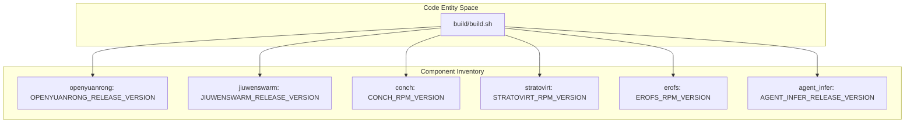

<!-- source: DeepWiki mcp.deepwiki.com · repo openJiuwen-ai/agentos-enterprise · page 2.1 build.sh: Modes, Downloads, Packaging · fetched 2026-11-02 -->

# build.sh: Modes, Downloads, Packaging

Relevant source files

The following files were used as context for generating this wiki page:

- [.gitmodules](.gitmodules)
- [build/build.sh](build/build.sh)
- [docs/en/how-to/build-package.md](docs/en/how-to/build-package.md)
- [docs/zh/how-to/build-package.md](docs/zh/how-to/build-package.md)

## Purpose and Scope

This document provides a deep technical dive into `build/build.sh`, the primary packaging script for the AgentOS Enterprise distribution. It covers script execution modes (`daily` vs `release`), remote artifact acquisition from Huawei Cloud OBS and GitCode via `.gitmodules`, parallel download execution control, component version mapping (`openyuanrong`, `jiuwenswarm`, `conch`, `stratovirt`, `erofs`), and the final tarball generation layout (`AgentOS-Client.tgz` and `AgentOS-Server-<arch>.tgz`).

Sources: `[build/build.sh:1-209]`, `[docs/en/how-to/build-package.md:1-73]()`

---

## 1. Build Modes and Argument Parsing

The script `build/build.sh` initiates execution by setting strict error handling (`set -e`) and resolving absolute paths for `SCRIPT_DIR`, `PROJECT_ROOT`, and `BUILD_DIR` [build/build.sh:1-10](). 

The `parse_args` function processes positional arguments and command-line flags to configure the build environment [build/build.sh:85-185](). The two primary execution modes are:
* **`daily`**: Automatically queries the OpenYuanRong daily build index on Huawei Cloud OBS to retrieve the latest matching snapshot.
* **`release`**: Relies on explicitly pinned component versions and tags for official production releases.

### Key Configuration Parameters

| Parameter Variable | Default Value | CLI Flag | Description |
|-------------------|---------------|----------|-------------|
| `BUILD_MODE` | `daily` | `daily` / `release` | Execution mode (positional argument) |
| `CP_TAG` | `cp311` | `--cp-tag` | Python ABI tag for Yuanrong wheel packages |
| `OPENYUANRONG_RELEASE_VERSION` | `0.9.0` | `--yuanrong-release-version` | Yuanrong version for release mode |
| `JIUWENSWARM_RELEASE_VERSION` | `0.2.3` | `--jiuwenswarm-release-version` | JiuwenSwarm wheel version |
| `JIUWENSWARM_RELEASE_GIT_TAG` | `release_0.2.3` | `--jiuwenswarm-release-git-tag` | JiuwenSwarm git release tag |
| `AGENT_INFER_RELEASE_VERSION` | `0.1.0` | `--agent-infer-release-version` | Agent Infer component version |
| `DOWNLOAD_JOBS` | `3` | `--download-jobs` | Maximum concurrent background download workers |

Sources: `[build/build.sh:11-83]`, `[docs/en/how-to/build-package.md:25-35]()`

---

## 2. Source Repositories and Artifact Retrieval

External dependencies span GitCode repositories and Huawei Cloud OBS object storage. Git submodules configured in `.gitmodules` define the source tree structure for development and source-based component inclusion.

*Diagram 1: Control flow from script invocation to daily/release mode resolution.*

Sources: `[build/build.sh:85-209]`, `[.gitmodules:1-16]()`

---

## 3. Parallel Download Infrastructure

To accelerate artifact acquisition, `build/build.sh` implements concurrency controls via the `DOWNLOAD_JOBS` variable [build/build.sh:21](). Downloads use `curl` or `wget` with built-in retry logic [build/build.sh:192-200](). 

When downloading large binary wheels, RPM packages (`conch`, `stratovirt`, `erofs`), and tarballs, the script regulates parallel execution slots to prevent network throttling or broken socket connections (`curl: (18) transfer closed`) on unstable uplinks [docs/en/how-to/build-package.md:70-71]().

Sources: `[build/build.sh:181-184]`, `[docs/en/how-to/build-package.md:70-72]()`

---

## 4. Component Builds and Version Mapping

The distribution bundles several core subsystems. Each component has strict version bindings defined at the top of the build script:

*Diagram 2: Component version bindings managed within `build/build.sh`.*

### Component Overview
* **OpenYuanRong**: Core execution engine runtime wheels tagged with `--cp-tag` (`cp311`) [build/build.sh:13]().
* **JiuwenSwarm**: Multi-agent framework components and TUI client wheels [build/build.sh:16-17]().
* **Conch, StratoVirt, and EROFS**: Virtualization and lightweight storage utilities provided as RPM packages (`Conch` wheel is embedded inside the Conch RPM) [build/build.sh:26-29]().
* **Agent Infer & Gateway**: Inference routing and service registration plugins [build/build.sh:22-25]().

Sources: `[build/build.sh:11-30]`, `[docs/en/how-to/build-package.md:63-66]()`

---

## 5. Packaging Layout and Output Generation

Once all components are downloaded, verified, and assembled, the build script packs them into two primary distributable archives inside `build/dist/`:

| Archive Name | Target Audience / Contents |
|--------------|----------------------------|
| `AgentOS-Client.tgz` | All-platform `jiuwenswarm_tui` wheels supporting macOS, Windows, Linux (`x86_64`, `aarch64`) [docs/en/how-to/build-package.md:64]() |
| `AgentOS-Server-<arch>.tgz` | Server-side wheel packages, RPMs (`conch`, `stratovirt`, `erofs`), and the complete orchestration directory (`deploy/`) [docs/en/how-to/build-package.md:65]() |

Every build cycle initializes by wiping `build/dist/` to prevent contamination from stale build artifacts [docs/en/how-to/build-package.md:71]().

Sources: `[build/build.sh:7]`, `[docs/en/how-to/build-package.md:58-67]()`

---

