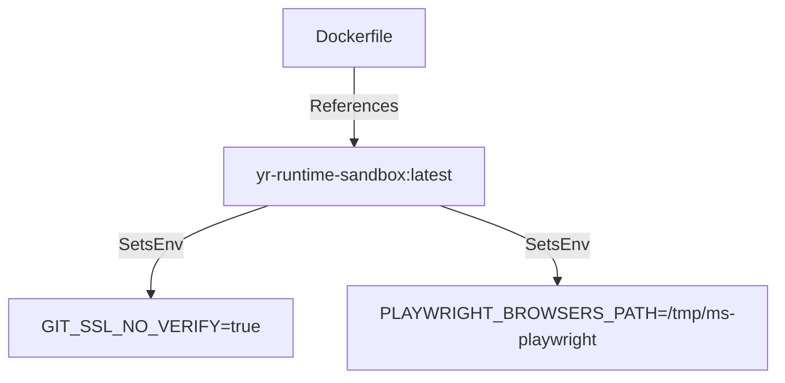
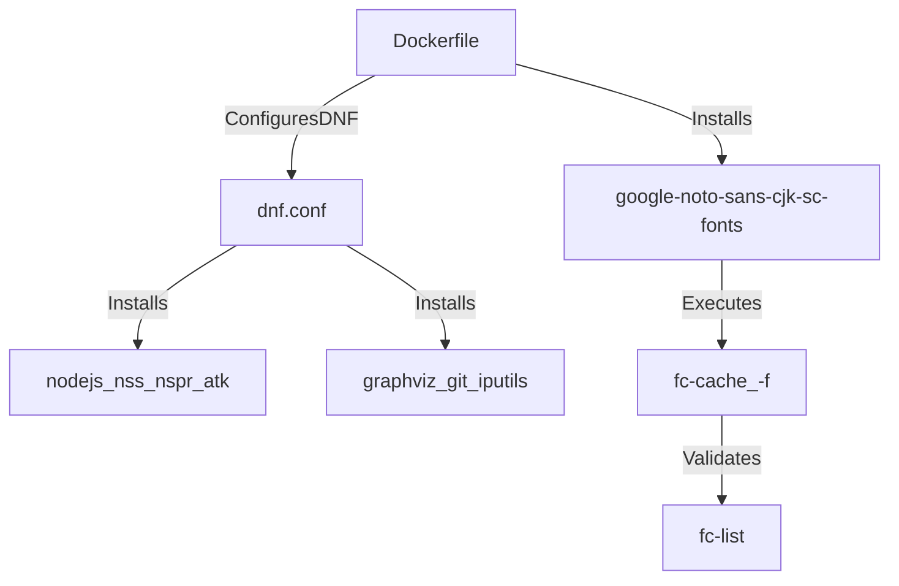
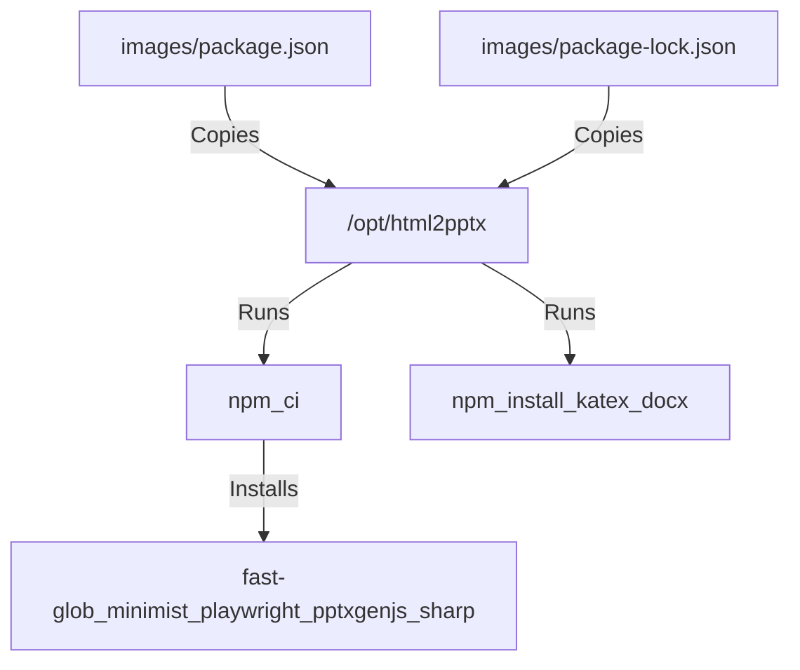
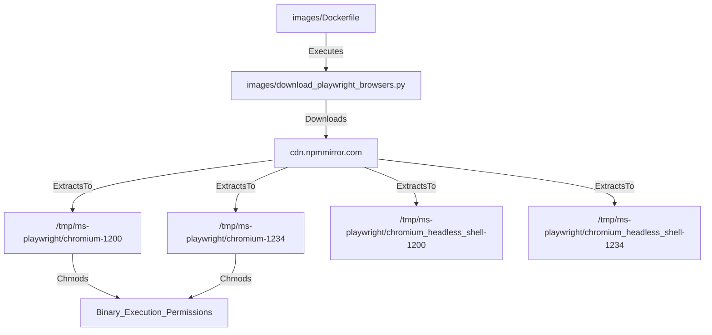

<!-- source: DeepWiki mcp.deepwiki.com · repo openJiuwen-ai/agentos-enterprise · page 2.3 Runtime Sandbox Container Image · fetched 2026-11-02 -->

# Runtime Sandbox Container Image

Relevant source files

The following files were used as context for generating this wiki page:

- [images/Dockerfile](images/Dockerfile)
- [images/download_playwright_browsers.py](images/download_playwright_browsers.py)
- [images/package-lock.json](images/package-lock.json)
- [images/package.json](images/package.json)

## Purpose and Scope
This page documents the technical implementation of the `ppt-pipeline-swarm` runtime sandbox container image defined in `images/Dockerfile` [images/Dockerfile:1-67]() and provisioned via helper scripts such as `images/download_playwright_browsers.py` [images/download_playwright_browsers.py:1-69](). This container image bundles system-level dependencies, Chinese fonts for WPS/PPT rendering, Node.js packages for the `html2pptx` conversion engine, dual-revision Playwright browser instances, and a comprehensive Python data-processing and AI pipeline package stack.

Sources: `images/Dockerfile` [images/Dockerfile:1-67](), `images/download_playwright_browsers.py` [images/download_playwright_browsers.py:1-69]()

---

## Base Image and Build Environment
The container builds upon an openEuler ARM64 base distribution equipped with Python 3.11, designated as `yr-runtime-sandbox:latest` hosted on Huawei Cloud SWR [images/Dockerfile:4-9](). 

During the container build phase, specific environment variables are injected to bypass internal corporate self-signed certificate constraints and establish standard browser paths [images/Dockerfile:11-13]():
* `GIT_SSL_NO_VERIFY=true`: Disables SSL verification for Git operations.
* `PLAYWRIGHT_BROWSERS_PATH=/tmp/ms-playwright`: Directs Playwright executions to look for browser binaries inside the `/tmp/ms-playwright` directory.

Sources: `images/Dockerfile` [images/Dockerfile:1-14]()

---

## System Dependencies and CJK Font Provisioning
To support headless rendering, document generation, and parsing utilities, the container installs core system libraries via `dnf`. DNF configuration is explicitly modified to disable SSL verification (`sslverify=0`) to accommodate internal mirror repositories [images/Dockerfile:16-23]().

Furthermore, Chinese typography rendering is enabled by provisioning `google-noto-sans-cjk-sc-fonts` and refreshing the font cache with `fc-cache -f` [images/Dockerfile:25-32](). Font availability is validated during build time using `fc-list` [images/Dockerfile:34-36]().

Sources: `images/Dockerfile` [images/Dockerfile:15-37]()

---

## Node.js Engine and Dependency Management
The `html2pptx` conversion engine relies on a Node.js CommonJS environment established under `/opt/html2pptx` [images/Dockerfile:39-40](). 

The container copies `package.json` [images/package.json:1-20]() and `package-lock.json` [images/package-lock.json:1-185](), then executes an exact dependency installation utilizing the Huawei Cloud npm mirror [images/Dockerfile:38-46]():
* Core dependencies defined in `package.json` [images/package.json:13-19]() include `fast-glob`, `minimist`, `playwright` (`^1.57.0`), `pptxgenjs` (`^4.0.1`), and `sharp` (`^0.34.5`).
* Additional auxiliary packages (`katex@0.18.4` and `docx@9.7.1`) are explicitly installed via `--no-save` [images/Dockerfile:45-45]().
* `NODE_PATH` is set to `/opt/html2pptx/node_modules` to ensure module resolution paths are globally accessible [images/Dockerfile:40-40]().

Sources: `images/Dockerfile` [images/Dockerfile:38-47](), `images/package.json` [images/package.json:1-20](), `images/package-lock.json` [images/package-lock.json:1-185]()

---

## Playwright Browser Provisioning
To avoid version mismatches between the Node.js runtime and Python-side quality control (QC) rendering, the container provisions two distinct revisions of Chromium using a dedicated python helper script, `images/download_playwright_browsers.py` [images/download_playwright_browsers.py:1-69]().

### Revision Isolation Strategy
* **Revision 1200**: Associated with the Node.js side Playwright 1.57.0 engine utilized by `html2pptx` [images/download_playwright_browsers.py:20-20]().
* **Revision 1234**: Associated with the Python-side Playwright/Patchright QC rendering engine [images/download_playwright_browsers.py:21-21]().

The script `download_playwright_browsers.py` downloads Linux ARM64 builds (`chromium-linux-arm64.zip` and `chromium-headless-shell-linux-arm64.zip`) from `cdn.npmmirror.com`, extracts them into isolated revision subfolders under `/tmp/ms-playwright/`, and updates binary execution permissions (`+x`) [images/download_playwright_browsers.py:35-64]().

Sources: `images/Dockerfile` [images/Dockerfile:48-51](), `images/download_playwright_browsers.py` [images/download_playwright_browsers.py:1-69]()

---

## Python Runtime Packages
Python dependencies are installed via `pip3` configured to use the Huawei Cloud PyPI mirror index [images/Dockerfile:53-64](). The pinned packages cover document processing, web parsing, PDF manipulation, rendering, and scientific plotting:
* Document and PDF libraries: `python-pptx`, `pypdf`, `pdfplumber`, `pymupdf`, `markitdown`, `PyPDF2`, `python-docx`, `openpyxl`, `reportlab`, `pdfkit` [images/Dockerfile:55-61]().
* Automation and Scraping: `requests`, `firecrawl-anydoc`, `playwright==1.62.0`, `patchright==1.62.3`, `scrapling[rag]==0.4.15`, `fake-useragent`, `imapclient`, `PySocks` [images/Dockerfile:55-62]().
* Markdown, Math, and Graphing: `markdown-it-py`, `markdown`, `matplotlib==3.11.1`, `pandas==3.0.5`, `graphviz==0.21`, `latex2mathml==3.81.0`, `Pillow` [images/Dockerfile:56-62]().

Following installation, the pip cache is purged to optimize container image footprint [images/Dockerfile:63-63]().

Sources: `images/Dockerfile` [images/Dockerfile:53-65]()

---

