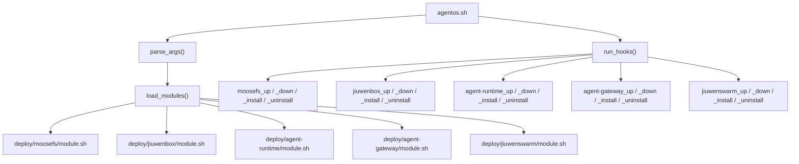
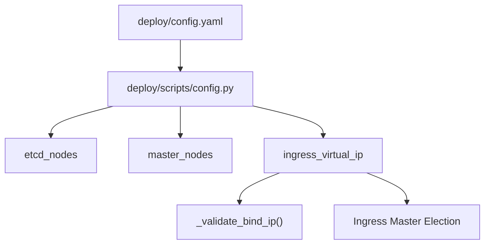

<!-- source: DeepWiki mcp.deepwiki.com · repo openJiuwen-ai/agentos-enterprise · page 3 Deployment Orchestration · fetched 2026-11-02 -->

# Deployment Orchestration

Relevant source files

The following files were used as context for generating this wiki page:

- [deploy/README.zh.md](deploy/README.zh.md)
- [deploy/agentos.sh](deploy/agentos.sh)

This page provides an overview of the deployment orchestration layer located in `deploy/`. The orchestrator is built around a pluggable architecture driven by `deploy/agentos.sh` [deploy/agentos.sh:6-15](), managing module lifecycles, configuration parsing via Python utilities, dependency provisioning, and multi-node coordination. 

For deep technical details on individual aspects, refer to the child pages:
- [agentos.sh CLI and Hook Dispatch](#3.1)
- [Cluster Configuration](#3.2)
- [Host Dependency Installation](#3.3)
- [Multi-Node Deployment](#3.4)
- [Writing a New Deploy Module](#3.5)

---

## agentos.sh CLI and Hook Dispatch

The core entry point for orchestrating the platform is `deploy/agentos.sh` [deploy/agentos.sh:1-27](). It implements a pluggable hook architecture where each component registers itself in the `MODULES` array [deploy/agentos.sh:36-36](). The script loads each module's `module.sh` script via `load_modules()` [deploy/agentos.sh:103-114]() and delegates commands (`up`, `down`, `install`, `uninstall`, `init`, `deinit`, `status`) to individual hook functions.

*Figure 1: Orchestration Flow and Hook Dispatch Architecture*

Sources: [deploy/agentos.sh:36-168](), [deploy/README.zh.md:51-78]()

For details on command line arguments, ordering semantics, pre-flight checks, and status reporting, see [agentos.sh CLI and Hook Dispatch](#3.1).

---

## Cluster Configuration

Cluster-wide topology is defined in `deploy/config.yaml` [deploy/README.zh.md:25-25]() and parsed through helper utilities in `deploy/scripts/config.py` [deploy/README.zh.md:47-48](). The configuration specifies `etcd_nodes`, `master_nodes`, and the `ingress_virtual_ip` [deploy/README.zh.md:108-119](). 

*Figure 2: Configuration Parsing and Ingress Master Resolution*

Sources: [deploy/agentos.sh:87-100](), [deploy/README.zh.md:101-147]()

For details on the `config.yaml` schema, python parser logic, bind IP validation, and ingress master election mechanics, see [Cluster Configuration](#3.2).

---

## Host Dependency Installation

Before executing module installation hooks, host environments must satisfy operating system, network, and package dependencies. The installation helper scripts inspect the target OS architecture (openEuler/Ubuntu), provision required RPMs/DEBs, set up MooseFS repositories, and configure runtime Python virtual environments.

Sources: [deploy/README.zh.md:83-91]()

For details on OS detection, package provisioning, and dependency scripts, see [Host Dependency Installation](#3.3).

---

## Multi-Node Deployment

Deploying across multiple nodes requires coordinating shared states, distributing SSH direct-connection keys [deploy/README.zh.md:148-160](), aligning etcd consensus topologies [deploy/README.zh.md:125-128](), and managing virtual IP (VIP) failover for ingress master nodes [deploy/README.zh.md:134-136]().

Sources: [deploy/README.zh.md:121-160]()

For step-by-step procedures, considerations for multi-node setups, and HA routing rules, see [Multi-Node Deployment](#3.4).

---

## Writing a New Deploy Module

Extending AgentOS with a new component follows a strict contract. A developer must create a new subdirectory under `deploy/` containing a `module.sh` file that implements the mandatory hook functions (`_install`, `_up`, `_down`, `_uninstall`, `_status`) and register the module name in the `MODULES` array [deploy/agentos.sh:12-15]().

Sources: [deploy/agentos.sh:5-15](), [deploy/README.zh.md:5-17]()

For instructions on creating and testing custom deploy modules, see [Writing a New Deploy Module](#3.5).

---

