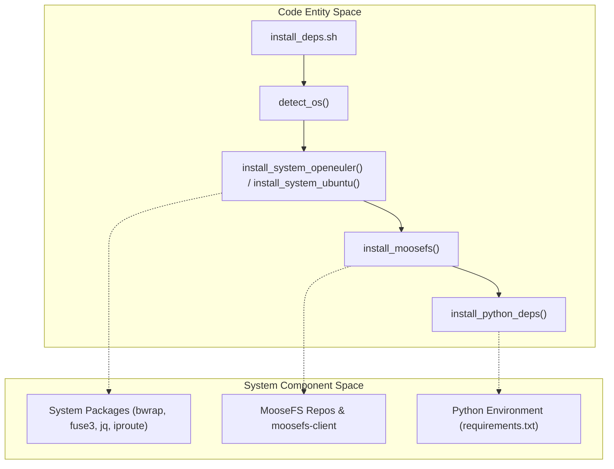

<!-- source: DeepWiki mcp.deepwiki.com · repo openJiuwen-ai/agentos-enterprise · page 3.3 Host Dependency Installation · fetched 2026-11-02 -->

# Host Dependency Installation

<details>
<summary>Relevant source files</summary>

The following files were used as context for generating this wiki page:

- [deploy/install_deps.sh](deploy/install_deps.sh)
- [deploy/jiuwenbox/module.sh](deploy/jiuwenbox/module.sh)
- [deploy/jiuwenswarm/module.sh](deploy/jiuwenswarm/module.sh)
- [deploy/requirements.txt](deploy/requirements.txt)

</details>


This page covers the technical implementation of host dependency provisioning in AgentOS Enterprise, centered on `deploy/install_deps.sh`. The script ensures that target nodes running openEuler or Ubuntu are prepared with the required system utilities, kernel capabilities, MooseFS distributed storage components, and Python runtime packages before any AgentOS modules are deployed.

---

## 1. Operating System and Architecture Detection

Before provisioning packages, `install_deps.sh` executes pre-flight checks to determine the host operating system family, version code name, package manager (`dnf`, `yum`, or `apt-get`), and CPU architecture (`x86_64` or `aarch64`).

The detection process is managed by `detect_os()`, `parse_os_info()`, and `detect_arch()` functions. `/etc/os-release` is parsed as the primary source of truth, falling back to `/etc/openEuler-release` or `/etc/lsb-release` if necessary.

```mermaid
graph TD
    A["Start detect_os"] --> B{[/etc/os-release exists?]}
    B -- Yes --> C["Extract ID, VERSION_ID, VERSION_CODENAME"]
    B -- No --> D{[/etc/openEuler-release exists?]}
    D -- Yes --> E["Set os_type=openEuler, parse version"]
    D -- No --> F{[/etc/lsb-release exists?]}
    F -- Yes --> G["Set os_type=ubuntu, parse release/codename"]
    
    C --> H["Determine Package Manager (dnf/yum/apt)"]
    E --> H
    G --> H
    
    H --> I{Validate OS Support}
    I --> J["detect_arch (uname -m)"]
    J --> K["Return os_type|os_version|os_codename|pkg_mgr"]
```
*Diagram 1: OS and architecture detection flow mapping natural language environment attributes to shell functions.*

Sources: `[deploy/install_deps.sh:45-142]()`

---

## 2. System Package Provisioning

Once the environment is categorized, the script provisions baseline system utilities required by runtime components like `jiuwenbox` (sandbox isolation) and `agent-runtime` (JSON parsing and networking).

### openEuler Provisioning (`install_system_openeuler`)
On openEuler (specifically tested against versions 22.03 and 24.03), `install_system_openeuler()` installs:
* `iptables` and `curl`
* `fuse3` (for MooseFS and runtime mounts)
* `iproute` (providing the `ip` command)
* `bubblewrap` (or fallback `bwrap` for containerless sandboxing in `jiuwenbox`)
* `jq` (for parsing `session.json` and agent manifests)
* Python 3.11 (`python3.11`) and `ensurepip`

Sources: `[deploy/install_deps.sh:147-197]()`

### Ubuntu Provisioning (`install_system_ubuntu`)
On Ubuntu (versions 22.04 and 24.04), corresponding DEB packages are provisioned using `apt-get`, utilizing non-interactive frontend flags to suppress prompt dialogs during `tzdata` or system library updates.

Sources: `[deploy/install_deps.sh:200-260]()`

---

## 3. MooseFS Repository and Client Integration

AgentOS leverages MooseFS for distributed storage across cluster nodes. The dependency script configures the official MooseFS repository (pinning `MOOSEFS_VERSION="4.59.2"`) and installs client-side or server-side packages depending on the node's assigned role in `config.yaml`.


*Diagram 2: Bridging deployment orchestration steps in `install_deps.sh` to target system components.*

Sources: `[deploy/install_deps.sh:27-34](), [deploy/install_deps.sh:261-350]()`

---

## 4. Python Virtual Environment and Requirements Installation

AgentOS applications and services rely on a locked set of Python packages defined in `deploy/requirements.txt`. The `install_python_deps()` function ensures that `python${YR_PYTHON_VERSION}` (defaulting to version `3.11`) is active and populates dependencies via `pip`.

The `requirements.txt` file enumerates over 200 pinned packages including framework SDKs, agent toolkits, and telemetry exporters:

```text
a2a-sdk==1.1.2
fastapi==0.139.2
openjiuwen==0.1.16.post11
pydantic==2.13.4
uvicorn==0.51.0
...
```

Sources: `[deploy/requirements.txt:1-238](), [deploy/install_deps.sh:351-420]()`

---

## 5. Execution Flags and CLI Options

`install_deps.sh` supports selective execution flags to bypass specific installation phases during iterative testing or minimal deployments:

| Flag | Effect | Code Reference |
| :--- | :--- | :--- |
| `--skip-system` | Bypasses operating system package installation | `[deploy/install_deps.sh:32]()` |
| `--skip-moosefs` | Skips MooseFS repository configuration and client installation | `[deploy/install_deps.sh:33]()` |
| `--skip-python` | Skips updating or installing packages from `requirements.txt` | `[deploy/install_deps.sh:34]()` |

Sources: `[deploy/install_deps.sh:16-18](), [deploy/install_deps.sh:31-35]()`

---

