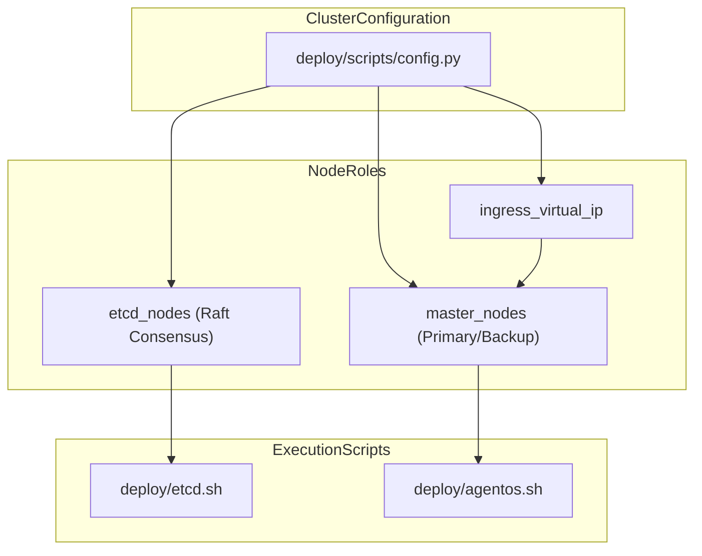
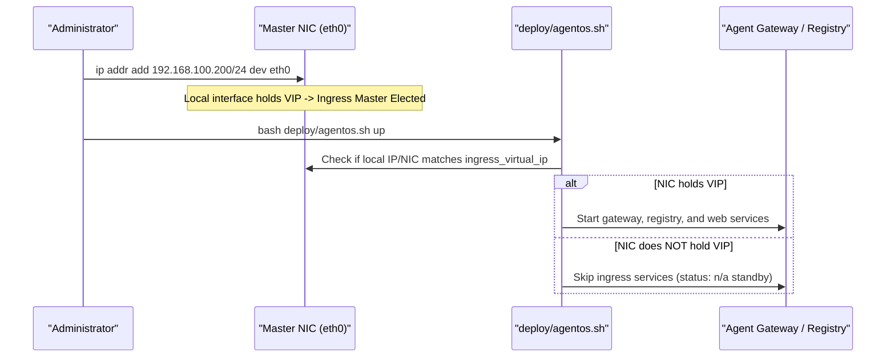
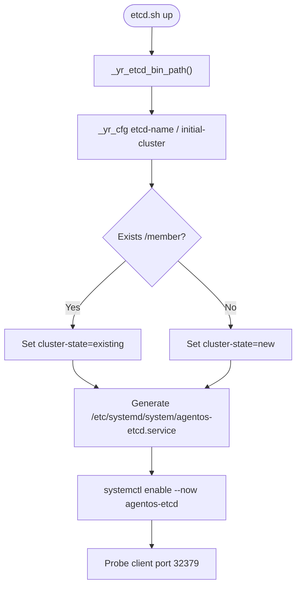

<!-- source: DeepWiki mcp.deepwiki.com · repo openJiuwen-ai/agentos-enterprise · page 3.4 Multi-Node Deployment · fetched 2026-11-02 -->

# Multi-Node Deployment

<details>
<summary>Relevant source files</summary>

The following files were used as context for generating this wiki page:

- [deploy/etcd.sh](deploy/etcd.sh)
- [docs/en/how-to/deploy-multi-node.md](docs/en/how-to/deploy-multi-node.md)
- [docs/zh/how-to/deploy-multi-node.md](docs/zh/how-to/deploy-multi-node.md)

</details>


This page details the procedures, architecture considerations, and lifecycle management for deploying AgentOS Enterprise across multiple nodes in a High Availability (HA) configuration. It covers topology planning, etcd consensus distribution, ingress Virtual IP (VIP) master election, and cross-node orchestration sequences.

## 1. Topology Planning and Cluster Roles

A multi-node AgentOS cluster distributes its workload across three specialized node classifications defined in the cluster configuration schema:

*   **etcd Nodes**: Must be configured with an odd number of nodes (recommended: 3) to ensure Raft consensus stability [docs/en/how-to/deploy-multi-node.md:7-9](). These nodes host the distributed coordination store managed by `deploy/etcd.sh` [deploy/etcd.sh:9-10]().
*   **Master Nodes**: Configured as primary/backup pairs (recommended: 2 nodes) [docs/en/how-to/deploy-multi-node.md:10](). Only the specific master node currently holding the `ingress_virtual_ip` initializes and runs the API gateway, registry, and web console.
*   **Worker/Agent Nodes**: All other components (such as `jiuwenbox` sandboxes and agent runtimes) run symmetrically across every node without primary/backup distinction [docs/en/how-to/deploy-multi-node.md:13]().


*Sources: [deploy/etcd.sh:9-16](), [docs/en/how-to/deploy-multi-node.md:7-13]()*

---

## 2. Environment Preparation and Key Distribution

Before executing deployment scripts, all nodes require identical foundational environments and a shared SSH key pair for agent-to-agent communication.

1.  **System Dependencies**: Execute `deploy/install_deps.sh` on every node to provision OS packages and Python runtime environments [docs/en/how-to/deploy-multi-node.md:19-21]().
2.  **SSH Key Generation**: Generate a unified Ed25519 key pair on a primary machine and distribute it to `/root/.ssh/` on all target cluster nodes [docs/en/how-to/deploy-multi-node.md:23-37]():
    ```bash
    ssh-keygen -t ed25519 -N '' -f /root/.ssh/agent_key
    cp /root/.ssh/agent_key.pub /root/.ssh/agent_pub/authorized_keys
    ```

*Sources: [docs/en/how-to/deploy-multi-node.md:15-38]()*

---

## 3. Ingress VIP and Master Election Data Flow

High availability for external entrypoints relies on an `ingress_virtual_ip` bound directly to the active master node's network interface [docs/en/how-to/deploy-multi-node.md:10-11]().


*Sources: [docs/en/how-to/deploy-multi-node.md:40-49]()*

---

## 4. etcd Topology and Raft Consensus Implementation

The etcd coordination subsystem is managed independently via `deploy/etcd.sh` [deploy/etcd.sh:6-10](). It parses cluster configurations and generates systemd units dynamically on designated etcd nodes.

### Unit Generation and State Management
The function `_yr_generate_etcd_unit()` detects whether the local data directory [deploy/etcd.sh:26]() contains existing WAL logs (`/member`) [deploy/etcd.sh:134](). It then sets the `--initial-cluster-state` flag accordingly [deploy/etcd.sh:124-140]():
*   If `${AGENT_RUNTIME_ETCD_DATA_DIR}/member` exists, `cluster_state="existing"` is used to preserve data across restarts [deploy/etcd.sh:134-136]().
*   If the directory is empty, `cluster_state="new"` triggers a clean bootstrap [deploy/etcd.sh:137-140]().

Key network parameters injected into `/etc/systemd/system/agentos-etcd.service` [deploy/etcd.sh:24-25]() include:
*   Client URL Listener: `http://0.0.0.0:32379` (Advertised via node-specific IP) [deploy/etcd.sh:163-164]()
*   Peer URL Listener: `http://0.0.0.0:32380` [deploy/etcd.sh:165-166]()


*Sources: [deploy/etcd.sh:59-178]()*, [docs/en/how-to/deploy-multi-node.md:9]*

---

## 5. Step-by-Step Execution Lifecycle

Multi-node deployment requires strict sequencing across nodes to satisfy etcd consensus and ingress master dependencies before orchestrating service startup [docs/en/how-to/deploy-multi-node.md:66-80]().

1.  **Installation**: Run `bash deploy/agentos.sh install` on all cluster nodes [docs/en/how-to/deploy-multi-node.md:71]().
2.  **Coordination Initialization**: Execute `bash deploy/agentos.sh init` on all etcd nodes. Do not proceed until the entire etcd ring reaches consensus [docs/en/how-to/deploy-multi-node.md:73-74]().
3.  **Service Startup (`up`)**:
    *   Start the primary master node holding the VIP first: `bash deploy/agentos.sh up --ip <master-ip>` [docs/en/how-to/deploy-multi-node.md:76-77]().
    *   Start remaining agent and backup nodes sequentially [docs/en/how-to/deploy-multi-node.md:76-77]().
4.  **Teardown**: Perform the reverse order (`down` on agent nodes, then master nodes; `deinit` on etcd nodes; `uninstall` cluster-wide) [docs/en/how-to/deploy-multi-node.md:86-93]().

*Sources: [docs/en/how-to/deploy-multi-node.md:66-93]()*

---

